# 第1题 莫尔纹、弹性测量与几何等值线

<!-- question-start -->

两组间距或方向相近的条纹叠加，会出现尺度远大于细条纹的莫尔纹。以下把两组细纹相同相位的重合位置称为亮纹，忽略有限线宽对亮度的影响。

（1）物体初始高度为 $D$，表面绘有初始间距 $h$ 的水平条纹，未受力的参考玻璃具有相同条纹。垂直底面增加压强 $\Delta p$，物体均匀压缩。若相邻亮纹间距为 $\lambda$，求杨氏模量 $Y$，其中 $\Delta p=Y\Delta D/D$。

（2）物体高度为 $H$，绘有间距 $h$ 的竖直条纹，参考玻璃不变。施加平行底面的剪应力 $\Delta p$，产生小剪切角 $\theta$。若沿高度方向的亮纹间距为 $\lambda$，求剪切模量 $\tau$，其中 $\Delta p=\tau\theta$。

（3）两组同心圆的半径为 $nr$，圆心位于 $(-\Delta/2,0)$ 与 $(\Delta/2,0)$。写出亮纹方程，说明它与同频、同相双点源干涉条纹的对应关系。

（4）从这两个圆心分别均匀发出 $N$ 条射线，两组角度零点一致。写出亮纹方程，说明它与平行于纸面的截面中等量异号无限长线电荷的电场线之间的对应关系。

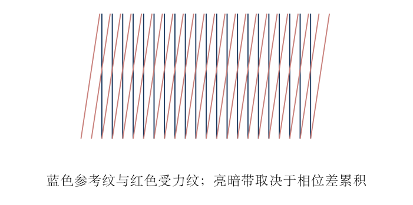

<!-- question-end -->

## 一、题型定位

本题把“纹理重合”转成空间相位差，再把相位差转成应变或几何等值线。前两问属于小应变测量，后两问属于等值线的几何构造。莫尔纹没有要求两束光相干；光学干涉的相同曲线来自同一数学条件，机制仍须分别说明。压强符号在两问中分别表示正向压应力和切向剪应力，不能把它们视为同一种力。

解题顺序是先写细纹相位，再规定亮纹的相位差为 $2\pi k$。这样可以同时处理条纹压缩、斜置、圆形波面和角度射线，避免仅凭图片猜测曲线。

## 二、知识点

一维细纹相位可取 $\phi=2\pi x/h$；两纹重合条件为 $\phi_1-\phi_2=2\pi k$，$k$ 为整数。对应的拍频波数为两空间波数之差，故同向直纹的莫尔周期是

$$\lambda=\frac{1}{|1/h_1-1/h_2|}.$$

杨氏模量的线性定义为正应力除以纵向相对应变，剪切模量的线性定义为剪应力除以小剪切角。它们的量纲均为帕斯卡。初始纹距、受力后纹距和放大的亮纹周期是三个不同量。

双曲线是到两个焦点的距离差的等值线。圆弧可以是看向两固定点的夹角等值线。二维线电荷场的势含对数距离，而其流函数含方位角；电场线与等势线的判据不同。

## 三、物理图像

均匀压缩使物体上的每一个水平纹间距都缩短，但参考纹距保持 $h$。细纹只有很小的错位，错位积累到一个周期时才出现下一条亮纹，所以亮纹尺度被放大。压缩量不是亮纹宽度，而是由许多微小纹距差累积得到。

剪切时各水平层发生不同的横向位移，竖直细纹倾斜。随着高度增加，受力纹和参考纹的水平相位差不断积累，亮纹成为近水平的带。顶面位移 $d$ 与高度 $H$ 的比值才是剪切应变。

圆纹叠加比较的是两个距离；射线叠加比较的是两个方位角。这一差别决定前者出现双曲线，后者出现经过两圆心的圆弧。

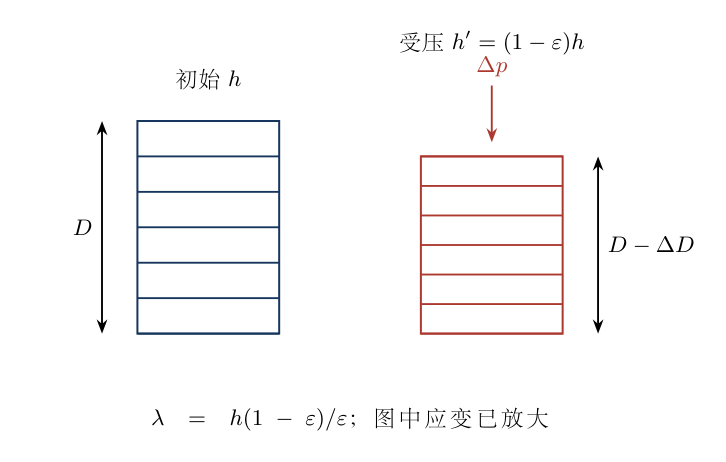

## 四、解题入口

压缩问先设 $\varepsilon=\Delta D/D>0$，则受力后的纹距 $h'=(1-\varepsilon)h$。在同一空间坐标中比较两纹相位，不能把材料初始坐标与受力后的坐标混在一个式子里。

剪切问以底面为零位移，令 $u_x(z)=\gamma z$，其中 $\gamma=d/H=\tan\theta$。受力细纹的标签由 $x-\gamma z$ 决定，参考细纹由 $x$ 决定。两者相位差只随 $z$ 变化。

后两问统一定义 $d_0=\Delta/2$，$r_-=\sqrt{(x+d_0)^2+y^2}$，$r_+=\sqrt{(x-d_0)^2+y^2}$。注意本题的细圆纹距仍记 $r$，不能与点到圆心的距离 $r_\pm$ 混同。

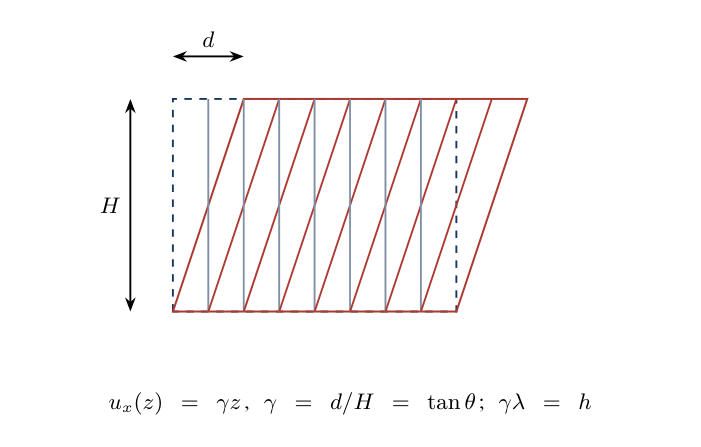

## 五、解析

（1）杨氏模量：先保留几何关系，再取小应变极限。

两组水平纹的波数分别为 $2\pi/h'$ 和 $2\pi/h$，故

$$\frac1\lambda=\frac1{(1-\varepsilon)h}-\frac1h
=\frac{\varepsilon}{(1-\varepsilon)h}.$$

于是

$$\varepsilon=\frac{h}{\lambda+h},\qquad
\Delta D=\frac{Dh}{\lambda+h},\qquad
\boxed{Y=\Delta p\left(1+\frac\lambda h\right)}.$$

这里的“精确”只指均匀仿射压缩的几何关系；材料的 $\Delta p=Y\varepsilon$ 本身仍是线性弹性模型。若 $h/\lambda\ll1$，竞赛常用的一阶式为

$$\boxed{Y\simeq\Delta p\frac\lambda h}.$$

原手写解省略了括号中的 $1$，对应小应变近似，不能与保留有限纹距差的结果混称。初始高度 $D$ 在相对应变中消去，因此最终模量不依赖取样高度；它仍参与实际压缩位移的计算。

（2）剪切模量：受力细纹的相位为 $2\pi(x-\gamma z)/h$，参考相位为 $2\pi x/h$，故相位差为 $-2\pi\gamma z/h$。亮纹沿高度的周期满足

$$\gamma\lambda=h,\qquad d=H\gamma=\frac{Hh}{\lambda}.$$

在小剪切角条件下 $\gamma=\tan\theta\simeq\theta$，所以

$$\boxed{\tau\simeq\Delta p\frac\lambda h}.$$

若仅对角度保留几何反函数，形式上可写 $\theta=\arctan(h/\lambda)$，再由题设角度定义得到 $\tau=\Delta p/\arctan(h/\lambda)$。这不意味着有限剪切仍服从线性本构；超出小角范围还须指定材料模型。这里的 $h$ 是沿底面方向的初始纹距，不能擅自替换成倾斜条纹的法向距离。

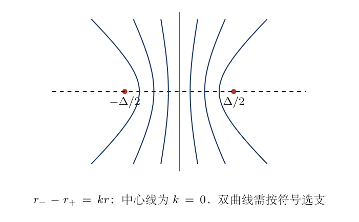

（3）同心圆亮纹的隐式条件最稳妥。

两组圆纹的空间相位分别为 $2\pi r_-/r$、$2\pi r_+/r$，亮纹满足

$$\boxed{r_--r_+=kr},\qquad k\in\mathbb Z.$$

三角不等式给 $|kr|\le\Delta$。当 $0<|kr|<\Delta$，设 $a_k=|kr|/2$、$c_0=\Delta/2$，则对应的双曲线为

$$\boxed{\frac{x^2}{a_k^2}-\frac{y^2}{c_0^2-a_k^2}=1}.$$

平方消元后出现左右两支；符号未消去的条件 $r_--r_+=kr$ 才能选择正确的一支。对 $k>0$ 取右支，对 $k<0$ 取左支。$k=0$ 时应单独得到 $x=0$，不能把 $a_k=0$ 直接塞进分式。$|kr|=\Delta$ 对应 $x$ 轴上的外侧射线，是退化极限。

同频同相点源在同一时刻的相位差为 $2\pi(r_--r_+)/\lambda_{\rm wave}$。令波长 $\lambda_{\rm wave}=r$，相长干涉条件与上式相同。二维图表示双曲线；三维空间绕焦点连线旋转后得到双曲面。若两源初相差不为零，级次会整体偏移，但等值线的家族不变。真实干涉强度还取决于振幅、传播衰减和相干性，不能从几何相似推出机制相同。

（4）射线亮纹须保留方位角的分支。

取 $\theta_-=\operatorname{atan2}(y,x+d_0)$、$\theta_+=\operatorname{atan2}(y,x-d_0)$。两组射线角周期为 $2\pi/N$，亮纹可写

$$\boxed{\theta_+-\theta_-=\delta_k,\qquad
\delta_k=\frac{2\pi k}{N}\pmod{2\pi}}.$$

由两向量的点积与叉积，有

$$\cot(\theta_+-\theta_-)
=\frac{x^2+y^2-d_0^2}{\Delta y}.$$

对 $\sin\delta_k\ne0$，亮纹所在的圆为

$$\boxed{x^2+(y-d_0\cot\delta_k)^2
=d_0^2\csc^2\delta_k}.$$

圆心位于垂直平分线，且每个圆都通过两个射线中心。一个完整圆包含不同的角分支，实际亮纹须按原方位角条件选取对应圆弧；不能把平方得到的整圆全部算作同一级亮纹。$\delta=0$ 与 $\pi$ 的情形退化为焦点连线的相应线段或外侧部分，需由方位角而非除以 $\sin\delta$ 处理。

对于置于两中心的等量异号无限长线电荷，纸面截面的电场可写

$$\mathbf E=K\left(\frac{\mathbf r_-}{r_-^2}
-\frac{\mathbf r_+}{r_+^2}\right),\qquad
K=\frac{\lambda_q}{2\pi\varepsilon_0}.$$

角差的梯度与上述电场正交，直接点乘得到

$$\mathbf E\cdot\nabla(\theta_+-\theta_-)=0.$$

因此电场沿角差等值线行进，正是这些通过两电荷的圆弧。对应势函数为

$$\Phi=K\ln(r_+/r_-).$$

其等值线由距离比决定，是另一族阿波罗尼斯圆。亮纹对应电场线，不是这族等势线；等量异号和无限长两个条件都参与了这个结论。

最后作三项核查。$\lambda/h$ 越大表示纹距差越小，在同样应力下应变越小，故测得模量越大。两类模量的结果均为压强乘无量纲比值。距离差级次只能取有限范围，角差级次则按角周期编号，两种编号不可混用。

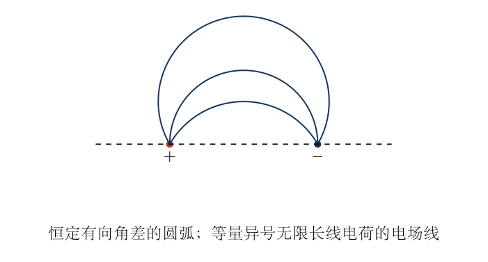

（5）参考误差如何进入测量。

若参考玻璃纹距不是初始 $h$，而是 $h_{\rm ref}=h(1+\delta)$，即使物体没有受力也会产生莫尔纹。受力后的测量波数差为

$$b_{\rm meas}=\frac1{h(1-\varepsilon)}-\frac1{h(1+\delta)}.$$

小量展开给 $hb_{\rm meas}\simeq\varepsilon+\delta$。因此在 $\varepsilon$ 很小时，固定的参考偏差可以显著改变所测应变；亮纹的大尺度不能自行区分初始偏差与受力变化。先测零载荷相位梯度，再对加载后的梯度作差，才有

$$b_{\rm loaded}-b_{\rm zero}
=\frac1{h(1-\varepsilon)}-\frac1h.$$

需要保留有符号梯度或用条纹移动方向确认压缩方向，只比较两个亮纹周期的绝对值可能混淆正负。剪切问也有类似的初始倾角偏差，应测量角差的变化而非把初始纹理斜率全部认作剪切应变。

对于模量的一阶误差传播 $Y\simeq\Delta p\lambda/h$，独立小误差满足

$$\frac{\delta Y}{Y}\simeq\frac{\delta(\Delta p)}{\Delta p}
+\frac{\delta\lambda}{\lambda}-\frac{\delta h}{h}.$$

这里是带符号的线性微分式；若各误差为独立随机标准不确定度，应在方差层面相加，不能把同一公式直接叫作标准差。均匀变形也是测量模型的重要条件：若应变随高度变化，亮纹的局部间距反映局部相位梯度，单个全局 $\lambda$ 不再足以代表整个物体的单一模量。

几何类比的另一项限制是圆心附近的相位不可定义。射线两中心属于圆弧的几何端点，但不是普通的有限场值点；电场线源和汇处的奇异性不能通过莫尔纹图的有限线宽消除。远处两圆纹的距离差近似为 $\Delta\cos\vartheta$，级次随方向变化，这与双点源远场角干涉条件一致，而不是平面中任意位置都具有同样亮纹间距。

（6）从亮纹位置到实验斜率，避免只用一次读数。

设压缩时记录第 $k$ 条亮纹的高度 $z_k$。在参考零相位一致时，$z_k=k\lambda$；若有任意固定初相，位置可写成 $z_k=z_c+k\lambda$。于是用相隔多级的两个位置求周期：

$$\lambda=\frac{z_{k+q}-z_k}{q},\qquad q\ge1.$$

初相引起的截距 $z_c$ 自动消去。若能确定两端的位置，跨越更多级次可减少定位误差对周期的相对影响，但不消除参考纹距本身的系统偏差。对不均匀变形则应逐段求周期，不能用很长区间的平均值掩盖局部应变变化。

压缩的几何保留式还能改写成加载关系

$$\Delta p=Y\frac{h}{\lambda+h},\qquad
\frac1\lambda=\frac{\Delta p}{h(Y-\Delta p)}.$$

这说明 $1/\lambda$ 对压强并非严格直线。只有 $\Delta p/Y\ll1$ 时，才有 $1/\lambda\simeq\Delta p/(hY)$。多次加载时先把每个测得周期转换成 $\varepsilon=h/(\lambda+h)$，再拟合应力对应变的斜率，能把几何非线性与材料本构的非线性分开。卸载后若亮纹不恢复，可能是残余变形或参考位置漂移，单凭一个残留周期不能判断原因。

剪切问也可直接从亮纹编号获得位移梯度。在有符号相位约定下，跨过 $q$ 个周期有

$$u_x(z_{k+q})-u_x(z_k)=\pm qh.$$

正负号由加载方向和条纹移动方向确定。若变形均匀，除以高度差得到恒定 $\gamma$；若变形非均匀，则这是区间平均剪切应变。顶面位移需要再对局部梯度沿高度积分，不能只把某一条纹的局部斜率乘任意高度。

最后说明曲线的绘图检验。取双曲线右顶点 $(a_k,0)$，两焦距之差为 $2a_k=|kr|$，可检查分支符号。取角差圆与 $y$ 轴交点，代回两个 $\operatorname{atan2}$ 求有向角，可检查圆弧归属。这两种检验都使用原始相位条件，不依赖平方后的方程，因此能排除代数消元引入的另一支。

## 六、关键洞察

莫尔纹相当于空间尺度的差频放大器，所测的是相位差的梯度。尺度放大不增加本来不存在的物理信息，参考纹距误差会被同样放大。

压缩的几何精确式与剪切的小角式看起来相近，但不能因此把各自的近似误差一并忽略。双曲线与圆弧的区别可追溯到“距离差”与“角度差”；先写这两个原始条件，退化情形和分支选择就能自然处理。

## 七、易错点

把 $Y=\Delta p\lambda/h$ 标为任意应变下的精确式；把 $Hh/\lambda$ 当作剪切角而漏除高度；混淆条纹法向间距与坐标方向间距；平方后不选双曲线支；对 $k=0$ 直接使用含零分母的式子；把角差圆弧当作电偶极子的等势线；将两组透明纹理的重合误称为光场相干干涉。

## 八、课堂讲解建议

先让学生对两张直线网格写出相位差，板书保留 $h'$ 与 $h$ 两个符号。课堂讨论压缩式中常被省去的 $1$，用误差比例说明何时可以省略。教师先用距离差示意双曲线，再以有向夹角示意圆弧，最后比较电场线与等势线的两个不同条件。四个变式分别检查数值、相位、误差和线电荷流函数。

## 九、变式训练

<!-- KEEP_TOGETHER_START -->

变式一：取 $h=0.100\,\mathrm{mm}$、$\lambda=20.0\,\mathrm{mm}$、$\Delta p=1.00\,\mathrm{MPa}$、$D=100\,\mathrm{mm}$，求模量与压缩量，并比较一阶式。

解：$\varepsilon=h/(\lambda+h)=1/201$，$\Delta D=100/201\,\mathrm{mm}\simeq0.49751\,\mathrm{mm}$。几何保留式 $Y=201\,\mathrm{MPa}$，一阶式为 $200\,\mathrm{MPa}$，相对低估 $1/201\simeq0.4975\%$。将 $h'=200h/201$ 代回拍频式，恢复 $\lambda=20.0\,\mathrm{mm}$，同时检验取样高度只影响位移。

单位核对时，应先把两条纹长度写在相同单位下。由周期差直接反求受力后的细纹间距，也可得到

$$h'=\frac{h\lambda}{h+\lambda}=0.0995025\,\mathrm{mm}.$$

它比初始纹距只小约 $0.0004975\,\mathrm{mm}$，而亮纹周期达到20毫米，显示差频放大的尺度。把应力与应变相除时，应变是无量纲数，故模量的单位保持为MPa。若把 $\Delta D$ 的毫米数直接作除数，将漏掉初始高度并得到错误量纲。

<!-- KEEP_TOGETHER_END -->

<!-- KEEP_TOGETHER_START -->

变式二：两组直条纹的初始相位相差 $\pi$，纹距仍为 $h$、$h'$。亮纹周期是否改变？

解：亮纹条件改为 $2\pi x(1/h'-1/h)+\pi=2\pi k$，位置为 $x=(k-1/2)\lambda$。相邻级次差仍为 $\lambda$，只平移半个莫尔周期。把两相邻位置相减即可验证，不应从某一亮纹相对底面的绝对位置推测纹距差。

固定相位平移也可一般化为任意 $\phi_0$：

$$x_k=\left(k-\frac{\phi_0}{2\pi}\right)\lambda,
\qquad x_{k+1}-x_k=\lambda.$$

因此空间相位的截距影响亮纹位置，空间梯度影响亮纹间距；两个量承担不同信息。若参考相位随高度变化，新增的是梯度而不再只是截距，才会改变测得周期。本变式的初相为常数，所以不能把半周期的整体位移理解成应变又增加一半。

<!-- KEEP_TOGETHER_END -->

<!-- KEEP_TOGETHER_START -->

变式三：若 $\lambda=100h$，忽略压缩公式中的 $1$，杨氏模量的相对误差是多少？

解：保留式为 $101\Delta p$，一阶式为 $100\Delta p$，误差为 $(Y-Y_{\rm app})/Y=1/101\simeq0.9901\%$。应变同为 $1/101$，故该近似的相对误差恰是均匀压缩应变。这个关系由分式精确得到，不应把分母换成 $100$ 后仍标为精确百分比。

若希望这项近似误差不超过给定 $\epsilon_Y$，应满足

$$\frac{h}{\lambda+h}\le\epsilon_Y
\quad\Longleftrightarrow\quad
\frac\lambda h\ge\frac1{\epsilon_Y}-1.$$

例如误差不超过1%需 $\lambda/h\ge99$，本例100恰满足。误差为负偏差，即一阶式低估保留式，而不是对称的随机不确定度；提高条纹定位精度不能修正这个被省略的确定项。该检验仍不保证真实材料在相应应变下严格线性。

<!-- KEEP_TOGETHER_END -->

<!-- KEEP_TOGETHER_START -->

变式四：等量异号线电荷的两焦点间距为 $2d_0$。取 $\theta_+-\theta_- =\pi/2$，写出电场线，并判断圆心处是否位于线上。

解：由 $\cot(\pi/2)=0$ 得 $x^2+y^2=d_0^2$，所需分支为上半圆；其圆心 $(0,0)$ 不在圆上。上半圆中点 $(0,d_0)$ 的有向夹角为 $\pi/2$，场沿水平方向，恰与圆弧切向一致。下半圆属于另一角分支，不能与上半圆作为同一个有向级次。

在上半圆中点，取 $\mathbf r_-=(d_0,d_0)$、$\mathbf r_+=(-d_0,d_0)$，场公式给

$$\mathbf E(0,d_0)=\frac{K}{d_0}\hat{\mathbf x}.$$

圆弧该点的切线水平，验证场线判据。与此同时两焦距相等，势为零；零势等值线是整条垂直平分线 $x=0$，与所求圆弧只是相交，不是同一曲线。场线与等势线在这个普通点互相正交，能进一步检查“角差”和“距离比”没有被互换。

<!-- KEEP_TOGETHER_END -->

<!-- question-complete -->

\newpage

# 第2题 球形地球上的最大落点距离

<!-- question-start -->

在地面一次点火，物体迅速取得速度 $v_0=3.20\,\mathrm{km/s}$，随后仅受球对称地球引力。忽略地球自转、大气和地形，取 $R=6.37\times10^6\,\mathrm m$、地表 $g=9.8\,\mathrm{m/s^2}$。发射地点为北纬 $40^\circ$、东经 $127^\circ$。

要求从地心看，首次重新落到球形地面时与发射点的角距离最大。求最佳发射仰角（相对当地水平面）及飞行时间。方位角可任意选择；地理经纬度在本题球对称模型中只定位发射点。

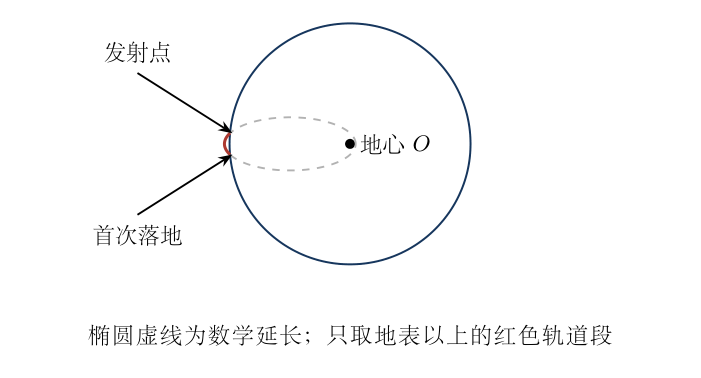

<!-- question-end -->

## 一、题型定位

这是固定能量、可变角动量的开普勒轨道优化。物体速度低于第一宇宙速度，因此轨道是穿过地球的椭圆；真正的飞行只取地表以上的一段，首次回到 $r=R$ 即结束。不能把整圈周期当成飞行时间，也不能把地面平抛射程最大时的 $45^\circ$ 当作球面结果。

## 二、知识点

引力参数 $\mu_E=gR^2$，单位质量机械能 $\mathcal E=v_0^2/2-\mu_E/R$，比角动量 $j=Rv_0\cos\alpha$。椭圆半长轴与半通径分别满足

$$a=-\frac{\mu_E}{2\mathcal E},\qquad p=\frac{j^2}{\mu_E},\qquad p=a(1-e^2).$$

椭圆轨道可写 $r=p/(1+e\cos f)$，$f$ 为真近点角。时间计算适合使用偏近点角 $E$：$r=a(1-e\cos E)$，平均近点角 $M=E-e\sin E$ 随时间匀速增加，$\dot M=\sqrt{\mu_E/a^3}$。两种角度是不同的轨道参数。

## 三、物理图像

从发射点沿当地水平和铅直向上分解速度。地心引力使轨道平面固定，发射点与落点关于椭圆远地点方向对称。发射仰角改变角动量，从而改变椭圆偏心率和地面交点，却不改变由固定初速决定的半长轴。

地球中心位于椭圆一个焦点。卫星“在地心看”的落点距离指中心角，既不是椭圆焦点以外的圆心角，也不是椭圆弧长。求飞行时间时，面积定律要求使用焦点扫过的面积。

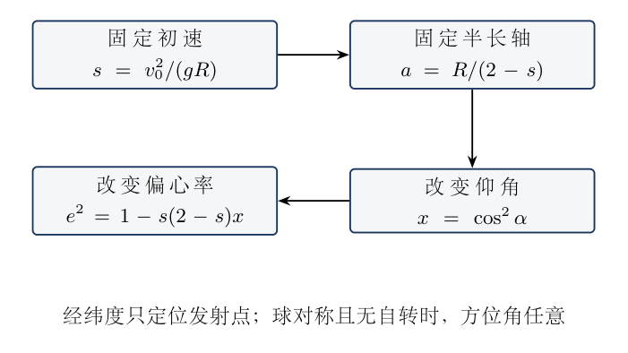

## 四、解题入口

定义无量纲速度参数 $s=v_0^2/(gR)$ 和 $x=\cos^2\alpha$。本题 $0<s<1$，发射仰角 $0<\alpha<\pi/2$。则

$$a=\frac{R}{2-s},\qquad p=Rsx,\qquad
 e^2=1-s(2-s)x.$$

先把地面交点条件 $r=R$ 代入轨道方程，表达中心角，再对 $x$ 优化。求得最佳角后，才代入时间公式；不宜同时优化复杂的时间表达式，因为目标函数是角距离。

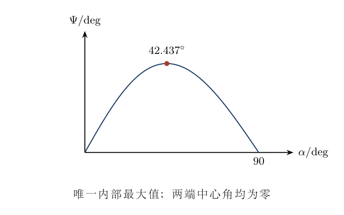

## 五、解析

（1）由地面交点得到角距离。

固定初速给负能量，所以所有仰角的椭圆都有相同半长轴 $a$。在发射点，$1+e\cos f_0=sx$，且向上发射对应 $\sin f_0>0$。第二次地表交点为 $2\pi-f_0$，地表以上扫过的真近点角为

$$\Psi=2\pi-2f_0.$$

对本题 $s<1$，$f_0>\pi/2$，因此 $0<\Psi<\pi$，这就是两地较短的中心角。由能量和角动量得

$$e\cos f_0=sx-1,\qquad
 e\sin f_0=s\sqrt{x(1-x)}.$$

后一个式子也可从径向速度 $v_r=(\mu_E/j)e\sin f$ 得到。于是

$$\boxed{\tan\frac\Psi2
=\frac{s\sqrt{x(1-x)}}{1-sx}}.$$

该式分子来自径向和切向速度的乘积，分母来自地表交点的几何约束。它使固定能量问题变成单变量的有限区间优化。

（2）求唯一内部最大值。

在 $0<x<1$ 上分母为正，$\arctan$ 单调。对上式的平方取对数求导，令导数为零：

$$\frac1x-\frac1{1-x}+\frac{2s}{1-sx}=0.$$

通分后仅剩 $1-(2-s)x=0$，故

$$\boxed{x_* =\frac1{2-s}},\qquad
\boxed{\alpha_* =\arctan\sqrt{1-s}}.$$

两端 $x=0,1$ 都给零角距离，在内部只有这一驻点，故为全局最大值。代回得

$$\tan\frac{\Psi_{\max}}2=\frac{s}{2\sqrt{1-s}},\qquad
\boxed{\Psi_{\max}=2\arcsin\frac{s}{2-s}}.$$

这里 $\alpha_*$ 是对水平的仰角。若将角定义成对铅直，则应取余角，数字和三角函数都会改变。对本题 $s\simeq0.16403$，得到

$$\boxed{\alpha_*\simeq42.437^\circ},\qquad
\Psi_{\max}\simeq0.17893\,\mathrm{rad}\simeq10.252^\circ.$$

地面大圆弧长约 $R\Psi_{\max}=1.140\times10^6\,\mathrm m$。这一弧长只是辅助检查，本题优化的是中心角。

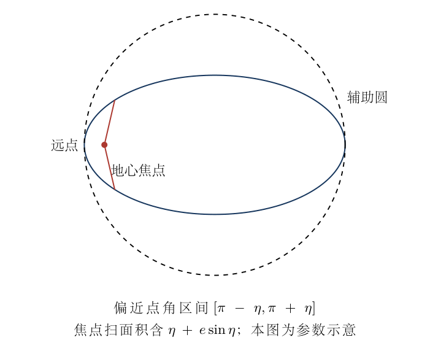

（3）飞行时间不能用中心角比例乘整圈周期。

最佳轨道有 $e_*^2=1-s$。定义 $\eta=\pi-E_0>0$，其中 $E_0$ 是向外运动的发射点偏近点角。地面条件给

$$\cos\eta=\frac{1-s}{e_*}=\sqrt{1-s},\qquad
 e_*\sin\eta=\sqrt{s(1-s)}.$$

落点偏近点角为 $\pi+\eta$。两点平均近点角差为

$$\Delta M=2\eta+2e_*\sin\eta.$$

因此

$$\boxed{t_f=2\sqrt{\frac{a^3}{\mu_E}}
\left[\arccos\sqrt{1-s}+\sqrt{s(1-s)}\right]}.$$

代入题给数据得到飞行时间约 $5.103\times10^2\,\mathrm s$，即约 $8.505$ 分钟。原手写解约481秒的时间值与精确面积积分不符，本稿以独立轨道积分核对约510.30秒。地表以上弧段经过远地点，偏近点角的区间对称；这使公式中的两项均为正。若仅用 $\Psi_{\max}/(2\pi)$ 乘椭圆周期，就误以为真近点角匀速增加，违反面积定律。

（4）用另一套面积参数核对时间。

在以椭圆中心为原点的参数式 $X=a\cos E$、$Y=b\sin E$ 中，地心焦点位于 $(ae,0)$。单位偏近点角的焦点扫面积是 $ab(1-e\cos E)/2$。对 $E\in[\pi-\eta,\pi+\eta]$ 积分，得

$$\Delta S=ab(\eta+e\sin\eta).$$

而面积速度为 $j/2$。利用 $j=\sqrt{\mu_Ea(1-e^2)}$ 与 $b=a\sqrt{1-e^2}$，恢复

$$t_f=\frac{2\Delta S}{j}
=2\sqrt{\frac{a^3}{\mu_E}}(\eta+e\sin\eta).$$

这个核对同时防止将椭圆中心三角形面积当作焦点扫面积。也能把它写成整圈周期 $T=2\pi\sqrt{a^3/\mu_E}$ 乘以真实扫面积比例，而不是几何中心角比例。

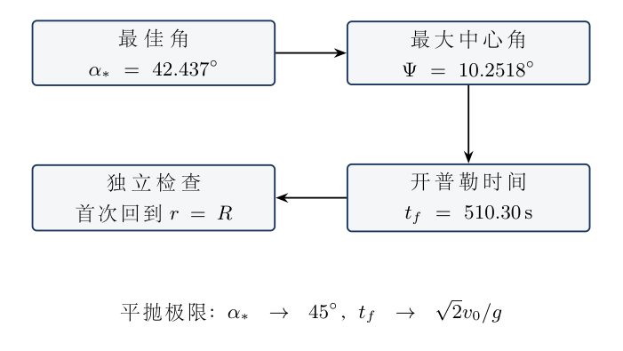

（5）极限与适用范围。

当 $s\ll1$，$\alpha_*\to45^\circ$，$\Psi_{\max}\simeq s$，因此弧长 $R\Psi_{\max}\simeq v_0^2/g$；这是地面平抛模型最大射程。时间式展开为 $t_f\simeq\sqrt2v_0/g$，也恢复 $45^\circ$ 抛体的结果。球面修正使最佳角略低于 $45^\circ$，并使角距离和时间稍增。

当 $s\to1^-$，最佳角趋向零，最大中心角趋向 $\pi$；这只是临界的极限，不能把恰好圆轨道称为再次落地的弹道。$s\ge1$ 时短弧角距离、轨道是否再次相交、目标取较短角还是扫过角都需要重新规定，本题的全局最优证明不能未经说明延伸过去。

经纬度未进入计算，因为忽略自转后地球具有旋转对称性。若纳入地球自转，发射方向与纬度会改变地心初始速度；那是新的初值问题。最后检查 $a\simeq3.469\times10^6\,\mathrm m<R$ 而远地点半径 $a(1+e)>R$，说明椭圆虽然大部分穿过地球，确有一段位于地面上方。

（6）非最佳仰角的时间可直接检验。

对任意向上仰角，仍有 $a=R/(2-s)$，但 $e=\sqrt{1-s(2-s)\cos^2\alpha}$。由初始半径及径向速度同时确定偏近点角，可设

$$\cos\eta_\alpha=\frac{1-s}{e},\qquad
 e\sin\eta_\alpha=\sqrt{s(2-s)}\sin\alpha.$$

因此一般飞行时间为

$$t(\alpha)=2\sqrt{\frac{a^3}{\mu_E}}
\left[\eta_\alpha+\sqrt{s(2-s)}\sin\alpha\right].$$

令 $\alpha=\alpha_*$，利用 $\sin^2\alpha_*=(1-s)/(2-s)$，即可恢复主结果。它还说明射程角最大和飞行时间最大不是同一目标：趋近竖直发射时，角距离回到零，飞行仍有非零上升、下降时间。

独立数值方法是在轨道平面直角坐标中积分

$$\ddot{\mathbf r}=-\frac{\mu_E}{|\mathbf r|^3}\mathbf r,$$

从 $\mathbf r(0)=(R,0)$、$\dot{\mathbf r}(0)=(v_0\sin\alpha,v_0\cos\alpha)$ 出发，监测径向向内穿过 $|\mathbf r|=R$ 的第一次事件。初始时刻本来就在地面，事件程序必须排除初始零点，不能把 $t=0$ 当作飞行终止。

这个方法直接用引力方程演化，不使用偏近点角时间公式。在最佳角处，它给落点中心角 $10.2518439^\circ$ 和飞行时间 $510.303902\,\mathrm s$。同时核验机械能和比角动量在全过程中恒定，能区别时间积分错误与轨道初值错误。

精确数值的意义仅限于忽略大气、自转等题设模型。经纬度、发射方位及地球形状一旦进入真实模型，落点与时间会改变；本题的数值保留适当位数，主要用于核对推导，不以更多小数冒充更完整的现实预测。

（7）最高点、扫过面积与两种角度的手算检查。

最佳仰角处 $e_*=\sqrt{1-s}$，远地点半径与最大离地高度分别为

$$r_a=\frac{R(1+\sqrt{1-s})}{2-s},\qquad H_a=r_a-R.$$

本题代入给 $r_a\simeq6.64183\times10^6\,\mathrm m$、$H_a\simeq2.71826\times10^5\,\mathrm m$。最高点不在椭圆几何中心上方，而在远地点；它位于两地表交点所夹的短弧中间。这个高度远小于地球半径，却已足以使匀强重力计算产生可见偏差。

时间公式可以用椭圆参数面积再推一次。设椭圆半短轴 $b=a\sqrt{1-e^2}$，参数坐标为 $X=a\cos E$、$Y=b\sin E$，引力焦点位于 $(ae,0)$。从焦点出发的面积微元是

$$dS=\frac12[(X-ae)dY-YdX]
=\frac{ab}{2}(1-e\cos E)dE.$$

对地面以上的区间 $E=\pi-\eta$ 到 $\pi+\eta$ 积分，得到

$$\Delta S=ab(\eta+e\sin\eta).$$

面积速度为 $j/2$，且 $j^2=\mu_Ea(1-e^2)$，所以 $ab/j=\sqrt{a^3/\mu_E}$。由 $t_f=2\Delta S/j$ 恢复前面的飞行时间。这给出了括号中加号的几何来源：所选轨道位于远地点附近，不能误用近地点附近的另一段面积。

## 六、关键洞察

固定速度给固定半长轴，仰角改变的是偏心率与两交点的位置。空间角优化与时间积分应各用最合适的变量：先用 $x=\cos^2\alpha$，后用偏近点角。地理经纬度是否有用，取决于模型是否保留地球自转，而不是题面是否出现它。

真近点角是焦点看到的位置角；偏近点角是辅助圆的参数角。两地面交点的真近点角差为 $\Psi$，其偏近点角差为 $2\eta$，一般并不相等。远地点处径向距离较大，角速度较小，故不能拿 $\Psi$ 的整圈比例乘周期。对本题，先用同一套单位求 $a$ 和 $\mu_E$，再代入面积式，可得到约 $510.30$ 秒。

另一个范围检查是 $R\Psi$ 必须使用弧度。将约 $10.25^\circ$ 直接乘 $R$ 会多出 $180/\pi$ 倍。地表最短弧长、空间弦长 $2R\sin(\Psi/2)$ 和弹道实际弧长也是三个不同长度；原题优化的是中心角，前两种长度随该角单调变化，但弹道弧长不能据此直接得到。

## 七、易错点

直接套 $45^\circ$；将真近点角当成匀速参数；忘记第一次回到地表即停止；把 $v_0$ 的km/s直接和SI的 $gR$ 相除；选到穿过地球内部的另一段时间；把仰角定义成对铅直角；只验证驻点不检查两端；在圆轨道极限讨论时忽略落地事件消失。

## 八、课堂讲解建议

教师先画出完整数学椭圆，再把地表以上的轨道段加粗，课堂讨论为什么半长轴可以小于地球半径。板书将角距离优化和时间积分分成两栏。让学生从 $s\to0$ 检验平抛极限，再用数值积分复核首次落地事件与最佳角。

## 九、变式训练

<!-- KEEP_TOGETHER_START -->

变式一：在同一球形地球模型中取 $v_0=\sqrt{gR}/2$，求最佳仰角与最大中心角。

解：此时 $s=1/4$，$\tan\alpha_*=\sqrt3/2$，故 $\alpha_*\simeq40.8934^\circ$。最大中心角为 $2\arcsin(1/7)\simeq16.4264^\circ$。将 $x_*=4/7$ 代回原角距离式，得 $\tan(\Psi/2)=1/(4\sqrt3)$，与反正弦结果一致。

由最佳条件先得 $\cos^2\alpha_*=1/(2-s)=4/7$，所以 $\sin^2\alpha_*=3/7$。半长轴与偏心率为

$$a=\frac{4R}{7},\qquad e_*=\frac{\sqrt3}{2}.$$

远地点半径 $a(1+e_*)>R$，说明所取椭圆具有地表以上的飞行段。两端仰角为0或90度时角距离为零，驻点处角距离为正，再结合主稿导数变号即可确认最大值。角数值是以度表示，而代入正弦或面积积分时使用相应弧度。

<!-- KEEP_TOGETHER_END -->

<!-- KEEP_TOGETHER_START -->

变式二：在 $s\ll1$ 时求最佳仰角相对 $45^\circ$ 的一阶修正。

解：由 $\sqrt{1-s}=1-s/2+O(s^2)$ 和 $\arctan(1+u)=\pi/4+u/2+O(u^2)$，得 $\alpha_*=\pi/4-s/4+O(s^2)$，这里 $s/4$ 以弧度计。角距离 $\Psi_{\max}=s+s^2/2+O(s^3)$。将长度乘 $R$ 后首项为 $v_0^2/g$，符合平抛。

角修正换成角度应再乘 $180/\pi$：

$$45^\circ-\alpha_*\simeq\frac{45}{\pi}s\ ^\circ.$$

例如 $s=0.01$，一阶角为约 $44.8568^\circ$，与准确式 $\arctan\sqrt{0.99}$ 接近。若直接从45度减去0.0025度，会把弧度混作度而错约57倍。射程首项与次项分别为 $Rs$ 和 $Rs^2/2$，所以相对曲率修正为约 $s/2$。

<!-- KEEP_TOGETHER_END -->

<!-- KEEP_TOGETHER_START -->

变式三：固定本题初速，改为竖直发射。能否达到最大落点角距离？最高半径是多少？

解：竖直发射角动量为零，沿同一径向上升再返回，中心角为零。由能量守恒 $v_0^2/2-\mu_E/R=-\mu_E/r_{\max}$ 得 $r_{\max}=R/(1-s/2)=2R/(2-s)=2a$。这是退化椭圆的远地点极限；最高并不等于角距离最远。

离地最高高度是

$$H_{\rm vert}=r_{\max}-R=\frac{Rs}{2-s}.$$

本题约 $5.69127\times10^5\,\mathrm m$，高于最佳射程弹道的约272千米。竖直发射没有切向速度，因此地心看到的轨道方向始终相同。比角动量为零时不能用 $r=p/(1+e\cos f)$ 的普通非退化形式除以 $p=0$，能量守恒的径向计算避免了该奇点。

<!-- KEEP_TOGETHER_END -->

<!-- KEEP_TOGETHER_START -->

变式四：某解把最佳弹道中心角占整圈的比例乘以开普勒周期求时间。指出错误并写出正确比例。

解：真近点角变化率为 $j/r^2$，沿轨道并不恒定。正确时间比例是 $\Delta M/(2\pi)=(\eta+e\sin\eta)/\pi$，而非 $\Psi/(2\pi)$。其等价面积比例为 $\Delta S/(\pi ab)$；代入 $\Delta S=ab(\eta+e\sin\eta)$ 即恢复正确值。

完整椭圆周期为 $T_K=2\pi\sqrt{a^3/\mu_E}$，地表以上只占

$$\frac{t_f}{T_K}=\frac{\eta+e\sin\eta}{\pi}.$$

分子来自焦点扫过的面积而非辅助圆扇形面积。漏掉 $e\sin\eta$ 相当于忽略焦点与椭圆中心的偏移，仍会低估这段时间。将两个地面端点各自的 $E-e\sin E$ 相减，可独立检查该比例和面积法一致。

<!-- KEEP_TOGETHER_END -->

<!-- question-complete -->

\newpage

# 第3题 弹跳木块与有限长滑动木板

<!-- question-start -->

质量为 $m$、长度为 $l$ 的木板置于光滑水平地面。另一质量为 $m$ 的小木块在木板左端正上方高度 $h$ 处，以水平速度 $v_0>0$ 抛出，木板初始静止。块与板之间的摩擦系数 $\mu=1/2$，每次瞬时碰撞中木块竖直速度反向而大小不变，木板始终平放在地面。

在质点木块、刚性板、瞬时库仑摩擦冲量的理想模型中，求木板长度应满足的条件，使木块以后始终不会从板上落到地面。默认碰撞过程中允许摩擦转为静摩擦；相对水平速度减到零后，不能继续用最大摩擦冲量把它反向。

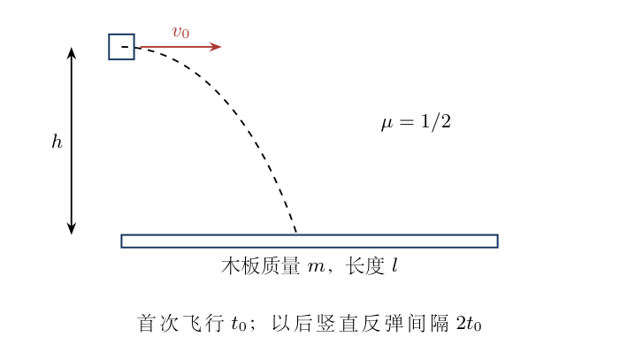

<!-- question-end -->

## 一、题型定位

这是重复斜碰撞与相对位移的离散求和问题。竖直弹跳不衰减，水平相对速度经过有限次碰撞降为零。板长限制的是木块相对木板的最远位置，不能把地面系的水平路程直接与 $l$ 比较，也不能只检验第一次着板位置。

## 二、知识点

初次下落的时间 $t_0=\sqrt{2h/g}$，碰撞前竖直速度大小 $u=\sqrt{2gh}=gt_0$。以后每次弹跳的飞行时间 $\Delta t=2u/g=2t_0$。

碰撞法向冲量对木块为 $J_N=2mu$。滑动状态下最大切向冲量为 $J_T^{\max}=\mu J_N=2\mu mu$。两物体质量相等，水平相对速度减少量为 $2J_T/m=4\mu u$。总水平动量在整个运动中守恒，但水平机械能在有摩擦冲量的碰撞中减少。

## 三、物理图像

初次碰撞前板不动，木块相对左端的位置增长到 $v_0t_0$。碰撞期间的位置来不及改变，水平速度却发生跳变。第二次及以后，块和板都在移动，木块相对板的位置增长速度是两者速度差。

竖直运动在每次碰撞后恢复同样的初始速度 $u$，所以所有后续飞行段时长相同。水平速度差形成下降的等差数列，直至最后一次碰撞被截断为零。相对位置只增不减，最大值就是水平共速以后永久保持的位置。

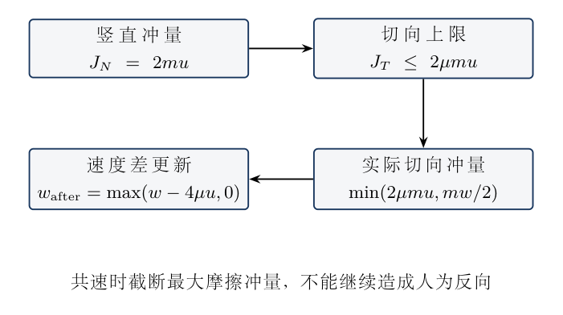

## 四、解题入口

设第 $j$ 次碰撞后的水平相对速度为 $w_j$，碰撞前最初相对速度 $w_0=v_0$。对一般 $\mu$ 先保留 $a_f=4\mu u$，再代入 $\mu=1/2$，可使冲量因子更容易核对。

达到共速所需的最少碰撞次数为

$$N=\left\lceil\frac{v_0}{a_f}\right\rceil.$$

若比值是整数，第 $N$ 次碰撞恰好达到零，不必额外加一次。仅前 $N-1$ 个碰撞后的飞行段还产生相对位移，故求和下标必须与碰撞编号配套。

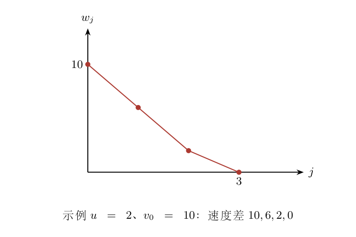

## 五、解析

（1）用冲量而不是接触力持续时间。

木块从 $-u$ 变成 $+u$，法向冲量 $2mu$；木板竖直运动由地面约束，不参与这个竖直自由弹跳。若碰撞前水平相对速度为 $w>0$，切向冲量对木块向左、对木板向右，因此

$$\Delta v_{\rm block}=-\frac{J_T}{m},\qquad
\Delta v_{\rm board}=+\frac{J_T}{m},\qquad
w'=w-\frac{2J_T}{m}.$$

达到水平共速只需要冲量 $J_T^{\rm req}=mw/2$。真正冲量必须取

$$\boxed{J_T=\min\left(2\mu mu,\frac{mw}{2}\right)}.$$

于是递推式为

$$\boxed{w_j=\max(v_0-ja_f,0)},\qquad a_f=4\mu u.$$

本题 $a_f=2u$。这一步是有限次停滑的核心。若不使用 $\max$ 截断，而把库仑最大值一直减下去，就会得到人为反向滑动和错误的往返路程。

总水平动量为 $mv_0$，所以碰撞后任意时刻的速度可由相对速度恢复：

$$v_{\rm block,j}=\frac{v_0+w_j}{2},\qquad
v_{\rm board,j}=\frac{v_0-w_j}{2}.$$

两式之和恒为 $v_0$，最后都为 $v_0/2$。板获得动量并不要求有地面摩擦；动量由木块的切向碰撞冲量传来。

（2）第一次必须先落在板上。

初次飞行时间与落点位置为

$$t_0=\frac ug=\sqrt{\frac{2h}{g}},\qquad
s_0=v_0t_0=\frac{v_0u}{g}.$$

最基本要求为 $l\ge s_0$。若小木块具有非零长度，或要求落点严格位于板内，应取严格不等号并留尺寸余量。本题质点与闭区间板的理想极限可以包含端点等号。

若 $v_0\le2u$，第一次碰撞即可水平共速，以后每次只改变竖直速度，故

$$\boxed{l\ge v_0\sqrt{2h/g}\quad(v_0\le2\sqrt{2gh})}.$$

但这只是一段参数区间的答案。对于初速更大，第一次落上板不代表以后不会滑出右端。

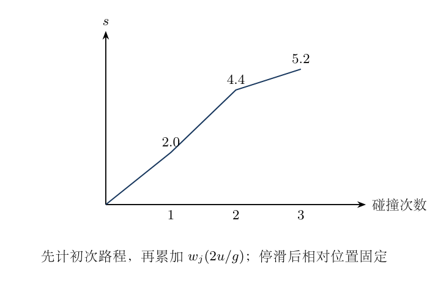

（3）把所有后续相对路程相加。

初次碰撞后，若 $w_1>0$，第二次碰撞前相对位置增加 $w_1\Delta t$。第 $j$ 次碰撞后到第 $j+1$ 次碰撞前增加 $w_j\Delta t$。故停滑位置为

$$s_{\max}=s_0+\frac{2u}{g}\sum_{j=1}^{N-1}(v_0-ja_f).$$

有限等差和给

$$s_{\max}=\frac ug\left[(2N-1)v_0-a_fN(N-1)\right].$$

对 $\mu=1/2$，最终结果为

$$\boxed{N=\left\lceil\frac{v_0}{2\sqrt{2gh}}\right\rceil},$$

$$\boxed{l\ge\frac{\sqrt{2gh}}g
\left[(2N-1)v_0-2\sqrt{2gh}\,N(N-1)\right]}.$$

若按通常题意要求每次落在板的内部，把 $\ge$ 换成 $>$。在达到停滑之前 $w_j\ge0$，所以每一次着板位置都不超过 $s_{\max}$；检验最终最大值同时保证所有中间碰撞还发生在板上。这说明条件在本模型中既必要又充分。

也可以写成没有取整符号歧义的正部求和：

$$\boxed{s_{\max}=\frac{v_0u}{g}
+\frac{2u}{g}\sum_{j=1}^{\infty}(v_0-2ju)_+},\qquad
(z)_+=\max(z,0).$$

只有有限项非零，故这不是一个需要收敛判别的无穷路程。它能直接处理整数边界，适合用于编程验证闭式结果。

（4）分段表达与边界连续性。

当 $2(N-1)u<v_0\le2Nu$ 时，$N$ 固定，$s_{\max}$ 是 $v_0$ 的一次函数，斜率为 $(2N-1)u/g$。例如

$$\begin{aligned}
0<v_0\le2u:&\quad s_{\max}=v_0u/g,\\
2u<v_0\le4u:&\quad s_{\max}=(u/g)(3v_0-4u),\\
4u<v_0\le6u:&\quad s_{\max}=(u/g)(5v_0-12u).
\end{aligned}$$

在 $v_0=2Nu$ 处左右两段相同，但斜率发生跳变。这是新增一次仍会滑动的飞行段造成的，不是位移突然跳变。原手写解后半部分以整数部分估计碰撞次数，并在初次路程之外求和；编号若移动一位，便可能漏掉最后一个仍为正的速度项，本稿用上取整和正部求和固定边界。

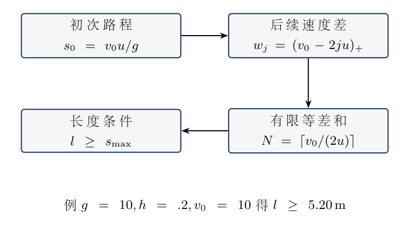

（5）能量核对与参数变化。

两物体水平总动能可分成共同质心与相对运动：

$$K_x=\frac{mv_0^2}{4}+\frac{mw^2}{4}.$$

每次水平损耗为 $m(w_{j-1}^2-w_j^2)/4\ge0$，累加至停滑为 $mv_0^2/4$。竖直动能在题设反弹中不损耗，所以块仍永远弹跳；“不掉到地面”并不等同于木块最终静止。

质量 $m$ 在冲量与速度变化比中消去，故等质量条件下所需板长与质量数值无关。一般 $\mu>0$ 时把 $a_f$ 恢复为 $4\mu u$，同一求和式仍成立；$\mu\to0$ 时停滑次数与所需长度趋于无穷。$h\to0$ 则离散弹跳模型的法向冲量与飞行间隔同时失去原来的意义，不能把该公式直接当作持续接触滑动的答案。

最后检查式子中的每一项：$u/g$ 是时间，括号内是速度，积是长度；$N=1$ 自动恢复第一次落点。所有速度在地面系中都为非负，只有相对速度需要被截断到零，不能错误地把板的速度当作反向。

（6）把离散板长写成连续项与弹跳修正。

令 $q=v_0/(2u)$，$N=\lceil q\rceil$，$\zeta=N-q\in[0,1)$。将 $N=q+\zeta$ 代入板长表达式，化简得

$$\boxed{s_{\max}=\frac{v_0^2}{2g}
+4h\zeta(1-\zeta)}.$$

所以

$$\frac{v_0^2}{2g}\le s_{\max}\le\frac{v_0^2}{2g}+h.$$

这两个界限对本题 $\mu=1/2$ 和等质量条件成立，不是任意摩擦系数下的通式。速度比恰为整数时修正为零，速度比为半整数时修正达到 $h$。例如 $h=0.2$、$v_0=10$、$u=2$ 给 $q=2.5$，$s_{\max}=5+0.2=5.2$ 米，直接复核前面三段路程。

主项 $v_0^2/(2g)$ 与两等质量物体在持续接触、摩擦系数 $1/2$ 时的相对停滑距离相同。这里每个弹跳周期平均法向冲量对应重力，离散冲量可以在多次弱弹跳极限中形成同一平均减速；额外修正记录第一次半周期和最后一次不满最大摩擦冲量的影响。

这不是把 $h=0$ 直接代入原来的碰撞次数公式。恰好零高度需要改用持续接触模型，$N$ 的定义会失效；只有先取 $h>0$ 的解，再考察 $h\to0^+$，才可通过上界 $4h\zeta(1-\zeta)\le h$ 看见路程趋向主项。

若给定板长而反求允许初速，应在每个 $N$ 区间解一次线性不等式，再检验 $2(N-1)u<v_0\le2Nu$。直接把 $N$ 当连续变量解一个二次方程，会丢失这些小但可观测的分段修正。上界可以先给足够条件 $l\ge v_0^2/(2g)+h$，下界则给必要条件 $l\ge v_0^2/(2g)$，但要得到精确阈值仍须保留取整信息。

（7）板长阈值的连续性与每次碰撞的耗能。

在给定碰撞次数 $N$ 的区间，板长阈值对初速是直线。相邻区间在 $v_0=2Nu$ 处给同一位置：

$$s_N(2Nu)=s_{N+1}(2Nu)=\frac{2N^2u^2}{g}.$$

因而取整并不使板长发生跃变，只使斜率从 $(2N-1)u/g$ 变成 $(2N+1)u/g$。这是最后一次摩擦冲量从未饱和变为饱和、再多出一个飞行段的结果。若绘图出现高度跳跃，通常意味着碰撞次数加错1或多算了最后共速飞行的相对路程。

例如 $h=0.2\,\mathrm m$、$g=10\,\mathrm{m/s^2}$ 时 $u=2\,\mathrm{m/s}$、$t_0=0.2\,\mathrm s$。当 $4<v_0\le8$，$N=2$，有

$$s_{\max}=0.6v_0-1.6\quad(\mathrm m).$$

当 $8<v_0\le12$，$N=3$，有

$$s_{\max}=1.0v_0-4.8\quad(\mathrm m).$$

两式在 $v_0=8$ 都给 $3.2$ 米。若木板长 $4$ 米，第二个区间解得 $v_0\le8.8\,\mathrm{m/s}$，且 $8.8$ 确实属于该区间，所以它是本组参数的精确初速上限。只用连续项会给 $\sqrt{2gl}\simeq8.944\,\mathrm{m/s}$，这个值仅是必要界，不能保证块留在板上。

耗能也可逐次检查。由共速部分与相对运动部分分解，碰撞前后水平动能的减少为

$$\Delta K_j=\frac m4(w_{j-1}^2-w_j^2)\ge0.$$

从 $j=1$ 求和到 $N$，中间项相消，得到总损失 $mv_0^2/4$。竖直速度在碰撞前后大小不变，所以这部分动能没有损失；但“竖直完全弹性”不等于整个斜碰撞机械能守恒。板的地面约束吸收竖直冲量而不做功，水平摩擦冲量则不可逆地消耗相对运动能量。

若块初始在板内位置 $x_0$ 而不是左端，最大相对位置改为 $x_0+s_{\max}$，留板条件是 $x_0+s_{\max}\le l$。以后共同向右的地面系位移可以无限增大，仍不影响这条相对位置判据。

## 六、关键洞察

从连续轨迹看问题很复杂，从每次碰撞后观察却只有一个带截断的线性递推。正确的“摩擦最大值”是上限而不是每次必须取到的值。停滑后的无穷弹跳不再增加相对路程，所以有限板长可以覆盖无限时间。

## 七、易错点

仅算第一落点；把后续飞行时间也取成 $t_0$；相对速度只减去木块自身的速度变化；忽略板反冲导致减速度少一倍；取整边界错一位；达到共速后继续施加动摩擦最大冲量；用木块地面系总路程约束板长；认为弹性竖直反弹意味着整个碰撞无能量损耗。

## 八、课堂讲解建议

先让学生列出前三次碰撞后的块、板、相对速度，教师先核对每列的动量和速度差。板书把初次飞行单列，再列后续等时飞行。课堂讨论取整边界，用恰好 $v_0=4u$ 的例子判断需不需要增加一次碰撞。最后用正部求和进行独立数值验证。

## 九、变式训练

<!-- KEEP_TOGETHER_START -->

变式一：取 $g=10\,\mathrm{m/s^2}$、$h=0.200\,\mathrm m$、$v_0=10.0\,\mathrm{m/s}$、$\mu=1/2$，求最短理想板长。

解：$u=2.00\,\mathrm{m/s}$，$t_0=0.200\,\mathrm s$，$\Delta t=0.400\,\mathrm s$。相对速度依次为 $10,6,2,0\,\mathrm{m/s}$，需三次碰撞。路程为 $2.00+6(0.400)+2(0.400)=5.20\,\mathrm m$，故闭区间质点模型 $l\ge5.20\,\mathrm m$。用闭式 $(u/g)(5v_0-12u)$ 得同值。

用地面系速度检查每段也很直接。第一次碰撞后块、板速度为8和2，第二次后为6和4，第三次后都为5，单位均为米每秒。因此三个相对路程是

$$10(0.2),\quad(8-2)(0.4),\quad(6-4)(0.4).$$

板本身在后两段也向右走，已由速度差扣除。长度恰等于5.20米时，质点最后停在右端边界；实际有尺寸木块与有限宽碰撞区域时应留出安全余量，不能将理想闭区间等号直接作为几何尺寸设计。

<!-- KEEP_TOGETHER_END -->

<!-- KEEP_TOGETHER_START -->

变式二：在上题数据中改取 $v_0=8.00\,\mathrm{m/s}$，判定碰撞次数与板长。

解：$v_0/(2u)=2$ 恰为整数，第二次碰撞后速度差为零。$N=2$，路程为 $8(0.2)+4(0.4)=3.20\,\mathrm m$。第三次只是继续竖直反弹，不增加相对位移。将 $N=3$ 的边界表达式代入也给 $3.20\,\mathrm m$，检验分段连续，但最少停滑碰撞数仍是2。

第一碰后块与板分别为6和2，第二碰后都为4米每秒。把最少次数写成

$$N=\left\lceil\frac{8}{4}\right\rceil=2$$

即可避免整数点多加一次。该点前后阈值函数的斜率不同，但位置连续；一次额外竖直弹跳只改变共同的地面系位移，不改变木块相对板的位置。因此数值函数连续不能用来证明最少碰撞次数也连续。

<!-- KEEP_TOGETHER_END -->

<!-- KEEP_TOGETHER_START -->

变式三：木板质量改为 $M$，其余不变。写出每次相对速度减少量与停滑板长。

解：法向冲量仍为 $2mu$，切向冲量上限 $2\mu mu$。相对速度减少量 $a_M=2\mu u(1+m/M)$，令 $N=\lceil v_0/a_M\rceil$。所需长度为 $s_{\max}=v_0u/g+(2u/g)[(N-1)v_0-a_MN(N-1)/2]$。最终共速为 $mv_0/(m+M)$。置 $M=m$ 恢复本题 $a_M=4\mu u$，证明质量修正不是简单换总质量。

达到共速所需的切向冲量一般为

$$J_T^{\rm req}=\frac{w}{1/m+1/M}=\frac{mM}{m+M}w.$$

它与 $2\mu mu$ 取较小者后，才可写相对速度的截断递推。对 $M\to\infty$，板近似不动，减速量趋 $2\mu u$；对 $M=m$，减速量加倍，因为板同时被加速。较轻木板容易共速，但最终共同速度更大，不能据共同速度大就断定需要更长板。

<!-- KEEP_TOGETHER_END -->

<!-- KEEP_TOGETHER_START -->

变式四：若 $v_0\le2u$，第一次碰撞达到共速，总水平动能损失多少？竖直弹跳是否停止？

解：总动量给两者共速 $v_0/2$，末水平动能 $2\times mv_0^2/8=mv_0^2/4$，初值 $mv_0^2/2$，损失 $mv_0^2/4$。竖直反弹系数仍为1，每次上升高度仍 $u^2/(2g)=h$，故弹跳不会停止。水平摩擦耗散与竖直恢复的条件分属两个方向，不可用“弹性”一词整体替代。

第一次碰撞需 $J_T=mv_0/2$，可用的上限为 $mu$；条件 $v_0\le2u$ 正保证共速冲量足够。总水平动能损失也可用约化质量求：

$$\Delta K=\frac12\frac{m\,m}{m+m}v_0^2=\frac{mv_0^2}{4}.$$

最后相对水平运动为零，但相对竖直运动仍周期重复。第二次及以后无水平相对滑动，水平切向冲量可为零，法向冲量依然为 $2mu$。两个方向的冲量并不必然同时消失。

<!-- KEEP_TOGETHER_END -->

<!-- question-complete -->

\newpage

# 第4题 三孔悬挂系统的二维小振动

<!-- question-start -->

光滑水平桌面上有三个小孔 $A,B,C$，两两距离均为 $L$，构成等边三角形，中心为 $O$。桌面质点质量为 $M$，分别用轻细绳通过三个小孔连接桌下三个质量均为 $m$ 的悬挂质点。绳不可伸长，足够长以保持悬挂质点不触地，孔处无摩擦。

（1）初态 $M$ 位于 $O$，沿 $OA$ 方向给予很小速度 $v_0$。证明其作简谐小振动并求周期。

（2）初态位置为 $\overrightarrow{OM}=\Delta x\,\hat{\mathbf x}$，其中 $\hat{\mathbf x}$ 沿 $OA$，$\Delta x\ll L$；初速度 $v_0\hat{\mathbf y}$ 垂直 $OA$ 且足够小，求以后的运动。题面排印中的“$\Delta x\ll l$”统一为孔间距 $L$。

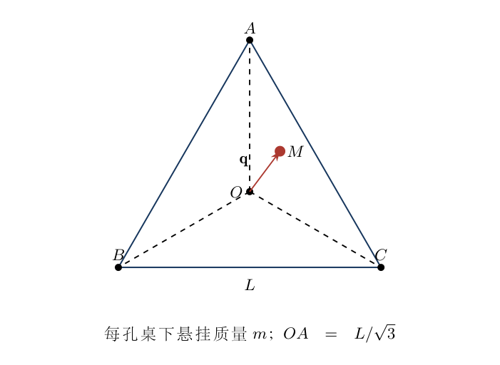

<!-- question-end -->

## 一、题型定位

本题的回复力不是由弹性绳产生，而是三个悬挂物的重力势能共同产生。中心附近两个正交方向具有相同的线性回复系数，形成各向同性的二维简谐振子。悬挂物随桌面质点移动，既贡献势能也贡献有效惯量，不能只使用桌面质量 $M$。

## 二、知识点

令孔到中心距离 $a=L/\sqrt3$，三个孔位置为 $a\mathbf n_i$，其中 $\mathbf n_i$ 两两夹角 $120^\circ$。有

$$\sum_i\mathbf n_i=0,\qquad
\sum_i\mathbf n_i\mathbf n_i^{\mathsf T}=\frac32\mathbf I_2.$$

桌面质点位置记 $\mathbf q$，到各孔的距离为 $r_i=|\mathbf q-a\mathbf n_i|$。绳长不变意味着悬挂部分长度 $h_i=\ell_i-r_i$，其竖直速度为 $-\dot r_i$。总势能去掉常数后为 $mg\sum_i r_i$，总动能为 $M|\dot{\mathbf q}|^2/2+m\sum_i\dot r_i^2/2$。

## 三、物理图像

桌面质点向 $A$ 移动，通向 $A$ 的桌面绳段缩短，悬挂物 $A$ 下移；另外两段绳变长，对应悬挂物上移。三个一阶势能变化相互抵消，二阶总势能增加。中心因此是稳定平衡，而不是每根绳各自作用力为零。

中心附近悬挂物的速度分别是桌面速度在三条孔方向上的投影的相反数。三个平方投影之和为桌面速度平方的 $3/2$ 倍。这个几何恒等式同时使回复力和有效质量在任意桌面方向上相同。

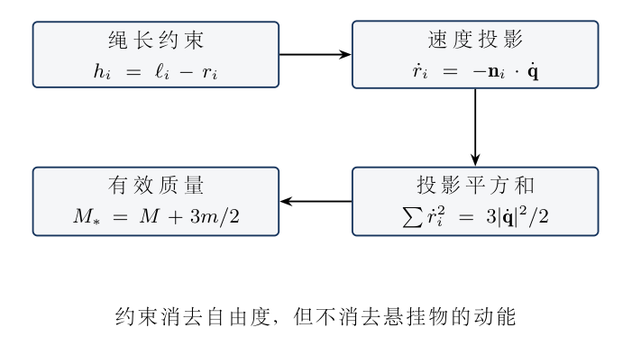

## 四、解题入口

最短入口是先写 $r_i$ 的二阶展开，再利用三个方向的求和恒等式。位置小量与速度小量要同时控制：$|\mathbf q|/L\ll1$，且速度足以保持振幅小。

第二问的初速度与初位移正交，只改变两个正交简谐分量的初始相位。不是匀速圆周运动的一般条件，也不应强行把质点限制在 $OA$ 一条直线上。

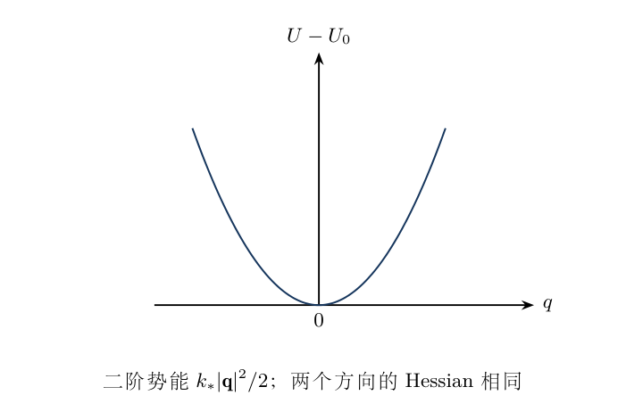

## 五、解析

（1）从准确几何量建立能量。

每根绳的悬挂长度为固定总长减去桌面段长度。悬挂物的势能 $-mgh_i$ 等于 $mgr_i$ 加常数，因此总势能是距离和：

$$U(\mathbf q)=mg\sum_{i=1}^3|\mathbf q-a\mathbf n_i|+U_0.$$

在 $\mathbf q=0$ 处，每根绳张力为 $mg$，三个水平拉力因方向和为零而平衡。距离函数的梯度、二阶导数分别为

$$\nabla r_i\big|_0=-\mathbf n_i,\qquad
\nabla\nabla r_i\big|_0=\frac1a(\mathbf I_2-\mathbf n_i\mathbf n_i^{\mathsf T}).$$

由对称恒等式得势能的二阶形式

$$\begin{aligned}
\sum_i r_i&=3a+\frac{3}{4a}|\mathbf q|^2+O(|\mathbf q|^3/a^2),\\
U-U(0)&=\frac12 k_*|\mathbf q|^2+O(mg|\mathbf q|^3/a^2),\\
\boxed{k_*}&=\boxed{\frac{3mg}{2a}=\frac{3\sqrt3mg}{2L}}.
\end{aligned}$$

正的 Hessian 说明两个方向都稳定。只把一根绳的横向分力作为回复力，会破坏三个一阶项的精确抵消。

（2）有效惯量来自所有悬挂物。

准确速度关系为 $\dot r_i=\nabla r_i\cdot\dot{\mathbf q}$。在线性振动阶次中可在中心取 $\nabla r_i=-\mathbf n_i$，所以

$$\sum_i\dot r_i^2=\sum_i(\mathbf n_i\cdot\dot{\mathbf q})^2
=\frac32|\dot{\mathbf q}|^2.$$

于是二次动能为

$$\boxed{K=\frac12\left(M+\frac32m\right)
|\dot{\mathbf q}|^2}.$$

定义 $M_*=M+3m/2$。不能加成 $M+3m$：悬挂物并非每个都与桌面质点同速，它们的速度是不同方向的投影。也不能完全漏掉悬挂物惯量。位置依赖的动能度量在高阶才产生额外耦合，线性阶恰为常数标量矩阵。

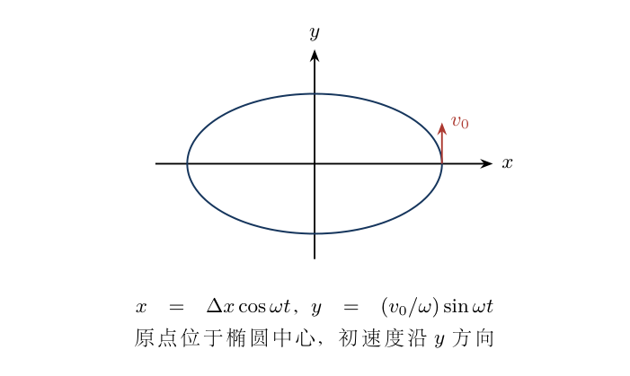

（3）线性方程与第一问。

由二次拉格朗日量 $\mathcal L=K-U$，得到

$$M_*\ddot{\mathbf q}+k_*\mathbf q=0,\qquad
\boxed{\omega^2=\frac{3\sqrt3mg}{2L(M+3m/2)}}.$$

两个方向同频，故周期为

$$\boxed{T=2\pi\sqrt{\frac{2L(M+3m/2)}{3\sqrt3mg}}}.$$

第一问初值 $x(0)=y(0)=0$、$\dot x(0)=v_0$、$\dot y(0)=0$，给

$$\boxed{x(t)=\frac{v_0}{\omega}\sin\omega t,\qquad y(t)=0}.$$

振幅 $v_0/\omega\ll L$ 是“很小速度”的具体含义。桌面质点沿 $OA$ 来回振动，而各悬挂物一般并非同相同幅。

（4）第二问是二维椭圆运动。

取 $x$ 沿 $OA$，$y$ 沿指定初速度，初值为 $x(0)=\Delta x$、$y(0)=0$、$\dot x(0)=0$、$\dot y(0)=v_0$。解为

$$\boxed{x(t)=\Delta x\cos\omega t,\qquad
 y(t)=\frac{v_0}{\omega}\sin\omega t}.$$

消去时间得到

$$\boxed{\frac{x^2}{(\Delta x)^2}
+\frac{y^2}{(v_0/\omega)^2}=1}.$$

两半轴分别为 $|\Delta x|$ 与 $|v_0|/\omega$。只有 $|v_0|=\omega|\Delta x|$ 时才是圆；某一分量为零时退化为线段。若初速度选择相反的 $y$ 方向，第二式整体改号，轨迹几何仍相同，运行方向相反。

两分量同周期，线性轨道闭合。这里各向同性是三重对称在二阶展开中的结果，不代表完整非线性势能在任意转角下不变；保留高阶项可能破坏精确椭圆和严格等周期。

（5）用张力方程独立复核。

悬挂长度向下取正，悬挂物加速度为 $-\ddot r_i$。牛顿第二定律为 $-m\ddot r_i=mg-T_i$，故

$$T_i=mg+m\ddot r_i\simeq mg-m\mathbf n_i\cdot\ddot{\mathbf q}.$$

桌面物体受力 $-\sum_iT_i\nabla r_i$。将张力和方向都展开到一阶，方向变化给 $-k_*\mathbf q$，张力变化给 $-(3m/2)\ddot{\mathbf q}$，因此

$$M\ddot{\mathbf q}=-k_*\mathbf q-\frac32m\ddot{\mathbf q},$$

恢复同一有效质量。若只用平衡张力 $mg$ 算方向变化，会漏掉张力的动态变化，最终错误地得到分母 $M$。

在简谐解中 $\ddot{\mathbf q}=-\omega^2\mathbf q$，张力近似为 $T_i=mg+m\omega^2\mathbf n_i\cdot\mathbf q$。保持绳绷紧需要 $\omega^2|\mathbf q|<g$。充分小的振幅通常能满足，但这是接触约束之外的一个明确检查。

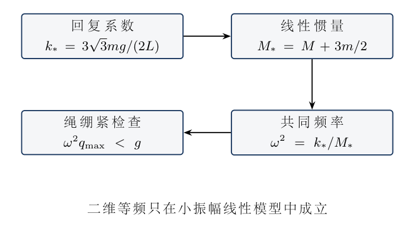

（6）量纲、极限和守恒量。

$k_*$ 的量纲为力/长度，$k_*/M_*$ 为时间的平方倒数。$M\gg m$ 时周期与 $\sqrt M$ 成正比；$M\to0$ 时悬挂物仍提供有限惯量，$\omega^2\to\sqrt3g/L$，不会发散。$m\to0$ 且 $M$ 固定时回复力消失，周期趋于无穷。

线性模型能量与角动量分别为

$$E_{\rm lin}=\frac{M_*}{2}|\dot{\mathbf q}|^2+
\frac{k_*}{2}|\mathbf q|^2,\qquad
J_{\rm lin}=M_*(x\dot y-y\dot x).$$

对第二问 $E_{\rm lin}=k_*[(\Delta x)^2+(v_0/\omega)^2]/2$，$J_{\rm lin}=M_*\Delta x v_0$，都是常数。准确模型只具有离散三重对称，不能把这个连续旋转守恒量无限制推广到大幅运动。

（7）三重对称为何在线性阶表现为旋转对称。

设 $\mathbf q=\rho(\cos\vartheta,\sin\vartheta)$，并把 $OA$ 方向选作 $\vartheta=0$。对三孔距离和进一步展开，有

$$\sum_i r_i=3a+\frac{3\rho^2}{4a}
-\frac{3\rho^3}{8a^2}\cos3\vartheta
+O(\rho^4/a^3).$$

二阶项不含方向，是本题二维等频的来源；最先出现的方向差在三阶，恰有 $120^\circ$ 周期。由此可知“孔是等边三角形”并没有赋予完整系统任意旋转对称，只使二阶近似退化成各向同性振子。振幅增加后，不同方向的非线性运动会出现差异。

准确的动能质量矩阵是

$$\mathbf G(\mathbf q)=M\mathbf I_2
+m\sum_i\nabla r_i(\mathbf q)\nabla r_i(\mathbf q)^{\mathsf T}.$$

它在中心为 $M_*\mathbf I_2$，离开中心后也会随位置改变。检验小振动时，势能保留二阶、动能保留速度二次且在平衡位置计算度量，两种截断必须匹配。只给势能加上三阶而仍称得到完整准确动力学，也不充分。

若三孔并非等边，或三悬挂物质量不等，就应分别求势能 Hessian $\mathbf K$ 和质量矩阵 $\mathbf G_0$，求解广义本征问题

$$\mathbf K\mathbf a=\omega^2\mathbf G_0\mathbf a.$$

两个模态通常不再等频，初位移与初速度正交也不能保证闭合椭圆。这个推广解释了本题对称恒等式的作用：它使两个矩阵同时正比单位阵，避免了耦合模态的对角化，而不是取消了所有约束动力学。

（8）线性解中的隐藏速度与能量交换。

取小位移 $\mathbf q=(x,y)$，三孔方向分别为 $(1,0)$、$(-1/2,\sqrt3/2)$、$(-1/2,-\sqrt3/2)$。绳的水平段速度在一阶为 $\dot r_i=-\mathbf n_i\cdot\dot{\mathbf q}$，悬挂端的竖直速度大小等于 $|\dot r_i|$。因此若沿 $x$ 轴速度为 $v$，三个悬挂物的速度大小分别是 $v,v/2,v/2$，总动能为

$$\frac12mv^2+2\frac12m(v/2)^2=\frac34mv^2.$$

这等于有效质量 $3m/2$ 的动能，而不是三个悬挂物都以速度 $v$ 运动的 $3mv^2/2$。换到任意方向，总投影平方仍是 $3v^2/2$，所以中心处惯量各向同性。

第二问椭圆解的总线性能量为

$$E_*=\frac12M_*v_0^2+\frac12k_*(\Delta x)^2
=\frac12k_*(A^2+B^2),$$

其中 $A=\Delta x$、$B=v_0/\omega$。在 $\omega t=0$，$x$ 位移最大而 $y$ 速度最大；在 $\omega t=\pi/2$，两者交换角色。它不是沿椭圆弧长作匀速运动，因为

$$|\dot{\mathbf q}|^2=\omega^2(A^2\sin^2\omega t+B^2\cos^2\omega t).$$

只有 $A=B$ 的圆轨道才有恒定速率。回复力始终指向中心，与椭圆切向通常不垂直，所以瞬时会做功；这与总能量守恒并不冲突，功改变的是动能与势能的分配。

线性体系还有角动量检查。令 $J_*=M_*(x\dot y-y\dot x)$，代入椭圆解得

$$J_*=M_*\omega AB=M_*\Delta x\,v_0.$$

对运动方程求导也有 $\dot J_*=M_*(x\ddot y-y\ddot x)=0$。这是二阶有效拉格朗日量旋转对称带来的守恒量；完整三孔系统只有离散三重对称，不能把这个线性守恒量无条件延伸到有限振幅。悬挂物并非绕中心转动，它们的惯性在消去绳长约束后进入平面有效模型，$J_*$ 因而要按有效坐标的守恒量理解。

## 六、关键洞察

绳长约束能把桌下竖直运动全部消去，但被消去的自由度仍通过动能贡献惯量。距离和的 Hessian 与速度投影矩阵分别给回复力和质量；两者共同决定频率。二维等频不等于始终圆周运动，初值决定椭圆两半轴和转向。

## 七、易错点

把中心到孔距离写成边长 $L$；只计桌面动能；直接把三份悬挂质量完整加到 $M$；弄错悬挂物升降与势能正负；在一阶平衡中求非零回复力；第二问强行限制为一维；把小振幅闭合椭圆当作任意振幅准确解；忽略绳松弛的约束。

## 八、课堂讲解建议

教师先画出沿 $OA$ 微移时三根绳长的变化，用板书展示一阶项相消。让学生分别求三个速度投影平方，再和距离和的二阶展开比较。课堂讨论第二问什么时候成为圆，最后用张力方程复核有效质量，避免把它当作凭对称猜出的系数。

## 九、变式训练

<!-- KEEP_TOGETHER_START -->

变式一：取 $M=m$，把周期写成只含 $L,g$ 的形式。

解：$M_*=5m/2$，故 $\omega^2=3\sqrt3g/(5L)$，$T=2\pi\sqrt{5L/(3\sqrt3g)}$。质量整体放大不改变频率，因为回复力和有效惯量同倍变化。将 $L=1\,\mathrm m$、$g=9.8\,\mathrm{m/s^2}$ 代入可得 $T\simeq1.969\,\mathrm s$，用于量级检验。

分别写出回复系数与有效质量，约去 $m$ 而不是先猜周期：

$$\frac{k_*}{M_*}=\frac{3\sqrt3mg/(2L)}{5m/2}
=\frac{3\sqrt3g}{5L}.$$

$L/g$ 的量纲为时间平方，故周期的平方根形式正确。若孔间距扩大4倍而质量不变，周期扩大2倍；这来自几何回复力减弱，而不来自绳在孔外的总长度。理想约束下悬挂长度只需足够使全过程保持绳长和绷紧条件。

<!-- KEEP_TOGETHER_END -->

<!-- KEEP_TOGETHER_START -->

变式二：第二问中取 $v_0=\omega\Delta x$，写出运动及线性角动量。

解：$x=\Delta x\cos\omega t$，$y=\Delta x\sin\omega t$，轨道为半径 $\Delta x$ 的圆。线性角动量为 $M_*\omega(\Delta x)^2$。径向加速度大小 $\omega^2\Delta x$，正好满足 $k_*\Delta x/M_*$。圆是初值特例，不需要新增约束力。

直接求二阶导数可得 $\ddot{\mathbf q}=-\omega^2\mathbf q$，所以合力为

$$\mathbf F_*=-k_*\mathbf q.$$

圆周速度大小是 $\omega\Delta x$，有效模型的动能与势能各为 $k_*(\Delta x)^2/2$，均恒定。若在相同初位移处只增大初速度，轨迹改为椭圆，不能仍保持半径 $\Delta x$ 的圆；给定圆轨道要求两个初值恰满足题设关系。

<!-- KEEP_TOGETHER_END -->

<!-- KEEP_TOGETHER_START -->

变式三：令 $M\to0$，判断周期是否趋零，并给出频率。

解：悬挂物贡献 $3m/2$ 的有效质量，故 $\omega^2\to\sqrt3g/L$，$T\to2\pi\sqrt{L/(\sqrt3g)}$，为有限值。只取桌面质量作惯量会错误地得到无限频率。这个极限检验了隐藏在绳长约束中的动能。

令 $M\to0$ 只取消桌面质点的动能，三个悬挂物仍在运动。沿任意小位移方向，总投影速度平方为 $3|\dot{\mathbf q}|^2/2$，所以

$$K\to\frac34m|\dot{\mathbf q}|^2.$$

势能的二阶回复系数也不消失。两者之比有限，故小振动仍有固有周期。这个数学极限要求质点仍维持三绳连接约束，不意味着把连接点也从物理系统中删除。

<!-- KEEP_TOGETHER_END -->

<!-- KEEP_TOGETHER_START -->

变式四：若椭圆两半轴为 $A,B$，给出保证所有绳在线性模型中始终绷紧的充分条件。

解：$|\mathbf q|\le\max(A,B)$，且 $T_i=mg+m\omega^2\mathbf n_i\cdot\mathbf q$，所以 $T_i\ge m[g-\omega^2\max(A,B)]$。充分条件为 $\omega^2\max(A,B)<g$，同时还需 $\max(A,B)\ll L$ 保证线性化。两个条件检查不同问题，不能用张力正值替代小振幅。

更细的线性条件可按每孔方向分别检查：

$$q_{i,\max}=\sqrt{A^2n_{ix}^2+B^2n_{iy}^2},
\qquad\omega^2q_{i,\max}<g.$$

全局 $\max(A,B)$ 界更易用，却可能偏保守。张力下界达到零时绳可能松弛，此后原线性绳长约束不再适用，不能继续沿原椭圆外推。即使张力始终为正，振幅若接近孔距，也必须使用位置相关的完整质量矩阵。

<!-- KEEP_TOGETHER_END -->

<!-- question-complete -->

\newpage

# 第5题 半无限LC梯形网络的传播与功率

<!-- question-start -->

交流源 $U(t)=U_0\cos\omega t$ 接到无穷梯形网络：每节先串联一个电感 $L$，再在节点并联一个电容 $C$ 到公共地线，所有元件理想无损。源端记节点0，第 $n$ 个电容上端记节点 $n$，$n\ge1$。

（a）求源端向右看的输入复阻抗 $Z(\omega)$。

（b）求第 $n$ 个节点的电压 $U_n(t)$。

（c）求从节点 $n$ 向其右侧网络传输的瞬时功率 $P_n(t)$。

采用 $\operatorname{Re}(\widetilde U e^{i\omega t})$ 相量约定。无穷远没有入射波，传播解向右输送能量；阻带解向右衰减。稳态按微小被动损耗或缓慢接通的极限选取，带边另说明。

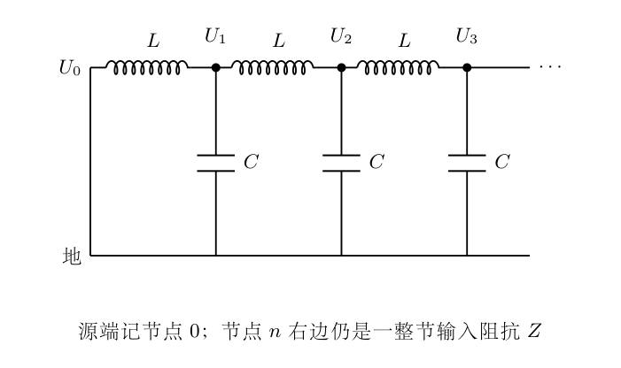

<!-- question-end -->

## 一、题型定位

本题是离散传输线。网络自相似给阻抗二次方程，但二次方程本身不能选择物理解。通带出现实部不是元件发热，而是能量传向无穷远；阻带只有局域无功交换和空间衰减。有限无损链的开路反射与半无限链的辐射边界是不同问题。

## 二、知识点

电感、电容阻抗分别为 $i\omega L$、$1/(i\omega C)$。节点后方的下一节输入阻抗仍为 $Z$，所以源端串联电感后接电容与 $Z$ 的并联。

节点电压满足离散Kirchhoff方程，平面波因子 $\rho=e^{-ik}$ 给色散关系 $\omega^2LC=4\sin^2(k/2)$。$k$ 为每节的相位延迟，量纲为弧度每节；若真实节长为 $a_0$，空间波数才是 $k/a_0$。

瞬时功率是实电压与实电流的乘积。相量 $\widetilde U\widetilde I^*/2$ 的实部给周期平均功率，不是任意时刻的功率。

## 三、物理图像

节点0与右侧之间先有一个电感，所以输入阻抗和节点电压比都带半节相位。向右波的电流滞后该节点电压 $k/2$。一个周期内局部电容和电感能量来回交换，瞬时功率可以反向，而平均功率仍向右。

在阻带，相邻节点电压交替正负并指数衰减。每节没有持续吸收能量，稳态平均功率为零。电压衰减也不等同于能量在电阻中耗散。

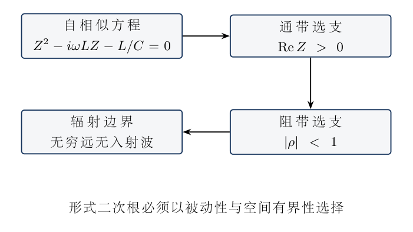

## 四、解题入口

先由自相似写

$$Z=i\omega L+\frac{Z}{1+i\omega CZ}.$$

随后定义 $Z_0=\sqrt{L/C}$、$\omega_c=2/\sqrt{LC}$。通带选择 $\operatorname{Re}Z>0$，阻带选择 $|\rho|<1$，其中

$$\rho=\frac{Z-i\omega L}{Z}.$$

最后用 $\widetilde U_n=U_0\rho^n$ 和 $\widetilde I_{n\to n+1}=\widetilde U_n/Z$ 计算瞬时功率。这里 $I_{n\to n+1}$ 是流过节点右边电感的电流，不能用流入节点电容的电流替代。

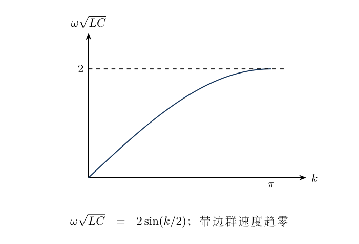

## 五、解析

（1）自相似方程与物理支。

将并联部分通分，得到

$$Z^2-i\omega LZ-\frac LC=0,$$

形式上的两根为

$$Z=\frac{i\omega L}{2}\pm\sqrt{\frac LC-\frac{\omega^2L^2}{4}}.$$

当 $0<\omega<\omega_c$，根号为正实数，物理解为

$$\boxed{Z=\sqrt{\frac LC-\frac{\omega^2L^2}{4}}+
\frac{i\omega L}{2}}.$$

选负实部等于让无穷远向源端送来能量，与没有入射波的条件冲突。无损元件各自不耗散，不要求整个半无限网络的输入平均功率为零；它可以持续把源能量存到越来越远的节点。

当 $\omega>\omega_c$，定义

$$X=\frac{\omega L}{2}+\sqrt{\frac{\omega^2L^2}{4}-\frac LC}.$$

物理解为

$$\boxed{Z=iX}.$$

另一个较小的纯虚根产生 $|\rho|>1$，让电压在无穷远发散，不能选作被动半无限网络。高频时 $X\sim\omega L$，首个电容近似短路，输入主要为首个电感，正好检验这一根的选择。

（2）通带节点电压与色散。

令 $0<k<\pi$，满足

$$\boxed{\omega=\frac2{\sqrt{LC}}\sin\frac k2},\qquad
 k=2\arcsin\frac{\omega\sqrt{LC}}2.$$

阻抗可以写成

$$Z=Z_0\left(\cos\frac k2+i\sin\frac k2\right)
=Z_0e^{ik/2}.$$

电感压降为 $i\omega L\widetilde I$，故

$$\rho=1-\frac{i\omega L}{Z}=e^{-ik},\qquad
\boxed{U_n(t)=U_0\cos(\omega t-nk)}.$$

电压振幅不衰减，相位每节延迟 $k$。任一节点的Kirchhoff方程为

$$\widetilde U_{n+1}-2\widetilde U_n+\widetilde U_{n-1}
=-\omega^2LC\widetilde U_n.$$

代入 $e^{-ink}$，左边系数为 $-4\sin^2(k/2)$，独立恢复色散关系。这个核查与输入阻抗二次方程来自不同形式的网络约束。

（3）阻带节点电压。

令 $\chi>0$，满足

$$\cosh\frac\chi2=\frac{\omega\sqrt{LC}}2.$$

由物理阻抗根得到

$$\boxed{\rho=-e^{-\chi}},\qquad
\boxed{U_n(t)=U_0(-1)^ne^{-n\chi}\cos\omega t}.$$

负号表示每节相位反转 $\pi$，指数表示包络衰减。它仍满足同一节点方程，因为 $\rho+\rho^{-1}=2-\omega^2LC<-2$。空间衰减与纯虚输入阻抗相容，周期平均输入功率为零。

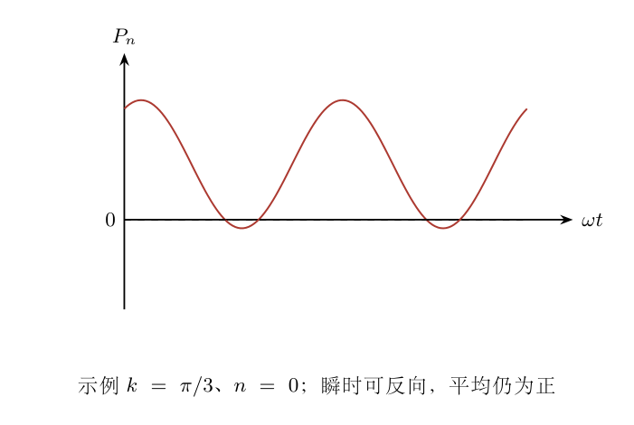

（4）通带瞬时及平均传输功率。

节点右侧网络从该节点看仍有完整一节串联电感，所以

$$I_{n\to n+1}(t)=\frac{U_0}{Z_0}
\cos\left(\omega t-nk-\frac k2\right).$$

令 $\vartheta_n=\omega t-nk$，利用两个余弦乘积恒等式得

$$\boxed{P_n(t)=\frac{U_0^2}{2Z_0}
\left[\cos\frac k2+
\cos\left(2\omega t-2nk-\frac k2\right)\right]}.$$

周期平均值为

$$\boxed{\overline P_n=\frac{U_0^2}{2Z_0}\cos\frac k2}.$$

它与 $n$ 无关，表示无损稳态下每个截面平均传输同样的能量。瞬时功率中的第二项幅度大于或等于第一项，故在某些相位 $P_n$ 为负。这代表局部储能短暂返回上游，不能用它否定平均单向传播。

（5）阻带瞬时功率。

$Z=iX$ 给

$$I_{n\to n+1}(t)=\frac{U_0\rho^n}{X}\sin\omega t,$$

因此

$$\boxed{P_n(t)=\frac{U_0^2\rho^{2n}}{2X}\sin2\omega t},
\qquad\boxed{\overline P_n=0}.$$

这里 $\rho^n$ 在电压和电流中同时出现，功率包络应为 $\rho^{2n}$；只写一个衰减因子会破坏能量尺度。瞬时功率随 $n$ 衰减，因为更远处的无功储能更小。

（6）用能量密度与群速度核对通带功率。

每节的电容平均能量为 $CU_0^2/4$，电感电流幅度为 $U_0/Z_0$，其平均能量为 $L(U_0/Z_0)^2/4=CU_0^2/4$。每节总平均储能为

$$\overline{\mathcal W}=\frac12CU_0^2.$$

以节数为位置单位，群速度为

$$v_{\rm cell}=\frac{d\omega}{dk}=\frac1{\sqrt{LC}}\cos\frac k2.$$

故 $\overline{\mathcal W}v_{\rm cell}=U_0^2\cos(k/2)/(2Z_0)$，与平均功率一致。乘真实节长 $a_0$ 后，能量密度除以 $a_0$，速度乘 $a_0$，功率不变。这解释了截止附近群速度及平均功率同时趋零。

也可以直接对单节电容、电感能量求时间导数，将相邻截面功率差与局部储能变化联系起来；所以不能要求不同节点的瞬时功率完全相同。相同的是它们的周期平均。

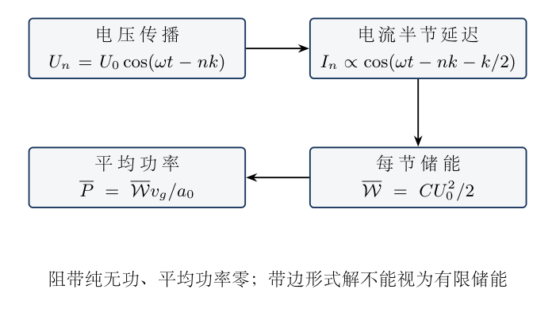

（7）带边与零频极限。

在 $\omega=\omega_c$，两根重合为 $iZ_0$，形式上 $\rho=-1$，$U_n=(-1)^nU_0\cos\omega_ct$，平均功率为零。这个非衰减带边解需要无限总储能，不能解释为有限时刻接通后瞬间建立的全空间状态。缓慢接通、有限损耗和有限观察时间的极限次序须明确。

在 $\omega\to0^+$，$Z\to Z_0$、$k\sim\omega\sqrt{LC}$，恢复连续传输线的长波极限。恰好直流时电容开路、电感短路与全网络初始条件有关，不能把交流稳态的低频极限直接当作直流接通的瞬态结论。原手写解对分支有提示，但节点与功率结果不完整；本稿将两频带、功率方向和带边分别闭合。

（8）用局部储能核查瞬时传输方向。

设 $i_n$ 为从节点 $n$ 向 $n+1$ 流过电感的电流，$i_{n-1}$ 为流入节点 $n$ 的电流。节点与电感方程为

$$i_{n-1}-i_n=C\dot U_n,\qquad
U_n-U_{n+1}=L\dot i_n.$$

将第一式乘 $U_n$，第二式乘 $i_n$，相加得

$$\frac d{dt}\left(\frac12CU_n^2+\frac12Li_n^2\right)
=U_ni_{n-1}-U_{n+1}i_n.$$

这是一个包含节点 $n$ 电容与右侧电感的单元能量连续式。边界功率用对应端点的电压；若将左右截面都定义在节点向右的端口，也会得到等价式，但单元包含的元件需要随之调整。

主问 $P_n=U_ni_n$ 与电感下游功率 $U_{n+1}i_n$ 的差，正是该电感储能变化率。因而“同一串联支路电流相同”不能推出支路两端任意时刻功率相同。周期平均的储能变化为零，才允许把平均功率沿线比较。

通带的阻抗大小恒为 $Z_0$，阻抗相角由0增至 $\pi/2$，因此输入实部随频率升高而趋零。若给波包而不是无限持续单频，能量前沿和群速度确定波包的传播；远端尚未到达的区域并没有稳态余弦场。无穷网络的形式正弦解是局域长期稳态，不是初始有限能量解的全空间同时状态。

有限链若直接开路，末端反射会形成驻波，输入阻抗一般随链长振荡。用物理 $Z$ 作终端匹配则每节看到相同阻抗，反射为零；本稿的数值核验以匹配有限链复核自相似关系，没有把开路链长度趋无穷当成无条件存在的稳态极限。

（9）群速度如何与储能和平均功率对应。

令每节实际长度为 $a_0$。从色散关系求导，通带群速度为

$$v_g=a_0\frac{d\omega}{dk}
=\frac{a_0}{\sqrt{LC}}\cos\frac k2.$$

它在低频趋向 $a_0/\sqrt{LC}$，在带边趋零。相速度为 $a_0\omega/k$，一般与群速度不同；给一个单频相位图不能直接把波峰速度称作能量运输速度。

在向右传播解中，电压振幅为 $U_0$，电流振幅为 $U_0/Z_0$。一个电容与一个电感组成的单元，周期平均储能为

$$\langle E_{\rm cell}\rangle=\frac{CU_0^2}{4}
+\frac{L}{4}\left(\frac{U_0}{Z_0}\right)^2
=\frac{CU_0^2}{2}.$$

单位长度平均能量密度是 $\langle E_{\rm cell}\rangle/a_0$。用已得平均功率除以它，得到

$$\frac{\langle P\rangle}{\langle E_{\rm cell}\rangle/a_0}
=\frac{a_0}{\sqrt{LC}}\cos\frac k2=v_g.$$

因此阻抗、色散与能量核算三条推导相互吻合。靠近带边，节点储能仍可有限，但输送同样储能的速度趋零；“平均功率小”并不必然表示“各元件振幅小”。若固定的是源电流而非源电压，振幅与功率应重新按对应边界条件计算。

瞬时负功率也可以定量看清。通带 $P_n$ 的常数项为 $\cos(k/2)$，振荡项最大幅度为1；对任何 $0<k<\pi$，最小值

$$P_{n,\min}=\frac{U_0^2}{2Z_0}\left(\cos\frac k2-1\right)<0.$$

此时局部储能短暂返还给左侧，周期平均仍正。低频时这个负值的绝对大小趋零，恢复连续线直观；高频靠近带边时返还更明显。

阻带没有实 $k$ 的远行波，改用 $k=\pi-i\chi$ 的衰减分支表示同一电压因子。此时不能把上面为实色散波包得到的 $v_g$ 延拓后当作可测的实速度。用实际能量连续式检查平均功率为零，才是这一分支的物理判断。

## 六、关键洞察

自相似代数只是候选解的生成器，辐射边界和被动性才选择支。相邻电压相位差是整节 $k$，电流相位差是半节 $k/2$，漏掉半节就会把平均功率算错。正输入实部可以代表向无穷远传播，而不必代表电阻发热。

## 七、易错点

只给二次方程不选根；通带选负实部；阻带选空间增长根；用 $U_n^2/Z$ 当瞬时功率；把电容支路电流当向右传输电流；忽略相量的 $e^{i\omega t}$ 约定；要求无损网络任何时刻功率都正；把带边形式解当成有限能量的全空间稳态。

## 八、课堂讲解建议

教师先用三个节点的Kirchhoff方程得到色散，再用自相似阻抗独立验证。课堂讨论无电阻却有正输入平均功率的原因。板书把瞬时乘积与相量平均功率分开，让学生观察功率二倍频项，并检查阻带的负传播比与衰减包络。

## 九、变式训练

<!-- KEEP_TOGETHER_START -->

变式一：取 $L=C=1$（相应SI单位），$\omega=1$、$U_0=2\,\mathrm V$，求 $Z,k$ 与平均功率。

解：$Z_0=1\,\Omega$、$\omega_c=2$，$k=\pi/3$，$Z=\sqrt3/2+i/2\,\Omega$。$U_n=2\cos(t-n\pi/3)$，$\overline P_n=2\cos(\pi/6)=\sqrt3\,\mathrm W$。由 $\overline{\mathcal W}=2$ 和 $v_{\rm cell}=\sqrt3/2$ 得同样的功率，检验半节相位。

源端电流为 $I_0(t)=2\cos(t-\pi/6)$，直接相乘得

$$P_0(t)=\sqrt3+2\cos(2t-\pi/6)\quad(\mathrm W).$$

平均值是 $\sqrt3$，瞬时最小值 $\sqrt3-2<0$，说明局部无损储能会短时返回源。这里 $v_{\rm cell}$ 按“节每秒”计；若每节长 $a_0$，实际群速度 $v_g=a_0v_{\rm cell}$，平均功率则是单节能量乘 $v_g/a_0$，数值保持一致。

<!-- KEEP_TOGETHER_END -->

<!-- KEEP_TOGETHER_START -->

变式二：仍取 $L=C=1$，改为 $\omega=3$，求电压相邻比与输入阻抗。

解：$X=(3+\sqrt5)/2$，$Z=i(3+\sqrt5)/2$。$\rho=1-3/X=-(7-3\sqrt5)/2\simeq-0.145898$。$\chi=2\operatorname{arcosh}(3/2)$，其 $-e^{-\chi}$ 给同值。另一根 $i(3-\sqrt5)/2$ 产生 $|\rho|>1$，被空间有界性排除。

在源端 $U_0\cos3t$ 下，电流相位滞后 $\pi/2$，有

$$I_0(t)=\frac{U_0}{X}\sin3t,\qquad
\overline P_0=0.$$

第 $n$ 节电压振幅为 $|\rho|^nU_0$，符号每节反转。首节振幅衰减到约14.59%，第二节约2.13%；这不是由电阻消耗造成的，而是高于截止频率时没有向右远行的传播模态。纯虚阻抗仍允许每周期储能和返还。

<!-- KEEP_TOGETHER_END -->

<!-- KEEP_TOGETHER_START -->

变式三：在通带，求瞬时功率的最大值和最小值，并说明最小值何时为负。

解：二倍频余弦在 $[-1,1]$，故 $P_{\max}=U_0^2[1+\cos(k/2)]/(2Z_0)$，$P_{\min}=U_0^2[\cos(k/2)-1]/(2Z_0)$。对 $0<k<\pi$，最小值严格为负，周期平均仍为正。两极值的平均等于 $\overline P$，振幅等于 $U_0^2/(2Z_0)$，可直接复核。

对 $k=\pi/3$、$U_0=2$、$Z_0=1$ 的具体例，极值为

$$P_{\max}=2+\sqrt3,\qquad P_{\min}=\sqrt3-2,$$

单位为瓦。二者半差为2，半和为 $\sqrt3$，与平均项和振荡项核对一致。通带内瞬时负功率发生在二倍频余弦小于 $-\cos(k/2)$ 的区间，其位置随节点相位 $2nk$ 移动，不能把某节点的负时段直接复制到所有节点。

<!-- KEEP_TOGETHER_END -->

<!-- KEEP_TOGETHER_START -->

变式四：每节实际长度为 $a_0$，求长波速度与截止附近群速度的极限。

解：长波 $k\ll1$ 时 $\omega\simeq k/\sqrt{LC}$，空间波数 $K=k/a_0$，故 $v_{\rm ph}\simeq v_g\simeq a_0/\sqrt{LC}$。一般 $v_g=a_0\cos(k/2)/\sqrt{LC}$，$k\to\pi$ 时趋零。相速度在带边为 $2a_0/(\pi\sqrt{LC})$，并不趋零；能流由群速度决定。

带边附近可令 $k=\pi-\delta$，$\delta\ll1$，则

$$v_g\simeq\frac{a_0\delta}{2\sqrt{LC}},\qquad
\omega_c-\omega\simeq\frac{\delta^2}{4\sqrt{LC}}.$$

群速度以截止频率差的平方根趋零，而相速度仍有限。这个展开只适用于通带侧；进入阻带后 $k$ 不再是实数，不能把上式当作实传播速度继续使用。每节长度负责把离散相位延迟转换为空间长度。

<!-- KEEP_TOGETHER_END -->

<!-- question-complete -->

\newpage

# 第6题 坡印廷-罗伯森阻力与灰尘轨道收缩

<!-- question-start -->

质量为 $m_d$、半径为 $r_d$ 的球形灰尘作为完全吸收并热平衡再辐射的黑体，近似沿半径 $R$ 的太阳圆轨道运动。太阳质量 $M_s$、光度 $L_s$，光速 $c$，引力常数 $G$。灰尘自身参考系中再辐射各向同性，速度 $v\ll c$。

（a）在灰尘瞬时静止系中，用太阳光的光行差计算切向阻力 $f_1$。

（b）在太阳系中，用再辐射动量计算切向阻力 $f_2$，比较两者。

（c）在缓慢、近圆轨道近似下，求 $dR/dt$。把题面灰尘半径 $r$ 记为 $r_d$，质量明确保留为 $m_d$；若只给半径而不给密度，不能唯一确定轨道收缩速率的数值。

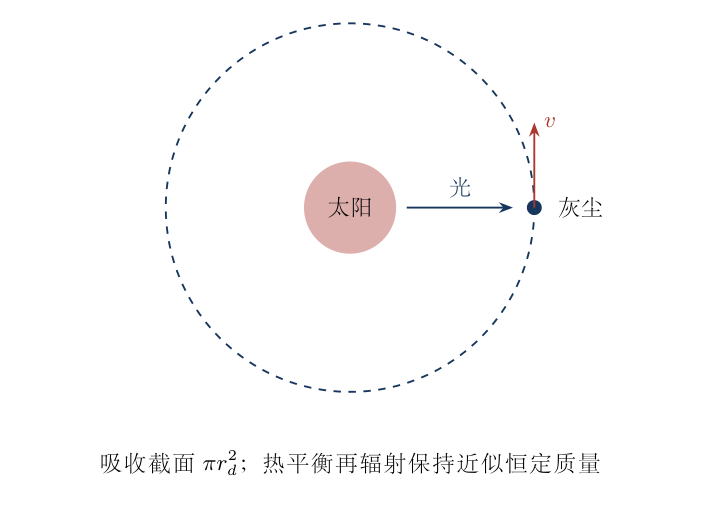

<!-- question-end -->

## 一、题型定位

本题把光子能量与动量联系到天体轨道的缓慢演化。同一个阻力在两参考系中可以用不同的动量分配描述，但不能把两系计算出来的阻力相加。吸收并持续再辐射使质量近似恒定；单独讨论向真空自由辐射的物体时，质量变化会影响动量方程。

## 二、知识点

距离 $R$ 处太阳辐射通量为 $L_s/(4\pi R^2)$，球的吸收截面是 $\pi r_d^2$，不是整个表面积 $4\pi r_d^2$。吸收功率

$$P_{\rm abs}=\frac{L_sr_d^2}{4R^2}.$$

光子动量大小为能量除以 $c$。小速度光行差角为 $v/c$，黑体静止系中各向同性辐射的总空间动量为零，但转换到太阳系后总辐射动量随运动携带一项 $P_{\rm abs}\mathbf v/c^2$。

近圆轨道的比能与比角动量为 $-\mu/(2R)$、$\sqrt{\mu R}$。能量法与角动量法应给相同的 $\dot R$。

## 三、物理图像

太阳系中入射光沿半径传播，直接吸收动量主要向外，没有一阶切向分量。灰尘系中入射光方向略向迎面倾斜，所以吸收带来反运动方向的切向动量。再辐射在灰尘系没有净动量，在太阳系却携带灰尘运动方向的动量。

两个叙述都给同一切向净力。轨道收缩不是因为切向力把灰尘直接推向太阳，而是切向耗散使圆轨道能量变得更负，轨道半径随之变小。

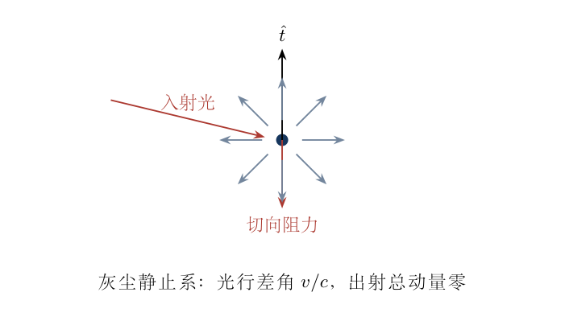

## 四、解题入口

先独立求 $P_{\rm abs}$，再把切向阻力写成 $P_{\rm abs}v/c^2$。定义具有面积每时间量纲的系数

$$A_{\rm PR}=\frac{L_sr_d^2}{2m_dc^2}.$$

由圆轨道能量 $E=-GM_sm_d/(2R)$ 求导，用耗散功率 $-fv$ 代入。最后通过角动量导数和单位检验核对。若保留辐射压力，则需先检查黑体吸收径向力相对引力的比例。

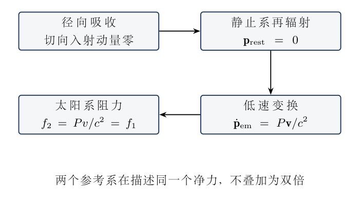

## 五、解析

（1）灰尘系中的吸收动量。

在太阳系中，光沿径向向外传播而灰尘沿切向运动。在灰尘瞬时静止系，入射光有很小的反切向分量，光行差角满足 $\vartheta\simeq v/c$。径向能量流与垂直于速度的功率变化在一阶近似中不变，故每单位时间的切向入射动量为

$$-\frac{P_{\rm abs}}c\frac vc.$$

再辐射在灰尘系各向同性，没有净空间动量。因此阻力大小为

$$\boxed{f_1=\frac{P_{\rm abs}v}{c^2}
=\frac{L_sr_d^2v}{4c^2R^2}}.$$

方向为 $-\hat{\mathbf t}$。一阶阻力含一个光子动量因子 $1/c$ 和一个角度因子 $v/c$，因此分母是 $c^2$。若把分母只写一个 $c$，量纲及光行差阶次都不正确。

（2）太阳系中的再辐射动量。

灰尘系在时间 $dt$ 中辐射总能量 $dE'$，总三维动量为零。对这个辐射系统作低速洛伦兹变换，太阳系中其切向总动量为

$$d\mathbf p_{\rm em}=\frac{dE'}{c^2}\mathbf v+O(v^2/c^2).$$

热平衡使 $dE'/dt\simeq P_{\rm abs}$，因此灰尘失去的切向动量为 $P_{\rm abs}\mathbf v/c^2$ 每单位时间。太阳系中径向入射光的切向动量为零，故

$$\boxed{f_2=\frac{P_{\rm abs}v}{c^2}=f_1}.$$

太阳系中的辐射并非各向同性；把静止系中的各向同性直接搬过去，会错误地得到零阻力。反过来，也不能同时在太阳系添加一次“光行差吸收阻力”，否则同一效应算了两遍。

质量近似恒定的条件来自吸收和再辐射的能量平衡。若只有自由辐射而没有吸收补偿，物体静质量降低，辐射携带的动量变化还须与 $d(m\mathbf v)/dt$ 中的 $\dot m\mathbf v$ 一并考虑；不能据辐射动量就断言速度减小。

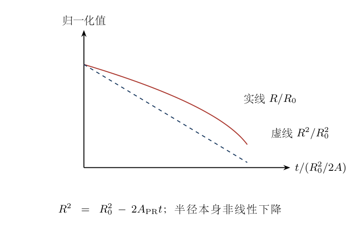

（3）能量法求轨道半径变化。

先忽略径向辐射压力对开普勒圆轨道的修正，圆轨道满足 $v^2=GM_s/R$。阻力耗散功率为

$$\dot E=-fv=-\frac{L_sr_d^2}{4c^2R^2}\frac{GM_s}{R}.$$

圆轨道能量为 $E=-GM_sm_d/(2R)$，故

$$\dot E=\frac{GM_sm_d}{2R^2}\dot R.$$

比较后 $GM_s$ 消去，得到

$$\boxed{\frac{dR}{dt}=-\frac{L_sr_d^2}{2m_dc^2R}
=-\frac{A_{\rm PR}}R}.$$

负号表示半径减小。给定初始半径 $R_0$，积分得

$$\boxed{R^2(t)=R_0^2-\frac{L_sr_d^2}{m_dc^2}t
=R_0^2-2A_{\rm PR}t}.$$

由 $R_0$ 降到 $R_f$ 的时间为

$$\boxed{t_{0\to f}=\frac{m_dc^2}{L_sr_d^2}(R_0^2-R_f^2)}.$$

向零半径外推的形式时间 $m_dc^2R_0^2/(L_sr_d^2)$ 仅属于固定参数的近圆简化模型；实际靠近太阳时温度、粒径、升华和轨道条件会改变，不把它当作实际抵达太阳中心的预测。

（4）以角动量法独立复核。

圆轨道角动量 $J=m_d\sqrt{GM_sR}$，切向阻力矩为 $-fR$，所以

$$\frac{m_d\sqrt{GM_s}}{2\sqrt R}\dot R
=-\frac{L_sr_d^2}{4c^2R^2}\sqrt{GM_sR}.$$

约去同样因子后恢复 $\dot R=-A_{\rm PR}/R$。能量和角动量同时闭合，证明慢变化的圆轨道近似在这一阶上自洽。若把圆轨道总能量误用为 $-GM_sm_d/R$，就会少算或多算一倍。

（5）径向辐射压力及近圆条件。

吸收的径向力为 $P_{\rm abs}/c$。与引力的比值

$$\boxed{\beta_{\rm rad}=\frac{L_sr_d^2}{4cGM_sm_d}}$$

与轨道半径无关。若 $\beta_{\rm rad}\ll1$，可以采用原题普通开普勒圆速度。若保留恒定径向压力且 $0<\beta_{\rm rad}<1$，把有效引力参数改为 $\mu_{\rm eff}=GM_s(1-\beta_{\rm rad})$，则圆速度为 $\sqrt{\mu_{\rm eff}/R}$。

能量法与角动量法中用同一个 $\mu_{\rm eff}$，仍得到同一 $\dot R$，因为它在等式两侧消去。这个结果不允许把 $\beta_{\rm rad}\ge1$ 的无束缚情形继续称为缓慢圆轨道收缩。

缓慢变化要求每圈相对半径变化很小。例如 $|\dot R|/v\ll1$，等价于 $A_{\rm PR}/\sqrt{\mu_{\rm eff}R}\ll1$。题设“很缓慢”是采用圆轨道演化式的物理条件，而不只是描述性的词语。

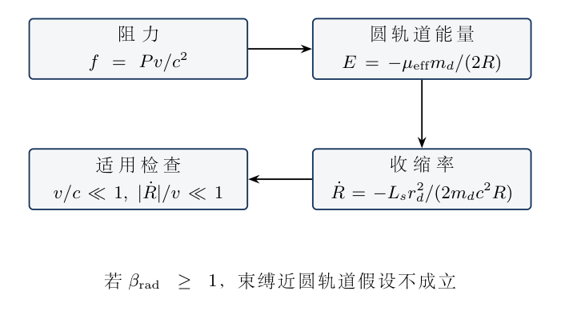

（6）给密度后才能消去质量。

若灰尘密度为 $\rho_d$，$m_d=4\pi\rho_dr_d^3/3$，得到

$$\boxed{\dot R=-\frac{3L_s}{8\pi\rho_dr_dc^2R}}.$$

在相同材料与相同圆轨道上，小颗粒的面积质量比较大，收缩更快；但同时 $\beta_{\rm rad}\propto1/r_d$ 也增大，足够小的颗粒可能不满足束缚条件，不能无条件向零粒径外推。

量纲核查：$P_{\rm abs}v/c^2$ 为力，$L_sr_d^2/(m_dc^2)$ 为面积每时间，除以 $R$ 为速度。半径平方随时间线性变化，而半径本身不应画成直线。两参考系的结果都是同一阻力的表述，最终没有额外的倍数2。

（7）粒径、材料与两个时间尺度。

吸收功率正比 $r_d^2$，黑体质量若按固定密度计算则正比 $r_d^3$。因此比阻力和轨道收缩率都与 $1/r_d$ 成正比。相同尺寸若换更高密度材料，惯量增加而吸收截面不变，收缩更慢。

瞬时径向收缩时间尺度与轨道周期分别是

$$t_R=\frac R{|\dot R|}=\frac{R^2}{A_{\rm PR}},\qquad
T_{\rm orb}=2\pi\sqrt{\frac{R^3}{\mu_{\rm eff}}}.$$

近圆演化更直接的要求是 $T_{\rm orb}/t_R\ll1$，即每圈半径相对改变很小。该比值为

$$\frac{T_{\rm orb}}{t_R}=\frac{2\pi A_{\rm PR}}{\sqrt{\mu_{\rm eff}R}}.$$

它与之前速度比例只差 $2\pi$。它把“缓慢”变成可以代数核查的条件。

若只有主阶阻力，轨道并非每个时刻严格圆，因为真实速度还含很小的向内径向分量。把它称作近圆的渐变序列，是忽略更高阶的偏离。不能同时要求严格零径向速度又声称半径随时间改变。圆轨道公式给主阶能量和角动量，其偏差受上述小参数控制。

径向辐射压力虽不在圆运动中直接做主阶切向功，仍会降低束缚强度。粒径缩小时，$\beta_{\rm rad}$ 和 $T_{\rm orb}/t_R$ 都可能增大，最终越过原近似的适用范围。至于吸收效率小于1、再辐射非各向同性或颗粒自转，都要重新确定截面效率和动量输出，不能只在最终结果前任意添一个常数而不重查参考系平衡。

（8）一组给定参数下的量级核查。

为检查单位而另取 $L_s=3.828\times10^{26}\,\mathrm W$、$c=2.99792458\times10^8\,\mathrm{m/s}$，颗粒半径 $r_d=10\,\mu\mathrm m$、密度 $\rho_d=3.00\times10^3\,\mathrm{kg/m^3}$。这组例值补充了原题未给的质量，不是仅由原题半径推出密度。球形质量为

$$m_d=\frac{4\pi}{3}\rho_dr_d^3
\simeq1.25664\times10^{-11}\,\mathrm{kg}.$$

定义 $A_{\rm PR}=L_sr_d^2/(2m_dc^2)$，有

$$A_{\rm PR}\simeq1.69469\times10^{10}\,\mathrm{m^2/s}.$$

在 $R_0=1.495978707\times10^{11}\,\mathrm m$ 的初始近圆轨道，主阶径向速度为

$$\dot R_0=-A_{\rm PR}/R_0\simeq-0.11328\,\mathrm{m/s}.$$

负号表示向内。这个速度与绕行速度相比很小，却在多年积累中改变轨道，不能因单圈变化小就认定长期效应为零。由 $R^2$ 的演化式，从 $R_0$ 到 $R_0/2$ 所需时间为

$$t_{1/2}=\frac{3R_0^2}{8A_{\rm PR}}
\simeq1.5692\times10^4\,\mathrm{yr},$$

其中一年取365.25日。若粗略把初始径向速度保持不变，所得时间为 $R_0^2/(2A_{\rm PR})$，比上式大 $4/3$ 倍；原因是向内以后吸收功率增大，收缩速度的绝对值增加。时间积分必须跟随半径改变。

再取引力参数 $GM_s=1.32712440018\times10^{20}\,\mathrm{m^3/s^2}$，本组 $\beta_{\rm rad}\simeq0.01914<1$。若把辐射压力也包括在初始近圆轨道，应用 $GM_s(1-\beta_{\rm rad})$ 求圆速度；收缩系数仍是上面值。只有给定初始轨道与同一有效引力模型一致，才可从一开始使用圆轨道能量关系。

将密度加倍而其余参数不变，质量加倍，$A_{\rm PR}$ 与 $\beta_{\rm rad}$ 都减半，漂移时间加倍。将半径加倍、密度不变，则质量增8倍、截面增4倍，同样使收缩时间加倍。两种比例检验对应不同物理变化，却都由面积质量比决定。

## 六、关键洞察

光行差和再辐射动量是同一相对论动量平衡的两种记账。圆轨道能量与角动量均随半径变化，将两者结合可检查渐近近圆假设。太阳质量在收缩率中消去不意味着引力无关，它仍决定轨道是否束缚、圆速度和近圆演化能否成立。

## 七、易错点

用整个球面面积吸收光；少一个 $c$；把两参考系的阻力相加；太阳系仍假设辐射各向同性；忽略持续辐射的质量条件；把轨道势能当作总能量；用半径线性下降取代半径平方线性下降；不给质量或密度却给唯一数值收缩率；忽略过大辐射压力造成的无束缚情形。

## 八、课堂讲解建议

板书分别列灰尘系与太阳系的入射、出射切向动量。教师先强调两列给同一净力，再让学生以能量法和角动量法各算一次收缩率。课堂讨论为何更小粒径同时加强阻力与径向辐射压力，并检查使用近圆模型的条件。

## 九、变式训练

<!-- KEEP_TOGETHER_START -->

变式一：同材料的两球半径分别为 $r_d$ 与 $2r_d$，在同一半径的束缚近圆轨道上，阻力加速度与收缩速率如何比较？先按忽略径向辐射压力的圆轨道比较，再说明保留它时的区别。

解：吸收功率正比面积 $r_d^2$，质量正比 $r_d^3$，故阻力加速度 $f/m_d$ 和 $|\dot R|$ 都正比 $1/r_d$。大球为小球的一半；形式收缩时间为两倍。直接把大球阻力说成一半不正确，因为总力在相同速度下反而为四倍。

若暂忽略径向辐射压力，两球在同一圆轨道的速度相同，故

$$\frac{(f/m)_{2r}}{(f/m)_r}
=\frac{4}{8}=\frac12.$$

保留径向压力时，两球的有效引力及各自圆速度稍不同，阻力加速度比还应乘速度比；但收缩率中的有效引力相消，半径因子仍为1/2。这个区别说明“同一轨道半径”并不在所有模型中自动保证完全相同的切向速度。

<!-- KEEP_TOGETHER_END -->

<!-- KEEP_TOGETHER_START -->

变式二：由 $R_0$ 缩到 $R_0/2$ 所需时间占形式零半径外推时间的多少？

解：$t_{0\to R_0/2}=m_dc^2[R_0^2-(R_0/2)^2]/(L_sr_d^2)=3t_{\rm formal}/4$。最后半径区间不占另一半时间，因为速度随 $1/R$ 增大。代入 $R^2=R_0^2-2A_{\rm PR}t$ 可验证。

将形式时间写为 $t_{\rm formal}=R_0^2/(2A_{\rm PR})$，当 $t=3t_{\rm formal}/4$ 时

$$\frac{R^2}{R_0^2}=1-\frac{t}{t_{\rm formal}}=\frac14,$$

取正根得 $R=R_0/2$。实际太阳具有有限半径，且小半径处近圆和低速近似可能失效，所以零半径时间仅用于比较公式，不是灰尘真实到达太阳中心的物理预测。若终半径为 $R_f>0$，应保留 $R_f^2$ 项。

<!-- KEEP_TOGETHER_END -->

<!-- KEEP_TOGETHER_START -->

变式三：只考虑一个在真空中各向同性自由辐射、无吸收的低速物体。是否可用 $P v/c^2$ 直接断言速度下降？

解：辐射携带动量使 $d(mv)/dt=-Pv/c^2$，同时质量变化 $\dot m=-P/c^2$。展开得 $m\dot v+\dot m v=-Pv/c^2$，两项抵消，故 $\dot v=0$。本题持续吸收补偿质量才使同样的辐射动量损失对应真实减速。这一检查区分恒质量与变质量系统。

以短时间 $dt$ 检查可见，辐射能量 $Pdt$ 使静质量减小 $Pdt/c^2$，物体动量减少

$$dp=v\,dm=-\frac{Pv}{c^2}dt.$$

动量改变来自质量而非速度改变。自由物体在自身瞬时静止系没有净辐射动量，因而不会自发选出一个加速度方向；这与太阳辐射给定外部径向入射方向的灰尘问题具有不同边界。把自由辐射模型当成外力恒质量模型，会漏掉这一抵消。

<!-- KEEP_TOGETHER_END -->

<!-- KEEP_TOGETHER_START -->

变式四：若恒定径向辐射压力比例为 $\beta_{\rm rad}=1/3$，近圆速度与原开普勒速度的比值是多少？收缩率是否改变？

解：有效引力 $\mu_{\rm eff}=2GM_s/3$，速度比为 $\sqrt{2/3}$。能量和角动量中一致使用有效参数后仍得 $\dot R=-L_sr_d^2/(2m_dc^2R)$，形式收缩率不变。近圆的时间尺度、周期和小参数却改变，不能说所有轨道性质都不变。

在同一半径处有 $v^2=\mu_{\rm eff}/R$，功率损失和能量导数分别含同一个有效参数：

$$-fv=-\frac{P_{\rm abs}\mu_{\rm eff}}{c^2R},
\qquad\frac{dE}{dR}=\frac{m_d\mu_{\rm eff}}{2R^2}.$$

相除后参数消去，才得到不变的收缩率。轨道周期则增为原来的 $\sqrt{3/2}$ 倍，同一径向漂移在每圈累积更多，所以近圆缓变条件还需重查。若初速度仍按未减弱引力的圆速度给定，初始轨道就并非所假定的圆。

<!-- KEEP_TOGETHER_END -->

<!-- question-complete -->

\newpage

# 第7题 绝热小孔连通与恒压推动活塞

<!-- question-start -->

两腔容器壁及中间带小孔的固定隔板均绝热，初始左右体积各为 $V_0$，左压 $p_0$、右压 $2p_0$，温度同为 $T_0$。右端有截面积 $S$ 的绝热活塞，以恒定外压 $2p_0$ 缓慢向左推动，直至两腔压力相等。气体为定比热理想气体，摩尔定容热容 $C_V$，$C_P=C_V+\mathcal R$，$\gamma=C_P/C_V$。

按小孔允许气体从右向左流动、两腔各自充分混合、腔间导热尚可忽略的储腔模型，求压力平衡瞬间的两侧温度及活塞位移。小孔的“绝热”不禁止随物质流动携带焓；这里的压力平衡瞬间区别于更长时间后的热平衡。

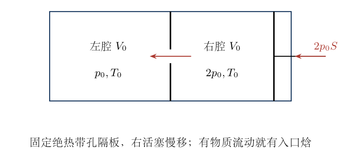

<!-- question-end -->

## 一、题型定位

本题要区分整个封闭系统与每个开放储腔。整个气体系统不漏气且绝热，只有恒外压活塞功；左腔虽然几何体积固定，却不断得到气体及入口焓；右腔边界移动，同时向左输出气体。不能把 $pV^\gamma=\text{常数}$ 不加条件地用于任一有质量交换的腔室。

## 二、知识点

理想气体内能为 $U=nC_VT=(C_V/\mathcal R)pV$，焓为 $H=nC_PT$。开放系统入口能量包括流动功，单位摩尔携带 $C_PT$，不是只携带 $C_VT$。

热交换可忽略时，右腔微分能量式为 $dU_R=-p_RdV_R+C_PT_Rdn_R$，其中 $dn_R<0$；左腔固定容积，有 $dU_L=-C_PT_Rdn_R$。总和恢复整个系统的 $d(U_L+U_R)=-p_RdV_R$。机械平衡快与温度均匀快是不同尺度；这里腔内均匀，腔间温差仍保留。

## 三、物理图像

恒外压、慢活塞使右腔压力近似一直等于 $2p_0$。小孔有压差时发生从右向左的流动，左腔压力逐渐上升。当左压也到 $2p_0$，净流动停止，活塞到达本题终点。

右腔压缩输入的机械功与向左流出的焓共同作用，右腔温度在本模型中保持 $T_0$。左腔没有边界功，却接收高于单纯内能的焓，温度会高于 $T_0$。这个升温不是隔板导热造成的。

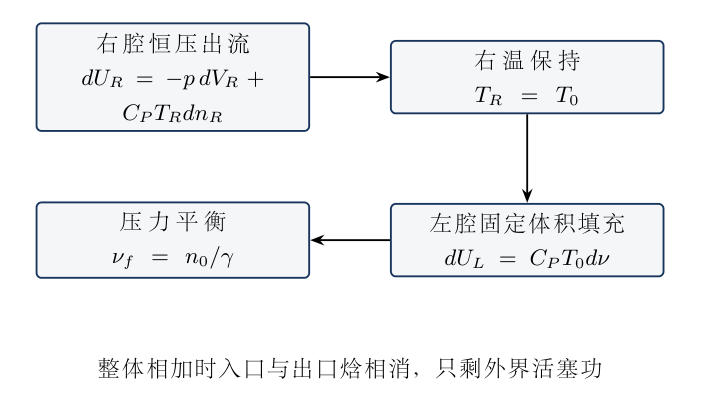

## 四、解题入口

先由整个系统能量求右腔最终体积，得到不依赖具体温度分配的检查。然后用右腔的开放系统方程证明 $T_R$ 恒定，最后对左腔积分入口焓。

定义 $n_0=p_0V_0/(\mathcal RT_0)$。初始左右摩尔数分别为 $n_0$、$2n_0$，总量 $3n_0$。以流入左腔的摩尔数 $\nu$ 为变量，右腔 $n_R=2n_0-\nu$，左腔 $n_L=n_0+\nu$。

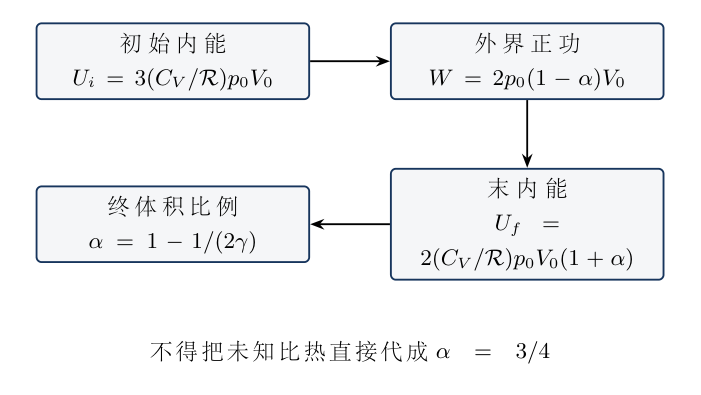

## 五、解析

（1）整体能量先给出体积终值。

压力平衡时 $p_f=2p_0$。左腔体积始终为 $V_0$，右腔最终体积写 $V_{R,f}=\alpha V_0$。初始和最终内能分别为

$$U_i=\frac{C_V}{\mathcal R}(p_0V_0+2p_0V_0),$$

$$U_f=\frac{C_V}{\mathcal R}\,2p_0(V_0+\alpha V_0).$$

外界对整个气体做功为 $W_{\rm in}=2p_0(1-\alpha)V_0$。绝热闭系统满足 $U_f-U_i=W_{\rm in}$，所以

$$C_V(2\alpha-1)=2\mathcal R(1-\alpha),$$

$$\boxed{\alpha=\frac{C_V+2\mathcal R}{2(C_V+\mathcal R)}
=1-\frac1{2\gamma}}.$$

活塞向左位移为

$$\boxed{\Delta x=\frac{V_0-V_{R,f}}S
=\frac{V_0}{2\gamma S}}.$$

这个整体结论只需要最终共同压力、恒外压功、理想气体与绝热条件。它是检验任何局部温度模型的约束。原手写解给出的普遍 $\alpha=3/4$ 只有 $\gamma=2$ 才与上式一致，不能在 $C_V$ 未固定时使用。

（2）右腔的温度如何确定。

对右腔取瞬时控制体，流出气体的摩尔焓为 $C_PT_R$，忽略喷流存储的动能并把其耗散计入下游腔。于是

$$d(n_RC_VT_R)=-p_RdV_R+C_PT_Rdn_R.$$

右腔准静态等压，理想气体给 $p_RdV_R=\mathcal R(T_Rdn_R+n_RdT_R)$。将它代入能量式，整理为

$$n_RC_PdT_R=0.$$

右腔还有气体，故 $dT_R=0$，得到

$$\boxed{T_{R,f}=T_0}.$$

这并不是右腔和外部热源等温接触的过程。它在绝热、恒压和出流的联合作用下保持同温：边界功与输出焓恰好协调。若漏掉出流焓，反而会错误得到普通绝热压缩升温。

在任意中间时刻 $n_R=2p_0V_R/(\mathcal RT_0)$，所以流入量 $\nu=2n_0(1-V_R/V_0)$，同时完成摩尔守恒。

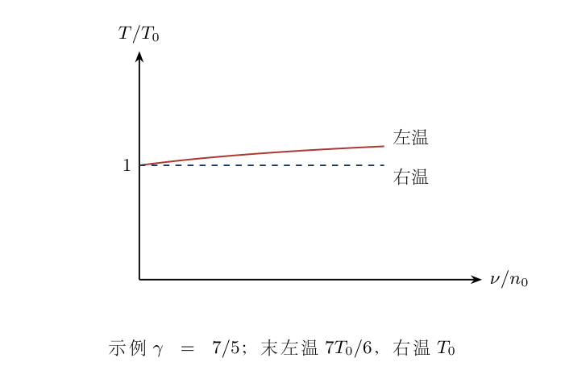

（3）左腔的入口焓决定其温度。

左腔体积固定、无外部热量、无边界功，每流入 $d\nu$ 摩尔都携带 $C_PT_0d\nu$。故

$$n_LC_VT_L-n_0C_VT_0=C_PT_0\nu.$$

写成

$$\boxed{T_L=T_0\frac{n_0+\gamma\nu}{n_0+\nu}}.$$

左压由状态方程得到

$$\frac{p_L}{p_0}=\frac{n_LT_L}{n_0T_0}
=1+\gamma\frac\nu{n_0}.$$

当 $p_L=2p_0$ 时，$\nu_f=n_0/\gamma$，因而

$$\boxed{n_{L,f}=n_0\left(1+\frac1\gamma\right)},\qquad
\boxed{n_{R,f}=n_0\left(2-\frac1\gamma\right)},$$

$$\boxed{T_{L,f}=\frac{2\gamma}{\gamma+1}T_0},
\qquad\boxed{T_{R,f}=T_0}.$$

由右腔摩尔数恢复 $V_{R,f}=[1-1/(2\gamma)]V_0$，与整体能量法独立一致。对于 $\gamma>1$，左温介于 $T_0$ 和 $2T_0$ 之间，右温不变；压力相等而温度不同不矛盾，因为两腔的数密度不同。

（4）全过程及一个具体例子。

以 $z=V_R/V_0$ 为参数，有

$$\nu=2n_0(1-z),\qquad
p_L=p_0[1+2\gamma(1-z)],$$

$$T_L=T_0\frac{1+2\gamma(1-z)}{3-2z},\qquad
T_R=T_0.$$

$z$ 从1减少到 $1-1/(2\gamma)$，左压单调上升。取双原子常温近似 $C_V=5\mathcal R/2$、$\gamma=7/5$，得到

$$V_{R,f}=\frac9{14}V_0,\quad
\Delta x=\frac5{14}\frac{V_0}S,\quad
T_{L,f}=\frac76T_0,\quad T_{R,f}=T_0.$$

终态摩尔数为 $12n_0/7$ 与 $9n_0/7$，和为 $3n_0$。若 $T_0=300\,\mathrm K$，左温为350 K，右温300 K。这些数值明确建立在给定比热和储腔模型上，不把它们无条件替代原题的一般参数。

（5）为何原手写绝热式不适用。

闭系的可逆绝热关系 $pV^\gamma=\text{常数}$ 推导时使用固定摩尔数和 $dU=-p\,dV$。本题左腔的 $V_0$ 不变而 $n_L$ 增加，正确式子是 $dU_L=C_PT_0d\nu$，它没有 $-p_LdV_L$ 的压缩功。

若把左腔中原来那部分气体作为物质系统，它的边界不再是固定隔板和容器，且与流入气体有混合与能量交换；不能既假设这部分气体可逆绝热，又把所得温度认作整个混合左腔的共同温度。形式结果 $2^{(\gamma-1)/\gamma}T_0$ 因此属于另加的等熵物质过程，并非本题开放填充自动给出的答案。

“热平衡足够缓慢”表示腔间直接热交换在压力均衡时尚未完成，不表示物质流动不携带能量。若原装置并非孔道流动，而是一个无质量绝热可动隔板，模型与温度结果会不同；题图的固定带孔隔板在本稿中已明确。

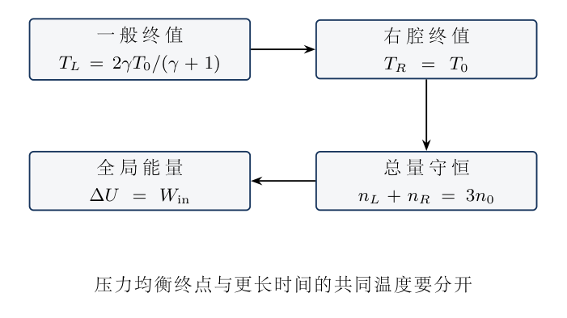

（6）长时间热平衡与题设终点的区别。

本题在首次压力相等时停止观察。若随后锁住活塞，固定两腔最终体积并等待通过小孔达成完全热平衡，整个系统无进一步边界功，最终共同温度是按摩尔数加权的平均值：

$$T_{\rm eq}=\frac{n_{L,f}T_{L,f}+n_{R,f}T_0}{3n_0}
=\frac{4-1/\gamma}{3}T_0.$$

整体压力仍为 $2p_0$，因为总内能、总体积和理想气体性质未变，左右摩尔数则会进一步重分配。这一长时间结果不应替代压力平衡瞬间的两温度。若不锁活塞而仍维持同样外压，全系统内能与体积关系也允许该等容终值，但其具体瞬态需考虑流动和活塞动力学。

能量式中的工作符号最后统一检查：活塞向左压缩，外界对气体做正功；气体对外做功为负。对任意 $\gamma>1$，$1/2<\alpha<1$，终体积为正且确实缩小。两腔分别是开放系统，合起来是闭系统，焓项在总和中相消，因而整体不会凭空获得额外热量。

（7）第二定律可作额外独立检查。

对同一种理想气体，选择共同参考态，摩尔熵变化可写 $C_P\ln(T/T_0)-\mathcal R\ln(p/p_0)$。初始右腔比左腔压强高一倍，温度相同；流动填充不是可逆过程，因此绝热总系统熵不必守恒。

代入终态摩尔数与两温，可得

$$\frac{\Delta S}{n_0\mathcal R}
=\frac{\gamma+1}{\gamma-1}
\ln\left(\frac{2\gamma}{\gamma+1}\right)-\ln2.$$

例如 $\gamma=7/5$ 给约 $0.23176>0$。这个正值与孔道压差流动、喷流耗散及混合相容；并没有从外界传入热量。若把左腔按可逆闭系绝热处理并同时保留混合填充，熵的记账便会与粒子边界不一致。

压力平衡后两温不同，说明状态还不是最大熵的全系统热平衡。随后锁住活塞并等待热与物质重新分配，熵还会增加，内能却不变。这再次区分了机械终点与热终点。

终体积比例可以从整体守恒式独立确定，因此即便另选流动热模型也必须满足该值。不过只有补充两腔各自均匀、入口总焓取右腔状态、孔道没有额外储能或外界做功等条件，才能逐腔计算温度。本题关于“小孔”的提示主要给出热和压力的时间尺度，原题并未提供真实孔道尺寸及流率；本稿不由此推测到达终点所需的实际时间。

（8）用终态各部分能量把整体守恒逐项算清。

取 $\gamma=7/5$ 并以 $n_0\mathcal RT_0=p_0V_0$ 为能量单位。此时 $C_V/\mathcal R=5/2$，左右初始内能分别为 $5/2$ 与 $5$，总初始内能为 $15/2$。终态左腔 $n_L=12n_0/7$、$T_L=7T_0/6$，所以

$$U_{Lf}=\frac{12}{7}n_0\frac52\mathcal R\frac76T_0
=5p_0V_0.$$

右腔 $n_R=9n_0/7$、$T_R=T_0$，于是

$$U_{Rf}=\frac{45}{14}p_0V_0,\qquad
U_f=\frac{115}{14}p_0V_0.$$

总内能增加 $5p_0V_0/7$。活塞从 $V_0$ 压到 $9V_0/14$，外界做功为

$$W_{\rm on}=2p_0\left(V_0-\frac9{14}V_0\right)
=\frac57p_0V_0,$$

与总内能增加完全相等。这一核对既检查温度，也检查活塞功的正负；若把体积减小误作气体对外正功，会得到内能反而减少。

左腔固定体积、不做边界功，却内能增加，原因是物质穿过小孔携带总焓。右腔的内能减少与流出焓并不相等，因为活塞同时向它输入功。一个系统含有能量输入和输出，并不要求它的温度变化与内能变化同向：右腔粒子减少而温度保持，正是本题的例子。

终态左、右数密度之比为

$$\frac{n_L/V_0}{n_R/V_{Rf}}=\frac{T_R}{T_L}=\frac67.$$

同压异温必然对应不同数密度，不能因为压力已平衡就把两腔的单位体积粒子数设为相等。若后来锁住活塞并达到共同温度，粒子还会继续重新分配；此时总体积固定、内能固定，总压仍为 $2p_0$，而各腔物质的量按其体积分配。小孔的流动阶段和锁定后的热平衡阶段拥有不同约束，不能把后阶段条件提前代入前阶段求解。

## 六、关键洞察

绝热是热流条件，固定粒子数是系统边界条件，可逆是过程条件，三者不能互相替代。开放储腔的能量账必须包含焓。整体能量对体积提供强约束，但温度分配仍须局部模型；明确各自的均匀混合与忽略腔间导热条件，才使两温结果可检查。

## 七、易错点

对固定体积填充腔套 $pV^\gamma$；把入口能量取成 $C_VT$；用压力相等推出温度相等；写 $\alpha=3/4$ 却不给比热；右腔压缩就必然认定升温；把整个系统的闭系能量式分别套到两腔；把第一次机械平衡与最终热平衡混同；忘记外界做功正号。

## 八、课堂讲解建议

教师先让学生圈出三个不同边界：左腔、右腔、总气体。板书每个边界的热流、功和物质流项，再讨论何时能用 $pV^\gamma$。课堂讨论“绝热小孔仍传递焓”，用 $\gamma=7/5$ 验证体积、摩尔数和总能量全部闭合。

## 九、变式训练

<!-- KEEP_TOGETHER_START -->

变式一：取单原子理想气体 $C_V=3\mathcal R/2$，给出两温和最终右腔体积。

解：$\gamma=5/3$，$\alpha=1-3/10=7/10$，$T_L=2\gamma T_0/(\gamma+1)=5T_0/4$，$T_R=T_0$。流入量 $3n_0/5$，终态左右摩尔数 $8n_0/5$ 和 $7n_0/5$，和仍为 $3n_0$。整体内能增加 $(3/5)p_0V_0$，恰等于外界功 $2p_0(3V_0/10)$。

终态右腔状态方程给

$$p_{Rf}=\frac{(7n_0/5)\mathcal RT_0}{7V_0/10}=2p_0.$$

左腔同样给 $p_{Lf}=(8/5)(5/4)p_0=2p_0$，所以两温不同仍满足压力平衡。单原子气体终右体积是0.7倍初值，与双原子0.642857倍不同；比热改变活塞做功如何转换为粒子和温度分配，不能仅凭初始压强比固定体积结果。

<!-- KEEP_TOGETHER_END -->

<!-- KEEP_TOGETHER_START -->

变式二：在压力平衡后锁住活塞，等待完全热平衡，取 $\gamma=7/5$ 求共同温度。

解：锁定体积、绝热总系统保持内能，故 $T_{\rm eq}=(4-1/\gamma)T_0/3=23T_0/21$。它介于 $T_0$ 与 $7T_0/6$ 之间，是摩尔加权平均，不是两温的算术平均。总压仍 $2p_0$，左腔最终摩尔数按体积分配，说明后续还有物质重分配。

完全热平衡后左腔摩尔数为

$$n_{L,\rm eq}=\frac{2p_0V_0}{\mathcal R(23T_0/21)}
=\frac{42}{23}n_0.$$

右腔为 $27n_0/23$，总和仍为 $3n_0$。它们不同于刚达到压力平衡时的 $12n_0/7$ 与 $9n_0/7$；因此后阶段不能只交换热而禁止物质重新分配，除非另外关闭孔道。固定总体积和总内能给共同压强，物质守恒给共同温度。

<!-- KEEP_TOGETHER_END -->

<!-- KEEP_TOGETHER_START -->

变式三：若误把左腔入口能量写成 $C_VT_0d\nu$，会得到什么矛盾？

解：错误能量式给 $n_LT_L=n_0T_0+T_0\nu$，所以左温不变。达到左压 $2p_0$ 需 $\nu=n_0$，右腔体积变成 $V_0/2$。此时整体末内能与初值相同，但外界做正功 $p_0V_0$，违反整体能量守恒。漏掉的正是入口流动功 $\mathcal RT_0d\nu$。

被漏掉的入口流动功在错误终态流入量 $n_0$ 上积分为

$$\int_0^{n_0}\mathcal RT_0\,d\nu=n_0\mathcal RT_0=p_0V_0.$$

它正好等于整体能量缺额，显示矛盾不是状态方程造成的，而是控制体能量通量漏项。改用总焓后停流所需量变为 $n_0/\gamma$，所以不能只给错误温度添加修正，还保留原来错误的流入量和活塞位置。

<!-- KEEP_TOGETHER_END -->

<!-- KEEP_TOGETHER_START -->

变式四：将初始右压和恒外压一般化为 $qp_0$，$q>1$，其余相同，求压力平衡瞬间的温度与体积。

解：右温仍 $T_0$。左压达到 $qp_0$ 时，流入量 $\nu=(q-1)n_0/\gamma$。$T_L=q\gamma T_0/(\gamma+q-1)$，右体积 $V_{R,f}=V_0[1-(q-1)/(q\gamma)]$。令 $q=2$ 恢复本题，令 $q\to1$ 则两温回到 $T_0$、活塞位移趋零，检验参数推广。

由 $n_{Rf}=qn_0-(q-1)n_0/\gamma$ 和 $T_R=T_0$，状态方程直接给

$$\frac{V_{Rf}}{V_0}=\frac{n_{Rf}}{qn_0}
=1-\frac{q-1}{q\gamma}.$$

$\gamma>1$ 保证任何有限 $q>1$ 下右腔仍有正体积和正粒子数。整体做功为 $qp_0(V_0-V_{Rf})$，再与两腔内能变化比较给同值。模型仍假定慢活塞、右腔恒压、孔道无额外储能；改变外压随位移的规律将形成另一道题。

<!-- KEEP_TOGETHER_END -->

<!-- question-complete -->

\newpage

# 第8题 十四面体电阻网与变化磁场

<!-- question-start -->

把边长为 $l$ 的立方体八角截至各棱中点，得到由八个三角面与六个正方面组成的十四面体（立方八面体），每条新棱有电阻 $1\,\Omega$，共12顶点、24棱。沿立方体三条坐标轴取 $x,y,z$。

以原立方体中心为原点，令 $s_l=l/2$。按原图标记固定 $A=(s_l,0,s_l)$、$B=(0,s_l,s_l)$、$C=(s_l,0,-s_l)$；其余顶点为 $(\pm s_l,\pm s_l,0)$ 及坐标轮换。

（a）求 $A,B$ 间等效电阻。

（b）求 $A,C$ 间等效电阻。

（c）外加均匀变化磁场 $\mathbf B=at(-\hat{\mathbf x}+\hat{\mathbf y})$，求通常电路节点电势约定下的 $U_{AB}$、$U_{AC}$。取关于几何中心的对称感应场 $\mathbf E_{\rm ind}=-(1/2)\dot{\mathbf B}\times\mathbf r$，没有另外施加保守电场，忽略自感和接入测量仪器的扰动。若“电压”指实际引线的电动势读数，必须另说明引线所围面积，详解将区分。

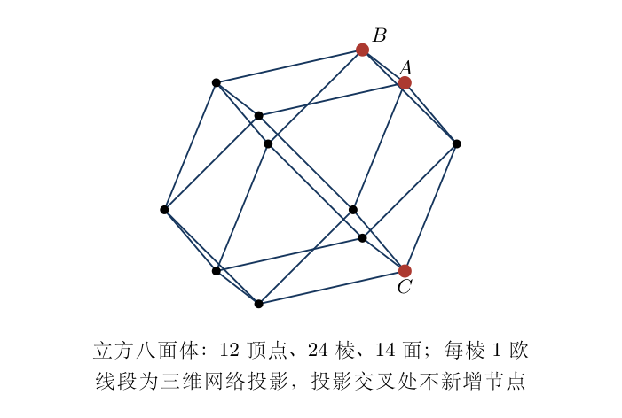

<!-- question-end -->

## 一、题型定位

静态两问是高度对称但不能随意并点的电阻图问题。第三问是有感应源的电阻网络：节点电势由电荷守恒决定，回路非保守电动势由变化磁通决定。节点电势相等并不意味着每一棱没有电流，也不意味着任意路径积分的电场都为零。

## 二、知识点

图Laplacian矩阵记 $\mathbf L_G$，每顶点度数为4，每条棱电导为 $1\,\mathrm S$。注入 $I$ 于源节点、抽出 $I$ 于汇节点，方程 $\mathbf L_G\boldsymbol\phi=\mathbf b$，固定一个参考电势后唯一可解。等效电阻 $R_{ij}=(\phi_i-\phi_j)/I$。

对于有感应电场的有向棱 $i\to j$，其沿棱电动势为 $\mathcal E_{ij}=\int_i^j\mathbf E_{\rm ind}\cdot d\mathbf r$，电流为 $(\phi_i-\phi_j+\mathcal E_{ij})/R_e$。Kirchhoff节点电流守恒仍成立，电场线积分不再只由端点决定。

对固定均匀 $\dot{\mathbf B}$，直棱电动势为 $-(1/2)\dot{\mathbf B}\cdot(\mathbf r_i\times\mathbf r_j)$。三角面的有向面积为顶点叉积和的一半，闭路电动势为负磁通变化率。

## 三、物理图像

原立方体棱被截去后，保留棱中点成为新顶点；在同一原面上相邻的两个棱中点相连。$A,B$ 是一条新棱的两端，$A,C$ 是同一正方面的对角顶点。十四个面不等于十四个电路节点。

对邻接点对 $A,B$，直接的一欧电阻与其余全网并联。对 $A,C$，有两条两棱路径，但其余顶点还有交叉连接，不能只把这两条路径并联。均匀磁场随时间变化时，每个面都可能有环流；节点只要求净流入为零，不要求每条流量为零。

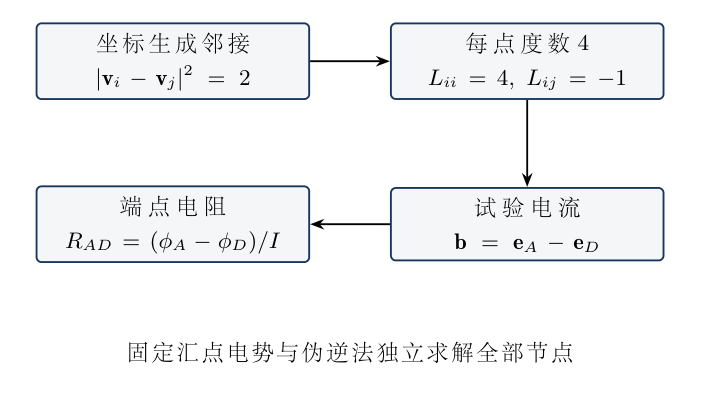

## 四、解题入口

先在无量纲坐标中用 $(\pm1,\pm1,0)$ 的排列列出12顶点。两顶点坐标差平方为2时相连，自动得到24棱。这样可复查图形投影里容易漏掉的背面边。

等效电阻用1 A试验电流求解，给出可逐节点验算的电势表；同时用对称与电阻网整体恒等式复核。感应问则先求每条棱的电动势，再对每个节点求和，不从“整体对称”直接跳到零电势差。

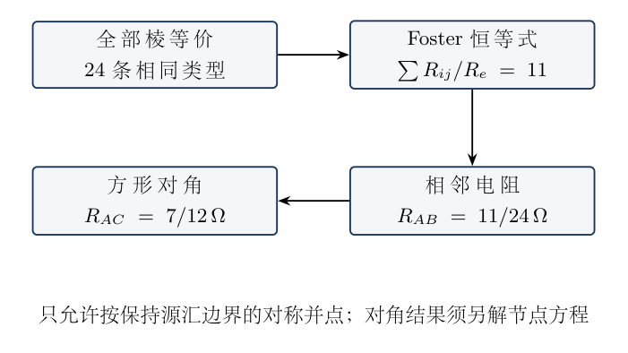

## 五、解析

（1）建立精确的12节点网络。

坐标都先除以 $s_l$。例如 $A=(1,0,1)$，相邻节点为 $(0,1,1)$、$(0,-1,1)$、$(1,1,0)$、$(1,-1,0)$。每顶点恰有四邻点，故棱数为 $12\times4/2=24$。

对任何节点 $i$，静态方程为

$$4\phi_i-\sum_{j\sim i}\phi_j=b_i.$$

注入源 $b_A=1\,\mathrm A$、抽出点 $b_D=-1\,\mathrm A$，其余为零。统一用1欧棱电阻，表中数值单位为伏。源与汇不可以按外观对称并为同一点；只有保持源汇边界条件的图自同构才允许判定其他点等势。

（2）$A,B$ 的等效电阻。

取 $B$ 电势为零，节点解如下。第二列针对1 A从 $A$ 流向 $B$，第三列针对1 A从 $A$ 流向 $C$ 并取 $C$ 为零；两列是两个独立试验，不是同一时刻的电势。

| 无量纲顶点 | $A\to B$ 电势 | $A\to C$ 电势 |
|---|---:|---:|
| $(-1,-1,0)$ | $11/48$ | $7/24$ |
| $(-1,0,-1)$ | $5/24$ | $1/4$ |
| $(-1,0,1)$ | $1/6$ | $1/3$ |
| $(-1,1,0)$ | $7/48$ | $7/24$ |
| $(0,-1,-1)$ | $1/4$ | $5/24$ |
| $(0,-1,1)$ | $7/24$ | $3/8$ |
| $(0,1,-1)$ | $5/24$ | $5/24$ |
| $(0,1,1)=B$ | $0$ | $3/8$ |
| $(1,-1,0)$ | $5/16$ | $7/24$ |
| $(1,0,-1)=C$ | $1/4$ | $0$ |
| $(1,0,1)=A$ | $11/24$ | $7/12$ |
| $(1,1,0)$ | $11/48$ | $7/24$ |

由第二列，

$$\boxed{R_{AB}=\frac{11}{24}\,\Omega}.$$

例如源节点的四邻电势和为 $0+7/24+11/48+5/16=5/6$，所以 $4(11/24)-5/6=1$，恰给1 A流出。汇节点的电势和为1，给 $-1$ A；普通节点的相应式均为零。表中全部值用有理数表示，可逐点检查而不依赖图形猜测。

直接 $AB$ 棱电流为 $11/24$ A，小于总1 A，说明其余路径确实分流。其余全网等效电阻为 $(11/24)/(13/24)=11/13\,\Omega$，与直接1欧电阻并联后恢复 $11/24$ 欧。

（3）$A,C$ 的等效电阻。

第三列给

$$\boxed{R_{AC}=\frac7{12}\,\Omega}.$$

例如 $A$ 四邻电势和为 $3/8+3/8+7/24+7/24=4/3$，所以 $4(7/12)-4/3=1$。$C$ 的邻点和为1，给 $-1$ A。两者关于 $z=0$ 平面的交换对称允许某些中间点具有相同电势，但不能把所有同高度点都判为等势。

两条最短两棱路径并联本来只给1欧，额外网络将结果进一步降为 $7/12$ 欧。$R_{AB}<R_{AC}$ 与相邻点比方形对角点更近的网络关系一致；几何距离只是直观检查，不是任意图中电阻大小的证明。

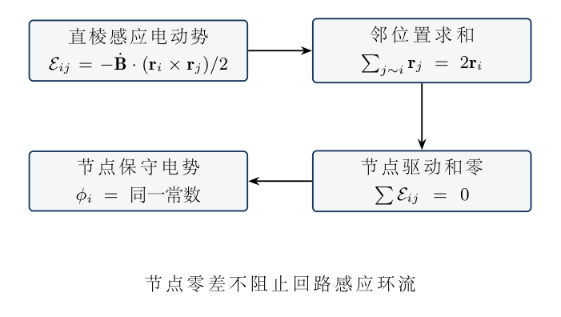

（4）独立的全网核对。

所有棱在立方八面体旋转对称下等价。连通电阻图的Foster恒等式为 $\sum_{\rm edges}R_{ij}/R_e=N_v-1$。本题 $R_e=1\,\Omega$、$N_v=12$、24条等价棱，故 $24R_{\rm edge}/1\,\Omega=11$，独立恢复邻接电阻 $11/24$ 欧。

该恒等式不直接给 $A,C$ 对角电阻；后者仍由节点解确定。数值上再用图Laplacian伪逆计算所有两点电阻，与上述固定汇点的线性解比较，防止漏边或不合法并点造成看似合理的分数。

（5）感应电动势与节点电势。

按题干的中心对称感应场，一条直棱的电动势为

$$\mathcal E_{ij}=-\frac12\dot{\mathbf B}\cdot(\mathbf r_i\times\mathbf r_j).$$

任一顶点的四个邻位置满足

$$\sum_{j\sim i}\mathbf r_j=2\mathbf r_i.$$

因此从该顶点向四邻的感应电动势总和为

$$\sum_{j\sim i}\mathcal E_{ij}
=-\frac12\dot{\mathbf B}\cdot
\left(\mathbf r_i\times2\mathbf r_i\right)=0.$$

没有外接电流时，节点方程成为 $\mathbf L_G\boldsymbol\phi=0$。网络连通，唯一解是一切节点具有同一电势（差一个任意常数）。所以在这一电路节点约定下

$$\boxed{U_{AB}=\phi_A-\phi_B=0,\qquad
U_{AC}=\phi_A-\phi_C=0}.$$

这不是因为所有边的感应电动势为零，而是每个节点的感应驱动已经满足零净流，因而无需另外的节点电势差来平衡。每条边电流仍为 $I_{ij}=\mathcal E_{ij}/R_e$，各面可存在非零环流。

（6）用一个具体面检查非零环流。

取顶点 $D=(s_l,s_l,0)$，闭路 $A\to B\to D\to A$ 是三角面。有向面积为

$$\mathbf S_{ABD}=\frac12(\mathbf r_A\times\mathbf r_B+
\mathbf r_B\times\mathbf r_D+\mathbf r_D\times\mathbf r_A).$$

本题 $\dot{\mathbf B}=a(-1,1,0)$，与该面的法向点积恰为零，这个特定面没有净电动势。换取含 $A$、$(0,-s_l,s_l)$、$(s_l,-s_l,0)$ 的另一个三角面，其法向在 $x,y$ 分量不同，与 $\dot{\mathbf B}$ 点积一般不为零。因而不能凭第一个零磁通面推论全网络没有电流。所有闭路的棱电动势和均满足 $\sum\mathcal E=-\dot{\mathbf B}\cdot\mathbf S$。

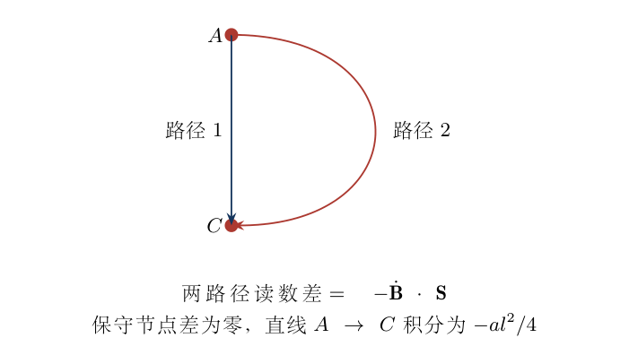

（7）实际测量引线必须另给路径。

非保守电场存在时，$\int_A^C\mathbf E\cdot d\mathbf r$ 不只由端点决定。节点电势差为零只指本模型的保守部分，不能无条件等同于任意引线读数。若定义从 $i$ 到 $j$ 的路径积分为 $\mathcal V_{i\to j}=\int_i^j\mathbf E\cdot d\mathbf r$，直线 $A\to B$ 的叉积为 $s_l^2(-1,-1,1)$，与 $a(-1,1,0)$ 点积为零，故该直路径积分为零。

但直线 $A\to C$ 有

$$\mathbf r_A\times\mathbf r_C=(0,2s_l^2,0),\qquad
\boxed{\mathcal V_{A\to C}^{\rm straight}=-as_l^2=-\frac{al^2}{4}}.$$

这与节点电势差 $U_{AC}=0$ 是不同的量，不构成矛盾。两条测量路径之间的读数差由它们围成的磁通变化率确定。原题只给均匀磁场没有给实际引线，因此若将“电势差”理解成一般端口测量电压，信息不足以给唯一读数。本稿保留原手写解的零节点结果，同时把场约定和测量范围明确列出。

空间均匀变化磁场只确定电场的旋度，还可叠加外部保守场。上述中心对称感应场及没有外部保守驱动是本题通常理想电阻网所用的补充约定；真实磁场源、导线截面、自感与仪表耦合都不由题目给定，不能悄悄加入数值结论。

（8）Foster核对为何能独立约束邻接电阻。

令有向关联矩阵为 $\mathbf D$，每棱电导为1，则 $\mathbf L_G=\mathbf D\mathbf D^{\mathsf T}$。单位棱两端电流向量为该列 $\mathbf d_e$，其等效电阻是 $\mathbf d_e^{\mathsf T}\mathbf L_G^+\mathbf d_e$。对全部棱求和，得到

$$\sum_e R_e^{\rm eff}
=\operatorname{tr}(\mathbf L_G^+\mathbf L_G)=N_v-1.$$

最后一步来自连通图仅有一个零模，常数节点电势不影响电阻。这不是把多面体物理棱电阻全部串联，而是对每条棱的端点“全网络有效电阻”求和；符号相似，含义不能混用。

感应问题则可检查外部磁场的能量供给。节点无外接电流且所有保守电势相等时，每条棱仍有 $I_{ij}=\mathcal E_{ij}/R_e$，焦耳热为

$$P_J=\sum_{\rm edges}\frac{\mathcal E_{ij}^2}{R_e}\ge0.$$

它由维持变化磁场的外部源提供，而不是来自某一非零节点电势差。每个节点的净流为零，保证不持续积累电荷；回路感应驱动提供功，保证热量有来源。零节点差与正焦耳热因此可以同时成立。

如果加入棱自感，就必须把每条支路的 $L_e\dot I_e$ 及互感项加入，电流不能在磁场开始变化的一瞬间随意跳到稳态值。题干明确忽略这些效应，所得电阻网结果对应这种理想近似。测量引线的回路面积也必须在同一磁场约定下计算，不能拿静态电路的端点电压概念代替一般的电场线积分。

（9）从棱的感应电动势核查实际发热。

把中心坐标写成 $\mathbf r_i=(l/2)\mathbf v_i$，其中 $\mathbf v_i$ 的坐标为 $(\pm1,\pm1,0)$ 的所有排列。由于叉积随坐标比例的平方缩放，单棱电动势为

$$\mathcal E_{ij}=-\frac{al^2}{8}
(-1,1,0)\cdot(\mathbf v_i\times\mathbf v_j).$$

直接按相邻顶点差的平方为2生成24条棱，得到其中12条棱的电动势为零，其余12条大小均为 $|a|l^2/4$；方向依棱的有向编号而定。节点保守电势相等时，每条非零棱的电流大小为 $|a|l^2/(4R_e)$。总焦耳热因而是

$$\boxed{P_J=12\frac{(al^2/4)^2}{R_e}
=\frac{3a^2l^4}{4R_e}}.$$

原题 $R_e=1\,\Omega$。量纲为 $\mathrm V^2/\Omega=\mathrm W$；网络整体缩放2倍时，每棱电动势增4倍、总热功率增16倍。这个尺度关系来自面积，不是导线长度；题设已把每棱电阻固定为1欧，若改为同种同截面材料导线，电阻还会随长度改变，不能继续使用原缩放结论。

为了检查节点条件，取 $A=(l/2,0,l/2)$。它的四个邻点可分成两对：

$$(0,\pm l/2,l/2),\qquad(l/2,\pm l/2,0).$$

沿 $A$ 指向前两个邻点的电动势为零，指向后两个则大小相等、符号相反，因此净流恰为零。其它节点由对称和同样的叉积关系满足相同条件。某个面没有磁通变化并不能保证每条棱电动势为零；相邻面的回路必须同时计算。

回到静态电阻，若同时从 $A$ 注入电流、从 $B$ 抽出电流并叠加感应驱动，理想线性电路可把两组支路电流叠加。感应部分的节点净流为零，故保守电势表仍由外接试验电流决定。两种电流的总发热应先在每棱相加再平方；本对称感应解与任意节点梯度在全图求和的交叉项为零，因为它的散度为零。这解释了非保守环流与保守电流的数学分工，也说明无外接电流的零节点差并不消除磁源提供的功率。

## 六、关键洞察

对称要和源汇边界一起使用，图形看起来相似不保证等势。感应网络中“节点电势零差”和“电场零线积分”不是同义词。先列棱电动势，再检查节点净流和回路磁通，就能看清零节点差与非零环流为何可以同时存在。

## 七、易错点

把十四面体误当24节点的截角立方体；遗漏背面棱；按高度直接并点；只算最短路径；把所有面磁通变化都当零；见节点等势便令所有棱电流为零；变化磁场下不给引线就声称任意仪表都读零；混淆原立方体边长和新棱长 $l/\sqrt2$；节点电势表把两个试验电流的列相加。

## 八、课堂讲解建议

教师先让学生用坐标生成邻接关系，再按源汇条件寻找真正的等势对称。板书选一个源点和一个普通点验算电势表。课堂讨论中心对称感应场中的零净流，再比较 $A\to C$ 直线积分和节点电势差，让学生用法拉第定律解释路径差。

## 九、变式训练

<!-- KEEP_TOGETHER_START -->

变式一：所有棱电阻改为 $R_e$，求 $R_{AB}$、$R_{AC}$。

解：所有电导同乘 $1/R_e$，对同样试验电流，节点电势同乘 $R_e$，故 $R_{AB}=11R_e/24$、$R_{AC}=7R_e/12$。它们的比值为 $11/14$，与尺寸无关。Foster和式 $24R_{AB}/R_e=11$ 保持不变，检验比例缩放。

节点方程也直接显示缩放。令单位棱电阻图矩阵为 $\mathbf L_G$，一般 $R_e$ 时有

$$\frac1{R_e}\mathbf L_G\boldsymbol\phi=\mathbf b
\quad\Longrightarrow\quad
\boldsymbol\phi=R_e\mathbf L_G^+\mathbf b+\phi_0\mathbf1.$$

保守电势零点 $\phi_0$ 不影响端点差。若只改其中一棱的电阻，则矩阵不再整体缩放，旋转等价也被破坏，原两个分数不能只乘该棱新电阻。尺寸独立依赖于题设直接固定各棱电阻。

<!-- KEEP_TOGETHER_END -->

<!-- KEEP_TOGETHER_START -->

变式二：向 $A$ 注入2 A、从 $B$ 抽出2 A，求 $AB$ 直接棱电流及整个网络发热功率。

解：电势差 $U_{AB}=2(11/24)=11/12$ V，直接1欧棱电流为 $11/12$ A。总功率 $I^2R_{AB}=4(11/24)=11/6$ W。其余支路共分走 $2-11/12=13/12$ A；把各棱电势差平方除以1欧再求和给同样功率。

直接棱发热为 $P_{AB}=(11/12)^2=121/144$ 瓦，其余网络合计

$$P_{\rm other}=\frac{11}{6}-\frac{121}{144}
=\frac{143}{144}\,\mathrm W.$$

两项相加复原总功率。$AB$ 的端点全网等效电阻比直接1欧棱小，是其它并联路径分流的结果；但这些路径内部不能都当作同一长度的串联链，仍须使用完整节点关系。这项功率分解检验了直接棱电流与源电流没有混用。

<!-- KEEP_TOGETHER_END -->

<!-- KEEP_TOGETHER_START -->

变式三：按中心对称感应场，求直线路径 $A\to C$ 的电场积分，并和节点电势差比较。

解：$\mathbf r_A\times\mathbf r_C=(0,l^2/2,0)$，故积分为 $-(1/2)\dot{\mathbf B}\cdot(\mathbf r_A\times\mathbf r_C)=-al^2/4$，而保守节点差仍0。积分的量纲是 $\mathrm{T/s}\times\mathrm m^2=\mathrm V$。只有明确路径，才可以把非保守电场贡献纳入端口读数。

直线路径参数化为 $\mathbf r(u)=\mathbf r_A+u(\mathbf r_C-\mathbf r_A)$，$0\le u\le1$。线积分中有

$$\mathbf r(u)\times d\mathbf r
=(\mathbf r_A\times\mathbf r_C)\,du.$$

叉积沿路径恒定，故可直接积分为端点叉积；这一步只对直线成立，一般弯曲路径不能仅由两个端点确定。反向 $C\to A$ 的积分为 $+al^2/4$，保守端点差仍零，方向符号检查了感应场定义。

<!-- KEEP_TOGETHER_END -->

<!-- KEEP_TOGETHER_START -->

变式四：若两条从 $A$ 到 $C$ 的引线路径合成有向闭环，面积向量为 $\mathbf S= S_y\hat{\mathbf y}$，两路径积分差是多少？

解：按闭环沿第一路径 $A\to C$、再沿第二路径 $C\to A$ 的约定，差为 $\mathcal V_1-\mathcal V_2=-\dot{\mathbf B}\cdot\mathbf S=-aS_y$。反转回路方向符号反转。节点保守电势差在两条路径中相消，因此路径差完全由磁通变化决定，不能通过改变电势零点消除。

面积向量由回路方向按右手定则确定。若 $S_y>0$、$a>0$，差为负；反转闭环后 $S_y$ 和差同时反号。取 $S_y=0$ 则

$$\mathcal V_1-\mathcal V_2=0,$$

但这只说明两条给定路径读数相同，不说明每条路径积分各自为零。若仪表引线收拢到几乎相同路径，寄生回路面积趋小，路径差也趋小；实际读数仍需指定端口和引线方向，不能只给电路图上两个字母。

<!-- KEEP_TOGETHER_END -->

<!-- question-complete -->
