# 第1题　有限光速下的人影与同时性

<!-- question-start -->

路灯在地面上方高度 $h$，行人身高 $l=h/2$，沿水平地面背离路灯以恒定速度 $v$ 行走。把人影长度定义为头部影界与脚之间的水平距离大小，取与脚相连的人影近端分支。

（1）忽略光传播时间，求人影长度的变化速率。（2）考虑光速有限，取 $v=0.6c$。在地面系中行人与灯柱水平距离为 $h/2$ 时，求人影长度。（3）在人静止的参考系中，当同时测得灯柱与人水平距离为 $h/2$ 时，求人影长度。（4）在第（3）问事件附近，求人系中该长度的瞬时变化速率大小。两系的“相距 $h/2$”按各自同时性定义；远端影界如有其他数学分支，应分别说明。

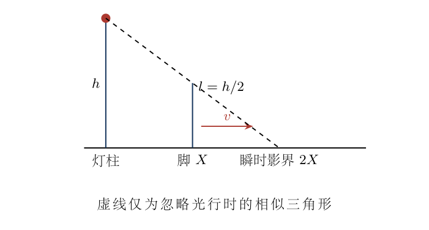

<!-- question-end -->

## 一、题型定位

有限光速把简单相似三角形变成一个迟滞几何问题。头部遮光、光到达地面以及人脚的位置涉及不同时刻；在讨论同一参考系中的影长时，应当把影界与脚放在该系的同一个时刻。行人竖直高度垂直于相对运动方向，因此本题不需要把 $l$ 或 $h$ 作洛伦兹收缩。

“影界运动”是连续不同光线和遮光事件的几何交点运动，并非一个物体或同一光子沿地面运动。不能预先把其速度限制为 $c$，也不能因出现很大的影界速度而删掉迟滞方程。另一方面，速度变换只适用于同一条影界世界线，而长度变换还涉及两端事件的同时性。

## 二、知识点

灯顶、遮光的头部和影界位于同一条直线。头部在高度 $h/2$，所以任一光线的头部遮挡点在灯顶和地面交点的几何中点，但此中点的横坐标属于遮挡时刻。光从头部到地面的时间为整个灯顶到地面传播时间的一半。

洛伦兹变换取 $x'=\gamma(x-vt)$，$t'=\gamma(t-vx/c^2)$，其中 $\gamma=(1-v^2/c^2)^{-1/2}$。对两端同时于地面系的事件直接作 $x'$ 差，通常不会得到人系同时测量的长度。光在两系中都以 $c$ 传播，人的固有高度保持 $h/2$。

## 三、物理图像

在地面系中灯柱固定，行人脚的横坐标记 $X=vt$，头部影界记 $q$。如果行人快速离开灯柱，某条被头部挡住的光线在到达地面时，行人已走到更远的位置。因此 $q-X$ 可以为负；本题定义的距离大小是 $|q-X|$。

在人系中脚固定于原点，灯柱向左运动。当前的灯柱位置不等于发出形成当前影界的光线时的位置。画图时先画当前脚，再画过去的发光灯顶；用当前灯顶与当前头部连线，相当于又回到忽略光行时的模型。

## 四、解题入口

地面系取脚在 $t=0$ 经过灯柱，先建立光到达地面时的方程。令 $\beta=v/c$，头部到地面传播时长为 $\sqrt{h^2+q^2}/(2c)$。因此遮挡时刻为 $t-\sqrt{h^2+q^2}/(2c)$，此时头部横坐标必须等于 $q/2$。

在人系中，令考察时刻为 $t'=0$，当前灯柱横坐标为 $-D$。影界横坐标记 $s$。灯顶在发光时的横坐标必须为 $-s$，这是高度二等分的几何结果。再把发光时的灯柱位置写成当前位置加上过去的移动量，避免混用两个坐标系的距离。

## 五、解析

（1）瞬时照明的几何极限。

若不计光行时，相似三角形给 $q=2X$，因而影长 $L=q-X=X$，所以

$$\boxed{\frac{dL}{dt}=v}.$$

这里的 $v$ 是影长增长速率；地面上影界本身的速度是 $dq/dt=2v$。两者相差脚的运动速度。忽略光传播时间并不等于把人影看成随人一起平移的固定图形。

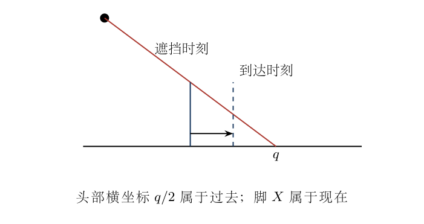

（2）地面系的迟滞方程与数值。

由入口中的遮挡时刻，得到

$$\frac q2=v\left[t-\frac{\sqrt{h^2+q^2}}{2c}\right],\qquad
\boxed{2X-q=\beta\sqrt{h^2+q^2}}.$$

左边必须非负。令 $\xi=X/h$、$Q=q/h$，平方后得到

$$(1-\beta^2)Q^2-4\xi Q+4\xi^2-\beta^2=0.$$

满足未平方方程的根是

$$Q=\frac{2\xi-\beta\sqrt{4\xi^2+1-\beta^2}}{1-\beta^2}.$$

在 $\xi=1/2$、$\beta=3/5$ 时，$Q=0.3619142055$，有向长度 $q-X=-0.1380857945h$，因此

$$\boxed{L_{\rm ground}=0.1380857945h}.$$

另一个平方根使 $2X-q<0$，不满足光的迟滞关系。这个根必须通过原方程剔除，而不是仅凭“距离不能为负”来剔除。保留下来的影界位于当前脚的靠灯一侧，但其地面横坐标仍为正。

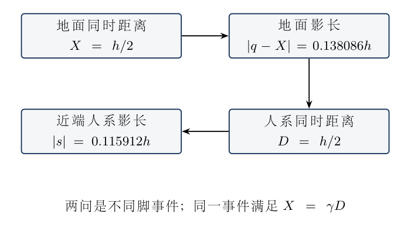

（3）人系中应重新规定同时性。

光从过去的灯顶 $(-s,h)$ 传播到地面 $(s,0)$，全程长为 $\sqrt{h^2+4s^2}$。灯柱在此过程中向左移动距离 $v\sqrt{h^2+4s^2}/c$。当前位置为 $-D$，故

$$\boxed{D-s=\beta\sqrt{h^2+4s^2}}.$$

令 $d=D/h$、$S=s/h$。对本题 $d=1/2$、$\beta=3/5$，有

$$11S^2+25S+\frac{11}{4}=0.$$

近端根为 $S=(-25+\sqrt{504})/22=-0.1159116218$，远端根为 $S=(-25-\sqrt{504})/22=-2.1568156509$。两个根均满足未平方的迟滞方程，不能把远端根误称为平方伪根。按照题干规定的与脚相连的近端人影，得到

$$\boxed{L_{\rm person}=0.1159116218h}.$$

人系同时切片可能与同一影界轨迹有多次交点；近端影界须与远处另外的影区区分。若不补充近端约定，仅写“头部投影”可能有分支歧义。这里明确列出两个解，并说明最终采用哪个解。

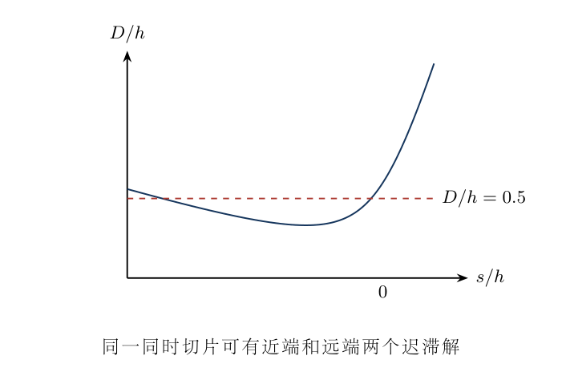

（4）先求有向影界导数，再求距离大小。

灯柱向左走，所以当前距离 $D$ 在人系中满足 $\dot D=v$。对迟滞方程求导，有

$$\frac{ds}{dt^{\prime}}=\frac{v}{1+4\beta s/\sqrt{h^2+4s^2}}.$$

把近端根代入，得到 $ds/dt^{\prime}=0.8230465247c$。因为此时 $s<0$，脚边影长为 $L=-s$，所以

$$\boxed{\frac{dL}{dt^{\prime}}=-0.8230465247c},\qquad
\boxed{\left|\frac{dL}{dt^{\prime}}\right|=0.8230465247c}.$$

负号表示近端影长正在缩短。导数是这一时刻的局部速率，不能把它当成整个行走过程中不变的值。接近影界分支相切的位置时，分母可能趋于零；那是几何投影的折叠点，并不意味着人体或光子的速度变为无穷。

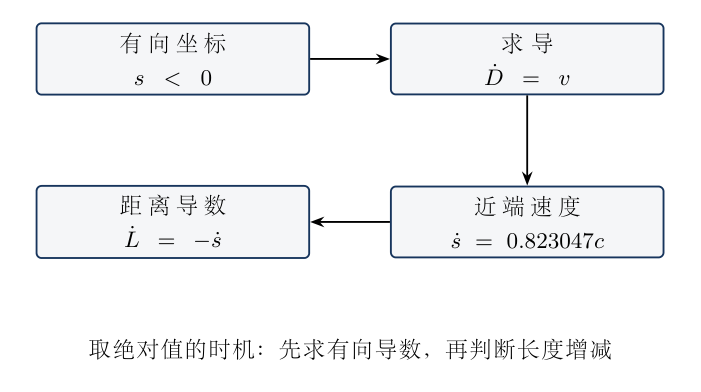

（5）同时距离不同，不能直接收缩两个数值。

第（2）问地面系的 $X=h/2$ 对应当前人系灯柱距离 $D=X/\gamma=0.4h$，而第（3）问 $D=h/2$ 对应脚所在的地面事件 $X=\gamma D=0.625h$。它们不是同一脚事件。即使选择同一脚事件，人系影界还要在 $t'$ 同时切片上重新寻找，不能把地面系同时长度乘上或除以 $\gamma$。

可以把影界的整个地面轨迹与脚的整个轨迹分别作洛伦兹变换，然后在指定 $t'$ 平面取交点。这一检查与人系迟滞方程等价。对于地面系影界事件，$v_q=dq/dt=2v/[1+\beta q/\sqrt{h^2+q^2}]$；形式上的速度变换给 $(v_q-v)/(1-vv_q/c^2)$，分母为零处正对应切片的几何折叠。

（6）低速和远距离检查。

当 $\beta\to0$，迟滞方程回到 $q=2X$ 和 $s=D$，两系影长均回到普通几何结果。固定 $\beta$ 且 $X/h\gg1$ 时，地面影界约为 $q\simeq2X/(1+\beta)$，因此 $q-X\simeq X(1-\beta)/(1+\beta)>0$。本题给定距离很近，才出现脚走过近端影界的情况。

在数值计算中，应分别检查方程残差、根的分支、长度绝对值和导数符号。四个问题的答案分别是一个经典增长速率、一个地面距离、一个人系近端距离和一个人系瞬时距离速率；单位和对象均不能互换。

（7）一般人系根及分支的形成条件。

把人系迟滞式平方，得到

$$(1-4\beta^2)S^2-2dS+d^2-\beta^2=0.$$

在 $\beta\ne1/2$ 时，两个形式根为

$$S_\pm=\frac{d\pm\beta\sqrt{4d^2+1-4\beta^2}}{1-4\beta^2}.$$

每个根还要检查 $d-S\ge0$。低速时只有一个满足这一未平方条件；当 $\beta>1/2$，方程曲线可能出现折叠。根号要求 $d\ge\sqrt{4\beta^2-1}/2$。本题 $d=0.5$ 高于这个最小值，因而确有两个真根。把 $\beta=0.6$ 放入一般式，得到与前面精确二次方程相同的两个数值。

这可由未平方曲线 $d(S)=S+\beta\sqrt{1+4S^2}$ 直接核验。驻点满足 $1+4\beta S/\sqrt{1+4S^2}=0$，因此

$$S_*=-\frac1{2\sqrt{4\beta^2-1}},\qquad
d_*=\frac12\sqrt{4\beta^2-1}.$$

本题 $d_*\simeq0.3316624790$。当 $d>d_*$，同一同时切片产生两个影界交点；$d=d_*$ 时两根合并，导数表达式的分母为零；$d<d_*$ 时该头部影界在此切片没有实交点。根的数量变化来自空间投影几何，不能解释为人的存在或灯的亮灭发生改变。

（8）头部影界与整个身体影区。

人系中身体是固定在 $x'=0$ 上、从地面到 $l$ 的线段。对一个地面点，先寻找灯顶发光的迟滞位置，再判断光线与 $x'=0$ 的交点是否落在身体高度范围。头部影界只对应交点高度恰为 $l$；脚的位置是另一条边界。对本题参数，靠近脚的影区由较小负根与 $s=0$ 相接，远处的另一影界则属于另一个不与脚相连的影区。

这一判断说明为什么近端约定有可观察的几何意义。若把两根都仅称为“头部投影”，却没有说明影区的连通部分，同一个题目会得到两种不同距离。整理稿在题面显式选近端，同时保留远根作为模型校勘。

若行人的匀速运动只在某一时刻开始，远端分支还会依赖启动前的光照历史。本文的迟滞世界线模型按恒定速度连续延拓，在这个模型内两个根均合法。近端结果与原手写答案所选分支一致，但其唯一性不能只靠平方公式声称。

（9）事件坐标而非“影长收缩”的计算检查。

取人系当前脚事件 $t'_0=D/v$、$x'_F=0$。同一人系时刻的影界事件为 $(t'_0,s)$。逆变换给地面影界时刻 $t_S=\gamma(t'_0+vs/c^2)$、横坐标 $q_S=\gamma(s+vt'_0)$。这与当前脚的地面时刻 $t_F=\gamma t'_0$ 不相同，时间差为 $\gamma vs/c^2$。

把 $t_S,q_S$ 代入地面迟滞式，可以逐个检查两个分支都属于同一地面影界世界线。长度收缩公式若忽略 $t_S-t_F$，就把影界取在了错误的地面时刻。这是同时性问题的实际计算内容，不是单靠“不同参考系有不同时间”一句话可以替代的步骤。

（10）一般身高比例的几何核查。

设人身高为 $\lambda h$，$0<\lambda<1$。忽略光行时，头部横坐标为 $(1-\lambda)q=X$，所以影长 $L=\lambda X/(1-\lambda)$，变化率为 $\lambda v/(1-\lambda)$。本题 $\lambda=1/2$ 才恰好给 $v$，这个数值不是任意身高都成立的规律。

有限光速时，从头部到地面的时间为 $\lambda\sqrt{h^2+q^2}/c$，故地面迟滞方程推广为

$$X-(1-\lambda)q=\beta\lambda\sqrt{h^2+q^2}.$$

人系中灯顶的迟滞横坐标为 $-(1-\lambda)s/\lambda$，全光程长为 $\sqrt{h^2+s^2/\lambda^2}$，因此

$$D-\frac{1-\lambda}{\lambda}s=\beta\sqrt{h^2+s^2/\lambda^2}.$$

取 $\lambda=1/2$ 同时恢复前面的两系方程。这个推广从几何中点变为一般分点，是对两个公式中系数 $2$ 的独立检验；若仅把高度改为 $\lambda h$ 却保留中点条件，结果就不再正确。

（11）特殊速度点与连续低速极限。

一般根公式在 $\beta=1/2$ 时分母消失，但未平方方程并没有失去意义。此时平方后的二次项恰好为零，变成线性方程，给出

$$S=\frac{d^2-1/4}{2d},\qquad d>0.$$

代回原式可见 $d-S=(d^2+1/4)/(2d)>0$，所以这个根合法。它也等于近端分支从低速或高速一侧趋近 $\beta=1/2$ 的连续极限；另一根则移向无穷远。不能因为通式分母为零就宣布该速度没有影界。

固定 $d>0$ 令 $\beta\to0$，未平方式直接给 $S\to d$。这是经典投影影界位于脚前方的有符号坐标。随着速度增大，影界可以穿过脚的位置，之后 $S<0$；影长仍定义为 $|S|h$，其导数需按所在符号分段。由 $S=0$ 代入迟滞式，穿过脚的条件是 $d=\beta$。

本题人系 $d=0.5<0.6$，所以近端影界已落在脚后方，影长的变化率与影界坐标变化率符号相反。先判断这一点，再取绝对值，才能同时给出正确的长度与“增长或缩短”的描述。

\newpage

# 第2题　抛转均匀细杆的扫掠包络与碰撞概率

<!-- question-start -->

长为 $l$、质量均匀的细笔初始沿 $x$ 轴，一端在瞬时冲量期间固定，另一端获得向上的速度 $v_0$；冲量结束后立即释放固定端，笔仅受重力。设 $v_0$ 足够大，使质心上升距离远大于 $l$。在笔落回原高度附近，质心下落速度的变化可忽略。以质心横坐标 $l/2$、向下速度 $v_0/2$ 的局部模型研究运动。

（1）通过笔与水平面夹角 $\theta$ 时各点的速度，建立 $x-z$ 平面中笔扫过区域边界的参数方程。（2）画出扫过区域，标明笔转动方向，区分端点轨迹与真实包络。（3）数值计算位于 $x=0.2l$ 和 $x=0.8l$ 的细小手指被碰到的概率之比。概率按笔落回该高度时的转动相位在一个周期内均匀分布定义，忽略手指尺寸和笔厚度。

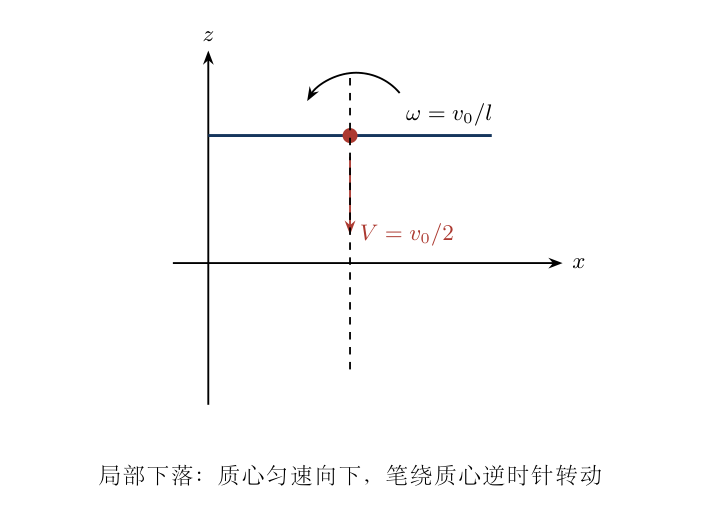

<!-- question-end -->

## 一、题型定位

本题包含两个独立阶段：冲量期间绕固定端转动，以及释放后质心平动加绕质心转动。把端点初速度直接当作质心速度，会把包络的尺度、下降节距和概率同时算错。边界也不等于简单叠加两个端点轨迹；一根直线段的运动可能在内部材料点处形成包络。

概率来自相位测度。只有指定返回时转动相位均匀，才能把扫掠竖向周期中覆盖长度的比例解释为碰撞概率。对单次给定初始状态，笔的运动完全确定，结果只有碰到或未碰到。这里的均匀相位模型是用于比较两个横向位置的统计假设。

## 二、知识点

均匀细杆绕端点的惯量为 $ml^2/3$，绕质心为 $ml^2/12$。冲量结束前端点速度 $v_0$ 对应角速度 $\omega=v_0/l$，质心速度为 $V=v_0/2$。释放后重力对质心没有力矩，因此 $\omega$ 不变；返回原高度时质心速度的大小回到 $V$。

一族线段参数化为 $\mathbf r(\theta,s)$，其中材料坐标 $s\in[-l/2,l/2]$。内部包络由二维雅可比行列式 $\det(\partial_\theta\mathbf r,\partial_s\mathbf r)=0$ 给出；端点 $s=\pm l/2$ 也是候选边界。最后还须删去被其他时刻的线段覆盖的候选弧。

## 三、物理图像

质心保持横坐标 $l/2$，在局部匀速模型中向下走；杆绕质心逆时针转动。一个完整的有标记材料转动周期为 $2\pi$，但均匀无标记的线段在转过 $\pi$ 后已经具有相同方向，只是下降一个新的竖直节距。

杆的右半边有些点的瞬时竖直速度可以为零，它们构成右侧内包络。左侧则由端点轨迹的未被覆盖的弧构成边界。端点曲线可能与相邻周期的端点曲线交叉；交叉后的弧若处于已扫过的区域内部，就不能继续涂成空隙边界。

## 四、解题入口

选取局部时刻使杆水平、质心高度为 $z_0$，令 $\theta=\omega t$。这个 $z_0$ 只设置竖向相位零点，不强迫实际返回原高度时杆也水平。用材料坐标 $s$ 写每个点的位置，再分别求端点和内部零速度条件。

计算概率时固定横坐标 $x$，把 $s$ 消去，得到只随 $\theta$ 变化的高度函数。材料范围转成允许角区间。一个角周期所产生的高度区间与相邻周期平移的区间作并集；使用并集长度，不能把重叠部分重复加到概率里。

## 五、解析

（1）质心速度与转速由释放前的刚体运动给出。

冲量结束时杆仍绕固定端转动，任一点速度为 $v(\xi)=\omega\xi$。端点条件给 $\omega=v_0/l$，所以质心速度 $\omega l/2=v_0/2$。释放后角动量关于质心守恒；质心自由抛体运动，不再受固定端约束。

初始上升高度为 $V^2/(2g)=v_0^2/(8g)$。题设要求此高度远大于 $l$，即 $gl/v_0^2\ll1$，因此落回原高度附近跨过一个杆长时的速度变化只是小量。此局部近似保留杆的旋转，却只把质心下降视为匀速，不是忽略重力的全程模型。

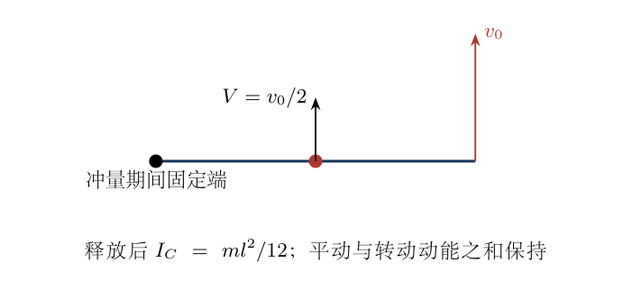

（2）整个线段族及内部包络。

取 $s$ 从质心向初始右端为正，得

$$x=\frac l2+s\cos\theta,\qquad
z=z_0-\frac l2\theta+s\sin\theta.$$

各点速度为

$$v_x=-\omega s\sin\theta,\qquad
v_z=\omega\left(-\frac l2+s\cos\theta\right).$$

雅可比为 $s-l\cos\theta/2$，所以包络材料点满足 $s=(l/2)\cos\theta$。代回得到

$$\boxed{x_{\rm env}=\frac l2+\frac l2\cos^2\theta},\qquad
\boxed{z_{\rm env}=z_0-\frac l2\theta+\frac l4\sin2\theta}.$$

在包络点处速度与杆方向平行，线段扫掠面积的一阶变化为零。它并不要求整个点速度为零。包络横坐标介于 $l/2$ 与 $l$，所以右侧 $x=0.8l$ 的间歇扫掠应由该包络决定，而不能只用右端轨迹。

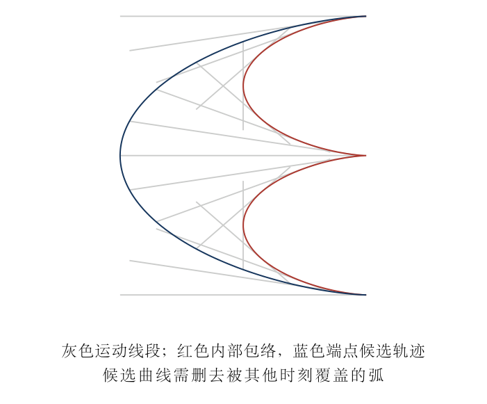

（3）端点候选边界及真正暴露的弧。

两个端点的轨迹分别为

$$x_\pm=\frac l2\pm\frac l2\cos\theta,\qquad
z_\pm=z_0-\frac l2\theta\pm\frac l2\sin\theta.$$

无标记线段的扫掠区域在竖向的基本周期为

$$H=\frac{\pi l}{2}.$$

相邻端点轨迹交点可取两个角 $\theta_1$ 与 $\pi-\theta_1$。等横坐标与等高度给出

$$\theta_1+\sin\theta_1=\frac\pi2.$$

数值根为 $\theta_1=0.8317111936$，相应空隙最右端横坐标为 $x_c=l(1-\cos\theta_1)/2=0.1631939855l$。因此 $x_c<x<l/2$ 的竖直线在周期内完全被覆盖。端点曲线在这个范围虽仍有轨迹，但其相关弧已被其他时刻扫掠，不能保留为孔洞边界。

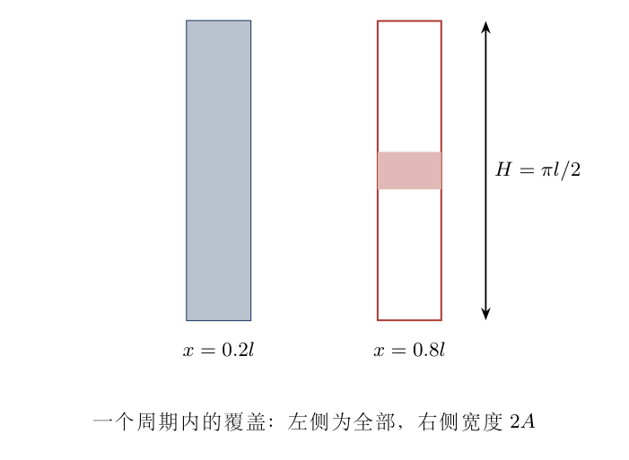

（4）固定横坐标的高度区间。

令 $d=x/l-1/2$，消去材料坐标得到

$$\frac{z-z_0}{l}=-\frac\theta2+d\tan\theta,
\qquad |\cos\theta|\ge2|d|.$$

对一个方向周期，可取 $-\alpha\le\theta\le\alpha$，$\alpha=\arccos(2|d|)$。连续高度函数在这个闭区间的值域是一个区间，周期之间再按 $H$ 平移。其极值既可能在区间端点，也可能来自内部导数为零的位置。

当 $d<0$，高度导数 $-1/2+d\sec^2\theta$ 总为负，区间长度为 $l[\alpha+2|d|\tan\alpha]$。因此

$$P(x)=\min\left(1,\frac{2}{\pi}[\alpha+2|d|\tan\alpha]\right),\quad x<l/2.$$

临界值就是上一节的 $x_c$。在 $x=l/2$，允许的线段横向方向经过竖直位置，质心扫过每个高度，概率为 $1$。在 $x$ 接近 $0$ 时，覆盖比趋于零；端点恰好触及左端位置是零测度事件，不产生有限概率。

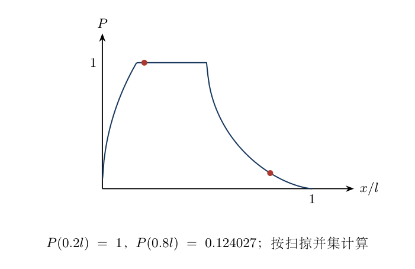

（5）两个指定位置及概率比。

$x=0.2l$ 时 $d=-0.3$、$\alpha=\arccos0.6$，覆盖区间长度为 $l(\alpha+0.8)=1.727295218l>H$，相邻周期的区间重叠，故 $P(0.2l)=1$。

$x=0.8l$ 时 $d=0.3$，内部驻点满足 $\cos^2\theta=0.6$。令 $\theta_e=\arccos\sqrt{0.6}=0.6847192030$，包络高度幅度为

$$A=\frac l2[\theta_e-\sin\theta_e\cos\theta_e]
=0.0974106272l.$$

端点的高度幅度只有 $0.0636476090l$，小于包络幅度，故应使用 $2A$ 作为总覆盖长度。于是

$$\boxed{P(0.8l)=\frac{4A}{\pi l}=0.1240270627},\qquad
\boxed{P(0.2l):P(0.8l)=1:0.1240270627}.$$

第二个位置碰撞概率约为 $12.4\%$。两个位置的差别来自时间扫掠几何，不是因为笔的质量或速度发生变化；在该局部模型中 $v_0$ 同时决定平动和转动，它在覆盖比例中消去。

（6）边界、概率与模型适用范围的独立检查。

把连续角区间密集采样，每一角先按材料范围计算高度，再取值域并按 $H$ 归一化，可以独立恢复上面的概率。用完整线段取样还可直接画出扫过区，不必先知道包络。两种方法应给出相同的右侧覆盖宽度和左侧完全覆盖带。

若手指有有限尺寸，或笔有有限半径，应把扫过区域向外扩张相应距离，概率会增加。若返回相位不是均匀分布，应对指定的相位分布积分；仅凭一幅包络图无法得到新的概率。若 $gl/v_0^2$ 不够小，质心速度随时间变化，基本竖向周期也不再严格恒定，必须回到抛体质心轨迹重新计算。

（7）概率为什么能够转成高度覆盖比。

无标记均匀杆在 $\theta\mapsto\theta+\pi$ 后，可将材料坐标同时换成 $s\mapsto-s$，线段方向和材料集合相同，而质心下降 $H=\pi l/2$。因此把返回相位在 $[0,\pi)$ 内均匀分布，等价于将固定手指高度相对扫掠图在一个竖向周期中均匀平移。

某条竖直线在一个周期内被扫过的高度总测度若为 $W(x)$，则 $P(x)=W(x)/H$。重叠区只算一次。左侧完整值域宽度大于 $H$ 时，平移后的相邻区间彼此覆盖，概率变为 $1$，而不是继续大于 $1$。

这个解释也表明概率与手指高度绝对值无关，但只适用于局部匀速下降和均匀返回相位。若相位由初始冲量、抛升时间精确确定，则只有一个确定返回角，不应把上述比例当作每次实验的随机机制。

（8）右侧一般位置的完整极值计算。

对 $l/2<x<l$，令 $d=x/l-1/2\in(0,1/2)$。允许区间 $|\theta|\le\alpha=\arccos(2d)$，高度导数为 $-1/2+d\sec^2\theta$。两个内部驻点为

$$\theta=\pm\theta_e,\qquad\theta_e=\arccos\sqrt{2d}.$$

因为 $\theta_e<\alpha$，这些点确实位于材料允许范围内。候选高度幅度包括内部包络幅度 $A/l=[\theta_e-\sin\theta_e\cos\theta_e]/2$ 和端点幅度 $B/l=|\alpha/2-d\tan\alpha|$。正确的总值域宽度为 $2\max(A,B)$，然后再除以 $H$。

这一形式尤其适合数值检查：先枚举区间端点和全部内部驻点，不能只找最近的一个导数零点。正文的 $x=0.8l$ 例子给 $A>B$；它同时说明端点轨迹不足以代表右侧真实边界。靠近 $x=l$ 时两种幅度都趋于零，概率也趋于零。

（9）端点轨迹的自交与空隙尺度。

左侧的端点曲线是带竖向漂移的旋转点轨迹。相邻半周的两条候选曲线在相同高度相交时，所对应的角互补，因而产生 $\theta+\sin\theta=\pi/2$ 的方程。这个方程在 $0<\theta<\pi/2$ 内严格单调：其导数为 $1+\cos\theta>0$，因此临界角唯一。

相交点右侧已被两组时间线段共同扫过，空隙不再延伸。用单调根数确认这一结构，能避免绘图时因有限取样漏掉窄重叠区域。纸面图可以直观显示空隙，精确阈值仍应由相交条件计算；外观估计为“约 $0.16l$”不能代替求根。

（10）角度、速度和惯量的尺度一致性。

任一点相对于质心的速度大小为 $\omega|s|$，最大值为 $v_0/2$，与质心下降速度同阶。因此即便笔的整体下落很快，也不能忽略它的转动。相反，局部模型忽略的是下降速度在几个杆长范围内的重力变化，二者不是同一种近似。

把杆长乘 $\lambda$、端点初速保持不变，角速度缩为 $1/\lambda$，局部竖向周期增为 $\lambda$ 倍。固定无量纲位置 $x/l$ 的概率不变，而近似小参数 $gl/v_0^2$ 增大，模型适用性可能变差。概率的尺度不变并不意味着所有物理条件都尺度不变。

（11）一个左侧非完全覆盖的例子。

取 $x=0.1l$，有 $d=-0.4$，允许角的端点 $\alpha=\arccos0.8$。因为高度函数在允许区间严格单调，覆盖宽度由两个端点给出：

$$\frac{W}{l}=\alpha+0.8\tan\alpha=\arccos0.8+0.6.$$

它小于 $H/l=\pi/2$，所以概率不是 $1$，而是 $P=2[\arccos0.8+0.6]/\pi\simeq0.791637$。从 $x=0.1l$ 向 $x=0.2l$ 移动，端点值域增宽并超过一个周期，这才产生完全覆盖带。

这个例子与右側 $x=0.8l$ 的极值机制不同：左侧没有内部驻点，右侧必须比较内部包络与端点。先看高度导数的符号再求值域，比在整张复杂扫掠图上目测覆盖长度可靠。计算得到的概率都应介于 $0$ 与 $1$，并随 $x$ 连续变化。

\newpage

# 第3题　方轮小车、反悬链线路面与滚动动能

<!-- question-start -->

一辆车有两个完全相同的正方形轮，轮边长为 $2a$，每轮质量为 $m$，关于轮轴的转动惯量为 $I=ma^2/6$。车体质量为 $M$，两轮轴同高。设计一个周期路面，使车体质心在竖直方向保持不变；每周期有一个凹槽。车从槽顶开始，初始水平车速为 $v_0$。取理想无滑动滚动和无耗散约束；原题的“忽略摩擦力”按无摩擦耗散理解，滚动运动学条件仍予保留。

（1）已知轮角速度 $\omega$，求轮刚进入槽顶和经过槽底时整个小车的动能。（2）解释为何一条轮边 $AB$ 依次与路面接触时轮轴高度能不变，求凹槽形状 $y=f(x)$、水平槽长、保持两轮同相滚动且不相互穿入时最小轮距，并讨论正六边形轮能否在这个同一路面上保持车体高度不变。以槽顶为 $x=y=0$、轮轴高度 $a$，槽内 $y\le0$。

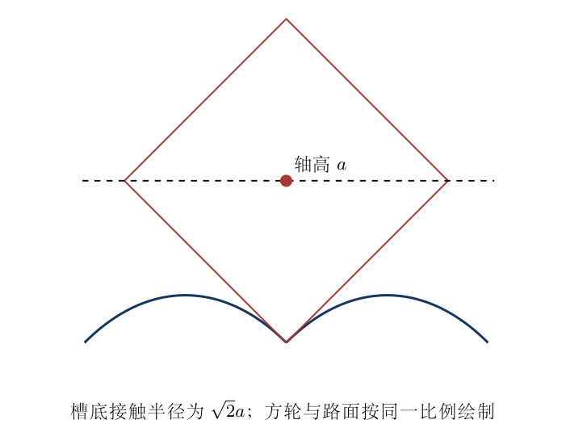

<!-- question-end -->

## 一、题型定位

方轮的轴到轮边距离不变，但轮轴到瞬时接触点的距离随滚动位置变化。平整路面会使轮轴随角度上下起伏；专门设计的反悬链线通过路面高度变化补偿这一变化。路面形状来自长度约束和轴高约束，而不是只把一条余弦曲线放在方轮下面。

动能包括车体平动、两个轮的平动和两个轮的自转。轴高恒定使重力势能恒定，无耗散理想约束下总动能恒定；但角速度并非常数，因为瞬时接触半径在变。原题所给惯量按数值使用，不假定为均匀实心方板的惯量。

## 二、知识点

理想纯滚动要求接触点对地瞬时速度为零。轮轴若只有水平速度 $V$，则 $V=\omega r$，其中 $r$ 是轮轴到接触点的竖直距离；接触点必须在轮轴的竖直下方。正方形轮的边到中心的垂直距离是 $a$。

设轮边从槽顶开始滚过的路面弧长为 $s$。沿同一条刚性轮边无滑动滚动时，该弧长也等于从边中点到当前接触点的材料距离。由直角三角形 $r^2=a^2+s^2$，轴高恒定给 $r=a-f(x)$。弧长则满足 $ds/dx=\sqrt{1+f'(x)^2}$。

## 三、物理图像

槽顶时轮边水平，其边中点位于轮轴正下方，$r=a$。向槽内移动时，接触点沿轮边向角点走，轮边同时倾斜；槽底时方轮呈菱形，下方角点到轴的距离为 $\sqrt2a$。路面下降深度恰好等于这个距离的增加量。

凹槽的左半和右半互为镜像。当前轮边滚到槽底角点后，下一条轮边接替接触并开始沿后半槽滚动。槽顶处相邻周期的切线相接，槽底处两段反悬链线有一个尖角；方轮角点在此完成接触边切换。

## 四、解题入口

先以瞬时接触为转动中心求速度关系，再列总动能。求形状时不要先猜 $f(x)$：从 $s^2=f^2-2af$ 出发，对 $x$ 求导并结合弧长方程，得到可分离的微分方程。

最小轮距涉及两个条件：两轮要处于相同的周期相位，以支持不俯仰的刚性车体；两轮实体也不能在同一平面中互相重叠。因此必须同时比较路面节距与方轮最大水平投影尺寸，不能只写轮距等于一个槽长。

## 五、解析

（1）统一动能式及两个位置。

车体和轮轴的水平速度相同，故

$$K=\frac12(M+2m)V^2+2\left(\frac12I\omega^2\right)
=\frac12(M+2m)V^2+I\omega^2.$$

槽顶的 $V=a\omega$，因此

$$\boxed{K_{\rm top}=\frac12(M+2m)a^2\omega^2+\frac16ma^2\omega^2}.$$

槽底的 $V=\sqrt2a\omega$，因此

$$\boxed{K_{\rm bottom}=(M+2m)a^2\omega^2+\frac16ma^2\omega^2}.$$

两个式子中的 $\omega$ 表示各位置的瞬时角速度。若比较同一次运动，总动能守恒，两个 $\omega$ 的数值一般不同。不能把同一个固定角速度同时代入并据此声称动能凭空增加。

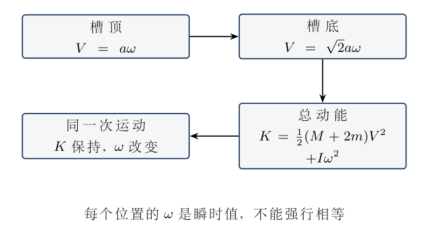

（2）轴高不变对应的几何约束。

当前接触点到轮轴的竖直距离为 $r=a-f(x)$。轮边中点到接触点沿边的距离是 $s$，所以

$$r^2=a^2+s^2,\qquad s^2=f(x)^2-2af(x).$$

无滑动要求材料边长与沿路面滚过的弧长相等，故

$$s=\int_0^x\sqrt{1+f'(\xi)^2}\,d\xi.$$

轮轴在这一构造中总位于 $y=a$，因此同相的两轮轴和车体质心高度均保持不变。这不是每个轮材料点的高度都不变；轮边与轮角仍持续上下运动，只有轴和刚性车体的高度受到设计条件控制。

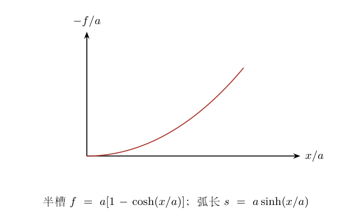

（3）从弧长方程求反悬链线。

对 $s^2=f^2-2af$ 求导：

$$s\sqrt{1+f'^2}=(f-a)f'.$$

在下坡半槽 $f\le0$、$f'\le0$，两边均非负。平方并使用 $s^2=(f-a)^2-a^2$，得到

$$[(f-a)^2-a^2](1+f'^2)=(f-a)^2f'^2.$$

令 $g=f-a<0$，则 $g'^2=g^2/a^2-1$。积分并使用槽顶 $f(0)=f'(0)=0$，得到

$$\boxed{f(x)=a[1-\cosh(x/a)]}.$$

代回有 $s=a\sinh(x/a)$、$r=a\cosh(x/a)$、$f'=-\sinh(x/a)$，三条关系共同满足弧长和轴高约束。只验证二阶微分方程却忽略初始高度，可能得到竖直平移或符号错误的曲线；因此应把原几何方程也一起回代。

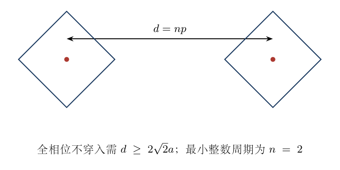

（4）槽底、槽长和周期延拓。

轮边从中点滚到角点时 $s=a$，所以 $\sinh(x_*/a)=1$，等价于 $\cosh(x_*/a)=\sqrt2$。半槽水平长为

$$x_*=a\operatorname{arcosh}\sqrt2=a\ln(1+\sqrt2).$$

槽深为 $f(x_*)=a(1-\sqrt2)$，完整槽的水平节距为

$$\boxed{p=2a\ln(1+\sqrt2)=1.7627471740a}.$$

半槽的路面弧长是 $a$，完整槽的弧长是 $2a$，刚好等于一条轮边长度。水平槽长和弧长不同，不能都记作 $2a$。若以一周期 $0\le x\le p$ 表示，前半用 $a[1-\cosh(x/a)]$，后半用 $a[1-\cosh((p-x)/a)]$，再按 $p$ 周期延拓。

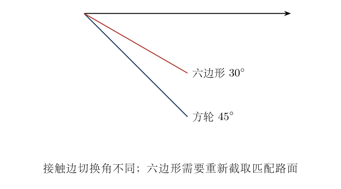

（5）两轮最小间距。

刚性车体两轴同高、同步运动，取两轮相同滚动相位，其水平轮距应为 $d=np$，$n$ 为正整数。方轮的最大水平宽度出现在菱形位置，为 $2\sqrt2a$。更严格地，对同角度的两个正方形作水平平移，分离轴判据给不穿入所需 $d\ge2a/\max(|\cos\varphi|,|\sin\varphi|)$，全相位最严条件正是 $2\sqrt2a$。

一个节距 $p<2\sqrt2a$，无法满足实体不相交；两个节距 $2p>2\sqrt2a$，可以满足。因此

$$\boxed{d_{\min}=2p=4a\ln(1+\sqrt2)=3.5254943481a}.$$

这是同平面、同相、实体轮不穿入的几何最小值。若两个轮安装在不同横向轨道且允许投影重叠，或者不要求同相，必须重新说明车体约束，不能直接引用这个最小值。

（6）为什么正六边形轮不能直接沿用同一路面。

正方形轮从边中点到角点时，轮边需相对水平转过 $45^\circ$；本路面半槽终点斜率为 $-1$，切线角也达到 $-45^\circ$。正六边形轮从边中点到角点只需转过 $30^\circ$，其接触边已提前到达角点，却还没有走到路面为方轮准备的槽底。因此接触关系不匹配，不能同时保持纯滚动和恒定轴高。

若为正六边形重新设计路面，设其内切圆半径为 $A$，同样的弧长推导给 $y=A[1-\cosh(x/A)]$，但应在 $x=A\operatorname{arcosh}(\sec30^\circ)$ 处切换接触边。形状家族相同，截取的参数范围和周期却不同；这正说明“都属于反悬链线”不等于“可以使用同一个路面”。

（7）能量与运动速率的检查。

从槽顶初速 $v_0$ 出发，初始角速度 $\omega_0=v_0/a$。任意接触半径 $r$ 时

$$\left[(M+2m)r^2+2I\right]\omega^2
=\left[(M+2m)a^2+2I\right]\omega_0^2.$$

于是槽底角速度减小，但水平车速 $V=r\omega$ 略增，因为自转动能减少、平动动能增加。极限 $I\to0$ 时 $V$ 保持 $v_0$；有有限轮惯量时车速一般不严格恒定。重力不改变总势能，理想接触的约束力不做功，能量重新分配来自几何速度关系的改变。

路面尖角和理想多边形角点属于理想化接触模型。若实际车轮、地面或轴承有变形与耗散，切换接触会引入额外损失；本题结论用于理想几何和动力学，不把真实车辆的碰撞细节隐含进能量守恒式。

（8）直接用路面切线求形状的另一条路径。

轮边与路面相切，轮中心到该切线的垂直距离恒为 $a$。接触点在轴的正下方，轴到接触点的竖直距离为 $r$；因此 $a=r/\sqrt{1+f'^2}$。恒轴高条件给 $r=a-f$，组合后得到

$$f'^2=\frac{(a-f)^2}{a^2}-1.$$

这与弧长推导完全一致。对下坡取负根，积分 $df/\sqrt{(a-f)^2-a^2}=-dx/a$，再使用 $f(0)=0$，得到 $a-f=a\cosh(x/a)$。这一路径只用接触切线和中心到边的垂距，可独立确认微分方程的符号。

反悬链线的普通悬链线形式来自双曲函数，而不是重力直接把地面拉成此形状。这里曲线由刚性多边形的几何接触设计产生，重力只进入运动动力学。两者的数学形式相似，物理起因应分别说明。

（9）轮角与路面坐标的对应关系。

令当前轮边倾角的大小为 $\varphi$，有 $s=a\tan\varphi$、$r=a\sec\varphi$。结合 $s=a\sinh(x/a)$，得到

$$\tan\varphi=\sinh(x/a),\qquad
x=a\operatorname{arsinh}(\tan\varphi).$$

在槽顶 $\varphi=0$，槽底 $\varphi=\pi/4$。对时间求导可得 $dx/d\varphi=a\sec\varphi=r$，所以水平速度正好为 $V=r\omega$。几何弧长、转角与纯滚动速度再次相互一致；它们不是三个独立可以任意指定的运动量。

半槽路面弧长 $s=a\tan\varphi$ 与水平坐标 $x$ 不同。若错误地令 $s=x$，会把反悬链线换成圆弧近似，并在槽底给出错误节距。槽顶小角时 $s\simeq x$ 只是局部近似。

（10）同一次运动的速度分配。

设 $A_M=M+2m$。从能量守恒可直接把水平速度写成

$$V(r)=v_0\sqrt{\frac{A_M+2I/a^2}{A_M+2I/r^2}}.$$

$r$ 从 $a$ 增到 $\sqrt2a$ 时，分母减小，所以 $V$ 增大；角速度 $\omega=V/r$ 却减小。重车体极限 $M\gg m$ 下，$I$ 对总惯量的贡献很小，水平车速趋于恒定。轻车体或轮转动惯量较大时，车速的变化更明显。

相同恒定轴高不等于相同恒定车速。题目所称“平稳”首先是竖向位置恒定，仍允许水平方向加速。若外部驱动强制恒定 $V$，则需随几何位置交换旋转能量，输入做功不再为零；不能同时要求无外功、有限轮惯量和全程恒速。

（11）一般正多边形的匹配路面。

对正 $n$ 边形轮，设内切圆半径为 $A$，从边中点滚到角点的半角是 $\pi/n$。相同推导给 $f=A[1-\cosh(x/A)]$，但半槽终点为

$$x_*=A\operatorname{arsinh}(\tan(\pi/n)).$$

整槽节距为 $2x_*$，半槽弧长为 $A\tan(\pi/n)$。正方形与正六边形只是不同截取角的两个例子。若固定边长，$A$ 随边数变化；若固定轮外接半径，$A$ 也有不同表达式。比较不同轮型前，必须说明保持的是哪一个尺寸。

（12）带数值的速度与能量复核。

取 $M=4m$、$a=1$、槽顶水平初速 $v_0=1$（相应一致单位），则 $\omega_0=1$、$I=m/6$，初始总动能为 $19m/6$。槽底转速 $\omega_b=\sqrt{19/37}$，水平速度 $V_b=\sqrt{38/37}$。代入槽底动能：

$$K_b=3m\frac{38}{37}+\frac m6\frac{19}{37}=\frac{19m}{6}.$$

平动部分由 $3m$ 增至 $114m/37$，自转部分由 $m/6$ 减至 $19m/222$；两项变化互相抵消。车体没有升高或降低，重力势能不变。

这个代入检查保留了两个轮的质量和两份自转动能，同时使用不同位置的不同转速。若误把槽底也设为 $\omega=1$，便会得到更大的总动能，与无外功条件不一致。题干所给惯量数值决定分配幅度，不能用未经说明的均匀方板惯量替换。

\newpage

# 第4题　表面张力梯度、半空间扩散与叶片漂移

<!-- question-start -->

液面各部分相互作用的单位长度拉力为表面张力系数 $\sigma$，力位于液面内、垂直分界线。忽略其他驱动力。

（1）边长 $l$ 的正方形叶片占据 $0\le x,y\le l$，若 $\sigma(x,y)=\sigma_0+k_1x+k_2y$，求合力。（2）面积 $S$ 的圆形小叶片中心到原点距离为 $r$，若 $\sigma(r)=\sigma_0+br^2$，求其合力大小与方向。（3）糖使表面张力增加，$\sigma(n)=\sigma_0+an$、$a>0$，在原点滴糖后叶片被吸引还是排斥？（4）糖在水中的扩散系数为 $D$，局部摩尔扩散通量为 $-D\nabla n$。在水面原点持续以摩尔率 $J$ 注入糖，假设深水半空间内形成稳定、各向同性的半球扩散，求水面距离 $r$ 处浓度 $n(r)$，取 $n(\infty)=0$。（5）叶片足够小，惯性可忽略，黏滞阻力为 $-k\mathbf v$。求从 $r_1$ 漂到 $r_2<r_1$ 所需时间。

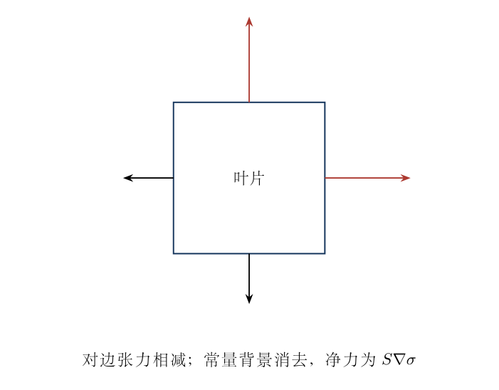

<!-- question-end -->

## 一、题型定位

表面张力是一条边界上的拉力，不是作用在叶片中心的预设径向力。先对叶片边缘的张力积分，才能确定梯度的方向与面积因子。糖改变张力后，叶片向张力较大的一侧移动；对于原点糖源，稳定浓度沿径向减小，张力也向外减小，所以合力指向原点。

扩散步骤必须明确空间几何。糖从水面点源进入深水，流过的是半球面，面积为 $2\pi r^2$。这与无限三维介质中的球形点源、薄二维膜上的径向扩散是不同模型；不能把 $4\pi r^2$、$2\pi r$ 随意替换进同一个答案。

## 二、知识点

沿叶片边缘外法线 $\mathbf n$ 的拉力为 $\sigma\mathbf n\,dl$，合力为

$$\mathbf F=\oint_{\partial A}\sigma\mathbf n\,dl
=\int_A\nabla\sigma\,dA.$$

这是二维散度定理逐分量的应用。均匀张力项的边界积分为零，只有空间变化产生净力。线性张力梯度对任意面积叶片给精确的 $A\nabla\sigma$；一般非线性场对小叶片可用中心梯度近似。

稳定扩散满足源外 $\nabla^2n=0$，总摩尔率通过任一包围源的水侧半球面均为 $J$。终端漂移满足驱动力与黏滞阻力平衡。这里的 $k$ 是阻力系数，量纲为 $\mathrm{N\,s/m}$，与前问张力梯度 $k_1,k_2$ 不同。

## 三、物理图像

正方形叶片左右两边的张力相差 $k_1l$，乘上边长 $l$ 得水平净力 $k_1l^2$；上下两边同理。每个方向单独比较对边，可以直观看到常量 $\sigma_0$ 消去。

圆叶片置于径向场中时，靠近糖源的一侧浓度大、张力大，拉力较强。浓度源不是把叶片“顶开”的压力源；题设只有表面张力梯度与黏滞阻力。叶片越靠近理想点源，梯度越大，漂移速度越大，但接近有限糖滴或叶片尺度时，小片近似会先失效。

## 四、解题入口

先用边界积分得到普遍合力公式，再分别代入线性场和二次径向场。对糖源，先写通过半球面的摩尔率守恒，再积分浓度梯度。最后把 $aS\,dn/dr$ 作为带符号的径向力，写出 $dr/dt$，按运动方向积分。

原题圆片面积小的条件在扫描中有量纲不一致的写法，应理解为 $\sqrt S\ll r$。二次张力场的面积积分因梯度本身线性，可精确取中心值；点源浓度场则真正需要小叶片近似。两处适用性不同。

## 五、解析

（1）正方形对边相减及方向。

右边与左边的 $x$ 向拉力分别为 $\int_0^l\sigma(l,y)dy$ 与 $-\int_0^l\sigma(0,y)dy$，差为 $k_1l^2$。上边与下边的 $y$ 向拉力差为 $k_2l^2$。所以

$$\boxed{\mathbf F=l^2(k_1\hat{\mathbf x}+k_2\hat{\mathbf y})}.$$

若 $k_1$ 为负，合力水平分量指向负 $x$；不应因为表面张力本身为正就把 $k_1$ 的符号改成正。张力梯度的量纲为 $\mathrm{N/m^2}$，乘面积后恰为牛顿。把对边张力差只乘一次长度而遗漏另一次，会得到错误量纲。

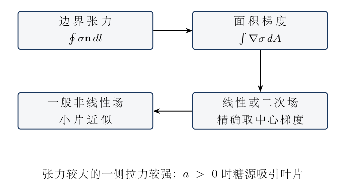

（2）圆形叶片在二次场中的合力。

$\sigma=\sigma_0+b(x^2+y^2)$，所以 $\nabla\sigma=2b(x,y)$。面积积分的第一矩给 $\int_A(x,y)dA=S\mathbf r_c$，其中 $\mathbf r_c$ 为叶片中心位置。于是

$$\boxed{\mathbf F=2bS\mathbf r_c},\qquad
\boxed{|\mathbf F|=2|b|Sr}.$$

$b>0$ 时指向远离原点的径向方向，$b<0$ 时指向原点。题目若按 $b>0$ 取参数，大小为 $2bSr$。由于梯度线性，这个结果对平面圆片乃至任意给定中心的形状都精确成立；小片假设只是后续把叶片放进非线性浓度场时所需。

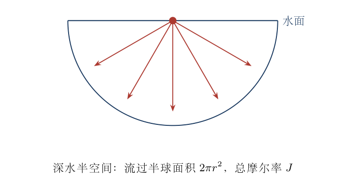

（3）糖浓度如何决定吸引。

糖源附近浓度高、远处浓度低，因此 $dn/dr<0$。由 $\sigma=\sigma_0+an$、$a>0$，有 $d\sigma/dr=a\,dn/dr<0$。小叶片合力为

$$\mathbf F\simeq aS\frac{dn}{dr}\hat{\mathbf r}.$$

于是合力向内，叶片受到吸引。这个结论只依赖浓度的径向递减与 $a>0$。若换成使表面张力下降的溶质，$a<0$，方向就会反转；不能把任意滴液后的叶片运动都称为吸引。

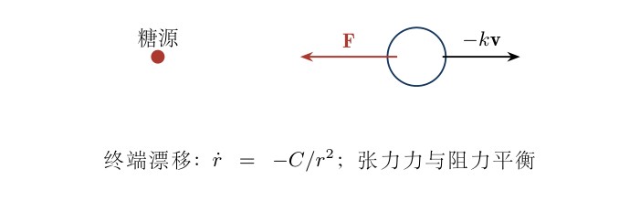

（4）半空间点源的稳定浓度。

源外任一半球面上的通量守恒给

$$J=-D\frac{dn}{dr}(2\pi r^2),\qquad
\frac{dn}{dr}=-\frac{J}{2\pi Dr^2}.$$

从 $r$ 积分到无穷远，使用 $n(\infty)=0$，得到

$$\boxed{n(r)=\frac{J}{2\pi Dr}}.$$

取常数背景浓度 $n_\infty$ 时，只需加上 $n_\infty$，浓度梯度与叶片受力不变。$J$ 的量纲为摩尔每秒，$D$ 为平方米每秒，因此 $J/(Dr)$ 的量纲为摩尔每立方米，恰好是体积摩尔浓度。

若糖源位于无限水体内部，包围面积为 $4\pi r^2$，系数改为 $1/(4\pi D)$。若在厚度固定的薄层内主要二维扩散，稳态浓度需指定有限外边界，通常出现对数而非 $1/r$。原题在水面注入深水的图像应使用半球模型，并在题干明确。

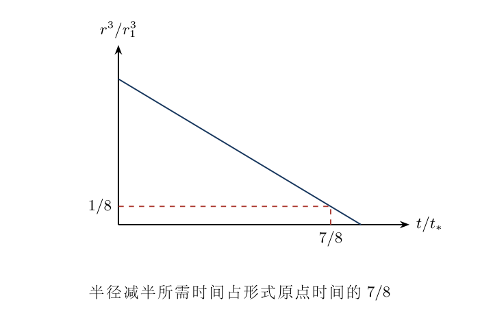

（5）合力、速度与时间积分。

在小叶片近似下

$$F_r=-\frac{aSJ}{2\pi Dr^2},\qquad
0=F_r-k\frac{dr}{dt}.$$

定义 $C=aSJ/(2\pi Dk)>0$，得到 $dr/dt=-C/r^2$。对 $r_1$ 到 $r_2$ 积分：

$$dt=-\frac{r^2}{C}\,dr,\qquad
\boxed{t=\frac{2\pi Dk}{3aSJ}(r_1^3-r_2^3)}.$$

由于 $r_1>r_2$，时间为正。轨迹也可写成

$$\boxed{r(t)^3=r_1^3-3Ct}.$$

因此 $r^3$ 对时间为直线，而 $r$ 本身不匀速。距离减半所需时间为外推到点源时间的 $7/8$，最后的短半径区间只占较少时间。这个形式不能一直用于叶片与糖源直接接触之后。

（6）惯性、小片和稳态条件。

忽略惯性不是指叶片没有质量，而是速度松弛时间 $m/k$ 远小于漂移尺度时间 $r/|v|=r^3/C$。条件可写为 $mC/(kr^3)\ll1$。若接近原点，这个比值反而增大，终端速度近似可能失效。有限叶片的另一条件是其半径 $q=\sqrt{S/\pi}$ 满足 $q/r\ll1$。

稳态浓度也需要足够长的注入时间，达到距离 $r$ 的扩散时间约为 $r^2/D$。把稳态式用于刚滴入糖的瞬间，通常会高估远处浓度与驱动力。原题已经指定浓度达到稳定，因此时间积分从此稳态背景中的叶片运动开始。

（7）有限片的独立面积检查。

在源附近非线性浓度场中，严格合力应计算 $a\int_A\nabla n\,dA$。对关于中心对称的圆片，一阶位置偏移项面积平均为零，首个相对修正为 $O(q^2/r^2)$，这解释为什么使用中心梯度有二阶小片误差，而不是一般的一阶误差。

均匀背景张力 $\sigma_0$ 无论多大都不产生净力；同样，浓度加一个常量也不改变漂移。合力随 $S$ 增大，但实际阻力系数 $k$ 可能也随叶片尺寸变化，所以只有在把 $k$ 明确保持不变的参数比较中，才能直接说速度正比面积。

（8）有限圆片的第一项修正。

设圆片半径为 $q$，中心距源 $r\gg q$。对中心对称区域，任意平滑标量场面积平均满足

$$\frac1S\int_A n\,dA=n(\mathbf r_c)+\frac{q^2}{8}\nabla_{\parallel}^2n(\mathbf r_c)+O(q^4\partial^4n).$$

这里是液面内二维拉普拉斯算符，不是整个三维空间算符。对水面 $n=K/r$，$K=J/(2\pi D)$，二维径向算符给 $\nabla_{\parallel}^2n=K/r^3$。再对圆片中心位置求梯度，得到

$$F_r=-\frac{aSK}{r^2}\left[1+\frac{3q^2}{8r^2}+O(q^4/r^4)\right].$$

因此有限片的吸引力略大于中心梯度近似；其相对误差首项为 $3q^2/(8r^2)$。本题不要求保留这个修正，但它提供小片模型的实际误差估计。二维拉普拉斯不为零，与三维源外 $\nabla^2n=0$ 并不矛盾，因为前者只对液面内两个方向求导。

（9）外边界浓度与背景项。

若在半径 $R_b$ 的外边界保持浓度 $n_b$，而内部仍是径向半球扩散，则

$$n(r)=n_b+\frac{J}{2\pi D}\left(\frac1r-\frac1{R_b}\right).$$

浓度绝对值发生变化，梯度却仍为 $-J/(2\pi Dr^2)$。因此叶片受力和同两个半径之间的漂移时间保持原式，只要外边界没有改变径向流量与几何。边界离叶片太近、流场不再半球对称时，这个结论失效，不能只加一个浓度常数补偿几何变化。

这也是检查张力背景的一个方法：$\sigma_0$ 和浓度常量只影响各边共同的张力，不影响净力。若某个推导的终端速度含 $\sigma_0$，就应回到边界积分查找没有消去的均匀项。

（10）多个近似条件的相互比较。

浓度达到局部稳态所需尺度时间为 $r^2/D$，叶片漂移尺度时间为 $r^3/C$。若要在漂移过程中把浓度场视为准稳态，应要求 $C/(Dr)\ll1$。另一方面，速度松弛要求 $mC/(kr^3)\ll1$，小片几何要求 $q/r\ll1$。它们分别控制扩散、惯性和空间非均匀性。

三条条件对 $r$ 的依赖不同，靠近源时可能先后失效。不能仅凭叶片质量很小就保证稳态扩散成立，也不能仅凭叶片面积很小就忽略速度松弛。原题指定稳态和忽略惯性，是将这些条件作为理想模型前提；实际例值需要逐项检查。

（11）参数依赖的定量核查。

在保持其余参数独立不变时，漂移时间正比 $D$ 和 $k$，反比 $a,S,J$。扩散系数越大，固定注入率对应的稳态浓度梯度越小，反而使此稳态驱动的叶片漂移更慢。这个结论并不表示扩散本身变慢，而是扩散更快降低了维持相同注入率所需的浓度梯度。

注入率加倍时浓度、梯度与驱动力都加倍，终端速度加倍，时间减半。若 $k$ 随面积变化，不能再孤立使用时间反比 $S$；应将实际 $k(S)$ 代入完整式。这种参数比较可以检查最终公式是否遗漏某个比例因子。

（12）指定半径区间的无量纲检查。

把 $r_1$ 作为长度尺度、$t_*=r_1^3/(3C)$ 作为时间尺度，定义 $\rho=r/r_1$、$\tau=t/t_*$。轨迹简化为

$$\rho^3=1-\tau,\qquad \rho=(1-\tau)^{1/3}.$$

因此不同 $J,D,a,S,k$ 的理想终端轨迹经各自尺度化后落在同一曲线上。若测得的 $r^3-t$ 图明显弯曲，就提示浓度尚未稳定、阻力非线性、有限片效应或惯性已不可忽略，不能靠调整一个常数 $C$ 解释所有偏差。

在 $\rho=1/2$、$1/4$ 两个区间点，时间分别为 $7/8$ 和 $63/64$。后一段半径从 $r_1/2$ 到 $r_1/4$ 只需 $7t_*/64$，是首段时间的 $1/8$，与局部尺度时间正比 $r^3$ 一致。这里的形式曲线只延伸到模型仍有效的最小半径，不描述实际源滴接触过程。

（13）从静止开始时的局部惯性修正。

终端近似默认速度已经适应当地驱动力。若叶片刚从静止释放，令初始半径为 $r_0$，在很短时间内把力大小近似固定为 $F_0=aSJ/(2\pi D r_0^2)$。取向源方向为局部正方向、速度为 $w$，牛顿方程是

$$m\dot w+kw=F_0,\qquad w(0)=0.$$

定义 $\tau_m=m/k$，解为 $w(t)=(F_0/k)(1-e^{-t/\tau_m})$。积一次得到向内位移

$$\Delta r=\frac{F_0}{k}\left[t-\tau_m(1-e^{-t/\tau_m})\right].$$

在 $t\ll\tau_m$ 时，展开指数，$\Delta r\simeq F_0t^2/(2m)$，恢复从静止开始的匀加速首项；在 $t\gg\tau_m$ 且位移仍远小于 $r_0$ 时，轨迹接近终端直线，但相对于立即取终端速度的结果有约 $\tau_m$ 的时间迟延。

局部驱动力固定的条件为 $\Delta r/r_0\ll1$，惯性可以忽略的条件则是 $\tau_m\ll r_0^3/C$。这两个条件描述不同的近似，不能互相代替。随叶片接近源点，$r^3/C$ 逐渐减小，终端近似可能先于形式上的到达时刻失效；主结果的有限区间积分应在这些条件仍成立的半径范围内使用。

\newpage

# 第5题　阻感参数倍增的无穷梯形网络

<!-- question-start -->

交流源 $U(t)=U_0\cos\omega t$ 驱动无穷梯形网络。第 $n$ 级（$n=0,1,2,\ldots$）先串联电阻 $2^nR$，随后该节点通过串联的电阻 $2^nR$ 和电感 $2^nL$ 接到公共回线，再接下一倍增级。$R>0,L>0$。求稳态输入等效阻抗，说明二次方程根的选择，并检查低频与高频极限。

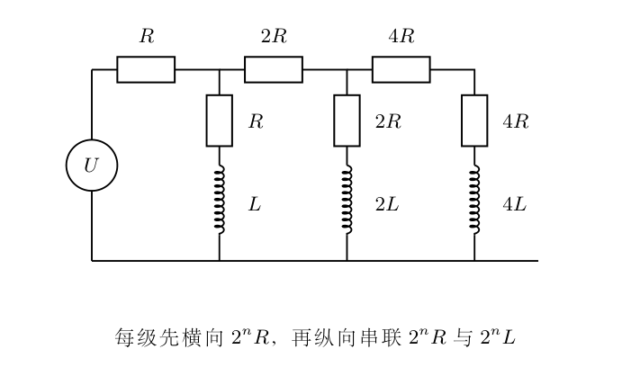

<!-- question-end -->

## 一、题型定位

网络每向右推进一级，所有阻抗整体乘二，拓扑结构不变。这是按阻抗尺度放大的自相似，不是每一级都与首级完全相同。输入阻抗可以通过一次并联和一次串联写成自身的函数，再解代数方程。

代数方程可能有两个解，但只有一个能代表被动有限梯形网络逐级增加后的极限。应通过有限级收敛、非负耗散和节点电压的空间行为判断，而不能只用“正号看起来合理”来选根。交流电感的阻抗为 $i\omega L$，复数根还需注明连续的平方根分支。

## 二、知识点

取相量约定 $\operatorname{Re}(\widetilde Ue^{i\omega t})$，于是电感阻抗为 $i\omega L$。一条支路的首级阻抗记 $B=R+i\omega L$。首个节点往右看见的整个余网，其每个元件均是原网的两倍，因此阻抗为 $2Z$。

两个并联阻抗 $B$ 与 $2Z$ 的等效值为 $2ZB/(2Z+B)$。被动网络稳态平均功率为 $\tfrac12\operatorname{Re}(\widetilde U\widetilde I^*)$，因此输入阻抗必须有非负实部。节点电压比可由第一串联电阻的分压求出，作为独立空间检查。

## 三、物理图像

每一节点都会分出一部分电流经本级的电阻和电感流回公共线。向后元件值越来越大，余网不是简单短路，也不是简单开路。随着频率升高，电感阻碍本级支路电流，但无限多级的并联结构仍会形成有限比例的输入感抗。

前一级的电阻 $R$ 位于输入端与首节点之间，不属于首节点的纵支路并联。若先把它与纵向电阻相加，会破坏拓扑。画递推图时先圈出“首串联电阻”，再在其右端分成 $B$ 和 $2Z$ 两条支路。

## 四、解题入口

只把端口之后完整复制的余网标记为 $2Z$，由 $Z=R+B\parallel2Z$ 建立方程。保留复数 $B$ 到最后，再代入 $R+i\omega L$，能减少符号错误。

根的检查可从 $\omega=0$ 开始：有限纯电阻网的等效阻值一定为正。再随频率连续延拓到交流根。有限网络也可以从最末一级反向递推，在保持拓扑一致的前提下与解析根比较。

## 五、解析

（1）自相似方程。

余网整体倍增，因此

$$\boxed{Z=R+\frac{2Z(R+i\omega L)}{2Z+R+i\omega L}}.$$

把分母移到两边，逐项展开为

$$2Z^2-(3R+i\omega L)Z-R(R+i\omega L)=0.$$

特别注意中间项系数是 $3R+i\omega L$。在展开 $(Z-R)(2Z+B)=2ZB$ 时，右边的 $2ZB$ 必须完整移项；遗漏它会得到另一个看似合理但与原网络不符的二次方程。

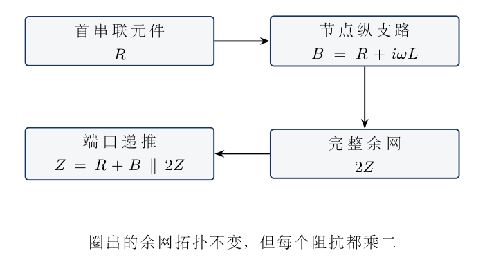

（2）两个代数根与平方根分支。

求根公式给

$$Z_\pm=\frac{3R+i\omega L\pm\sqrt{17R^2-\omega^2L^2+14iR\omega L}}4.$$

对 $\omega\ge0$，选平方根的实部为正、虚部非负的连续分支。物理解为

$$\boxed{Z=\frac{3R+i\omega L+\sqrt{17R^2-\omega^2L^2+14iR\omega L}}4}.$$

$\omega=0$ 时平方根为 $\sqrt{17}R$，加号根为正，减号根为 $(3-\sqrt{17})R/4<0$。实际无源电阻网络不可能产生负输入电阻，因此减号根在直流已被排除。频率变化时继续使用同一连续分支，避免数值开方在不同频段任意跳根。

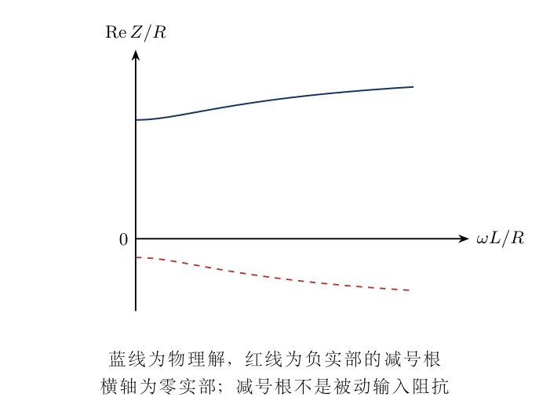

（3）显式实部、虚部及被动性。

令 $q=\omega L/R$，$A=17-q^2$、$C=14q$，$H=\sqrt{A^2+C^2}$。平方根可写为 $R(u+iw)$，其中

$$u=\sqrt{\frac{H+A}{2}},\qquad
w=\sqrt{\frac{H-A}{2}}\quad(q\ge0).$$

于是

$$\operatorname{Re}Z=\frac R4(3+u),\qquad
\operatorname{Im}Z=\frac R4(q+w).$$

对 $q>0$ 均为正，网络同时有耗散和感性储能。$u$ 从 $\sqrt{17}$ 向高频值 $7$ 趋近，所以输入实部从约 $1.7808R$ 向 $2.5R$ 变化。高频不能简单把所有电感看作开路后再说端口断路；无穷级极限与“每一有限级逐个开路”的操作需要分别处理。

平均输入功率为 $\overline P=U_0^2\operatorname{Re}(1/Z)/2$，不是 $U_0^2/(2\operatorname{Re}Z)$。当 $Z$ 有虚部时，后二者不同。源电流峰值为 $U_0/|Z|$，相位滞后 $\arg Z$。

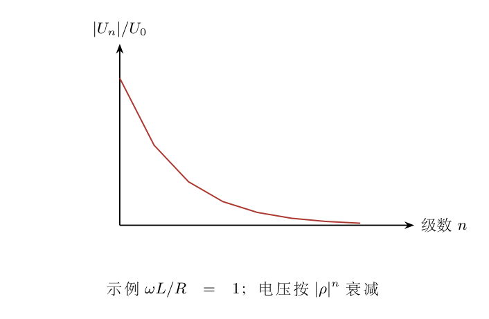

（4）节点电压衰减与根的空间检验。

首节点电压为 $\widetilde U_1=\widetilde U_0(1-R/Z)$。定义

$$\rho=1-\frac RZ,\qquad \widetilde U_n=\rho^n\widetilde U_0.$$

物理解满足 $|\rho|<1$，因为

$$|Z|^2-|Z-R|^2=2R\operatorname{Re}Z-R^2>0.$$

节点相量因此向后衰减。纵向支路和继续向右的电流还除以逐级倍增的阻抗，衰减比涉及 $\rho/2$，不能仅按电压比推断电流。

直流减号根使 $|\rho|>1$，其电压在无源网络中越向后越大，与有限网络无外部尾端电源的极限不一致。这个空间判断独立于直流阻抗正负，是一次额外根选择检查。

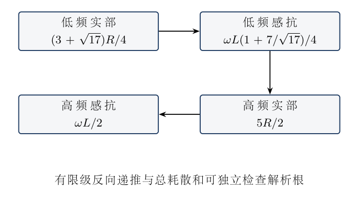

（5）低频极限与等效参数。

$q\to0$ 时

$$\boxed{Z(0)=\frac{3+\sqrt{17}}4R}.$$

把平方根按 $\omega$ 一阶展开，得到

$$Z=\frac{3+\sqrt{17}}4R
+i\omega\frac L4\left(1+\frac7{\sqrt{17}}\right)
+O\left(\frac{\omega^2L^2}{R}\right).$$

因此低频输入可以等效为电阻 $(3+\sqrt{17})R/4$ 串联一个一阶有效电感 $L[1+7/\sqrt{17}]/4$。这只是频率足够小的展开，并不表示整个无限网络在任意频率都等于同一个固定电阻和固定电感。

直流电压衰减比为 $\rho_0=(\sqrt{17}-1)/(\sqrt{17}+3)$，约为 $0.4384471872$。从首级电阻与余网分压也能得到同一数值，作为极限拓扑检查。

（6）高频极限及有限网络的验证。

对 $q\gg1$，所选平方根满足 $\sqrt{17R^2-\omega^2L^2+14iR\omega L}=7R+i\omega L+O(R^2/\omega L)$。所以

$$\boxed{Z=\frac52R+\frac{i\omega L}{2}+O(R^2/\omega L)}.$$

输入感抗的主项对应 $L/2$。若先令 $R=0$，所有横向串联电阻为零，电感 $L,2L,4L,\ldots$ 并联，其等效电感正好为 $L/2$；这只检查感抗主项，不足以推出有限 $R$ 的实部 $5R/2$。

有限 $N$ 级网络的最末首级等效为 $Z_1=R+B$，再反复作 $Z_{n+1}=R+2Z_nB/(2Z_n+B)$。对固定有限频率，随着 $N$ 增加递推收敛到加号根。数值核验应覆盖低、中、高频；只验证 $\omega=0$ 不能排除交流相量符号错误。

（7）各级损耗的几何级数检查。

第 $n$ 个横向串联电阻中的电流为 $\widetilde U_0\rho^n/(2^nZ)$；本级纵向电阻中的电流为 $\widetilde U_0\rho^{n+1}/(2^nB)$。两组平均损耗都按 $|\rho|^2/2$ 形成收敛级数，求和得到

$$\overline P=\frac{RU_0^2}{2[1-|\rho|^2/2]}
\left(\frac1{|Z|^2}+\frac{|\rho|^2}{|B|^2}\right).$$

它应与端口 $U_0^2\operatorname{Re}(1/Z)/2$ 相同。这是能量与电路递推之间的独立一致性检查，也说明节点电压衰减的空间解确实给出有限总耗散。

（8）有限级递推为什么选定同一个根。

定义映射 $F(z)=R+2zB/(2z+B)$，有限尾端为 $z_1=R+B$。物理解 $Z$ 是这个映射的固定点。其局部导数为

$$F'(Z)=\frac{2B^2}{(2Z+B)^2}.$$

加号根附近映射收敛，增加级数后尾端选择对输入的影响逐渐消失。实际数值可以同时报告 $|z_N-Z|/|Z|$ 和 $|F'(Z)|$；前者检验整个递推，后者只检验固定点附近的局部稳定性。不能把局部稳定性自动等同于任意起点的全局收敛。

对首级电压 $U_0$，第 $n$ 节节点电压按 $\rho^n$ 衰减，纵支路电流再按元件倍增除以 $2^n$。因此越远的支路即使具有更大的电感，也承担更小电流；总储能和损耗都需要按实际电流权重计算，不能简单把无限个元件值相加。

（9）一般倍增因子 $\lambda$ 的推广。

若每级阻抗乘 $\lambda>1$，完整余网为 $\lambda Z$。原递推变成

$$Z=R+\frac{\lambda ZB}{\lambda Z+B}.$$

展开得

$$\lambda Z^2-[\lambda R+(\lambda-1)B]Z-RB=0.$$

取连续被动根，有

$$Z=\frac{\lambda R+(\lambda-1)B+
\sqrt{[\lambda R+(\lambda-1)B]^2+4\lambda RB}}{2\lambda}.$$

取 $\lambda=2$ 恢复正文。这个推广检查了首串联电阻、纵支路和余网三者的比例；如果只把正文答案中的数字 $2$ 全部机械替换为 $\lambda$，往往会遗漏中间的 $\lambda-1$ 项。

（10）一般倍增网络的高频主项。

令横向电阻先趋于零，电感 $L,\lambda L,\lambda^2L,\ldots$ 并联。倒数和为 $\lambda/[L(\lambda-1)]$，故高频感抗主项为 $i\omega L(\lambda-1)/\lambda$。对有限 $R$ 的完整平方根展开，实部趋于

$$R\left[2+\frac1{\lambda(\lambda-1)}\right].$$

$\lambda=2$ 时给 $L/2$ 与 $5R/2$，与正文一致。$\lambda\to1^+$ 时高频实部展开的系数发散，提示这个高频展开与几乎不倍增的极限不能不加条件地交换。等倍元件网络应另用 $\lambda=1$ 的递推，再讨论频率尺度。

（11）复阻抗与瞬时、平均功率。

令 $Z=|Z|e^{i\phi}$，源电流为 $I(t)=U_0\cos(\omega t-\phi)/|Z|$。相乘得到

$$P(t)=\frac{U_0^2}{2|Z|}
[\cos\phi+\cos(2\omega t-\phi)].$$

平均值为 $U_0^2\cos\phi/(2|Z|)=U_0^2\operatorname{Re}(1/Z)/2$。感性网络中瞬时功率可以在部分时间为负，表示储能返回电源；平均功率仍为正，等于所有电阻的平均损耗。这与“输入阻抗实部为正”的被动性判断并不矛盾。

（12）一个中频相量例子。

取 $R=L=1$、$\omega=1$，输入根为

$$Z=\frac{3+i+\sqrt{16+14i}}4.$$

计算平方根前先确认它的实部和虚部都为正。相量源电流为 $\widetilde I=U_0/Z$，节点电压比为 $\rho=1-1/Z$。用二十级以上有限梯形网反向递推，可在不先开平方的情况下得到相同输入阻抗。

若取 $U_0=1$，平均输入功率为 $\operatorname{Re}(1/Z)/2$。再把横电阻损耗和纵电阻损耗逐级求和，所得功率应一致。计算复数损耗时用 $|I_n|^2R_n/2$，不能直接用 $I_n^2R_n/2$；后者一般是复数，不代表平均焦耳热。中频例子同时检验相量共轭、支路倍率和根的虚部符号，避免只在纯实直流极限上验证。

\newpage

# 第6题　滑套连杆机构的速度与加速度

<!-- question-start -->

平面机构中，杆 $AB$ 以恒定速度 $v$ 水平向右平移。其端点 $B$ 是套在绕固定点 $O$ 转动的杆 $OC$ 上的滑套，$B$ 可沿 $OC$ 滑动。滑块 $E$ 沿过 $O$ 的水平轨道运动，固定长度连杆 $DE$ 连接杆 $OC$ 上的固定铰点 $D$ 与 $E$。$AB$ 与 $OE$ 两水平线的垂直距离为 $b$。

在图示瞬间，$OC$ 与水平夹角 $\alpha=60^\circ$，连杆 $DE$ 向右下方与水平夹角 $\beta=30^\circ$，且 $OD=BD$。求杆 $OC$ 的角速度、角加速度，以及滑块 $E$ 的速度和加速度。取向右为水平正向、逆时针为角度正向。$D$ 是杆上固定材料点，等距关系只在该瞬间成立。

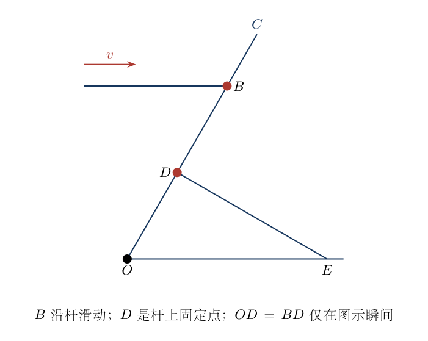

<!-- question-end -->

## 一、题型定位

滑套 $B$ 有一项沿杆的相对运动，而 $D$ 是杆的固定材料点。这两个点的位置虽然在指定瞬间有 $OD=BD$，但不能在求导时把 $D$ 永远写成 $B$ 的中点。机构加速度题中，瞬时几何关系与全程约束必须区分。

杆 $OC$ 的角运动可先由 $B$ 的水平轨迹确定；再求固定点 $D$ 的速度、加速度；最后通过连杆 $DE$ 的固定长度与 $E$ 的水平约束求输出。这个顺序既便于矢量法，也便于坐标微分法。

## 二、知识点

对绕固定点的杆上材料点，有 $\mathbf v_D=\dot\alpha\,\hat{\mathbf z}\times\mathbf r_D$，$\mathbf a_D=\ddot\alpha\,\hat{\mathbf z}\times\mathbf r_D-\dot\alpha^2\mathbf r_D$。连杆两端的相对速度垂直于连杆：$(\mathbf v_E-\mathbf v_D)\cdot\mathbf r_{ED}=0$。

固定连杆长度还给加速度约束

$$(\mathbf a_E-\mathbf a_D)\cdot\mathbf r_{ED}
+|\mathbf v_E-\mathbf v_D|^2=0.$$

第二项不能省略，它来自对长度平方约束的二次求导。滑块 $E$ 的竖向速度和加速度都为零。角速度与角加速度可以异号，角加速度为正并不表示当时正在逆时针转动。

## 三、物理图像

$B$ 在高度 $b$ 的水平线上向右走，$OB$ 越来越倾斜向右，角度 $\alpha$ 减小，所以杆顺时针转动。转动速度的大小随角度变化；本题瞬间的角加速度为逆时针方向，表示顺时针转动正在减慢。

固定铰点 $D$ 同时向右和向下运动。连杆另一端 $E$ 只能水平走，因此相对速度必须沿连杆法向。加速度中既有连杆转动的法向项，也有杆 $OC$ 的切向与向心项，单凭速度三角形不能得到完整加速度。

## 四、解题入口

令 $x_B=b\cot\alpha$，直接对时间求导，利用 $\dot x_B=v$、$\ddot x_B=0$，先得到 $\dot\alpha$、$\ddot\alpha$。再由瞬时几何求固定长度 $d=OD=b/\sqrt3$、$\ell=DE=b$。

然后保持 $d,\ell$ 为常数写 $x_D=d\cos\alpha$、$y_D=d\sin\alpha$。取 $E$ 位于 $D$ 的右侧，得 $x_E=x_D+\sqrt{\ell^2-y_D^2}$。这是一条可直接两次微分的标量路径，也能用于数值差分检查。

## 五、解析

（1）杆 $OC$ 的角速度。

由套点高度不变，$OB=b/\sin\alpha$、$x_B=b\cot\alpha$。因此

$$v=-b\csc^2\alpha\,\dot\alpha,\qquad
\dot\alpha=-\frac vb\sin^2\alpha.$$

代入 $\alpha=60^\circ$，得到

$$\boxed{\dot\alpha=-\frac{3v}{4b}}.$$

负号表示顺时针。若题目仅问角速度大小，答案为 $3v/(4b)$，但在加速度计算中必须继续使用带符号角速度，尤其是切向项和相对速度方向不能随意改号。

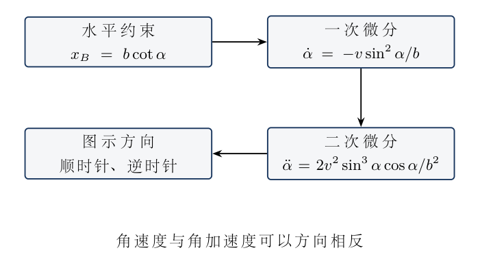

（2）角加速度。

对 $\dot\alpha=-v\sin^2\alpha/b$ 求导，利用 $v$ 为常数：

$$\ddot\alpha=-\frac{2v}{b}\sin\alpha\cos\alpha\,\dot\alpha
=\frac{2v^2}{b^2}\sin^3\alpha\cos\alpha.$$

故

$$\boxed{\ddot\alpha=\frac{3\sqrt3v^2}{8b^2}}.$$

这是逆时针角加速度。角速度的绝对值在当前区间随时间减小，与 $B$ 越走越远、杆的方向变化越来越慢一致。角加速度量纲为每秒平方，不能漏掉分母中的 $b^2$。

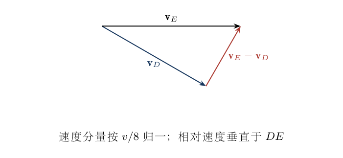

（3）固定点 $D$ 的几何和速度。

$OD=OB/2=b/(2\sin60^\circ)=b/\sqrt3$。记 $d=b/\sqrt3$，则当前 $\mathbf r_D=(b/(2\sqrt3),b/2)$。连杆 $DE$ 的竖向高度差为 $b/2$，由 $\beta=30^\circ$ 得 $DE=b$，水平投影为 $\sqrt3b/2$。

$D$ 的速度为

$$\mathbf v_D=d\dot\alpha(-\sin\alpha,\cos\alpha)
=\left(\frac{3v}{8},-\frac{\sqrt3v}{8}\right).$$

在 $\mathbf r_{ED}=(\sqrt3b/2,-b/2)$ 方向上，相对速度投影必须为零。令 $\mathbf v_E=(V_E,0)$，得到

$$\frac{\sqrt3b}{2}\left(V_E-\frac{3v}{8}\right)
-\frac b2\left(\frac{\sqrt3v}{8}\right)=0.$$

于是

$$\boxed{\mathbf v_E=\frac v2\hat{\mathbf x}}.$$

两端相对速度为 $(v/8,\sqrt3v/8)$，大小为 $v/4$。这还给连杆 $DE$ 的逆时针角速度 $v/(4b)$；它与杆 $OC$ 的顺时针角速度不是同一个角速度。

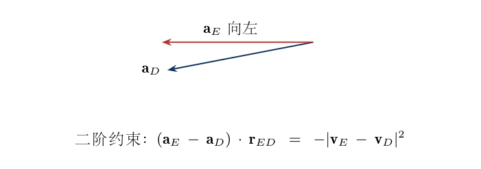

（4）$D$ 的加速度。

保持 $d$ 固定，对材料点坐标求两次导数：

$$a_{Dx}=-d(\cos\alpha\,\dot\alpha^2+\sin\alpha\,\ddot\alpha),$$

$$a_{Dy}=d(-\sin\alpha\,\dot\alpha^2+\cos\alpha\,\ddot\alpha).$$

代入上述数值，得到

$$\boxed{\mathbf a_D=
\left(-\frac{9\sqrt3v^2}{32b},-\frac{3v^2}{32b}\right)}.$$

水平分量向左，竖直分量向下。向心项与切向项在两个分量上组合不同，不能把 $|\ddot\alpha|d$ 当作总加速度大小，也不能忽略 $d\dot\alpha^2$。

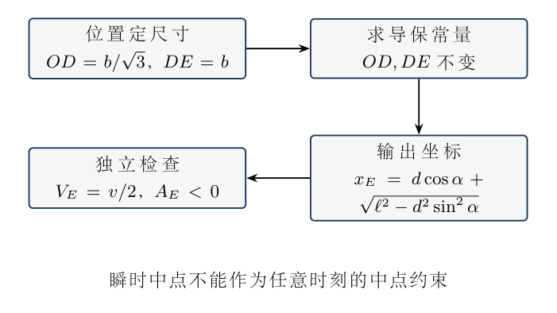

（5）滑块 $E$ 的加速度。

取 $\mathbf a_E=(A_E,0)$，二阶长度约束给

$$(\mathbf a_E-\mathbf a_D)\cdot\mathbf r_{ED}
=-|\mathbf v_E-\mathbf v_D|^2=-\frac{v^2}{16}.$$

代入 $D$ 的加速度与连杆投影：

$$\frac{\sqrt3b}{2}\left(A_E+\frac{9\sqrt3v^2}{32b}\right)
-\frac b2\left(\frac{3v^2}{32b}\right)=-\frac{v^2}{16}.$$

因此

$$\boxed{\mathbf a_E=-\frac{7\sqrt3v^2}{24b}\hat{\mathbf x}}.$$

输出滑块此时向右运动，却向左加速，即正在减速。不能因为速度向右而把加速度方向也画成右；本题这两个方向恰好相反。

（6）坐标微分的独立路径。

固定 $d=b/\sqrt3$、$\ell=b$，用

$$x_E(\alpha)=d\cos\alpha+\sqrt{\ell^2-d^2\sin^2\alpha}$$

直接求导。也可以把 $x_B$ 作为自变量，写成

$$x_E(x_B)=\frac{dx_B}{\sqrt{x_B^2+b^2}}
+\sqrt{\ell^2-\frac{d^2b^2}{x_B^2+b^2}}.$$

在 $x_B=b/\sqrt3$ 处，$V_E=v\,dx_E/dx_B$、$A_E=v^2d^2x_E/dx_B^2$。数值差分和矢量约束应恢复 $v/2$ 与 $-7\sqrt3v^2/(24b)$。这里不能把 $d$ 写成当前 $OB/2$ 再随 $x_B$ 一同变化，因为 $D$ 是杆上的固定铰点。

（7）为什么瞬时中点不能作全程约束。

如果错误地令 $\mathbf r_D=\mathbf r_B/2$ 全程成立，会得到 $\mathbf v_D=(v/2,0)$ 和 $\mathbf a_D=0$。这与固定材料点必须绕 $O$ 作圆弧运动的事实矛盾，也会把连杆速度三角形整个改变。

本题的等距关系只用于求机构固定尺寸 $OD$，求导后必须保持该尺寸不变。判断约束是否可求导，应先分清它是“任意时刻成立的机构关系”还是“题目指定瞬间的位置数值”。这一规则同样适用于别的滑套、齿轮接触或曲柄机构题。

（8）连杆 $DE$ 的角加速度及向心项。

取 $DE$ 向右下方角为 $-\beta$，则 $y_D=\ell\sin\beta$。一次求导给 $\dot\beta=\dot y_D/(\ell\cos\beta)=-v/(4b)$，因此连杆自身角速度为 $-\dot\beta=v/(4b)$，方向逆时针。

二次求导有

$$a_{Dy}=\ell(\cos\beta\,\ddot\beta-\sin\beta\,\dot\beta^2).$$

使用 $a_{Dy}=-3v^2/(32b)$、$\ell=b$、$\beta=30^\circ$，得到 $\ddot\beta=-v^2/(8\sqrt3b^2)$。所以连杆自身的角加速度为 $\sqrt3v^2/(24b^2)$，同样逆时针。

再写 $\mathbf a_E=\mathbf a_D+\dot\omega_{DE}\hat{\mathbf z}\times\mathbf r_{ED}-\omega_{DE}^2\mathbf r_{ED}$，可恢复输出水平加速度，竖直分量严格相消。这条刚体加速度路径与长度二次约束等价，明确揭示了正文速度平方项对应的连杆向心加速度。

（9）输入速度若随时间变化。

一般输入 $x_B(t)$ 的速度为 $v$、加速度为 $a_{\rm in}$。角运动变成

$$\dot\alpha=-\frac vb\sin^2\alpha,\qquad
\ddot\alpha=-\frac{a_{\rm in}}b\sin^2\alpha
+\frac{2v^2}{b^2}\sin^3\alpha\cos\alpha.$$

输出坐标写作固定尺寸函数 $x_E=g(x_B)$，所以 $V_E=g'v$、$A_E=g'a_{\rm in}+g''v^2$。图示位置 $g'=1/2$、$g''=-7\sqrt3/(24b)$，给出

$$A_E=\frac12a_{\rm in}-\frac{7\sqrt3v^2}{24b}.$$

第一项是输入直接传递的加速度，第二项是机构几何导致的加速度。原题输入匀速只消去第一项，不消去第二项。把“输入加速度为零”理解成所有输出加速度为零，是运动学中常见的错误。

（10）套点 $B$ 的极坐标相对运动检查。

$B$ 的径向坐标为 $\rho=b/\sin\alpha$。速度分解为 $\mathbf v_B=\dot\rho\mathbf e_r+\rho\dot\alpha\mathbf e_\alpha$，其竖直分量必须为零、水平分量为 $v$。由 $\dot\rho=-b\cos\alpha\dot\alpha/\sin^2\alpha=v\cos\alpha$，可以逐项确认这一速度分解。

加速度包含径向 $\ddot\rho-\rho\dot\alpha^2$ 与切向 $\rho\ddot\alpha+2\dot\rho\dot\alpha$。后者中的系数 $2$ 是滑套径向运动与杆转动同时存在的交叉项。代入匀速输入后两个地面分量均为零，与套点直线匀速轨迹一致；漏掉交叉项就会得到虚假的非零加速度。

（11）约束和分支的几何可行性。

输出函数中平方根要求 $\ell^2-d^2\sin^2\alpha\ge0$。原图 $d=b/\sqrt3$、$\ell=b$，在整个第一象限满足该条件。取正平方根表示 $E$ 位于 $D$ 右侧；若改取负根，机构位于另一装配分支，输出速度和加速度也会改变。

因此在代数运算前应确认装配分支，不能把平方根默认选正当成纯数学惯例。固定点半径、连杆长度和滑块位置约束共同决定机构的可行运动区间。

（12）位置约束的残差如何核查。

对任一足够小的角度变化，保持 $d=b/\sqrt3$ 和 $\ell=b$，用位置函数生成 $D,E$ 坐标，距离应满足 $(x_E-x_D)^2+y_D^2=\ell^2$。然后分别求一阶和二阶残差：

$$R_v=(\mathbf v_E-\mathbf v_D)\cdot\mathbf r_{ED},$$

$$R_a=(\mathbf a_E-\mathbf a_D)\cdot\mathbf r_{ED}
+|\mathbf v_E-\mathbf v_D|^2.$$

两者应同时为零。只检查第一条不能保证加速度正确，因为不同的错误加速度仍可能配合同一组正确速度。

使用数值差分时，步长过大有截断误差，过小则受浮点相减影响。可逐次减小步长，观察二阶导数先趋近解析值，再选择稳定区间作为检查。数值方法中的这种变化不能通过修改机构固定尺寸来“补偿”，否则检查的已不是原装配位置。

\newpage

# 第7题　远离楔形墙角的声源与回声多普勒效应

<!-- question-start -->

两面静止、无限延伸的平面墙构成 $60^\circ$ 楔角。超音蝠位于楔角内部，以恒定速度 $v=u/3$ 沿角平分线远离墙角，$u$ 为静止空气中的声速。它向四周发出频率 $f_0$ 的声波，并接收墙面反射的回声。求一次墙面反射回声频率与原频率之比；若把经两面墙连续反射的回声也包含在“回声”中，应分别给出其频率。忽略空气流动，墙面按镜面反射处理。

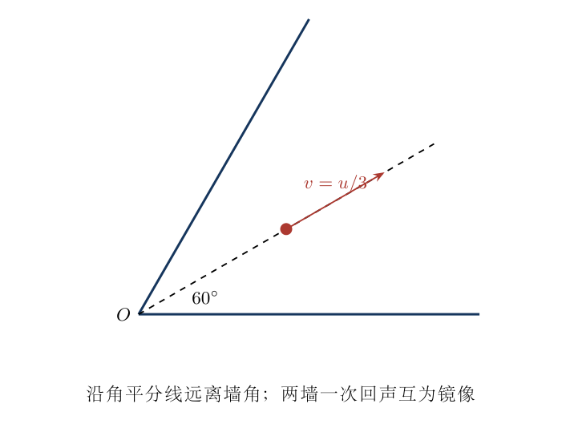

<!-- question-end -->

## 一、题型定位

发声者和接收者是同一只移动的蝙蝠，但声波发出和收到之间它的位置已改变。对斜墙的回声，不能把当前到墙的法向速度简单套入一维往返公式；实际传播方向会由移动接收端的位置决定。

镜像法把一次反射展开成“过去的镜像声源到未来的接收者”的直线传播。然后用两次相邻发射的到达时刻差求频率。这同时处理声源运动、接收者运动和传播角度变化，不需要把两个多普勒因子分别猜出再相乘。

## 二、知识点

墙静止时镜面反射保持声波在空气中的频率，但移动声源的发射频率与空气中沿某方向传播的频率不同，移动接收者又改变接收频率。完整计算应明确两个速度相对于空气的方向投影。

把源点镜像到墙另一侧，源与像到墙的距离相等，反射路径总长等于接收点到像点的直线长度。若传播时长 $T$ 随发射时刻 $t_e$ 变化，到达时刻为 $t_a=t_e+T(t_e)$，则相邻波峰的频率比为 $f/f_0=dt_e/dt_a$。

## 三、物理图像

蝙蝠沿角平分线向楔角开口方向飞，离两墙都越来越远。一次反射的两个镜像源分别位于角平分线两侧，镜像方向与实际方向夹角均为 $60^\circ$，因此两面墙的一次回声具有相同频率。

两次连续反射对应镜像源绕墙角旋转 $120^\circ$，它的传播路径更长、时延对源距离增长更敏感，因此频率更低。三次形式镜像的方向差为 $180^\circ$，直线路径会穿过墙角本身；该退化路径不能直接当作普通墙面镜面反射的第三类回声。

## 四、解题入口

取某次发射时蝙蝠到墙角的距离为 $r$，发射后经过时间 $T$ 收到回声，此时真实位置到墙角距离为 $r+vT$。镜像声源仍对应发射时的距离 $r$，不随收到时刻再次移动。

一次反射时，用两位置夹角 $60^\circ$ 写余弦定理；两次反射时夹角为 $120^\circ$。解传播时长后，再令后一次发射的位置为 $r+v\Delta t_e$，求到达间隔。整个过程必须保留声波传播期间蝙蝠继续向外飞的位移。

## 五、解析

（1）一次反射的传播时间。

像点与未来接收点的夹角为 $60^\circ$，于是

$$(uT)^2=r^2+(r+vT)^2-2r(r+vT)\cos60^\circ.$$

化简为

$$(u^2-v^2)T^2-rvT-r^2=0.$$

取正时间根，令 $\beta=v/u$，得到

$$T=\frac ruK_1,\qquad
K_1=\frac{\beta+\sqrt{4-3\beta^2}}{2(1-\beta^2)}.$$

负根对应到达早于发射，不满足回声因果顺序，应舍去。二次项系数是 $u^2-v^2$，若误写成 $u^2+v^2$，会得到不同的数值频率；这一符号可以直接由未来接收位置的平方展开核查。

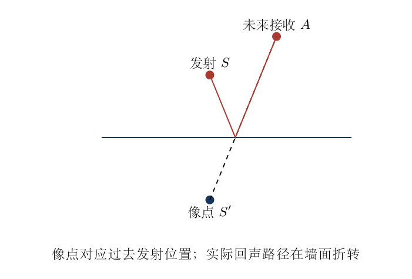

（2）相邻波峰的到达间隔。

第一次在发射时刻 $t_e$ 距墙角 $r$。后一次在 $t_e+\Delta t_e$ 发射，距离变成 $r+v\Delta t_e$。由于 $K_1$ 只依赖固定速度比，两次传播时间之差为 $vK_1\Delta t_e/u$。因此

$$\Delta t_a=(1+\beta K_1)\Delta t_e.$$

接收频率比为

$$\boxed{\frac{f_1}{f_0}=\frac1{1+\beta K_1}
=\frac{2(1-\beta^2)}{2-\beta^2+\beta\sqrt{4-3\beta^2}}}.$$

比值小于一，表示远离墙面的红移。此结果与当前距离 $r$ 无关，因为整个几何随 $r$ 按比例放大；传播时间本身正比 $r$，但到达间隔的比例只取决于速度比与墙角。

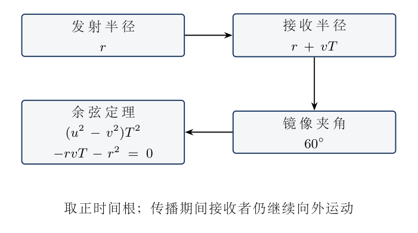

（3）代入 $v=u/3$。

$\beta=1/3$ 时 $K_1=3(1+\sqrt{33})/16$，所以

$$\boxed{\frac{f_1}{f_0}=\frac{16}{17+\sqrt{33}}
=\frac{17-\sqrt{33}}{16}=0.7034648346}.$$

两面墙各自的一次反射回声频率相同，可以重叠到达。原手写解的传播根和约 $0.73$ 的数值不满足上述余弦定理的二次方程，因此本稿以完整传播几何校正。若只保留蝙蝠速度在当下墙法线的投影 $v/2$，会得到一维近似 $5/7\simeq0.7143$；它也不是有限速度下的精确结果。

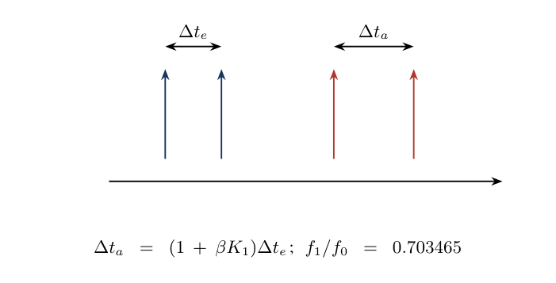

（4）用移动镜像的投影公式独立检查。

镜像源的速度是实际速度对墙的镜像，其方向与实际速度夹角为 $60^\circ$。沿从发射像点到未来接收点的单位方向 $\mathbf n$，一般声源与观察者多普勒公式为

$$\frac f{f_0}=\frac{u-\mathbf v_r\cdot\mathbf n}
{u-\mathbf v_s'\cdot\mathbf n}.$$

取实际运动单位向量为 $\mathbf e$、镜像为 $\mathbf e'$，$\mathbf e\cdot\mathbf e'=1/2$，传播方向

$$\mathbf n=\frac{(r+vT)\mathbf e-r\mathbf e'}{uT}.$$

由此 $\mathbf v_r\cdot\mathbf n=v(r/2+vT)/(uT)$，$\mathbf v_s'\cdot\mathbf n=v(-r/2+vT/2)/(uT)$。代入 $T=rK_1/u$ 后，恰好恢复 $1/(1+\beta K_1)$。这一路径使用速度投影，与波峰到达时间求导是独立表达的同一物理过程。

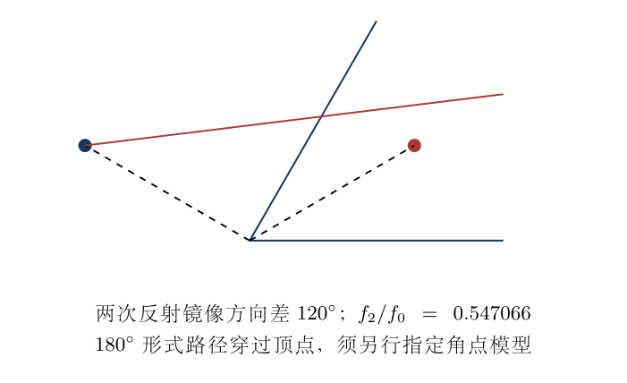

（5）两面墙连续反射的回声。

两次镜像对应实际源方向与像点方向夹角 $120^\circ$。此时

$$(uT_2)^2=r^2+(r+vT_2)^2-2r(r+vT_2)\cos120^\circ,$$

即 $(u^2-v^2)T_2^2-3rvT_2-3r^2=0$。因此

$$K_2=\frac{3\beta+\sqrt{12-3\beta^2}}{2(1-\beta^2)},\qquad
\frac{f_2}{f_0}=\frac1{1+\beta K_2}.$$

对 $\beta=1/3$，得到

$$\boxed{\frac{f_2}{f_0}=\frac{16}{19+\sqrt{105}}
=\frac{19-\sqrt{105}}{16}=0.5470655771}.$$

先下墙后上墙、先上墙后下墙的两条路径互为镜像，具有相同频率。它们的频率与一次反射不同，所以若把“所有回声”都包含在问题中，不能只报一个数字而省略反射次数。

（6）一般镜像夹角与退化角点路径。

若有效镜像方向与实际方向夹角为 $\delta$，记 $a_\delta=1-\cos\delta$，传播方程统一为

$$(1-\beta^2)K^2-2a_\delta\beta K-2a_\delta=0.$$

正根为 $K=[a_\delta\beta+\sqrt{a_\delta^2\beta^2+2a_\delta(1-\beta^2)}]/(1-\beta^2)$，频率仍为 $1/(1+\beta K)$。$\delta=60^\circ$ 与 $120^\circ$ 分别恢复前两类结果。

形式上取 $\delta=180^\circ$ 可得往返频率比 $(1-\beta)/(1+\beta)=1/2$。但在本楔角的镜像展开中，这条射线通过共同墙角，而不是依次打到三个非顶点的平面位置。墙角的衍射或散射需要额外模型，不能把形式镜像数值当作必然存在的第三类普通回声。

（7）低速与固定墙的检查。

$\beta\to0$ 时 $K_1\to1$，一次反射路径长为 $r$，频率回到 $f_0$。一阶展开 $f_1/f_0=1-\beta+O(\beta^2)$，等于两个法向投影多普勒因子的一阶合成。原题 $\beta=1/3$ 不够小，必须保留有限速度的传播方向变化。

墙静止只保证反射前后空气系频率不变，并不能消除移动声源和接收者的多普勒效应。两次反射的红移更大来自不同像点几何，不是静止墙每反射一次就额外乘一个独立频率损失系数。

（8）一般墙角的一次反射结果。

设楔角为 $2\alpha$，蝙蝠仍沿角平分线运动。一次像点方向差为 $2\alpha$，令 $a_\alpha=1-\cos2\alpha=2\sin^2\alpha$。传播系数为

$$K=\frac{a_\alpha\beta+
\sqrt{a_\alpha^2\beta^2+2a_\alpha(1-\beta^2)}}{1-\beta^2}.$$

频率比仍为 $1/(1+\beta K)$。静止时 $K=2\sin\alpha$，即往返距离等于两倍法向墙距。这个一般式同时检验原题 $\alpha=30^\circ$ 的像点角与路径尺度，不能把楔角 $60^\circ$ 误当成每条墙与运动方向的夹角。

（9）法向近似与精确结果的阶数。

记 $s_\alpha=\sin\alpha$，精确传播式在低速下展开为

$$\frac f{f_0}=1-2s_\alpha\beta+2s_\alpha^2\beta^2
-(s_\alpha+s_\alpha^3)\beta^3+O(\beta^4).$$

把当前法向速度 $vs_\alpha$ 放入一维往返式，展开前三项相同，但三阶系数是 $-2s_\alpha^3$。因此二者第一次差异出现在三阶。原题 $s_\alpha=1/2$，精确三阶系数 $-5/8$，近似为 $-1/4$；这解释为何一阶检查通过，有限速度下仍有可见差别。

这一阶数判断比笼统声称“近似不精确”更有用。对很小速度，法向近似的误差较小；在本题 $v/u=1/3$ 时，应使用完整时延或速度投影公式，不能只保留低速项。

（10）移动镜像法中的空气参考系。

像点轨迹是发射者轨迹对固定墙面的几何镜像，镜像速度来自同一个空气系。声速 $u$ 也定义在空气系。这里没有把声速作相对论不变速度处理；蝙蝠在自己的参考系中测量频率，通过波峰到达时刻得到声源和接收者的相对作用。

若空气有风，声波传播速度应叠加空气流动速度，像点展开是否仍可简单使用还取决于风场对墙面反射的几何影响。原题已假定空气静止，因而镜像距离除以 $u$ 是正确的传播时长。把 $c$ 换成 $u$ 后套相对论多普勒式，会混淆两类波传播模型。

（11）两次反射射线的存在性。

在 $60^\circ$ 楔角的展开平面中，两次反射像点位于与接收径向方向相差 $120^\circ$ 的扇区。像点到接收点的线段跨过两个扇区边界，且通常不穿墙角，因此可折回成依次打到两面墙的合法射线。

再增加到方向差 $180^\circ$，像点与接收点位于同一直线相反方向，连接线必过墙角。这个极限不是连续三次非顶点镜面反射的常规路径。有限波长声波可能产生角点衍射，但其幅度与可接收频率要指定模型；正文只给该形式镜像的时间比例，并明确不把它作为必然存在的普通第三回声。

若题目只关注最先到达的一次反射回声，答案是 $0.7034648346$。若传感器包含后续两次反射，应预期另一个 $0.5470655771$ 的频率分量。测量窗口和路径类别决定实际需要报告哪个结果。

（12）数值射线和波峰间隔的复核。

取 $u=300$、$v=100$、发射时 $r=10$（一致SI单位）。一次回声传播时间由正根求出；未来接收点半径 $r+vT$ 用同一个时间生成，不能再使用静止的初始接收点。把镜像发射位置和未来接收位置连接，交墙点满足入射角与反射角相等。

再过一个很小发射间隔 $\Delta t_e$，重新求后一个波峰的正传播时间。计算到达间隔时，应加上这个发射间隔本身：

$$\Delta t_a=\Delta t_e+T(r+v\Delta t_e)-T(r).$$

用 $\Delta t_e/\Delta t_a$ 求比值，数值恢复 $0.7034648346$。若只用两个传播时间之差作为接收周期，会漏掉最前面的 $\Delta t_e$，得到不正确的频率。对两次反射使用同一过程，恢复较低的 $0.5470655771$，为路径分类提供独立时域验证。

\newpage

# 第8题　转动辐条在长直导线磁场中的动生电压

<!-- question-start -->

半径 $R$ 的金属轮缘以恒定角速度 $\omega$ 顺时针转动，轮内只有一根从中心 $O$ 连到轮缘的金属辐条。轮平面内的无限长直导线位于轮正下方，导线与轮缘最低点的距离为 $R$，所以导线到轮心距离为 $2R$；导线电流 $I$ 向左。用理想静止滑动触点从轮心与轮缘引出电压，忽略负载电流、磁反作用和接触电阻。

（1）辐条水平、与直导线平行时，求轮缘相对轮心的电压 $U_1$。（2）辐条竖直向上、处于轮心远离导线的一侧时，求电压 $U_2$。说明极性，并检验磁场非均匀性。

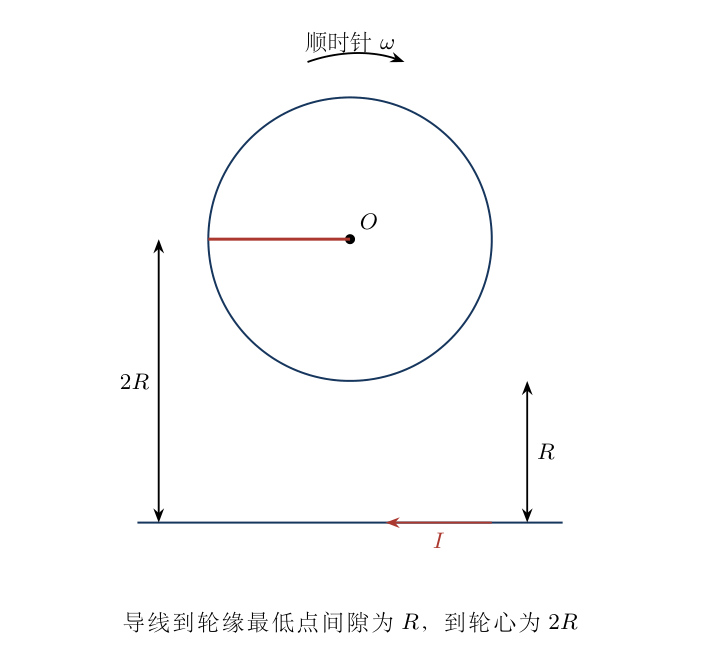

<!-- question-end -->

## 一、题型定位

导线磁场随离导线的距离变化，辐条上各点的线速度又随离轮心的距离变化。因此动生电压必须沿辐条积分两个位置函数的乘积。水平辐条上磁场恰好恒定，可以先积分速度；向上辐条的磁场沿半径减弱，不能把端点或中心磁场直接乘整根杆长。

本题求开路端电压，在理想静止引线不产生额外动生电动势的条件下，它与辐条上的动生积分对应。轮缘是导体，沿圆周方向的 $\mathbf v\times\mathbf B$ 分量为零，故可以把轮缘视为同一电势端口。

## 二、知识点

无限长直导线在距离 $d$ 处的磁感应强度大小为 $B=\mu_0I/(2\pi d)$。电流向左时，导线上方磁场指向纸内；轮的角速度也指向纸内。辐条上半径 $r$ 处速度为切向速度 $\omega r$，因此 $\mathbf v\times\mathbf B$ 沿辐条向外。

开路电荷重新分布，使导体内沿杆方向的总力平衡，$\mathbf E+\mathbf v\times\mathbf B=0$。于是轮缘相对中心的电势差为

$$U=\varphi_P-\varphi_O=\int_O^P(\mathbf v\times\mathbf B)\cdot d\mathbf l.$$

力平衡中的电场负号与电势梯度负号相消，最终端电压与动生积分同号。

## 三、物理图像

轮心到导线距离为 $2R$，水平辐条的每一点也都处在这个距离，磁场为常量。辐条竖直向上时，距离从 $2R$ 增到 $3R$，所以相同半径处的磁场小于水平情形，最终电压应更小。

顺时针转动与向左电流使正电荷沿半径外移，轮缘电势较高。无论水平辐条指向左还是右，径向外移的结论相同。若把辐条转到轮心向下的一侧，磁场反而沿杆增强，得到更大的电压；这不是本问指定的位置。

## 四、解题入口

将沿辐条的材料坐标设为 $r\in[0,R]$。水平问用 $d(r)=2R$，向上问用 $d(r)=2R+r$。每一段贡献为 $dU=\omega r\mu_0I\,dr/[2\pi d(r)]$，先建立这个统一式再分别积分。

极性先用一个水平向右的短杆段检验：速度向下、磁场向内，叉积向右即沿半径向外。结果应为 $U_1>0$、$U_2>0$。中心速度为零不表示整个辐条没有动生电压，因为积分覆盖所有非零半径。

## 五、解析

（1）水平辐条的恒定磁场。

水平辐条到直导线的距离处处是 $2R$，所以

$$B_1=\frac{\mu_0I}{4\pi R}.$$

动生电压为

$$U_1=\int_0^R\omega rB_1\,dr
=\frac{\mu_0I\omega}{4\pi R}\frac{R^2}{2}.$$

故

$$\boxed{U_1=\frac{\mu_0I\omega R}{8\pi}},\qquad
\boxed{\varphi_P>\varphi_O}.$$

常见的转动杆公式 $B\omega R^2/2$ 在此可以使用，是因为整个水平辐条的 $B$ 确实恒定。导线到轮心距离若被误取为 $R$，结果会大一倍；图中标出的 $R$ 是导线到轮缘最低点的间隙，不是轮心距离。

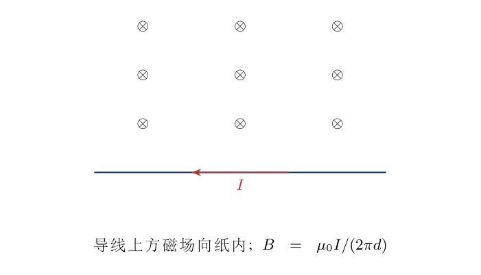

（2）向上辐条的非均匀磁场。

距轮心 $r$ 处到导线距离为 $2R+r$，所以

$$U_2=\frac{\mu_0I\omega}{2\pi}
\int_0^R\frac{r}{2R+r}\,dr.$$

把被积式拆成 $1-2R/(2R+r)$，积分得到

$$\int_0^R\frac{r}{2R+r}\,dr
=R-2R\ln\frac{3R}{2R}.$$

于是

$$\boxed{U_2=\frac{\mu_0I\omega R}{2\pi}
\left(1-2\ln\frac32\right)}.$$

括号为 $0.1890697838>0$，极性仍为轮缘高于轮心。自然对数的参数必须是距离比 $3R/(2R)$，不能写成带单位的 $\ln(3R)$。积分的常量项与对数项同为长度，再乘外面的系数才得到电压。

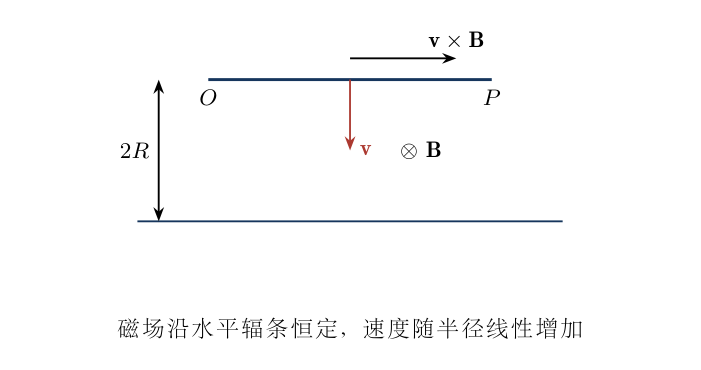

（3）用不等式检查大小。

向上杆磁场处于 $\mu_0I/(6\pi R)$ 与 $\mu_0I/(4\pi R)$ 之间，所以

$$\frac{\mu_0I\omega R}{12\pi}<U_2<U_1.$$

更精确的比值为

$$\boxed{\frac{U_2}{U_1}=4\left(1-2\ln\frac32\right)
=0.7562791351}.$$

它处于 $2/3$ 与 $1$ 之间，满足磁场上下界。若用端点磁场估计，得到下界；用中心磁场估计，得到上界。任一近似都不能代替积分，但可在做完积分后快速检查数值和符号。

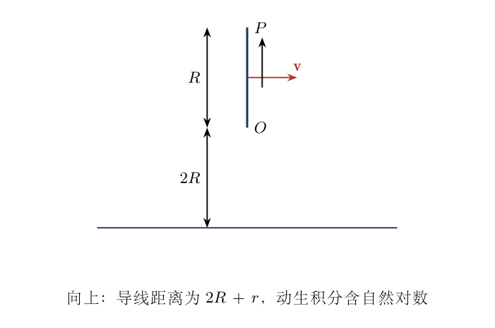

（4）任意方向的辐条统一表达式。

设辐条与竖直向上的夹角为 $\theta$，轮心到直导线距离一般记 $H>R$。则辐条各点到导线距离为 $H+r\cos\theta$，有

$$U(\theta)=\frac{\mu_0I\omega}{2\pi}
\int_0^R\frac{r}{H+r\cos\theta}\,dr.$$

当 $c_\theta=\cos\theta\ne0$，积分为

$$U(\theta)=\frac{\mu_0I\omega}{2\pi}
\left[\frac{R}{c_\theta}-\frac{H}{c_\theta^2}
\ln\left(1+\frac{Rc_\theta}{H}\right)\right].$$

当 $c_\theta=0$，连续极限为 $\mu_0I\omega R^2/(4\pi H)$。$H>R$ 保证整轮位于导线上方，场的方向不改变，积分没有奇点。取 $H=2R$、$\theta=\pi/2$ 和 $0$，分别恢复前两问。

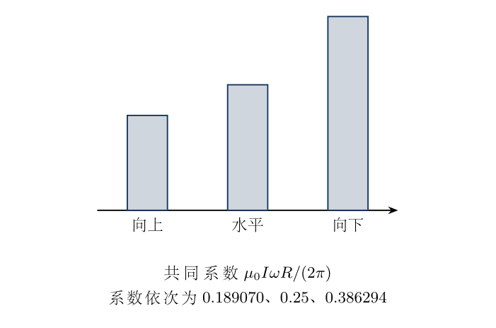

（5）靠近与远离导线的位置比较。

向下辐条 $\theta=\pi$ 具有 $d=2R-r$，积分得

$$U_{\rm down}=\frac{\mu_0I\omega R}{2\pi}(2\ln2-1).$$

向上、水平、向下三个无量纲积分系数分别为 $1-2\ln(3/2)$、$1/4$、$2\ln2-1$，依次增大。这个排序可直接从任意相同 $r>0$ 处磁场的排序推出，不必先完成每个积分。

对一般 $H\gg R$，展开 $1/(H+r\cos\theta)$ 得

$$U(\theta)=\frac{\mu_0I\omega}{2\pi H}
\left[\frac{R^2}{2}-\frac{R^3\cos\theta}{3H}
+O(R^4/H^2)\right].$$

首项是均匀场近似，角度变化来自磁场梯度的第一修正。原题 $R/H=1/2$ 并不很小，因此向上问应保留完整对数积分。

（6）开路电压与能量条件。

静止引线本身没有 $\mathbf v\times\mathbf B$，外部理想电压表测得两端的保守电势差。辐条开路时电荷重排后没有持续负载电流；求电压并不需要知道辐条电阻。若接上负载，电流受总电阻限制，并对旋转产生制动力矩，维持恒转速的外部动力要提供电功率和耗散。

“中心不动、轮缘运动”不代表可以把两个端点速度相减后乘一个统一磁场。运动杆上的局部磁力必须逐点积分；非均匀场中即使端点的速度已知，也不足以决定整个端电压。

（7）为什么不能只用固定圆面积的磁通。

整轮几何圆区域不随时间改变，而直导线磁场也静止，所以固定整圆磁通的时间导数为零。这并不意味着轮心与轮缘的端电压为零。端口回路包含旋转辐条与静止外部引线，是带滑动接触的运动回路，必须使用含运动项的电动势表达式。

沿轮缘圆周的速度为切向，$\mathbf v\times\mathbf B$ 为径向，其与圆周线元点积为零；轮缘因此提供同一电势的端口。辐条沿径向的运动项才是非零贡献。把整圆当成实际端口回路，会误把端口连接方式与固定几何区域混为一谈。

（8）用积分微元检查极性。

取水平向右的辐条，角速度顺时针给 $\mathbf v=-\omega r\hat{\mathbf y}$，导线上方磁场为 $\mathbf B=-B\hat{\mathbf z}$，所以 $\mathbf v\times\mathbf B=\omega rB\hat{\mathbf x}$。正电荷被推向外端。平衡电场指向中心，电势由中心向外增加。

对向上的辐条，速度向右、磁场向内，叉积向上，仍是径向外端。几何方向改变了磁场强度函数，却没有改变极性。对于导线始终位于整轮下方的情况，所有角度的辐条都保持同一极性；若反转 $I$ 或 $\omega$，极性整体翻转。

（9）任意角度电压的单调性。

令 $c_\theta=\cos\theta$，对统一积分求导：

$$\frac{dU}{dc_\theta}=-\frac{\mu_0I\omega}{2\pi}
\int_0^R\frac{r^2}{(H+rc_\theta)^2}\,dr<0.$$

因此向上 $c_\theta=1$ 给最小电压，水平 $c_\theta=0$ 为中间，向下 $c_\theta=-1$ 给最大电压。这个单调结论不依赖对数原函数，直接由每一个半径的磁场变化得到，适合作为独立检查。

在 $c_\theta$ 很小处，闭式表达中的两个大项会相减，数值计算容易损失精度。应使用积分或连续展开 $R^2/(2H)-R^3c_\theta/(3H^2)+\cdots$，避免用接近零的角余弦直接除两次。解析公式正确不保证所有数值写法都稳定。

（10）接上负载后的力矩和能量。

若外电路有电流 $i$，辐条微段受磁力大小为 $iB(r)dr$，方向反抗其切向运动。对轮心的制动力矩大小为

$$\tau=i\int_0^R rB(r)\,dr=\frac{iU}{\omega}.$$

所以外部维持恒转速的机械功率 $\tau\omega=iU$，与电路得到的电功率相等。若总电阻为 $r_{e}$，准静态电流为 $i=U/r_{e}$，机械输入最终转为焦耳热和负载功。开路时 $i\to0$，保持端电压却没有持续负载功率，二者不矛盾。

本题在求 $U$ 时已忽略电流磁反作用，负载变式只用于说明能量去向。强电流、自感或接触瞬态都需要增加电路与机械耦合方程，不能从开路电压直接推出任意负载下仍保持同样转速。

（11）积分变量与空间距离的区分。

$r$ 是轮心到辐条微段的材料半径，决定线速度；$d=H+r\cos\theta$ 是微段到无限直导线的垂直距离，决定磁场。两种距离在水平问和竖直问具有不同关系。把它们用同一个符号代入 $B\omega r$，很容易错误消去位置依赖。

$\mu_0I$ 的量纲为特斯拉米，乘 $\omega R$ 再除无量纲系数给特斯拉平方米每秒，也就是伏。这个量纲检查解释了原题保持间隙与半径成比例时 $U\propto R$；如果保持轮心距离 $H$ 独立不变，水平电压却是 $U\propto R^2/H$。缩放比较前须先说明保持哪一个距离不变。

（12）有效磁场是速度权重的平均。

若希望把电压写成均匀场形式 $U=B_{\rm eff}\omega R^2/2$，则正确的有效磁场为

$$B_{\rm eff}=\frac2{R^2}\int_0^R rB(r)\,dr.$$

这是按线速度 $\omega r$ 加权的平均，而不是沿杆简单算术平均。向上辐条的普通平均磁场相对于中心场的比值为 $2\ln(3/2)\simeq0.810930$，而有效磁场比为 $4[1-2\ln(3/2)]\simeq0.756279$。

外端速度较大，但磁场较弱，速度权重使平均场更偏向外端的较小磁场。两种平均不同，说明把“平均磁场”不加定义地放进转动杆公式会产生系统误差。水平辐条的磁场恒定，两种平均才相同。积分形式明确了权重，也使电压上下界和角度单调性可以直接得到。
