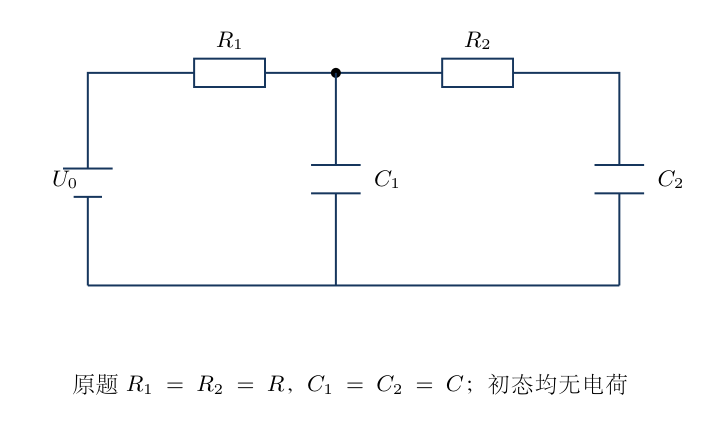
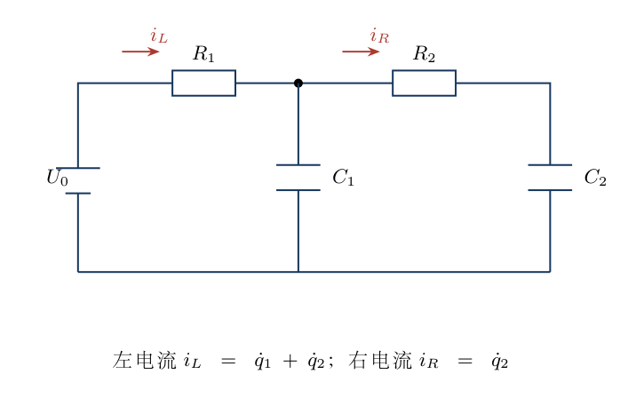
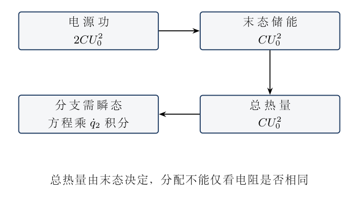
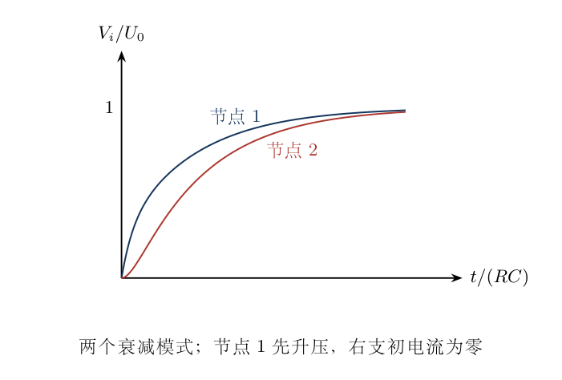
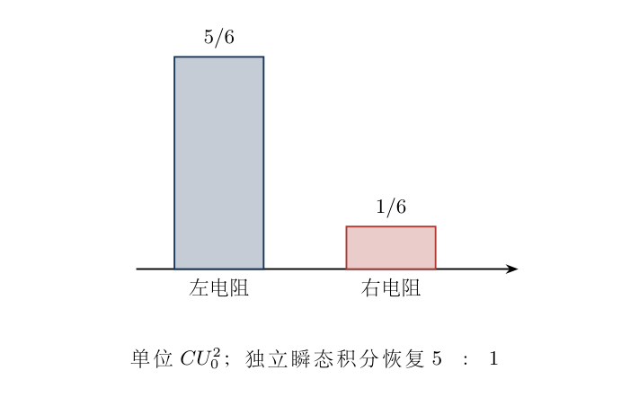

# 第 4 题　双电容梯形充电的总热量与分配

<!-- question-start -->

电源电压恒为$U_0$，从电源正端先经过左电阻$R$到节点1，再经右电阻$R$到节点2。节点1、2分别通过一个电容$C$连接电源负端。初始两电容均无电荷，$t=0$接通电源。（1）求充电足够久后两电阻的总焦耳热。（2）求左电阻与右电阻发热量之比。所有元件理想，$R,C>0$。

<!-- question-end -->

## 一、题型定位

线性电路的瞬态能量分配。总热量由电源功和末态储能求出，单个电阻的热量需额外瞬态方程或积分恒等式。

## 二、知识点

电容电压连续，恒压源做功为$U_0$乘从源端转移的总电荷。每个电容最终电压都为$U_0$，但充电路径不同，热量并不均分。

电阻焦耳热为$\int R i^2dt$，不是$R$乘通过电荷的平方，也不是电容储能的局部差额。两电容上端电流不同，左电阻电流为两个电容充电电流的和。

## 三、物理图像

接通瞬间，节点1、2的电压均为零；左电阻电流为$U_0/R$，右电阻两端暂时没有压差，所以初电流为零。随后节点1先升高，右电阻才开始给节点2电容充电。

最终两节点等电势，电流都归零，但整个过程左电阻既向第一个电容供电，又为第二个电容提供电荷。右电阻只承受两节点电压差，发热明显较小。

## 四、解题入口

先用末态求总热量，再写两电容电荷$q_1,q_2$的回路方程。消去$q_1$得到$q_2$的二阶方程；把它乘$\dot q_2$并从初态积分到末态，可以直接求右电阻热量，不必先解全部指数系数。

## 五、解析

（1）电源功与末态储能。

足够长时间后两个电容的电压都为$U_0$，电荷分别为$CU_0$。从源正端流出的总电荷为$2CU_0$，电源做功

$$W=U_0\,(2CU_0)=2CU_0^2.$$

末态电场能为两个$\frac12CU_0^2$之和，即$E_C=CU_0^2$。没有其他储能元件，所以

$$\boxed{Q_{\rm total}=W-E_C=CU_0^2.}$$

初态电场能为零。这里电源功是$2CU_0^2$而不是$CU_0^2$；半能量规律是储能占电源做功的一半，不是把两个电容储能中的一半再扣一次。

（2）正确标记支路电流。

左电阻电流$i_L=\dot q_1+\dot q_2$，右电阻电流$i_R=\dot q_2$。节点电压分别$q_1/C$、$q_2/C$，两个回路关系是

$$U_0=R(\dot q_1+\dot q_2)+\frac{q_1}{C},
\qquad \frac{q_1}{C}=R\dot q_2+\frac{q_2}{C}.$$

第二式给$q_1=q_2+RC\dot q_2$。求导后代回第一式，得到

$$\boxed{R^2C\ddot q_2+3R\dot q_2+\frac{q_2}{C}=U_0.}$$

初态$q_2(0)=0$且$\dot q_2(0)=0$。末态$q_2(\infty)=CU_0$、$\dot q_2(\infty)=0$。初导数为零是由右电阻初始压差为零得到，不能由“电容初始无电荷”自动推出所有支路电流为零。

（3）积分恒等式求右电阻热量。

把二阶方程乘$\dot q_2dt$，从$0$积分到$\infty$：

$$\frac{R^2C}{2}[\dot q_2^2]_0^\infty
+3R\int_0^\infty\dot q_2^2dt
+\frac{1}{2C}[q_2^2]_0^\infty
=U_0[q_2]_0^\infty.$$

首项为零，后两边的电荷边界项分别为$CU_0^2/2$与$CU_0^2$，因此

$$3Q_R+\frac12CU_0^2=CU_0^2,
\qquad \boxed{Q_R=\frac16CU_0^2.}$$

这一步保留了真实的时间积分。形式上的“乘$dq_2$”等于乘$\dot q_2dt$；不要将二阶导数简单理解成$\ddot q_2dq_2$的某个电荷势函数。

（4）左电阻热量与比值。

由总热量立即得到

$$\boxed{Q_L=\frac56CU_0^2,\qquad Q_L:Q_R=5:1.}$$

两只相同电阻的热量不相等，因为电流函数不同。左电阻最初电流最大，且流经它的总电荷是流经右电阻的两倍；仅凭电荷比也不能得到热量比$4:1$，因为两个电流的时间形状不同。

（5）无量纲节点方程。

定义$s=t/(RC)$、$u_i=V_i/U_0=q_i/(CU_0)$。节点电流守恒给

$$u_1'=1-2u_1+u_2,
\qquad u_2'=u_1-u_2,$$

其中撇号代表对$s$求导。消去$u_1$得到$u_2''+3u_2'+u_2=1$，和电荷方程相符。初值$u_1=u_2=0$，末值均为$1$。

电阻归一化功率分别为$p_L=(1-u_1)^2$、$p_R=(u_1-u_2)^2$，实际功率共同系数为$U_0^2/R$。时间积分转换为$RC\,ds$，所以热量的共同系数是$CU_0^2$。

（6）两个衰减模式的完整解。

设$a=(3-\sqrt5)/2$、$b=(3+\sqrt5)/2$，则$a+b=3$、$ab=1$。满足初值的节点2电压为

$$u_2=1-\frac{b e^{-as}-a e^{-bs}}{b-a},
\qquad u_2'=\frac{e^{-as}-e^{-bs}}{b-a}.$$

节点1电压$u_1=u_2+u_2'$，从而

$$u_1=1-\frac{(b-1)e^{-as}+(1-a)e^{-bs}}{b-a}.$$

两节点均逐渐趋于$1$，右电阻电流先从零上升再下降。两个时间常数分别为$RC/a$和$RC/b$，不能仅用一个$RC$指数描述整个电路。

（7）直接积分的交叉检查。

右电阻电流归一化为$u_2'$，因此

$$\frac{Q_R}{CU_0^2}=\frac{1}{(b-a)^2}
\left(\frac1{2a}+\frac1{2b}-\frac{2}{a+b}\right).$$

利用$(b-a)^2=5$、$a+b=3$、$ab=1$，括号内为$3/2-2/3=5/6$，故结果是$1/6$。这个方法独立检查积分恒等式，也说明所有模式及交叉项都必须包括。

左电阻电流$1-u_1$含两个同号指数。展开平方时交叉项为正，积分得$5/6$。若只把两模式各自的平方积分相加，会漏掉交叉项，导致总热量无法与电源能量平衡。

（8）累计能量平衡。

在任意有限时间，电源功$W(t)=CU_0^2[u_1(t)+u_2(t)]$，储能$E_C(t)=CU_0^2[u_1^2+u_2^2]/2$。累计总热量为

$$Q_L(t)+Q_R(t)=CU_0^2\left[u_1+u_2-\frac{u_1^2+u_2^2}{2}\right].$$

求导可恢复$R i_L^2+R i_R^2$，末态恢复$CU_0^2$。这不是只在末态成立的巧合，而是整个瞬态的功率守恒。数值求解时同时积累两热量，可用此式检查积分误差。

（9）改成两个不同电阻。

若左、右分别为$R_1,R_2$，两电容仍均为$C$，消元方程变为

$$R_1R_2C\ddot q_2+(2R_1+R_2)\dot q_2+\frac{q_2}{C}=U_0.$$

同样的积分给

$$Q_R=\frac{R_2}{2(2R_1+R_2)}CU_0^2,
\qquad \frac{Q_L}{Q_R}=1+\frac{4R_1}{R_2}.$$

右电阻越大，其慢充电过程越独立，热量趋于$CU_0^2/2$；右电阻趋于零时，两电容近似同步充电，右热量趋于零。总热量始终为$CU_0^2$，但分配依赖电阻比。

（10）不同电容的推广。

若节点1电容$C_1$、节点2电容$C_2$，则

$$R_1R_2C_1\ddot q_2+
\left[R_1\left(1+\frac{C_1}{C_2}\right)+R_2\right]\dot q_2
+\frac{q_2}{C_2}=U_0.$$

初、末态电流均零，积分后得到

$$Q_R=\frac{R_2C_2^2U_0^2}{2[R_1(C_1+C_2)+R_2C_2]},
\qquad Q_{\rm total}=\frac12(C_1+C_2)U_0^2.$$

令$C_1=C_2=C$恢复前式。分母中$R_2$乘的是$C_2$，分子也含$C_2^2$，可用$C_2\to0$时右支路没有储能和电流的极限进行检查。

<!-- KEEP_STUDENT_START -->
（11）尺度与理想极限。

将两电阻同时乘$\lambda>0$，电流按$1/\lambda$缩小、充电时间按$\lambda$放大，热量不变。将两电容同时乘$\lambda$，时间和热量均按$\lambda$放大，而热量比保持$5:1$。电压乘$\lambda$时，电荷乘$\lambda$、热量乘$\lambda^2$。

这里“足够长时间”必须相对最慢模式而言。先令某个电阻无限大再接通，支路实际上断开；先对任意有限电阻充到末态再取极限，末态仍充满。两个极限次序不同，不能用断路图否定有限电阻的慢充电热量。
<!-- KEEP_STUDENT_END -->

（12）右支电流的峰值及时间。

右电流为$i_R=(U_0/R)(e^{-as}-e^{-bs})/(b-a)$。它在$s=0$为零，在无穷远也为零，中间只有一个正峰。令导数为零，得到

$$s_{\rm peak}=\frac{\ln(b/a)}{b-a},
\qquad t_{\rm peak}=RC\,s_{\rm peak}.$$

这与左支接通瞬间即达到最大电流$U_0/R$不同。右支只有在节点1已经建立电压以后才能充电，因此两电流的形状差别是热量不能由电荷比平方求出的直接原因。即使两支最终转移电荷之比为$2:1$，也不存在$i_L(t)=2i_R(t)$的逐时关系。

（13）积分边界项为何不会遗漏。

消元方程乘$\dot q_2$后，二阶项成为$R^2C\,d(\dot q_2^2)/2dt$，电容项成为$d(q_2^2)/2Cdt$。两端的右支电流都为零，故前一边界项确实消失；后一项由$q_2(0)=0$、$q_2(\infty)=CU_0$给出$CU_0^2/2$。

若改成不同初态，必须重新检查这两个边界项。特别是两节点起初电压不同，右支初电流一般不再为零，不能直接把原题的$5:1$套用。两个电容同时处于相同$V_i$时，平移电压才会恢复相同的归一化初态，这正是相同初压变式可以使用原比例的原因。

（14）电阻趋零为何仍可有有限热量。

同时把两电阻乘小量$\epsilon$，峰值功率按$1/\epsilon$增加，持续时间按$\epsilon$缩短，而积分热量不变。它说明电路的理想化极限是越来越窄、越来越高的脉冲，不能把某个固定$t>0$处的极限电流为零当成整个积分为零。

严格令电阻为零的理想源直接连接理想电容，会缺少决定充电过程的动态元件。实际线路的电感、源内阻及辐射决定极短时间内如何分配能量。原题则明确在有限正电阻模型中计算，再取参数极限，因此答案中的耗散与能量守恒一致。数值程序若步长大于最短衰减时间，会漏掉接通脉冲；应通过总能量恒等式与两个独立热量积分同时检查。

（15）有限时间结果的可测验算。

在任何$s>0$，测得两个节点电压即可算累计总热量，但不能只凭这两个瞬时电压唯一分出$Q_L,Q_R$，分配还记录了此前的电流历史。完整指数解则可分别积分至指定$s$，并将两者之和与电源功减储能核对。

若两电阻温升不同，温升之比也只有在电阻热容相同、散热可忽略时才等于热量比。原题求的是焦耳热积分，不涉及材料热容和环境传热。把$5:1$直接作为任意实际电阻的末态温度比，会额外引入题目没有提供的条件。

## 六、关键洞察

末态决定总耗散，但分支耗散需要瞬态信息。把二阶方程乘充电电流并积分，可将未知时间函数的平方积分转化为已知初末态边界项。

## 七、易错点

把左电流设为单个电容电流；设两个相同电阻均分热量；漏掉指数交叉项；将源功错写成末态储能；误设右电流初值非零；混用先充满与先断路的极限。

## 八、课堂讲解建议

教师先画接通瞬间和末态两幅电路，再标左电流是两支路之和。课堂先算总热，再完整消元，最后乘电流积分。用改变电阻但不改变总热的例子解释能量分配和充电时间的区别。

## 九、变式训练

<!-- KEEP_TOGETHER_START -->

变式一：右电阻改为$2R$，左电阻仍为$R$，求两热量及比值。

解：总热仍为$CU_0^2$。取$R_1=R,R_2=2R$，有$Q_R=2/[2(2+2)]CU_0^2=CU_0^2/4$，$Q_L=3CU_0^2/4$，比为$3:1$。右电阻增加后充电更慢，它在总耗散中的份额增加。与两个相同电阻的$5:1$不同，说明分支热量不能由末态电荷单独确定。

对本变式，消元方程为

$$2R^2C\ddot q_2+4R\dot q_2+q_2/C=U_0.$$

乘$\dot q_2$并积分，得到$4R\int\dot q_2^2dt=CU_0^2/2$，再乘右电阻$2R$恢复$Q_R=CU_0^2/4$。总耗散与原题相同，分支比例变化来自瞬态，而不是末态储能变化。

<!-- KEEP_TOGETHER_END -->

<!-- KEEP_TOGETHER_START -->

变式二：左电阻改为$2R$，右电阻仍为$R$，求热量比。

解：积分方程中阻尼系数为$2R_1+R_2=5R$，所以$Q_R=CU_0^2/10$，左为$9CU_0^2/10$，比$9:1$。左电阻增大使源端供电更慢，两节点电压差更小，右耗散份额降低；总热量和末态储能均未变。若同时把两个电阻都加倍，则比例又回到$5:1$。

消元中的二阶系数为$2R^2C$、阻尼系数为$5R$，积分得

$$5R\int_0^\infty\dot q_2^2dt=\frac12CU_0^2.$$

右电阻仍为$R$，所以直接恢复$Q_R=CU_0^2/10$。这个独立步骤也检查推广式的电阻编号：左电阻出现在$2R_1$中，若将左右名称交换，会把比例算成另一个变式的$3:1$。

<!-- KEEP_TOGETHER_END -->

<!-- KEEP_TOGETHER_START -->

变式三：两个电阻均为$R$，节点1电容为$2C$，节点2为$C$，求$Q_L,Q_R$。

解：总热为$(2C+C)U_0^2/2=3CU_0^2/2$。推广式给$Q_R=RC^2U_0^2/[2(R(3C)+RC)]=CU_0^2/8$，所以$Q_L=11CU_0^2/8$，比$11:1$。源转移总电荷$3CU_0$、做功$3CU_0^2$，末态储能$3CU_0^2/2$，与总热再核对。

这时电荷消元方程为

$$2R^2C\ddot q_2+4R\dot q_2+q_2/C=U_0.$$

其方程形式与右电阻变成$2R$的情况相同，但求右热时乘的电阻不同：这里是$R$，故右热是那一变式的一半。末态储能又随总电容改变，不能仅根据相同的$q_2$方程就认为总热也相同。

<!-- KEEP_TOGETHER_END -->

<!-- KEEP_TOGETHER_START -->

变式四：两个电容起初电压都为$V_i$，改接恒压源$U_0$，求两电阻热量。

解：把节点电压写成$V_i+(U_0-V_i)u_i(s)$，其归一化初末态方程与原题相同。电流共同幅值由$U_0/R$改成$(U_0-V_i)/R$，故$Q_L=5C(U_0-V_i)^2/6$，$Q_R=C(U_0-V_i)^2/6$。即使$V_i>U_0$电流反向，热量仍为正；不能把热量表达式写成$C(U_0^2-V_i^2)$。

源功和电容储能变化分别为

$$W=2CU_0(U_0-V_i),\qquad
\Delta E_C=C(U_0^2-V_i^2).$$

两者之差为$C(U_0-V_i)^2$，与两支热量之和一致。若$V_i>U_0$，源功为负，电源吸收能量，但电阻耗散仍为正；不能把负源功当作负焦耳热。

<!-- KEEP_TOGETHER_END -->

<!-- question-complete -->
