# 第 1 题　柱形电流中的导线运动与有效势

<!-- question-start -->

半径为$r$、长度$l\gg r$的圆柱区域内有沿$-z$方向的均匀稳恒电流，电流密度大小为$j$。一根长$l$、质量$m$的细直导线与$z$轴平行，导线电流$I$也沿$-z$方向。导线在横截面内运动，只考虑给定电流产生的安培力，忽略端部与电磁感应效应。

（1）求导线距圆心$\rho$时的合力大小及方向。（2）初始$\rho_0>r$，初速度$v_0$与径向垂直，求导线始终不进入柱形区域的条件。（3）导线从边界$(-r,0)$出发，以速度$v_1$指向圆内，要求第一次再次接触边界的位置为$(0,r)$，求初速度方向与速率的条件。允许触边；若严格要求入内，应区分临界切向轨道。

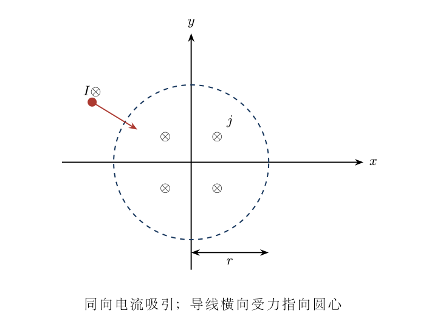

<!-- question-end -->

## 一、题型定位

安培环路定理与二维中心力。外区用角动量和有效势判断最近距离，内区用二维简谐运动确定出射点。

## 二、知识点

同向电流相吸；均匀电流柱的内磁场随半径线性增加，外磁场按距离反比衰减。中心力保证关于圆心的角动量守恒；这里能量守恒来自给定力场的保守性，而不是带电粒子的$q\mathbf v\times\mathbf B$不做功结论。

导线受力为$I\mathbf l\times\mathbf B$，其中$\mathbf l$沿导线，和导线质心的速度方向没有相同含义。为保持$I$恒定，外部电源可能参与能量交换；本题忽略感应后，以给定机械势处理平动。

## 三、物理图像

柱内电流与细导线电流同向，导线总受到指向圆心的力。在圆外，一条弯曲轨道可以有较大径向范围；它不一定是圆周。初始径向速度为零，只说明初始位置是径向转折点之一。

柱内的横向力与位置向量严格成正比，所以$x$、$y$具有相同固有频率。每条内区轨道是以圆心为中心的椭圆，所求两边界点可以用时间参数联立，而不能直接用匀速直线连接。

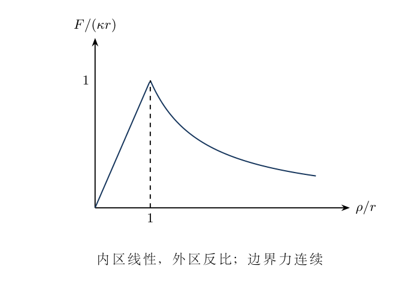

## 四、解题入口

先定义$\kappa=\mu_0jIl/2$与$\omega=\sqrt{\kappa/m}$。分别求内外磁场，再把外区的不入内要求翻译成$\rho_{\min}\ge r$。第（3）问从给定初位置写出$x(t),y(t)$，同时检验目标点和到达前确在圆内。

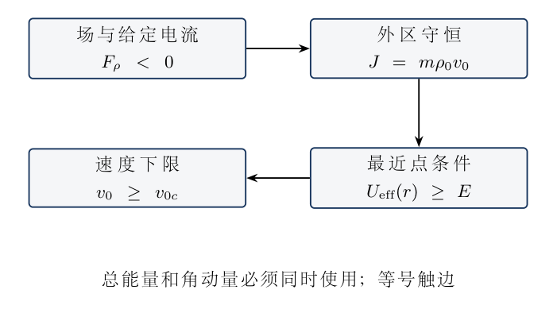

## 五、解析

（1）环路定理与力的连续性。

取半径$\rho$的同心圆作为安培环路。内区包围的电流为$j\pi\rho^2$，外区包围总电流$j\pi r^2$。由$B(2\pi\rho)=\mu_0I_{\rm enc}$得到

$$B(\rho)=\begin{cases}\mu_0j\rho/2,&0\le\rho\le r,\\ \mu_0jr^2/(2\rho),&\rho\ge r.\end{cases}$$

用导线长度$l$乘以$I B$，合力向量为

$$\boxed{\mathbf F=-\kappa\mathbf \rho\quad(\rho\le r),\qquad
\mathbf F=-\kappa\frac{r^2}{\rho^2}\mathbf \rho\quad(\rho\ge r).}$$

合力大小内区为$\kappa\rho$，外区为$\kappa r^2/\rho$。在$\rho=r$两式均给$\kappa r$，圆心处力为零。内区不是反平方中心力，外区的力大小也不是反平方。

（2）建立一份跨边界连续的机械势。

取$U(r)=0$，由$F_\rho=-dU/d\rho$积分，得到

$$U(\rho)=\begin{cases}\frac\kappa2(\rho^2-r^2),&\rho\le r,\\
\kappa r^2\ln(\rho/r),&\rho\ge r.\end{cases}$$

势及其一阶导数在边界连续。外区势向无穷远增长，因此在这一无限长、无限横向理想模型中，有限初速度不会真正逃逸到无穷远。这与万有引力势趋近有限值的情况不同。有限柱长时远区场会改变，本结论只在本题模型中成立。

（3）有效势与触边临界值。

初速度纯切向，角动量大小$J=m\rho_0v_0$。径向运动满足

$$\frac12m\dot\rho^2+U_{\rm eff}(\rho)=E,
\qquad U_{\rm eff}=U(\rho)+\frac{J^2}{2m\rho^2},$$

其中$E=\frac12mv_0^2+\kappa r^2\ln(\rho_0/r)$。临界轨道在$r$处径向速度也为零；因此

$$\frac12mv_{0c}^2+\kappa r^2\ln(\rho_0/r)
=\frac12m\frac{\rho_0^2}{r^2}v_{0c}^2.$$

解得

$$\boxed{v_0^2\ge v_{0c}^2
=\frac{2\kappa r^4}{m(\rho_0^2-r^2)}\ln\frac{\rho_0}{r}.}$$

等号为触边，严格大于为不触边。速度条件应是下限：切向运动太慢时，导线受到吸引便深入柱内。式中的$r^4$不能由力公式中的$r^2$直接猜测，它还含角动量屏障在边界的因子。

（4）为什么有效势判据既必要又充分。

外区有效势导数为$U_{\rm eff}'=\kappa r^2/\rho-J^2/(m\rho^3)$，只有一个极小值，位于$\rho_*=J/(r\sqrt{m\kappa})$。初始位置和最近点之间没有额外势垒。若$U_{\rm eff}(r)>E$，则边界不可到达；若$U_{\rm eff}(r)<E$，则内向分支可穿过边界。

外区圆轨道所需切向速度恒为$v_c=r\sqrt{\kappa/m}=\omega r$，与圆半径无关。$v_0<v_c$时初始位置为远点，$v_0>v_c$时为近点。临界速度小于$v_c$，因此临界轨道确从$\rho_0$向内到达$r$。对$v_0\ge v_c$，初始近点已经在柱外，自然不入内；这也包含在上面的下限中。

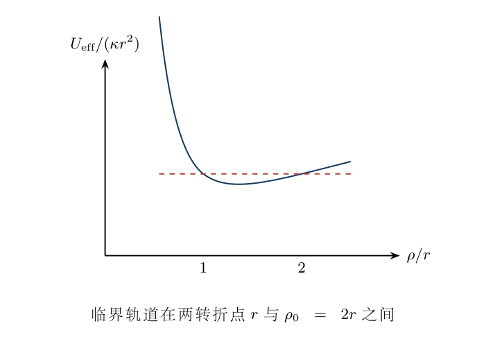

（5）无量纲形式与边界极限。

令$s=\rho_0/r>1$，$w=v_0/(\omega r)$，不入内条件成为

$$w^2\ge \frac{2\ln s}{s^2-1}.$$

右边在$s\to1^+$时趋于$1$，与从边界开始的圆轨道临界速度吻合；$s\gg1$时约为$2\ln s/s^2$。同一角速度尺度下，从较远位置释放允许更小的切向速度，因为角动量的力臂同时变大。这里比较的是$v_0$，不是固定角动量或固定总能量的另一类问题。

（6）柱内简谐方程。

令$\alpha$为初速度与$+x$方向的夹角，指向上半圆内时$0\le\alpha<\pi/2$。初始条件为$x(0)=-r$、$y(0)=0$、$\dot x(0)=v_1\cos\alpha$、$\dot y(0)=v_1\sin\alpha$。于是

$$x=-r\cos\tau+\frac{v_1\cos\alpha}{\omega}\sin\tau,
\qquad y=\frac{v_1\sin\alpha}{\omega}\sin\tau,
\qquad \tau=\omega t.$$

目标$x=0,y=r$给$\cot\tau=v_1\cos\alpha/(\omega r)$及$\sin\tau=\omega r/(v_1\sin\alpha)$。用$\sin^2\tau+\cos^2\tau=1$消去时间，得到

$$\boxed{\sin^2\alpha=\frac{v_1^2+\omega^2r^2}{2v_1^2}.}$$

因此$v_1\ge\omega r$才有形式解。真正从边界进入柱内需$\cos\alpha>0$，故

$$\boxed{v_1>\omega r,\qquad
\alpha=\arcsin\sqrt{\frac{1+(\omega r/v_1)^2}{2}}.}$$

速度越大，$\alpha$越接近$45^\circ$；它不能任取一个指向目标的方向，因为轨迹在柱内弯曲。

（7）首次出界而非某次经过目标。

设$q=v_1/(\omega r)>1$，$\cos\alpha=\sqrt{(q^2-1)/(2q^2)}$。内区距离平方可直接展开为

$$\rho^2-r^2=r^2\sin\tau\big[(q^2-1)\sin\tau-2q\cos\alpha\cos\tau\big].$$

在$0<\tau<\tau_e$中方括号为负，$\rho<r$；第一次正根满足

$$\tan\tau_e=\sqrt{\frac{2}{q^2-1}},\qquad 0<\tau_e<\frac\pi2.$$

代回位置可得$x=0,y=r$，因此该角度确保证第一次出界就是目标点。只求一个三角函数关系而不核对首次性，可能把后续完整椭圆的其他交点也当作答案。

（8）临界轨道的物理意义。

当$v_1=\omega r$，$\alpha=\pi/2$，位置为$x=-r\cos\tau,y=r\sin\tau$，全程贴着圆柱边界运动。它会到$(0,r)$，但没有进入圆内；若题目只说“可从目标点经过”，等号可收录，若要求“向圆内运动后离开”，必须排除等号。

当$v_1\gg\omega r$，飞行时间趋于$\sqrt2r/v_1$，与两目标点间直线弦长相符。低于临界速度则不可能在所指定的四分之一圆周点第一次出界，不能用增加等待时间补救。

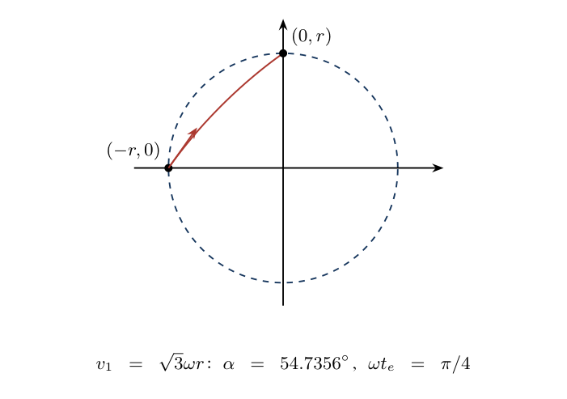

（9）能量、速度及方向的独立检查。

两个边界点具有相同机械势，因此出射速率仍是$v_1$。把$\tau_e$代入速度公式，可以同时验证$\dot x^2+\dot y^2=v_1^2$与$J=x m\dot y-y m\dot x=-mr v_1\sin\alpha$不变。

角动量是有向量：本路径绕圆心总体顺时针，$J_z<0$。选取大小计算势垒时只出现$J^2$，但出射方向检查不能随意丢掉符号。内外力连续也保证离开边界时速度连续，外区轨迹随后不再是简谐椭圆。

<!-- KEEP_STUDENT_START -->
（10）一组可复算的数值。

取$\omega=r=1$的一致单位，$\rho_0=2$，临界速度$v_{0c}=\sqrt{2\ln2/3}=0.679778$。若$v_1=\sqrt3$，则$\sin\alpha=\sqrt{2/3}$、$\alpha=54.7356^\circ$，$\tau_e=\pi/4$。代入轨迹得$x=0,y=1$，且此前$\rho<1$。

数值积分应采用分段连续的力，越界后立即切换为外区公式。把内区简谐力延拓到整个平面，会错误地产生闭合椭圆；把外区对数势延拓到圆心，则会错误地产生奇点。
<!-- KEEP_STUDENT_END -->

（12）外区轨道的分类与阈值单调性。

把初始半径写成$s_0r$，初速写成$w\omega r$。外区有效势的无量纲形式为

$$\mathcal U(s)=\ln s+\frac{s_0^2w^2}{2s^2},
\qquad \mathcal E=\ln s_0+\frac{w^2}{2}.$$

其导数为$\mathcal U'(s)=(s^2-s_0^2w^2)/s^3$，只有一个极小点$s=s_0w$。当$w<1$时，初始径向加速度向内，$s_0$是外转折点；当$w>1$时，初始径向加速度向外，$s_0$是内转折点，导线当然不会进入圆柱。$w=1$则是在外区保持圆周运动。不能把“不进入”误解成“永远静止在初始半径”。

临界值$w_c^2=2\ln s_0/(s_0^2-1)$小于$1$，因为对$s_0>1$有$2\ln s_0<s_0^2-1$。因此真正需要比较边界势垒的是$w_c\le w<1$这段向内初动分支。其最近点仍在$r$以外，等号时最近点恰为$r$。这也说明阈值条件包含圆轨道及向外初动分支，没有漏掉较大的速度。

（13）边界附近和远距离的检查。

令$s_0=1+\epsilon$，展开得

$$w_c^2=1-\epsilon+O(\epsilon^2),
\qquad w_c=1-\frac\epsilon2+O(\epsilon^2).$$

初始位置越贴近圆柱，所需切向速度越接近边界圆周速度$\omega r$。远处则有$w_c\sim\sqrt{2\ln s_0}/s_0$；虽然初速下限变小，临界角动量$m\rho_0v_{0c}$仍随$\sqrt{\ln s_0}$增加。比较不同初始半径时，不能只看速度而忽略力臂。

内区位置解还给出一个独立判断：$\rho^2-r^2$在首次入区后的符号应为负。满足出口位置方程只是必要检查；若初始法向速度没有指向内部，或所取时间跨过较早的边界交点，所得振子解不再代表这一段真实内区轨迹。入口、首次出口及后续外区必须分段连接，连接时位置和速度连续，受力在边界也连续。

（14）内区椭圆的几何不变量。

将内区解写成$\mathbf r=\mathbf a\cos\omega t+\mathbf b\sin\omega t$，其中$\mathbf a=(-r,0)$、$\mathbf b=\mathbf v(0)/\omega$。椭圆的两主半轴平方是矩阵$\mathbf a\mathbf a^{\mathsf T}+\mathbf b\mathbf b^{\mathsf T}$的两个特征值。即使$x,y$同频，椭圆主轴也不必与坐标轴重合。

记半轴为$A_e,B_e$，则

$$A_e^2+B_e^2=r^2+\frac{v_1^2}{\omega^2},
\qquad A_eB_e=\frac{rv_1|\sin\alpha|}{\omega}.$$

第一式来自矩阵迹，第二式来自行列式。这两个不变量分别与内区振子能量、角动量相连：$E_{\rm osc}=m\omega^2(A_e^2+B_e^2)/2$、$|J|=m\omega A_eB_e$。若角动量为零，椭圆退化成穿过圆心的线段；若两个半轴相等，轨道才是圆。仅凭各坐标同频，不能认定速率恒定。

本题$\alpha$由出口条件确定，通常给倾斜椭圆。内区只截取从入点到首次出点的一段，完整椭圆的其余部分可能处于真实的外区，此时受力已经改变。因而$2\pi/\omega$是延拓振子的周期，并非整条分段真实轨道的周期。

（15）径向加速度与向心力的区别。

极坐标方程为

$$m\ddot\rho=\frac{J^2}{m\rho^3}+F_\rho.$$

右端第一项是角动量产生的径向惯性项，$F_\rho$才是实际安培力。只有$\ddot\rho=0$的圆轨道才可直接使用$|F_\rho|=mv^2/\rho$。一般轨道上速度有径向分量，实际轨道曲率中心也不必等于圆柱中心。

能量式的径向动能$m\dot\rho^2/2$与角动量项$J^2/(2m\rho^2)$相加才给总动能。把“初始切向速度”误当成“以后也始终纯切向”，会删除径向动能，并把全部轨道误判为圆周。使用有效势时保留这个分解，既能判转折点，也能决定哪一段允许运动。

\newpage

# 第 2 题　洛伦兹速度变换与空间轨迹夹角

<!-- question-start -->

惯性系$S$中两个粒子作匀速运动，空间轨迹为两条不同的平行直线。（1）是否存在另一个惯性系$S'$，使两粒子的空间轨迹相交？区分同向同速与反向运动，并说明空间轨迹相交是否意味着碰撞。（2）两粒子的速度大小同为$v_0<c$，取反向运动$\mathbf u_1=-\mathbf u_2$，两轨迹处于同一平面。令$S'$相对$S$沿$x$方向以速度$V$运动，$\mathbf u_1$与$x$轴夹角为$\theta$。求$S'$中两空间轨迹方向垂直的条件；讨论退化方向。

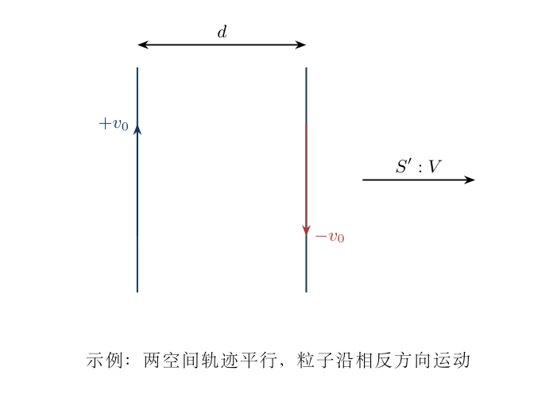

<!-- question-end -->

## 一、题型定位

狭义相对论速度变换与空间几何。对象是每个参考系中的轨迹方向，不是四维世界线是否相交。

## 二、知识点

沿$x$方向的洛伦兹变换既改变纵向速度，也改变横向速度，分母包含各粒子的$u_x$。空间角度按同一参考系的速度向量欧氏内积定义，不能用闵可夫斯基内积代替。

两条平行空间直线不要求两粒子同向运动；两粒子速度相同则任何惯性系中的速度也相同。题目要求出现垂直方向时，反向的等速粒子给出非退化分支。

## 三、物理图像

在$S$中两粒子可沿平行线向相反方向运动。换到横向或斜向运动的参考系，两条速度向量都扣除参考系运动，但横向伸缩和两个不同的时间分母也同时出现，方向可以张开。

某粒子经过空间交点的时刻通常不同于另一粒子经过该点的时刻。空间轨迹把时间标签抹去，交点不具有碰撞事件的含义。两个世界线是否真正有共同事件，是所有惯性系一致的事实。

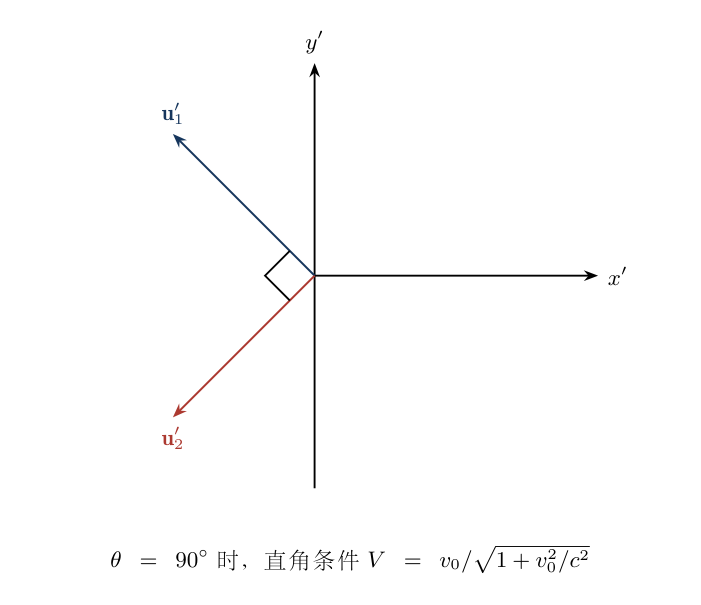

## 四、解题入口

先明确粒子速度的方向。设$\mathbf u_1=v_0(\cos\theta,\sin\theta)$、$\mathbf u_2=-\mathbf u_1$，用完整二维速度变换写出两个$\mathbf u_i'$，再令$\mathbf u_1'\cdot\mathbf u_2'=0$。最后检验$|V|<c$、两速度非零及平面中的空间交点。

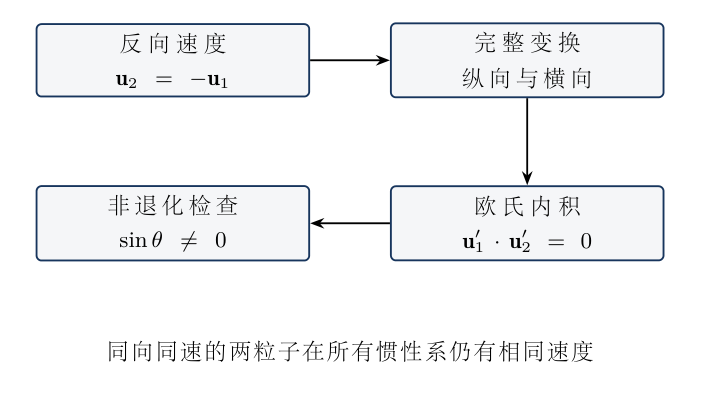

## 五、解析

（1）完整速度变换。

令$\gamma_V=(1-V^2/c^2)^{-1/2}$。对任意粒子的速度$(u_x,u_y)$，由$x'=\gamma_V(x-Vt)$、$t'=\gamma_V(t-Vx/c^2)$求导得到

$$u_x'=\frac{u_x-V}{1-u_xV/c^2},\qquad
u_y'=\frac{u_y}{\gamma_V(1-u_xV/c^2)}.$$

对亚光速粒子与亚光速参考系，分母严格为正。它改变速度大小，但求方向时同一向量的公共分母可以约去。不能把所有粒子使用同一个时间分母，也不能只在$x$速度中减去$V$而把$y$分量保持不变。

（2）同向同速的反例。

若$\mathbf u_1=\mathbf u_2$，变换公式给$\mathbf u_1'=\mathbf u_2'$。因此原来两条不同平行轨迹在任一非共动参考系仍为不同平行线；在共动系，两粒子分别固定于不同位置，空间轨迹退化为两个点，也不会因变换发生碰撞。

所以第（1）问的“是否可能”可以回答可能，但不能解释成对所有平行运动状态均存在这样的参考系。速度方向是影响结论的必要资料，初始位置则影响交点坐标及经过交点的时刻。

（3）反向等速的变换。

写$u_x=v_0\cos\theta$、$u_y=v_0\sin\theta$，则

$$\mathbf u_1'=\frac{(u_x-V,\ u_y/\gamma_V)}{1-u_xV/c^2},
\qquad
\mathbf u_2'=\frac{(-u_x-V,\ -u_y/\gamma_V)}{1+u_xV/c^2}.$$

两分母为正，因此垂直条件只需分子点积为零：

$$V^2-u_x^2-\frac{u_y^2}{\gamma_V^2}=0.$$

代入$1/\gamma_V^2=1-V^2/c^2$，整理为

$$V^2\left(1+\frac{v_0^2}{c^2}\sin^2\theta\right)=v_0^2.$$

因此

$$\boxed{V=\pm\frac{v_0}{\sqrt{1+(v_0^2/c^2)\sin^2\theta}}.}$$

正负号是两个相反运动方向的参考系。相对于题设选定的$+x$方向，可取正根。$0<v_0<c$且$\sin\theta\ne0$时，两根都满足亚光速要求，两粒子在新系中都有非零速度。

（4）方向角法的适用范围。

当两个$x$速度都非零时，可令$\tan\alpha_1=u_y/[\gamma_V(u_x-V)]$、$\tan\alpha_2=-u_y/[\gamma_V(-u_x-V)]$，用$\tan\alpha_1\tan\alpha_2=-1$得到相同结果。

但若某个$x$分量为零，斜率公式会无意义；向量内积仍可直接使用。使用$\arctan$还可能漏掉象限变化。解出$V$后必须保留速度向量的符号，不能只根据两条正斜率或负斜率的图作结论。

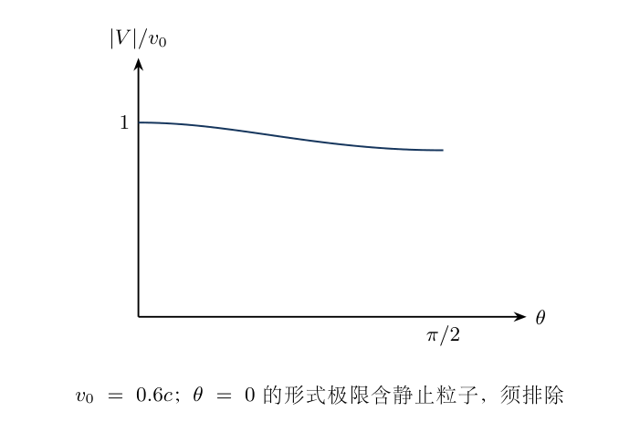

（5）退化夹角。

当$\sin\theta=0$，两粒子都沿$x$轴方向运动。公式给$|V|=v_0$，使其中一个粒子在$S'$中静止；另一粒子的轨迹为直线，静止粒子的轨迹为点，不能赋予点一个与直线垂直的方向。

故真正的垂直轨迹要求$\boxed{\sin\theta\ne0}$。当$\theta\to0$，可获得趋于垂直的两条非退化轨迹，但极限时其中一粒子速度趋于零。不能把所有允许参数的极限都当作同样的几何对象。

当$\theta=\pi/2$，两粒子在$S$中沿$y$轴反向运动，而参考系沿$x$轴运动。这一情况最容易画图验证，所需速率为$V=v_0/\sqrt{1+v_0^2/c^2}$。

（6）一个明确的空间相交例子。

取两条轨迹$x=0$与$x=d$，第一粒子沿$+y$以$v_0$运动，第二粒子沿$-y$以$v_0$运动，初始均取$y=0$。在沿$x$运动的新系中，速度为$(-V,+v_0/\gamma_V)$与$(-V,-v_0/\gamma_V)$。只要$V\ne0$，两方向不同且位于同一平面，所对应的无限空间直线必相交。

第一粒子的直线是$y'=-v_0x'/(\gamma_VV)$。第二条世界线消去时间后是

$$y'=\frac{v_0}{\gamma_VV}x'-\frac{v_0d}{V}.$$

交点为$x'_* =\gamma_Vd/2$、$y'_*=-v_0d/(2V)$。这个计算使用的是完整直线轨迹，如果只讨论从$t=0$以后的一段运动，交点是否落在两段之内还需核对各自的时间范围。

（7）为什么没有发生新的碰撞。

第一粒子在交点的$S'$时刻为$t_1'=-\gamma_Vd/(2V)$。第二粒子的时刻为

$$t_2'=\frac{\gamma_Vd}{2V}-\frac{\gamma_VVd}{c^2}.$$

两者之差$\Delta t'=d/(\gamma_VV)\ne0$。所以两粒子分别经过同一个新系空间位置，却不同时到达。原系中两条$x$固定值不同的世界线永不相交，这一事实在新系仍成立。

将一个物理碰撞事件变成不碰撞，或将不碰撞变成碰撞，都会与洛伦兹变换的一一对应性矛盾。改变的是三维空间轨迹图，不能说“运动参考系使粒子真正相撞”。

（8）数值方向核验。

取$v_0=0.6c$、$\theta=90^\circ$，有$V=0.6c/\sqrt{1.36}=0.514496c$，$\gamma_V=\sqrt{1.36}=1.166190$。两粒子的速度为

$$\mathbf u_1'=c(-0.514496,+0.514496),\qquad
\mathbf u_2'=c(-0.514496,-0.514496).$$

两点积为零，速率均为$0.727607c<c$。此例同时检验横向速度中的$1/\gamma_V$和参考系速率。若忘记横向因子，会得到$V=0.6c$以及错误的直角条件。

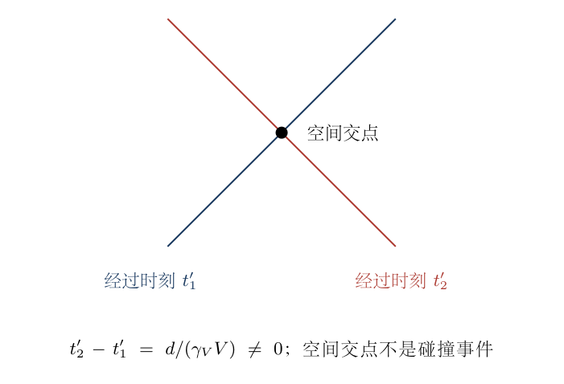

（9）低速极限与相对论修正。

记$\eta=v_0/c\ll1$，展开所需参考系速率：

$$|V|=v_0\left[1-\frac12\eta^2\sin^2\theta
+\frac38\eta^4\sin^4\theta+O(\eta^6)\right].$$

伽利略变换也可使反向平行轨迹改变夹角，它的垂直条件为$|V|=v_0$。因此“平行空间轨迹能变为相交”本身并非只属于相对论的现象；相对论改变的是精确条件，首项修正的相对大小为$O(v_0^2/c^2)$。

（10）有限速度和极端方向。

在固定$v_0$下，$|V|$随$|\sin\theta|$增大而减小，最小值在横向运动时为$v_0/\sqrt{1+v_0^2/c^2}$，最大形式极限为$v_0$。当$v_0\to c^-$且$\theta=\pi/2$，参考系速率趋于$c/\sqrt2$，仍不需要超光速参考系。

光子的速度变换应另按无质量对象解释；本题的$v_0<c$是粒子的既定限制。若把$v_0=c$直接代入当作有静质量粒子的状态，会混淆物理模型，但可用该形式极限检验数学表达式的有界性。

<!-- KEEP_STUDENT_START -->
（11）答案所需资料与可检验量。

第（2）问给出了反向速度、平面、参考系运动方向及$\theta$后，方向条件唯一确定$V^2$。若只给“等速且平行”，同向分支与反向分支的答案不同。若要定位交点，还须给两条轨迹的横向间距和初始位置。

独立核验可以用洛伦兹变换两个世界线上的若干事件拟合空间直线，再计算方向夹角；该方法不直接调用速度变换公式。事件的时间标签应保留，避免将不同事件的空间投影交点误记为碰撞。
<!-- KEEP_STUDENT_END -->

（12）把空间直线从事件变换直接导出。

取粒子的一条世界线$x=x_0+u_xt$、$y=y_0+u_yt$。洛伦兹变换为$x'=\gamma_V(x-Vt)$、$t'=\gamma_V(t-Vx/c^2)$。消去原时间，得到

$$x'=\frac{x_0}{\gamma_V(1-u_xV/c^2)}
 +\frac{u_x-V}{1-u_xV/c^2}\,t',$$

$$y'=y_0+\frac{u_yVx_0/c^2}{1-u_xV/c^2}
 +\frac{u_y}{\gamma_V(1-u_xV/c^2)}\,t'.$$

式中的常数项同时发生变化。因此不能只变换速度，再把原来的截距照抄进新参考系的轨迹方程。速度决定方向，常数项决定交点；这两种信息在求交时都需要。由于$|u_x|<c$、$|V|<c$，所有分母严格为正，事件参数的时间次序不会在单条粒子世界线上倒转。

（13）为什么平行轨迹仍可能改变夹角。

在原参考系，反向的两个速度向量共享同一条方向轴。换系后，两个向量的纵向分子都减去$V$，横向分量却保留相反符号；纵横比例不再互为负数。这个现象也有经典的参照：伽利略变换给$(u_x-V,u_y)$与$(-u_x-V,-u_y)$，内积为$V^2-v_0^2$，故经典直角条件是$|V|=v_0$。相对论的修正来自横向因子和速度分母，而不是凭空创造“平行改变夹角”。

相对论结果使$|V|/v_0$介于$1/\sqrt{1+v_0^2/c^2}$和$1$之间，且横向运动时取最小值。这个区间提供快速验算：若答案要求$|V|>v_0$，或者给出超光速惯性系，说明点积或速度变换符号有误。

（14）有限观察时间的限制。

整条空间轨迹的交点可能对应某粒子的过去时刻。若只观察发射之后的线段，必须分别回代两条轨迹的$t_i'$，检查其是否落在实际观察区间。两条无限直线相交，不能保证两段可见路径也相交。即使两个时间都在观察区间，只要$t_1'\ne t_2'$，粒子仍不会在那里相撞；碰撞要求两个完整事件的空间坐标和时间坐标全部一致。

（15）从任意夹角检查直角根的唯一性。

对反向初速度，去掉两个正的时间分母后，方向向量分别为$(u_x-V,u_y/\gamma_V)$和$(-u_x-V,-u_y/\gamma_V)$。两向量夹角$\chi$满足

$$\cos\chi=\frac{V^2-u_x^2-u_y^2/\gamma_V^2}{N_1N_2},$$

$$N_1=\sqrt{(u_x-V)^2+u_y^2/\gamma_V^2},
\qquad N_2=\sqrt{(u_x+V)^2+u_y^2/\gamma_V^2}.$$

当$u_y\ne0$、$|V|<c$时，$N_1,N_2$均非零，分子的符号直接决定锐钝角。分子也可写成$V^2(1+u_y^2/c^2)-v_0^2$，对$V^2$严格递增。因此本题直角只有一个速度大小，沿$x$轴的正反两个运动方向均给相同夹角。

在$V=0$时，$\chi=\pi$，是原参考系的反向速度；$V$逐渐接近光速时，两个亚光速粒子都显得向$-x'$方向运动，夹角趋零。直角根处于两个极限之间。若将某一速度分母误用成另一个粒子的分母，常会破坏这一连续的物理图像。

（16）亚光速条件的直接核验。

速度变换本身给出恒等式

$$c^2-|\mathbf u'|^2=
\frac{c^2-v_0^2}{\gamma_V^2(1-u_xV/c^2)^2}>0.$$

所以由亚光速初态变换而来的速度必然亚光速，无需把计算所得两个分量再人为截断。直角只要求两个非零三维空间速度的欧氏内积为零，并不要求某个四维内积为零；混用时空度量会求出与题意不同的条件。

一般三维反向速度也可以先把垂直于换系方向的分量旋转到一个平面，再使用本题的$u_y^2=u_\perp^2$。若还要求两条空间轨迹有交点，则轨迹的相对位置须在同一运动平面中；三维中方向不平行的两条直线还可能异面。这是原题明确两轨迹所在平面的原因。

\newpage

# 第 3 题　独轮车的椭圆钢丝、平衡转矩与摩擦

<!-- question-start -->

固定点$A,B$相距$2a/\sqrt3$，用长度$2a$的轻软钢丝连接。质量为$m$的骑行者在半径$r\ll a$的独轮车上从钢丝最低处缓慢向右运动。忽略钢丝和车轮质量，钢丝在轮两侧绷直；把小轮接触区视为椭圆折点，运动足够缓慢，可以采用准静态力和转矩平衡。

（1）到横坐标$x$时，求为平衡所需的车轮驱动转矩，说明骑行者应向哪一侧倾。（2）求轮与钢丝无滑动所需的最小静摩擦系数。取$A=(-a/\sqrt3,0)$、$B=(a/\sqrt3,0)$；讨论所求位置和整个行程的适用范围。

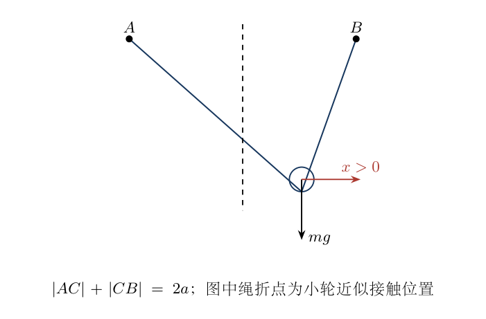

<!-- question-end -->

## 一、题型定位

可变几何的静力平衡与柔绳绕轮摩擦。先由长度约束确定椭圆，再由两边张力求轮上转矩，最后用包角和张力比判断无滑动。

## 二、知识点

轻软钢丝同一自由直段张力恒定，但绕轮接触区的张力可以变化。车轮两侧张力一般不相等；若把整个钢丝的张力强行设为一个常量，便无法解释骑行者所需转矩。

静摩擦是维持滚动所需的约束，最小系数由临界条件决定。微元法得到张力比不超过$e^{\mu\phi}$，其中$\phi$是总接触包角，不能用车轮转过的角度或椭圆参数角替代。

## 三、物理图像

钢丝总长固定，轮所在折点到两固定点的距离之和为$2a$，因此小轮中心的近似位置在下半椭圆上。右移时右段更陡，右侧张力大于左侧张力，接触钢丝对轮施加逆时针转矩。

要使车轮向右滚动，骑行者须给轮顺时针驱动转矩；骑行者受到反向转矩，需要向前倾，使重力转矩平衡。倾斜大小还依赖骑行者质心到轮轴的高度，题目未给该高度，故只能确定质心水平偏移或所需转矩。

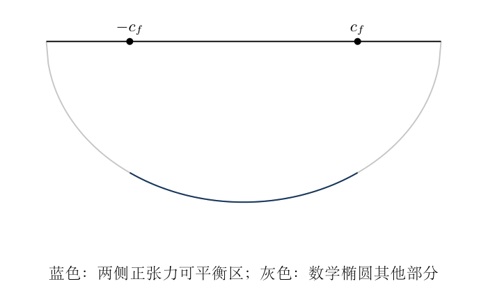

## 四、解题入口

把椭圆焦距记为$c_f=a/\sqrt3$，竖向半轴记为$b=a\sqrt{2/3}$，避免与车轮半径$r$混用。用水平和竖直力平衡解出$T_1,T_2$，取有向转矩$r(T_1-T_2)$。包角从两条钢丝方向角相加获得，再求$|\ln(T_2/T_1)|/\phi$。

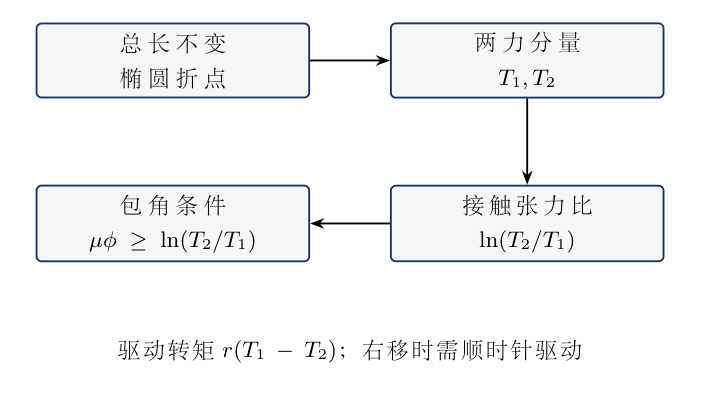

## 五、解析

（1）椭圆和两段钢丝长度。

令轮的近似位置为$(x,-y)$，$y>0$。焦距$c_f=a/\sqrt3$，钢丝总长$2a$，竖向半轴$b=\sqrt{a^2-c_f^2}=a\sqrt{2/3}$，所以

$$\frac{x^2}{a^2}+\frac{y^2}{b^2}=1,
\qquad y=\sqrt{\frac23(a^2-x^2)}.$$

左段长度$d_1=a+x/\sqrt3$，右段长度$d_2=a-x/\sqrt3$。它们的和为$2a$，平方分别等于$(c_f+x)^2+y^2$与$(c_f-x)^2+y^2$，这可独立核对焦点位置。

（2）力平衡的适用区间。

两张力的单位方向为$\mathbf e_1=(-c_f-x,y)/d_1$及$\mathbf e_2=(c_f-x,y)/d_2$。准静态平衡为

$$-T_1\frac{c_f+x}{d_1}+T_2\frac{c_f-x}{d_2}=0,
\qquad T_1\frac{y}{d_1}+T_2\frac{y}{d_2}=mg.$$

两张力都为正要求$-c_f<x<c_f$。如果轮移到右固定点外侧，两个绳段的水平分量都向左，不可能在没有其他水平力时保持准静态平衡。因此整个数学椭圆不是全程可实现的骑行轨迹。

在$x=c_f$，左侧张力趋于零，钢丝不再满足两侧绷紧假设。小轮近似及摩擦判据也应在这一退化点以前使用。

（3）两侧张力。

联立两式得到

$$T_1=\frac{mg\,d_1(c_f-x)}{2c_fy},\qquad
T_2=\frac{mg\,d_2(c_f+x)}{2c_fy}.$$

代入几何量，可写成

$$T_1=\frac{mg(\sqrt3a+x)(a-\sqrt3x)}{2a\sqrt{2(a^2-x^2)}},$$

$$T_2=\frac{mg(\sqrt3a-x)(a+\sqrt3x)}{2a\sqrt{2(a^2-x^2)}}.$$

在$x=0$，$T_1=T_2=\sqrt{3/8}\,mg$。两张力的水平分量相消，竖直分量相加为$mg$，所以每个张力都不等于$mg/2$。

（4）驱动转矩及倾斜方向。

张力差为

$$T_2-T_1=\frac{2mgx}{\sqrt{2(a^2-x^2)}}.$$

约定逆时针为正，钢丝对轮的接触转矩为$r(T_2-T_1)$。为了保持轮的准静态转动，骑行者的驱动转矩须为

$$\boxed{M_{\rm drive}=r(T_1-T_2)
=-\frac{2mg rx}{\sqrt{2(a^2-x^2)}}.}$$

对$x>0$是顺时针，大小为上述正值。等效轮缘驱动力大小为

$$\frac{|M|}{r}=\frac{2mgx}{\sqrt{2(a^2-x^2)}}.$$

这个等效力不是两侧张力的合力，后者的竖直分量仍为$mg$。

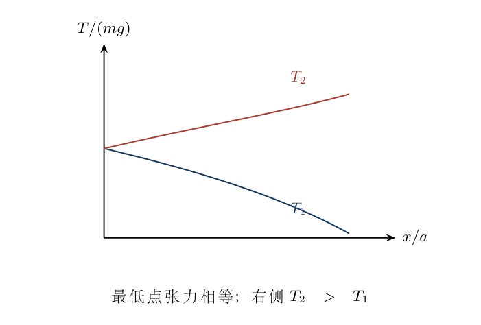

（5）骑行者质心偏移。

车轮对骑行者施加逆时针反作用转矩。若骑行者质心在轮轴右侧水平偏移$\delta$，重力给顺时针转矩$mg\delta$，故

$$\delta=\frac{|M|}{mg}
=\frac{2rx}{\sqrt{2(a^2-x^2)}}.$$

因此应向前、即右侧倾。若另给质心离轴距离$H$，可写$\sin\psi=\delta/H$；若给竖向高度$h$，则$\tan\psi=\delta/h$。这两个几何长度定义不同，不能在没有资料时直接报告一个唯一倾角。

向左运动到$x<0$时，张力差和转矩都反号，需向左倾。静态平衡所需方向由位置决定，而不只由瞬间速度的正负决定；例如在右侧缓慢后退，维持该位置仍需要同样的重力转矩。

（6）微元张力和欧拉绕绳公式。

取包角增量$d\vartheta$内一小段钢丝。忽略高阶小量，轮对钢丝的法向力大小为$dN=T\,d\vartheta$。静摩擦最多$\mu\,dN$，因此

$$|dT|\le\mu T\,d\vartheta,
\qquad |d\ln T|\le\mu\,d\vartheta.$$

沿接触区积分，得到

$$\left|\ln\frac{T_2}{T_1}\right|\le\mu\phi,
\qquad \boxed{\mu_{\min}(x)=\frac{|\ln(T_2/T_1)|}{\phi(x)}.}$$

非临界静摩擦不必处处等于$\mu dN$。等式仅用于求维持给定张力差所需的最小系数。不能把轮总承载力$mg$直接乘$\mu$当成整个包角的张力差上限，因为接触法向力沿绳弯曲连续分布。

（7）几何包角。

令左右绳段与向外水平线的锐角分别为$\theta_1,\theta_2$，有

$$\cos\theta_1=\frac{c_f+x}{d_1},\qquad
\cos\theta_2=\frac{c_f-x}{d_2}.$$

钢丝绕过车轮下部的总方向改变为$\phi=\theta_1+\theta_2$，所以

$$\phi=\arccos\frac{a+\sqrt3x}{\sqrt3a+x}
+\arccos\frac{a-\sqrt3x}{\sqrt3a-x}.$$

此处$\arccos$用弧度。轮轴位置和车轮接触点相差$O(r)$，本稿使用$r/a\to0$的题设近似；不能一边取椭圆折点，一边又把有限轮的全部接触弧长加进同一长度约束而不重新求几何。

（8）系数的显式结果。

对$0\le x<c_f$，$T_2\ge T_1$，无绝对值的表达式为

$$\boxed{\mu_{\min}=\frac{\displaystyle\ln\frac{(\sqrt3a-x)(a+\sqrt3x)}{(\sqrt3a+x)(a-\sqrt3x)}}
{\displaystyle\arccos\frac{a+\sqrt3x}{\sqrt3a+x}
+\arccos\frac{a-\sqrt3x}{\sqrt3a-x}}.}$$

负$x$侧用$|x|$或保留对数绝对值。质量、重力和车轮半径均在最小系数中消去；它们改变张力与转矩的量值，而不改变这个无量纲摩擦条件。

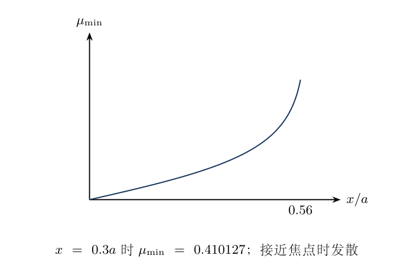

（9）最低点与端部极限。

最低点张力相等，所需驱动转矩为零，$\mu_{\min}(0)=0$；这并不说明任何动态过程都不需要摩擦，只说明题设准静态最低点没有张力差。

当$x\to c_f^-$，$T_1\to0$、$T_2$保持有限，张力比趋于无穷。包角却趋于$\pi/6+\pi/2=2\pi/3$，所以$\mu_{\min}\to\infty$。因此不存在一个有限常数，使这一模型中的轮从最低点一直无滑动地到达绷紧分支的极限位置。第（2）问必须理解成所求位置$x$的条件，或给定有限终点$x_{\max}<c_f$的全程条件。

（10）小位移展开与可用终点。

令$\xi=x/a$，张力比对数在$\xi=0$附近为$\ln(T_2/T_1)=4\xi/\sqrt3+O(\xi^3)$。包角为$\phi_0+O(\xi^2)$，$\phi_0=2\arccos(1/\sqrt3)$，故

$$\mu_{\min}=\frac{2|\xi|}{\sqrt3\arccos(1/\sqrt3)}+O(|\xi|^3),
\qquad M_{\rm drive}=-\sqrt2\,mgr\xi+O(\xi^3).$$

摩擦需求和转矩大小初期均随位移线性增加。给定$\mu$后，可通过单变量求根找允许最大$\xi$；应先把求根区间限制在$0<\xi<1/\sqrt3$，否则张力为负的区域会产生没有物理意义的对数或角度。

<!-- KEEP_STUDENT_START -->
（11）数值复核与模型边界。

取$x=0.3a$，有$T_1=0.361791mg$、$T_2=0.806541mg$、$\phi=1.954730$，最小系数为$0.410127$。驱动转矩大小$0.444750mgr$。把两单位方向与张力相乘，水平分量为零、竖直合力为$mg$，再核对$\ln(T_2/T_1)=\mu_{\min}\phi$。

若运动速度不可忽略，曲率产生的法向加速度会改变两张力和包角承载条件；若车轮有显著惯量，还需驱动角加速度。以上结果属于题目指定的缓慢平衡模型，不能直接当作任意速度下的行驶动力学。
<!-- KEEP_STUDENT_END -->

（12）包角公式的局部推导。

在轮缘取接触角宽$d\theta$的小段钢丝。小轮近似中，两端张力大小分别为$T$和$T+dT$；法向分量一阶合成得到$dN=T\,d\theta$。接触的切向静摩擦满足$|dT|\le\mu\,dN$，所以

$$\left|\frac{dT}{T}\right|\le\mu\,d\theta.$$

沿整个接触弧积分得到$|\ln(T_2/T_1)|\le\mu\phi$。只有每一小段都达到同一方向的摩擦极限时才取等号，故原题求的是不打滑所需的最小系数。把摩擦力直接写成$\mu(T_1+T_2)$会忽略接触法向力沿弧分布，不能恢复正确的指数关系。

此处$\phi$是两根绳方向在轮下方绕过的接触角，不是图中两绳之间的锐角。极小轮半径并不使包角趋于零：接触长度$r\phi$虽然缩短，每单位弧长法向力随$1/r$增大，两者积分后的摩擦条件仍有限。转矩却正比于$r$，因此“摩擦系数与半径无关”和“驱动转矩随半径改变”可以同时成立。

（13）有限速度时原题还缺少什么。

准静态是使原题能够仅从位置求张力的补充条件。若中心沿椭圆以有限速度运动，设横坐标$x(t)$，向下的深度$y(x)=\sqrt{2(a^2-x^2)/3}$，则向上的加速度为

$$a_y=-y''(x)\dot x^2-y'(x)\ddot x,
\qquad a_x=\ddot x.$$

张力平衡须改为

$$-T_1\frac{c_f+x}{d_1}+T_2\frac{c_f-x}{d_2}=m\ddot x,$$

$$T_1\frac y{d_1}+T_2\frac y{d_2}=m(g+a_y).$$

右端包含速度和加速度，接触张力比、所需摩擦系数及骑行者姿态随运动方案变化；只给$x$不足以计算。原详解的准静态结果由$\dot x,\ddot x\to0$恢复。这个检验也解释为何不能把有限速度的小轮运动当作普通静止吊物。

轮的角加速度非零时，还需把轮及骑行者的有效转动惯量纳入驱动转矩方程。原题没有给出该惯量及骑行姿态高度，所以不把这种动力学补充冒充原题的唯一数值答案。准静态倾斜先确定重心水平偏移，若另给重心到轮轴的距离才可转成倾角。

（14）小轮近似的范围。

真实钢丝长度包含两段切线及轮缘接触弧$r\phi$，中心到端点的距离也不完全等于切线长。本题把$r/a$视为小量，在首阶位置几何中忽略这些修正，却在转矩中保留力臂$r$；它们属于不同物理量中的最低非零项，并不矛盾。

这一近似在接近张力趋零的极限位置时不一定一致有效。此时极小的几何修正也可能改变很大的张力比，所以摩擦发散是理想点轮模型的边界结论。对给定且远离边界的$x$，公式用于估算；若需要有限半径的精确极限位置，必须重新建立切线和接触弧的总长约束。

\newpage

# 第 4 题　双电容梯形充电的总热量与分配

<!-- question-start -->

电源电压恒为$U_0$，从电源正端先经过左电阻$R$到节点1，再经右电阻$R$到节点2。节点1、2分别通过一个电容$C$连接电源负端。初始两电容均无电荷，$t=0$接通电源。（1）求充电足够久后两电阻的总焦耳热。（2）求左电阻与右电阻发热量之比。所有元件理想，$R,C>0$。

<!-- question-end -->

## 一、题型定位

线性电路的瞬态能量分配。总热量由电源功和末态储能求出，单个电阻的热量需额外瞬态方程或积分恒等式。

## 二、知识点

电容电压连续，恒压源做功为$U_0$乘从源端转移的总电荷。每个电容最终电压都为$U_0$，但充电路径不同，热量并不均分。

电阻焦耳热为$\int R i^2dt$，不是$R$乘通过电荷的平方，也不是电容储能的局部差额。两电容上端电流不同，左电阻电流为两个电容充电电流的和。

## 三、物理图像

接通瞬间，节点1、2的电压均为零；左电阻电流为$U_0/R$，右电阻两端暂时没有压差，所以初电流为零。随后节点1先升高，右电阻才开始给节点2电容充电。

最终两节点等电势，电流都归零，但整个过程左电阻既向第一个电容供电，又为第二个电容提供电荷。右电阻只承受两节点电压差，发热明显较小。

## 四、解题入口

先用末态求总热量，再写两电容电荷$q_1,q_2$的回路方程。消去$q_1$得到$q_2$的二阶方程；把它乘$\dot q_2$并从初态积分到末态，可以直接求右电阻热量，不必先解全部指数系数。

## 五、解析

（1）电源功与末态储能。

足够长时间后两个电容的电压都为$U_0$，电荷分别为$CU_0$。从源正端流出的总电荷为$2CU_0$，电源做功

$$W=U_0\,(2CU_0)=2CU_0^2.$$

末态电场能为两个$\frac12CU_0^2$之和，即$E_C=CU_0^2$。没有其他储能元件，所以

$$\boxed{Q_{\rm total}=W-E_C=CU_0^2.}$$

初态电场能为零。这里电源功是$2CU_0^2$而不是$CU_0^2$；半能量规律是储能占电源做功的一半，不是把两个电容储能中的一半再扣一次。

（2）正确标记支路电流。

左电阻电流$i_L=\dot q_1+\dot q_2$，右电阻电流$i_R=\dot q_2$。节点电压分别$q_1/C$、$q_2/C$，两个回路关系是

$$U_0=R(\dot q_1+\dot q_2)+\frac{q_1}{C},
\qquad \frac{q_1}{C}=R\dot q_2+\frac{q_2}{C}.$$

第二式给$q_1=q_2+RC\dot q_2$。求导后代回第一式，得到

$$\boxed{R^2C\ddot q_2+3R\dot q_2+\frac{q_2}{C}=U_0.}$$

初态$q_2(0)=0$且$\dot q_2(0)=0$。末态$q_2(\infty)=CU_0$、$\dot q_2(\infty)=0$。初导数为零是由右电阻初始压差为零得到，不能由“电容初始无电荷”自动推出所有支路电流为零。

（3）积分恒等式求右电阻热量。

把二阶方程乘$\dot q_2dt$，从$0$积分到$\infty$：

$$\frac{R^2C}{2}[\dot q_2^2]_0^\infty
+3R\int_0^\infty\dot q_2^2dt
+\frac{1}{2C}[q_2^2]_0^\infty
=U_0[q_2]_0^\infty.$$

首项为零，后两边的电荷边界项分别为$CU_0^2/2$与$CU_0^2$，因此

$$3Q_R+\frac12CU_0^2=CU_0^2,
\qquad \boxed{Q_R=\frac16CU_0^2.}$$

这一步保留了真实的时间积分。形式上的“乘$dq_2$”等于乘$\dot q_2dt$；不要将二阶导数简单理解成$\ddot q_2dq_2$的某个电荷势函数。

（4）左电阻热量与比值。

由总热量立即得到

$$\boxed{Q_L=\frac56CU_0^2,\qquad Q_L:Q_R=5:1.}$$

两只相同电阻的热量不相等，因为电流函数不同。左电阻最初电流最大，且流经它的总电荷是流经右电阻的两倍；仅凭电荷比也不能得到热量比$4:1$，因为两个电流的时间形状不同。

（5）无量纲节点方程。

定义$s=t/(RC)$、$u_i=V_i/U_0=q_i/(CU_0)$。节点电流守恒给

$$u_1'=1-2u_1+u_2,
\qquad u_2'=u_1-u_2,$$

其中撇号代表对$s$求导。消去$u_1$得到$u_2''+3u_2'+u_2=1$，和电荷方程相符。初值$u_1=u_2=0$，末值均为$1$。

电阻归一化功率分别为$p_L=(1-u_1)^2$、$p_R=(u_1-u_2)^2$，实际功率共同系数为$U_0^2/R$。时间积分转换为$RC\,ds$，所以热量的共同系数是$CU_0^2$。

（6）两个衰减模式的完整解。

设$a=(3-\sqrt5)/2$、$b=(3+\sqrt5)/2$，则$a+b=3$、$ab=1$。满足初值的节点2电压为

$$u_2=1-\frac{b e^{-as}-a e^{-bs}}{b-a},
\qquad u_2'=\frac{e^{-as}-e^{-bs}}{b-a}.$$

节点1电压$u_1=u_2+u_2'$，从而

$$u_1=1-\frac{(b-1)e^{-as}+(1-a)e^{-bs}}{b-a}.$$

两节点均逐渐趋于$1$，右电阻电流先从零上升再下降。两个时间常数分别为$RC/a$和$RC/b$，不能仅用一个$RC$指数描述整个电路。

（7）直接积分的交叉检查。

右电阻电流归一化为$u_2'$，因此

$$\frac{Q_R}{CU_0^2}=\frac{1}{(b-a)^2}
\left(\frac1{2a}+\frac1{2b}-\frac{2}{a+b}\right).$$

利用$(b-a)^2=5$、$a+b=3$、$ab=1$，括号内为$3/2-2/3=5/6$，故结果是$1/6$。这个方法独立检查积分恒等式，也说明所有模式及交叉项都必须包括。

左电阻电流$1-u_1$含两个同号指数。展开平方时交叉项为正，积分得$5/6$。若只把两模式各自的平方积分相加，会漏掉交叉项，导致总热量无法与电源能量平衡。

（8）累计能量平衡。

在任意有限时间，电源功$W(t)=CU_0^2[u_1(t)+u_2(t)]$，储能$E_C(t)=CU_0^2[u_1^2+u_2^2]/2$。累计总热量为

$$Q_L(t)+Q_R(t)=CU_0^2\left[u_1+u_2-\frac{u_1^2+u_2^2}{2}\right].$$

求导可恢复$R i_L^2+R i_R^2$，末态恢复$CU_0^2$。这不是只在末态成立的巧合，而是整个瞬态的功率守恒。数值求解时同时积累两热量，可用此式检查积分误差。

（9）改成两个不同电阻。

若左、右分别为$R_1,R_2$，两电容仍均为$C$，消元方程变为

$$R_1R_2C\ddot q_2+(2R_1+R_2)\dot q_2+\frac{q_2}{C}=U_0.$$

同样的积分给

$$Q_R=\frac{R_2}{2(2R_1+R_2)}CU_0^2,
\qquad \frac{Q_L}{Q_R}=1+\frac{4R_1}{R_2}.$$

右电阻越大，其慢充电过程越独立，热量趋于$CU_0^2/2$；右电阻趋于零时，两电容近似同步充电，右热量趋于零。总热量始终为$CU_0^2$，但分配依赖电阻比。

（10）不同电容的推广。

若节点1电容$C_1$、节点2电容$C_2$，则

$$R_1R_2C_1\ddot q_2+
\left[R_1\left(1+\frac{C_1}{C_2}\right)+R_2\right]\dot q_2
+\frac{q_2}{C_2}=U_0.$$

初、末态电流均零，积分后得到

$$Q_R=\frac{R_2C_2^2U_0^2}{2[R_1(C_1+C_2)+R_2C_2]},
\qquad Q_{\rm total}=\frac12(C_1+C_2)U_0^2.$$

令$C_1=C_2=C$恢复前式。分母中$R_2$乘的是$C_2$，分子也含$C_2^2$，可用$C_2\to0$时右支路没有储能和电流的极限进行检查。

<!-- KEEP_STUDENT_START -->
（11）尺度与理想极限。

将两电阻同时乘$\lambda>0$，电流按$1/\lambda$缩小、充电时间按$\lambda$放大，热量不变。将两电容同时乘$\lambda$，时间和热量均按$\lambda$放大，而热量比保持$5:1$。电压乘$\lambda$时，电荷乘$\lambda$、热量乘$\lambda^2$。

这里“足够长时间”必须相对最慢模式而言。先令某个电阻无限大再接通，支路实际上断开；先对任意有限电阻充到末态再取极限，末态仍充满。两个极限次序不同，不能用断路图否定有限电阻的慢充电热量。
<!-- KEEP_STUDENT_END -->

（12）右支电流的峰值及时间。

右电流为$i_R=(U_0/R)(e^{-as}-e^{-bs})/(b-a)$。它在$s=0$为零，在无穷远也为零，中间只有一个正峰。令导数为零，得到

$$s_{\rm peak}=\frac{\ln(b/a)}{b-a},
\qquad t_{\rm peak}=RC\,s_{\rm peak}.$$

这与左支接通瞬间即达到最大电流$U_0/R$不同。右支只有在节点1已经建立电压以后才能充电，因此两电流的形状差别是热量不能由电荷比平方求出的直接原因。即使两支最终转移电荷之比为$2:1$，也不存在$i_L(t)=2i_R(t)$的逐时关系。

（13）积分边界项为何不会遗漏。

消元方程乘$\dot q_2$后，二阶项成为$R^2C\,d(\dot q_2^2)/2dt$，电容项成为$d(q_2^2)/2Cdt$。两端的右支电流都为零，故前一边界项确实消失；后一项由$q_2(0)=0$、$q_2(\infty)=CU_0$给出$CU_0^2/2$。

若改成不同初态，必须重新检查这两个边界项。特别是两节点起初电压不同，右支初电流一般不再为零，不能直接把原题的$5:1$套用。两个电容同时处于相同$V_i$时，平移电压才会恢复相同的归一化初态，这正是相同初压变式可以使用原比例的原因。

（14）电阻趋零为何仍可有有限热量。

同时把两电阻乘小量$\epsilon$，峰值功率按$1/\epsilon$增加，持续时间按$\epsilon$缩短，而积分热量不变。它说明电路的理想化极限是越来越窄、越来越高的脉冲，不能把某个固定$t>0$处的极限电流为零当成整个积分为零。

严格令电阻为零的理想源直接连接理想电容，会缺少决定充电过程的动态元件。实际线路的电感、源内阻及辐射决定极短时间内如何分配能量。原题则明确在有限正电阻模型中计算，再取参数极限，因此答案中的耗散与能量守恒一致。数值程序若步长大于最短衰减时间，会漏掉接通脉冲；应通过总能量恒等式与两个独立热量积分同时检查。

（15）有限时间结果的可测验算。

在任何$s>0$，测得两个节点电压即可算累计总热量，但不能只凭这两个瞬时电压唯一分出$Q_L,Q_R$，分配还记录了此前的电流历史。完整指数解则可分别积分至指定$s$，并将两者之和与电源功减储能核对。

若两电阻温升不同，温升之比也只有在电阻热容相同、散热可忽略时才等于热量比。原题求的是焦耳热积分，不涉及材料热容和环境传热。把$5:1$直接作为任意实际电阻的末态温度比，会额外引入题目没有提供的条件。

\newpage

# 第 5 题　三点电荷的直线轨迹与相似膨胀构型

<!-- question-start -->

平面内三个同号点电荷$Q_1,Q_2,Q_3$，质量$m_1,m_2,m_3>0$，电荷质量比满足$Q_1/m_1:Q_2/m_2:Q_3/m_3=1:2:3$。三个粒子同时从静止释放，只考虑两两静电库仑作用，忽略相对论及辐射。求使各粒子始终沿固定直线运动的初始构型条件。区分共线初态与非共线、保持三角形相似的分支，并证明所得非共线构型能维持直线运动。

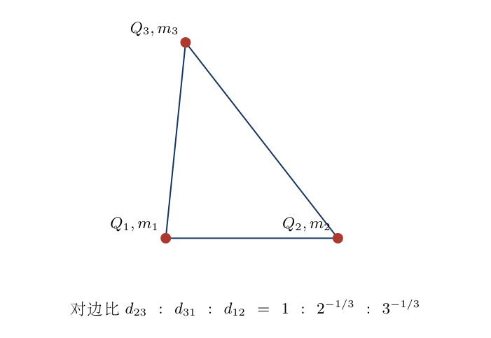

<!-- question-end -->

## 一、题型定位

三体中心构型与库仑相似膨胀。关键是比较电荷质量比和对边的三次方，而不是把三电荷当作等质量的等边三角形。

## 二、知识点

系统内力成对反向，总动量守恒，初始静止的质心保持静止。非共线相似膨胀要求各粒子加速度与其相对于质心的位置成同一个比例，才能用同一个尺度函数描述运动。

库仑力大小按距离平方反比，向量式按位移除以距离三次方。推出边长比例时出现立方根，来自这个向量式，不是把力大小错误写成距离三次方反比。

## 三、物理图像

三电荷同时相互排斥。一般三角形释放后，各顶点合力方向会随形状改变，轨迹会弯曲。特殊三角形可以使三个合力恰好沿各自的质心径向，且径向加速度比例相同，于是仅放大而不旋转。

若初始三粒子已经共线，所有库仑力始终沿同一条线，任何无重合的共线排列都能维持直线运动；它们未必保持距离比不变。不能用非共线三角形的边长比例排除这个直接分支。

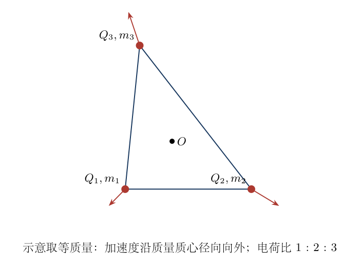

## 四、解题入口

把原点置于质量质心，记$\eta_i=Q_i/m_i$与$d_{ij}=|\mathbf r_i-\mathbf r_j|$。用$\sum m_i\mathbf r_i=0$消去第三个位置，要求非共线分支中$\mathbf a_i\parallel\mathbf r_i$。找出使三对作用的“每单位两质量系数”相等的条件，再代入尺度运动证明充分性。

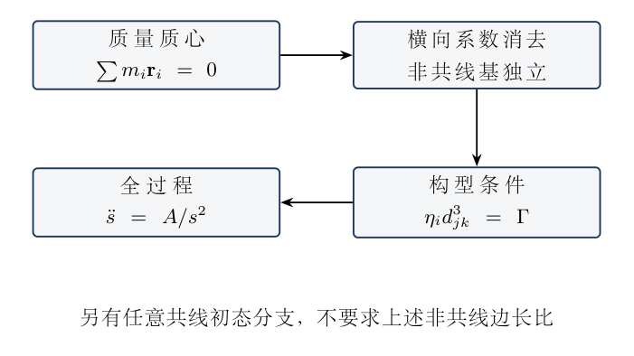

## 五、解析

（1）先列出共线分支。

三个粒子若从三个不同的共线位置静止释放，两两力都沿该直线。牛顿方程没有横向分量，唯一性保证横向坐标始终不变。因此所有共线、无重合初态都满足各粒子沿固定直线运动。

同号电荷的势能在距离趋零时趋于正无穷，有限初始能量不能到达两粒子重合点，因此共线排列不会通过碰撞交换次序。若换成异号电荷，直线方向仍保持，但可能发生碰撞奇点，需要另说明运动延续问题。

共线分支不要求$1:2:3$对应的特定距离比。非共线结果是在排除这个分支后，三角形直线膨胀的构型条件。

（2）质心坐标与库仑方程。

设$M=m_1+m_2+m_3$，质心原点满足

$$m_1\mathbf r_1+m_2\mathbf r_2+m_3\mathbf r_3=0.$$

第$i$粒子的加速度为

$$\mathbf a_i=K\eta_i\sum_{j\ne i}
\frac{m_j\eta_j}{d_{ij}^3}(\mathbf r_i-\mathbf r_j),$$

其中$K$为静电常量。$Q_i$可同时为负，但三个$\eta_i$比相同；以下先取正号，最后的两两乘积仍正。

（3）消去第三个位置。

以粒子1为例，$\mathbf r_3=-(m_1\mathbf r_1+m_2\mathbf r_2)/m_3$。代入后$\mathbf a_1$在$\mathbf r_1,\mathbf r_2$基下的横向系数为

$$K\eta_1m_2\left(-\frac{\eta_2}{d_{12}^3}
+\frac{\eta_3}{d_{13}^3}\right).$$

非共线时，$\mathbf r_1,\mathbf r_2$线性独立。为使加速度沿$\mathbf r_1$，上述系数必须为零，即$\eta_2/d_{12}^3=\eta_3/d_{13}^3$。对其他两粒子循环同理，得到

$$\boxed{\eta_1d_{23}^3=\eta_2d_{31}^3=\eta_3d_{12}^3=\Gamma.}$$

质心必须按质量求，不能按电荷求。如果把三个位置放在电荷中心而直接使用质量质心的线性关系，横向系数就会错误地改变。

（4）构型的边长比。

题给$\eta_1:\eta_2:\eta_3=1:2:3$，所以

$$\boxed{d_{23}:d_{31}:d_{12}
=1:2^{-1/3}:3^{-1/3}.}$$

这三条边分别是粒子1、2、3的对边。最大边$d_{23}$对应最小电荷质量比，最小边$d_{12}$对应最大的电荷质量比。若按相邻粒子的编号顺序记忆，很容易把最长和最短边交换。

数值为$1:0.793700526:0.693361274$。最大边$1$小于另外两边之和$1.487061800$，因此非共线三角形确实存在。边长比只确定相似类，整体尺寸、平移、旋转和镜像仍自由。

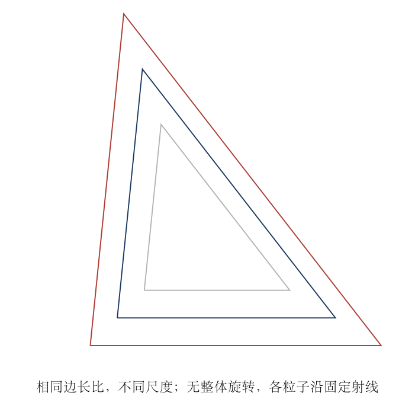

（5）三个加速度的公共比例。

由构型条件，三个成对系数相等：

$$\frac{K\eta_1\eta_2}{d_{12}^3}
=\frac{K\eta_2\eta_3}{d_{23}^3}
=\frac{K\eta_3\eta_1}{d_{31}^3}
=\beta,$$

其中$\beta=K\eta_1\eta_2\eta_3/\Gamma$。因此

$$\mathbf a_i=\beta\sum_{j\ne i}m_j(\mathbf r_i-\mathbf r_j)
=\beta M\mathbf r_i.$$

定义$A=\beta M>0$，得到所有粒子相同的径向比例$\mathbf a_i=A\mathbf r_i$。$A$具有时间平方的倒数量纲；这里初始构型的加速度是向外，不是引力中心构型的向内。

（6）充分性：构造全过程。

设初始质心位置为$\mathbf R_i$，取

$$\mathbf r_i(t)=s(t)\mathbf R_i,
\qquad s(0)=1,\quad\dot s(0)=0.$$

两两距离都乘$s$，库仑加速度都乘$s^{-2}$。牛顿方程化为同一个标量方程

$$\boxed{\ddot s=\frac{A}{s^2}.}$$

它有从静止向外膨胀的解，且$\dot s>0$、$s>1$。每个粒子沿固定的$\mathbf R_i$方向运动，三角形形状不变，质心仍为零。初始构型并非只在一瞬间合力径向：共同尺度方程证明这个关系可以持续。

（7）尺度能量与终速度。

乘$\dot s$并积分，得到

$$\frac12\dot s^2=A\left(1-\frac1s\right).$$

所以$\dot s\to\sqrt{2A}$，每个粒子的终速度为$\sqrt{2A}\mathbf R_i$。终速向量之和按质量加权仍为零，系统的总动量没有因为膨胀而改变。

初始质量二阶矩$I_0=\sum m_iR_i^2$，初始库仑势能$U_0=\sum_{i<j}KQ_iQ_j/d_{ij}$。由$\sum\mathbf r_i\cdot\mathbf F_i=U_0$和$\mathbf F_i=m_iA\mathbf R_i$，可得$A=U_0/I_0$。全过程能量也可写为

$$\frac12I_0\dot s^2+\frac{U_0}{s}=U_0.$$

这与标量积分相同，可独立检查对边编号和质量系数。

（8）非共线直线条件的限定。

“各粒子沿直线”首先约束的是全过程速度和加速度方向，不能仅把初始合力指向某个点就宣称以后必保持。三粒子从静止、质心不动的非共线运动中，三个固定速度方向由总动量关系约束，三个位移可使用共同的标量参数表示。

将此表示代入库仑力的横向分量，要求两项横向作用对整个参数区间相消；非共线、非零加速度时，两个距离三次方的比必须固定。三个粒子循环使用同一条件，得固定边长比，零总角动量又排除整体旋转，于是成为上述相似膨胀分支。共线时位置基退化，不能继续把横向系数单独置零，因此它须独立列出。

这一步所依据的是全程固定方向和初始静止。若允许非零初速度、整体转动或只要求某一个粒子瞬时加速度径向，构型条件会改变，不能直接使用本题结论。

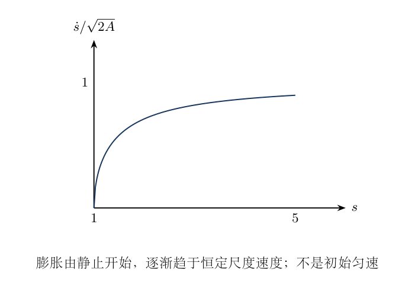

（9）一份可以直接代入力学的坐标。

取$d_{23}=D$，先用任意平移坐标令$\mathbf R_1^{\rm lab}=(0,0)$、$\mathbf R_2^{\rm lab}=(D3^{-1/3},0)$。第三个顶点可取

$$x_3=\frac{D^2(3^{-2/3}+2^{-2/3}-1)}{2D3^{-1/3}},
\quad y_3=\sqrt{D^2 2^{-2/3}-x_3^2}.$$

再扣除质量质心$\sum m_i\mathbf R_i^{\rm lab}/M$，得到$\mathbf R_i$。用实际$Q_i=\eta_i m_i$算三对力，三个$\mathbf a_i/\mathbf R_i$应有同一个比例$A$。质量不相同时质心位置会变，但边长比例仍由$\eta_i$决定。

（10）尺度变化与比较方式。

若所有初始距离乘$\lambda$，构型比例不变，初始加速度大小乘$\lambda^{-2}$，公共径向比例$A$乘$\lambda^{-3}$，特征时间乘$\lambda^{3/2}$。终速度大小乘$\lambda^{-1/2}$，与库仑势能按$1/\lambda$缩放相符。

若保持质量和形状，所有电荷乘$\lambda$，库仑力乘$\lambda^2$，终速度大小乘$|\lambda|$，时间尺度乘$1/|\lambda|$。若同时改质量与电荷，使$\eta_i$保持不变，仍需检查总质量对$A$的影响，不能只由电荷质量比声称所有时间函数不变。

<!-- KEEP_STUDENT_START -->
（11）可观察的检验与非中心初态。

对所求三角形，数值轨迹应同时满足：三边比保持常量，每个速度与初始质心位置叉积为零，总动量为零，总能量不变。只检查某两个轨迹近似直线不足以确认构型，初始释放时所有速度本来为零，短时间弯曲也可能不明显。

将一条边改变百分之一后，初始加速度一般已含横向分量，后续边长比和方向都会漂移。等边三角形配$1:2:3$的电荷质量比不满足本题构型；只有三个比相等时，非共线分支才是等边三角形。
<!-- KEEP_STUDENT_END -->

（12）尺度函数的时间积分。

由$\dot s=\sqrt{2A}\sqrt{(s-1)/s}$，从初态到指定尺度所需时间为

$$t(s)=\frac1{\sqrt{2A}}\int_1^s\sqrt{\frac{u}{u-1}}\,du.$$

令$u=\cosh^2 z$，积分可显式写成

$$\boxed{t(s)=\frac{\sqrt{s(s-1)}+\operatorname{arcosh}\sqrt s}{\sqrt{2A}}.}$$

虽然积分核在$s=1$处发散，积分本身有限。令$s=1+\epsilon$，有$t\sim\sqrt{2\epsilon/A}$，反解$s=1+At^2/2+O(t^4)$，恢复初始静止与初始加速度。大尺度时$s$近似按$\sqrt{2A}t$增长，但还存在缓慢的对数修正，不能把全过程写成匀速放大。

（13）非共线固定直线分支的代数限制。

若三条固定运动方向不全平行，总动量为零使三个速度的标量系数只有一个自由参数。可把全过程写成$\mathbf r_i=\mathbf R_i+\mathbf A_i u(t)$，其中$\sum m_i\mathbf A_i=0$。对每个粒子，将牛顿方程与$\mathbf A_i$作叉积：两对力的横向分子都是$u$的一次式，而距离平方都是$u$的二次式。

横向相消在一个连续时间区间内成立，意味着相应多项式恒等式成立。将距离三次方比的等式平方后，左右分别含二次式的三次幂和一次式的二次幂。非退化二次式的根重数不能与一次式的根重数匹配，因而距离比必须恒定；若距离二次式是完全平方，说明该相对位移始终平行于初始边。对三条边循环使用，三角形闭合也使它们采用同一个尺度。

因此非共线固定直线运动保持三角形相似。初始静止给零总角动量，排除持续整体旋转，便回到已构造的相似膨胀。共线初态则从一开始就缺少独立的横向基，不能使用上述非退化论证。正电荷之间的势能在距离趋零时发散，有限初始能量也排除碰撞造成的方向分支跳变。

\newpage

# 第 6 题　穿孔绳球的质量改变与支点转换

<!-- question-start -->

光滑水平桌面有小孔$O$，轻绳穿过孔，桌面端系质量$m$的小球$A$，下端系质量$\lambda m$的小球$B$。初态桌面绳长$l_0$，$A$以角速度$\omega_0$绕孔作匀速圆周运动，$B$静止。

（1）用$\omega_0,g,l_0$表示$\lambda$。（2）在$B$上无冲量地粘上一块原先静止、质量$2\lambda m$的物体，求$B$下降的最大位移。（3）另从原初态出发，在当前桌面绳的中点$P$，距孔$l_0/2$处置光滑钉子。绳接触钉子后绕$P$运动，求$B$竖直最大位移及方向。忽略绳与钉子的摩擦，两个改变分别独立进行；题给$\lambda\gg1$，同时检查最大位移是否依赖此近似。

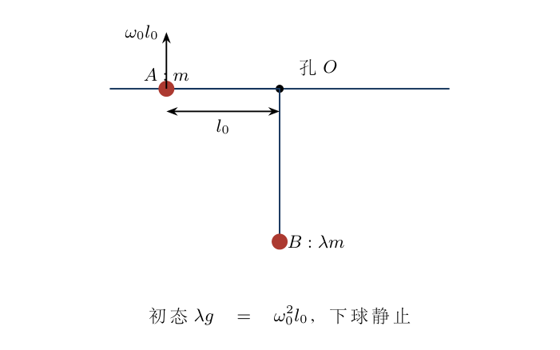

<!-- question-end -->

## 一、题型定位

可变半径运动、有效势和参考转轴切换。径向动能必须同时计入两球，但最大位移时径向速度为零；角动量守恒的转轴需根据绳的受力支点改变。

## 二、知识点

孔对桌面球的拉力通过孔，故未设钉子时关于孔的角动量守恒。钉子设入后拉力通过钉子，关于钉子的角动量守恒，关于孔的一般不再守恒。

绳不可伸长，使桌面自由长度的变化与下方球位移同幅反向。质量改变时若两者初始竖直速度为零且粘合无冲量，不损失桌面球的切向动能。恒张力平衡只适用于原来的匀速圆周初态，不适用于随后所有时刻。

## 三、物理图像

新增重物后，下端变为$3\lambda m$，向下拉动绳子，桌面半径缩小、切向速率因角动量守恒而增大；到最近半径时两球径向速度均为零，随后回摆。

钉子改变的不是总质量，而是桌面球的转轴和初始自由半径。初速度仍为$\omega_0l_0$，新自由半径只有$l_0/2$，所需向心力变成原来的两倍，下方球开始向上运动，而非下降。

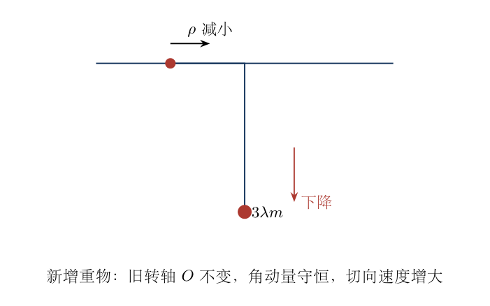

## 四、解题入口

先用初态$T=\lambda mg=m\omega_0^2l_0$。第（2）问保留关于孔的角动量$m\omega_0l_0^2$，以桌面半径$\rho$写有效势。第（3）问新角动量为$m(\omega_0l_0)(l_0/2)$，用新自由半径$R$重写能量，不沿用孔轴公式。

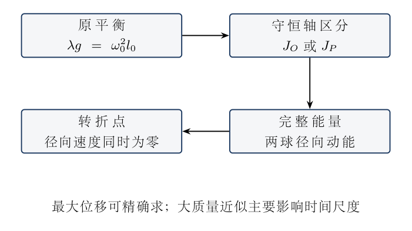

## 五、解析

（1）初态质量比。

下方球静止，张力$T=\lambda mg$。桌面球的向心力$m\omega_0^2l_0=T$，所以

$$\boxed{\lambda=\frac{\omega_0^2l_0}{g}.}$$

因此$\lambda\gg1$等价于初始切向运动具有较大的离心需求，但这里离心力是讨论有效势时的用语，实际惯性系受力只有绳张力。初始速度$v_t=\omega_0l_0$。

（2）新增重物后的角动量。

下端总质量变为$3\lambda m$。桌面球在水平方向仍受通过孔$O$的中心拉力，因此

$$J_O=m\rho^2\dot\theta=m\omega_0l_0^2.$$

切向速率为$v_t(\rho)=\omega_0l_0^2/\rho$。绳约束给$B$下降距离$h=l_0-\rho$，竖直速率大小等于$|\dot\rho|$。两球的径向总动能为$\frac12m(1+3\lambda)\dot\rho^2$，不能在整个过程中只保留桌面球的切向动能。

（3）完整能量方程与有效势。

以初态下球高度为势能零点，重力势改变为$-3\lambda mg(l_0-\rho)$。能量守恒为

$$\frac12m(1+3\lambda)\dot\rho^2
+\frac{J_O^2}{2m\rho^2}
-3\lambda mg(l_0-\rho)
=\frac12m\omega_0^2l_0^2.$$

若略去与$\rho$无关的常数，有效势$U_{\rm eff}=J_O^2/(2m\rho^2)+3\lambda mg\rho$。它在$\rho\to0$发散，角动量屏障阻止桌面球落到孔内。稳定半径满足$J_O^2/(m\rho^3)=3\lambda mg$，即$\rho_{\rm eq}=l_0/3^{1/3}$。

原来的$l_0$大于新平衡半径，因此初始运动向内，下方球下降。这一符号可在求最大位移前由受力判定，避免把另一转折根当作初始下降后的最近点。

（4）最近半径的代数求解。

最大下降时$\dot\rho=0$。用$\lambda g=\omega_0^2l_0$和$z=\rho/l_0$化简能量式：

$$\frac1{2z^2}-\frac12=3(1-z).$$

两边乘$2z^2$得$6z^3-7z^2+1=0$，因式分解为

$$\boxed{(z-1)(6z^2-z-1)=0.}$$

根为$z=1,1/2,-1/3$。$z=1$是初态，负根不代表绳长；实际最近半径$z=1/2$。因此

$$\boxed{h_{\max}=l_0/2.}$$

在最近点切向速率变成$2\omega_0l_0$，切向动能变为初态的四倍；重力下降释放的能量正好补足差额。

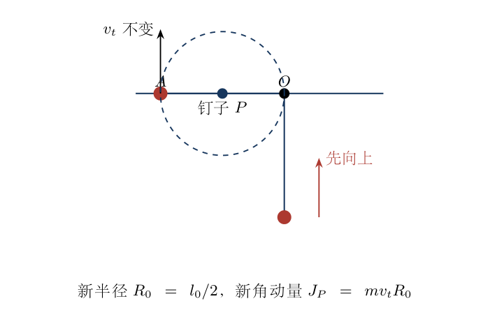

（5）为什么最大位移不需要大质量近似。

完整能量中径向惯性包含$m(1+3\lambda)$，但初末两个转折点径向速度都为零，所以这一项在求振幅时严格消失。初态的圆周平衡关系又消去$\lambda$，因此$h_{\max}=l_0/2$对任意$\lambda>0$都成立，只要理想绳长、无耗散及无冲量粘合条件成立。

$\lambda\gg1$影响运动时间和瞬态径向速度，不能据此从完整方程中任意删去所有径向动能。转折点处可省略的是该时刻为零的项，而非全程为零的项。

（6）钉子改变新轴的角动量。

另回到原初态，总质量未增加。钉子在$P$，距$O$为$l_0/2$，桌面自由绳半径初值$R_0=l_0/2$。接触瞬间$A$速度与$PA$垂直，因此理想支点切换不需要改变速度，也没有机械能损失。

新轴角动量为

$$J_P=mR_0(\omega_0l_0)=\frac12m\omega_0l_0^2.$$

接触后张力通过$P$，所以$J_P=mR^2\dot\varphi$守恒。关于原孔$O$的角动量不守恒，钉子的约束力对$O$有转矩。不能只把原孔轴角动量的公式中的$l_0$换成$l_0/2$，那会使初切向速度也被错误减半。

（7）先判断竖直运动方向。

接触后的初始自由半径减半而切向速度不变，桌面球所需向心力$m v_t^2/R_0=2\lambda mg$。下方质量仍为$\lambda m$，因此不能保持原有的静止平衡。

令$u=R-R_0$为$B$向上位移，绳长约束给$R$增加时$B$上升。径向方程可写

$$m(1+\lambda)\ddot R=\frac{J_P^2}{mR^3}-\lambda mg.$$

初态右边为$\lambda mg>0$，所以$\ddot R>0$，$B$开始上升。这一方向与新增重物问题恰好相反；“下方重球”并不保证改变约束后一定下落。

（8）钉子分支的能量和最高点。

完整能量为

$$\frac12m(1+\lambda)\dot R^2
+\frac{J_P^2}{2mR^2}
+\lambda mg(R-R_0)
=\frac12m\omega_0^2l_0^2.$$

最高点$\dot R=0$，令$u/l_0=y\ge0$、$R/l_0=1/2+y$，得到

$$\frac{1}{2(1+2y)^2}+y=\frac12.$$

设$z=1+2y$，则$z^2(2-z)=1$，分解为$(z-1)(z^2-z-1)=0$。排除初态$z=1$及负长度根，实际新根$z=(1+\sqrt5)/2$，所以

$$\boxed{u_{\max}=\frac{\sqrt5-1}{4}l_0
\approx0.309017l_0,\quad\text{方向向上}.}$$

新自由半径最大为$(1+\sqrt5)l_0/4$，大于初值$l_0/2$。最高点桌面切向速率减小，损失的切向动能转为下方球的重力势能。

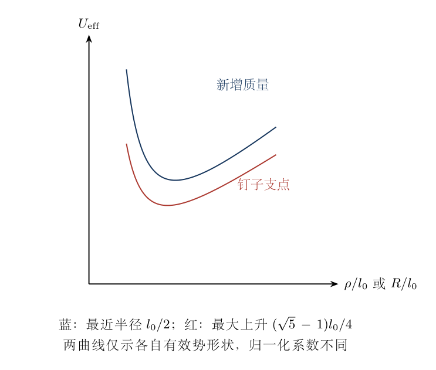

（9）张力、绳松弛和能量检查。

新增重物分支取$h=l_0-\rho$向下，$T=3\lambda mg+3\lambda m\ddot\rho$。结合径向方程，得到$T=3\lambda[mg+m v_t^2/\rho]/(1+3\lambda)>0$。钉子分支同理$T=\lambda[mg+m v_t^2/R]/(1+\lambda)>0$。

所以所求转折区间中绳始终绷紧，没有因为负张力而丧失约束。计算的最大位移也小于相关初自由长度；但实际桌面边缘、下方绳长度与球的尺寸若限制行程，需要另加入碰撞约束。本题未提供这些限制，采用理想无限空间。

（10）任意新增质量倍率的结果。

若下端总质量变为$p\lambda m$、$p>1$，转折方程为$1/(2z^2)-1/2=p(1-z)$。因式分解后，非初态正根满足

$$2p z^2-z-1=0,
\qquad z_{\min}=\frac{1+\sqrt{1+8p}}{4p}.$$

下降幅度$l_0(1-z_{\min})$。取$p=3$恢复$1/2$；$p\to1$时根趋于$1$，扰动消失。负根与初态根都应剔除。新平衡半径$l_0p^{-1/3}$一般不等于最近半径，因为无阻尼运动会越过平衡点。

<!-- KEEP_STUDENT_START -->
（11）运动时间与初态小振动。

未改变约束时的稳定圆轨道附近，令$\rho=l_0+\epsilon$，径向方程线性化给

$$\ddot\epsilon+\frac{3\omega_0^2}{1+\lambda}\epsilon=0.$$

小振动角频率$\Omega=\omega_0\sqrt{3/(1+\lambda)}$。$\lambda$越大，径向惯性越大，振动越慢；这说明大质量条件主要进入时间尺度。新增重物或半程支点转换是有限扰动，不能直接用这一小振动振幅代替精确转折结果。
<!-- KEEP_STUDENT_END -->

（12）位移与运动时间为何对质量有不同依赖。

在加重物分支，把$z=\rho/l_0$、$\tau=\omega_0t$代入完整径向方程，有

$$\frac{d^2z}{d\tau^2}=\frac{z^{-3}-3}{1+3\lambda}.$$

势能的两个转折点由初始角动量与重力关系决定，因初态已有$\lambda g=\omega_0^2l_0$，最大位移中的$\lambda$可以消去。但径向加速的有效惯性仍含$1+3\lambda$，所以到达转折点的无量纲时间正比于$\sqrt{1+3\lambda}$。

钉子分支令$z=R/l_0$，则

$$\frac{d^2z}{d\tau^2}=\frac{1/(4z^3)-1}{1+\lambda}.$$

该分支的时间因子为$\sqrt{1+\lambda}$，转折半径却同样不依赖质量比。两种操作虽然均可用有效势求位移，初始角动量、势能函数及时间因子都不同，不能用一套根式替换两种过程。

（13）由能量求到达极值的时间。

加重物分支的能量给

$$\left(\frac{dz}{d\tau}\right)^2=
\frac{1-z^{-2}+6(1-z)}{1+3\lambda}.$$

取向内运动的负平方根，从$z=1$积分到$1/2$。两个端点的径向速度都为零，积分核虽各有平方根奇性，时间积分仍收敛。这样求出的时间与完整两球方程一致；若漏掉悬球径向动能，会错误地把分母写成$1$。

钉子分支在$z=1/2$开始，速度平方为

$$\left(\frac{dz}{d\tau}\right)^2=
\frac{2-2z-1/(4z^2)}{1+\lambda}.$$

这次取正平方根，上限为$(1+\sqrt5)/4$。上球远离钉子时，下球因总绳长约束而上升，且两者的径向速度大小相同。上下方向、半径增减和积分根号的正负需要一起确定。

（14）平衡半径与极值半径的区别。

有效势极小点只表示圆运动平衡，并不是从原初态释放后的停止位置。加重物后系统越过新平衡半径，再在更小半径转向；钉子后则越过新平衡半径，在更大半径转向。没有阻尼时，系统不会在势能极小点停住。以“新向心力等于重力”直接解最大位移，会求出平衡位置而遗漏径向动能。

（15）轻绳能否始终绷紧。

下球质量为$M_B$，以其向下位移为正。绳长约束给下球加速度$-\ddot\rho$，故$M_Bg-T=-M_B\ddot\rho$。与上球径向方程$m\ddot\rho=mv_t^2/\rho-T$联立，得到

$$T=\frac{M_B}{m+M_B}\left(mg+\frac{mv_t^2}{\rho}\right)>0.$$

对钉子分支只需将$\rho$改成$R$。正质量、正半径使两种过程的张力始终为正，轻绳约束不会在推导区间失效。若钉子、桌缘、下球与地面的几何空间限制先被触及，则应先终止理想运动；原题默认这些接触限制不发生。

\newpage

# 第 7 题　双凸透镜系统的焦距反演与双解

<!-- question-start -->

两个理想薄凸透镜位于空气中，左镜$L_1$、右镜$L_2$相距$L=25.0\,\mathrm{cm}$，焦距$f_1,f_2>0$。（1）轴上点光源放在左镜左侧$l_1=10.0\,\mathrm{cm}$时，经过两镜的右侧出射光为平行光。（2）从左侧入射平行光，经过两镜后在右镜右侧$l_2=5.0\,\mathrm{cm}$聚焦。求所有满足两项观测的焦距组合，并判断这两项测量能否唯一确定焦距。采用近轴薄透镜模型。

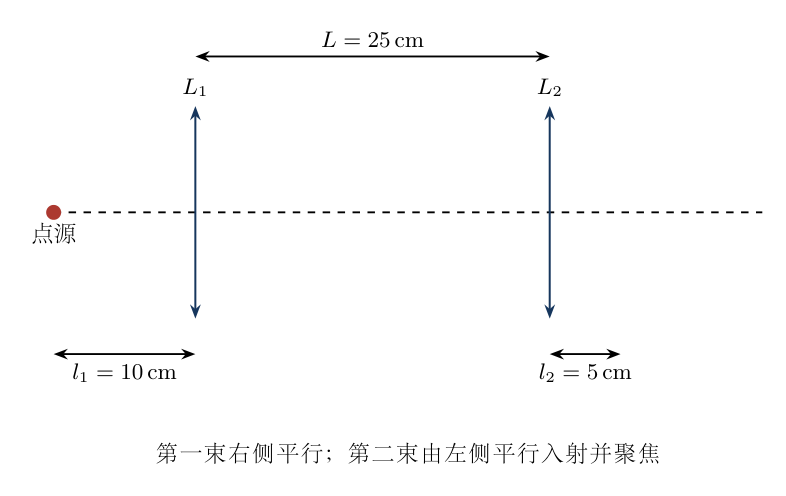

<!-- question-end -->

## 一、题型定位

由系统前后焦点反演两枚薄透镜。必须允许中间实像或虚像，并保留方程的全部正焦距解。

## 二、知识点

薄透镜成像式$1/s+1/s'=1/f$中，入射侧实物距离为正，出射侧实像距离为正；若光线尚未到会聚点便进入下一镜，该会聚点对下一镜是虚物，物距为负。

一组透镜的有效焦距与从镜片位置量出的前后焦点距离一般不同。两个正焦距镜片间距很大时，组合光焦度甚至可以为负，不能凭“都是凸透镜”先排除这种分支。

## 三、物理图像

点源经左镜后，可能在两镜之间先交叉，也可能仍发散；只要到右镜时正好相当于来自其前焦点，就会出射平行。平行光进入左镜时，也可能在到右镜前已交叉，或尚在向一个右侧会聚点聚拢。

两种中间像状态都可能满足同样的外部焦点测量。反演中的两个解对应“短焦距、两镜间交叉”和“长焦距、第二镜遇到会聚束”的不同光路。

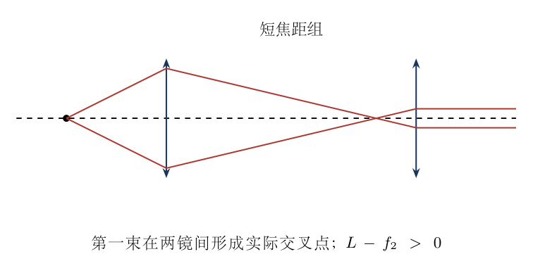

## 四、解题入口

先逐镜写两条成像方程，使用带符号中间物距。再用光线矩阵检查结果：两镜总矩阵的$B$元等于镜间距$L$，前后焦点条件给$D+l_1C=0$和$A+l_2C=0$，结合行列式为1得到一个二次方程。

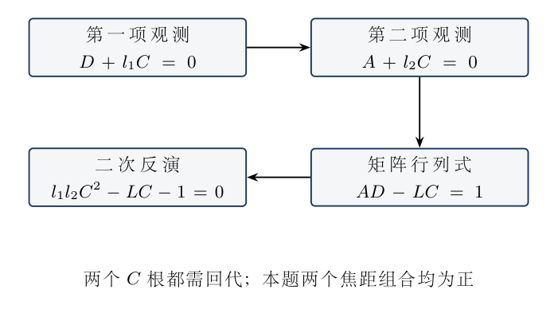

## 五、解析

（1）第一项测量的成像关系。

点源在左镜左侧$l_1$，要使右镜出射平行，左镜单独产生的像必须位于右镜的左焦点，即像坐标距左镜$L-f_2$。于是

$$\boxed{\frac1{l_1}+\frac1{L-f_2}=\frac1{f_1}.}$$

若$f_2>L$，该中间像在左镜左侧，是左镜的虚像，$L-f_2<0$仍可使用。这里没有假定中间像一定处于两镜之间。

（2）第二项测量的成像关系。

平行光经左镜会聚到其后焦点，坐标为$f_1$。对右镜的物距为$L-f_1$，最后实像距右镜$l_2>0$，所以

$$\boxed{\frac1{L-f_1}+\frac1{l_2}=\frac1{f_2}.}$$

当$f_1>L$，右镜接收到的光束正在向它右侧的点会聚，故右镜物距为负。将负物距改成其绝对值，会把一个合法解误删，或产生另一组错误焦距。

（3）直接消元和全部正根。

代入$L=25,l_1=10,l_2=5$（单位厘米），消元得到

$$6f_1^2-225f_1+1250=0,
\qquad f_2=\frac32f_1-\frac{25}{4}.$$

因此有两组解，根的符号须配对：

$$\boxed{f_1=\frac{75}{4}\pm\frac{25\sqrt{33}}{12},
\qquad f_2=\frac{175}{8}\pm\frac{25\sqrt{33}}{8}\quad(\mathrm{cm}).}$$

数值分别为

$$\boxed{(f_1,f_2)=(6.782161,3.923242)\ \mathrm{cm},}$$

$$\boxed{(f_1,f_2)=(30.717839,39.826758)\ \mathrm{cm}.}$$

两组均为凸透镜，均满足原来的两个测量。因此数据不足以唯一确定两镜焦距。不是一个二次方程中只有“正号根”才有物理意义：这里两个根全部为正。

（4）短焦距组的实际光路。

对短焦距组，第一项点源成像在左镜右侧$L-f_2=21.076758\,\mathrm{cm}$，位于两镜之间。光线先在此交叉，随后发散到右镜；这个点到右镜距离正好为$f_2$，故再次出射为平行光。

第二项的平行光在左镜后$6.782161\,\mathrm{cm}$先交叉，之后作为右镜左侧实物点入射。右镜物距$L-f_1=18.217839\,\mathrm{cm}$，由成像式得到右侧实像$5.000000\,\mathrm{cm}$。

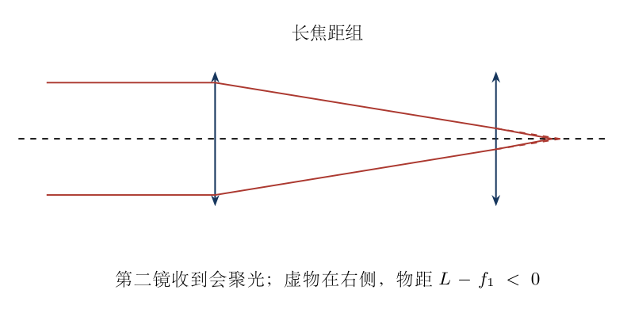

（5）长焦距组的实际光路。

对长焦距组，第一项的左镜虚像位置为$L-f_2=-14.826758\,\mathrm{cm}$，在左镜左侧。到右镜时入射束仿佛从其左焦点、距右镜$39.826758\,\mathrm{cm}$处发出，故右侧仍为平行光。

第二项平行束经左镜本来会在左镜右侧$30.717839\,\mathrm{cm}$会聚，但右镜在$25\,\mathrm{cm}$处提前进入光束。它的物距为$-5.717839\,\mathrm{cm}$，是虚物；经过右镜后会聚到右镜右侧$5\,\mathrm{cm}$。这段光路没有违反任何“凸透镜只能处理发散光”的规则，因为凸透镜也能接收会聚束。

（6）矩阵方法独立建立方程。

取光线向量$(y,\vartheta)^T$，传播与薄透镜矩阵分别为

$$P(d)=\begin{pmatrix}1&d\\0&1\end{pmatrix},
\qquad F(f)=\begin{pmatrix}1&0\\-1/f&1\end{pmatrix}.$$

从左镜前到右镜后，总矩阵

$$M=F(f_2)P(L)F(f_1)=\begin{pmatrix}A&B\\C&D\end{pmatrix},$$

其中$A=1-L/f_1$、$B=L$、$C=(L-f_1-f_2)/(f_1f_2)$、$D=1-L/f_2$。每个基本矩阵行列式都是1，因此$AD-BC=1$。

（7）前后焦点条件。

点源在左镜左侧$l_1$，到左镜时的任意光线满足$y=l_1\vartheta$。出射角$\vartheta_{\rm out}=(Cl_1+D)\vartheta$，平行出射要求$D+l_1C=0$。

平行入射取$\vartheta=0$，在右镜后传播$l_2$，光线高度为$(A+l_2C)y$。聚焦轴上要求$A+l_2C=0$。代入行列式得

$$l_1l_2C^2-LC-1=0.$$

这是与逐镜成像完全独立的反演途径。它不需要事先识别每个中间像为实或虚，但$C$的两根仍需全部检验。

（8）有效焦距和组合光焦度。

记系统有效焦距$f_{\rm sys}=-1/C$，上式等价于

$$f_{\rm sys}^2-Lf_{\rm sys}-l_1l_2=0,
\qquad f_{\rm sys}=\frac{L\pm\sqrt{L^2+4l_1l_2}}2.$$

本题两个系统有效焦距分别为$-1.861407\,\mathrm{cm}$和$26.861407\,\mathrm{cm}$。短焦距两镜的和小于间距，组合$C>0$、有效焦距为负；长焦距组$C<0$、有效焦距为正。

从镜片位置量到的$10\,\mathrm{cm}$和$5\,\mathrm{cm}$是系统焦点位置资料，不能分别直接当成两镜焦距，也不能把它们直接当作有效焦距。主平面可以落在镜组外部，这解释了看似反常的负有效焦距分支。

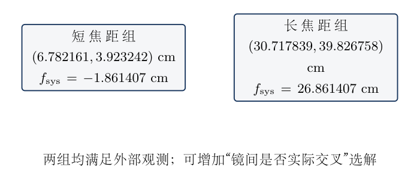

（9）从矩阵恢复两枚焦距。

对每个$C$根，$A=-l_2C$、$D=-l_1C$，所以

$$f_1=\frac{L}{1+l_2C},\qquad f_2=\frac{L}{1+l_1C}.$$

本题两组分母都为正，得到四个正焦距。给定其他$L,l_1,l_2$后，仍需检查焦距正负和有限性，不应把所有二次根自动当作“两个凸透镜”解。

若分母为零，某个焦距无限大，等效为无光焦度的元件；这种退化不满足本题两枚有限凸透镜的条件。矩阵法保留退化信息，逐镜分式法则需谨慎避免在中间零分母处直接除法。

（10）增加什么测量可以选解。

可以观察第一项点源光是否在两镜之间形成实际光斑。若是，选择短焦距组；若只保持发散并无中间实际交叉，选择长焦距组。也可拆开测任一镜的焦距，或者测系统有效焦距的符号。

“两镜都是凸透镜”不能增加区分，因为两组已满足。只重复原来的两个焦点位置也不增加独立信息。反演遇到多解时应说明可测的判据，而不能凭通常镜片大小或经验焦距舍去合法分支。

<!-- KEEP_STUDENT_START -->
（11）数值光线检查与精度。

对每组焦距任选几条近轴入射光线：第一项取$(y,\vartheta)=(l_1\vartheta,\vartheta)$，矩阵输出角应为零；第二项取$(y,0)$，右镜后再传播$l_2$，高度应为零。两组均通过这些检查。

数值结果保留六位小数供回代。题目测量只给三位有效数字，实际报告宜为

$$(6.78,3.92)\,\mathrm{cm}\quad\text{或}\quad(30.7,39.8)\,\mathrm{cm}.$$

未给测量误差时不应把六位小数解释成实验精度。实际厚透镜和有限孔径需另考虑主平面、像差和遮挡。
<!-- KEEP_STUDENT_END -->

（12）双解在哪些测量范围内都为正。

保留一般的$L,l_1,l_2>0$。由二次方程得

$$C_\pm=\frac{L\pm\sqrt{L^2+4l_1l_2}}{2l_1l_2},
\qquad f_1=\frac L{1+l_2C},\quad f_2=\frac L{1+l_1C}.$$

$C_+>0$使两个分母都为正，并且$f_1,f_2<L$，因此总有一组较短的正焦距。$C_-<0$时，两个分母同时为正的条件为

$$\boxed{L>|l_1-l_2|.}$$

例如检查$f_1$的分母，需$L+\sqrt{L^2+4l_1l_2}>2l_2$；若右端减去$L$为正，再平方即得$L+l_1>l_2$。另一分母同理给$L+l_2>l_1$。这两条件合并便是上述不等式。本题$25>|10-5|$，所以长焦距组确实存在，且两个焦距均大于$L$。

等号时其中一个焦距趋于无穷大，对应没有光焦度的极限元件；若不等式失效，一组反演解会包含负焦距，不再满足两个凸透镜的限定。因此“二次方程有两根”与“两个根都符合器材条件”是不同步骤，本题必须完成后一步回代检查。

（13）从单条近轴光线验证整个光束。

以点源发出的光线为$(y,\theta)=(0,\theta_0)$，传播$l_1$到第一镜后，入射向量为$(l_1\theta_0,\theta_0)$。系统作用后出射角是$(Cl_1+D)\theta_0$。该系数为零意味着对任意足够小的$\theta_0$均平行，而不是只让主轴光线恰好平行。

第二项测量中，入射平行束向量为$(y_0,0)$，系统后传播$l_2$，像高为$(A+l_2C)y_0$。系数为零保证所有近轴高度汇聚同一点。主轴光线本来就穿过轴上点，单独检查它不能确定焦距；必须检查非零高度光线，或直接检验矩阵系数。

用两组焦距各选正负两个入射高度回代，镜后角度与最终像高均满足上述零条件。实际中可再观察镜间是否有交叉点，这一额外信息能够区分短焦距与长焦距组，而原题给出的两项外部观测自身不能选出唯一组。

（14）中间虚像和虚物的符号核对。

第一镜的物距始终为$l_1>0$，所以其中间像距为$b_1=f_1l_1/(l_1-f_1)$。短焦距组$f_1<l_1$给$b_1>0$，光线先会聚；长焦距组$f_1>l_1$给$b_1<0$，光线经过第一镜仍发散，其反向延长线在左侧相交。这与第一项测量$b_1=L-f_2$完全一致。

第二项测量中，平行入射经第一镜后的目标焦点在$f_1$。若$f_1<L$，光线先越过这个实焦点再到第二镜，对右镜是实物；若$f_1>L$，到右镜时尚在会聚，对右镜是位于右侧的虚物。虚物不代表该处放着真实发光物体，而是描述入射光束如果继续传播将去向何处。

（15）为什么不是无焦系统。

两透镜满足$f_1+f_2=L$时，系统矩阵$C=0$，称为无焦组合。它把平行光变成平行光，却不能满足本题有限点源变成平行束、又将平行束聚于有限像距的两项观测：若$C=0$，观测要求$D=0$和$A=0$，与$AD-BC=1$矛盾。

本题两组都有$C\ne0$，有效焦距均有限。短焦距组的组合有效焦距为负，并不意味着其中某一片透镜必须为凹透镜。镜间的传播也参与系统矩阵，因此组合光焦度不能仅把两片正光焦度相加；完整表达含$-L/(f_1f_2)$一项。

选解时应使用能区分两组的测量，例如镜间光束是否实际越轴，或单独测得一片镜的焦距是否超过镜间距。重复原有两项外部观测只会提高数值精度，仍不能消除结构上的双解。

\newpage

# 第 8 题　玻尔圆轨道的磁场与弱场能级修正

<!-- question-start -->

采用固定原子核、非相对论电子圆轨道的玻尔模型。电子质量$m=0.91\times10^{-30}\,\mathrm{kg}$，电荷$-q$，$q=1.6\times10^{-19}\,\mathrm C$；$K=8.99\times10^9\,\mathrm{N\,m^2/C^2}$，$h=6.628\times10^{-34}\,\mathrm{J\,s}$，$\mu_0=4\pi\times10^{-7}\,\mathrm{H/m}$。记$\hbar=h/(2\pi)$，基态轨道角动量大小按$\hbar$取值。

（1）求基态电子轨道在原子核处产生的磁场大小$B_0$。（2）外加与轨道面垂直的恒定均匀磁场$\mathbf B=B\hat{\mathbf z}$，推导有向机械角动量$L_z$的变化率，并求由$L_z$与$qBr^2/2$组成的守恒量。（3）把此守恒量的大小量子化为$n\hbar$，在弱磁场下求圆轨道能级到$B$的一阶，讨论第一激发态至基态的跃迁是否改变光谱。忽略自旋、精细结构、辐射和核反冲；区分零阶近似与一阶修正。

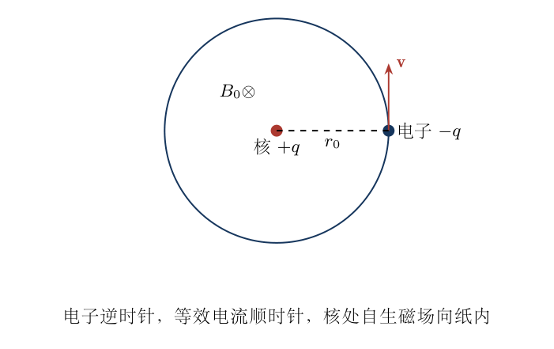

<!-- question-end -->

## 一、题型定位

轨道电流、机械与正则角动量、弱磁场能量展开。以有向量统一电荷和磁场符号，保留线性磁场能量，不能由半径无一阶变化推断能级也无变化。

## 二、知识点

玻尔模型的量子条件是$L=n\hbar$，其中$\hbar=h/(2\pi)$；普朗克常量$h$用于光子能量$h\nu$。轨道电流由电荷除以周期求，磁场方向与负电荷运动方向的右手关系相反。

在均匀轴向磁场中，机械角动量不必恒定，旋转对称对应的守恒量是正则角动量。磁场不做功仍允许固定正则量下的圆轨道动能和能级改变，不能把“不做功”当作“不改变谱线”的理由。

## 三、物理图像

取电子逆时针运动为$L_z>0$，轨道电流为顺时针，原点自生磁场沿$-z$。外加$+z$磁场对切向运动的电子产生径向内力，同时若有径向速度，会产生切向力和角动量变化。

正则角动量保持给定量子值后，机械角动量含$Br^2$修正。弱场中圆轨道半径只从$B^2$开始变化，机械角速度和能量却有$B$的一阶变化；这两个精度不能混淆。

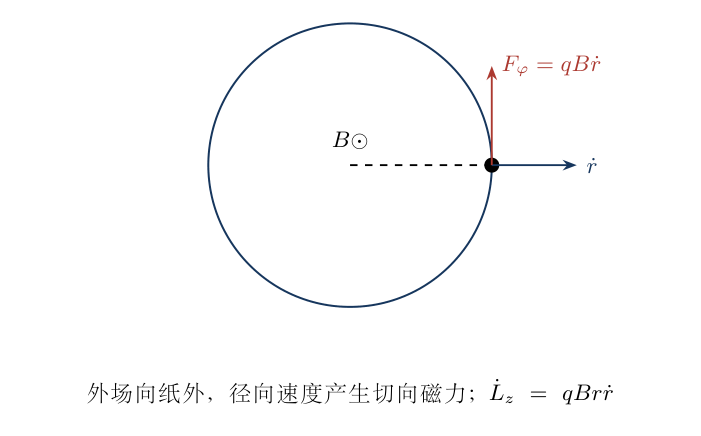

## 四、解题入口

先以$k=Kq^2$简写库仑常数，联立$m v^2/r=k/r^2$与$mvr=\hbar$求$r_0,v_0$，再用圆电流中心场公式。外场取有向$L_z$，推导$J=L_z-qBr^2/2$；用$J$写径向有效能量并在圆轨道极小值展开。

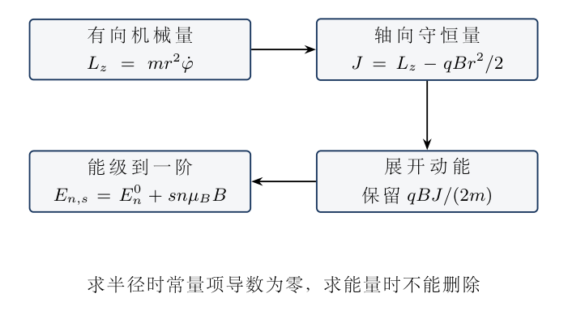

## 五、解析

（1）无场基态圆轨道。

令$k=Kq^2$。向心平衡$m v_0^2/r_0=k/r_0^2$，角动量$m v_0r_0=\hbar$，联立得到

$$\boxed{r_0=\frac{\hbar^2}{mk},\qquad v_0=\frac{k}{\hbar}.}$$

代入题给常量，$r_0=5.31330\times10^{-11}\,\mathrm m$、$v_0=2.18171\times10^6\,\mathrm{m/s}$。速度约为光速的$0.0073$，符合此题非相对论近似。数值采用题给圆整常量，不混用另一套更新数值。

（2）轨道电流与核处磁场。

一周周期$T=2\pi r_0/v_0$，电流大小$i=q/T=qv_0/(2\pi r_0)$。圆电流中心场为$\mu_0i/(2r_0)$，所以

$$\boxed{B_0=\frac{\mu_0qv_0}{4\pi r_0^2}
=\frac{\mu_0m^2K^3q^7}{4\pi\hbar^5}
\approx12.3648\,\mathrm T.}$$

电子逆时针运动对应负电荷，等效电流顺时针，因此磁场沿$-z$，与$L_z$方向相反。所求是轨道在核处产生的场，不把外加磁场相加进$B_0$的定义。

（3）恒定外场下的角动量变化。

平面极坐标速度$\mathbf v=\dot r\mathbf e_r+r\dot\varphi\mathbf e_\varphi$。电荷为$-q$，洛伦兹力为

$$\mathbf F_B=-q\mathbf v\times B\hat{\mathbf z}
=-qBr\dot\varphi\mathbf e_r+qB\dot r\mathbf e_\varphi.$$

库仑力没有关于核的转矩，磁力切向分量给

$$\boxed{\dot L_z=qBr\dot r
=\frac{qB}{2}\frac{d(r^2)}{dt}.}$$

于是$\boxed{J=L_z-qBr^2/2}$为守恒量。这里$L_z=mr^2\dot\varphi$可正可负，$B$也可以是有向标量。若改用轨道角动量大小，或把磁场取与绕行方向相反，就会出现另一种加号写法；必须同时说明方向约定，不能把正负号独立任取。

（4）正则角动量解释与磁场开启。

对称规范$\mathbf A=(Br/2)\mathbf e_\varphi$给正则角动量$p_\varphi=mr^2\dot\varphi+(-q)Br^2/2=J$。它是轴对称的守恒量，而机械角动量仅当$r$固定时才不变。

若磁场随时间缓慢开启，法拉第电场$E_\varphi=-r\dot B/2$必须计入。电子受力转矩给$\dot L_z=(q/2)d(Br^2)/dt$，所以在轴对称开启过程中$J$仍守恒；不能把磁场瞬间加入却既忽略感生电场又声称机械角动量按某个量子值立即改变。本题能级讨论是外场已建立后的定态模型。

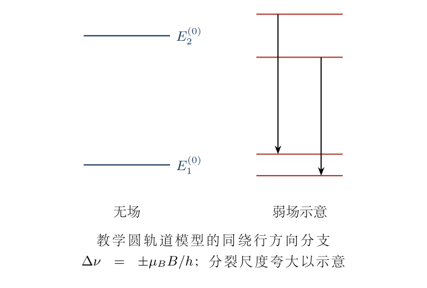

（5）在守恒量下写能量。

机械能为$E=m\dot r^2/2+L_z^2/(2mr^2)-k/r$。由$L_z=J+qBr^2/2$代入，得到

$$E=\frac12m\dot r^2+
\frac{J^2}{2mr^2}+\frac{qBJ}{2m}
+\frac{q^2B^2r^2}{8m}-\frac{k}{r}.$$

中间$\frac{qBJ}{2m}$是与半径无关的线性磁场项，不能因求半径时导数为零便从能量中删除。最后一项为抗磁的二次修正。

磁力不做功意味着在固定场中的实际自由运动机械能守恒，并不意味着不同外场定态、不同量子约束下的机械能值相同。开启磁场时外界感生电场还可以交换能量。

（6）圆轨道半径的方程。

定态圆轨道是有效径向势的极小值。令对$r$的导数为零，得到

$$-\frac{J^2}{mr^3}+\frac{q^2B^2r}{4m}+\frac{k}{r^2}=0,$$

即

$$\boxed{J^2=mk r+\frac{q^2B^2r^4}{4}.}$$

在固定$J$下，此式只有$B^2$，所以$r=r_n+O(B^2)$，$r_n=J^2/(mk)$。这一步证明的是半径无一阶修正，不能推广成机械角动量、切向速度或能量都无一阶修正。

（7）弱场量子化与能级。

用$s=\pm1$表示两种绕行方向，量子化$J=s n\hbar$、$n=1,2,\ldots$，无场半径$r_n=n^2r_0$。在能量中取$r=r_n+O(B^2)$，得到

$$\boxed{E_{n,s}=-\frac{mK^2q^4}{2n^2\hbar^2}
+s\,n\mu_BB+O(B^2),
\qquad \mu_B=\frac{q\hbar}{2m}.}$$

题给常量得$\mu_B=9.27366\times10^{-24}\,\mathrm{J/T}$。电子的轨道磁矩与机械角动量相反，因此磁偶极能$-\boldsymbol\mu\cdot\mathbf B$与正则量能量展开的线性符号一致。

（8）基态与第一激发态跃迁。

无场$E_1=-2.16574\times10^{-18}\,\mathrm J$，$E_2=E_1/4$。光子频率

$$\nu_{21}^{(0)}=\frac{E_2-E_1}{h}
=\frac{3mK^2q^4}{8h\hbar^2}
\approx2.45067\times10^{15}\,\mathrm{Hz}.$$

若比较同一绕行方向$s$的$2\to1$分支，则

$$\boxed{\nu_{21,s}=\nu_{21}^{(0)}+s\frac{\mu_B B}{h}+O(B^2).}$$

频移系数$\mu_B/h=q/(4\pi m)=1.39916\times10^{10}\,\mathrm{Hz/T}$。因此零阶光谱与无场相同，一阶光谱已经改变。若把不同绕行方向之间的跃迁也列入，频差的线性项为$(2s_2-s_1)\mu_BB/h$；是否允许及强度如何需要额外选择规则，本题模型没有提供，不能直接声明所有分支必有相同强度。

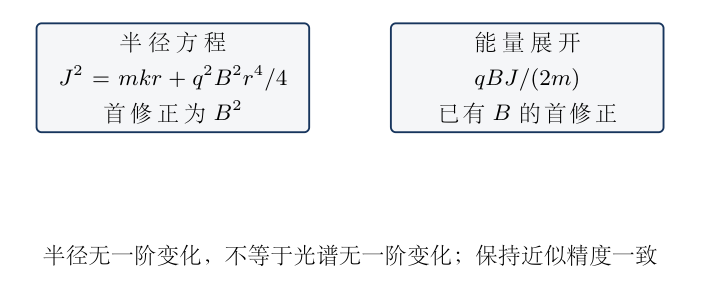

（9）为什么只忽略径向磁力会得到错误结论。

外场很弱时，磁力相对库仑力很小。若只保留零阶向心平衡，并同时把所有$O(B)$量都略去，确实恢复原来的无场能级；这只是零阶结论。

若保留正则角动量中的$Br^2$项，却在向心方程和动能中丢掉同阶修正，会不一致地推导出半径有一阶变化，或推导“光谱不变”。正确做法是在同一阶次下展开完整能量，得到半径无一阶变化、能量有线性变化。原手写答案的“不改变光谱”不能作为一阶结果保留。

（10）弱场参数和二阶修正。

可用$\epsilon_n=q|B|r_n^2/(2n\hbar)\ll1$判断正则与机械角动量的相对修正。圆轨道方程给

$$r=r_n(1-\epsilon_n^2+O(\epsilon_n^4)).$$

由于无场有效势在$r_n$处驻定，半径改动对能量的贡献先到四阶；二阶能量为$q^2B^2r_n^2/(8m)$。因此

$$E_{n,s}=E_n^{(0)}+sn\mu_B B
+\frac{q^2B^2r_n^2}{8m}+O(B^4).$$

对给定$B$，$\epsilon_n\propto n^3$，高激发态更容易离开弱场范围。不能只用基态的弱场条件确认所有$n$都可用同一一阶公式。

<!-- KEEP_STUDENT_START -->
（11）常量、方向和模型范围。

原题扫描把角动量常量写作$h$，手写解按$\hbar$使用；本稿显式统一为$\hbar=h/(2\pi)$。若字面按$L=h$，半径将变为上述的$4\pi^2$倍，自生场按角动量五次方反比缩小，不能仍称标准玻尔基态。

本题是带有圆轨道量子条件的教学模型。真实氢原子基态轨道角动量为零，磁量子数、电子自旋与跃迁选择规则不能由此圆轨道模型完整给出。这里“同绕行方向”的线性谱移是本模型的结论，不将它当作真实氢原子全部塞曼分裂的完整谱线图。
<!-- KEEP_STUDENT_END -->

（12）机械角动量为何不能直接固定。

匀强轴向外场可取轴对称矢势$A_\varphi=Br/2$。电子电荷为$-q$，拉格朗日量的电磁耦合项为$-q\mathbf A\cdot\mathbf v$，故角坐标的共轭动量为

$$p_\varphi=\frac{\partial\mathcal L}{\partial\dot\varphi}
=mr^2\dot\varphi-\frac{qBr^2}{2}=J.$$

角坐标没有显式出现在拉格朗日量中，所以守恒的是这个共轭量。机械角动量$L_z=J+qBr^2/2$随半径变化，在径向运动中一般不守恒。题目沿用量子化的轨道模型时，应以轴对称运动的作用量为背景理解$J=sn\hbar$，不能把有场时的$L_z$仍固定为同一数值，再同时声称径向洛伦兹力没有切向分量。

（13）弱场的定量范围。

以无场第$n$轨道的$r_n$为尺度，令$u=r/r_n$，精确圆轨道方程变为

$$u+\epsilon_n^2u^4=1,
\qquad \epsilon_n=\frac{q|B|r_n^2}{2n\hbar}.$$

该式在$u>0$单调递增，因此只有一个正半径根。它关于$B$为偶函数，反向外场不改变该固定$|J|$圆轨道的半径修正，却会改变线性能量项的符号。展开得$u=1-\epsilon_n^2+O(\epsilon_n^4)$，半径相对修正为负二阶量。

由于$r_n=n^2r_1$，有$\epsilon_n=n^3\epsilon_1$。即使基态轨道的弱场近似很好，对很大的$n$也可能失效。判断“磁场较小”必须同时给出轨道尺度，而不能只根据外场相对核处自生场的大小作结论。

（14）为何可以在零场半径上算二阶能量。

零场有效势在$r_n$处一阶导数为零，半径的二阶偏移对零场有效势的影响从四阶才开始。故二阶能量项直接取$q^2B^2r_n^2/(8m)$即可；但线性项$qBJ/(2m)$与半径无关，始终须保留。

若删除这个常数项，半径方程看似不变，能级差却会出错。它对不同$J$不是相同的全局能量零点，因此不能在计算跃迁频率时一并消去。谱线讨论还必须注明采用的是教学圆轨道模型；真实氢原子的角动量量子数、电子自旋和跃迁选择规则需要另外处理。

（15）角速度的一阶变化。

由$L_z=J+qBr^2/2$有

$$\dot\varphi=\frac{J}{mr^2}+\frac{qB}{2m}.$$

固定$J$时，半径只含二阶修正，但角速度已有$qB/(2m)$的一阶项。这个频率尺度与线性能量的系数一致：每单位角动量的线性能量为$qB/(2m)$。它给出“半径近似不变，运动仍有一阶改变”的又一个直接例子。

若外场随时间建立，感应电场也参与电子能量变化。场建立以后，在静磁场中洛伦兹力本身不做功，轨道机械能守恒；这不意味着比较不同磁场下、满足各自量子化条件的稳态能量必相同。这两种比较的初始条件和守恒背景不同。
