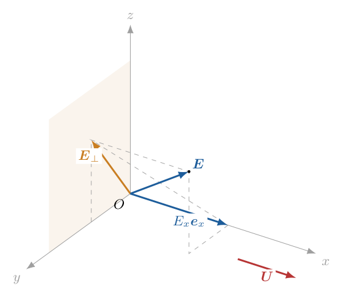
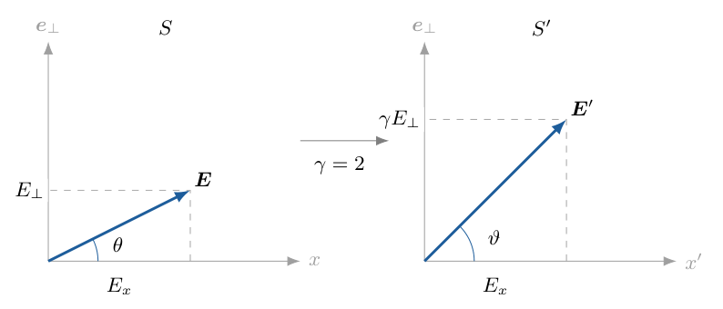
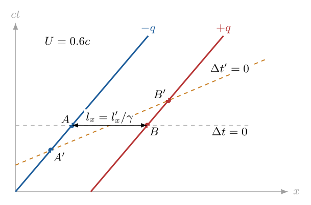
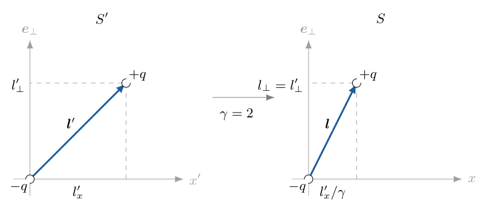
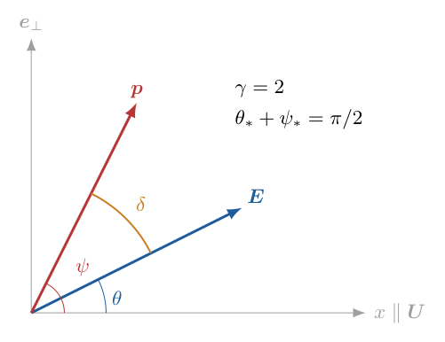
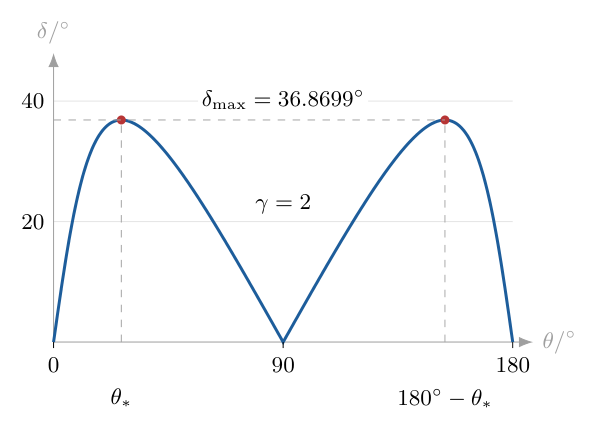

# 第8题

<!-- source-complete: 两问完整；保留异号电荷简化模型和正确手写路线，校正场变换排印并定义夹角。 -->
<!-- question-complete -->
<!-- question-start -->

原子在外电场作用下会发生极化。将极化后的原子简化为电荷量分别为 $+q$、$-q$ 的两个电荷，其平均分离向量 $\boldsymbol l$ 由负电荷指向正电荷，电偶极矩定义为
$$
\boldsymbol p=q\boldsymbol l.
$$
在原子静止的参考系中，题设采用各向同性的线性响应关系
$$
\boldsymbol p=\alpha\boldsymbol E,
$$
其中 $\alpha>0$ 为电极化率。

设参考系 $S'$ 相对 $S$ 沿 $x$ 轴正方向以速度 $u$ 运动，两系坐标轴平行。电磁场的变换关系为
$$
\begin{aligned}
E'_x&=E_x,& B'_x&=B_x,\\
E'_y&=\gamma_u(E_y-uB_z),&
B'_y&=\gamma_u(B_y+uE_z/c^2),\\
E'_z&=\gamma_u(E_z+uB_y),&
B'_z&=\gamma_u(B_z-uE_y/c^2),
\end{aligned}
$$
其中
$$
\gamma_u=\frac{1}{\sqrt{1-u^2/c^2}},
$$
$c$ 为真空中的光速。

（1）地面参考系中存在匀强电场 $\boldsymbol E=(E_x,E_y,E_z)$，无外磁场。一个原子以速度 $U$ 沿 $x$ 轴正方向匀速运动，其中 $0\le U<c$。求原子自身静止参考系中的诱导电偶极矩 $\boldsymbol p'$ 及其大小。

（2）求地面参考系中原子的电偶极矩 $\boldsymbol p$ 及其大小。令 $\theta$ 为地面电场 $\boldsymbol E$ 与 $x$ 轴正方向的夹角；电场大小和原子速度一定时，$\theta$ 取何值使 $\boldsymbol p$ 与 $\boldsymbol E$ 的夹角最大？求该最大夹角。

修订说明：校正场变换中的两个分量下标、洛伦兹因子的根号和速度符号；地面偶极统一记为 $\boldsymbol p$，并补明 $\theta$ 的定义。采用题设的静态线性极化与平均分离模型，不另加原子内部结构假设。

<!-- question-end -->

## 一、题型定位

本题将电磁场的洛伦兹变换、诱导电偶极和长度测量的同时性结合起来。诱导规律 $\boldsymbol p'=\alpha\boldsymbol E'$ 必须在原子静止的参考系使用；求地面偶极时，必须在地面同一时刻测量正、负电荷的平均位置。

研究对象不是原子产生的自有电场，而是作用于原子的外电场及由它引起的电荷分离。题设把复杂的原子响应概括为常量 $\alpha$，不要求由原子结构计算 $\alpha$，也不要求求原子的加速度。

核心问题有两次不同的变换。第一次把地面外电场变到原子固有系，横向电场增大。第二次把已经形成的电荷分离变回地面系，纵向长度收缩。两者作用于不同物理量，不能用同一条“乘上 $\gamma$”的口诀代替。

## 二、知识点

电偶极矩的方向由负电荷指向正电荷，定义中的 $q$ 是正的电荷量大小。对总电荷为零的两电荷系统，
$$
\boldsymbol p=q\boldsymbol r_+-q\boldsymbol r_-
=q(\boldsymbol r_+-\boldsymbol r_-).
$$
位置必须取自同一参考系的同一时刻。均匀地平移坐标原点不会改变这个差，但改变参考系会改变同时测量所得的分离向量。

参考系 $S'$ 以速度 $\boldsymbol U$ 相对 $S$ 运动时，电场的平行分量不变，横向分量与磁场混合：
$$
\boldsymbol E'_{\parallel}=\boldsymbol E_{\parallel},
\qquad
\boldsymbol E'_{\perp}
=\gamma(\boldsymbol E_{\perp}+\boldsymbol U\times\boldsymbol B),
\qquad
\gamma=\frac1{\sqrt{1-U^2/c^2}}.
$$
地面 $\boldsymbol B=\boldsymbol0$ 时，这只给出电场的变换，不能直接用来变换电偶极矩。

两端在固有系中的平均位置不随时间改变时，地面同时测得的纵向间距为固有纵向间距的 $1/\gamma$，横向间距不变。这个结论来源于洛伦兹变换与地面同时性条件，不是对固有系两同时事件机械地乘一个系数。

向量夹角可以从点乘求余弦，也可以结合叉乘求正弦。当点乘为正时，夹角在 $[0,\pi/2)$，其正切等于叉积大小与点积的比值。先确定这个角度范围，才能把最大夹角问题转为最大正切问题。

## 三、物理图像

在地面系中，原子沿 $x$ 方向运动。电场一般不与速度平行，因而应分成一个平行分量和一个位于 $yz$ 平面内的横向分量。两个参考系的 $y,z$ 轴没有旋转，横向方向本身不变。

在原子固有系中，横向电场比地面值大 $\gamma$ 倍。各向同性的诱导规律使 $\boldsymbol p'$ 与 $\boldsymbol E'$ 同方向，因而固有系电荷分离也偏向横向。

再从地面同一时刻观察这两个电荷，横向分离保持原值，纵向分离变短。于是地面偶极矩进一步偏向横向，而地面外电场并没有随它一起改变方向。最终的夹角正是这两个方向变化累计后的结果。

当电场完全平行或完全垂直于速度时，虽然偶极大小改变，方向仍不变。最大方向偏离一定出现在两分量都不为零的情形，不能只比较“哪一方向的偶极最长”。

## 四、解题入口

先固定地面系 $S$、原子固有系 $S'$ 和 $\gamma$ 的定义，把地面无磁场代入正确的场变换。在固有系使用响应关系求 $\boldsymbol p'$，分开写分量和模长。

接着从地面同时测长推导电荷间距变换，再求地面 $\boldsymbol p$。把 $\boldsymbol E$ 与 $\boldsymbol p$ 都放进由速度和电场张成的平面，分别定义它们与速度的夹角 $\theta,\psi$；撇号保留给参考系，不用 $\theta'$ 同时表示多个不同角。

最后保留正切差角的主路线，补出正切适用的象限、最大值的等号条件及两端点。以点乘和叉乘再作一次核对，防止反正切的分支掩盖了钝角电场的另一组最优方向。

## 五、解析

**第1步：明确偶极方向、响应规律及适用参考系。**

设 $q>0$。在原子固有系中，用 $\boldsymbol r'_+,\boldsymbol r'_-$ 表示两异号电荷的平均位置，定义
$$
\begin{aligned}
\boldsymbol l'&=\boldsymbol r'_+-\boldsymbol r'_-,\\
\boldsymbol p'&=q\boldsymbol l'=\alpha\boldsymbol E'.
\end{aligned}
$$
$\boldsymbol l'$ 和 $\boldsymbol p'$ 的箭头都从负电荷指向正电荷。若将电荷次序反过来，却仍写 $\boldsymbol p'=q\boldsymbol l'$，会把整题的方向取反。

这里的 $\alpha$ 是固有系中静态线性电响应的系数；$\alpha>0$ 表示诱导分离与当地电场同向。没有依据将同一标量关系未经变换就写成地面系的 $\boldsymbol p=\alpha\boldsymbol E$。本题恰是求这一关系在地面如何改变。

**第2步：建立参考系、正方向和真正的空间分解。**

地面系为 $S$，原子沿 $\boldsymbol U=U\boldsymbol e_x$ 运动。与原子一起运动的系 $S'$ 相对 $S$ 具有正速度 $U$，因此题给场变换中应代入 $u=U$，不是 $-U$。两系坐标轴平行，零时刻原点可取重合。

令
$$
\begin{aligned}
\beta&=\frac Uc,&
\gamma&=\frac1{\sqrt{1-\beta^2}},\\
E_\perp&=\sqrt{E_y^2+E_z^2},&
E&=\sqrt{E_x^2+E_y^2+E_z^2}.
\end{aligned}
$$
$\gamma$ 无量纲，且 $\gamma\ge1$。$E_\perp$ 是横向向量的模，不是把有正负号的两个分量直接相加。

图8-1采用真实三维坐标的投影，灰色虚线构造出电场端点及它在横向平面上的投影。图中电场一般同时具有 $y,z$ 分量；它不必落在某个原始坐标面内。

{width=68%}

按图8-1的构造，
$$
\boldsymbol E=E_x\boldsymbol e_x
+(E_y\boldsymbol e_y+E_z\boldsymbol e_z)
=\boldsymbol E_\parallel+\boldsymbol E_\perp.
$$
电场的横向方位在后续两次变换中保持不变，可以保留三维含义后再把问题化为一个包含 $\boldsymbol e_x$ 的二维平面。

**第3步：先用叉乘核对六个场分量中的下标与符号。**

对沿 $x$ 方向的速度，
$$
\begin{aligned}
\boldsymbol U\times\boldsymbol B
&=U\boldsymbol e_x\times
(B_x\boldsymbol e_x+B_y\boldsymbol e_y+B_z\boldsymbol e_z)\\
&=UB_y\boldsymbol e_z-UB_z\boldsymbol e_y.
\end{aligned}
$$
其中利用了右手系的
$$
\boldsymbol e_x\times\boldsymbol e_y=\boldsymbol e_z,
\qquad
\boldsymbol e_x\times\boldsymbol e_z=-\boldsymbol e_y.
$$
所以 $E'_y$ 中是 $-UB_z$，$E'_z$ 中是 $+UB_y$，后者不能写成 $+UB_x$。同样，
$$
\boldsymbol U\times\boldsymbol E
=UE_y\boldsymbol e_z-UE_z\boldsymbol e_y,
$$
结合磁场变换中的负号，得
$$
\begin{aligned}
B'_y&=\gamma(B_y+UE_z/c^2),\\
B'_z&=\gamma(B_z-UE_y/c^2).
\end{aligned}
$$
这也说明 $B'_z$ 中必须使用 $E_y$。按叉乘逐项核对，比只看公式外形更能检查分量下标。

**第4步：将地面无磁场代入，求固有系的外电场。**

地面外磁场为零，即 $B_x=B_y=B_z=0$。逐分量代入后得到
$$
\boxed{\boldsymbol E'=(E_x,\gamma E_y,\gamma E_z).}
$$
同时，固有系外磁场一般不为零：
$$
\boldsymbol B'=
\left(0,\frac{\gamma UE_z}{c^2},
-\frac{\gamma UE_y}{c^2}\right).
$$
“地面无磁场”不是“每个参考系都无磁场”。但题设的固有系静态电响应仍按 $\alpha\boldsymbol E'$ 计算；平均分离模型没有给出独立的磁极化率，不能另造一项磁响应加入答案。

可以用两个场不变量检查符号和 $\gamma$：
$$
\begin{aligned}
\boldsymbol E'\cdot\boldsymbol B'
&=\gamma E_y\frac{\gamma UE_z}{c^2}
+\gamma E_z\left(-\frac{\gamma UE_y}{c^2}\right)=0,\\
E'^2-c^2B'^2
&=E_x^2+\gamma^2E_\perp^2
-\gamma^2\beta^2E_\perp^2\\
&=E_x^2+\gamma^2(1-\beta^2)E_\perp^2\\
&=E_x^2+E_\perp^2=E^2.
\end{aligned}
$$
这里使用 $\gamma^2(1-\beta^2)=1$。若将洛伦兹因子误写为 $(1-\beta^2)^{-1}$，此处一般不能还原成 $E^2$。

**第5步：在固有系逐分量应用线性诱导规律。**

把第4步的电场代入 $\boldsymbol p'=\alpha\boldsymbol E'$：
$$
\begin{aligned}
p'_x&=\alpha E_x,\\
p'_y&=\alpha\gamma E_y,\\
p'_z&=\alpha\gamma E_z.
\end{aligned}
$$
于是
$$
\boxed{\boldsymbol p'
=\alpha(E_x,\gamma E_y,\gamma E_z).}
$$
固有系中偶极与固有系电场平行，即 $\boldsymbol p'\times\boldsymbol E'=\boldsymbol0$。它是否与地面电场平行是另一回事，不能跨参考系比较两个方向后仍称为当地响应的夹角。

由电偶极定义，还可求出两个平均电荷位置的分离：
$$
\boldsymbol l'=\frac{\alpha}{q}
(E_x,\gamma E_y,\gamma E_z).
$$
这一步把电场响应与后续几何测长连接起来，不能在变换地面偶极时忘记已经形成的 $\boldsymbol l'$。

**第6步：计算固有偶极的大小，并核对平方项。**

向量大小由各正交分量的平方和给出：
$$
\begin{aligned}
p'^2&=(p'_x)^2+(p'_y)^2+(p'_z)^2\\
&=\alpha^2E_x^2+\alpha^2\gamma^2E_y^2
+\alpha^2\gamma^2E_z^2\\
&=\alpha^2(E_x^2+\gamma^2E_\perp^2).
\end{aligned}
$$
取非负平方根，因 $\alpha>0$，
$$
\boxed{p'=\alpha\sqrt{E_x^2+\gamma^2(E_y^2+E_z^2)}.}
$$
横向分量先增大 $\gamma$ 倍，再平方，因此模长根号内是 $\gamma^2$，不是 $\gamma$。这已经完整回答第（1）问的向量与大小。

若 $E_x=0$，则 $p'=\alpha\gamma E$；若 $E_\perp=0$，则 $p'=\alpha E$。两个端点说明固有极化大小依赖地面电场相对速度的方向，但不能据此直接确定地面方向偏角。

**第7步：画出两系电场，分清第一次方向变化。**

当 $E_\perp>0$ 时，定义横向单位向量
$$
\boldsymbol e_\perp
=\frac{E_y\boldsymbol e_y+E_z\boldsymbol e_z}{E_\perp}.
$$
它与 $\boldsymbol e_x$ 正交。先考虑 $E_x>0$，令 $\theta$ 为地面电场与 $+x$ 的锐角，$\vartheta$ 为固有系电场与 $+x'$ 的锐角。

图8-2在同一个 $x$—$\boldsymbol e_\perp$ 分解平面中显示两系分量，坐标取相同的场强比例尺。没有将空间方向简化为不明含义的任意斜线。

{width=88%}

由图8-2两直角三角形，
$$
\tan\theta=\frac{E_\perp}{E_x},
\qquad
\tan\vartheta=\frac{\gamma E_\perp}{E_x}
=\gamma\tan\theta.
$$
这是第一次方向变化。固有偶极 $\boldsymbol p'$ 也沿 $\vartheta$，但尚未得到地面偶极方向。后面另一因子 $\gamma$ 来自测长，不来自再次变换外电场。

**第8步：地面偶极必须由地面同时的两位置计算。**

在固有系中，题设的平均分离是稳态的，故两电荷的平均位置可写为常量。为计算间距，选取负电荷的一个事件与正电荷的另一个事件，记差为
$$
(\Delta t',\Delta x',\Delta y',\Delta z').
$$
因为位置不随固有时间改变，
$$
(\Delta x',\Delta y',\Delta z')
=(l'_x,l'_y,l'_z)
$$
对不同的 $\Delta t'$ 仍成立。

两事件差的逆洛伦兹变换为
$$
\begin{aligned}
\Delta x&=\gamma(\Delta x'+U\Delta t'),\\
\Delta t&=\gamma\left(\Delta t'+\frac{U\Delta x'}{c^2}\right),\\
\Delta y&=\Delta y',\qquad \Delta z=\Delta z'.
\end{aligned}
$$
现在要求它们是地面测长的两端事件，因此应设 $\Delta t=0$，而不是先设 $\Delta t'=0$。

图8-3用两条平行世界线表示两个平均位置随时间的地面运动。水平切片上的两事件才属于同一地面时刻；斜切片上的另一对事件在固有系同时，不能混为同一组测长端点。

{width=72%}

图8-3的水平切片对应 $\Delta t=0$。因此时间方程给出
$$
\Delta t'=-\frac{U\Delta x'}{c^2}.
$$
两固有时刻通常不同，但平均端点在固有系静止，所以它们的空间差仍是 $\boldsymbol l'$。

**第9步：将同时性条件代回，逐项推导长度收缩。**

将第8步的 $\Delta t'$ 代入空间变换：
$$
\begin{aligned}
l_x=\Delta x
&=\gamma\left(\Delta x'
-U\frac{U\Delta x'}{c^2}\right)\\
&=\gamma\Delta x'(1-U^2/c^2)\\
&=\gamma\Delta x'\frac1{\gamma^2}\\
&=\frac{\Delta x'}{\gamma}
=\frac{l'_x}{\gamma}.
\end{aligned}
$$
横向坐标不含时间混合，故
$$
l_y=l'_y,\qquad l_z=l'_z.
$$
这是对分量的变换，并非对整根斜分离向量统一缩短：
$$
\boxed{\boldsymbol l=(l'_x/\gamma,l'_y,l'_z).}
$$

相反，若错误地取 $\Delta t'=0$，会得到 $\Delta x=\gamma\Delta x'$；这组事件在地面具有 $\Delta t=\gamma U\Delta x'/c^2$，所以它不是地面同时测得的长度。不是洛伦兹变换有两种互相矛盾的答案，而是两种取事件方法在测不同的量。

**第10步：用电荷一阶矩而不是外场公式变换偶极。**

电荷量 $q$ 不因换参考系而改变。地面同一时刻的偶极定义为
$$
\boldsymbol p=q\boldsymbol l,
$$
从第9步立即得到
$$
\begin{aligned}
p_x&=\frac{q l'_x}{\gamma}=\frac{p'_x}{\gamma},\\
p_y&=q l'_y=p'_y,\\
p_z&=q l'_z=p'_z.
\end{aligned}
$$
图8-4把负电荷、正电荷和从负到正的分离箭头画出。两幅使用相同的长度比例尺；虚线分别投影到平行、横向方向，不能把横向分离也除以 $\gamma$。

{width=90%}

图8-4中的分量关系实际进入上述三个偶极方程。电场的横向增强与偶极的纵向收缩分别作用于两幅不同的几何关系，不能相互抵消成一个标量不变规律。

如果地面原点平移 $\boldsymbol a$，则
$$
q(\boldsymbol r_+-\boldsymbol a)
-q(\boldsymbol r_--\boldsymbol a)
=q(\boldsymbol r_+-\boldsymbol r_-).
$$
这是总电荷为零带来的原点不变性；不表示电偶极矩在不同惯性系之间保持不变。

**第11步：代入固有偶极，得到地面的三个分量。**

把第5步的结果逐项代入第10步：
$$
\begin{aligned}
p_x&=\frac{\alpha E_x}{\gamma},\\
p_y&=\alpha\gamma E_y,\\
p_z&=\alpha\gamma E_z.
\end{aligned}
$$
因此
$$
\boxed{\boldsymbol p
=\alpha(E_x/\gamma,\gamma E_y,\gamma E_z).}
$$
平行方向只经历长度收缩，横向方向保留固有系由增强外场造成的较大分离。对给定速度而言，地面响应表现为两个不同系数，
$$
\alpha_\parallel=\frac\alpha\gamma,\qquad
\alpha_\perp=\alpha\gamma.
$$
这不是假设原子固有性质改变，而是把同一个固有系响应换成地面同时测量所得的描述。

**第12步：计算地面偶极大小，与固有大小分开。**

由三个地面分量，
$$
\begin{aligned}
p^2&=p_x^2+p_y^2+p_z^2\\
&=\alpha^2\left(\frac{E_x^2}{\gamma^2}
+\gamma^2E_y^2+\gamma^2E_z^2\right),
\end{aligned}
$$
所以
$$
\boxed{p=\alpha\sqrt{\frac{E_x^2}{\gamma^2}
+\gamma^2(E_y^2+E_z^2)}.}
$$
不能把第（1）问的 $p'$ 模长照抄过来。两式只有平行项不同，而这正是地面同时长度测量的影响。

还可直接比较它们：
$$
\begin{aligned}
p'^2-p^2
&=\alpha^2E_x^2\left(1-\frac1{\gamma^2}\right)\\
&=\alpha^2\beta^2E_x^2\ge0.
\end{aligned}
$$
因此在本模型中 $p\le p'$；若平行电场为零或速度为零，等号成立。这是独立于极值问题的大小检查。

**第13步：写成不依赖任意横向轴选择的向量关系。**

对非零速度，用
$$
\boldsymbol E_\parallel
=(\boldsymbol E\cdot\widehat{\boldsymbol U})\widehat{\boldsymbol U},
\qquad
\boldsymbol E_\perp=\boldsymbol E-\boldsymbol E_\parallel,
$$
其中 $\widehat{\boldsymbol U}=\boldsymbol U/U$。第11步可写为
$$
\boldsymbol p
=\frac{\alpha}{\gamma}\boldsymbol E_\parallel
+\alpha\gamma\boldsymbol E_\perp.
$$
将横向部分展开：
$$
\begin{aligned}
\boldsymbol p
&=\alpha\gamma\boldsymbol E
+\alpha(1/\gamma-\gamma)\boldsymbol E_\parallel\\
&=\alpha\gamma\left[
\boldsymbol E-\beta^2
(\boldsymbol E\cdot\widehat{\boldsymbol U})\widehat{\boldsymbol U}
\right].
\end{aligned}
$$
此处利用
$$
1/\gamma-\gamma=-\gamma\beta^2.
$$
任意旋转 $y,z$ 轴不会改变该式。它也说明 $\boldsymbol p,\boldsymbol E,\boldsymbol U$ 位于同一平面；地面偶极不会凭空产生一个垂直于此平面的新方向。

**第14步：分别定义地面电场角与地面偶极角。**

对 $E>0$，令 $0\le\theta\le\pi$，
$$
E_x=E\cos\theta,\qquad E_\perp=E\sin\theta.
$$
若横向分量非零，其单位方向仍记为 $\boldsymbol e_\perp$。地面电场与偶极分别为
$$
\begin{aligned}
\boldsymbol E&=E(\cos\theta\,\boldsymbol e_x
+\sin\theta\,\boldsymbol e_\perp),\\
\boldsymbol p&=\alpha E\left(
\frac{\cos\theta}{\gamma}\boldsymbol e_x
+\gamma\sin\theta\,\boldsymbol e_\perp\right).
\end{aligned}
$$
令地面偶极与 $+x$ 的夹角为 $\psi$，则在两个分量不为零时，
$$
\tan\psi=\frac{\gamma\sin\theta}{\cos\theta/\gamma}
=\gamma^2\tan\theta.
$$
这里的 $\psi$ 不是固有系电场角 $\vartheta$。两次方向变化连起来是
$$
\tan\vartheta=\gamma\tan\theta,\qquad
\tan\psi=\gamma\tan\vartheta.
$$

图8-5画的是同一地面系中的两个向量，蓝线为电场方向，红线为偶极方向；图中的夹角 $\delta$ 才是题目要求最大化的量。

{width=66%}

图8-5在锐角支中有
$$
\delta=\psi-\theta.
$$
因 $\gamma^2\ge1$，锐角电场对应 $\psi\ge\theta$。钝角支则有 $\psi\le\theta$，须写 $\delta=|\psi-\theta|$，不能照搬带符号的锐角差。

**第15步：用点乘确定夹角范围，并统一全部象限。**

地面电场与偶极的点积为
$$
\begin{aligned}
\boldsymbol E\cdot\boldsymbol p
&=\alpha E^2\left(
\frac{\cos^2\theta}{\gamma}
+\gamma\sin^2\theta\right)>0.
\end{aligned}
$$
这里要求 $E>0,\alpha>0$；因此 $\boldsymbol E$ 与 $\boldsymbol p$ 的实际夹角一定小于 $\pi/2$，即使 $\theta$ 本身是钝角也如此。

叉积大小为
$$
|\boldsymbol E\times\boldsymbol p|
=\alpha E^2(\gamma-1/\gamma)
|\sin\theta\cos\theta|.
$$
于是
$$
\boxed{
\tan\delta=
\frac{(\gamma^2-1)|\sin\theta\cos\theta|}
{\cos^2\theta+\gamma^2\sin^2\theta}.}
$$
点积恒正，所以上式的非负值唯一决定实际夹角，不存在把反正切误取到第二象限的问题。

将 $\theta$ 换成 $\pi-\theta$，分母不变，分子绝对值不变。因此偏角曲线关于 $\pi/2$ 镜像对称；只需先求锐角支，再补上钝角的对应解。

**第16步：沿差角正切路线整理出需要最小化的分母。**

在 $0<\theta<\pi/2$ 中，$\delta=\psi-\theta$，用正切差角公式：
$$
\begin{aligned}
\tan\delta
&=\frac{\tan\psi-\tan\theta}
{1+\tan\psi\tan\theta}\\
&=\frac{\gamma^2\tan\theta-\tan\theta}
{1+\gamma^2\tan^2\theta}\\
&=\frac{(\gamma^2-1)\tan\theta}
{1+\gamma^2\tan^2\theta}.
\end{aligned}
$$
由于此时 $\tan\theta>0$，可将分子、分母同时除以 $\tan\theta$：
$$
\tan\delta
=\frac{\gamma^2-1}
{\displaystyle\frac1{\tan\theta}+\gamma^2\tan\theta}.
$$
数学技巧是用一个正变量把角度极值变成代数极值。令 $t=\tan\theta>0$，则
$$
\tan\delta=\frac{\gamma^2-1}{t^{-1}+\gamma^2t}.
$$
分子在固定速度下为常量。对 $U>0$ 有 $\gamma>1$，最大偏角等价于最小化这个正分母。

**第17步：补全均值不等式及等号条件。**

对 $t>0$，
$$
\begin{aligned}
t^{-1}+\gamma^2t-2\gamma
&=\left(\frac1{\sqrt t}-\gamma\sqrt t\right)^2\\
&\ge0.
\end{aligned}
$$
这既证明分母至少是 $2\gamma$，也直接给出等号条件。等号成立当且仅当
$$
\frac1{\sqrt t}=\gamma\sqrt t
\quad\Longleftrightarrow\quad
1=\gamma t
\quad\Longleftrightarrow\quad
t=\frac1\gamma.
$$
因此锐角支的最优电场方向为
$$
\boxed{\theta_*=\arctan\frac1\gamma.}
$$
这里的不等式应用于两个正数；不能把钝角支的负 $\tan\theta$ 不加绝对值地代进去。钝角的对应解由第15步镜像关系得到。

**第18步：用导数与边界再次核对最大值。**

令
$$
f(t)=\frac{(\gamma^2-1)t}{1+\gamma^2t^2}.
$$
求导时逐项使用商法则：
$$
\begin{aligned}
f'(t)
&=\frac{(\gamma^2-1)(1+\gamma^2t^2)
-(\gamma^2-1)t(2\gamma^2t)}
{(1+\gamma^2t^2)^2}\\
&=\frac{(\gamma^2-1)(1-\gamma^2t^2)}
{(1+\gamma^2t^2)^2}.
\end{aligned}
$$
当 $\gamma>1$ 时，分母严格为正，所以 $f'(t)$ 在 $0<t<1/\gamma$ 为正，在 $t>1/\gamma$ 为负。驻点确实是这一支的唯一最大值，不是最小值。

此外，
$$
\lim_{t\to0^+}f(t)=0,\qquad
\lim_{t\to+\infty}f(t)=0.
$$
两个极限分别对应平行电场和横向电场，均无偏角。导数、均值不等式和端点检查给出一致结论，而不是只找到一个使导数为零的角就停止。

**第19步：求最大夹角本身，并列全最优方向。**

在 $t=1/\gamma$ 处，
$$
\begin{aligned}
\tan\delta_{\max}
&=\frac{\gamma^2-1}{2\gamma}\\
&=\frac{\gamma-\gamma^{-1}}2
=\frac{\gamma\beta^2}{2}.
\end{aligned}
$$
由于 $0\le\delta_{\max}<\pi/2$，
$$
\boxed{\delta_{\max}
=\arctan\frac{\gamma^2-1}{2\gamma}.}
$$
若希望直接用速度表示，
$$
\boxed{\delta_{\max}
=\arctan\frac{\beta^2}{2\sqrt{1-\beta^2}}.}
$$
为求正弦与余弦，先把分母中的平方完整展开：
$$
\begin{aligned}
1+\tan^2\delta_{\max}
&=1+\frac{(\gamma^2-1)^2}{4\gamma^2}\\
&=\frac{4\gamma^2+\gamma^4-2\gamma^2+1}{4\gamma^2}\\
&=\frac{(\gamma^2+1)^2}{4\gamma^2}.
\end{aligned}
$$
因 $\gamma>0$，其正平方根为 $(\gamma^2+1)/(2\gamma)$。用
$\cos\delta=1/\sqrt{1+\tan^2\delta}$、$\sin\delta=\tan\delta\cos\delta$，
并用 $\gamma^2-1=\gamma^2\beta^2$、$\gamma^2+1=\gamma^2(2-\beta^2)$，得
$$
\begin{aligned}
\sin\delta_{\max}
&=\frac{\gamma^2-1}{\gamma^2+1}
=\frac{\beta^2}{2-\beta^2},\\
\cos\delta_{\max}
&=\frac{2\gamma}{\gamma^2+1}.
\end{aligned}
$$
$\arcsin$ 表达式必须取 $[0,\pi/2)$ 的主值。

对 $0<U<c$，完整最优角为
$$
\boxed{
\theta=\arctan(1/\gamma)
\quad\text{或}\quad
\theta=\pi-\arctan(1/\gamma).}
$$
横向方位角任意；两个最优方向族绕速度轴各形成一个圆锥，而不是只有图8-5某一平面内的两根箭头。若只约定 $E_x>0$，则仅取锐角解。

在锐角最优处，$\tan\psi_*=\gamma$，因此
$$
\theta_*+\psi_*=\frac\pi2,\qquad
\delta_{\max}=\psi_*-\theta_*.
$$
这个互余关系可以在图8-5的最优示例中检查。

**第20步：检查零速度、端点和小速度极限。**

若 $U=0$，则 $\gamma=1$，
$$
\boldsymbol p'=\boldsymbol p=\alpha\boldsymbol E,
\qquad
\delta=0.
$$
此时所有 $\theta$ 都达到相同的最大值零。不能仍宣称 $\theta=\pi/4$ 是唯一最优方向，因为第17步“分子为正”的前提已经退化。

若 $E=0$，偶极为零，方向和夹角没有定义；这一情况不参与角度优化。非零电场的 $\theta=0,\pi/2,\pi$ 均有 $\delta=0$。

当 $\beta\ll1$，利用二阶展开，
$$
\gamma=1+\frac{\beta^2}{2}+O(\beta^4),
\qquad
\gamma^{-1}=1-\frac{\beta^2}{2}+O(\beta^4).
$$
代入地面分量：
$$
\begin{aligned}
p_x&=\alpha E_x\left(1-\frac{\beta^2}{2}\right)
+O(\alpha|E_x|\beta^4),\\
p_y&=\alpha E_y\left(1+\frac{\beta^2}{2}\right)
+O(\alpha|E_y|\beta^4),\\
p_z&=\alpha E_z\left(1+\frac{\beta^2}{2}\right)
+O(\alpha|E_z|\beta^4).
\end{aligned}
$$
固定锐角 $\theta$ 时，将 $\gamma^2=1+\beta^2+O(\beta^4)$ 代入第15步：
$$
\begin{aligned}
\tan\delta
&=\frac{[\beta^2+O(\beta^4)]\sin\theta\cos\theta}
{\cos^2\theta+[1+\beta^2+O(\beta^4)]\sin^2\theta}\\
&=\frac{[\beta^2+O(\beta^4)]\sin\theta\cos\theta}
{1+\beta^2\sin^2\theta+O(\beta^4)}\\
&=\beta^2\sin\theta\cos\theta+O(\beta^4).
\end{aligned}
$$
最后利用 $\arctan x=x+O(x^3)$。这里 $x=\tan\delta=O(\beta^2)$，
故反正切带来的更高阶项为 $O(\beta^6)$，不改变二阶结论：
$$
\delta=\beta^2\sin\theta\cos\theta+O(\beta^4),
$$
因此最大值
$$
\delta_{\max}=\frac{\beta^2}{2}+O(\beta^4)
$$
以弧度计。偏角从速度的二阶开始，换成 $-U$ 不改变本题无磁场的结果。

**第21步：用一个完整数值方向检查曲线与大小。**

取 $\gamma=2$，即 $U=\sqrt3\,c/2$。锐角最优方向满足
$$
\tan\theta_*=\frac12,
\qquad
\theta_*=26.5651^\circ,
\qquad
\psi_*=63.4349^\circ.
$$
因此
$$
\delta_{\max}=36.8699^\circ,\qquad
\tan\delta_{\max}=\frac34.
$$
图8-6按第15步的实际向量夹角绘制整个 $0^\circ$ 至 $180^\circ$ 范围，而不是只画一根没有极值位置的示意曲线。

{width=90%}

在此最优方向，取横向单位向量 $\boldsymbol e_\perp$，有
$$
\cos\theta_*=\frac2{\sqrt5},
\qquad
\sin\theta_*=\frac1{\sqrt5}.
$$
逐项代入而不是只代最终最大角：
$$
\begin{aligned}
\boldsymbol p'
&=\alpha E\left(\frac2{\sqrt5}\boldsymbol e_x
+\frac2{\sqrt5}\boldsymbol e_\perp\right),\\
p'&=\alpha E\sqrt{\frac85},\\
\boldsymbol p
&=\alpha E\left(\frac1{\sqrt5}\boldsymbol e_x
+\frac2{\sqrt5}\boldsymbol e_\perp\right),\\
p&=\alpha E.
\end{aligned}
$$
尽管地面模长恰等于 $\alpha E$，其方向显然不是电场的方向。这是“大小像静止结果”与“向量等于静止结果”的区别。

**第22步：汇总答案并检查量纲、极限及模型边界。**

两问的核心结果为
$$
\begin{aligned}
\boldsymbol p'&=\alpha(E_x,\gamma E_y,\gamma E_z),\\
p'&=\alpha\sqrt{E_x^2+\gamma^2(E_y^2+E_z^2)},\\
\boldsymbol p&=\alpha(E_x/\gamma,\gamma E_y,\gamma E_z),\\
p&=\alpha\sqrt{E_x^2/\gamma^2+\gamma^2(E_y^2+E_z^2)}.
\end{aligned}
$$
对 $0<U<c$ 和 $E>0$，
$$
\begin{aligned}
\theta_*&=\arctan(1/\gamma)
\ \text{或}\ \pi-\arctan(1/\gamma),\\
\delta_{\max}&=\arctan[(\gamma^2-1)/(2\gamma)].
\end{aligned}
$$
$\gamma$ 和各三角函数的自变量均无量纲；$\boldsymbol p$ 的单位是 $\mathrm{C\,m}$，所以
$$
[\alpha]=\frac{\mathrm{C\,m}}{\mathrm{V/m}}
=\mathrm{C\,m^2/V}.
$$
每个分量公式都保持该量纲。

形式上 $U\to c^-$ 时，$\theta_*\to0$ 且 $\delta_{\max}\to\pi/2$，但任一有限亚光速的实际偏角都小于 $\pi/2$。在严格平行的 $\theta=0$ 处，偏角始终为零；不能把随速度一起趋零的最优角，与固定的零角混淆。

高速度下固有横向电场 $\gamma E_\perp$ 可能很大。题设常量 $\alpha$ 的线性响应若在实际物质中失效，不能把理想公式的增长解释成真实原子可无限极化。本题结论始终限定在所给线性平均分离模型内。

## 六、关键洞察

**两次不同的物理变换形成一个 $\gamma^2$ 的方向比。**

第一次变换给出 $p'_\perp/p'_\parallel=\gamma E_\perp/E_x$；第二次变换保留横向分离而将纵向分离除以 $\gamma$。因此地面比例为
$$
\frac{p_\perp}{p_\parallel}
=\gamma\frac{p'_\perp}{p'_\parallel}
=\gamma^2\frac{E_\perp}{E_x}.
$$
若只写最后的 $\gamma^2$ 而未解释两个因子的来源，会漏掉题中最重要的物理内容。固有系电场角、固有偶极角相同；地面偶极角由同时测长再改变，这三者应分别定位。

**电偶极是指定同时切片上的电荷一阶矩，不是任意四维位移。**

也可把题设的静止平均电荷扩展为连续分布作交叉说明；这条替代路线明确限定固有系分布稳态且没有内部电流，即 $\boldsymbol j'=\boldsymbol0$。整体沿 $x$ 匀速运动时，电荷密度增加 $\gamma$ 倍，地面体积元纵向缩小 $1/\gamma$：
$$
\rho=\gamma\rho',\qquad
\mathrm d^3r=\frac1\gamma\mathrm d^3r'.
$$
在地面时间 $t$ 固定时，坐标关系为
$$
x=\frac{x'}{\gamma}+Ut,\qquad y=y',\qquad z=z'.
$$
于是
$$
\begin{aligned}
p_x
&=\int x\rho\,\mathrm d^3r\\
&=\int\left(\frac{x'}{\gamma}+Ut\right)\rho'\,\mathrm d^3r'\\
&=\frac1\gamma\int x'\rho'\,\mathrm d^3r'
+Ut\int\rho'\,\mathrm d^3r'\\
&=\frac{p'_x}{\gamma},
\end{aligned}
$$
最后使用总电荷为零。横向同理为 $p_y=p'_y,p_z=p'_z$。如果对象带净电荷，平移项不再消失，必须重新说明偶极的原点；不能将本题中性结论直接套用。

这里用的是静止平均电荷模型的无内部电流连续化例子。稳态本身不自动排除环流；若固有系已有 $\boldsymbol j'\ne\boldsymbol0$，密度变换还含内部电流项，不能只写 $\rho=\gamma\rho'$。若固有电荷分布本身随时间显著变化，地面同时切片在不同位置取到不同固有时刻，积分中必须保留该时间依赖，也不能继续用上述静态简化。

**最大方向偏离与最大诱导模长不是同一个优化。**

固定地面电场大小，地面模长为
$$
\frac{p^2}{\alpha^2E^2}
=\frac{\cos^2\theta}{\gamma^2}
+\gamma^2\sin^2\theta.
$$
对 $\gamma>1$，它随 $\sin^2\theta$ 单调增大；最小值 $\alpha E/\gamma$ 在平行方向，最大值 $\alpha\gamma E$ 在横向方向。但这两类方向的偏角都是零。

在最大偏角方向，
$$
\cos^2\theta_*=\frac{\gamma^2}{\gamma^2+1},
\qquad
\sin^2\theta_*=\frac1{\gamma^2+1},
$$
所以
$$
\begin{aligned}
\frac{p_*^2}{\alpha^2E^2}
&=\frac1{\gamma^2+1}
+\frac{\gamma^2}{\gamma^2+1}=1,\\
p_*&=\alpha E.
\end{aligned}
$$
这并不与地面响应的各向异性矛盾；最大角方向恰使两项共同给出这个模长。固有模长则为
$$
p'_*=\alpha E
\sqrt{\frac{2\gamma^2}{\gamma^2+1}}.
$$
用同一角度同时核对两参考系的模长，可以发现漏掉纵向收缩的错误。

**不取正切也能独立得到同一最大角。**

令 $s=\sin^2\theta$。用点积除以两模长，
$$
\cos^2\delta
=\frac{[1+(\gamma^2-1)s]^2}
{1+(\gamma^4-1)s}.
$$
记 $a=\gamma^2-1>0$、$b=\gamma^4-1=a(\gamma^2+1)$，则
$$
G(s)=\frac{(1+as)^2}{1+bs}.
$$
求导并分解：
$$
\begin{aligned}
G'(s)
&=\frac{2a(1+as)(1+bs)-b(1+as)^2}{(1+bs)^2}\\
&=\frac{(1+as)[\,2a-b+ab s\,]}{(1+bs)^2}.
\end{aligned}
$$
除方括号外的因子均为正。驻点满足
$$
s=\frac{b-2a}{ab}=\frac1{\gamma^2+1}.
$$
上述消元中，$b=a(\gamma^2+1)$，所以
$$
\begin{aligned}
b-2a&=a(\gamma^2+1-2)=a(\gamma^2-1)=a^2,\\
ab&=a^2(\gamma^2+1),\\
\frac{b-2a}{ab}&=\frac{a^2}{a^2(\gamma^2+1)}
=\frac1{\gamma^2+1}.
\end{aligned}
$$
因为 $a>0$，约去 $a^2$ 合法；速度零时这个约分不能使用。
导数在此前为负、此后为正，故余弦平方取得最小值，即夹角最大。代回得
$$
G_{\min}=\frac{4\gamma^2}{(\gamma^2+1)^2},
$$
与主解的 $\cos\delta_{\max}$ 完全一致。这个方法直接覆盖 $\theta$ 与 $\pi-\theta$，但仍须单独处理 $\gamma=1$ 的退化。

**速度极限与方向极限的次序不可交换。**

对一个固定的锐角 $0<\theta<\pi/2$，$\gamma\to\infty$ 时
$$
\tan\psi=\gamma^2\tan\theta\to\infty,
\qquad
\delta\to\frac\pi2-\theta.
$$
若先固定 $\theta=0$，则始终 $p_\perp=0,\delta=0$；如果随着速度增大选择 $\theta_*=\arctan(1/\gamma)$，则两分量的竞争一直存在，最大偏角趋向 $\pi/2$。这不是同一个固定方向的极限。

在整个角度区间内，最大偏角由响应系数比决定，而不是由电场大小或 $\alpha$ 决定。只要线性模型成立，缩小电场能同时缩小偶极而不改变方向偏角；这有助于区分“极化强度”与“方向各向异性”。

## 七、易错点

**1. 漏掉洛伦兹因子的根号。** 正确 $\gamma=(1-\beta^2)^{-1/2}$，不是 $(1-\beta^2)^{-1}$。用场不变量或 $\beta=0.6$ 时 $\gamma=1.25$ 即可检查。

**2. 把 $E'_z$ 的混合项写成 $UB_x$。** 沿 $x$ 的速度与 $B_x$ 平行，叉乘为零；应为 $UB_y$。$B'_z$ 同理涉及 $E_y$，不是 $E_x$。

**3. 把原子固有系的相对速度取反。** 固有系相对地面沿 $+x$ 运动，应使用 $u=U$。逆变换才将相对速度改为 $-U$；本题纯电场的电分量恰好只含偶次速度，不代表磁场符号也可任意写。

**4. 地面无磁场就令 $\boldsymbol B'=\boldsymbol0$。** 固有系一般有磁场；只是不需要另造磁极化规律。本题求的是指定电响应产生的电偶极，不是完整物质的磁响应。

**5. 直接在地面写 $\boldsymbol p=\alpha\boldsymbol E$。** 这会把本题的最大偏角错误地算成零。标量响应关系属于原子静止系，换系后需处理外场与同时分离两个步骤。

**6. 将偶极当电场一样变换。** $\boldsymbol p$ 是电荷一阶矩；它不是外电场，不能套 $p'_x=p_x,p'_\perp=\gamma p_\perp$。应回到 $q\boldsymbol l$。

**7. 把固有系同时事件直接变到地面后测长。** $\Delta t'=0$ 得到的地面两事件通常不同步，不是长度收缩的测量。地面测长要求先设 $\Delta t=0$。

**8. 整个斜分离向量都除以 $\gamma$。** 只收缩沿速度的分量。图8-4的横向投影不变，因而角度也会改变。

**9. 电荷量也乘上 $\gamma$。** 单个电荷不变；电荷密度与体积的变化相抵。把 $q$ 当密度变换会重复计入一个因子。

**10. 混用 $\theta,\vartheta,\psi$。** 分别是地面电场、固有电场和地面偶极的方向角。尤其不要把 $\psi$ 写成撇号后，又误以为它是固有系角。

**11. 将 $\tan\psi=\gamma^2\tan\theta$ 用主值反正切覆盖全空间。** $\theta$ 在第二象限时，$\psi$ 也在第二象限；需由分量符号确定象限，或直接用点积/叉积公式。

**12. 找到驻点却不检查它是最大。** 正切函数的正定义域、导数符号、两端极限和不等式等号条件缺一都会留下逻辑空白。速度零时更不存在唯一驻点意义的最优角。

**13. 最大模长方向当作最大偏角方向。** 横向电场虽使 $p$ 最大，却与 $\boldsymbol p$ 同方向；最大偏角出现在 $\tan\theta=1/\gamma$，且此时 $p=\alpha E$。

**14. 把 $\delta_{\max}\to\pi/2$ 写成有限速度能达到直角。** 对任何 $U<c$，点积严格为正；直角只是不实际达到的极限。真实强场还可能破坏题设的线性响应。

## 八、课堂讲解建议

先用两个静止异号电荷开始，让学生说清偶极箭头为什么由负到正、为什么中性偶极不依赖原点。板书只保留 $\boldsymbol p=q(\boldsymbol r_+-\boldsymbol r_-)$，要求“两个位置来自同一时刻”的条件与公式一起出现。此处不提前引入全部电磁场变换，否则容易让学生把外场和分离向量混成同类量。

第二段先沿速度分解电场，再用图8-1的三维投影确认横向并不等于固定的 $y$ 方向。教师可令 $E_y,E_z$ 同时非零，问：“旋转横向坐标轴会改变最后答案吗？”由 $E_\perp=\sqrt{E_y^2+E_z^2}$ 和投影式解释不变性，再讲图8-2的横向增强。要求学生先写 $\boldsymbol E'$，然后才写 $\alpha\boldsymbol E'$，使响应规律的适用系可见。

第三段把图8-3作为同时性说明的主体。课堂提问：“固有系两端同一时刻的两个事件，变到地面后仍同时吗？”完整代入时间方程得否定答案，再换成地面同时切片求 $\Delta t'$，代回空间方程推导 $1/\gamma$。不能只告诉学生“运动的长度变短”，因为本题需要的是斜分离的分量而非整段长度。

随后在图8-4上保留横向投影，只缩短纵向投影。让学生指出第一次与第二次 $\gamma$ 各来自哪里，并依次写出 $\tan\vartheta=\gamma\tan\theta$、$\tan\psi=\gamma\tan\vartheta$。如果学生写成 $\tan\psi=\gamma\tan\theta$，应回到两幅分量图寻找缺少的变换，不用背答案的方式纠正。

最后以图8-5、图8-6进入角度优化。先问为什么两个端点偏角都为零，再把正变量 $t=\tan\theta$ 引入。板书完整展开 $(t^{-1/2}-\gamma t^{1/2})^2$，解释等号条件，而不是只写“均值不等式”。用导数符号做第二条检验，补上 $\gamma=1$ 的退化与钝角对称。

课堂收束可用 $\gamma=2$ 的完整示例：同时算电场方向、固有偶极、地面偶极和最大偏角。特别指出最优方向的 $p=\alpha E$ 只是模长相等，向量仍有 $36.8699^\circ$ 的偏离。作业评价时应分别看参考系、同时性、分量、象限和极值检查，不能只看最终角是否写成 $\arctan(1/\gamma)$。

## 九、变式训练

**变式1：三维电场下逐分量计算两系偶极和实际偏角。**

设 $U=0.6c$，地面电场
$$
\boldsymbol E=E_0(3,4,12),\qquad E_0>0,
$$
地面无磁场，固有电极化率为 $\alpha$。求两系偶极大小、地面电场与偶极的实际夹角，并判断该方向是否达到最大偏角。

先算速度因子：
$$
\gamma=\frac1{\sqrt{1-0.6^2}}=\frac1{0.8}=1.25.
$$
横向场强
$$
E_\perp=E_0\sqrt{4^2+12^2}
=4\sqrt{10}\,E_0,\qquad E=13E_0.
$$
因此
$$
\begin{aligned}
\boldsymbol p'&=\alpha E_0(3,5,15),\\
p'&=\alpha E_0\sqrt{9+25+225}
=\alpha E_0\sqrt{259},\\
\boldsymbol p&=\alpha E_0(12/5,5,15),\\
p&=\alpha E_0\sqrt{144/25+25+225}
=\frac{\alpha E_0}{5}\sqrt{6394}.
\end{aligned}
$$
不得将三个分量 $3+5+15$ 当作模长。平方比较为
$$
p'^2-p^2
=\alpha^2E_0^2(259-6394/25)
=\frac{81}{25}\alpha^2E_0^2,
$$
与主解的 $\alpha^2\beta^2E_x^2
=\alpha^2E_0^2(0.36)(9)$ 一致。

在横向单位方向上，
$$
\tan\theta=\frac{4\sqrt{10}}3,\qquad
\tan\psi=\gamma^2\tan\theta
=\frac{25\sqrt{10}}{12}.
$$
为了避免先取两个反正切再作差的累计误差，直接计算
$$
\begin{aligned}
\boldsymbol E\cdot\boldsymbol p
&=\alpha E_0^2(36/5+20+180)
=\frac{1036}{5}\alpha E_0^2,\\
|\boldsymbol E\times\boldsymbol p|
&=\alpha E_0^2(\gamma-1/\gamma)(3)(4\sqrt{10})\\
&=\frac{27\sqrt{10}}5\alpha E_0^2.
\end{aligned}
$$
因此
$$
\boxed{\delta=\arctan\frac{27\sqrt{10}}{1036}
\approx4.7114^\circ.}
$$
这一速度的最大偏角满足
$$
\tan\delta_{\max}
=\frac{1.25-0.8}{2}=0.225,
\qquad
\delta_{\max}\approx12.6804^\circ.
$$
最优锐角应满足 $\tan\theta_*=0.8$；给定场的横向与平行比远大于 $0.8$，所以并不最优。全部 $y,z$ 分量虽非零，极值仍只取决于横向合成量，不分别优化两个坐标角。

**变式2：由最大偏角反求速度与两个最优方向。**

沿用本题模型，若测得方向优化后的最大偏角为 $30^\circ$，求原子速度、最优电场角、地面偶极角和最优方向下的两系偶极大小。

从最大角的正弦表达式，
$$
\frac{\gamma^2-1}{\gamma^2+1}
=\sin30^\circ=\frac12.
$$
交叉相乘并逐项移项：
$$
2\gamma^2-2=\gamma^2+1
\quad\Longrightarrow\quad
\gamma^2=3.
$$
选择 $\gamma\ge1$ 的正根 $\gamma=\sqrt3$，然后
$$
\begin{aligned}
1-\beta^2&=\frac1{\gamma^2}=\frac13,\\
\beta^2&=\frac23,\qquad
U=c\sqrt{\frac23}\approx0.816497c.
\end{aligned}
$$
锐角最优解
$$
\theta_*=\arctan\frac1{\sqrt3}=30^\circ,
\qquad
\psi_*=\arctan\sqrt3=60^\circ.
$$
因此两方向差为 $30^\circ$。钝角最优解是 $\theta=150^\circ,\psi=120^\circ$，同样有非负夹角 $30^\circ$；不能把 $\psi$ 的反正切主值写成 $-60^\circ$。

若地面电场大小为 $E$，在锐角支
$$
E_x=\frac{\sqrt3}{2}E,\qquad E_\perp=\frac12E.
$$
所以
$$
\begin{aligned}
\boldsymbol p'
&=\alpha E\left(
\frac{\sqrt3}{2}\boldsymbol e_x+
\frac{\sqrt3}{2}\boldsymbol e_\perp\right),\\
p'_*&=\alpha E\sqrt{\frac32},\\
\boldsymbol p
&=\alpha E\left(
\frac12\boldsymbol e_x+
\frac{\sqrt3}{2}\boldsymbol e_\perp\right),\\
p_*&=\alpha E.
\end{aligned}
$$
这个逆问题有唯一的速度大小，但若未限定运动正方向，则速度的符号不能由无磁场的偏角数据确定；本题约定沿 $+x$，所以取正 $U$。

一般地，已知 $0\le d<\pi/2$ 为最大偏角，可用
$$
\beta^2=\frac{2\sin d}{1+\sin d}
$$
反求速度。它来自
$$
\begin{aligned}
\beta^2&=(2-\beta^2)\sin d,\\
\beta^2(1+\sin d)&=2\sin d,\\
\beta^2&=\frac{2\sin d}{1+\sin d}.
\end{aligned}
$$
$d=0$ 对应速度零，不能再用唯一最优方向的说法；$d=\pi/2$ 则要求光速，不在亚光速模型内。

**变式3：地面只有磁场时，运动是否能诱导电偶极？**

修改外场条件：地面 $\boldsymbol E=\boldsymbol0$，磁场为 $\boldsymbol B=B_0\boldsymbol e_z$，$B_0>0$；原子沿 $+x$ 以速度 $U$ 运动。仍只采用题设固有系静态电响应，不增加磁响应。求 $\boldsymbol p'$、$\boldsymbol p$，并核对电磁场不变量。

先用右手法则，
$$
\boldsymbol U\times\boldsymbol B
=UB_0(\boldsymbol e_x\times\boldsymbol e_z)
=-UB_0\boldsymbol e_y.
$$
由于该向量全部横向，
$$
\boldsymbol E'=-\gamma UB_0\boldsymbol e_y.
$$
固有磁场为 $\boldsymbol B'=\gamma B_0\boldsymbol e_z$。因此
$$
\boldsymbol p'=-\alpha\gamma UB_0\boldsymbol e_y.
$$
这个偶极完全横向，地面测长不改变其横向分离：
$$
\boxed{\boldsymbol p=\boldsymbol p'
=-\alpha\gamma UB_0\boldsymbol e_y.}
$$
若 $q>0$，正电荷在相对负电荷的 $-y$ 方向。不能只写大小而略掉由叉乘决定的负号。

量纲检查：
$$
[UB_0]=(\mathrm{m/s})(\mathrm{V\,s/m^2})
=\mathrm{V/m},
$$
故 $\alpha UB_0$ 具有偶极单位。能在地面无电场时产生非零诱导偶极，不与静止规律矛盾，因为原子的当地固有电场并非零。

再验两个不变量：
$$
\begin{aligned}
\boldsymbol E'\cdot\boldsymbol B'&=0,\\
E'^2-c^2B'^2
&=\gamma^2U^2B_0^2-c^2\gamma^2B_0^2\\
&=-c^2\gamma^2(1-\beta^2)B_0^2
=-c^2B_0^2.
\end{aligned}
$$
这正等于地面 $E^2-c^2B^2$。若把 $E'_y$ 符号写反，大小不变量虽不一定发现错误，叉乘方向仍会发现，因此方向检查不可被模长检查取代。

对一般地面外场，先把 $\boldsymbol E'$ 诱导为 $\alpha\boldsymbol E'$，再变换分离，可得
$$
\boldsymbol p
=\frac{\alpha}{\gamma}\boldsymbol E_\parallel
+\alpha\gamma(\boldsymbol E_\perp+\boldsymbol U\times\boldsymbol B).
$$
$\boldsymbol U\times\boldsymbol B$ 总是横向，因而不再被长度收缩。此扩展仅适用于这里指定的电响应模型；不主张它同时描述具有独立磁偶极的任何物体。

**变式4：固有响应已经各向异性时，偏转一定远离速度吗？**

设原子固有系响应改为
$$
p'_x=\alpha_xE'_x,\qquad
p'_y=\alpha_tE'_y,\qquad
p'_z=\alpha_tE'_z,
$$
$\alpha_x,\alpha_t>0$ 为给定常量，轴仍与速度平行、横向。地面无磁场。求一般最大偏角，再取 $\alpha_x=4\alpha_t$、$\gamma=\sqrt2$ 和 $\gamma=2$ 两个例子比较。

先执行相同的场变换与同时测长：
$$
p_x=\frac{\alpha_x}{\gamma}E_x,\qquad
p_\perp=\alpha_t\gamma E_\perp.
$$
记两个地面响应系数为
$$
A=\frac{\alpha_x}{\gamma},\qquad
C=\alpha_t\gamma,\qquad
k=\frac CA=\frac{\alpha_t}{\alpha_x}\gamma^2.
$$
对锐角电场，
$$
\tan\psi=k\tan\theta.
$$
若 $k>1$，偏向横向；若 $0<k<1$，反而偏向速度。不能仅凭原子在运动就断言一定远离速度，原题的结论还依赖固有各向同性。

令 $t=\tan\theta>0$，则实际夹角为 $|\psi-\theta|$，
$$
\tan\delta=\frac{|k-1|\,t}{1+kt^2}
=\frac{|k-1|}{t^{-1}+kt}.
$$
分母的平方配方给出
$$
t^{-1}+kt-2\sqrt k
=\left(t^{-1/2}-\sqrt k\,t^{1/2}\right)^2\ge0.
$$
当 $k\ne1$ 时，
$$
\begin{aligned}
\tan\theta_*&=\frac1{\sqrt k},\\
\tan\delta_{\max}&=\frac{|k-1|}{2\sqrt k},\\
\sin\delta_{\max}&=\frac{|k-1|}{k+1}.
\end{aligned}
$$
还有钝角镜像解。$k=1$ 时两响应系数相同，所有电场方向的偏角为零，不能把上述等号条件误说成唯一最优角。

取 $\alpha_x=4\alpha_t,\gamma=\sqrt2$，有
$$
k=\frac12,\qquad
A=2\sqrt2\,\alpha_t,\qquad C=\sqrt2\,\alpha_t.
$$
因此
$$
\begin{aligned}
\theta_*&=\arctan\sqrt2\approx54.7356^\circ,\\
\psi_*&=\arctan(1/\sqrt2)\approx35.2644^\circ,\\
\delta_{\max}&=\arcsin\frac13\approx19.4712^\circ.
\end{aligned}
$$
此时 $\psi_*<\theta_*$，方向向速度靠近。最优地面偶极模长可逐项算为
$$
\begin{aligned}
p_*^2
&=E^2\frac{A^2k+C^2}{1+k}\\
&=E^2\frac{A^2(C/A)+C^2}{1+C/A}\\
&=E^2\frac{AC+C^2}{(A+C)/A}\\
&=E^2\frac{C(A+C)A}{A+C}\\
&=E^2AC,
\end{aligned}
$$
由于 $E>0,A>0,C>0$，由平方量求模长时选取非负根，得到
$$
\begin{aligned}
p_*&=E\sqrt{AC}
=E\sqrt{\frac{\alpha_x}{\gamma}\alpha_t\gamma}\\
&=E\sqrt{\alpha_x\alpha_t}
=E\sqrt{4\alpha_t^2}=2\alpha_t E.
\end{aligned}
$$
原题 $\alpha_x=\alpha_t=\alpha$ 是它的特例，所以原题最优模长 $\alpha E$ 并非巧合。

当同一对象取 $\gamma=2$，则
$$
\begin{aligned}
A&=\frac{4\alpha_t}{2}=2\alpha_t,\\
C&=2\alpha_t,\qquad
k=\frac{C}{A}=1.
\end{aligned}
$$
固有系本来较强的纵向响应恰被运动造成的纵向收缩与横向增强补偿，地面得到
$$
\begin{aligned}
\boldsymbol p
&=A\boldsymbol E_\parallel+C\boldsymbol E_\perp\\
&=2\alpha_t\boldsymbol E_\parallel
+2\alpha_t\boldsymbol E_\perp\\
&=2\alpha_t(\boldsymbol E_\parallel+\boldsymbol E_\perp)
=2\alpha_t\boldsymbol E.
\end{aligned}
$$
所有方向均无偏角。此结果不是把原题标量 $\alpha$ 改掉后直接套答案，而是明确改动响应条件，再从两次变换完整重算。
