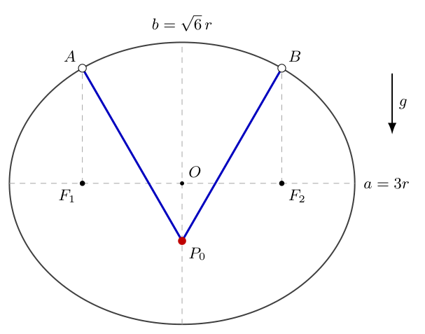
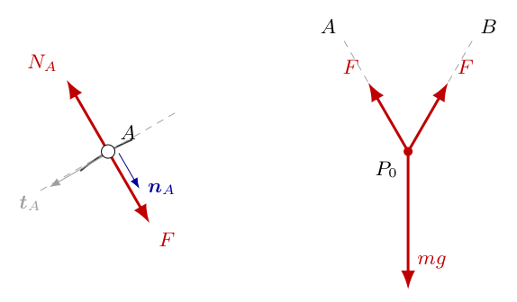
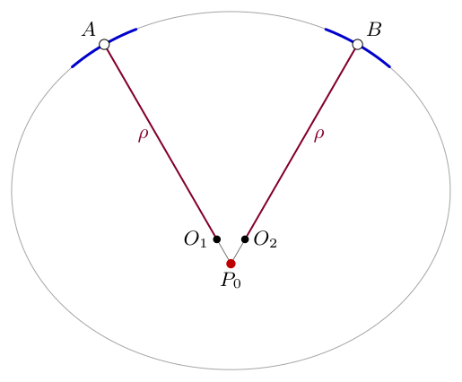
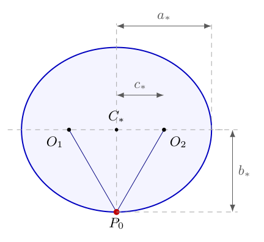
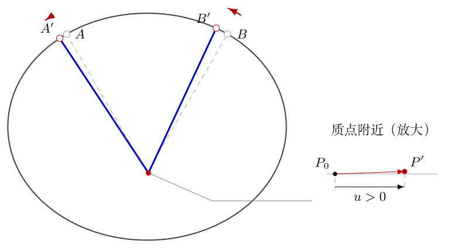
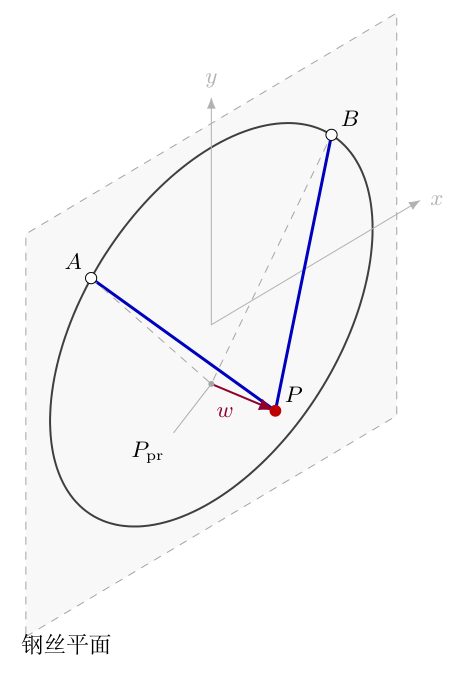

# 第5题

<!-- conditional-draft: 原题保留“伸长的细线”；不可伸长、质量忽略的小环及平面内扰动的补充尚待确认。以下为明确条件下的完整解，不作为本题无条件验收。 -->
<!-- source-complete: 22步完整核心、四个带解变式及六幅TikZ已保存；仅允许条件稿工作预览，模型确认及实际PDF审读另行记录。 -->
<!-- question-complete -->
<!-- question-start -->

如图所示，一根光滑的椭圆钢丝固定在竖直平面内，半长轴为 $a=3r$，半短轴为 $b=\sqrt6\,r$。一根伸长的细线两端分别系着轻质小环，小环可以沿钢丝无摩擦滑动。细线上穿着一个质点，质点可以沿细线无摩擦滑动。重力竖直向下，重力加速度大小为 $g$。

初态系统处于平衡，两个小环恰好位于椭圆两个焦点的正上方。求质点在小扰动下的运动状态；若平衡稳定，求小振动周期；若不稳定，说明理由。

{width=83%}

<!-- question-end -->

## 一、题型定位

这是一个由可移动支点改变有效轨道的约束小振动问题。绳的端点不是固定支点，而是沿钢丝滑动的小环；质点也不是细线上固定的一点。必须同时使用小环处的法向条件和两段绳的总长条件，才能确定质点平衡位置附近的轨道。

题干的“伸长的细线”没有明确规定长度约束，也没有给出伸缩本构关系；钢丝位于竖直平面，并不单独保证质点的扰动仍在该平面内。下面的主要解答明确采用以下条件：细线柔软、质量忽略、不可伸长且始终拉紧；小环的质量忽略，因而它们的位置满足瞬时法向平衡；首先只研究图示竖直平面内的小扰动。这些条件是结论的适用范围，不能暗中用它们替代未说明的题意。若细线确实会伸缩而没有相应的弹性参数，不能唯一确定周期；若允许离面运动，还存在另一种小振动，后文给出其结果及来源。

用 $m$ 表示质点质量，用 $F$ 表示绳的张力，用 $T$ 表示振动周期。题目最终的周期与 $m$ 无关，但受力和能量方程中仍须先保留 $m$，不能直接省去研究对象的惯性。

## 二、知识点

对无摩擦的曲线约束，钢丝作用于小环的约束反力垂直于钢丝的局部切线。质量忽略的小环满足合力为零，因此绳段也必须沿该处法线。这里的“法线”是局部几何方向，并不是椭圆中心与小环的连线；除轴端等特殊点外，这两种方向不同。

质点在柔软轻绳上无摩擦滑动，使相接的两段绳具有相同张力。不可伸长只给出
$$
|AP|+|BP|=L,
$$
其中 $L$ 为总绳长；它不要求 $|AP|$ 与 $|BP|$ 分别保持不变。

平面参数曲线 $\boldsymbol R(\theta)$ 的曲率半径为
$$
\rho=\frac{|\boldsymbol R'(\theta)|^3}
 {|\boldsymbol R'(\theta)\times\boldsymbol R''(\theta)|}.
$$
在平面内，分母可理解为两向量构成的行列式的绝对值。密切圆与原曲线在接触点具有相同的位置、切线和曲率，因此可以用于局部二阶计算，不能当作整条曲线的全局替代。

若质点平衡位置附近的实际约束轨道为
$$
y=y_0+\frac{u^2}{2R_{\rm eff}}+o(u^2),
$$
且只有该质点保留惯性，则二阶势能与动能分别为
$$
\Delta V=\frac{mg}{2R_{\rm eff}}u^2,\qquad
K^{(2)}=\frac12m\dot u^2.
$$
当 $R_{\rm eff}>0$ 时，平衡在这一约束支路上稳定，并有
$$
\omega^2=\frac g{R_{\rm eff}},\qquad
T=2\pi\sqrt{\frac{R_{\rm eff}}g}.
$$
这一公式中的 $R_{\rm eff}$ 属于质点的有效轨道，不一定等于钢丝的曲率半径或某一段绳长。

## 三、物理图像

两环在焦点上方时，绳段分别沿椭圆在两环处的向内法线，质点位于这两条法线的交点。由题给的轴长算出的交点在原椭圆内部，而不是在钢丝最低点的下方。图5-1按这个真实几何关系重绘；钢丝是一条固定的闭合曲线，细线则是连接两环与质点的两段直线，它们不能混为同一根线。

质点向右发生微小位移时，两环也会移动：在所研究的法向约束支路上，两环都向左，左环同时下降，右环同时上升。两段绳的长度一增一减，总长仍固定。若把图中的两环当作不动，得到的是另一个物理系统，周期会相差三倍。

质点的竖直升高在平衡点附近是水平位移的二阶小量。因此，一阶运动看起来主要是水平的，恢复作用却来自不能忽略的二阶势能。求周期的关键，不是直接套用一段绳的摆长，而是求出这个二阶升高量。

## 四、解题入口

先建立椭圆方程，通过“焦点正上方”确定两环坐标，再用法向条件求质点平衡坐标与总绳长。接着求钢丝在两环处的曲率半径和曲率中心，保持两曲率中心到质点的正确位置次序。

在平衡点附近，用两个密切圆建立局部辅助椭圆，完整求其半轴及下端曲率半径。由质点的局部高度函数判断稳定性，再建立小振动方程。最后从真实钢丝的法向方程与总绳长方程直接求导，检查局部辅助椭圆是否给出了正确的二阶结果。这两条路线分别使用局部曲率几何和原始约束，不以重复同一公式代替核验。

## 五、解析

**第1步：确定坐标、研究对象与长度约束。**

取椭圆中心 $O$ 为原点，$x$ 轴沿水平长轴向右，$y$ 轴竖直向上。钢丝方程为
$$
\frac{x^2}{a^2}+\frac{y^2}{b^2}=1,
\qquad a=3r,\quad b=\sqrt6\,r.
$$
令两环分别为 $A$、$B$，质点为 $P$。只讨论拉紧的细线，质量忽略的小环和轻绳本身不贡献动能。两段线的长度记作 $\ell_A=|AP|$、$\ell_B=|BP|$，不可伸长条件是
$$
\ell_A+\ell_B=L.
$$
质点在绳上可以滑动，所以不能额外加上 $\ell_A=\text{常量}$ 或 $\ell_B=\text{常量}$。在平衡时对称性会使它们相等，但扰动后一般不相等。

**第2步：由焦点位置求出两个小环的坐标。**

椭圆的焦距参数满足 $c^2=a^2-b^2$。代入题给半轴：
$$
\begin{aligned}
c^2&=(3r)^2-(\sqrt6\,r)^2\\
&=9r^2-6r^2=3r^2,\\
c&=\sqrt3\,r.
\end{aligned}
$$
因为 $c$ 是长度，取正根。两个焦点为
$$
F_1=(-\sqrt3\,r,0),\qquad F_2=(\sqrt3\,r,0).
$$
“正上方”意味着环的横坐标与相应焦点相同，纵坐标取椭圆上半部的正值。以右环为例，
$$
\begin{aligned}
y_B
&=b\sqrt{1-\frac{c^2}{a^2}}\\
&=b\sqrt{\frac{a^2-c^2}{a^2}}\\
&=b\sqrt{\frac{b^2}{a^2}}
=\frac{b^2}{a}\\
&=\frac{6r^2}{3r}=2r.
\end{aligned}
$$
左环同理。因此
$$
A=(-\sqrt3\,r,2r),\qquad
B=(\sqrt3\,r,2r).
$$
两环不是放在 $y=b$ 的最高点；最高点只有一个，其横坐标为零。

**第3步：根据小环受力确定绳段必须沿法线。**

如图5-2，小环 $A$ 受到绳沿 $AP$ 的拉力和钢丝的约束反力。图中 $\boldsymbol t_A$ 为钢丝的单位切向量，$\boldsymbol n_A$ 为指向椭圆内部的单位法向量。

{width=94%}

光滑钢丝的反力在切向上的分量为零。小环质量忽略，不能保留一个有限的切向惯性项，故其切向平衡要求
$$
F\,\boldsymbol e_{AP}\cdot\boldsymbol t_A=0.
$$
其中 $\boldsymbol e_{AP}$ 为从 $A$ 指向 $P$ 的单位向量。绳始终拉紧，$F>0$，所以
$$
\boldsymbol e_{AP}\cdot\boldsymbol t_A=0.
$$
这说明 $AP$ 沿钢丝在 $A$ 处的法线；$BP$ 同理。钢丝反力与绳拉力方向相反，不应把二者画成同向。

质点与绳之间无摩擦，沿绳的局部滑动方向没有额外摩擦力。理想轻绳的两段张力相等，记为同一个 $F$。质点所受张力从 $P$ 指向 $A$、$B$，与小环所受绳拉力的方向相反。

**第4步：写出法线方程并求平衡点。**

把椭圆写成等值曲线
$$
\Phi(x,y)=\frac{x^2}{a^2}+\frac{y^2}{b^2}-1=0.
$$
梯度垂直于等值曲线：
$$
\nabla\Phi=\left(\frac{2x}{a^2},\frac{2y}{b^2}\right).
$$
在左环 $A$ 处，外法线方向为
$$
\left(-\frac{2\sqrt3}{9r},\frac{2}{3r}\right).
$$
其纵横分量之比为
$$
\frac{2/(3r)}{-2\sqrt3/(9r)}
=-\frac3{\sqrt3}=-\sqrt3.
$$
因此经过 $A$ 的法线方程是
$$
y-2r=-\sqrt3\,(x+\sqrt3\,r).
$$
右环的法线方程是
$$
y-2r=\sqrt3\,(x-\sqrt3\,r).
$$
两式相减，得到
$$
-2\sqrt3\,x=0,
$$
故 $x=0$。代回左环的法线：
$$
y-2r=-\sqrt3\times\sqrt3\,r=-3r,
$$
从而
$$
P_0=(0,-r).
$$
对称性只能先说明 $P_0$ 在 $y$ 轴上，不能单独给出它的高度；高度必须由法向关系计算。

**第5步：核对空间位置、绳长与平衡张力。**

原椭圆最低点的纵坐标是 $-\sqrt6\,r$。由于
$$
-\sqrt6\,r<-r<0,
$$
$P_0$ 位于椭圆内部、中心下方。图5-1中的钢丝最低点仍在质点下方，不能凭原示意图的大小把质点画到闭合钢丝外。

单段平衡绳长为
$$
\begin{aligned}
d
&=|AP_0|\\
&=\sqrt{(0+\sqrt3\,r)^2+(-r-2r)^2}\\
&=\sqrt{3r^2+9r^2}
=2\sqrt3\,r.
\end{aligned}
$$
于是
$$
L=2d=4\sqrt3\,r.
$$
从小环指向质点的向内单位法线为
$$
\boldsymbol n_A=\left(\frac12,-\frac{\sqrt3}2\right),
\qquad
\boldsymbol n_B=\left(-\frac12,-\frac{\sqrt3}2\right).
$$
质点两张力的水平分量相互抵消，竖直向上的分量各为 $F_0\sqrt3/2$，故
$$
\begin{aligned}
2F_0\frac{\sqrt3}2-mg&=0,\\
F_0&=\frac{mg}{\sqrt3}>0.
\end{aligned}
$$
正张力说明所取支路与拉紧条件相容。若几何计算给出必须为负的张力，就不能把该位置当作轻绳能够维持的平衡。

**第6步：区分原钢丝曲率与质点轨道曲率。**

质点一旦偏离平衡，两环会移动，绳方向也随钢丝法向变化。因此，质点的轨道既不是原钢丝，也不是以 $A$ 或 $B$ 为固定圆心的圆。

如图5-3，$O_1$、$O_2$ 分别是原钢丝在 $A$、$B$ 处的曲率中心，$\rho$ 是这两个位置相同的曲率半径。图中只画出密切圆在接触点附近的局部圆弧，而不是把原钢丝整条替换为圆。

{width=52%}

后面先用 $\rho$ 确定局部几何，再求质点有效轨道的 $R_{\rm eff}$。这两个半径分别属于不同的曲线，不能用一个字母不加区别地表示。

**第7步：从参数方程完整计算原椭圆的曲率。**

令
$$
\boldsymbol R(\theta)=(a\cos\theta,b\sin\theta).
$$
对参数 $\theta$ 求一阶和二阶导数：
$$
\begin{aligned}
\boldsymbol R'(\theta)&=(-a\sin\theta,b\cos\theta),\\
\boldsymbol R''(\theta)&=(-a\cos\theta,-b\sin\theta).
\end{aligned}
$$
因此
$$
|\boldsymbol R'|^2
=a^2\sin^2\theta+b^2\cos^2\theta.
$$
平面行列式的绝对值为
$$
\begin{aligned}
|\boldsymbol R'\times\boldsymbol R''|
&=\left|(-a\sin\theta)(-b\sin\theta)
 -(b\cos\theta)(-a\cos\theta)\right|\\
&=ab(\sin^2\theta+\cos^2\theta)=ab.
\end{aligned}
$$
所以
$$
\rho(\theta)
=\frac{(a^2\sin^2\theta+b^2\cos^2\theta)^{3/2}}{ab}.
$$
此处使用参数曲线曲率公式，导数是对 $\theta$ 而非时间求导；$\boldsymbol R'$ 并不是小环的实际速度。

**第8步：把两环的参数值代入曲率公式。**

环的横、纵坐标分别满足
$$
\cos\theta_A=-\frac1{\sqrt3},\quad
\cos\theta_B=\frac1{\sqrt3},\quad
\sin\theta_A=\sin\theta_B=\sqrt{\frac23}.
$$
两处的 $\sin^2\theta$、$\cos^2\theta$ 相同，故
$$
\begin{aligned}
|\boldsymbol R'|^2
&=9r^2\frac23+6r^2\frac13\\
&=6r^2+2r^2=8r^2,\\
|\boldsymbol R'|&=2\sqrt2\,r.
\end{aligned}
$$
代入 $ab=3\sqrt6\,r^2$：
$$
\begin{aligned}
\rho
&=\frac{(2\sqrt2\,r)^3}{3\sqrt6\,r^2}\\
&=\frac{16\sqrt2\,r^3}{3\sqrt6\,r^2}\\
&=\frac{16r}{3\sqrt3}.
\end{aligned}
$$
从第二行到第三行约去一个 $r^2$，再用 $\sqrt6=\sqrt2\sqrt3$ 约去 $\sqrt2$。结果的量纲为长度。

**第9步：求曲率中心，并筛选正确的距离符号。**

曲率中心沿向内法线、距离小环 $\rho$，所以
$$
O_1=A+\rho\boldsymbol n_A.
$$
横、纵坐标分别计算为
$$
\begin{aligned}
x_{O_1}
&=-\sqrt3\,r+\frac12\frac{16r}{3\sqrt3}\\
&=-\frac{9r}{3\sqrt3}+\frac{8r}{3\sqrt3}
=-\frac{r}{3\sqrt3},\\
y_{O_1}
&=2r-\frac{\sqrt3}{2}\frac{16r}{3\sqrt3}\\
&=2r-\frac83r=-\frac23r.
\end{aligned}
$$
同理
$$
O_2=\left(\frac{r}{3\sqrt3},-\frac23r\right).
$$
同时
$$
\begin{aligned}
d-\rho
&=2\sqrt3\,r-\frac{16r}{3\sqrt3}\\
&=\frac{18r-16r}{3\sqrt3}
=\frac{2r}{3\sqrt3}>0.
\end{aligned}
$$
于是沿左法线的次序是 $A\to O_1\to P_0$，沿右法线的次序是 $B\to O_2\to P_0$。两曲率中心都处在相应环和质点之间，故
$$
|O_1P_0|=|O_2P_0|=d-\rho.
$$
若写成 $\rho-d$，将得到负“距离”，随后辅助椭圆的半长轴也会被错误地取负。

**第10步：说明密切圆近似保留到哪一阶。**

在每个小环附近用弧长增量 $s$ 描述钢丝，设平衡点的切向量和向内法向量分别为 $\boldsymbol t$、$\boldsymbol n$。局部展开为
$$
\boldsymbol R(s)
=\boldsymbol R(0)+\boldsymbol t\,s
 +\frac{\boldsymbol n}{2\rho}s^2+o(s^2).
$$
密切圆有相同的零阶、一阶和二阶项，所以用它计算质点的二阶升高量是适当的。曲率随环位置的变化会影响更高阶运动，不能据此声称质点的大幅运动也是沿同一条辅助椭圆。

在密切圆模型中，过环的法线通过固定圆心。由于已经确定 $A\to O_1\to P_0$ 的次序，附近同一支路满足
$$
|AP|\ \simeq\ \rho+|O_1P|,
\qquad
|BP|\ \simeq\ \rho+|O_2P|.
$$
符号 $\simeq$ 表示用于二阶局部计算的等效关系，而不是对原钢丝任意位置都成立的全局等式。下一步从总绳长得到局部轨道，后面再直接对原始约束求导检查这一二阶结果。

**第11步：由总绳长建立辅助椭圆。**

把两段局部长度关系相加，并使用 $|AP|+|BP|=L$，得到
$$
|O_1P|+|O_2P|\ \simeq\ L-2\rho.
$$
以 $O_1$、$O_2$ 为焦点、到两焦点距离之和为常量的曲线是一条椭圆。其中心是
$$
C_*=\left(0,-\frac23r\right).
$$
如图5-4，辅助椭圆被单独放大展示，原钢丝并没有变成图中这条小椭圆。$a_*$、$b_*$ 是辅助椭圆的半长轴、半短轴，$c_*$ 是其中心到焦点的距离。

{width=44%}

这幅图要用于确定 $P$ 附近的高度变化，而不是重新规定原题的钢丝形状。由于距离之和为 $2a_*$，有
$$
2a_*=L-2\rho,\qquad
2c_*=|O_1O_2|.
$$

**第12步：逐项求辅助椭圆的三个长度参数。**

先求半长轴：
$$
\begin{aligned}
a_*
&=\frac{L-2\rho}{2}
=d-\rho\\
&=\frac{2r}{3\sqrt3}.
\end{aligned}
$$
再求焦距参数：
$$
\begin{aligned}
|O_1O_2|
&=\frac{r}{3\sqrt3}
 -\left(-\frac{r}{3\sqrt3}\right)
=\frac{2r}{3\sqrt3},\\
c_*&=\frac{r}{3\sqrt3}.
\end{aligned}
$$
椭圆的半短轴满足 $b_*^2=a_*^2-c_*^2$，故
$$
\begin{aligned}
b_*^2
&=\left(\frac{2r}{3\sqrt3}\right)^2
 -\left(\frac{r}{3\sqrt3}\right)^2\\
&=\frac{4r^2}{27}-\frac{r^2}{27}
=\frac{3r^2}{27}=\frac{r^2}{9},\\
b_*&=\frac r3.
\end{aligned}
$$
半短轴为长度，选正根。还有 $a_*>c_*>0$，保证辅助椭圆没有退化；这一条件不能在开方后略去。

**第13步：求辅助椭圆下端的有效曲率半径。**

辅助椭圆方程为
$$
\frac{x^2}{a_*^2}
+\frac{(y+2r/3)^2}{b_*^2}=1.
$$
其下端纵坐标是
$$
y_{\rm bottom}=-\frac23r-b_*=-r,
$$
恰好等于已经求出的 $P_0$，所以应取下支而非上支。

也可将辅助椭圆参数化为
$$
x=a_*\cos\psi,\qquad
y=-\frac23r+b_*\sin\psi.
$$
在下端 $\psi=-\pi/2$，曲率公式给出
$$
R_{\rm eff}
=\frac{(a_*^2)^{3/2}}{a_*b_*}
=\frac{a_*^2}{b_*}.
$$
由于 $a_*,b_*>0$，$(a_*^2)^{3/2}=a_*^3$，不存在绝对值遗漏。代入本题参数：
$$
\begin{aligned}
R_{\rm eff}
&=\frac{4r^2/27}{r/3}\\
&=\frac{4r^2}{27}\frac3r
=\frac{4r}{9}.
\end{aligned}
$$
这个长度小于单段绳长 $d$，也小于原钢丝的曲率半径 $\rho$；它不是任选一个“等效摆长”，而是已经由全部约束算出的轨道曲率。

**第14步：把局部几何写成可用于动力学的高度函数。**

令质点的水平位移为 $u=x$。辅助椭圆下支是
$$
y=-\frac23r-b_*
 \sqrt{1-\frac{u^2}{a_*^2}}.
$$
利用平方根在零点附近的二阶展开，
$$
\sqrt{1-z}=1-\frac z2+O(z^2),
\qquad z=\frac{u^2}{a_*^2}.
$$
于是辅助椭圆给出
$$
\begin{aligned}
y
&=-\frac23r-b_*
 +\frac{b_*}{2a_*^2}u^2+O(u^4)\\
&=-r+\frac{u^2}{2R_{\rm eff}}+O(u^4).
\end{aligned}
$$
辅助椭圆的 $O(u^4)$ 项不能直接当作真实钢丝轨道的高阶系数；对真实约束，目前可以确定的结论是
$$
y=-r+\frac{9u^2}{8r}+o(u^2).
$$
这里保留到二阶，因为稳定性和线性小振动频率正是由该阶势能决定的。

**第15步：判断平衡稳定，并写出二阶动能。**

以平衡点势能为零，则
$$
\begin{aligned}
\Delta V
&=mg(y+r)\\
&=\frac{9mg}{8r}u^2+o(u^2).
\end{aligned}
$$
$r>0$、$g>0$、$m>0$，二次项系数为正，说明 $u=0$ 是所研究约束支路上的势能严格极小点，平面内小扰动受到恢复作用。

质点的速度满足
$$
v^2=\dot u^2+\dot y^2.
$$
由高度展开，
$$
\dot y=\frac{9}{4r}u\dot u+\text{高阶项}.
$$
若 $u$ 与 $\dot u$ 均按振幅的一阶量计，$\dot y$ 是二阶量，$\dot y^2$ 是四阶量。因此二阶动能为
$$
K^{(2)}=\frac12m\dot u^2.
$$
这不是认为质点完全没有竖直运动，而是说明竖直动能不进入线性小振动方程。小环质量忽略，故此处不再叠加它们的动能。

**第16步：由能量建立恢复方程与周期。**

二阶总机械能为
$$
E^{(2)}
=\frac12m\dot u^2+\frac{9mg}{8r}u^2.
$$
对时间求导，理想约束不耗散机械能：
$$
\begin{aligned}
\frac{dE^{(2)}}{dt}
&=m\dot u\ddot u+\frac{9mg}{4r}u\dot u\\
&=\dot u\left(m\ddot u+\frac{9mg}{4r}u\right)=0.
\end{aligned}
$$
在 $\dot u\ne0$ 的区间可约去 $\dot u$；在转折点由运动的连续性延拓，不能因为瞬时速度为零就取消运动方程。得到
$$
\ddot u+\frac{9g}{4r}u=0.
$$
与 $\ddot u+\omega_\parallel^2u=0$ 对照：
$$
\omega_\parallel=\sqrt{\frac{9g}{4r}}.
$$
通解为
$$
u(t)=U\cos(\omega_\parallel t+\varphi),
$$
其中 $U$、$\varphi$ 由初始位移和速度确定。故平面内小振动周期是
$$
\boxed{T_\parallel=2\pi\sqrt{\frac{4r}{9g}}}.
$$
恢复项移到右边为 $\ddot u=-9gu/(4r)$，当 $u>0$ 时水平加速度向左，符号与稳定性判断一致。

**第17步：直接从原钢丝约束求出两环的一阶位移。**

现在不把钢丝换成固定密切圆，而在真实钢丝上求导。用弧长参数 $s_A,s_B$ 描述环的位置，正方向取椭圆参数 $\theta$ 增加的方向。在平衡位置，切向量为
$$
\boldsymbol t_A=\left(-\frac{\sqrt3}2,-\frac12\right),
\qquad
\boldsymbol t_B=\left(-\frac{\sqrt3}2,\frac12\right).
$$
法向条件写为
$$
(P-A)\cdot\boldsymbol t_A=0,
\qquad
(P-B)\cdot\boldsymbol t_B=0.
$$
对 $u$ 求导，令 $s'_A=ds_A/du$。由弧长定义，
$$
\frac{dA}{du}=\boldsymbol t_A s'_A,\qquad
\frac{d\boldsymbol t_A}{du}
=\frac{\boldsymbol n_A}{\rho}s'_A.
$$
第二式使用平面曲线的切向转动公式，$\rho$ 取平衡点的值。又有 $P_0-A=d\boldsymbol n_A$，故
$$
\begin{aligned}
0
&=\left(P'-\boldsymbol t_A s'_A\right)
 \cdot\boldsymbol t_A
 +(d\boldsymbol n_A)\cdot
 \left(\frac{\boldsymbol n_A}{\rho}s'_A\right)\\
&=P'\cdot\boldsymbol t_A
 -s'_A+\frac d\rho s'_A.
\end{aligned}
$$
对称性给 $y'(0)=0$，所以平面内 $P'(0)=(1,0)$。由此
$$
\left(1-\frac d\rho\right)s'_A
=-\frac{\sqrt3}2.
$$
逐项算出
$$
\frac d\rho
=\frac{2\sqrt3\,r}{16r/(3\sqrt3)}
=\frac98,\qquad
1-\frac d\rho=-\frac18,
$$
于是
$$
s'_A=s'_B=4\sqrt3.
$$
注意分母为负，所以环与质点的水平运动方向相反。这里求的是每单位质点水平位移引起的环弧长变化，不是环的速度数值。

**第18步：把环位移与绳长变化对应到解答图。**

由上一式，
$$
\begin{aligned}
dA
&=\boldsymbol t_A\,4\sqrt3\,du
=(-6,-2\sqrt3)\,du,\\
dB
&=\boldsymbol t_B\,4\sqrt3\,du
=(-6,2\sqrt3)\,du.
\end{aligned}
$$
图5-5中实线为根据真实法向条件和总绳长条件得到的扰动位置，虚线保留平衡位置。扰动幅度为便于观察而放大；后续推导使用的是 $u\to0$ 的一阶和二阶结果。

{width=88%}

当 $du>0$ 时，$dx_A=dx_B=-6du<0$，左环下降、右环上升。对一段距离 $\ell_A=|P-A|$ 求导：
$$
\frac{d\ell_A}{du}
=\boldsymbol n_A\cdot(P'-A').
$$
因 $\boldsymbol n_A\cdot\boldsymbol t_A=0$，环的切向一阶位移不进入这一内积，所以
$$
\ell'_A=\frac12,\qquad
\ell'_B=-\frac12.
$$
即
$$
d\ell_A=\frac12du,\qquad
d\ell_B=-\frac12du,\qquad
d(\ell_A+\ell_B)=0.
$$
图中每个运动箭头都对应上述符号关系。若把两段绳都画成同时变长，就违背了主解使用的长度约束。

**第19步：从真实绳长的二阶导数核验有效曲率。**

设 $\boldsymbol v=P'-A'$，从 $\ell_A=|P-A|$ 两次求导，得到
$$
\ell''_A
=\frac{|\boldsymbol v|^2-(\boldsymbol n_A\cdot\boldsymbol v)^2}{d}
 +\boldsymbol n_A\cdot(P''-A'').
$$
这来自向量模长的求导，不是另套辅助椭圆。环的二阶导数含有切向项和法向项：
$$
A''=\boldsymbol t_A s''_A
 +\frac{\boldsymbol n_A}{\rho}(s'_A)^2.
$$
切向项与 $\boldsymbol n_A$ 的内积为零。平面内 $P''=(0,y'')$，所以
$$
\boldsymbol n_A\cdot(P''-A'')
=-\frac{\sqrt3}2y''
 -\frac{(s'_A)^2}{\rho}.
$$
$\boldsymbol v$ 的垂直于 $\boldsymbol n_A$ 的分量是
$$
\boldsymbol t_A\cdot\boldsymbol v
=t_{A,x}-s'_A
=-\frac{\sqrt3}2-4\sqrt3
=-\frac{9\sqrt3}2.
$$
因此第一项为
$$
\frac{(9\sqrt3/2)^2}{d}
=\frac{243/4}{2\sqrt3\,r}
=\frac{81\sqrt3}{8r}.
$$
另一项为
$$
\frac{(s'_A)^2}{\rho}
=\frac{48}{16r/(3\sqrt3)}
=\frac{9\sqrt3}{r}.
$$
合并：
$$
\ell''_A
=\frac{9\sqrt3}{8r}-\frac{\sqrt3}2y''.
$$
右绳段同样给出
$$
\ell''_B
=\frac{9\sqrt3}{8r}-\frac{\sqrt3}2y''.
$$
总绳长固定，故 $\ell''_A+\ell''_B=0$，即
$$
\begin{aligned}
\frac{9\sqrt3}{4r}-\sqrt3\,y''&=0,\\
y''(0)&=\frac{9}{4r},\\
R_{\rm eff}&=\frac1{y''(0)}=\frac{4r}{9}.
\end{aligned}
$$
这条真实约束路线独立得到与局部辅助椭圆相同的二阶高度系数，说明密切圆方法在小振动所需的阶次上是可靠的。

**第20步：核对恢复方向、质量消去与小量范围。**

周期中 $r$ 是题给的几何尺度，不是钢丝上任意一点的曲率半径。量纲检查：
$$
\left[\frac r g\right]
=\frac{\mathrm m}{\mathrm{m\,s^{-2}}}
=\mathrm{s^2},
$$
开方后为时间。质量在惯性项和重力恢复项中各出现一次，约去后周期不依赖 $m$；平衡张力仍与 $m$ 成正比。

小振动要求环位置、绳方向和质点高度都只作小变化。由
$$
\frac{ds_A}{\rho}
=\frac{4\sqrt3}{16r/(3\sqrt3)}du
=\frac9{4r}du,
$$
环法向转角振幅约为 $9U/(4r)$，因此应满足 $U/r\ll1$。同一条件也使质点轨道斜率
$$
y'(u)\simeq\frac{9u}{4r}
$$
远小于一。不能因为质点移动量比整个椭圆轴长小，就忽略环位置的放大响应。

**第21步：辨明离面扰动为何不能自动排除。**

若允许质点离开钢丝所在平面，增加垂直该平面的坐标 $w$。在仍然采用不可伸长与质量忽略的小环条件下，真实约束给出的局部高度是
$$
y=-r+\frac{9u^2}{8r}+\frac{w^2}{6r}
 +o(u^2+w^2).
$$
其中 $w^2$ 系数可以不依赖辅助椭圆求出：在 $w=0$ 的平衡点，沿 $w$ 的一阶环位移为零；每段距离的二阶导数为
$$
\ell_{i,ww}
=\frac1d-\frac{\sqrt3}2y_{ww}.
$$
两段相加并令总长二阶变化为零：
$$
\begin{aligned}
\frac2d-\sqrt3\,y_{ww}&=0,\\
y_{ww}&=\frac2{\sqrt3\,d}
=\frac1{3r}.
\end{aligned}
$$
高度展开中的系数为 $y_{ww}/2=1/(6r)$。因而还有离面正常模
$$
\ddot w+\frac g{3r}w=0,\qquad
\boxed{T_\perp=2\pi\sqrt{\frac{3r}{g}}}.
$$
两个二次势能系数均为正，所述理想约束支路的这两种正常模都稳定。但
$$
\frac{T_\perp}{T_\parallel}
=\frac{3\sqrt3}{2}
$$
不是整数，也不是有理数；一般混合扰动不能用一个共同周期描述。只说钢丝在竖直平面内，不足以把 $T_\parallel$ 称为所有空间扰动的唯一周期。

**第22步：按不同模型给出边界清楚的结论。**

在不可伸长、始终拉紧、理想质量忽略的小环和图示平面内扰动条件下，质点在 $P_0=(0,-r)$ 附近稳定，沿水平坐标的一阶运动为简谐振动，周期为
$$
\boxed{T_\parallel=2\pi\sqrt{\frac{4r}{9g}}}.
$$
质点竖直位移在二阶上为
$$
y(t)+r
=\frac{9U^2}{8r}
 \cos^2(\omega_\parallel t+\varphi)+o(U^2).
$$
它含有恒定项和二倍频项，不应把这一高阶高度变化误作另一个平面内独立正常模。

若放宽为允许空间扰动，还须保留 $T_\perp$；若细线允许伸缩而没有弹性关系，则上述固定总长的主推导不能直接使用。若小环具有不可忽略的惯性，则它们沿钢丝的切向方程需要保留，不能仅凭质量忽略模型的轨道就宣称完整有限质量系统的全部扰动稳定。

## 六、关键洞察

**洞察1：可以移动的支点把轨道曲率改变了一个数量级。**

本题三个重要长度为
$$
d=2\sqrt3\,r,\qquad
\rho=\frac{16r}{3\sqrt3},\qquad
R_{\rm eff}=\frac{4r}{9}.
$$
它们分别是平衡绳段长度、钢丝在环处的曲率半径、质点局部有效轨道的曲率半径。三者含义不同，即使量纲相同，也不能相互替代。

真正敏感的几何量是
$$
1-\frac d\rho=-\frac18.
$$
它来自法向条件求导，控制环的弧长响应。因为它的绝对值较小，质点发生很小的水平位移就能引起明显的环位移；这也使固定环模型与滑动环模型的轨道曲率相差很大。负号意味着环向质点水平移动的反方向运动，并不意味着曲率半径为负。

**洞察2：法向约束与总绳长是一个可直接求解的真实几何系统。**

用
$$
A(\theta_1)=(a\cos\theta_1,b\sin\theta_1,0),\qquad
B(\theta_2)=(a\cos\theta_2,b\sin\theta_2,0)
$$
描述真实环位置，用 $P=(u,y,w)$ 描述质点。三个原始约束为
$$
\begin{aligned}
(P-A)\cdot A_{\theta_1}&=0,\\
(P-B)\cdot B_{\theta_2}&=0,\\
|P-A|+|P-B|&=L.
\end{aligned}
$$
给定足够小的 $u,w$ 后，未知量是 $\theta_1,\theta_2,y$。平衡点附近所取法向支路的局部解连续，三个约束对这三个未知量的雅可比行列式为 $-\sqrt3\,r^4\ne0$，故可以在这一邻域求取隐函数。该结论只保证局部支路可解，不保证任意大位移时仍有同一解，也不代替动力学稳定性分析。

例如平面内
$$
\frac{ds}{d\theta}=|\boldsymbol R'|=2\sqrt2\,r,
$$
结合解析中 $ds/du=4\sqrt3$ 得
$$
\frac{d\theta_1}{du}
=\frac{d\theta_2}{du}
=\frac{4\sqrt3}{2\sqrt2\,r}
=\frac{\sqrt6}{r}.
$$
这是对真实椭圆参数的运动响应，而不是把环沿图上画出的圆弧随意移动。直接求导所得的 $y_{uu}=9/(4r)$、$y_{ww}=1/(3r)$ 同时说明：平面内和离面运动的高度曲率不同，不能把辅助小椭圆旋转成一个椭球来猜离面周期。

**洞察3：几何等效必须保持“局部”二字。**

两环在平衡位置具有确定曲率中心，但环移到另一位置后，真实椭圆的曲率中心一般也变化。关系
$$
|O_1P|+|O_2P|\simeq L-2\rho
$$
用来保留二阶局部高度是有效的；若把它当成全局精确轨道，再计算大振幅周期，则已经换了模型。

真实轨道仍可从原始约束得到高度函数 $y(u)$。若从 $u=U$ 静止释放，能量守恒给
$$
\frac12m\bigl[1+y'(u)^2\bigr]\dot u^2
+mg\,y(u)=mg\,y(U).
$$
解出速度的绝对值：
$$
|\dot u|
=\sqrt{\frac{2g[y(U)-y(u)]}{1+y'(u)^2}}.
$$
利用左右对称，一个周期是四倍从 $u=0$ 到 $u=U$ 的用时：
$$
T(U)=4\int_0^U
\frac{\sqrt{1+y'(u)^2}}
 {\sqrt{2g[y(U)-y(u)]}}\,du.
$$
端点 $u=U$ 处出现可积的平方根奇性，可令 $u=U\sin\phi$、$du=U\cos\phi\,d\phi$，将积分区间变为 $0\le\phi\le\pi/2$，适合稳定的数值积分。这里的 $y$ 应由真实法向及总长约束求出，而不是直接取辅助椭圆的精确下支。

仅取二阶高度
$$
y(U)-y(u)\simeq\frac{U^2-u^2}{2R_{\rm eff}}
$$
及 $y'^2$ 的零阶部分，才得到
$$
\begin{aligned}
T(U)
&\longrightarrow4\sqrt{\frac{R_{\rm eff}}g}
 \int_0^U\frac{du}{\sqrt{U^2-u^2}}\\
&=4\sqrt{\frac{R_{\rm eff}}g}\,\frac\pi2
=2\pi\sqrt{\frac{R_{\rm eff}}g}.
\end{aligned}
$$
这解释了小振动周期为何与振幅无关，也说明这一振幅无关性不能无条件外推到大运动。

**洞察4：高度一阶不变，不代表重力没有恢复作用。**

在平衡位置 $y'(0)=0$，所以重力在水平切向上的一阶功确实为零；但恢复力取决于势能的一阶导数，而势能本身必须计算到二阶：
$$
V(u)=V(0)+\frac12mg\,y''(0)u^2+\cdots,
$$
故
$$
-\frac{dV}{du}
=-mg\,y''(0)u+\cdots.
$$
把轨道只线性化为 $y=-r$ 会丢失整个恢复项。保留二阶几何、一阶动力学，是小振动计算中不同阶次各司其职的结果，不是推导前后采用了不一致的近似。

**洞察5：无质量环是动力学消元条件，不只是省略一个小数字。**

若环的质量为有限的 $\mu$，切向方程应为
$$
\mu\ddot s_A
=F\,\boldsymbol e_{AP}\cdot\boldsymbol t_A
 -\mu g\,t_{A,y},
$$
其中 $t_{A,y}$ 是单位切向量的纵分量，右环同理。此时绳段不必始终严格沿钢丝法线，环的位置也不再能仅由静态法向条件瞬时消去。还必须同时考虑环的动能、重力及完整长度约束，重新分析耦合模式。

因此不能只在本题的 $m$ 后面“加两个环质量”而保留原轨道，便声称获得有限质量修正周期。质量忽略模型的支路稳定性与有限质量系统全部配置扰动的稳定性是不同问题；没有给出这些质量和运动条件时，本题不把后者当成已经求解的结论。

## 七、易错点

1. **把小环放在椭圆最高点。** 焦点正上方的横坐标为 $\pm c$，不是零。应先算 $c$，再代入椭圆方程，得到 $y=2r$。

2. **把绳段当作椭圆的切线或中心连线。** 绳段沿局部法线，方向由小环切向平衡确定。用 $\nabla\Phi$ 或参数切线都能核对法向，不能凭对称图形猜方向。

3. **照示意图比例把质点画到钢丝外。** 本题法线交点为 $(0,-r)$，原钢丝最低点为 $(0,-\sqrt6\,r)$。两者的真实上下关系必须与坐标一致。

4. **把总长不变写成每段都不变。** 实际一阶长度变化为 $d\ell_A=du/2$、$d\ell_B=-du/2$。质点沿绳滑动正是允许两段之间转移长度的条件。

5. **把 $d-\rho$ 写成 $\rho-d$。** 应先比较 $d$ 和 $\rho$，确认 $d/\rho=9/8>1$，再按 $A\to O_1\to P_0$ 的位置次序取正距离。

6. **混淆 $\rho$ 与 $R_{\rm eff}$。** 前者属于环处钢丝，后者属于质点轨道。只因单位都是长度，就直接把 $\rho$ 代入小摆周期，是对曲线对象的混淆。

7. **只保留高度一阶展开。** 平衡位置一阶高度导数为零；若不计算二阶高度，就会错误地得出“无恢复力”或“任意位置均平衡”。

8. **把密切圆当作钢丝的全局替代。** 两条曲线的二阶接触足以给出线性小振动，但不保证大位移轨道或有限振幅周期完全一致。

9. **把线张力和周期都记为 $T$。** 推导中用 $F$ 表示张力、$T$ 表示周期，避免把 $F_0=mg/\sqrt3$ 与 $T_\parallel$ 在图和正文中混写。

10. **把“竖直平面内的钢丝”当作“质点只能平面运动”。** 若没有额外运动限制，离面正常模必须检查。两个模式都有正势能二次项，也不意味着所有混合运动都有单一周期。

11. **忽略模型条件却给出无条件数值。** 能伸缩的线缺少弹性关系时，固定绳长结论不能直接使用；有限质量环也不能自动满足瞬时法向平衡。

12. **把转折点约去 $\dot u$ 的操作当成漏洞。** 能量方程在非转折区间给出微分方程，再由连续性延拓至转折点；也可独立用切向重力或拉格朗日方程获得同一结果。

## 八、课堂讲解建议

建议先在图5-1中让学生指出钢丝、细线、环与质点四个不同对象，再要求他们写出“哪个对象质量被忽略、哪个对象保留惯性”。如果把环当作固定支点，先不急于纠正周期，可通过图5-5的环运动方向反问：绳段要始终沿法线，端点还能不动吗？

板书可分为三列：左列写原钢丝的 $a,b,c,\rho$；中列写绳长与曲率中心 $d,L,O_1,O_2$；右列写质点轨道的 $a_*,b_*,R_{\rm eff}$。每写一个长度，让学生说明它属于哪个几何对象，以阻止把相同量纲当作可互换量。

讲解密切圆时，先保留切线近似，再询问为什么切线近似不能得到恢复力，随后补上二阶法向偏离。这样能说明“需要曲率”不是为了使用一个高级公式，而是因为势能的第一项非零变化恰好在二阶。教师可在图5-3中标出 $A\to O_1\to P_0$ 的次序，再进行距离相减，减少符号记忆负担。

解析第17—19步可作为独立复核重点。先让学生从法向条件求出 $ds/du$ 的负分母，预测两环向左，再用真实长度二阶导数核对 $y''$。这一路线的价值是逐式解释环为何移动以及轨道为何上弯，不是单纯展示另一个最终公式。

最后区分“平面内小扰动”的标准结果与“允许离面”的扩展结果。课堂不应把原题缺失的条件悄悄补进学生脑中；应明确一个正确答案总是对应一个已经说明的物理模型。变式2、3分别改变支点约束和运动维数，适合用于检查模型理解，而非只检查代数熟练度。

## 九、变式训练

**变式1：改变椭圆轴长，保持焦点上方的滑动环。**

设钢丝半长轴为 $a=4r$、半短轴为 $b=\sqrt{12}\,r$。细线不可伸长且拉紧，小环质量忽略，仍只允许质点在钢丝平面内运动。两环平衡时位于焦点正上方。求稳定性与小振动周期。

先对一般 $a>b>0$ 推导，令
$$
c^2=a^2-b^2,\qquad d^2=2a^2-b^2=a^2+c^2.
$$
两环坐标仍为
$$
A=(-c,b^2/a),\qquad B=(c,b^2/a).
$$
左环法线斜率为
$$
\frac{(b^2/a)/b^2}{(-c)/a^2}=-\frac a c.
$$
它在 $x=0$ 时的纵坐标为
$$
y_0=\frac{b^2}a-a=-\frac{c^2}a.
$$
因此一段平衡绳的水平差为 $c$、竖直差为 $a$：
$$
|AP_0|=\sqrt{c^2+a^2}=d,\qquad L=2d.
$$
左环向内单位法线为
$$
\boldsymbol n_A=(c/d,-a/d),
$$
右环为 $(-c/d,-a/d)$。质点平衡张力为
$$
F_0=\frac{mgd}{2a}>0.
$$

再求两环处的钢丝曲率。参数值满足
$$
\cos^2\theta=\frac{c^2}{a^2},
\qquad
\sin^2\theta=\frac{b^2}{a^2}.
$$
于是
$$
\begin{aligned}
|\boldsymbol R'|^2
&=a^2\frac{b^2}{a^2}
 +b^2\frac{c^2}{a^2}\\
&=\frac{b^2(a^2+c^2)}{a^2}
=\frac{b^2d^2}{a^2},\\
\rho
&=\frac{(bd/a)^3}{ab}
=\frac{b^2d^3}{a^4}.
\end{aligned}
$$
为了判断 $d-\rho$ 的符号，先通分：
$$
\begin{aligned}
d-\rho
&=d\left(1-\frac{b^2d^2}{a^4}\right),\\
a^4-b^2d^2
&=a^4-b^2(2a^2-b^2)\\
&=(a^2-b^2)^2=c^4.
\end{aligned}
$$
因此
$$
a_*=d-\rho=\frac{dc^4}{a^4}>0.
$$
左曲率中心的横坐标为
$$
\begin{aligned}
x_{O_1}
&=-c+\rho\frac c d\\
&=-c\left(1-\frac{\rho}{d}\right)
=-\frac{c^5}{a^4}.
\end{aligned}
$$
两中心对称，故
$$
c_*=\frac{c^5}{a^4}.
$$
半短轴计算为
$$
\begin{aligned}
b_*^2
&=a_*^2-c_*^2\\
&=\frac{d^2c^8-c^{10}}{a^8}\\
&=\frac{c^8(d^2-c^2)}{a^8}\\
&=\frac{c^8a^2}{a^8}
=\frac{c^8}{a^6},\\
b_*&=\frac{c^4}{a^3}.
\end{aligned}
$$
因此
$$
R_{\rm eff}
=\frac{a_*^2}{b_*}
=\frac{d^2c^8}{a^8}\frac{a^3}{c^4}
=\frac{d^2c^4}{a^5}>0.
$$
该法向支路平面内稳定，周期为
$$
T=2\pi\sqrt{\frac{d^2c^4}{a^5g}}.
$$

代入本变式：
$$
\begin{aligned}
c^2&=16r^2-12r^2=4r^2,\quad c=2r,\\
d^2&=2\times16r^2-12r^2=20r^2,\\
R_{\rm eff}
&=\frac{20r^2\times16r^4}{(4r)^5}\\
&=\frac{320r^6}{1024r^5}
=\frac{5r}{16}.
\end{aligned}
$$
故
$$
\boxed{T=2\pi\sqrt{\frac{5r}{16g}}}.
$$
在 $a>b>0$ 的条件下 $R_{\rm eff}$ 为正。形式上令 $a\to b$ 时 $c\to0$、辅助椭圆和两环位置均退化，局部消元条件也退化；不能把公式形式上的 $T\to0$ 说成圆钢丝上真实的无限频率振动。

**变式2：把两环固定在原题的平衡位置。**

保留 $a=3r$、$b=\sqrt6\,r$ 与原题平衡绳长 $L=4\sqrt3\,r$，但将两环固定在
$$
A=(-\sqrt3\,r,2r),\qquad B=(\sqrt3\,r,2r),
$$
不再允许它们沿钢丝移动。质点仍沿轻绳无摩擦滑动，绳不可伸长，且只研究平面内运动。求周期，并与原题比较。

这时 $\ell_A+\ell_B=L$ 对固定焦点 $A,B$ 是精确的椭圆轨道条件，不需要钢丝的局部曲率。为了避免与原钢丝半轴混用，用 $\alpha,\beta$ 表示质点轨道的半长、半短轴：
$$
\alpha=\frac L2=2\sqrt3\,r,\qquad
c_f=\frac{|AB|}2=\sqrt3\,r.
$$
因此
$$
\begin{aligned}
\beta^2
&=\alpha^2-c_f^2\\
&=12r^2-3r^2=9r^2,\\
\beta&=3r.
\end{aligned}
$$
该椭圆中心在 $(0,2r)$，下端高度为 $2r-\beta=-r$，与原题平衡点相同。但是相同平衡点不代表相同附近轨道，其下端曲率半径为
$$
R_f=\frac{\alpha^2}{\beta}
=\frac{12r^2}{3r}=4r.
$$
下支高度展开为
$$
\begin{aligned}
y
&=2r-\beta\sqrt{1-\frac{u^2}{\alpha^2}}\\
&=-r+\frac{u^2}{8r}+O(u^4).
\end{aligned}
$$
由势能二次项和质点动能，
$$
\ddot u+\frac g{4r}u=0,\qquad
\boxed{T_f=2\pi\sqrt{\frac{4r}{g}}}.
$$
对比原题：
$$
\begin{aligned}
\frac{T_f}{T_\parallel}
&=\sqrt{\frac{4r/g}{4r/(9g)}}=3,\\
\frac{R_f}{R_{\rm eff}}&=\frac{4r}{4r/9}=9.
\end{aligned}
$$
所以“把滑动环画成固定支点”不仅是图形细节错误，还会把周期改成原结果的三倍。两模型的平衡张力相同，但回复曲率不同。

**变式3：允许质点离开钢丝平面，求两个正常模。**

保留原题的不可伸长轻绳、理想质量忽略的小环，取消平面内运动限制。取钢丝所在竖直平面为 $xy$ 平面，$w$ 轴垂直该平面。求小振动模式，并说明一般运动是否只有一个周期。

如图5-6，$A,B$ 始终在钢丝平面内，质点 $P$ 可以有非零 $w$。图中 $P_{\rm pr}$ 是质点在钢丝平面上的正投影，线段 $P_{\rm pr}P$ 表示离面位移，细线仍由真实的 $AP$、$BP$ 两段构成。图示离面量为辨认空间关系而放大，环和质点仍满足真实法向及总长条件；小振动方程取 $w\to0$ 的极限。

{width=48%}

三维法向约束不是“绳必须在钢丝平面内”，而是绳与环处钢丝的切线垂直：
$$
(P-A)\cdot\boldsymbol t_A=0,\qquad
(P-B)\cdot\boldsymbol t_B=0.
$$
钢丝切线在 $xy$ 平面，$w$ 方向与它天然垂直。总绳长仍为
$$
|P-A|+|P-B|=L.
$$

首先取纯离面位移，以 $w$ 为微小参数。平衡点处
$$
P_w=(0,y_w,1).
$$
总长的一阶导数为
$$
L_w
=(\boldsymbol n_A+\boldsymbol n_B)\cdot P_w
=-\sqrt3\,y_w.
$$
由 $L_w=0$ 得 $y_w=0$。对法向条件求一次导数，得到
$$
\left(1-\frac d\rho\right)s_{A,w}
=P_w\cdot\boldsymbol t_A=0.
$$
因 $1-d/\rho=-1/8\ne0$，
$$
s_{A,w}=s_{B,w}=0.
$$
这意味着环在纯离面运动中没有一阶移动，但二阶移动仍可能存在，不能据此把环永久固定。

对长度作二阶导数。此时每段的 $\boldsymbol v=P_w-A_w=(0,0,1)$，所以
$$
|\boldsymbol v|^2=1,\qquad
\boldsymbol n_i\cdot\boldsymbol v=0.
$$
环的二阶加速度项在该阶只剩切向项，和 $\boldsymbol n_i$ 垂直，因此
$$
\begin{aligned}
\ell_{i,ww}
&=\frac1d+\boldsymbol n_i\cdot P_{ww}\\
&=\frac1d-\frac{\sqrt3}2y_{ww}.
\end{aligned}
$$
两段相加：
$$
0=L_{ww}=\frac2d-\sqrt3\,y_{ww},
$$
从而
$$
y_{ww}=\frac2{\sqrt3 d}=\frac1{3r}.
$$
平面内已经独立算出 $y_{uu}=9/(4r)$。对钢丝平面反射 $w\mapsto-w$，系统条件不变，所以高度函数关于 $w$ 为偶函数，平衡点的混合项 $y_{uw}$ 为零。二阶高度为
$$
y+r=\frac12\frac{9}{4r}u^2
 +\frac12\frac1{3r}w^2+o(u^2+w^2).
$$
相应的二阶能量是
$$
E^{(2)}
=\frac12m(\dot u^2+\dot w^2)
 +\frac{9mg}{8r}u^2+\frac{mg}{6r}w^2.
$$
分别对两个广义坐标写运动方程：
$$
\begin{aligned}
\ddot u+\frac{9g}{4r}u&=0,\\
\ddot w+\frac g{3r}w&=0.
\end{aligned}
$$
因此两个正常模都稳定，角频率和周期为
$$
\begin{aligned}
\omega_\parallel&=\sqrt{\frac{9g}{4r}},&
T_\parallel&=2\pi\sqrt{\frac{4r}{9g}},\\
\omega_\perp&=\sqrt{\frac g{3r}},&
T_\perp&=2\pi\sqrt{\frac{3r}{g}}.
\end{aligned}
$$
一般小运动是
$$
\begin{aligned}
u(t)&=U\cos(\omega_\parallel t+\varphi_u),\\
w(t)&=W\cos(\omega_\perp t+\varphi_w).
\end{aligned}
$$
若只有一种振幅非零，就是相应正常模的周期运动；若两者均非零，由于
$$
T_\perp/T_\parallel=3\sqrt3/2
$$
为无理数，不存在一个有限时间使两种相位同时精确回到初态。因而一般混合运动不是单一周期的简谐振动。这是对运动维数的改变，不是原平面内答案算错。

**变式4：代入实际尺度，计算周期、张力与能量。**

取 $r=0.120\ \mathrm m$、$g=9.80\ \mathrm{m\,s^{-2}}$、$m=0.150\ \mathrm{kg}$。按原题的平面内理想模型，质点从水平位移 $U=2.00\ \mathrm{mm}$ 处静止释放。求小振动周期、平衡张力、最大水平速度与加速度、环弧长振幅和振动能量，并检查小振幅近似。

先统一单位：
$$
U=2.00\times10^{-3}\ \mathrm m,\qquad
R_{\rm eff}=\frac49\times0.120
=0.0533333\ \mathrm m.
$$
角频率与周期为
$$
\begin{aligned}
\omega_\parallel^2
&=\frac{9\times9.80}{4\times0.120}
=\frac{88.2}{0.480}
=183.75\ \mathrm{s^{-2}},\\
\omega_\parallel&=\sqrt{183.75}
\simeq13.5554\ \mathrm{s^{-1}},\\
T_\parallel
&=\frac{2\pi}{13.5554}
\simeq0.463518\ \mathrm s.
\end{aligned}
$$
从右端静止释放可取初相为零。写出位移后对时间求导：
$$
\begin{aligned}
u(t)&=0.00200\cos(\omega_\parallel t)\ \mathrm m,\\
\dot u(t)&=-0.00200\,\omega_\parallel
 \sin(\omega_\parallel t)\ \mathrm{m\,s^{-1}}.
\end{aligned}
$$
因此
$$
\begin{aligned}
v_{x,\max}
&=\omega_\parallel U
\simeq13.5554\times0.00200
=0.0271109\ \mathrm{m\,s^{-1}},\\
a_{x,\max}
&=\omega_\parallel^2U
=183.75\times0.00200
=0.367500\ \mathrm{m\,s^{-2}}.
\end{aligned}
$$
加速度在端点达到最大绝对值、指向平衡位置；速度在过平衡点时达到最大绝对值。

平衡张力为
$$
F_0
=\frac{mg}{\sqrt3}
=\frac{0.150\times9.80}{\sqrt3}
\simeq0.848705\ \mathrm N.
$$
小振动过程中的张力会有高阶变化，上式是平衡值，不是声称任意时刻完全不变。

环的一阶弧长振幅为
$$
\begin{aligned}
S_{\rm ring}
&=4\sqrt3\,U
=4\sqrt3\times0.00200\\
&=0.0138564\ \mathrm m
=13.8564\ \mathrm{mm}.
\end{aligned}
$$
它比质点水平振幅大，但决定近似好坏的是相对于钢丝局部曲率的转角：
$$
\begin{aligned}
\rho&=\frac{16\times0.120}{3\sqrt3}
\simeq0.369504\ \mathrm m,\\
\frac{S_{\rm ring}}\rho
&=\frac{9U}{4r}
=\frac{9\times0.00200}{4\times0.120}
=0.0375.
\end{aligned}
$$
所得转角远小于一弧度，质点轨道最大斜率在同一阶也约为 $0.0375$，小振动近似相容。

从端点静止释放，二阶振动能量全部为势能：
$$
\begin{aligned}
E^{(2)}
&=\frac12m\omega_\parallel^2U^2\\
&=\frac12\times0.150\times183.75
 \times(0.00200)^2\\
&=0.0750\times183.75\times4.00\times10^{-6}
=5.51250\times10^{-5}\ \mathrm J.
\end{aligned}
$$
也可从最高的二阶升高量核验：
$$
\begin{aligned}
\Delta y_{\max}
&=\frac{9U^2}{8r}
=\frac{9\times4.00\times10^{-6}}{0.960}\\
&=3.75000\times10^{-5}\ \mathrm m,\\
mg\,\Delta y_{\max}
&=1.470\times3.75000\times10^{-5}
=5.51250\times10^{-5}\ \mathrm J.
\end{aligned}
$$
两条计算途径一致，分别检查了动力学角频率和几何升高系数。这里所有最大值和能量均按线性小振动及相应二阶能量近似给出，不将小数位数当作有限振幅精确性的保证。
