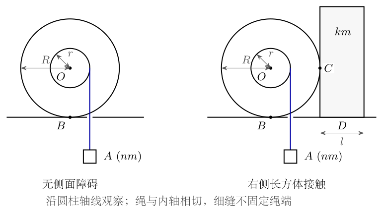
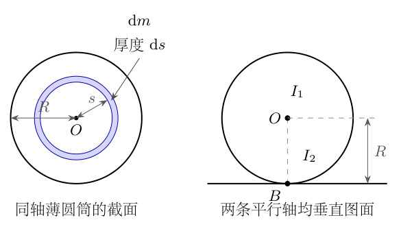
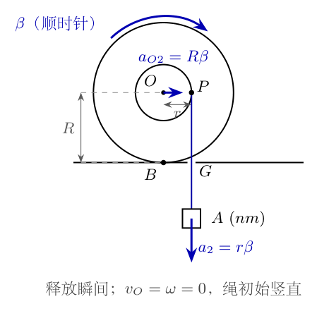
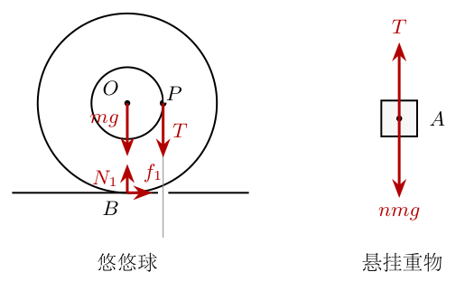
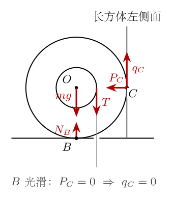
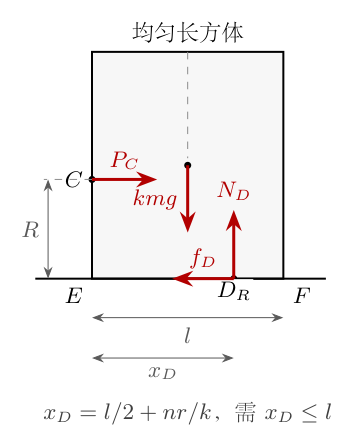

# 第4题

<!-- question-start -->

如图4-1所示，将悠悠球视为质量为 $m$、半径为 $R$ 的均匀圆柱，其中心同轴装有质量可忽略、半径为 $r$ 的轴，且 $0<r<R$。柔软、轻质且不可伸长的绳子已在轴上绕若干圈，从轴的右侧沿竖直切线向下穿过桌面细缝，悬挂质量为 $nm$ 的小重物 $A$，其中 $n>0$ 为已知量。细缝不对绳子产生摩擦，重力加速度为 $g$。球心记为 $O$，悠悠球与水平桌面的接触处记为 $B$。

（1）求悠悠球绕中心轴的转动惯量 $I_1$。

（2）若悠悠球与桌面间光滑，用手使系统保持图示静止状态。释放瞬间，求重物 $A$ 向下的加速度 $a_1$。

（3）利用平行轴定理，求悠悠球绕通过 $B$ 且平行于中心轴的轴转动时的转动惯量 $I_2$。

（4）若第（2）问中的桌面具有足够大的静摩擦系数，释放后悠悠球在桌面上纯滚动。求释放瞬间重物 $A$ 向下的加速度 $a_2$、球心向右的加速度 $a_{O2}$、$B$ 处正压力 $N_1$、摩擦力 $f_1$ 的大小和方向，以及维持该瞬间纯滚动所需的最小静摩擦系数 $\mu_1$。

（5）在悠悠球右边放置一个均匀长方体，与悠悠球在其右侧点 $C$ 接触，$C$ 与球心等高。若 $B$ 处光滑，能否通过调整 $C$、$D$ 处的摩擦以及长方体的尺寸、质量，使系统在放手后仍保持静止？简述理由。$D$ 表示长方体与桌面的接触区域。

（6）在第（5）问的摆放方式下，长方体质量为 $km$，其中 $k>0$ 已知，水平宽度为 $l$；长方体高度足以与 $C$ 接触。若 $C$ 处光滑，要使系统放手后保持静止，求 $B$ 处静摩擦系数 $\mu_B$、$D$ 处静摩擦系数 $\mu_D$ 及宽度 $l$ 各自必须满足的条件。

记号整理：第（4）问中原题将重物和球心的加速度记成同一符号，现用 $a_2$ 与 $a_{O2}$ 区分。两动力学分问均只求释放瞬间；其余静止分问按静摩擦与不发生倾覆的接触条件讨论。

{width=85%}

<!-- question-end -->

## 一、题型定位

本题是刚体转动、平动与绳长约束的综合题。首先区分圆柱半径 $R$ 与绕绳轴半径 $r$：前者进入转动惯量和地面纯滚动关系，后者进入绳张力的力矩以及重物的初始加速度。把绳子画成从外圆半径 $R$ 处出绳，或者把重物的下降距离误当球心的平移距离，都会改变模型。

第（2）与第（4）问的差别并非只增加一个摩擦力。光滑桌面上的球心在释放瞬间没有水平加速度；纯滚动时，静摩擦使球心向右加速，同时对圆柱产生与绳张力相反的力矩。因此纯滚动时重物的加速度反而较小。第（5）、（6）问转入静力学，除力与力矩平衡，还必须检查法向反力、静摩擦上限以及支承合力是否落在长方体底面内。

## 二、知识点

转动惯量的质量积分；均匀圆柱的中心转动惯量；平行轴定理；质心平动方程；定轴转动方程；平面刚体的纯滚动约束；绳与轴无相对滑动；静摩擦的方向由动力学需求决定；库仑静摩擦不等式；接触力的作用点与力臂；长方体底面正压力合力的位置；滑动与倾覆两类失稳的区分。

中心轴垂直于图面。统一取水平方向向右为正，重物沿竖直方向向下为正，悠悠球顺时针角加速度的大小记为 $\beta$。于是绳对圆柱的顺时针力矩为 $Tr$；若桌面摩擦力向右，其对球心的力矩为逆时针，大小 $fR$。两个力矩相减，不相加。

“接触点瞬时速度为零”不能不加条件地变成“接触点始终固定”。本题释放瞬间所有速度为零，采用纯滚动的切向加速度关系即可；更晚时刻，绳相对于桌面细缝的方向还会变化，不能直接照搬竖直出绳的关系到整个运动过程。

## 三、物理图像

图4-1是沿圆柱轴线观察的截面图。外圆与桌面接触，半径是 $R$；内圆代表绕绳轴，半径是 $r$。绳的离轴点位于 $O$ 的右方，记为 $P$。初态满足 $OP=r$，绳从 $P$ 竖直向下，因此张力对 $O$ 的力臂是水平距离 $r$，不是到桌面的高度 $R$。

没有长方体时，绳对悠悠球向下拉，桌面正压力要同时承受圆柱重力和绳张力。地面纯滚动时，张力趋向使圆柱顺时针转动，外圆最低点相对于球心有向左的转动趋势。桌面因此对悠悠球提供向右的静摩擦力，帮助球心向右平移，并抑制相对滑动。

长方体与悠悠球的接触点 $C$ 和球心等高。$C$ 处的水平法向力对 $O$ 没有力矩；若 $C$ 有摩擦，竖直摩擦力才可能提供力矩。第（6）问的 $C$ 光滑时，悠悠球必须依靠 $B$ 处摩擦平衡绳的力矩。长方体受悠悠球的水平推力，这个推力作用在离桌面高度 $R$ 处，同时要求底面摩擦防滑、正压力合力向右偏移防倾覆。

## 四、解题入口

先求 $I_1$ 和 $I_2$，再把重物、悠悠球分开列式。动力学中先写重物的 $nmg-T=nma$，后写圆柱的力矩方程，最后用正确的瞬时几何约束消元。第（4）问必须同时保留球心的平动方程，否则无法确定摩擦力和最小摩擦系数。

静力学则从 $T=nmg$ 开始。第（5）问先检查悠悠球的水平力平衡，判断是否可能产生非零侧向法向力，再检查侧向摩擦能否存在；不先猜一个很大的摩擦系数。第（6）问依次求悠悠球的底面摩擦、侧面推力、长方体底面摩擦，最后对长方体取力矩，求实际正压力合力的位置。

## 五、解析

<!-- KEEP_TOGETHER_START -->

**第1步：用质量微元确定中心转动惯量。**

均匀圆柱的质量分布相对于中心轴具有轴对称性。设圆柱长度为 $h$，体密度为 $\rho_m$，则 $m=\rho_m\pi R^2h$。取半径 $s$、厚度 $\mathrm ds$ 的同轴薄圆筒，质量微元为

$$
\mathrm dm=2\pi s h\rho_m\,\mathrm ds
=\frac{2m}{R^2}s\,\mathrm ds.
$$

<!-- KEEP_TOGETHER_END -->

质量微元距中心轴的距离为 $s$，所以其转动惯量是 $s^2\mathrm dm$。如图4-2所示，积分的半径从 $0$ 到 $R$，不能用绕绳轴半径 $r$ 作上限。

{width=68%}

代入图中微元半径 $s$：

$$
\begin{aligned}
I_1
&=\int_0^R s^2\,\mathrm dm\\
&=\frac{2m}{R^2}\int_0^R s^3\,\mathrm ds\\
&=\frac{2m}{R^2}\left[\frac{s^4}{4}\right]_0^R\\
&=\frac{2m}{R^2}\cdot\frac{R^4}{4}\\
&=\boxed{\frac12mR^2}.
\end{aligned}
$$

中间轴的质量忽略，所以不再加一个质量未知的内轴转动惯量。外部悬挂的重物也不属于悠悠球本体，不纳入 $I_1$。

**第2步：固定出绳方向与加速度符号。**

图4-3给出释放瞬间的绳切点 $P$、桌面接触点 $B$ 和球心 $O$。绳在轴右侧竖直向下，顺时针转动使 $P$ 的转动速度指向下。球心平移速度则是水平的，对绳的竖直速度分量没有贡献。

{width=52%}

在初态速度为零时，$P$ 的切向加速度向下，大小为 $\beta r$。此刻尚无由转速产生的向心加速度，球心也不产生竖直加速度。因此释放瞬间重物的向下加速度满足

$$
\boxed{a_A=r\beta}.
$$

这使用的是绳与轴无滑动及初始竖直切线，不是把圆柱与重物看成同一个物体。若后来球心移动，绳会为通过固定细缝而改变离轴位置和方向；本式在本题中的用途是求初始加速度。

**第3步：第（2）问先确定光滑桌面上的球心运动。**

没有摩擦时，悠悠球受到重力、桌面竖直支持力以及初始竖直向下的绳张力，没有水平外力。质心平动方程的水平分量为

$$
ma_O=0,\qquad a_O=0.
$$

球心仍可保持初始高度；竖直支持力只负责接触，不产生绕中心轴的力矩。因此圆柱绕 $O$ 的顺时针转动方程为

$$
I_1\beta=Tr.
$$

代入 $I_1=mR^2/2$ 和 $\beta=a_1/r$：

$$
\begin{aligned}
\frac12mR^2\frac{a_1}{r}&=Tr,\\
T&=\frac{mR^2}{2r^2}a_1.
\end{aligned}
$$

**第4步：在重物上列牛顿第二定律并消去张力。**

重物质量是 $nm$，不是 $m$。向下取正，重力向下、张力向上，因此

$$
nmg-T=nma_1.
$$

将上一步的 $T$ 代入，不提前约去半径：

$$
\begin{aligned}
nmg-\frac{mR^2}{2r^2}a_1&=nma_1,\\
ng&=\left(n+\frac{R^2}{2r^2}\right)a_1,\\
2nr^2g&=(2nr^2+R^2)a_1.
\end{aligned}
$$

于是第（2）问答案为

$$
\boxed{a_1=\frac{2nr^2}{R^2+2nr^2}g\quad\text{（向下）}}.
$$

对应张力为

$$
\begin{aligned}
T_{\rm s}
&=nm(g-a_1)\\
&=nmg\left(1-\frac{2nr^2}{R^2+2nr^2}\right)\\
&=\frac{nmR^2}{R^2+2nr^2}g>0.
\end{aligned}
$$

下标 $\rm s$ 仅表示本步光滑桌面的动力学状态。因为分母比分子中的 $2nr^2$ 大，得到 $0<a_1<g$，重物不是自由落体。

**第5步：利用平行轴定理完成第（3）问。**

图4-2中的中心轴与通过 $B$ 的轴互相平行，两轴之间的距离为 $OB=R$。平行轴定理中参与平移的质量是整个悠悠球质量 $m$，故

$$
\begin{aligned}
I_2
&=I_1+mR^2\\
&=\frac12mR^2+mR^2\\
&=\boxed{\frac32mR^2}.
\end{aligned}
$$

$I_2$ 是关于另一条轴的转动惯量，不是圆柱本身质量分布发生了变化。悬挂重物仍不计入此量；它的运动要在联立方程中另行考虑。

**第6步：第（4）问写出外圆纯滚动约束。**

取顺时针角速度为 $\omega$。球心向右速度为 $v_O$ 时，外圆最低点相对球心的转动速度向左，大小为 $R\omega$。与桌面无相对滑动要求

$$
v_O-R\omega=0.
$$

对时间求导，释放瞬间得到

$$
a_{O2}-R\beta=0,\qquad a_{O2}=R\beta.
$$

与图4-3中轴切点的 $a_2=r\beta$ 联立：

$$
\boxed{a_{O2}=\frac{R}{r}a_2}.
$$

因 $R>r$，球心加速度的大小大于重物加速度，并不矛盾：它们分别由外圆与内轴的不同半径控制，方向也不同。

<!-- KEEP_TOGETHER_START -->

**第7步：建立悠悠球与重物分离的受力图。**

按图4-4，悠悠球受到 $mg$、$N_1$、轴切点的向下张力 $T$ 和底面静摩擦。先假定摩擦力向右，记其有符号大小为 $f_1$；如果解得负值，实际方向才需要反转。重物单独受到 $nmg$ 和 $T$。

<!-- KEEP_TOGETHER_END -->

{width=73%}

图中张力作用在 $P$，到球心的力臂是 $r$；摩擦作用在 $B$，到球心的力臂是 $R$。球心水平、竖直的牛顿第二定律及中心轴力矩方程依次为

$$
\begin{aligned}
ma_{O2}&=f_1,\\
N_1-mg-T&=0,\\
I_1\beta&=Tr-f_1R.
\end{aligned}
$$

向右摩擦的逆时针力矩必须写成负号；重力与法向力的作用线通过 $O$，关于 $O$ 的力矩为零。

**第8步：消去摩擦，得到与底面轴惯量一致的方程。**

由 $f_1=ma_{O2}=mR\beta$，代入力矩式：

$$
\begin{aligned}
I_1\beta&=Tr-mR^2\beta,\\
(I_1+mR^2)\beta&=Tr,\\
I_2\beta&=Tr.
\end{aligned}
$$

这一步只是中心平动与中心转动方程的代数组合。若使用 $I_2$，桌面摩擦的效应已经通过 $mR^2$ 纳入，不能再写成 $I_2\beta=Tr-f_1R$；否则把同一平动效应算了两次。

释放瞬间也可以直接对 $B$ 取矩：重力和正压力作用线通过 $B$，摩擦作用在 $B$，均无力矩；绳张力的力臂仍为 $r$。此时得到的正是 $I_2\beta=Tr$。

<!-- KEEP_TOGETHER_START -->

**第9步：联立重物方程，完整算出纯滚动加速度。**

重物的向下方程仍为 $nmg-T=nma_2$，即 $T=nm(g-a_2)$。用 $\beta=a_2/r$ 代入上一步：

$$
\begin{aligned}
\frac32mR^2\frac{a_2}{r}
&=nm(g-a_2)r,\\
\frac32mR^2a_2
&=nmr^2g-nmr^2a_2,\\
\left(\frac32mR^2+nmr^2\right)a_2
&=nmr^2g,\\
(3R^2+2nr^2)a_2
&=2nr^2g.
\end{aligned}
$$

<!-- KEEP_TOGETHER_END -->

于是

$$
\boxed{a_2=\frac{2nr^2}{3R^2+2nr^2}g\quad\text{（向下）}}.
$$

再由图4-3对应的加速度关系：

$$
\boxed{a_{O2}=\frac{2nRr}{3R^2+2nr^2}g\quad\text{（向右）}}.
$$

两分母相差 $2R^2>0$，所以 $a_2<a_1$。多出的惯性效应对应球心平动，不能把“摩擦帮助球心运动”理解成重物一定下降得更快。

**第10步：求张力、支持力与摩擦力。**

为缩短后续代数，记 $D_2=3R^2+2nr^2$；这是一个具有长度平方量纲的正量。先由重物方程求张力：

$$
\begin{aligned}
T&=nmg-nm\frac{2nr^2}{D_2}g\\
&=nmg\frac{D_2-2nr^2}{D_2}\\
&=\frac{3nmR^2}{D_2}g.
\end{aligned}
$$

悠悠球竖直加速度为零，图4-4中的向上支持力平衡两项向下力，故

$$
\begin{aligned}
N_1&=mg+T\\
&=mg\left(1+\frac{3nR^2}{D_2}\right)\\
&=\boxed{mg\frac{3(n+1)R^2+2nr^2}{3R^2+2nr^2}}.
\end{aligned}
$$

摩擦力由球心水平运动方程确定：

$$
\begin{aligned}
f_1&=ma_{O2}\\
&=\boxed{\frac{2nmRr}{3R^2+2nr^2}g}.
\end{aligned}
$$

解得 $f_1>0$，与假定一致，实际方向向右。不能把 $N_1$ 取成 $mg$，也不能在没有达到极限的纯滚动状态直接设 $f_1=\mu N_1$。

**第11步：用静摩擦不等式筛选纯滚动条件。**

给定桌面静摩擦系数为 $\mu$ 时，静摩擦可调整大小，但必须满足 $f_1\le\mu N_1$。因此

$$
\begin{aligned}
\mu
&\ge\frac{f_1}{N_1}\\
&=\frac{2nmRr g/D_2}{mg[3(n+1)R^2+2nr^2]/D_2}\\
&=\frac{2nRr}{3(n+1)R^2+2nr^2}.
\end{aligned}
$$

第（4）问要求的最小值为

$$
\boxed{\mu_1=\frac{2nRr}{3(n+1)R^2+2nr^2}}.
$$

其量纲为零；等号表示释放瞬间静摩擦达到上限。若实际 $\mu<\mu_1$，先前纯滚动的约束不成立，不能保留同一加速度而只把摩擦力改小。

**第12步：第（5）问先由水平平衡判断侧面压力。**

系统保持静止时，重物给出 $T=nmg>0$。设长方体对悠悠球在 $C$ 处的法向力大小为 $P_C\ge0$，方向水平向左；设 $C$ 处摩擦力在悠悠球上向上，记为 $q_C$。如图4-5所示，$C$ 的法向力作用线通过球心，只有竖直摩擦才有中心力矩。

{width=44%}

$B$ 处光滑，不能提供任何水平力。初始绳也竖直，圆柱的水平平衡只能是

$$
-P_C=0,\qquad P_C=0.
$$

若 $C$ 处服从通常的静摩擦规律，则

$$
|q_C|\le\mu_C P_C=0,\qquad q_C=0.
$$

改变长方体质量、宽度或者 $D$ 处摩擦，不能绕过悠悠球自身的水平平衡而使 $P_C$ 非零。接触几何允许两个表面相贴，并不意味着它们自动产生一个可任意指定的压紧力。

**第13步：检查力矩，完成“不可能”的证明。**

对悠悠球绕 $O$ 取矩。绳产生顺时针力矩 $Tr$，$C$ 处向上摩擦提供逆时针力矩 $q_CR$；其余力对 $O$ 无力矩。静止要求

$$
Tr-q_CR=0,\qquad q_C=\frac{Tr}{R}.
$$

但上一步已得 $q_C=0$，而 $T=nmg>0$、$r>0$，所以 $Tr>0$，矛盾。第（5）问答案是不能。可简述为：

底面光滑使侧面压力为零，侧面摩擦也为零，无法平衡绳张力对悠悠球的力矩。

这不是说摩擦系数不够大，而是产生侧面摩擦所必需的压紧力根本不存在。

**第14步：第（6）问在悠悠球上确定全部静力。**

现在 $C$ 处光滑，故 $q_C=0$；但 $B$ 处允许静摩擦。重物仍静止，得到 $T=nmg$。设桌面对悠悠球的摩擦向右，大小为 $f_B$，正压力为 $N_B$。三条平衡方程为

$$
\begin{aligned}
f_B-P_C&=0,\\
N_B-mg-T&=0,\\
Rf_B-rT&=0.
\end{aligned}
$$

逐式解得

$$
\begin{aligned}
f_B&=\frac{rT}{R}=\frac{nmr}{R}g,\\
P_C&=f_B=\frac{nmr}{R}g,\\
N_B&=(n+1)mg.
\end{aligned}
$$

此时摩擦力仍向右，但大小不是第（4）问的动态 $f_1$，因为静止时的张力是 $nmg$ 而不是 $nm(g-a_2)$。

**第15步：得到 $B$ 处静摩擦系数条件。**

悠悠球底面静摩擦不能超过 $\mu_B N_B$，因此

$$
\begin{aligned}
\frac{nmr}{R}g&\le\mu_B(n+1)mg,\\
&\boxed{\mu_B\ge\frac{nr}{(n+1)R}}.
\end{aligned}
$$

这里 $N_B>0$，接触条件成立。侧面法向力也为正，它不是外加的任意预压力，而由底面摩擦和力矩平衡共同确定。

**第16步：在长方体上求底面摩擦条件。**

按牛顿第三定律，悠悠球对长方体的接触力大小同为 $P_C$，方向向右。图4-6将长方体单独画出：它受到重力 $kmg$、桌面支持力 $N_D$、向左的桌面摩擦 $f_D$ 和高度 $R$ 处的向右推力 $P_C$。

{width=40%}

使用图中的竖直、水平平衡：

$$
N_D=kmg,\qquad f_D=P_C=\frac{nmr}{R}g.
$$

由 $f_D\le\mu_D N_D$ 得

$$
\begin{aligned}
\frac{nmr}{R}g&\le\mu_D kmg,\\
&\boxed{\mu_D\ge\frac{nr}{kR}}.
\end{aligned}
$$

两处桌面摩擦方向相反，分别作用在不同物体上，不能把它们当成同一个物体上自动相消的一对力。$C$ 光滑，因此长方体没有来自悠悠球的竖直摩擦，$N_D$ 才能取为 $kmg$。

**第17步：通过正压力作用点检查是否倾覆。**

图4-6中长方体底面左边缘记为 $E$、右边缘记为 $F$。从 $E$ 向右量，底面正压力合力作用点 $D_R$ 的距离记为 $x_D$。均匀长方体的重力作用线在 $l/2$ 处；侧面推力作用高度是 $R$，而不是长方体高度的一半。

对 $E$ 取矩，底面摩擦作用于桌面平面，对 $E$ 的力臂为零；逆时针取正：

$$
\begin{aligned}
N_Dx_D-kmg\frac l2-P_CR&=0,\\
x_D
&=\frac l2+\frac{P_CR}{kmg}\\
&=\frac l2+\frac{nr}{k}.
\end{aligned}
$$

推力向右，会将正压力合力移向右边缘，故 $x_D>l/2$。桌面不能向下拉长方体，底面非负接触压力的合力必须在支承宽度内：

$$
0\le x_D\le l.
$$

左端条件已自动满足。右端给出

$$
\begin{aligned}
\frac l2+\frac{nr}{k}&\le l,\\
\frac{nr}{k}&\le\frac l2,\\
&\boxed{l\ge\frac{2nr}{k}}.
\end{aligned}
$$

等号对应合力恰好到达右边缘 $F$，是即将倾覆的极限静力状态；留有抗扰动余量时需取严格大于。增加底面摩擦系数不能改变这一力矩要求，所以防滑与防倾覆必须同时检查。

**第18步：核对三条件的充分性、量纲与边界。**

若第（6）问的三个不等式均满足，可取

$$
\begin{aligned}
T&=nmg,\\
N_B&=(n+1)mg,\qquad f_B=P_C=\frac{nmr}{R}g,\\
N_D&=kmg,\qquad f_D=\frac{nmr}{R}g,\\
x_D&=\frac l2+\frac{nr}{k}\le l.
\end{aligned}
$$

将这些量回代两个物体的所有力、力矩平衡式，残差均为零；正压力非负，摩擦不超过各自上限，合力作用点在底面内。因此在理想刚体、静摩擦模型及题设高度条件下，三条件联合也是静力平衡的充分条件。不能只给必要的摩擦条件，而漏掉宽度条件。

<!-- KEEP_STUDENT_START -->

动力学加速度的系数均为半径平方比，乘 $g$ 后量纲正确；力都具有 $mg$ 的量纲；两摩擦系数条件无量纲，宽度下限具有长度量纲。固定 $n$ 时令 $r/R\to0$，有 $a_1,a_2,a_{O2}\to0$，因为张力的力臂趋零。固定半径令 $n\to0$，驱动力和各摩擦需求趋零；令 $n\to\infty$，$a_1,a_2\to g$，但球心加速度趋于 $(R/r)g$，与两个不同半径的约束一致。

最后，第（1）、（3）问分别为 $I_1=mR^2/2$、$I_2=3mR^2/2$。第（2）问取光滑桌面初态，第（4）问取纯滚动初态，不能互换惯量和接触条件。第（5）问无静力平衡；第（6）问的联合条件为

$$
\boxed{
\mu_B\ge\frac{nr}{(n+1)R},\qquad
\mu_D\ge\frac{nr}{kR},\qquad
l\ge\frac{2nr}{k}.
}
$$

保持静止与维持初始纯滚动是两种不同状态，它们的张力、摩擦和法向力必须分别计算。

<!-- KEEP_STUDENT_END -->

## 六、关键洞察

**转动惯量中的半径、力矩中的力臂和绳约束中的半径各有来源。**

$I_1=mR^2/2$ 的 $R$ 来自质量分布积分；张力力矩 $Tr$ 的 $r$ 来自 $O$ 到竖直绳作用线的水平距离；外圆纯滚动使用 $R$，轴切点的初始竖直运动使用 $r$。三处半径不可用一个“转动半径”统称。按图4-2检查质量微元，按图4-4检查力臂，按图4-3检查运动约束，可以使三种来源逐项独立。

**用能量法可以核对两种初始加速度，静摩擦不耗散不等于没有作用。**

令圆柱从初态产生很小的顺时针转角 $\varphi$，角速度为 $\omega$。只取足以求初始加速度的最低阶：重物下降 $y_A=r\varphi+O(\varphi^2)$，其速度为 $v_A=r\omega+o(\omega)$。纯滚动时球心速度是 $R\omega$。因此总动能最低阶为

$$
\begin{aligned}
K
&=\frac12I_1\omega^2+\frac12m(R\omega)^2
+\frac12nm(r\omega)^2\\
&=\frac12\left(I_1+mR^2+nmr^2\right)\omega^2.
\end{aligned}
$$

重力势能减少的最低阶为 $nmg\,r\varphi$。由初始静止的局部关系 $\omega^2=2\beta\varphi+o(\varphi)$，能量守恒给出

$$
\begin{aligned}
\left(I_1+mR^2+nmr^2\right)\beta&=nmg\,r,\\
a_2=r\beta
&=\frac{nmg\,r^2}{I_1+mR^2+nmr^2}\\
&=\frac{2nr^2}{3R^2+2nr^2}g.
\end{aligned}
$$

三项有效惯量分别对应圆柱自转、球心平移、悬挂重物平动，不能遗漏后两项中的任意一项。纯滚动时桌面接触点速度为零，静摩擦对整个刚体的瞬时功率为零；但它对质心平动的功率是 $f_1v_O$，对绕质心转动的功率是 $-f_1R\omega$，二者由 $v_O=R\omega$ 恰好抵消。不能仅因摩擦对质心做正功就断定机械能增加。

光滑桌面在释放附近的最低阶没有球心平移动能项，改为

$$
K=\frac12(I_1+nmr^2)\omega^2,\qquad
a_1=\frac{nmg\,r^2}{I_1+nmr^2}
=\frac{2nr^2}{R^2+2nr^2}g.
$$

该能量比较给出 $a_2<a_1$ 的直接物理原因。它仅比较初始局部加速度，不假定固定细缝允许绳在有限平移后仍竖直。

**瞬心可用于读速度，不能默认成永久固定转轴。**

选初态桌面上的固定点 $B_0$，其位置与圆柱接触点重合。球心在它正上方，高度为 $R$。取顺时针为正，圆柱关于该点的角动量在初态附近写为

$$
H_{B_0}=I_1\omega+mRv_O.
$$

第二项是球心平动对该点的角动量，不是再次给圆柱增加一个物体。对时间求导并使用初始纯滚动关系：

$$
\begin{aligned}
\frac{\mathrm dH_{B_0}}{\mathrm dt}
&=I_1\beta+mRa_{O2}\\
&=(I_1+mR^2)\beta=I_2\beta.
\end{aligned}
$$

外力关于 $B_0$ 的初始力矩只有 $Tr$，于是 $I_2\beta=Tr$。这解释了底面轴方法为何有效，也解释了为何该式中不能再减去 $f_1R$。中心轴方程才是 $I_1\beta=Tr-f_1R$。

**初始 $a_A=r\beta$ 可由固定细缝的真实切线几何验证。**

将图4-3的桌面细缝位置记为固定点 $G$。取初始球心的水平位置为零，桌面高度为零，则 $O=(x,R)$、$G=(r,0)$。令离轴半径与右方水平线的夹角为 $\psi$，离轴点的相对位置是 $r(\cos\psi,\sin\psi)$。绳为圆轴切线，半径与离轴后直绳垂直，故

$$
(r-x)\cos\psi-R\sin\psi=r.
$$

初态 $x=0$、$\psi=0$。对 $x$ 隐式求导，在初态代入：

$$
-1-R\psi'(0)=0,\qquad \psi'(0)=-\frac1R.
$$

再求导一次，初态含 $\sin\psi$ 的项消失，得到

$$
-r[\psi'(0)]^2-R\psi''(0)=0,\qquad
\psi''(0)=-\frac r{R^3}.
$$

离轴点到细缝的直绳长为

$$
S(x)=\sqrt{(r-x)^2+R^2-r^2}
=\sqrt{R^2-2rx+x^2}.
$$

切点沿轴移动还会改变绕轴弧长，因此有关的几何长度组合是

$$
\Lambda(x)=S(x)-r\psi(x).
$$

直接求导：

$$
\begin{aligned}
S(0)&=R,\qquad S'(0)=-\frac rR,\\
S''(0)&=\frac{R^2-r^2}{R^3},\\
\Lambda'(0)
&=-\frac rR-r\left(-\frac1R\right)=0,\\
\Lambda''(0)
&=\frac{R^2-r^2}{R^3}
-r\left(-\frac r{R^3}\right)=\frac1R.
\end{aligned}
$$

若顺时针转角为 $\varphi$，总绳长不变给出重物下降量

$$
y_A=r\varphi-[\Lambda(x)-\Lambda(0)].
$$

此处不是把直绳长度变化遗漏，而是同时计入直绳和绕轴弧长。连续两次对时间求导：

$$
\begin{aligned}
v_A&=r\omega-\Lambda'(x)v_O,\\
a_A&=r\beta-\Lambda'(x)a_O-\Lambda''(x)v_O^2.
\end{aligned}
$$

释放瞬间 $v_O=0$ 且 $\Lambda'(0)=0$，严格恢复 $a_A=r\beta$。纯滚动时 $x=R\varphi$，局部展开进一步给出

$$
y_A=r\varphi-\frac R2\varphi^2+O(\varphi^3).
$$

二阶修正证明：球心平移后不能继续把重物下降量精确写成 $r\varphi$。这不影响本题初始加速度，却限制了用初始公式推算整个运动过程的范围。

**长方体的底面接触不是固定在底面中心的一根支持力。**

图4-6中的 $D_R$ 是正压力分布的合力位置，不等同于底面中心。若把支持力强行画在中心，力矩平衡将错误地要求 $P_C=0$，从而把第（6）问也误判成无解。

可用底面两边缘的等效非负反力验证条件的充分性。令左、右边缘反力分别为 $N_E$、$N_F$，它们满足

$$
\begin{aligned}
N_E+N_F&=kmg,\\
N_Fl&=kmg\frac l2+P_CR.
\end{aligned}
$$

逐步解出

$$
\begin{aligned}
N_F&=\frac{kmg}{2}+\frac{P_CR}{l},\\
N_E&=\frac{kmg}{2}-\frac{P_CR}{l}.
\end{aligned}
$$

要求 $N_E\ge0$，就是 $l\ge2P_CR/(kmg)=2nr/k$。当严格大于时，两边缘均可提供正支承；等号时左边缘反力消失，处于右边缘倾覆的临界。两个边缘模型是对合力与力矩的等效表示，不要求真实压力只集中在两点。

<!-- KEEP_TOGETHER_START -->

**运动状态改变，摩擦需求也改变。**

记无量纲半径比 $\eta=r/R\in(0,1)$。纯滚动初态的最小摩擦系数和有长方体时的静止下限分别为

$$
\mu_1=\frac{2n\eta}{3(n+1)+2n\eta^2},\qquad
\mu_{B,\text{静}}=\frac{n\eta}{n+1}.
$$

它们满足

$$
\frac{\mu_1}{\mu_{B,\text{静}}}
=\frac{2(n+1)}{3(n+1)+2n\eta^2}<\frac23.
$$

所以足以使无障碍圆柱初始纯滚动的桌面，不一定足以让加上长方体后的系统静止。原因是静止重物的张力较大，圆柱底面又必须完全抵消张力的力矩。不能用一个摩擦阈值代替两种状态的计算。

<!-- KEEP_TOGETHER_END -->

## 七、易错点

把绕绳轴半径写成 $R$，会同时改错张力力臂和重物加速度约束；把均匀圆柱的转动惯量写成 $mr^2/2$，则忽略了主要质量分布在外半径范围内。图4-1的绳必须与内轴相切，桌面细缝不能被画成使绳连接在外圆的固定端。

只列转动方程而不列质心平动方程，会漏掉纯滚动所需的向右摩擦。静摩擦不必反对物体质心的运动方向；它阻止接触面相对滑动，方向须通过有符号方程确定。

在中心轴力矩式中用 $I_2$，同时又保留 $-fR$，是两种取矩方法的混用。中心轴用 $I_1$ 并含摩擦力矩；初态底面点取矩用 $I_2$ 且摩擦力矩为零。两式各自有明确研究对象和取矩点。

把 $N_1$ 写成 $mg$，会低估法向支持力并高估所需摩擦系数。绳在圆柱上向下拉，故 $N_1=mg+T$。但长方体在 $C$ 光滑时不受竖直接触摩擦，所以其正压力是 $kmg$，不是 $(k+n)mg$。

在第（5）问先给 $C$ 一个很大的竖直摩擦，忽略该摩擦要由侧面压力产生。圆柱水平平衡迫使 $P_C=0$，随后 $|q_C|\le\mu_CP_C$ 迫使 $q_C=0$；这一步不受长方体底面摩擦多大影响。

将侧面推力的力臂取成长方体高度的一半，会漏读 $C$ 与球心等高的几何条件。推力对底面边缘的力臂是 $R$，长方体自身重力的水平力臂才是 $l/2$。

只检验两处摩擦，不检验 $x_D\le l$，会允许支持力作用在底面以外。滑动上限和倾覆上限是不同约束，增加底面摩擦只能改善前者。等号代表临界理想静力平衡，不代表具有有限抗扰动裕度。

把初始 $a_A=r\beta$ 当成全程公式，可能在固定细缝问题中忽略绳的转向与直绳长度变化。可以用局部切线几何核对其成立，但有限时间运动需重新写绳长约束。

## 八、课堂讲解建议

课堂先让学生在图4-1上分别用两种颜色描出外圆与绕绳轴，并指出绳的离轴点、桌面接触点和球心。板书先保留 $R$、$r$ 两个符号，不提前设定二者的比值；教师逐项追问三个半径来源，使质量积分、力矩和运动约束各自落实到图中。

计算顺序可先处理光滑桌面：重物受力、圆柱中心力矩、轴切点加速度依次连接，得到 $a_1$。再补地面纯滚动，让学生从最低点的两个相反水平速度读出 $v_O=R\omega$，而不是直接记忆 $a_{O2}=(R/r)a_2$。摩擦方向先设为右，再由正解确认。

教师可并列板书 $I_1\beta=Tr-f_1R$ 与 $I_2\beta=Tr$，逐项标记取矩点，展示二者通过 $f_1=mR\beta$ 等价。随后用三个动能项复核：圆柱自转、球心平移、重物平动。课堂必须解释静摩擦对整个刚体不耗能，但分别改变平动与转动能量分配。

静止分问先只看悠悠球，不先讨论长方体有多重。让学生从水平平衡读出光滑 $B$ 时 $P_C=0$，再得到 $q_C=0$，用力矩矛盾结束第（5）问。第（6）问将两个物体的受力图分开，教师最后才把底面支持力由中心移到 $D_R$，用边缘取矩说明宽度条件。变式全部给出答案与回代，不能以未作答自测代替核心推导。

## 九、变式训练

**变式1：同一悠悠球在光滑桌面和纯滚动桌面上的初始运动。**

取 $m=0.40\,\mathrm{kg}$、$R=0.060\,\mathrm m$、$r=0.020\,\mathrm m$、$n=1$、$g=9.80\,\mathrm{m\,s^{-2}}$，不放长方体。求两种状态的重物加速度及张力，并求纯滚动时球心加速度、底面支持力、摩擦力与最小摩擦系数。

先算半径平方和转动惯量：

$$
\begin{aligned}
R^2&=0.003600\,\mathrm{m^2},\qquad r^2=0.000400\,\mathrm{m^2},\\
I_1&=\frac12(0.40)(0.003600)
=0.000720\,\mathrm{kg\,m^2},\\
I_2&=3I_1=0.002160\,\mathrm{kg\,m^2}.
\end{aligned}
$$

光滑桌面的分母为 $R^2+2nr^2=0.004400\,\mathrm{m^2}$，故

$$
\begin{aligned}
a_1
&=\frac{0.000800}{0.004400}(9.80)
=1.781818\,\mathrm{m\,s^{-2}},\\
T_{\rm s}
&=(1)(0.40)(9.80-1.781818)
=3.207273\,\mathrm N.
\end{aligned}
$$

球心在释放瞬间 $a_O=0$。纯滚动分母为 $D_2=0.010800+0.000800=0.011600\,\mathrm{m^2}$，于是

$$
\begin{aligned}
a_2
&=\frac{0.000800}{0.011600}(9.80)
=0.675862\,\mathrm{m\,s^{-2}},\\
a_{O2}
&=\frac{0.060}{0.020}a_2
=2.027586\,\mathrm{m\,s^{-2}},\\
T&=(0.40)(9.80-0.675862)
=3.649655\,\mathrm N,\\
N_1&=(0.40)(9.80)+3.649655
=7.569655\,\mathrm N,\\
f_1&=(0.40)(2.027586)=0.811034\,\mathrm N,\\
\mu_1&=\frac{0.811034}{7.569655}
=0.107143=\frac3{28}.
\end{aligned}
$$

重物向下、球心向右、底面摩擦向右。角加速度 $\beta=a_2/r=33.793103\,\mathrm{s^{-2}}$，代回中心力矩：

$$
\begin{aligned}
Tr-f_1R
&=(3.649655)(0.020)-(0.811034)(0.060)\\
&=0.024331\,\mathrm{N\,m},\\
I_1\beta
&=(0.000720)(33.793103)
=0.024331\,\mathrm{N\,m}.
\end{aligned}
$$

两个独立取矩计算相符。若桌面静摩擦系数为 $0.110$，释放瞬间可以纯滚动；若为 $0.100$，则不能使用纯滚动的上述解。

**变式2：同时检查防滑与防倾覆。**

取 $n=3$、$k=2$、$m=0.20\,\mathrm{kg}$、$R=0.050\,\mathrm m$、$r=0.020\,\mathrm m$、$g=9.80\,\mathrm{m\,s^{-2}}$。$C$ 光滑，给定 $\mu_B=0.31$、$\mu_D=0.61$、$l=0.070\,\mathrm m$。判断系统能否静止；再将 $\mu_D$ 单独降为 $0.55$，其他条件不变，重新判断。

静止重物给出 $T=3(0.20)(9.80)=5.880\,\mathrm N$。悠悠球所需摩擦与侧面压力为

$$
f_B=P_C=T\frac rR=(5.880)\frac{0.020}{0.050}
=2.352\,\mathrm N.
$$

两个底面正压力及最小摩擦系数分别是

$$
\begin{aligned}
N_B&=4(0.20)(9.80)=7.840\,\mathrm N,\\
N_D&=2(0.20)(9.80)=3.920\,\mathrm N,\\
\mu_{B,\min}&=2.352/7.840=0.300,\\
\mu_{D,\min}&=2.352/3.920=0.600.
\end{aligned}
$$

实际 $\mu_B=0.31>0.30$、$\mu_D=0.61>0.60$，两处均不滑动。宽度下限和支持力位置为

$$
\begin{aligned}
l_{\min}&=\frac{2(3)(0.020)}2=0.060\,\mathrm m,\\
x_D&=\frac{0.070}2+\frac{(3)(0.020)}2
=0.065\,\mathrm m<l.
\end{aligned}
$$

故第一组条件允许静止，正压力合力位于底面内，距离右边缘 $0.005\,\mathrm m$。若 $\mu_D=0.55$，长方体底面最多提供 $0.55(3.920)=2.156\,\mathrm N<2.352\,\mathrm N$，静力平衡不能成立。宽度够大不等于防滑条件也够强。

**变式3：给定桌面摩擦系数时，允许的悬挂质量比有多大？**

不放长方体，要求释放瞬间纯滚动。给定 $\eta=r/R=1/2$ 和静摩擦系数 $\mu=0.150$，求允许的 $n>0$；并给出一般 $\eta$、$\mu$ 下的质量比条件。

由主解不等式

$$
\mu[3(n+1)+2n\eta^2]\ge2n\eta
$$

移项得到

$$
3\mu\ge n[2\eta-\mu(3+2\eta^2)].
$$

必须先判断右侧 $n$ 的系数。若 $2\eta-\mu(3+2\eta^2)\le0$，则任意 $n>0$ 都满足初始纯滚动的摩擦需求；若该系数为正，才能除以它并保持不等号方向：

$$
0<n\le
\frac{3\mu}{2\eta-\mu(3+2\eta^2)}.
$$

本例系数为 $1-0.150(3+0.500)=0.475>0$，于是

$$
\boxed{0<n\le\frac{0.450}{0.475}=\frac{18}{19}}.
$$

在边界 $n=18/19$ 时，所需摩擦系数恰好为 $0.150$。若取 $n=1$，所需值为 $2/13=0.153846>0.150$，已经不满足纯滚动假定。一般判据中的“任意 $n$”分支对应

$$
\mu\ge\frac{2\eta}{3+2\eta^2}
=\lim_{n\to\infty}\mu_1.
$$

该极限只针对释放瞬间，不声明有限时间内绳方向变化后的摩擦需求仍不变。

<!-- KEEP_TOGETHER_START -->

**变式4：给定两处摩擦与长方体宽度，求静止质量上限。**

放置 $C$ 处光滑的长方体，取 $R=0.050\,\mathrm m$、$r=0.020\,\mathrm m$、$k=2$、$\mu_B=0.250$、$\mu_D=0.500$、$l=0.060\,\mathrm m$。求系统能保持静止的最大 $n$，并判断首先达到哪个边界。

先由 $B$ 处条件，令 $\eta=0.400$：

$$
\begin{aligned}
\mu_B&\ge\frac{n\eta}{n+1},\\
\mu_B(n+1)&\ge n\eta,\\
n(\eta-\mu_B)&\le\mu_B.
\end{aligned}
$$

因为 $\eta-\mu_B=0.150>0$，可得 $n\le0.250/0.150=5/3$。若一般情况下 $\mu_B\ge\eta$，则此条件不给出有限质量上限，不能除以零或负量。

$D$ 处摩擦和宽度条件分别给出

$$
\begin{aligned}
n&\le\frac{\mu_DkR}{r}
=\frac{(0.500)(2)(0.050)}{0.020}
=2.500,\\
n&\le\frac{kl}{2r}
=\frac{(2)(0.060)}{2(0.020)}
=3.000.
\end{aligned}
$$

三个条件必须同时满足，因此

$$
\boxed{n_{\max}=\min\left(\frac53,\frac52,3\right)=\frac53}.
$$

首先达到的是悠悠球底面 $B$ 的静摩擦上限，而不是长方体底面滑动或倾覆。在 $n=5/3$ 时，$\mu_D$ 的实际需求为

$$
\frac{nr}{kR}=\frac{(5/3)(0.020)}{(2)(0.050)}=\frac13<0.500.
$$

正压力合力的位置为

$$
x_D=0.030+\frac{(5/3)(0.020)}2
=0.046667\,\mathrm m<0.060\,\mathrm m.
$$

两项仍有余量。任意略大于 $5/3$ 的 $n$ 都会先违反 $B$ 处摩擦不等式；单独增加长方体质量或宽度并不能修复这一边界。

<!-- KEEP_TOGETHER_END -->

<!-- question-complete -->
