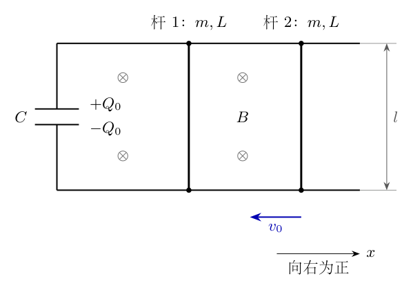
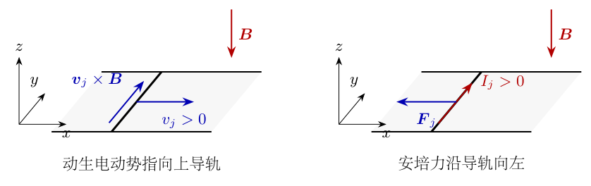
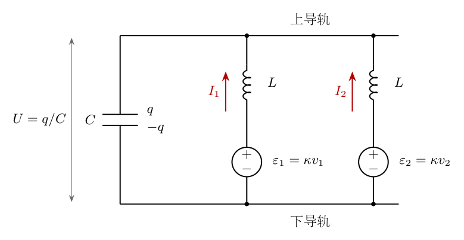
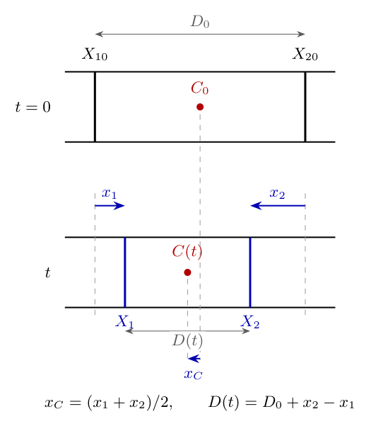
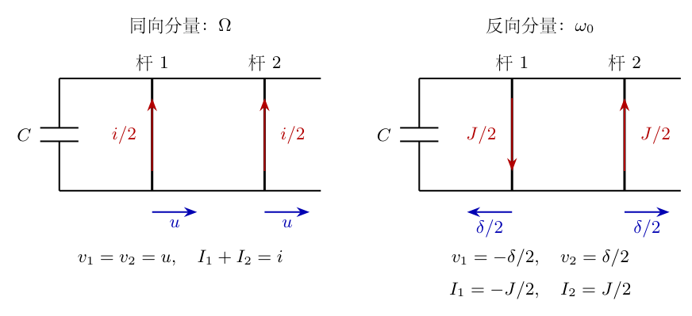
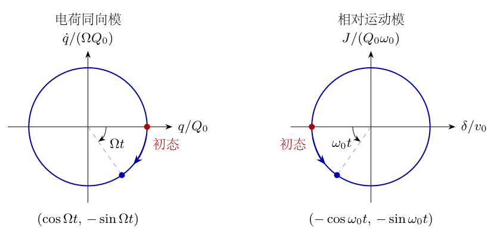

# 第5题

<!-- question-start -->

如图5-1所示，两条足够长、水平且光滑的平行金属导轨间距为 $l$，导轨所在区域存在垂直于导轨平面、方向向下的匀强磁场，磁感应强度大小为 $B$。导轨左端接有电容为 $C$ 的电容器。两根金属杆均垂直于导轨，能沿导轨运动并始终保持良好电接触；每根杆的质量均为 $m$，自感均为 $L$。忽略摩擦、电阻及金属杆以外的电感，不另计互感。

初始时电容器上极板带电荷 $+Q_0$，下极板带电荷 $-Q_0$，其中 $Q_0>0$。右杆初始向左运动，速度大小为 $v_0$，且

$$
v_0=\frac{Q_0Bl}{m}.
$$

初始时左杆静止，两个金属杆支路的电流分别为零。不考虑两杆发生碰撞的情况。

（1）求时刻 $t_1$ 两杆质心相对于初始位置的位移 $x_C$，以向右为正。

（2）求时刻 $t_2$ 左杆相对于初始位置的位移 $x_1$，以向右为正。

修订说明：补充左杆初始静止，并将初始电流明确为两个支路各自为零，即 $v_1(0)=0$、$I_1(0)=I_2(0)=0$。不同初速度的完整结果另作有明确条件的变式讨论。

{width=82%}

## 一、题型定位

本题是两个机械自由度与一个电容器耦合的电磁振动问题。金属杆具有自感，电流不能被当作一个由电容电压瞬时确定的代数量；需要同时列出两杆的运动方程、两个支路的电压方程和电容器的电荷连续性方程。

第（1）问只要求质心，因此先把两杆方程相加，寻找总速度与电容电荷之间的关系。第（2）问要求单根杆，不能把质心解直接当成左杆解，还必须求出两杆的相对运动。最终左杆位移由两个不同角频率的正弦项组成，不是单一简谐振动。

特殊初值 $mv_0=BlQ_0$ 的作用，是使一个“机械动量加电荷项”的常量恰为零。它并不意味着两杆机械总动量守恒，也不意味着右杆的全部初始动能都立即转化为电容能。原题的初始电流为零，但电容有电压、右杆有动生电动势，两个支路的电流变化率均不为零。

## 二、知识点

动生电动势与洛伦兹力；自感电动势的符号；并联支路共用电容电压；电荷连续性；有符号的牛顿第二定律；初值积分常量；二阶线性常系数微分方程；非共振正弦强迫方程的通解与特解；质心运动和相对运动的分解；机械能、电容能与自感磁能之间的交换。

统一记号：左杆相对于初始位置的位移为 $x_1(t)$，右杆为 $x_2(t)$，两者均向右取正，故

$$
v_1=\dot x_1,\qquad v_2=\dot x_2,\qquad
v_1(0)=0,\qquad v_2(0)=-v_0.
$$

上极板的有符号电荷记为 $q(t)$，电压为 $U=q/C$。两杆电流 $I_1,I_2$ 都以由下导轨流向上导轨为正。这个方向与初始电容放电时的实际电流方向相反，但只要所有方程使用同一约定，负电流就能正确表达实际方向。

为简化书写，定义

$$
\kappa=Bl,\qquad
\omega_0=\frac{\kappa}{\sqrt{mL}},\qquad
\Omega=\sqrt{\frac{\kappa^2}{mL}+\frac{2}{LC}}.
$$

$\kappa$ 不是新条件，只是 $Bl$ 的缩写。$\omega_0$ 与 $\Omega$ 均为角频率，而且对有限正值的 $C,L$，

$$
\Omega^2-\omega_0^2=\frac{2}{LC}>0.
$$

这个严格不等式决定了单杆方程的特解应有的负号，也排除了把本题误判为共振的可能。

## 三、物理图像

图5-1是沿垂直方向观察导轨平面的俯视图，图中的叉号表示磁场指向纸内。金属杆沿导轨左右运动；它们不是固定电感，而是既承受安培力又产生动生电动势的运动导体。忽略电阻不等于忽略自感，更不等于电流可以无限快建立。

向右运动的杆内，正电荷受到的磁力沿杆指向上导轨，因而杆上端的动生电势较高。若把电流正方向也取向上，安培力却沿导轨向左。这两个方向来自不同的叉乘，不能把“电动势向上”与“杆受力向上”混为一谈。

相加的运动分量对应两杆同向运动，决定质心；相减的运动分量对应两杆反向运动，决定杆间距离。前者参与电容器充放电，角频率为 $\Omega$；后者的两个支路电流相反，电容器总电流为零，角频率为 $\omega_0$。真实单杆运动是这两种分量的叠加。

## 四、解题入口

先用图5-2确定安培力和动生电动势的正负号，再按图5-3写两个支路电压方程。把两杆的牛顿方程相加并从 $0$ 到 $t$ 积分，必须保留初始机械动量和初始电荷；然后才使用 $mv_0=\kappa Q_0$ 消掉积分常量。

得到 $q(t)$ 后，质心速度由总速度直接给出，积分即可完成第（1）问。第（2）问沿单杆支路先作定积分，用自感电流与左杆加速度消元，得到有正弦驱动项的单杆方程；把特解、齐次解和两个初值完整合并。最后再用相对运动方程独立复核两个频率和左杆答案。

## 五、解析

<!-- KEEP_TOGETHER_START -->

**第1步：固定电荷与支路电流的关系。**

$I_1,I_2>0$ 都表示电流从下导轨经过金属杆流入上导轨，再流向上极板。因此上极板电荷增加率是两个支路电流之和：

$$
\boxed{\dot q=I_1+I_2}.
$$

<!-- KEEP_TOGETHER_END -->

初始两支路电流分别为零，故 $q(0)=Q_0$、$\dot q(0)=0$。若改把杆中向下电流记为正，应同时改写连续性和安培力方程，不能只改其中一式。这里 $q$ 可以变负，表示电容极性翻转；不能把它全过程替换成非负的“电荷量大小”。

**第2步：从空间方向确定安培力。**

图5-2中，$\hat{\boldsymbol x}$ 沿导轨向右，$\hat{\boldsymbol y}$ 沿杆由下导轨指向上导轨，$\hat{\boldsymbol z}$ 竖直向上。外磁场为 $-B\hat{\boldsymbol z}$。按电流正方向，杆的长度矢量为 $l\hat{\boldsymbol y}$，所以

$$
\begin{aligned}
\boldsymbol F_j
&=I_jl\hat{\boldsymbol y}\times
  (-B\hat{\boldsymbol z})\\
&=-BlI_j\hat{\boldsymbol x}.
\end{aligned}
$$

{width=75%}

导轨的支持与约束保证杆在平面内、垂直导轨运动，约束力不沿运动方向做功。两杆水平方向的牛顿第二定律分别为

$$
\boxed{m\ddot x_1=-\kappa I_1},\qquad
\boxed{m\ddot x_2=-\kappa I_2}.
$$

负号来自图中的叉乘，不来自“磁力总阻碍运动”这样的笼统判断。当 $I_j<0$ 时，实际安培力向右；它究竟使杆加速还是减速，要再看该杆当时的速度方向。

**第3步：写出每根杆的动生电动势。**

杆的速度为 $v_j\hat{\boldsymbol x}$，正电荷的单位电荷磁力为

$$
\boldsymbol v_j\times\boldsymbol B
=v_j\hat{\boldsymbol x}\times(-B\hat{\boldsymbol z})
=Bv_j\hat{\boldsymbol y}.
$$

从下端到上端的有符号动生电动势因此为

$$
\varepsilon_j=Blv_j=\kappa\dot x_j.
$$

这里 $v_j$ 是有符号速度。右杆初始向左，故其初始动生电动势为 $-\kappa v_0$，不是 $+\kappa v_0$。不能因为 $v_0$ 在题干中表示大小，就在电路方程中忘记方向。

**第4步：把自感与公共电容电压列入两个支路。**

图5-3把杆的运动电动势与自感分开画成等效元件，但它们属于同一根运动杆，不是另外接入的电源。沿 $I_j$ 的正方向由下导轨到上导轨，动生电动势为 $\kappa v_j$，自感电动势为 $-L\dot I_j$；上端对下端的电压是 $q/C$。因此

$$
\frac qC=\kappa\dot x_j-L\dot I_j.
$$

{width=78%}

将两个支路完整写出：

$$
\begin{aligned}
\frac qC-\kappa\dot x_1+L\dot I_1&=0,\\
\frac qC-\kappa\dot x_2+L\dot I_2&=0.
\end{aligned}
$$

电容并联在两条支路之间，两个方程都使用同一个 $q/C$。把其中一项写成 $q/(2C)$，或把两个自感先不加区分地合成一根 $L$，都改变了实际电路。

**第5步：相加动力学方程，得到可积的一阶关系。**

两杆牛顿方程相加，再代入 $\dot q=I_1+I_2$：

$$
\begin{aligned}
m(\ddot x_1+\ddot x_2)
&=-\kappa(I_1+I_2)\\
&=-\kappa\dot q.
\end{aligned}
$$

从 $0$ 到 $t$ 作定积分；此处用的是微积分基本定理，不能直接省略下限项：

$$
m\bigl[\dot x_1(t)+\dot x_2(t)
-\dot x_1(0)-\dot x_2(0)\bigr]
=-\kappa[q(t)-Q_0].
$$

代入 $\dot x_1(0)=0$、$\dot x_2(0)=-v_0$：

$$
\begin{aligned}
m[\dot x_1+\dot x_2+v_0]
&=-\kappa q+\kappa Q_0,\\
m(\dot x_1+\dot x_2)+\kappa q
&=\kappa Q_0-mv_0.
\end{aligned}
$$

最后才用题设 $mv_0=\kappa Q_0$，得到

$$
\boxed{\dot x_1+\dot x_2=-\frac{\kappa}{m}q}.
$$

机械总动量是 $m(\dot x_1+\dot x_2)$，它随 $q$ 改变而改变；守恒的是含电荷项的组合 $m(\dot x_1+\dot x_2)+\kappa q$。

**第6步：相加支路电压方程，消去各支路电流。**

图5-3中两支路电压相同，两式相加：

$$
\begin{aligned}
\frac{2q}{C}
-\kappa(\dot x_1+\dot x_2)
+L(\dot I_1+\dot I_2)&=0.
\end{aligned}
$$

由第1步，$\dot I_1+\dot I_2=\ddot q$；由第5步，总速度为 $-\kappa q/m$。依次代入：

$$
\begin{aligned}
\frac{2q}{C}
-\kappa\left(-\frac{\kappa q}{m}\right)
+L\ddot q&=0,\\
L\ddot q+\left(\frac2C+\frac{\kappa^2}{m}\right)q&=0,\\
\ddot q+\left(\frac{2}{LC}+\frac{\kappa^2}{mL}\right)q&=0.
\end{aligned}
$$

于是

$$
\boxed{\ddot q+\Omega^2q=0},\qquad
\Omega^2=\frac{2}{LC}+\frac{\kappa^2}{mL}.
$$

因运动杆参与能量交换，电容的振动频率不只是把两个电感并联后得到的 $\sqrt{2/(LC)}$。机械自由度额外贡献了 $\kappa^2/(mL)$。

**第7步：利用电荷初值确定完整的电容振动。**

二阶齐次方程的实通解可写成

$$
q=A\cos\Omega t+D\sin\Omega t.
$$

在 $t=0$ 代入 $q(0)=Q_0$，得 $A=Q_0$。再求导：

$$
\dot q=-A\Omega\sin\Omega t+D\Omega\cos\Omega t.
$$

由 $\dot q(0)=0$、$\Omega>0$，得 $D=0$，所以

$$
\boxed{q(t)=Q_0\cos\Omega t},\qquad
\dot q=-Q_0\Omega\sin\Omega t.
$$

电容器极性在 $\cos\Omega t$ 变号时翻转，式子仍适用。这个电荷振动解只对应已采用的初值组合；若左杆初速度改变，第5步常量不再为零，电荷方程会多出常值驱动项。

**第8步：从两杆质心定义得到质心速度。**

两杆质量相等，图5-4中质心的实际位置是两杆位置的算术平均。$x_1,x_2$ 都是相对于各自初态的位移，因此质心相对初态的位移也是

$$
x_C=\frac{x_1+x_2}{2}.
$$

{width=55%}

将第5步的总速度代入质心速度：

$$
\begin{aligned}
\dot x_C
&=\frac{\dot x_1+\dot x_2}{2}\\
&=-\frac{\kappa}{2m}q(t)\\
&=-\frac{\kappa Q_0}{2m}\cos\Omega t\\
&=-\frac{v_0}{2}\cos\Omega t.
\end{aligned}
$$

初始质心速度为 $-v_0/2$，与“一根静止、一根向左以 $v_0$ 运动”的初态一致。质心不是静止，也不是始终向左匀速。

**第9步：从初态作定积分，完成第（1）问。**

$x_C(0)=0$，于是

$$
\begin{aligned}
x_C(t)
&=\int_0^t-\frac{\kappa Q_0}{2m}\cos\Omega s\,\mathrm ds\\
&=-\frac{\kappa Q_0}{2m\Omega}
  [\sin\Omega s]_0^t\\
&=-\frac{\kappa Q_0}{2m\Omega}\sin\Omega t.
\end{aligned}
$$

把 $t$ 取为题问的 $t_1$，最终答案为

$$
\boxed{x_C(t_1)
=-\frac{BlQ_0}{2m\Omega}\sin\Omega t_1
=-\frac{v_0}{2\Omega}\sin\Omega t_1}.
$$

负号表示刚开始质心向左位移，不表示所有时刻位移都为负。$t_1$ 是给定的时刻，不是由题设决定的某个特定周期或极值时刻。

**第10步：为单杆问题积分左支路，保留自感初值。**

左支路方程是

$$
\frac qC-\kappa\dot x_1+L\dot I_1=0.
$$

将已求出的 $q=Q_0\cos\Omega t$ 代入，并从 $0$ 到 $t$ 积分：

$$
\begin{aligned}
\frac{Q_0}{C}\int_0^t\cos\Omega s\,\mathrm ds
-\kappa[x_1(t)-x_1(0)]
+L[I_1(t)-I_1(0)]&=0.
\end{aligned}
$$

使用 $x_1(0)=0$、$I_1(0)=0$：

$$
\frac{Q_0}{C\Omega}\sin\Omega t-\kappa x_1+LI_1=0.
$$

移项得到

$$
\boxed{\kappa x_1-LI_1
=\frac{Q_0}{C\Omega}\sin\Omega t}.
$$

这一步不能把 $LI_1$ 随意丢掉。它是对自感电动势的时间积分，单位与其余两项都是磁通量，而不是电压。

**第11步：用单杆牛顿方程消去自感电流。**

由 $m\ddot x_1=-\kappa I_1$，

$$
I_1=-\frac m\kappa\ddot x_1.
$$

代入上一步：

$$
\begin{aligned}
\kappa x_1
-L\left(-\frac m\kappa\ddot x_1\right)
&=\frac{Q_0}{C\Omega}\sin\Omega t,\\
\kappa x_1+\frac{mL}{\kappa}\ddot x_1
&=\frac{Q_0}{C\Omega}\sin\Omega t.
\end{aligned}
$$

两边乘以 $\kappa/(mL)$，整理为

$$
\begin{aligned}
\ddot x_1+\frac{\kappa^2}{mL}x_1
&=\frac{\kappa Q_0}{mLC\Omega}\sin\Omega t\\
&=\frac{v_0}{LC\Omega}\sin\Omega t.
\end{aligned}
$$

因此单杆方程是

$$
\boxed{\ddot x_1+\omega_0^2x_1
=\frac{v_0}{LC\Omega}\sin\Omega t}.
$$

这是整个系统自由运动经过变量消元后的形式；右侧是内部耦合产生的驱动项，不是外界后来施加的一台振动源。

**第12步：写齐次解并逐次求导确定特解符号。**

齐次方程 $\ddot x_1+\omega_0^2x_1=0$ 的通解为

$$
x_{1h}=a\sin\omega_0t+b\cos\omega_0t.
$$

因为 $\Omega\ne\omega_0$，可试取正弦特解

$$
x_{1p}=A_*\sin\Omega t.
$$

两次求导时第二次必须产生负号：

$$
\dot x_{1p}=A_*\Omega\cos\Omega t,\qquad
\ddot x_{1p}=-A_*\Omega^2\sin\Omega t.
$$

代回非齐次方程：

$$
\begin{aligned}
(-\Omega^2+\omega_0^2)A_*\sin\Omega t
&=\frac{v_0}{LC\Omega}\sin\Omega t,\\
A_*
&=\frac{v_0}{LC\Omega(\omega_0^2-\Omega^2)}.
\end{aligned}
$$

系数分母是频率平方之差，不是频率平方之和；不需要在 $\sin\Omega t=0$ 的孤立时刻作除法，而是比较两个函数表达式的正弦系数。

<!-- KEEP_TOGETHER_START -->

**第13步：把频率之差代入特解系数。**

由 $\Omega^2-\omega_0^2=2/(LC)$，

$$
\begin{aligned}
A_*
&=\frac{v_0}{LC\Omega[-2/(LC)]}\\
&=-\frac{v_0}{2\Omega}.
\end{aligned}
$$

<!-- KEEP_TOGETHER_END -->

负号有确定的代数来源。完整解因此为

$$
x_1(t)=a\sin\omega_0t+b\cos\omega_0t
-\frac{v_0}{2\Omega}\sin\Omega t.
$$

即使两个频率数值很接近，仍不能删去其中一项；它们在初值处互相抵消的导数，正是左杆初始静止的关键。

**第14步：两个运动初值分别确定两个齐次常量。**

先用 $x_1(0)=0$。两项正弦均为零，余下 $b=0$。再求导：

$$
\dot x_1=a\omega_0\cos\omega_0t
-\frac{v_0}{2}\cos\Omega t.
$$

使用 $\dot x_1(0)=0$：

$$
a\omega_0-\frac{v_0}{2}=0,\qquad
a=\frac{v_0}{2\omega_0}.
$$

于是第（2）问的答案为

$$
\boxed{x_1(t_2)
=\frac{v_0}{2}
\left(\frac{\sin\omega_0t_2}{\omega_0}
-\frac{\sin\Omega t_2}{\Omega}\right)}.
$$

两项前面的角频率分母必须与各自正弦的角频率相同。若把两个分母交叉替换，写成

$$
\frac{\sin\Omega t}{\omega_0},\qquad
\frac{\sin\omega_0t}{\Omega},
$$

两项导数在初态不再相抵，一般不能满足初始速度为零。

**第15步：保留未化简形式，与完整消元过程对应。**

在尚未代入频率之差时，特解常量为第12步的 $A_*$；初始速度给出 $a=-A_*\Omega/\omega_0$。因此同一左杆解可写成

$$
\begin{aligned}
x_1(t)
&=-\frac{v_0}{LC\omega_0(\omega_0^2-\Omega^2)}
  \sin\omega_0t\\
&\quad+\frac{v_0}{LC\Omega(\omega_0^2-\Omega^2)}
  \sin\Omega t.
\end{aligned}
$$

利用 $LC(\omega_0^2-\Omega^2)=-2$，两个正弦项的系数分别成为

$$
\begin{aligned}
-\frac{v_0}{LC\omega_0(\omega_0^2-\Omega^2)}
&=-\frac{v_0}{-2\omega_0}
=\frac{v_0}{2\omega_0},\\
\frac{v_0}{LC\Omega(\omega_0^2-\Omega^2)}
&=\frac{v_0}{-2\Omega}
=-\frac{v_0}{2\Omega}.
\end{aligned}
$$

第一项系数为正，第二项为负。这说明较长的频率差表达式和第14步的简洁表达式完全等价，简化的是记号而不是省略计算。

**第16步：用相对运动独立复核两个角频率。**

定义相对速度与支路电流之差

$$
\delta=v_2-v_1,\qquad J=I_2-I_1.
$$

两杆牛顿方程相减：

$$
m\dot\delta=-\kappa J.
$$

右支路电压方程减左支路；公共电压 $q/C$ 恰好消失：

$$
-\kappa(v_2-v_1)+L(\dot I_2-\dot I_1)=0,
\qquad L\dot J=\kappa\delta.
$$

对 $m\dot\delta=-\kappa J$ 求导，代入后一式：

$$
\begin{aligned}
m\ddot\delta&=-\kappa\dot J\\
&=-\frac{\kappa^2}{L}\delta,\\
\ddot\delta+\omega_0^2\delta&=0.
\end{aligned}
$$

初值为 $\delta(0)=-v_0$；因 $I_1(0)=I_2(0)=0$，$\dot\delta(0)=0$。故

$$
\boxed{\delta=-v_0\cos\omega_0t}.
$$

图5-5的箭头按 $u,i,\delta,J$ 取正时的分量方向示意，箭头旁写各分量的大小；反向分量的负号在图下按统一的向右速度、向上电流正方向给出。这些箭头不是初态实际电流或速度。

{width=78%}

图5-5中，同向分量使两杆均以 $u=\dot x_C$ 运动，反向分量则给左杆 $-\delta/2$、右杆 $+\delta/2$。于是图中的分解进入实际速度方程：

$$
\begin{aligned}
v_1&=\dot x_C-\frac{\delta}{2}
=\frac{v_0}{2}(\cos\omega_0t-\cos\Omega t),\\
v_2&=\dot x_C+\frac{\delta}{2}
=-\frac{v_0}{2}(\cos\omega_0t+\cos\Omega t).
\end{aligned}
$$

从 $0$ 到 $t$ 积分，$x_1$ 正好恢复第14步结果；同时得到用于回代检查的右杆位移

$$
x_2=-\frac{v_0}{2}
\left(\frac{\sin\omega_0t}{\omega_0}
+\frac{\sin\Omega t}{\Omega}\right).
$$

两杆位移相加除以 $2$ 恢复 $x_C$；相减则得到 $x_2-x_1=-v_0\sin\omega_0t/\omega_0$。相对运动不参与电容器的净充放电，所以其角频率没有 $2/(LC)$ 项。

**第17步：把支路电流回代到原始方程，而不只检查最终位移。**

对上一步两个速度分别求导，再用 $I_j=-m\dot v_j/\kappa$：

$$
\begin{aligned}
I_1
&=\frac{Q_0}{2}
  (\omega_0\sin\omega_0t-\Omega\sin\Omega t),\\
I_2
&=-\frac{Q_0}{2}
  (\omega_0\sin\omega_0t+\Omega\sin\Omega t).
\end{aligned}
$$

其中用了 $mv_0/\kappa=Q_0$。两电流相加为 $-Q_0\Omega\sin\Omega t=\dot q$，验证电荷连续性。

再检查左支路电压：

$$
\begin{aligned}
\kappa v_1-L\dot I_1
&=\frac{\kappa v_0}{2}
  (\cos\omega_0t-\cos\Omega t)\\
&\quad-\frac{LQ_0}{2}
  (\omega_0^2\cos\omega_0t-\Omega^2\cos\Omega t)\\
&=\frac{LQ_0}{2}(\Omega^2-\omega_0^2)\cos\Omega t\\
&=\frac{Q_0}{C}\cos\Omega t=\frac qC.
\end{aligned}
$$

这里 $\kappa v_0=LQ_0\omega_0^2$，所以两项 $\cos\omega_0t$ 抵消。对右支路也把每一项写出：

$$
\begin{aligned}
\kappa v_2-L\dot I_2
&=-\frac{\kappa v_0}{2}
  (\cos\omega_0t+\cos\Omega t)\\
&\quad+\frac{LQ_0}{2}
  (\omega_0^2\cos\omega_0t+\Omega^2\cos\Omega t)\\
&=\frac{LQ_0}{2}(\Omega^2-\omega_0^2)\cos\Omega t\\
&=\frac{Q_0}{C}\cos\Omega t=\frac qC.
\end{aligned}
$$

右支路的 $\cos\omega_0t$ 项同样抵消，剩余相同的电容电压。运动方程、两支路电压与电荷关系全部闭合，而不是只满足其中一条消元后的方程。

**第18步：检查初态、小时间行为与量纲。**

质心解给出 $x_C(0)=0$、$\dot x_C(0)=-v_0/2$；左杆解给出 $x_1(0)=0$、$\dot x_1(0)=0$；电流公式给出 $I_1(0)=I_2(0)=0$。这四类初值必须同时检查，单独验证位置为零还不足够。

利用 $\sin z=z-z^3/6+O(z^5)$，两个单杆正弦项的一阶项抵消：

$$
\begin{aligned}
x_1
&=\frac{v_0}{2}
\left[t-\frac{\omega_0^2t^3}{6}
-t+\frac{\Omega^2t^3}{6}\right]+O(t^5)\\
&=\frac{v_0(\Omega^2-\omega_0^2)}{12}t^3+O(t^5)\\
&=\frac{v_0}{6LC}t^3+O(t^5).
\end{aligned}
$$

因此左杆刚开始向右运动，但其初始速度和初始加速度都为零；首先非零的是加速度的变化率。小时间时 $I_1=-Q_0t/(LC)+O(t^3)<0$，实际电流向下、安培力向右，与该位移符号一致。

$LC$ 具有时间平方量纲，$\kappa^2/(mL)$ 具有时间的负二次方量纲；$v_0/\omega_0$、$v_0/\Omega$ 都是长度，$\kappa Q_0$ 是动量。因此两个位移式和含电荷项的守恒组合量纲均正确。

<!-- KEEP_TOGETHER_START -->

**第19步：明确答案及适用范围。**

按左杆初始静止、两支路初始电流均为零的初值，两问答案统一为

$$
\begin{aligned}
x_C(t_1)
&=-\frac{v_0}{2\Omega}\sin\Omega t_1,\\
x_1(t_2)
&=\frac{v_0}{2}
  \left(\frac{\sin\omega_0t_2}{\omega_0}
       -\frac{\sin\Omega t_2}{\Omega}\right),\\
\omega_0&=\frac{Bl}{\sqrt{mL}},\qquad
\Omega=\sqrt{\frac{B^2l^2}{mL}+\frac{2}{LC}}.
\end{aligned}
$$

$t_1,t_2$ 只是分别代入两个时间函数的时刻。左杆解通常含两个频率，不能把质心周期 $2\pi/\Omega$ 当成单杆完整运动的周期。实际位置关系为图5-4中的 $D(t)=D_0+x_2-x_1$；本解不描述相撞后的运动，也不擅自给出碰撞后速度。在题设忽略碰撞并保持两杆与导轨良好接触的范围内，以上初值解闭合成立。

<!-- KEEP_TOGETHER_END -->

## 六、关键洞察

**最有力的入口是一个积分常量，而不是直接求解七个变量。**

五个电磁与速度变量为 $q,I_1,I_2,v_1,v_2$，位移再由速度积分。如果一开始同时寻找所有变量，很容易把符号和初值混在一起。相加的牛顿方程先给

$$
\Pi=m(v_1+v_2)+\kappa q.
$$

$\Pi$ 在本理想模型中为常量。题设特殊速度条件仅仅使 $\Pi=0$，将电荷和总速度直接关联。外磁场对带电流的两杆有合力，机械总动量不是独立的守恒量；$\Pi$ 的守恒是运动方程和电荷连续性共同导出的结果，不应被解释成“没有外力”。

**能量守恒逐项验证电路符号。**

电容能、两杆自感磁能与两杆动能之和为

$$
E=\frac{q^2}{2C}
+\frac L2(I_1^2+I_2^2)
+\frac m2(v_1^2+v_2^2).
$$

分别求导，不跳过能量流的正负号：

$$
\begin{aligned}
\frac{\mathrm d}{\mathrm dt}\frac{q^2}{2C}
&=\frac qC(I_1+I_2),\\
\frac{\mathrm d}{\mathrm dt}\frac L2(I_1^2+I_2^2)
&=I_1(\kappa v_1-q/C)+I_2(\kappa v_2-q/C),\\
\frac{\mathrm d}{\mathrm dt}\frac m2(v_1^2+v_2^2)
&=-\kappa(I_1v_1+I_2v_2).
\end{aligned}
$$

三式相加，每个电容功率项与动生功率项都成对抵消，得到 $\dot E=0$。若其中任一安培力符号、自感符号或电荷连续性符号单独反写，通常不能完成这一步抵消。初态总能量为

$$
E_0=\frac{Q_0^2}{2C}+\frac{mv_0^2}{2},
$$

不是只有电容的初始能量。

**同向与反向分量各有自己的不变能量。**

用 $u=(v_1+v_2)/2$、$\delta=v_2-v_1$、$i=I_1+I_2=\dot q$、$J=I_2-I_1$ 展开平方：

$$
\begin{aligned}
v_1^2+v_2^2&=2u^2+\frac{\delta^2}{2},\\
I_1^2+I_2^2&=\frac{i^2+J^2}{2}.
\end{aligned}
$$

在 $\Pi=0$ 时，$u=-\kappa q/(2m)$，故总能量分成

$$
\begin{aligned}
E_{\rm c}
&=\frac{L}{4}\dot q^2+
 \left(\frac1{2C}+\frac{\kappa^2}{4m}\right)q^2
 =\frac L4(\dot q^2+\Omega^2q^2),\\
E_{\rm d}
&=\frac m4\delta^2+\frac L4J^2.
\end{aligned}
$$

分别求导，再使用 $\ddot q=-\Omega^2q$、$m\dot\delta=-\kappa J$、$L\dot J=\kappa\delta$：

$$
\begin{aligned}
\dot E_{\rm c}
&=\frac L2\dot q(\ddot q+\Omega^2q)=0,\\
\dot E_{\rm d}
&=\frac m2\delta\dot\delta+\frac L2J\dot J\\
&=-\frac{\kappa}{2}\delta J+\frac{\kappa}{2}J\delta=0.
\end{aligned}
$$

两种能量分别保持，不只是总和保持。

{width=77%}

图5-6左图的横、纵坐标为 $q/Q_0$ 和 $\dot q/(\Omega Q_0)$，实际解满足

$$
\left(\frac q{Q_0}\right)^2+
\left(\frac{\dot q}{\Omega Q_0}\right)^2=1.
$$

右图横、纵坐标为 $\delta/v_0$ 和 $J/(Q_0\omega_0)$，实际解为 $-\cos\omega_0t$ 和 $-\sin\omega_0t$，因此也有单位圆关系。左图初态在右端，右图初态在左端，两个方向箭头必须分别依据实际时间导数确定，不能直接复制。

初始分量能量为

$$
E_{{\rm c},0}
=\frac{Q_0^2}{2C}+\frac{mv_0^2}{4},\qquad
E_{{\rm d},0}=\frac{mv_0^2}{4}.
$$

两者相加恢复 $E_0$。同向模虽然涉及电容，也包括质心动能；反向模虽然电容总电流为零，也储有两杆的自感磁能。

**题面漏写左杆初速度会实质改变质心解。**

令一般初速度为 $v_1(0)=u_1$、$v_2(0)=u_2$，仍取两个支路初始电流为零。常量成为

$$
\Pi=m(u_1+u_2)+\kappa Q_0.
$$

总速度 $v_1+v_2=(\Pi-\kappa q)/m$，代入相加的电路方程：

$$
\ddot q+\Omega^2q=\frac{\kappa\Pi}{mL}.
$$

定义新的电荷平衡中心

$$
q_{\rm e}=\frac{\kappa\Pi}{mL\Omega^2}
=\frac{\kappa C\Pi}{2m+\kappa^2C}.
$$

因 $q(0)=Q_0$、$\dot q(0)=0$，可得

$$
q=q_{\rm e}+(Q_0-q_{\rm e})\cos\Omega t.
$$

质心速度分成常值漂移与振动：

$$
\begin{aligned}
u
&=\frac{\Pi-\kappa q_{\rm e}}{2m}
-\frac{\kappa(Q_0-q_{\rm e})}{2m}\cos\Omega t,\\
V_{\rm d}
&=\frac{\Pi-\kappa q_{\rm e}}{2m}
=\frac{\Pi}{2m+\kappa^2C}.
\end{aligned}
$$

因此

$$
x_C=V_{\rm d}t
-\frac{\kappa(Q_0-q_{\rm e})}{2m\Omega}\sin\Omega t.
$$

相对速度仍为 $\delta=(u_2-u_1)\cos\omega_0t$。从图5-5的运动分解，完整单杆位移为

$$
\begin{aligned}
x_1&=x_C-\frac{u_2-u_1}{2\omega_0}\sin\omega_0t,\\
x_2&=x_C+\frac{u_2-u_1}{2\omega_0}\sin\omega_0t.
\end{aligned}
$$

若 $u_1=0,u_2=-v_0$，特殊条件使 $\Pi=q_{\rm e}=V_{\rm d}=0$，才恢复学生版的纯振动质心。因此左杆初值不是可以任意忽略的细节。

**碰撞条件完全由相对模决定。**

令初始两杆实际间距为 $D_0>0$，则

$$
D(t)=D_0-\frac{v_0}{\omega_0}\sin\omega_0t.
$$

不发生接触所需的严格条件为 $D_0>v_0/\omega_0$。若等号成立，两杆在最小间距时恰好接触；若 $0<D_0<v_0/\omega_0$，第一接触时刻为

$$
t_{\rm hit}
=\frac1{\omega_0}
 \arcsin\left(\frac{D_0\omega_0}{v_0}\right).
$$

这里取反正弦的第一象限分支，因为初始右杆向左、间距正在减小。题设特殊初值给出

$$
\frac{v_0}{\omega_0}
=Q_0\sqrt{\frac Lm}.
$$

相对模不含 $C$，接触时刻也不依赖 $C$；但接触时两杆的共同平移状态一般依赖 $C$。不能因此说接触后运动与电容无关，接触后需要另给碰撞和电接触模型。

<!-- KEEP_TOGETHER_START -->

**极限检查必须连同初值关系一起取。**

保持 $Q_0,m,L,C,l$ 不变，让 $B\to0$ 时，$\kappa,v_0,\omega_0$ 同时趋零。利用 $\sin(\omega_0t)/\omega_0\to t$，两杆位移仍趋零；电路则趋于两个相等电感并联电容的振动，$\Omega\to\sqrt{2/(LC)}$。不能只把 $\omega_0$ 设零，却把受题设约束的 $v_0$ 固定不变。

<!-- KEEP_TOGETHER_END -->

保持其他参数有限，让 $C\to\infty$，$\Omega\to\omega_0$，但左杆驱动项 $v_0/(LC\Omega)$ 同时趋零。两正弦项相消，$x_1\to0$，而右杆趋于 $x_2=-v_0\sin\omega_0t/\omega_0$。这不是保留有限驱动力的共振极限。

$L\to0$ 则是奇异极限：两个支路方程将要求 $q/C=\kappa v_1=\kappa v_2$，与 $q(0)=Q_0>0,v_1(0)=0,v_2(0)=-v_0$ 不相容。不能把已有的无电阻、有自感初值解直接取成无电感的有限运动解；此时必须另处理初始瞬态或改变模型。

## 七、易错点

把上极板电荷 $q$ 当成总是非负的大小，会在电容翻转后破坏电荷方程。把两杆电流都规定向上，却写成 $\dot q=-(I_1+I_2)$，也会造成频率项的错误符号。先画上极板电流流入方向，再确定连续性，比死记“放电电流是负号”可靠。

安培力 $-\kappa I_j$ 与动生电动势 $+\kappa v_j$ 的符号不同，分别由 $l\hat{\boldsymbol y}\times\boldsymbol B$ 与 $\boldsymbol v_j\times\boldsymbol B$ 决定。初态实际支路电流还为零，但变化率为负；不能直接把图中的正电流箭头当成初态实际电流。

定积分漏掉 $-mv_0$ 或 $Q_0$ 会使总速度出现错误常量。$mv_0=\kappa Q_0$ 要在保留两个初值项之后使用；凭空把总机械动量设为零，不是等价方法。

两条支路共享同一电容电压，相加后出现 $2q/C$。这不是电容本身变成 $2C$；在没有机械运动的特例中，等效自感为 $L/2$，对应角频率 $\sqrt{2/(LC)}$，与相加方程一致。

正弦特解的二阶导数是 $-A_*\Omega^2\sin\Omega t$。写成正号后，频率差会错误变成频率和；即使最后抄对结果，中间过程仍不是成立的证明。应将特解回代到原来的强迫方程直接核验。

左杆初始静止要同时保证位置为零、速度为零；两个不同频率的正弦项在初态的导数恰好相抵。单独保留特解，或给齐次项任意初相，都不满足同一物理初态。

$x_1,x_2$ 是位移，不是两杆实际坐标或间距。真实间距要写成 $D_0+x_2-x_1$；右杆位移为负不意味着右杆越过左杆，是否接触要用实际间距判定。超出接触前范围的延拓解只能代表忽略碰撞的数学模型。

$\Omega>\omega_0$ 不表示单根杆只有一个“平均频率”。通常两个频率不可公度，单杆轨迹有界但没有有限严格周期。完整初始状态复现需要两个相位同时恢复，不能只看电容电荷重新等于 $Q_0$。

## 八、课堂讲解建议

课堂先让学生在图5-1指出两个共同电势节点，再在图5-2分别做两次叉乘：一次用于动生电动势，一次用于安培力。教师保留“电流向上为正”的统一约定，使学生看到正方向与初态实际方向不同并不构成矛盾。板书只用一组符号，不在推导中途更换电流方向。

随后并列两杆牛顿方程和两支路电压方程。让学生分别尝试相加与相减，比较：相加电路保留电容电压，相减电路消去它。教师在积分处完整写上下限，明确特殊初值消除的是积分常量，而不是依据机械动量守恒直接置零。

求左杆时保留“左支路积分—用安培力换电流—正弦特解—两个初值”四段板书。要求学生亲自求两次导数，把特解的负号圈出，再用频率差将系数约成 $-v_0/(2\Omega)$。将未化简形式与最终两正弦形式并排，说明短公式可由完整运算得到，而不是借简化省略步骤。

最后用图5-5复核两个分量，并在图5-6检查初态、方向与能量。课堂可由“左杆初始速度和加速度都为零，为什么后来向右运动”引出三次小时间项。碰撞、一般初速度和完整状态周期仅在明确新增条件的带解变式中讨论，不让未解自测代替主解析。

## 九、变式训练

**变式1：有量纲参数的位移、频率与能量核验。**

取 $m=0.200\,\mathrm{kg}$、$L=0.0800\,\mathrm H$、$C=0.0200\,\mathrm F$、$B=0.800\,\mathrm T$、$l=0.500\,\mathrm m$、$Q_0=0.500\,\mathrm{C}$，左杆初始静止、两支路初始电流为零，右杆速度满足题设。求 $t_1=0.0500\,\mathrm s$ 的质心位移及 $t_2=0.0800\,\mathrm s$ 的左杆位移，并计算初态总能量。

先算磁耦合常数和初速度：

$$
\kappa=(0.800)(0.500)=0.400\,\mathrm{T\,m},\qquad
v_0=\frac{(0.500)(0.400)}{0.200}=1.000\,\mathrm{m\,s^{-1}}.
$$

两个频率分别为

$$
\begin{aligned}
\omega_0^2
&=\frac{0.400^2}{(0.200)(0.0800)}
=10.000\,\mathrm{s^{-2}},\\
\omega_0&=\sqrt{10}=3.162278\,\mathrm{s^{-1}},\\
\frac{2}{LC}
&=\frac{2}{(0.0800)(0.0200)}
=1250.000\,\mathrm{s^{-2}},\\
\Omega&=\sqrt{1260}=35.496479\,\mathrm{s^{-1}}.
\end{aligned}
$$

代入各自对应时刻，保留三角函数的弧度制：

$$
\begin{aligned}
x_C(0.0500)
&=-\frac{1.000}{2(35.496479)}
 \sin[(35.496479)(0.0500)],\\
x_1(0.0800)
&=\frac{1.000}{2}
 \left\{\frac{\sin[(3.162278)(0.0800)]}{3.162278}
-\frac{\sin[(35.496479)(0.0800)]}{35.496479}\right\}.
\end{aligned}
$$

质心的相位为 $1.774823935$，其正弦为 $0.979258469$；左杆的两个相位分别为 $0.252982213$ 和 $2.839718296$，对应正弦为 $0.250292358$ 和 $0.297310329$。因此

$$
\begin{aligned}
x_C(0.0500)
&=-\frac{0.979258469}{70.9929574}
=-0.013793741\,\mathrm m,\\
x_1(0.0800)
&=\frac12\left(
\frac{0.250292358}{3.162277660}
-\frac{0.297310329}{35.496478699}\right)\\
&=0.035386812\,\mathrm m.
\end{aligned}
$$

两个时刻分别代入，不能把同一相位用于两问。质心向左位移，左杆向右位移，两者并不矛盾。独立积分完整运动、电流与电荷方程也得到相同的两个数值。初态只有右杆有动能，两杆自感磁能均为零，故

$$
\begin{aligned}
E_0
&=\frac{0.500^2}{2(0.0200)}
+\frac12(0.200)(1.000)^2\\
&=6.250+0.100=6.350\,\mathrm J.
\end{aligned}
$$

其中同向模初态能量为 $6.300\,\mathrm J$，反向模为 $0.0500\,\mathrm J$。任意后续时刻用实际 $q,I_1,I_2,v_1,v_2$ 计算的总能量都应恢复 $6.350\,\mathrm J$。

**变式2：解除忽略碰撞约定，只求首次接触。**

沿用变式1的 $m,L,B,l,Q_0$，初始两杆距离为 $D_0=0.200\,\mathrm m$。仅在首次接触前采用本题模型；分别取 $C=0.0100,0.0200,0.100\,\mathrm F$，求首次接触时刻，并比较电容改变的影响。

相对位移振幅为

$$
\frac{v_0}{\omega_0}
=\frac{1.000}{3.162278}
=0.316228\,\mathrm m.
$$

初始间距小于这一振幅，必然在第一个相对振动的四分之一周期内接触。$D(t)=0$ 给

$$
\sin\omega_0t
=\frac{D_0\omega_0}{v_0}
=\frac{(0.200)(3.162278)}{1.000}
=0.632456.
$$

第一次接触取 $0<\omega_0t<\pi/2$，故

$$
t_{\rm hit}
=\frac{\arcsin(0.632456)}{3.162278}.
$$

用未舍入的频率计算，$\arcsin(0.632455532)=0.684719203\,\mathrm{rad}$，所以

$$
t_{\rm hit}
=\frac{0.684719203}{3.162277660}
=\boxed{0.216527224\,\mathrm s}.
$$

三种电容对应的完整七变量运动方程分别积分，并在实际间距第一次由正变零时停止，均得到这一时刻。三种电容给相同首次接触时刻，因为接触方程只含相对模；质心位置和电容电荷则依赖 $\Omega$，一般不同。若要求全过程不接触，应把初始间距改为严格大于 $0.316228\,\mathrm m$。本变式没有给恢复系数或接触后的电路拓扑，不求碰撞后的运动。

<!-- KEEP_TOGETHER_START -->

**变式3：左杆有非零初速度时的质心漂移。**

沿用变式1全部参数，但改为左杆初速度 $u_1=+0.400\,\mathrm{m\,s^{-1}}$，右杆 $u_2=-1.000\,\mathrm{m\,s^{-1}}$，两个支路初始电流仍为零。求电荷振动中心、质心平均漂移速度及经过一个电荷周期后的质心位移。

<!-- KEEP_TOGETHER_END -->

常量不再为零：

$$
\begin{aligned}
\Pi
&=(0.200)(0.400-1.000)+(0.400)(0.500)\\
&=-0.120+0.200
=0.0800\,\mathrm{kg\,m\,s^{-1}}.
\end{aligned}
$$

共同分母为

$$
2m+\kappa^2C
=2(0.200)+(0.400)^2(0.0200)
=0.4032\,\mathrm{kg}.
$$

所以

$$
\begin{aligned}
q_{\rm e}
&=\frac{(0.400)(0.0200)(0.0800)}{0.4032}
=0.00158730\,\mathrm{C},\\
V_{\rm d}
&=\frac{0.0800}{0.4032}
=0.198413\,\mathrm{m\,s^{-1}},\\
q(t)&=0.00158730+0.49841270\cos(35.496479t).
\end{aligned}
$$

质心位移因此为

$$
x_C(t)
=0.198413t
-\frac{(0.400)(0.49841270)}
 {2(0.200)(35.496479)}
 \sin(35.496479t).
$$

电荷周期 $T_{\rm c}=2\pi/\Omega$ 内，正弦项在两端均为零，故

$$
x_C(T_{\rm c})
=V_{\rm d}\frac{2\pi}{\Omega}.
$$

保留未舍入频率及漂移速度，

$$
\begin{aligned}
T_{\rm c}
&=\frac{2\pi}{35.496478699}
=0.177008693\,\mathrm s,\\
x_C(T_{\rm c})
&=(0.198412698)(0.177008693)\\
&=\boxed{0.035120772\,\mathrm m}.
\end{aligned}
$$

这一结果还可用初始速度为 $+0.400$、$-1.000\,\mathrm{m\,s^{-1}}$ 的完整方程独立积分核验。此时电荷回到初始值不代表两杆完整状态同时回到初始，因为相对角频率 $\omega_0$ 一般尚未完成整数圈。初始总速度为 $-0.600\,\mathrm{m\,s^{-1}}$，瞬时质心速度为 $-0.300\,\mathrm{m\,s^{-1}}$；平均漂移却向右，两者并不矛盾，完整质心速度同时包含振动项。

<!-- KEEP_TOGETHER_START -->

**变式4：调谐两个模，使完整运动出现共同周期。**

保留变式1的 $m,L,B,l,Q_0$ 及原来的初始静止左杆，重新选择 $C$，使 $\Omega=2\omega_0$。初始间距取 $D_0=0.500\,\mathrm m$，确保两杆不接触。求所需电容、最小完整状态周期，并比较半周期时两杆速度。

<!-- KEEP_TOGETHER_END -->

由角频率平方关系：

$$
\begin{aligned}
\omega_0^2+\frac{2}{LC}
&=4\omega_0^2,\\
\frac{2}{LC}&=3\frac{\kappa^2}{mL},\\
C&=\frac{2m}{3\kappa^2}
=\frac{2(0.200)}{3(0.400)^2}
=\frac56\,\mathrm F.
\end{aligned}
$$

$\omega_0=\sqrt{10}\,\mathrm{s^{-1}}$，$\Omega=2\sqrt{10}\,\mathrm{s^{-1}}$。完整状态复现要求两种相位均为 $2\pi$ 的整数倍。最小正共同周期是

$$
T=\frac{2\pi}{\omega_0}
=\frac{2\pi}{\sqrt{10}}\,\mathrm s
=1.986917653\,\mathrm s.
$$

在 $T$，两正弦均为零、两余弦均为 $1$，所以两杆回到各自初始位置，左杆速度为零、右杆为 $-v_0$，电容电荷回到 $Q_0$，两支路电流恢复零。

在 $T/2=0.993458827\,\mathrm s$，$\omega_0t=\pi$、$\Omega t=2\pi$。电容同样回到 $Q_0$，两杆位移也均为零，但速度为

$$
\begin{aligned}
v_1(T/2)
&=\frac{v_0}{2}(-1-1)=-v_0,\\
v_2(T/2)
&=-\frac{v_0}{2}(-1+1)=0.
\end{aligned}
$$

初始速度分配恰好交换，因此半周期不是完整状态周期。间距振幅仍为 $0.316228\,\mathrm m$，最小间距为 $0.500-0.316228=0.183772\,\mathrm m>0$，满足接触前模型条件；改变电容没有改变这一几何边界。

<!-- question-complete -->

<!-- question-end -->
