# 第1题

<!-- question-start -->

（1）设重力加速度恒为 $g$。一个质点从地面上的出射点 $A$ 以速率 $v_0$ 斜向上抛出，最终落回地面。证明：抛物线轨迹的焦点到 $A$ 的距离与出射角无关；求出该距离，并求出准线到 $A$ 的距离。

（2）考虑引力随距离的变化。设地表重力加速度为 $g$，地球半径为 $R$，重复第（1）问中的发射情景。证明：质点轨道上除地心之外的另一个焦点到出射点 $A$ 的距离为定值，并求出该值；给出改变出射角时，质点轨迹能够覆盖的范围。

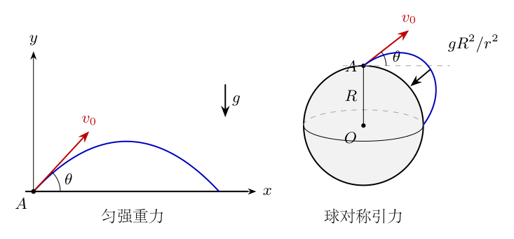{width=94%}

<!-- question-end -->

## 一、题型定位

本题把动力学中“相同出射速率”转化为圆锥曲线中的几何不变量。第一问的抛物线焦点随角度移动，但始终在一个以出射点为圆心的圆上；第二问的总机械能只由 $v_0$ 和 $R$ 决定，因此所有负能量轨道具有相同半长轴。另一焦点的轨迹与轨道族的包络由此联系起来。

需要区分三个层次：一条具体轨道上的点；固定速率、改变方向得到的轨道族；轨道族实际在地球外、首次撞地前走过的部分。仅画完整椭圆并把内部全部涂色，不足以证明最后一种覆盖范围。图1-1左侧的 $x,y$ 是平面坐标；右侧的 $O,A$ 用来建立地心距离 $r$，两套坐标不混用。

## 二、知识点

匀强重力下的水平匀速与竖直匀加速运动；二次函数配方；抛物线的焦点、准线及有符号焦参数；球对称引力中的能量与角动量；极坐标径向方程与圆锥曲线；椭圆两焦点距离和；三角不等式及相切法向；二次方程的判别式和物理解筛选。

为避免与“单位质量能量”混淆，记引力参数为 $\mathcal G=gR^2$，而不把它记作质量。记比机械能为 $\varepsilon$，比角动量为 $\ell$。这两个量分别具有 $\mathrm{m^2\,s^{-2}}$ 和 $\mathrm{m^2\,s^{-1}}$ 的量纲。半长轴 $a$、焦点圆半径 $D$、包络距离和 $S$ 均为长度。

## 三、物理图像

第一问中，固定 $v_0$、改变仰角 $\theta$，相当于改变水平和竖直动能的分配。轨迹顶点上升时，向下开口抛物线的焦参数同时改变，这两种变化恰使焦点到 $A$ 的距离不变。准线在所有角度下都是同一条水平直线。

第二问中，所有发射方向具有相同初始动能和引力势能。负能量下，轨道变得扁长或接近圆形，但能量决定的半长轴不变。地心 $O$ 是固定焦点，另一个焦点 $F$ 在以 $A$ 为中心、半径 $D$ 的球面上变化。轨道包络是另一张以 $O,A$ 为焦点的旋转椭球面；它不是某一条质点轨道，也不是以地心为中心的球面。

地球是不允许穿过的实物区域。需要在包络内再施加 $r\ge R$，并核对从 $A$ 到目标的轨道段没有先撞地。达到逃逸速率时，负能量轨道族的包络趋于无界，但不能直接说“所有地球外位置都可由临界逃逸轨道到达”：无限时间、速度极限和空间点的位置必须分别讨论。

## 四、解题入口

先把第一问写成 $y=a_qx^2+b_qx$，保留 $a_q<0$ 的符号，配方确定顶点，再与标准抛物线形式比较。不要凭图猜焦点在顶点上方还是下方。

第二问先用能量识别轨道支路，再推导同能量轨道的半长轴。对任意轨道点 $P$，分别写出 $AF=2a-R$ 和 $OP+FP=2a$，然后使用 $AP\le AF+FP$。得到覆盖范围的必要条件以后，再以固定目标的出射角方程证明条件充分，并排除数学轨道穿地后的延伸。

## 五、解析

**第1步：明确坐标、角度与模型边界。**

第一问取 $A$ 为原点，地面为 $y=0$，$x$ 水平向右，$y$ 竖直向上。设出射仰角为 $\theta$，初速度为

$$
\begin{aligned}
v_{x0}&=v_0\cos\theta,\\
v_{y0}&=v_0\sin\theta.
\end{aligned}
$$

通常的斜抛对应 $0<\theta<\pi/2$；向左发射可由镜面对称得到。水平发射的质点在理想地面处立即受到边界限制，竖直发射不形成通常的非退化抛物线，故二者只在需要时作为轨道族的极限。

第二问仍把 $\theta$ 定义为相对出射点局部切线的仰角。因此初始径向速度与切向速度分别为 $v_0\sin\theta$、$v_0\cos\theta$，而不是反过来。图1-1右侧的切线与 $OA$ 垂直。地球外的单位质量引力加速度为

$$
\mathbf a=-\frac{\mathcal G}{r^3}\mathbf r,
\qquad
\mathcal G=gR^2,
\qquad
r=|\mathbf r|.
$$

这里采用题目引力模型的通常假定：球对称平方反比引力，忽略空气阻力、自转与地形。地球内的引力并未由题目给定，也无须猜测，因为实际飞行在首次到达 $r=R$ 时停止。后文以可达点及其可逼近边界的闭包描述空间覆盖；若某边界必须用球面圆轨道才能精确达到，将明确说明它与先严格离地的飞行不同。

**第2步：消去第一问的时间，得到带符号的二次函数。**

水平与竖直运动方程为

$$
\begin{aligned}
x(t)&=v_0\cos\theta\,t,\\
y(t)&=v_0\sin\theta\,t-\frac12gt^2.
\end{aligned}
$$

因为 $\cos\theta>0$，可以由第一式解出 $t=x/(v_0\cos\theta)$，代入第二式：

$$
\begin{aligned}
y
&=x\tan\theta-\frac{g}{2v_0^2\cos^2\theta}x^2\\
&=b_qx+a_qx^2,\\
b_q&=\tan\theta,\\
a_q&=-\frac{g(1+\tan^2\theta)}{2v_0^2}<0.
\end{aligned}
$$

这里使用了 $1/\cos^2\theta=1+\tan^2\theta$。$a_q$ 的负号表示开口向下；若将它当成正数，焦点与准线位置都会颠倒。

**第3步：完整配方，确定顶点与焦参数。**

对二次函数进行配方：

$$
\begin{aligned}
y
&=a_q\left(x^2+\frac{b_q}{a_q}x\right)\\
&=a_q\left(x+\frac{b_q}{2a_q}\right)^2
-\frac{b_q^2}{4a_q}.
\end{aligned}
$$

因此顶点 $V$ 的坐标为

$$
x_V=-\frac{b_q}{2a_q},
\qquad
y_V=-\frac{b_q^2}{4a_q}.
$$

尤其注意 $x_V$ 前的负号：由于 $a_q<0$、$b_q>0$，实际 $x_V>0$，与质点向右运动一致。

将配方结果改写为标准形式

$$
(x-x_V)^2=4p(y-y_V),
\qquad
p=\frac{1}{4a_q}<0.
$$

这里的 $p$ 是有符号焦参数，不是“焦点到顶点的正距离”。实际正距离为 $|p|$。向下开口时，焦点在顶点下方，准线在顶点上方。

**第4步：算出焦点与准线，逐项消去角度。**

由标准形式，焦点为 $F=(x_V,y_V+p)$，准线为 $y=y_V-p$。记

$$
d=\frac{v_0^2}{2g}.
$$

代入 $a_q,b_q$ 后，顶点和焦参数分别为

$$
\begin{aligned}
x_V
&=\frac{v_0^2\sin\theta\cos\theta}{g}
=d\sin2\theta,\\
y_V
&=\frac{v_0^2\sin^2\theta}{2g}
=d\sin^2\theta,\\
p
&=-\frac{v_0^2\cos^2\theta}{2g}
=-d\cos^2\theta.
\end{aligned}
$$

故焦点坐标和准线为

$$
\begin{aligned}
x_F&=d\sin2\theta,\\
y_F&=d(\sin^2\theta-\cos^2\theta)
=-d\cos2\theta,\\
y_{\text{准线}}
&=d(\sin^2\theta+\cos^2\theta)=d.
\end{aligned}
$$

计算 $AF$ 时应先平方再求正长度：

$$
\begin{aligned}
AF^2
&=x_F^2+y_F^2\\
&=d^2(\sin^22\theta+\cos^22\theta)\\
&=d^2.
\end{aligned}
$$

于是

$$
\boxed{AF=\frac{v_0^2}{2g}},
\qquad
\boxed{\operatorname{dist}(A,\text{准线})=\frac{v_0^2}{2g}}.
$$

焦点随着 $2\theta$ 改变而沿圆 $x_F^2+y_F^2=d^2$ 运动；准线却不动。图1-2中的 $F,V,p$ 和 $y=d$ 正对应这些量，不把焦点圆误认为质点轨迹。

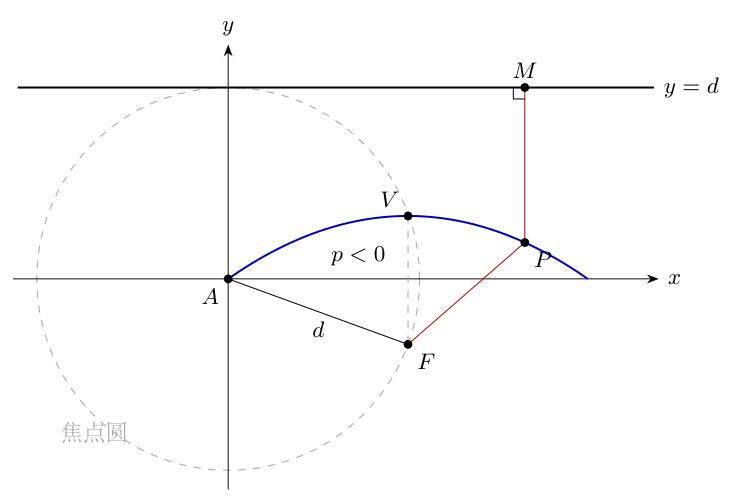{width=82%}

**第5步：用焦点—准线定义独立检查符号。**

取轨迹任意点 $P=(x,y)$，向准线作垂足 $M=(x,d)$，则 $PM=d-y$。飞行中 $y\le y_V\le d$，所以无需把 $d-y$ 改为负值。

令 $X=x-x_V$、$Y=y-y_V$，轨迹满足 $X^2=4pY$。于是

$$
\begin{aligned}
PF^2
&=X^2+(Y-p)^2\\
&=4pY+Y^2-2pY+p^2\\
&=(Y+p)^2.
\end{aligned}
$$

准线纵坐标为 $y_V-p$，故

$$
\begin{aligned}
PM^2
&=[(y_V-p)-y]^2\\
&=(-p-Y)^2\\
&=(Y+p)^2=PF^2.
\end{aligned}
$$

两者都是非负距离，因而 $PF=PM$。图1-2中画出的两条等距线段用于这一步核验。它检验的是整条抛物线定义，不仅是把焦点最终数值代回某一个点。

**第6步：求平面轨道族的覆盖范围，说明判别式的物理意义。**

虽然第一问只要求焦点与准线，但同一几何结构也能直接检查“固定速率改变方向”的覆盖。设 $\tau=\tan\theta$，由第2步得

$$
y=x\tau-\frac{x^2}{4d}(1+\tau^2).
$$

把目标点 $P=(x,y)$ 固定，将其视为关于 $\tau$ 的方程：

$$
\frac{x^2}{4d}\tau^2-x\tau+
\left(y+\frac{x^2}{4d}\right)=0.
$$

对于 $x>0$，判别式为

$$
\begin{aligned}
\Delta_\tau
&=x^2-\frac{x^2}{d}
\left(y+\frac{x^2}{4d}\right)\\
&=x^2\left(1-\frac yd-\frac{x^2}{4d^2}\right).
\end{aligned}
$$

有实出射角的必要条件为

$$
y\le d-\frac{x^2}{4d}.
$$

若再要求 $y\ge0$，则平方根在 $0$ 与 $1$ 之间，两根

$$
\tau_\pm=\frac{2d}{x}
\left(1\pm\sqrt{1-\frac yd-\frac{x^2}{4d^2}}\right)
$$

均不为负。由 $t=x/(v_0\cos\theta)>0$，且斜抛在第一次到达 $y=0$ 前始终有 $y\ge0$，可知这些目标确实能够在首次落地前到达。向左右改变方位后的平面覆盖为

$$
\boxed{0\le y\le d-\frac{x^2}{4d}}.
$$

当 $\Delta_\tau=0$，两种角度合并，这才是轨道族的包络。该包络也是一条抛物线，但不是任何一条固定角度轨迹；它的焦点为 $A$，准线为 $y=2d$，而单条轨迹的准线是 $y=d$。

**第7步：中心引力先用能量分支，避免无条件套用椭圆。**

第二问的比机械能为

$$
\begin{aligned}
\varepsilon
&=\frac12v_0^2-\frac{\mathcal G}{R}\\
&=\frac12v_0^2-gR.
\end{aligned}
$$

因为球对称引力的力矩为零，$\ell=|\mathbf r\times\mathbf v|$ 守恒。初始值为

$$
\ell=Rv_0\cos\theta.
$$

定义无量纲速度参数

$$
u=\frac{v_0^2}{gR}.
$$

因此

$$
\varepsilon=\frac{gR}{2}(u-2).
$$

$0<u<2$ 对应负能量椭圆；$u=2$ 对应抛物线逃逸；$u>2$ 对应双曲线逃逸。逃逸速率为

$$
v_{\mathrm{esc}}=\sqrt{2gR}.
$$

原题所说“落回地球”的非退化轨道必须首先在 $u<2$ 范围讨论。能量虽相同，角动量并不相同；不能由“能量固定”推出所有轨道的偏心率或周期内的撞地时间相同。

**第8步：从牛顿方程推导圆锥曲线及能量—半长轴关系。**

设轨道平面内的地心极角为 $\varphi$，取 $A$ 的地心方向为 $\varphi=0$，令 $w(\varphi)=1/r$。角动量守恒给出

$$
\dot\varphi=\frac{\ell}{r^2}=\ell w^2.
$$

利用链式法则：

$$
\begin{aligned}
\dot r
&=\frac{dr}{d\varphi}\dot\varphi\\
&=-\frac{w'}{w^2}\ell w^2=-\ell w',\\
\ddot r
&=-\ell w''\dot\varphi
=-\ell^2w^2w'',\\
r\dot\varphi^2&=\ell^2w^3.
\end{aligned}
$$

径向牛顿方程为 $\ddot r-r\dot\varphi^2=-\mathcal G/r^2$，故

$$
\begin{aligned}
-\ell^2w^2(w''+w)&=-\mathcal G w^2,\\
w''+w&=\frac{\mathcal G}{\ell^2}.
\end{aligned}
$$

这一步是将中心力运动化为常系数二阶微分方程。其解可写为

$$
w=\frac{\mathcal G}{\ell^2}
[1+e\cos(\varphi-\varphi_p)],
\qquad
r=\frac{p_c}{1+e\cos(\varphi-\varphi_p)},
\qquad
p_c=\frac{\ell^2}{\mathcal G}.
$$

$e$ 是偏心率，$p_c$ 是半通径，不能与第一问的有符号焦参数 $p$ 混淆。

再将此解代入能量，保留径向和切向两部分：

$$
\begin{aligned}
\varepsilon
&=\frac{\ell^2}{2}\big[(w')^2+w^2\big]-\mathcal G w\\
&=\frac{\mathcal G^2}{2\ell^2}
\left[e^2\sin^2f+(1+e\cos f)^2
-2(1+e\cos f)\right]\\
&=\frac{\mathcal G^2}{2\ell^2}(e^2-1),
\qquad f=\varphi-\varphi_p.
\end{aligned}
$$

括号展开时，$2e\cos f$ 与 $-2e\cos f$ 抵消，$e^2(\sin^2f+\cos^2f)=e^2$，因此能量确与沿轨道的位置无关。

为明确半长轴从何而来，沿近地点方向取局部直角坐标 $(X_c,Y_c)$，轨道方程写成 $r+eX_c=p_c$。平方并配方：

$$
\begin{aligned}
X_c^2+Y_c^2&=(p_c-eX_c)^2,\\
(1-e^2)X_c^2+2p_ceX_c+Y_c^2&=p_c^2,\\
(1-e^2)\left(X_c+\frac{p_ce}{1-e^2}\right)^2
+Y_c^2&=\frac{p_c^2}{1-e^2}.
\end{aligned}
$$

当 $e<1$，比较椭圆标准式得到

$$
a=\frac{p_c}{1-e^2}.
$$

结合能量式，才可推出

$$
\varepsilon=-\frac{\mathcal G}{2a}.
$$

以上推导假设 $\ell>0$；竖直径向发射对应其退化极限，后面单独核对最高点，不用 $1/\ell$ 公式硬代零。

**第9步：由能量求固定半长轴，再算另一焦点距离。**

把初始能量代入 $\varepsilon=-\mathcal G/(2a)$：

$$
\begin{aligned}
\frac12v_0^2-\frac{\mathcal G}{R}
&=-\frac{\mathcal G}{2a},\\
v_0^2-\frac{2\mathcal G}{R}
&=-\frac{\mathcal G}{a},\\
\frac1a&=\frac2R-\frac{v_0^2}{\mathcal G}.
\end{aligned}
$$

所以对于 $0<u<2$，

$$
\boxed{a=\frac{\mathcal G R}{2\mathcal G-Rv_0^2}
=\frac{R}{2-u}}.
$$

地心 $O$ 是椭圆一个焦点，另一焦点为 $F$。由于 $A$ 在椭圆上，焦点定义给出

$$
OA+AF=2a.
$$

利用 $OA=R$：

$$
\begin{aligned}
D\equiv AF
&=2a-R\\
&=\frac{2R}{2-u}-R\\
&=\frac{Ru}{2-u}\\
&=\frac{Rv_0^2}{2gR-v_0^2}.
\end{aligned}
$$

于是

$$
\boxed{AF=\frac{Rv_0^2}{2gR-v_0^2}},
\qquad 0<v_0<\sqrt{2gR}.
$$

这个距离只由 $v_0,g,R$ 决定，与仰角和发射方位无关。图1-3中的 $OA+AF=2a$ 与 $OP+FP=2a$ 是同一个椭圆定义应用于两个不同的轨道点，不是两个额外的动力学假设。

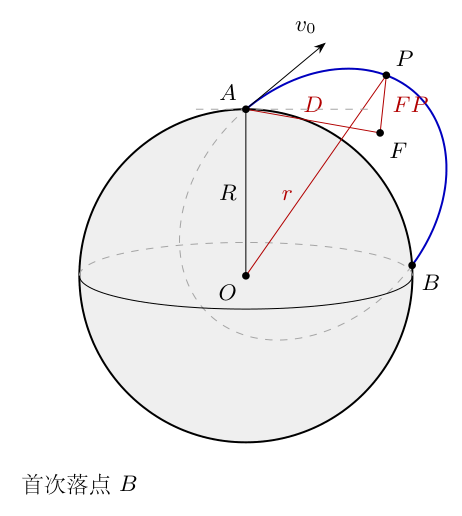{width=60%}

**第10步：用三角不等式建立包络，判定何时真正相切。**

取一条轨道上的任意地球外点 $P$，记 $r=OP$、$s=AP$。由该椭圆的焦点性质，

$$
r+FP=2a.
$$

再由三角不等式，

$$
AP\le AF+FP.
$$

将上一式的 $FP=2a-r$ 以及 $AF=D=2a-R$ 代入：

$$
\begin{aligned}
s
&\le (2a-R)+(2a-r),\\
s+r&\le4a-R.
\end{aligned}
$$

定义

$$
S=4a-R=\frac{R(2+u)}{2-u}=R+2D.
$$

因此任何实际地球外可达点必须满足

$$
\boxed{r\ge R,\qquad s+r\le S}.
$$

等号成立要求 $A,F,P$ 共线，且 $F$ 位于 $A$ 与 $P$ 之间，而不是仅要求三点落在任意一条直线上。图1-4明确画出这一顺序，$AF=D$、$AP=s$、$OP=r$ 将实际进入包络方程。

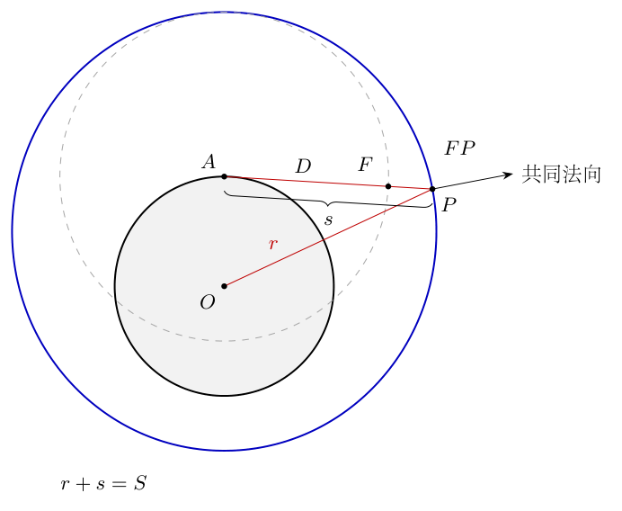{width=74%}

还应证明包络与具体轨道相切，而不是只凭示意图断言。具体轨道的局部法向与

$$
\frac{\overrightarrow{OP}}{OP}
+\frac{\overrightarrow{FP}}{FP}
$$

平行，包络面的局部法向与

$$
\frac{\overrightarrow{OP}}{OP}
+\frac{\overrightarrow{AP}}{AP}
$$

平行。取等时 $F$ 位于 $A,P$ 之间，所以 $\overrightarrow{FP}/FP=\overrightarrow{AP}/AP$，两个法向相同，从而切面相同。$F=P$ 的退化径向顶点用连续极限理解，不对零长度 $FP$ 求单位向量。

**第11步：证明包络内的目标确有向外发射解。**

必要条件不等于充分条件。现固定一个目标 $P$，令其地心极角为 $0<\varphi\le\pi$，地心距离为 $r=\rho R$，$\rho\ge1$。发射方位取在 $OA,OP$ 确定的平面内；另一侧可由对称性得到。

第8步的解在 $A$ 处满足

$$
w(0)=\frac1R,
\qquad
w'(0)=-\frac{v_0\sin\theta}{\ell}.
$$

由此可将轨道写成明确含初始角的形式：

$$
\frac{R}{r}
=\frac{
1+(u\cos^2\theta-1)\cos\varphi
-u\sin\theta\cos\theta\sin\varphi
}{u\cos^2\theta}.
$$

令 $\tau=\tan\theta$，乘以 $u\cos^2\theta$，再利用 $\cos^2\theta=1/(1+\tau^2)$：

$$
\begin{aligned}
\frac u\rho
&=(1+\tau^2)(1-\cos\varphi)
+u\cos\varphi-u\tau\sin\varphi,\\
(1-\cos\varphi)\tau^2-u\sin\varphi\,\tau
&+1-\cos\varphi+u\cos\varphi-\frac u\rho=0.
\end{aligned}
$$

这是固定目标时的出射角二次方程。展开判别式：

$$
\begin{aligned}
\Delta_\tau
&=u^2\sin^2\varphi
-4(1-\cos\varphi)
\left(1-\cos\varphi+u\cos\varphi-\frac u\rho\right)\\
&=(1-\cos\varphi)
\left[u^2-4+(u-2)^2\cos\varphi+\frac{4u}{\rho}\right].
\end{aligned}
$$

将包络 $s+r=S$ 与距离公式 $s^2=r^2+R^2-2Rr\cos\varphi$ 联立，解得该方向的包络半径

$$
\begin{aligned}
r_e(\varphi)
&=\frac{S^2-R^2}{2(S-R\cos\varphi)},\\
\rho_e(\varphi)
&=\frac{4u}
{(2-u)[2+u-(2-u)\cos\varphi]}.
\end{aligned}
$$

代入判别式，恰有

$$
\Delta_\tau
=4u(1-\cos\varphi)
\left(\frac1\rho-\frac1{\rho_e}\right).
$$

由于 $0<u<2$、$\rho>0$，故 $\Delta_\tau\ge0$ 等价于 $\rho\le\rho_e$，即目标在包络内。对于 $0<\varphi<\pi$，较大根

$$
\tau_+=
\frac{u\sin\varphi+\sqrt{\Delta_\tau}}
{2(1-\cos\varphi)}
$$

为正，给出向外初始径向速度。$\varphi=\pi$ 时根由原方程单独计算，存在正根的条件仍与包络一致；$\varphi=0$ 则使用径向发射，而不在分母 $1-\cos\varphi=0$ 处硬套公式。

**第12步：检查所选轨道在到达目标之前没有先撞地。**

令

$$
k=\frac{p_c}{R}=u\cos^2\theta,
\qquad
c_0=u\sin\theta\cos\theta\ge0.
$$

轨道任意中间极角 $\psi$ 的半径为

$$
\frac{r(\psi)}R=
\frac{k}{1+(k-1)\cos\psi-c_0\sin\psi}.
$$

负能量非退化椭圆的偏心率 $e<1$，分母始终为正，因此可以安全地比较不等式，不会把双曲线另一支的负分母混进来。

条件 $r(\psi)\ge R$ 等价于

$$
\begin{aligned}
(k-1)(\cos\psi-1)-c_0\sin\psi&\le0,\\
-2\sin\frac\psi2
\left[(k-1)\sin\frac\psi2
+c_0\cos\frac\psi2\right]&\le0.
\end{aligned}
$$

对 $0<\psi<\pi$，两半角函数均为正，因此进一步等价于

$$
(k-1)\tan\frac\psi2+c_0\ge0.
$$

若 $k\ge1$，该式在整个半周内自动成立。若 $k<1$，左侧随 $\psi$ 增大而减小；既然目标处 $\psi=\varphi$ 有 $r\ge R$，则所有更早的 $\psi$ 都满足它。因此目标确在首次撞地之前，而非穿地后的数学轨道段上。

$\varphi=\pi$ 的可达目标必须有 $k\ge1$，否则其半径小于 $R$，不能进入地球外范围。恰有 $k=1,c_0=0$ 时为球面圆轨道，应按后面的临界边界约定处理。至此，“包络内且地球外”的条件既必要又充分，不能省去这一步而只给一幅完整椭圆图。

**第13步：把距离和条件写成空间范围，求最高高度与球面覆盖。**

以 $O$ 为坐标原点，$Y$ 轴沿 $OA$ 向外，$X,Z$ 为与之垂直的坐标，令 $\varrho=\sqrt{X^2+Z^2}$。此时 $A=(0,R,0)$，

$$
r=\sqrt{\varrho^2+Y^2},
\qquad
s=\sqrt{\varrho^2+(Y-R)^2}.
$$

包络 $r+s=S$ 是以 $O,A$ 为焦点的旋转椭球，中心在 $Y=R/2$。半长轴、半焦距和横向半轴分别为

$$
\begin{aligned}
a_e&=\frac S2=\frac{R(2+u)}{2(2-u)},\\
c_e&=\frac R2,\\
b_e^2
&=a_e^2-c_e^2\\
&=\frac{S^2-R^2}{4}
=\frac{2R^2u}{(2-u)^2}.
\end{aligned}
$$

所以负能量下的空间覆盖闭包为

$$
\boxed{
\frac{X^2+Z^2}{b_e^2}
+\frac{(Y-R/2)^2}{a_e^2}\le1,
\qquad
X^2+Y^2+Z^2\ge R^2
}.
$$

图1-5画的是该轴对称体的空间投影，两幅分别缩放，不能把纸面大小当成实际尺寸比较；前实后虚的纬圈帮助区别球面和旋转椭球。解题使用的仍是 $\varrho,Y,r,s$，不是把投影中看起来相交的线误当成空间接触。

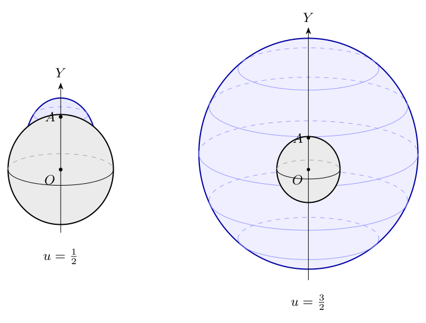{width=94%}

沿 $OA$ 向外的径向发射角动量为零，最高点满足径向速度为零。直接由能量求得

$$
\begin{aligned}
-\frac{\mathcal G}{r_{\max}}
&=\frac12v_0^2-\frac{\mathcal G}{R},\\
r_{\max}&=\frac{2R}{2-u}=2a,\\
h_{\max}&=r_{\max}-R=\frac{Ru}{2-u}=D.
\end{aligned}
$$

这也与椭球最外端 $Y=R/2+a_e=2a$ 一致，是动力学与包络几何的独立交叉检查。

球面上 $r=R$，则可达边界满足 $AP\le S-R=2D$。设球面目标与 $A$ 的地心夹角为 $\varphi$，弦长为

$$
AP=2R\sin\frac\varphi2.
$$

所以当 $0<u<1$ 时，

$$
\boxed{0\le\varphi\le
2\arcsin\frac{u}{2-u}}.
$$

当 $1<u<2$ 时 $D>R$，全部球面位置均在包络内，可以由真实向外飞行轨道到达。当 $u=1$ 时，反面点恰在包络边界；切向发射为 $r=R$ 的圆轨道，若要求质点先严格离开球面，反面点只能作为 $\theta\to0^+$ 的极限接近，不能声称有一条先升空再于反面点首次撞地的有限角度轨道。

**第14步：处理逃逸临界与双曲线焦点，说明“另一个焦点”的适用域。**

当 $u=2$ 时，$\varepsilon=0$，第8步能量式给出 $e=1$。轨道为以地心 $O$ 为焦点的抛物线，只有一个有限焦点。椭圆 $a,D$ 发散只是支路极限，不能把无穷远当成一个可量出的有限“另一个焦点”。

当 $u>2$ 时，$\varepsilon>0$，$e>1$。第8步的直角坐标方程此时改写为

$$
(e^2-1)\left(X_c-\frac{p_ce}{e^2-1}\right)^2-Y_c^2
=\frac{p_c^2}{e^2-1}.
$$

比较双曲线标准式，其半实轴的正长度为 $a_h=p_c/(e^2-1)$。再由第8步完整能量式，

$$
\varepsilon=\frac{\mathcal G^2}{2\ell^2}(e^2-1)
=\frac{\mathcal G}{2a_h}.
$$

因此由

$$
\varepsilon=\frac{\mathcal G}{2a_h}
$$

求得

$$
a_h=\frac{R}{u-2}.
$$

初始向外运动所在的实际双曲线支满足 $AF-OA=2a_h$，从而

$$
\begin{aligned}
AF
&=R+2a_h\\
&=\frac{Ru}{u-2}\\
&=\frac{Rv_0^2}{v_0^2-2gR}.
\end{aligned}
$$

因此超临界支路的另一焦点距离也与角度无关，但它不是把椭圆公式保留负号后直接当作负距离。非退化情况下可以合写为 $AF=Rv_0^2/|2gR-v_0^2|$，仍必须注明 $u\ne2$ 以及各自的轨道类型。

**第15步：用单调角积分求不落回支路的实际覆盖，排除伪解。**

对于 $u\ge2$，向外发射后径向运动不会出现有限外侧转向点。能量与角动量给出

$$
\dot r^2
=2\varepsilon+\frac{2\mathcal G}{r}
-\frac{\ell^2}{r^2}.
$$

因为 $\dot r\ge0$，从球面到目标半径 $r$ 的累计偏转角为

$$
\varphi(r;\ell)=
\int_R^r
\frac{\ell\,dq}
{q^2\sqrt{2\varepsilon+2\mathcal G/q-\ell^2/q^2}}.
$$

固定 $\varepsilon,r$，对被积函数关于 $\ell$ 求导。令 $C(q)=2\varepsilon+2\mathcal G/q>0$，逐项求导得

$$
\begin{aligned}
\frac{\partial}{\partial\ell}
\frac{\ell}{q^2\sqrt{C-\ell^2/q^2}}
&=\frac1{q^2}
\left[(C-\ell^2/q^2)^{-1/2}
+\frac{\ell^2}{q^2}(C-\ell^2/q^2)^{-3/2}\right]\\
&=\frac{C}{q^2(C-\ell^2/q^2)^{3/2}}>0.
\end{aligned}
$$

故固定目标半径时，偏转角随角动量增大而增大。向外发射允许的最大角动量是 $\ell_{\max}=Rv_0$，对应切向发射 $\theta=0$；其初始径向速度虽为零，但 $u\ge2$ 时径向加速度为 $v_0^2/R-g=g(u-1)>0$，会立即向外离开球面。

切向轨道的半通径和偏心率为 $p_c=Ru$、$e=u-1$，且 $A$ 为近地点。因此图1-6中的边界轨道为

$$
r_t(\varphi)=
\frac{Ru}{1+(u-1)\cos\varphi}.
$$

从径向发射的零偏转到切向发射的最大偏转连续变化，实际可达范围为

$$
\boxed{
1+(u-1)\cos\varphi>0,
\qquad
r\ge\frac{Ru}{1+(u-1)\cos\varphi}
},
\qquad u\ge2.
$$

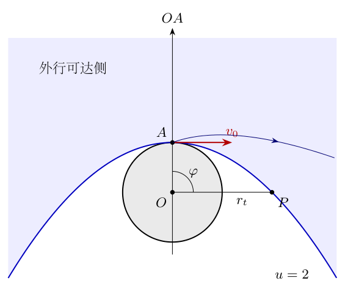{width=88%}

其中 $u=2$ 时 $r_t=2R/(1+\cos\varphi)$、$0\le\varphi<\pi$；$u>2$ 时

$$
0\le\varphi<
\arccos\left(-\frac1{u-1}\right).
$$

严格不等号表示渐近方向在有限距离不能到达。图1-6的 $A,O,\varphi$ 与 $r_t$ 就是上式中的量；阴影位于切向抛物线外行一侧，不表示把数学轨道另一支或穿地部分纳入覆盖。即便代入固定目标二次方程得到正 $\tan\theta$，仍须检查目标是否位于从 $A$ 开始的实际外行支，不能用判别式代替这一筛选。

**第16步：检查平地极限、量纲与主要边界。**

固定 $v_0,g$ 而令 $R\to\infty$，有 $u=v_0^2/(gR)\to0$。第二问焦点距离变为

$$
\begin{aligned}
D
&=\frac{v_0^2}{2g}
\left(1-\frac{v_0^2}{2gR}\right)^{-1}\\
&=\frac{v_0^2}{2g}
\left[1+\frac{v_0^2}{2gR}
+O(R^{-2})\right]\\
&\longrightarrow d.
\end{aligned}
$$

这里使用几何级数展开 $(1-z)^{-1}=1+z+O(z^2)$，适用于 $|z|\ll1$。$v_0^2/g$ 是长度，$v_0^2/(gR)$ 是无量纲量，所以式中各项量纲一致。

再取出射点附近的局部高度 $y=Y-R$、水平距离 $x=\varrho$。在 $|x|,|y|\ll R$ 时，

$$
r=\sqrt{x^2+(R+y)^2}
=R+y+\frac{x^2}{2R}+O(R^{-2})
$$

，而 $s=\sqrt{x^2+y^2}$。包络 $s+r=R+2D$ 在平地极限给出

$$
\sqrt{x^2+y^2}+y=2d.
$$

移项后平方：

$$
\begin{aligned}
x^2+y^2&=(2d-y)^2,\\
x^2&=4d^2-4dy,\\
y&=d-\frac{x^2}{4d}.
\end{aligned}
$$

恰与第6步的平面包络一致。注意这是固定局部空间点的 $R\to\infty$ 极限，不是固定 $R$ 把 $u\to2$ 的逃逸极限；两种极限不能互换。

$v_0\to0$ 时 $D\to0$，外部可达体缩到出射点附近；$u\to2^-$ 时 $D\to\infty$，负能量椭圆可以在长时间后绕回，但 $u=2$ 的实际外行抛物线不再折返，覆盖支路需按第15步重新判断。

**第17步：给出可复算的数值与轨道检查，不只核对最终公式。**

以 $g,R$ 为单位使 $R=1$、$\mathcal G=1$，取 $u=1/2$。由前面式子，

$$
\begin{aligned}
a&=\frac23,\qquad
D=\frac13,\qquad
S=\frac53,\\
a_e&=\frac56,\qquad
b_e=\frac23.
\end{aligned}
$$

例如目标的地心极角 $\varphi=0.2$、地心距离 $\rho=1.1$ 时，包络半径为

$$
\rho_e=
\frac{4u}{(2-u)[2+u-(2-u)\cos\varphi]}
\approx1.2946.
$$

所以目标在包络内；不能只因 $\rho>1$ 就判断可达。将 $\varphi,\rho,u$ 代回角度二次方程，三个系数和判别式为

$$
\begin{aligned}
A_\tau&=1-\cos0.2\approx0.01993342,\\
B_\tau&=-0.5\sin0.2\approx-0.09933467,\\
C_\tau&=1-\cos0.2+0.5\cos0.2-\frac{0.5}{1.1}
\approx0.05542126,\\
\Delta_\tau&=B_\tau^2-4A_\tau C_\tau
\approx0.00544843.
\end{aligned}
$$

所以 $\tau_-\approx0.640160$、$\tau_+\approx4.343162$，分别给出 $\theta_-\approx32.6257^\circ$、$\theta_+\approx77.0338^\circ$。两初始径向速度均为正；按第12步检查中间半径都不小于 $R$。再从

$$
\begin{aligned}
\dot X&=V_X,\qquad \dot Y=V_Y,\\
\dot V_X&=-\frac{X}{(X^2+Y^2)^{3/2}},\\
\dot V_Y&=-\frac{Y}{(X^2+Y^2)^{3/2}}
\end{aligned}
$$

独立积分，初值取地心坐标 $X(0)=1,Y(0)=0$、$V_X(0)=\sqrt u\sin\theta$、$V_Y(0)=\sqrt u\cos\theta$。这组核验坐标只是把前面的径向轴旋转了 $90^\circ$，$r,\varphi$ 的定义未变。

计算应在首次 $r=1$ 的回落事件终止，或在到达目标极角时终止，并同时检查 $\varepsilon$、$\ell$ 守恒。81个负能量目标与36个逃逸目标的独立运动积分、12个切向边界的径向角积分均与本题解析一致；这些核验使用牛顿方程与积分定义，而不是把最终焦点公式重复输入自证。

## 六、关键洞察

固定速率的关键不是“轨迹相似”，而是能量相同。匀强重力模型把这种不变量藏在焦点坐标的两倍角中；平方反比模型把它藏在半长轴中。两者的焦点定距离在平地极限连续相接，但覆盖体在逃逸临界存在不同外行支路，不能凭形式连续就忽略时间和撞地边界。

几何法还可为负能量覆盖提供另一条独立路线。若给定地球外点 $P$，要求另一焦点满足

$$
AF=D,\qquad PF=2a-r.
$$

两个圆在轨道平面内相交的条件为

$$
|D-(2a-r)|\le AP\le D+(2a-r).
$$

左侧为 $|r-R|$，对任意 $OP=r$、$OA=R$ 由三角不等式自动成立；右侧为 $S-r$，正是包络条件。还须检查 $2a-r\ge0$。由 $AP\ge r-R$ 和 $AP+r\le S$，可得 $2r-R\le4a-R$，所以 $r\le2a$，此检查自动通过。两圆交点中的向外发射解再按主解析的首次撞地条件筛选；这说明几何构造与动力学筛选缺一不可。

利用偏心率向量可以直接复核焦点圆。单位质量轨道的偏心率向量为

$$
\mathbf e=\frac{\mathbf v\times(\mathbf r\times\mathbf v)}{\mathcal G}
-\frac{\mathbf r}{r}.
$$

在 $A$ 处，以 $\mathbf e_r,\mathbf e_t$ 表示局部径向与切向：

$$
\begin{aligned}
\mathbf e
&=(u\cos^2\theta-1)\mathbf e_r
-u\sin\theta\cos\theta\,\mathbf e_t,\\
e^2
&=(u\cos^2\theta-1)^2
+u^2\sin^2\theta\cos^2\theta\\
&=1+u(u-2)\cos^2\theta.
\end{aligned}
$$

负能量椭圆的另一焦点相对地心为 $\overrightarrow{OF}=-2a\mathbf e$，故

$$
\begin{aligned}
\overrightarrow{AF}
&=-2a\mathbf e-R\mathbf e_r\\
&=D[-\cos2\theta\,\mathbf e_r
+\sin2\theta\,\mathbf e_t].
\end{aligned}
$$

这不仅再次证明 $AF=D$，还证明改变发射方位时，另一焦点覆盖以 $A$ 为中心的球面。$F$ 的切向分量朝发射方向，不能为了让几何图好看任意翻转它。双曲线的有符号半长轴为负，另一焦点方向会相应改变；实际正距离仍按其支路计算。

数值验证中，包络的角度二次方程具有理论重根。浮点运算得到极小正判别式时，直接开方会将舍入误差放大为平方根级误差，尤其在接近逃逸的细长轨道上。正确处理是先确认目标确为解析包络点，再使用严格重根式；不能把容差不断放宽，掩盖真正的几何或符号错误。

## 七、易错点

将向下开口抛物线的焦点放在顶点上方，通常来自把 $p$ 当成无符号正距离。应先保留 $p=1/(4a_q)<0$，再分别写 $y_F=y_V+p$ 和准线 $y=y_V-p$。

配方时漏写 $x_V=-b_q/(2a_q)$ 的负号，会把焦点画到发射点左侧。距离平方偶然仍可能算对，不能据此认定坐标和图正确。

把 $AF+FP=AP$ 写成对任何轨道点都成立。一般情况下只有 $AP\le AF+FP$；等号必须有 $A,F,P$ 的正确共线顺序。另一种共线顺序给出距离差，不是本题的椭圆包络。

把同能量椭圆与以 $O,A$ 为焦点的包络椭圆混为一谈。前者半长轴 $a$、焦点 $O,F$；后者半长轴 $a_e=S/2$、焦点 $O,A$。两个椭圆在边界点相切，但不是同一条曲线。

只检查目标在包络内，不检查 $r\ge R$、向外初速与首次撞地。数学椭圆的内部轨道段穿过地球，不能按未给出的地球内部模型继续飞行。

将 $u=1$ 的圆轨道、$u=2$ 的逃逸轨道混为一类。前者速度为 $\sqrt{gR}$，是切向绕地临界；后者速度为 $\sqrt{2gR}$，能量才为零。$u=1$ 的反面球面点涉及是否允许恰沿球面运行，须注明边界约定。

对双曲线目标只用角度方程的正根和判别式判断可达。另一数学支可能给出看似正的出射角，却需越过无穷远后才到目标。非负能量应以实际外行角积分或真实运动时间筛选。

## 八、课堂讲解建议

课堂可先只讲第一问。板书保留 $a_q<0$，让学生亲自完成一次配方，再比较焦点和准线的纵坐标。先问“顶点升高时，焦点是否一定同步升高”，再用 $\theta=30^\circ,60^\circ$ 的计算打破只看顶点的直觉。图1-2上必须指出焦点圆并非飞行轨迹。

转入第二问时，先让学生分别写初始能量和角动量，比较哪一个随角度变化。教师在板书上分开列 $a$ 与 $a_e$，全过程保留 $O,F$ 与 $O,A$ 两套焦点。图1-4只在共线取等处使用，图1-3用于提醒真实飞行在首次碰到球面处停止。

学生能够完成必要条件后，不立即宣布全解。课堂再提出“包络内是否每一点都能到达”，先用两圆交点直观建立候选轨道，再用角度方程与首次撞地不等式补齐证明。运算基础较弱时，可分两次讲第11、12步，不能把充分性压缩成“显然”。

最后的逃逸支路适合作为条件辨析。教师画图1-6，要求学生比较“$u\to2^-$ 的长周期回落”与“恰有 $u=2$ 的外行逃逸”，明确二者不是同一条实际运动过程。学生若用双曲线正根声称可绕过所有方向，课堂以真实角积分的单调性定位其错误，不仅告知答案错了。

## 九、变式训练

**变式1：指定地面目标的两种发射角。**

取 $v_0=20\,\mathrm{m\,s^{-1}}$、$g=10\,\mathrm{m\,s^{-2}}$。先求 $\theta=30^\circ$ 的焦点与准线，再判断 $P=(24\,\mathrm m,8\,\mathrm m)$ 能否到达，并求两种角度。

由 $d=v_0^2/(2g)=20\,\mathrm m$，

$$
\begin{aligned}
x_F&=20\sin60^\circ=10\sqrt3\,\mathrm m,\\
y_F&=-20\cos60^\circ=-10\,\mathrm m,\\
y_{\text{准线}}&=20\,\mathrm m.
\end{aligned}
$$

该角度的顶点高度仅为 $d\sin^230^\circ=5\,\mathrm m$，焦点却在地下；这不违背抛物线的几何定义，焦点不要求位于物理飞行弧内。

目标处的包络高度为

$$
y_e(24)=20-\frac{24^2}{80}=12.8\,\mathrm m>8\,\mathrm m.
$$

因此目标可达。角度根为

$$
\begin{aligned}
\tau_\pm
&=\frac{40}{24}
\left(1\pm\sqrt{1-\frac8{20}-\frac{24^2}{1600}}\right)\\
&=\frac53\left(1\pm\frac{\sqrt6}{5}\right)\\
&=\frac{5\pm\sqrt6}{3}.
\end{aligned}
$$

所以

$$
\boxed{\theta_\pm=
\arctan\frac{5\pm\sqrt6}{3}}.
$$

两根约为 $0.8502,2.4832$，对应仰角约 $40.37^\circ,68.06^\circ$。各自飞行时间为 $t_\pm=24/(20\cos\theta_\pm)$；代入 $y=20\sin\theta_\pm\,t_\pm-5t_\pm^2$，均得到 $8\,\mathrm m$。由于目标高度非负且取正时间，两种角度都属于首次落地前的轨迹。

**变式2：低于绕地速率时的最大球面射程。**

设 $v_0^2=gR/2$，求最高高度、包络半轴和最大球面弧长。

此时 $u=1/2$，故

$$
\begin{aligned}
a&=\frac{2R}{3},&
D=h_{\max}&=\frac R3,\\
S&=\frac{5R}{3},&
a_e&=\frac{5R}{6},\\
b_e^2
&=\left(\frac{5R}{6}\right)^2-\left(\frac R2\right)^2
=\frac{4R^2}{9},&
b_e&=\frac{2R}{3}.
\end{aligned}
$$

球面上 $AP=2R\sin(\varphi/2)$，而最大弦长为 $2D=2R/3$：

$$
\sin\frac{\varphi_{\max}}2=\frac13.
$$

因此最大球面弧长为

$$
\boxed{L_{\max}=2R\arcsin\frac13
\approx0.679674R}.
$$

它不是弦长 $2R/3$。若硬套平地射程 $v_0^2/g=R/2$，则忽略了球面曲率和引力变化；本例最高高度已达 $R/3$，不满足平地近似的尺度要求。

**变式3：首次落点可以是出射点的反面吗？**

设 $u=3/2$，求一条首次落点为反面球面点的发射角，并验证其轨道在此之前不穿地。

反面点有 $\varphi=\pi$、$\rho=1$。将其代入角度方程：

$$
\begin{aligned}
2\tau^2+2-u-u&=0,\\
2\tau^2-1&=0.
\end{aligned}
$$

选向外发射的正根：

$$
\boxed{\tan\theta=\frac1{\sqrt2}},
\qquad
\theta\approx35.264^\circ.
$$

这时 $\cos^2\theta=2/3$，所以

$$
k=u\cos^2\theta=1,
\qquad
c_0=u\sin\theta\cos\theta=\frac1{\sqrt2}.
$$

轨道为

$$
\frac rR=\frac1{1-\frac1{\sqrt2}\sin\varphi}.
$$

在 $0<\varphi<\pi$ 中，分母严格小于 $1$ 且大于 $1-1/\sqrt2>0$，因此 $r>R$；到 $\varphi=\pi$ 时恰有 $r=R$。这证明反面点确是首次落点，不是穿地后重新走到的点。

本例 $a=2R$、$D=3R$、$S=7R$，所有球面都在包络内；但径向最高高度 $3R$ 与这条轨道的最大高度不同。该轨道在 $\varphi=\pi/2$ 达到

$$
r_{\mathrm{apo}}=\frac{R}{1-1/\sqrt2}
=(2+\sqrt2)R.
$$

其最高高度为 $(1+\sqrt2)R<3R$，符合“轨道族最高值”不等于“每一条轨道的最高值”。

**变式4：超临界速度下，侧面的近处目标反而不能到达。**

设 $u=3$，目标位于与 $OA$ 垂直的地心方向，即 $\varphi=\pi/2$。求可达的最小地心距离，并判断 $r=2R$ 与 $r=4R$。

由实际外行边界，并代入第14、15步的几何参数，逐项得到

$$
\begin{aligned}
r_t(\pi/2)&=\frac{3R}{1+2\cos(\pi/2)}=3R,\\
a_h&=\frac{R}{3-2}=R,\qquad
AF=\frac{3R}{3-2}=3R,\\
\varphi_\infty&=\arccos\left(-\frac1{3-1}\right)=120^\circ.
\end{aligned}
$$

所以 $r=2R$ 不可达，$r=4R$ 可达。$\varphi=\pi/2$ 虽在渐近角范围内，仍须满足 $r\ge3R$，同时检查角度与径向界限才构成完整判断。不是速度足够大就能用任意角度飞到一切外部近点：固定速率且必须向外发射，会限制累计偏转角。

对可达目标 $\rho=4$，角度方程为

$$
\begin{aligned}
\tau^2-3\tau+\frac14&=0,\\
\tau_\pm&=\frac{3\pm\sqrt{9-1}}2
=\frac{3\pm2\sqrt2}{2}.
\end{aligned}
$$

实际外行支选较小根 $\tau_-=(3-2\sqrt2)/2\approx0.08579$。较大根虽然也为正，却对应越过渐近方向后的另一数学段，不能用作从 $A$ 出发到该目标的实际轨迹。

这一筛选不能仅凭“选小根”的经验完成。对任一候选根，先由初始角算出

$$
\begin{aligned}
k&=\frac{3}{1+\tau^2},&
c_0&=\frac{3\tau}{1+\tau^2},\\
\frac rR
&=\frac{k}{1+(k-1)\cos\psi-c_0\sin\psi}.
\end{aligned}
$$

这里 $\psi$ 是沿实际运动连续增长的地心角，目标要求 $\psi=\pi/2$。分子 $k>0$，所以只有从 $\psi=0$ 起、分母连续为正的那一段才是出发后的物理轨道。分母第一次降为零时，$r$ 趋于无穷；越过这个角度再代入代数式，已不是从 $A$ 沿这条外行轨道可到达的位置。

<!-- KEEP_TOGETHER_START -->

为求第一次出现的零点，令

$$
\begin{aligned}
e&=\sqrt{(k-1)^2+c_0^2},\\
\delta&=\operatorname{atan2}(-c_0,k-1),\qquad -\pi<\delta<0,\\
1+(k-1)\cos\psi-c_0\sin\psi
&=1+e\cos(\psi-\delta).
\end{aligned}
$$

此处利用辅助角公式；$\operatorname{atan2}$ 根据两个分量确定象限，不能用单值的 $\arctan[-c_0/(k-1)]$ 替代，否则较大根的象限会错。初始时 $\psi-\delta=-\delta\in(0,\pi)$，且分母等于 $k>0$。随着 $\psi$ 增大，余弦在到达 $\pi$ 前单调减小。因为本例 $e>1$，第一次零点满足

$$
\boxed{\psi_\infty
=\delta+\arccos\left(-\frac1e\right)}.
$$

逐根代入得到

$$
\begin{aligned}
\tau_-&\approx0.0857864:&
k_-&\approx2.9780834,&
c_{0-}&\approx0.2554792,&
e_-&\approx1.9945133,\\
\tau_+&\approx2.9142136:&
k_+&\approx0.3160343,&
c_{0+}&\approx0.9209914,&
e_+&\approx1.1471854.
\end{aligned}
$$

于是

$$
\begin{aligned}
\psi_{\infty,-}&\approx112.7317^\circ>90^\circ,\\
\psi_{\infty,+}&\approx24.0576^\circ<90^\circ.
\end{aligned}
$$

较小根的实际轨道尚未走到无穷远，便在 $90^\circ$ 方向到达 $4R$；较大根的实际轨道在 $24.0576^\circ$ 已趋于无穷远，永远不能转到目标的 $90^\circ$ 方向。用初始条件直接积分牛顿方程也得到这两条轨道的不同渐近方向。这个例子说明：二次方程实根只保证代数关系成立，根的物理筛选还必须检查连续运动区间，不能忽略双曲线的分支。

<!-- KEEP_TOGETHER_END -->

<!-- question-complete -->

\newpage

# 第2题

<!-- question-start -->

一个很长的薄壁圆柱筒，半径为 $r$，表面固定有面密度为 $\sigma$ 的电荷。筒壁与电荷的总面质量密度为 $\mu$。圆筒绕中心轴以角速度 $\omega$ 匀速转动，筒壁单位长度能够承受的最大张力为 $\lambda$。

（1）同时考虑牛顿第二定律、静电作用和洛伦兹力，求 $\omega$ 的最大值。

（2）在 $\omega r\ll c$ 的情况下，通过计算说明是否需要考虑洛伦兹力。$c$ 为真空光速。

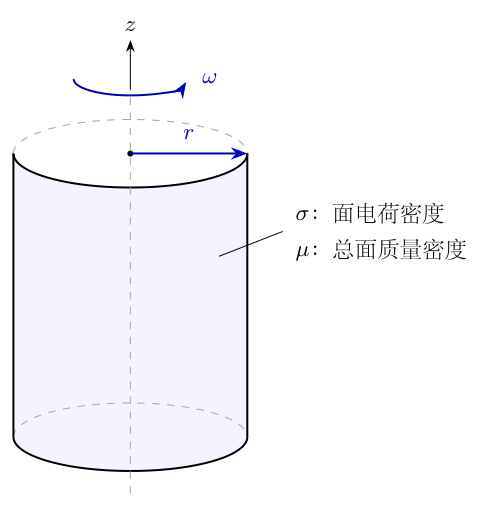{width=58%}

<!-- question-end -->

## 一、题型定位

这是带电旋转薄膜的环向强度问题。静电排斥、环向电流的磁自作用以及维持圆周运动所需的向心合力，共同决定筒壁的张力。先求场，再确定哪些场真正作用于壁面电荷，最后用一个壁带的受力方程求张力，不能直接用“总质量乘向心加速度”代替局部强度分析。

图2-1中轴向为 $z$，$r$ 是筒半径而非壁厚。题目中的 $\mu$ 是包括电荷在内的面质量密度，$\lambda$ 是跨过轴向切边的环向张力上限，按每单位轴向长度计量；两者都不是整个圆筒的质量或总拉力。磁导率另记作 $\mu_0$，不要与 $\mu$ 混淆。

## 二、知识点

圆柱对称电场与高斯定律；面电流密度与安培环路定律；薄壁表面内外场的跃变及剔除自场后的平均场；洛伦兹力的叉乘方向；薄膜环向张力与微元几何；惯性系中的向心加速度；强度约束与实根筛选；近似量级和临界值误差的区别。

使用 SI 制，真空介电常数为 $\varepsilon_0$，真空磁导率为 $\mu_0$，满足 $\varepsilon_0\mu_0=1/c^2$。面电荷密度 $\sigma$ 的单位为 $\mathrm{C\,m^{-2}}$，面质量密度 $\mu$ 的单位为 $\mathrm{kg\,m^{-2}}$，张力 $\lambda$ 的单位为 $\mathrm{N\,m^{-1}}$。电磁压力的单位则是 $\mathrm{N\,m^{-2}}$，比张力多一个长度分母。

## 三、物理图像

固定在壁面上的电荷随筒旋转，形成沿圆周方向的连续面电流。长圆筒的电场在内部为零、外部沿径向；磁场在内部沿轴向、外部在长筒近似下为零。这不表示壁面电荷完全不受某一种力：壁面处不能任选“内侧为零”或“外侧非零”的单侧场，而应取排除了局部电荷或电流自身贡献后的场。

以 $\sigma>0$、$\omega>0$ 为例，从 $+z$ 方向看电流逆时针，内部磁场朝 $+z$。局部速度沿 $\mathbf e_\varphi$，而 $\mathbf e_\varphi\times\mathbf e_z=\mathbf e_r$，所以磁力与静电力都指向筒外。使壁带向内加速的是两边张力的径向合力，不是磁力。轴向电流导线的磁收缩图像不能直接移植到环向电流圆筒上。

## 四、解题入口

把壁面受到的电力、磁力先写成单位面积的向外压力 $p_E,p_B$，再取轴向长 $h$、圆周中心角 $\mathrm d\varphi$ 的小壁带。它的面积为 $r h\,\mathrm d\varphi$，两端拉力大小各为 $T h$，径向合力约为 $-T h\,\mathrm d\varphi$。这里 $T$ 表示实际环向张力，最后才令 $T=\lambda$。

为使小角近似的来源可见，解析还将用中心角为 $2\alpha$ 的有限壁带做一次精确积分。两种取法得到同一张力方程。第二问先算磁力与电力之比，再区分“总自作用力的主阶近似”与“最大角速度的相对精度”，避免在临界强度问题中删掉虽小却影响裕量的项。

## 五、解析

**第1步：明确模型、研究对象与正方向。**

采用题目所要求的牛顿薄壁模型。将圆筒中段近似为无限长筒，忽略端部场和壁厚引起的修正；不施加额外电磁场。电荷固定在表面，不假定电荷可以在导体中任意重新分布。半径 $r$、面密度 $\sigma,\mu$ 均取稳态转动时给定的值，且 $r>0,\mu>0$。

取径向向外为 $\mathbf e_r$，沿正转向的切向为 $\mathbf e_\varphi$，轴向为 $\mathbf e_z$。先取 $\omega\ge0$ 求角速度大小；反向旋转时用 $|\omega|$ 表示同一强度界限。局部运动量为

$$
\mathbf v=\omega r\,\mathbf e_\varphi,
\qquad
\mathbf a=-\omega^2 r\,\mathbf e_r.
$$

实际张力记作 $T$，安全条件是 $T\le\lambda$。轴向长为 $h$ 的切边所承受的总拉力为 $T h$；不能把单位长度张力 $T$ 直接当成牛顿为单位的总力。由于 $\mu$ 已含电荷质量，写质量微元时不再另加一份电荷质量。

**第2步：由高斯定律求圆筒两侧电场。**

用 $s$ 表示观察点到轴的距离，避免与固定的筒半径 $r$ 混用。取半径 $s$、长度 $h$ 的同轴高斯柱面。由圆柱对称性，电场只有径向分量，在侧面大小相同；端面法向沿轴，电场与之垂直，故端面通量为零。

对于 $s<r$，高斯面没有包围壁面电荷：

$$
E(s)\,2\pi s h=0,
\qquad E(s)=0.
$$

对于 $s>r$，包围电荷量为 $\sigma\,2\pi r h$，因而

$$
\begin{aligned}
E(s)\,2\pi s h
&=\frac{\sigma\,2\pi r h}{\varepsilon_0},\\
\mathbf E(s)&=\frac{\sigma r}{\varepsilon_0s}\,\mathbf e_r.
\end{aligned}
$$

这里 $E(s)$ 可作为有符号径向分量，负电荷时方向自动反转。趋近壁面的两侧极限为

$$
\mathbf E_{\text{内}}=0,
\qquad
\mathbf E_{\text{外}}=\frac{\sigma}{\varepsilon_0}\,\mathbf e_r.
$$

图2-2左侧用径向箭头表示外场，用筒内的零场区域与之区分；右侧将用于下一步的环向电流及轴向磁场。

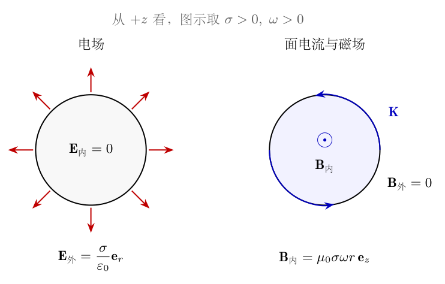{width=92%}

**第3步：从通过切边的电荷求面电流密度。**

沿轴向取一条长 $h$ 的固定观察线。在时间 $\mathrm dt$ 内，电荷沿圆周移动距离 $v\,\mathrm dt=\omega r\,\mathrm dt$。跨过这条线的壁面带面积和电荷分别为

$$
\begin{aligned}
\mathrm dS_{\text{跨}}
&=h\omega r\,\mathrm dt,\\
\mathrm dq_{\text{跨}}
&=\sigma h\omega r\,\mathrm dt.
\end{aligned}
$$

跨线电流是 $\mathrm dq_{\text{跨}}/\mathrm dt$，再除以切边长度 $h$，得到面电流密度

$$
\boxed{\mathbf K=\sigma\omega r\,\mathbf e_\varphi}.
$$

$K$ 的单位为 $\mathrm{A\,m^{-1}}$，不是 $\mathrm A$；截取轴向宽度 $\mathrm dz$，这一圈电流大小为 $K\,\mathrm dz$。图2-2中的环向箭头正表示 $\mathbf K$，它与壁面速度平行；若 $\sigma<0$，常规电流方向与速度相反。

**第4步：由安培环路定律求内外磁场。**

均匀环向电流相当于连续分布的长螺线管电流。由轴向与转动对称性，磁场沿轴向。在不穿过壁面电流的矩形环路上应用安培定律，得到同一侧的轴向场不随径向位置改变。无外加场，并要求远处磁场为零，便有长筒近似下的外场 $\mathbf B_{\text{外}}=0$。

再取一条跨过壁面的矩形环路，长边长 $h$、平行于轴。环路法向选成使穿过环面的面电流为正，故

$$
\begin{aligned}
(B_{\text{内}}-B_{\text{外}})h
&=\mu_0 K h,\\
\mathbf B_{\text{内}}
&=\mu_0\sigma\omega r\,\mathbf e_z,\\
\mathbf B_{\text{外}}&=0.
\end{aligned}
$$

有符号的 $\sigma\omega$ 决定磁场朝向。图2-2右侧的 $\odot$ 对应正电荷按图示逆时针转动时朝向观察者的轴向场；它不是径向磁场，也不是从壁面向外的磁力箭头。

**第5步：剔除局部自场，说明两个二分之一因子。**

洛伦兹力公式中的场必须由其余电荷、电流产生。理想薄壁总场在表面不连续，不能把壁面外场直接乘以壁面电荷，也不能因为内场为零就认为电力为零。将很小壁片局部视作平面，记其自身在两侧产生的场为自场，其余来源的场在该局部两侧连续。

电荷面自场在两侧分别为 $+\sigma\mathbf e_r/(2\varepsilon_0)$ 和 $-\sigma\mathbf e_r/(2\varepsilon_0)$。于是

$$
\begin{aligned}
\mathbf E_{\text{外}}
&=\mathbf E_{\text{其余}}
+\frac{\sigma}{2\varepsilon_0}\mathbf e_r,\\
\mathbf E_{\text{内}}
&=\mathbf E_{\text{其余}}
-\frac{\sigma}{2\varepsilon_0}\mathbf e_r.
\end{aligned}
$$

两式相加消去局部自场：

$$
\boxed{\mathbf E_{\text{有效}}
=\mathbf E_{\text{其余}}
=\frac{\mathbf E_{\text{外}}+\mathbf E_{\text{内}}}{2}
=\frac{\sigma}{2\varepsilon_0}\mathbf e_r}.
$$

局部平面电流片的自场也在两侧反向。对图示 $\mathbf K=K\mathbf e_\varphi$，其内侧自场朝 $+z$，外侧自场朝 $-z$，因此

$$
\begin{aligned}
\mathbf B_{\text{内}}
&=\mathbf B_{\text{其余}}+\frac{\mu_0K}{2}\mathbf e_z,\\
\mathbf B_{\text{外}}
&=\mathbf B_{\text{其余}}-\frac{\mu_0K}{2}\mathbf e_z,\\
\mathbf B_{\text{有效}}
&=\frac{\mathbf B_{\text{内}}+\mathbf B_{\text{外}}}{2}
=\frac{\mu_0\sigma\omega r}{2}\mathbf e_z.
\end{aligned}
$$

图2-3把电、磁两种场的单侧总场放在壁面两边。计算力时使用上式的平均场；“平均”不是把实际壁面电荷量再除以二，电荷仍是 $\mathrm dq=\sigma\,\mathrm dS$。

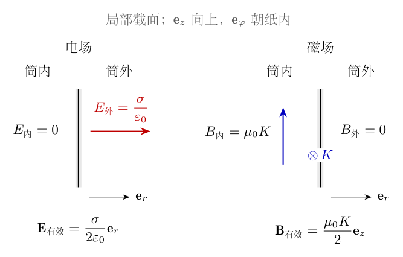{width=92%}

**第6步：分别计算静电、磁自作用的大小与方向。**

面积 $\mathrm dS$ 的壁片带电量为 $\mathrm dq=\sigma\,\mathrm dS$，它受到的电力为

$$
\begin{aligned}
\mathrm d\mathbf F_E
&=\mathrm dq\,\mathbf E_{\text{有效}}\\
&=\sigma\,\mathrm dS\,
\frac{\sigma}{2\varepsilon_0}\mathbf e_r\\
&=p_E\,\mathrm dS\,\mathbf e_r,
\qquad
p_E=\frac{\sigma^2}{2\varepsilon_0}.
\end{aligned}
$$

磁力按叉乘计算，而不是仅根据“电流之间吸引”猜方向：

$$
\begin{aligned}
\mathrm d\mathbf F_B
&=\mathrm dq\,\mathbf v\times\mathbf B_{\text{有效}}\\
&=\sigma\,\mathrm dS\,
(\omega r\,\mathbf e_\varphi)
\times\left(\frac{\mu_0\sigma\omega r}{2}\mathbf e_z\right)\\
&=\frac{\mu_0\sigma^2\omega^2r^2}{2}
\,\mathrm dS\,\mathbf e_r\\
&=p_B\,\mathrm dS\,\mathbf e_r,
\qquad
p_B=\frac{\mu_0\sigma^2\omega^2r^2}{2}.
\end{aligned}
$$

两种压力均非负，均使圆筒向外胀。反转旋转方向时，$\mathbf v$ 与 $\mathbf B$ 同时反转，叉乘不变；反转电荷符号时，$\mathrm dq$ 与 $\mathbf B$ 同时反转，磁力也不变。电力、磁力只依赖 $\sigma^2$，符合这一符号检验。

**第7步：建立壁带几何，求两边张力的径向合力。**

在截面上以壁带中央径向为 $+x$，中央切向为 $+y$。取中心角 $2\alpha$ 的壁带，$0<\alpha<\pi/2$，轴向长仍为 $h$。两个切边在极角 $\pm\alpha$，从其余筒壁传来的拉力沿各端点切线，大小各为 $T h$。图2-4中的两个蓝色箭头是切边实际拉力，红色箭头代表分布在壁带上的向外压力；图上没有额外添加离心力。

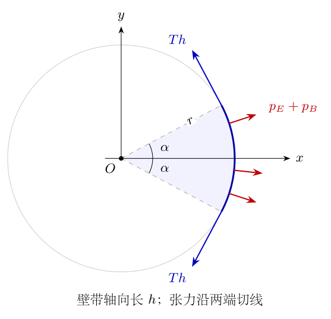{width=84%}

上端拉力指向左上，下端拉力指向左下。把图中切线方向分解到同一组坐标：

$$
\begin{aligned}
\mathbf F_{T,+}
&=T h(-\sin\alpha\,\mathbf e_x+\cos\alpha\,\mathbf e_y),\\
\mathbf F_{T,-}
&=T h(-\sin\alpha\,\mathbf e_x-\cos\alpha\,\mathbf e_y).
\end{aligned}
$$

切向分量抵消，径向分量相加：

$$
\boxed{\mathbf F_T=-2T h\sin\alpha\,\mathbf e_x}.
$$

不是 $-2T h\cos\alpha\,\mathbf e_x$。当 $\alpha$ 趋于零，两条切线近乎平行且两边拉力近乎反向，向内合力应随壁带宽度趋零；$\sin\alpha$ 才符合此极限。

**第8步：对压力与真实加速度分别积分。**

壁带中的位置角用 $\psi$ 表示，$-\alpha\le\psi\le\alpha$。其面积微元为 $\mathrm dS=r h\,\mathrm d\psi$，径向单位矢量为

$$
\mathbf e_r(\psi)=\cos\psi\,\mathbf e_x+\sin\psi\,\mathbf e_y.
$$

令 $p=p_E+p_B$。压力大小相同，但方向随 $\psi$ 改变，因此不能把有限壁带全部面积直接乘以中央方向。精确积分：

$$
\begin{aligned}
\mathbf F_p
&=\int_{-\alpha}^{\alpha}p\,r h\,\mathbf e_r(\psi)\,\mathrm d\psi\\
&=p r h\left[
\left(\int_{-\alpha}^{\alpha}\cos\psi\,\mathrm d\psi\right)\mathbf e_x
+\left(\int_{-\alpha}^{\alpha}\sin\psi\,\mathrm d\psi\right)\mathbf e_y
\right]\\
&=2p r h\sin\alpha\,\mathbf e_x.
\end{aligned}
$$

这里使用奇函数对称区间积分为零，以及 $\int_{-\alpha}^{\alpha}\cos\psi\,\mathrm d\psi=2\sin\alpha$。

同一位置处 $\mathrm dm=\mu r h\,\mathrm d\psi$，真实加速度是 $-\omega^2r\,\mathbf e_r(\psi)$。牛顿第二定律右边必须用各质量微元加速度的和：

$$
\begin{aligned}
\int\mathbf a\,\mathrm dm
&=\int_{-\alpha}^{\alpha}
(-\omega^2r\,\mathbf e_r(\psi))
(\mu r h\,\mathrm d\psi)\\
&=-2\mu\omega^2r^2 h\sin\alpha\,\mathbf e_x.
\end{aligned}
$$

电磁合力向外，张力合力向内，真实合加速度向内，三者的方向现已在同一个 $x$ 正方向下确定。

**第9步：列牛顿方程，逐项求实际环向张力。**

将第7、8步代入 $\mathbf F_T+\mathbf F_p=\int\mathbf a\,\mathrm dm$，取 $x$ 分量：

$$
-2T h\sin\alpha+2(p_E+p_B)r h\sin\alpha
=-2\mu\omega^2r^2h\sin\alpha.
$$

由于 $h>0,\sin\alpha>0$，除以共同因子 $2h\sin\alpha$：

$$
\begin{aligned}
-T+r(p_E+p_B)&=-\mu\omega^2r^2,\\
T&=\mu\omega^2r^2+r(p_E+p_B),\\
T&=\mu\omega^2r^2
+\frac{r\sigma^2}{2\varepsilon_0}
+\frac{\mu_0\sigma^2\omega^2r^3}{2}.
\end{aligned}
$$

最终

$$
\boxed{
T=\frac{r\sigma^2}{2\varepsilon_0}
+r^2\left(\mu+\frac{\mu_0\sigma^2r}{2}\right)\omega^2}.
$$

三个项依次是静电已占用的张力、向心运动的张力需求，以及磁自作用追加的张力。磁力虽不是向心力，仍影响强度上限：它向外，所以必须再增加向内张力来抵消它。

有限壁带结果与 $\alpha$ 无关。取 $2\alpha=\mathrm d\varphi$，使用 $\sin\alpha\simeq\alpha$，便恢复微元取法：

$$
\begin{aligned}
\mathrm dS&=r h\,\mathrm d\varphi,\\
\mathrm dm&=\mu r h\,\mathrm d\varphi,\\
(p_E+p_B)\mathrm dS-T h\,\mathrm d\varphi
&=-\mathrm dm\,\omega^2r.
\end{aligned}
$$

再除以 $h\,\mathrm d\varphi$，仍得到同一张力式。这个极限明确解释了两边总拉力为何不是 $2T h$ 全部作为向心力。

**第10步：施加强度条件，求最大角速度并筛选可行情形。**

定义静止时的环向张力及随 $\omega^2$ 增加的系数：

$$
T_0=\frac{r\sigma^2}{2\varepsilon_0},
\qquad
A_T=r^2\left(\mu+\frac{\mu_0\sigma^2r}{2}\right)>0.
$$

于是 $T=T_0+A_T\omega^2$。图2-5以 $\Omega=\omega^2$ 为横轴；直线截距是 $T_0$，斜率是 $A_T$，与 $T=\lambda$ 的交点才给出强度边界。

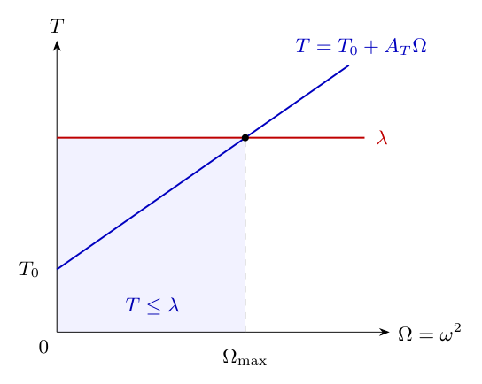{width=76%}

若 $\lambda>T_0$，解不等式并取非负角速度：

$$
\begin{aligned}
T_0+A_T\omega^2&\le\lambda,\\
\omega^2&\le
\frac{\lambda-r\sigma^2/(2\varepsilon_0)}
{r^2(\mu+\mu_0\sigma^2r/2)},\\
\omega_{\max}
&=\frac1r\sqrt{
\frac{\lambda-r\sigma^2/(2\varepsilon_0)}
{\mu+\mu_0\sigma^2r/2}}\\
&=\boxed{\frac1r
\sqrt{\frac{2\lambda-r\sigma^2/\varepsilon_0}
{2\mu+\mu_0r\sigma^2}}}.
\end{aligned}
$$

最后一行同时把分子、分母乘以 $2$，并未多加一个二分之一。

若 $\lambda=T_0$，只有 $\omega=0$ 位于强度边界，任何非零转动都会超过它。若 $\lambda<T_0$，连静止圆筒也无法承受给定电荷的排斥，不存在本模型中的可行稳态；不能把负的根号内部继续解释成某个“最大转速”。若材料在达到最大张力时即发生破坏，严格安全范围应取 $T<\lambda$，上式给的是极限值。

<!-- KEEP_TOGETHER_START -->

**第11步：计算低速时磁力与静电力的比。**

对 $\sigma\ne0$，同一壁片面积相同，故力比等于压力比：

$$
\begin{aligned}
\frac{\mathrm dF_B}{\mathrm dF_E}
&=\frac{p_B}{p_E}\\
&=\frac{\mu_0\sigma^2\omega^2r^2/2}
{\sigma^2/(2\varepsilon_0)}\\
&=\mu_0\varepsilon_0\,\omega^2r^2\\
&=\boxed{\left(\frac{\omega r}{c}\right)^2}.
\end{aligned}
$$

<!-- KEEP_TOGETHER_END -->

所以 $\omega r\ll c$ 时，磁自力相对于静电自力是二阶小量。若只求电磁总力的低速主阶，可取

$$
p_E+p_B
=p_E\left[1+\left(\frac{\omega r}{c}\right)^2\right]
\simeq p_E.
$$

这是低速时通常可以忽略磁力的直接计算依据。$\sigma=0$ 时两种自力都为零，不把 $0/0$ 当作力比；此时无需任何电磁修正。

**第12步：说明忽略磁力对临界角速度的精度条件。**

总力中的小修正，不一定是临界转速中的小相对修正，因为静电已经占去张力 $T_0$，用于转动的裕量是 $\lambda-T_0$。仅忽略磁力求得的角速度为

$$
\omega_{\text{无磁}}^2
=\frac{\lambda-T_0}{\mu r^2},
\qquad \lambda>T_0.
$$

保留磁力时，定义无量纲量

$$
\eta=\frac{\mu_0\sigma^2r}{2\mu}
=\frac{T_0}{\mu c^2}.
$$

由第10步直接逐项比较：

$$
\begin{aligned}
\omega_{\max}^2
&=\frac{\lambda-T_0}{\mu r^2(1+\eta)}
=\frac{\omega_{\text{无磁}}^2}{1+\eta},\\
\frac{\omega_{\text{无磁}}-\omega_{\max}}{\omega_{\max}}
&=\boxed{\sqrt{1+\eta}-1}.
\end{aligned}
$$

因此，若要保证“不计磁力”求得的临界转速相对准确，还需 $\eta\ll1$。当这一条件成立，用二项式展开到一阶：

$$
\omega_{\max}
=\omega_{\text{无磁}}(1+\eta)^{-1/2}
\simeq\omega_{\text{无磁}}\left(1-\frac{\eta}{2}\right).
$$

为看清两种小量的差别，再令静电裕量比例

$$
\delta=\frac{\lambda-T_0}{T_0}>0.
$$

则在强度边界

$$
\begin{aligned}
\left(\frac{\omega_{\max}r}{c}\right)^2
&=\frac{\lambda-T_0}{\mu c^2(1+\eta)}\\
&=\boxed{\frac{\delta\eta}{1+\eta}}.
\end{aligned}
$$

$\delta$ 很小时，边界速率可以远低于 $c$，即使 $\eta$ 并不小。此时磁力相对静电确实很小，却可能与用于转动的张力增量相当。在原题牛顿薄壁模型内，第二问的严谨结论是：低速总电磁力的主阶通常不需磁项；若要求最大角速度的相对精度，则必须同时检查 $\eta$，不能单凭 $\omega r/c$ 删去磁项。

**第13步：检查量纲、退化情形与模型有效性。**

张力式三项应全部为 $\mathrm{N\,m^{-1}}$。其中

$$
\begin{aligned}
[\mu\omega^2r^2]
&=\mathrm{kg\,m^{-2}}\,
\mathrm{s^{-2}}\mathrm{m^2}
=\mathrm{N\,m^{-1}},\\
\left[\frac{r\sigma^2}{\varepsilon_0}\right]
&=[r p_E]=\mathrm{N\,m^{-1}},\\
[\mu_0\sigma^2r]&=\mathrm{kg\,m^{-2}}=[\mu].
\end{aligned}
$$

因此根号内“张力除以面质量密度”的量纲为速率平方，外面的 $1/r$ 使结果成为角速度，单位为 $\mathrm{s^{-1}}$。

不带电时，第10步给出

$$
\boxed{\omega_{\max}=\sqrt{\frac{\lambda}{\mu r^2}}},
$$

与纯机械旋转薄筒相符。静止时，$T=T_0=r p_E$，与薄膜圆筒承受均匀向外压力的关系相符。保持其他参数不变，增加 $|\sigma|$ 同时提高静电截距及磁力斜率，故只能降低可行转速；当 $|\sigma|>\sqrt{2\varepsilon_0\lambda/r}$，静态强度已经失效。

式中的电磁作用采用给定面密度的稳恒场，运动方程采用牛顿质量模型。保留磁力能给出这一模型内的完整结果，但并不使牛顿方程自动变成相对论方程。若计算所得 $\omega_{\max}r$ 不再远小于 $c$，必须重新处理质量、应力和电荷密度的相对论关系；不能把高于或接近光速的形式根当作实际可实现转速。

## 六、关键洞察

本题真正控制张力的是“每单位轴向长度的局部壁带”，不是整个圆筒的合力。完整圆筒的向心加速度矢量在周向积分后相互抵消，总合力可以为零，但每一点仍需向心加速度，壁内张力并不为零。选有限壁带后，压力、张力和惯性项都带有相同的 $2h\sin\alpha$，恰好说明这一局部关系与所选壁带宽度无关。

平均场的二分之一可以用有限厚度模型独立检查。令壁厚为 $t$，中面半径仍为 $r$，内外半径 $a=r-t/2,b=r+t/2$。将相同面电荷均匀铺在薄层内，取体电荷密度 $\rho_q=\sigma/t$。由于 $\int_a^b2\pi s\rho_q\,\mathrm ds=2\pi r\sigma$，单位轴长的总电荷不变。薄层中各处以同一角速度旋转，因此 $J_\varphi(s)=\rho_q\omega s$。

高斯定律与安培定律给出层内场

$$
\begin{aligned}
E(s)&=\frac{\rho_q(s^2-a^2)}{2\varepsilon_0s},\\
B(s)&=\frac{\mu_0\rho_q\omega}{2}(b^2-s^2),
\qquad a\le s\le b.
\end{aligned}
$$

换算为中面单位面积的力时，体积微元须带面积比例 $s/r$，而不能只对 $\rho_q E\,\mathrm ds$ 积分。于是

$$
\begin{aligned}
p_E(t)
&=\int_a^b\rho_qE(s)\frac{s}{r}\,\mathrm ds\\
&=\frac{\rho_q^2}{2\varepsilon_0r}
\int_a^b(s^2-a^2)\,\mathrm ds\\
&=\frac{\rho_q^2}{2\varepsilon_0r}
\left[\frac{s^3}{3}-a^2s\right]_a^b\\
&=\frac{\rho_q^2}{2\varepsilon_0r}
\left(\frac{b^3-a^3}{3}-a^2(b-a)\right).
\end{aligned}
$$

用 $b-a=t$，先因式分解，再代入中面半径：

$$
\begin{aligned}
\frac{b^3-a^3}{3}-a^2(b-a)
&=\frac{b-a}{3}(b^2+ab-2a^2)\\
&=\frac{(b-a)^2(b+2a)}{3}\\
&=t^2\left(r-\frac{t}{6}\right),\\
p_E(t)&=\frac{(\sigma/t)^2}{2\varepsilon_0r}
t^2\left(r-\frac{t}{6}\right)\\
&=\frac{\sigma^2}{2\varepsilon_0}
\left(1-\frac{t}{6r}\right).
\end{aligned}
$$

磁力中速度也随 $s$ 改变，故积分还多出一个 $s$，不能直接照搬电力积分：

$$
\begin{aligned}
p_B(t)
&=\int_a^b\rho_q\omega s B(s)\frac{s}{r}\,\mathrm ds\\
&=\frac{\mu_0\rho_q^2\omega^2}{2r}
\int_a^b s^2(b^2-s^2)\,\mathrm ds\\
&=\frac{\mu_0\rho_q^2\omega^2}{2r}
\left[\frac{b^2s^3}{3}-\frac{s^5}{5}\right]_a^b\\
&=\frac{\mu_0\rho_q^2\omega^2}{2r}
\left[\frac{b^2(b^3-a^3)}{3}-\frac{b^5-a^5}{5}\right].
\end{aligned}
$$

为显示多项式化简，记 $u=t/2$，则 $a=r-u,b=r+u$。二项式展开给出

$$
\begin{aligned}
b^3-a^3&=6r^2u+2u^3,\\
b^5-a^5&=10r^4u+20r^2u^3+2u^5,\\
b^2&=r^2+2ru+u^2.
\end{aligned}
$$

代入后，两项中的一次项抵消：

$$
\begin{aligned}
\frac{b^2(b^3-a^3)}{3}
&=2r^4u+4r^3u^2+\frac83r^2u^3
+\frac43ru^4+\frac23u^5,\\
\frac{b^5-a^5}{5}
&=2r^4u+4r^2u^3+\frac25u^5,\\
\frac{b^2(b^3-a^3)}{3}-\frac{b^5-a^5}{5}
&=4r^3u^2-\frac43r^2u^3
+\frac43ru^4+\frac4{15}u^5\\
&=r^3t^2-\frac{r^2t^3}{6}
+\frac{rt^4}{12}+\frac{t^5}{120},\\
p_B(t)
&=\mu_0\sigma^2\omega^2
\left(\frac{r^2}{2}-\frac{rt}{12}
+\frac{t^2}{24}+\frac{t^3}{240r}\right).
\end{aligned}
$$

令 $t\to0$，分别回到 $p_E=\sigma^2/(2\varepsilon_0)$ 和 $p_B=\mu_0\sigma^2\omega^2r^2/2$。这一路线直接积分层内真实电荷所受的力，独立说明“取单侧场”会多算一倍，并不是为了贴合最终张力式而人为加二分之一。

另一个等价检查是用电磁应力。对局部径向法向，电场沿径向、磁场沿轴向时，应力张量的径向分量为

$$
{\cal T}_{rr}=\frac{\varepsilon_0 E_r^2}{2}
-\frac{B_z^2}{2\mu_0}.
$$

壁外只有径向电场，壁内只有轴向磁场。因此

$$
\begin{aligned}
{\cal T}_{rr}^{\text{外}}-{\cal T}_{rr}^{\text{内}}
&=\frac{\varepsilon_0 E_{\text{外}}^2}{2}
+\frac{B_{\text{内}}^2}{2\mu_0}\\
&=\frac{\sigma^2}{2\varepsilon_0}
+\frac{\mu_0\sigma^2\omega^2r^2}{2}
=p_E+p_B.
\end{aligned}
$$

内场磁压力对筒壁是向外推，不因应力式中 $B_z^2$ 前有负号就变成向内拉力；必须做外侧减内侧。不能单独按“磁场能量越小越好”猜运动方向：在改变半径的虚位移中，还需说明固定的是电流、磁通还是角速度，以及维持电流的系统所做的功。

最后，低速判据比较的是 $p_B/p_E$，临界误差比较的却是 $r p_B$ 与静电之外的张力裕量。不同分母对应不同物理问题。$\eta$ 只是在原张力方程中合并两个 $\omega^2$ 项的无量纲系数，不应未经论证解释成一块额外的实际物质面质量。

## 七、易错点

把 $\lambda$ 当作总拉力，或把 $p_E$ 直接与 $\lambda$ 比较，会少一个长度。应先明确切边长 $h$、总拉力 $T h$，以及压力到张力的换算 $r p$。

用 $\sigma E_{\text{外}}$ 或 $K B_{\text{内}}$ 求自作用力会多算一倍；用零内电场求电力则会完全漏掉静电作用。正确场是内外平均场，电荷量和电流量本身不能再任意减半。

将环向电流圆筒误当作轴向电流柱，容易把磁力画成向内。应直接检查 $\mathbf e_\varphi\times\mathbf e_z=\mathbf e_r$。改变 $\sigma$ 的符号后，最终压力仍应不变；含单独一次 $\sigma$ 的压力式应重新检查。

两端拉力几乎反向，向内合力是 $2T h\sin\alpha$，而不是 $2T h$ 或 $2T h\cos\alpha$。有限壁带中的径向方向也不完全相同，压力与加速度都须投影或积分，不能只对其中一个量使用几何因子。

在惯性系方程中再加向外离心力，同时把向心加速度留在右边，会重复计算。若改在转动系计算，必须明确更换方程体系；两种体系不能混写。本解全程使用惯性系。

先写根式再忽略分子符号，会在静电张力已经超过强度时给出没有物理意义的“转速”。应先检查 $\lambda-T_0$，再选取非负角速度的根。

低速时磁力小于静电力，并不证明它小于临界裕量中的其他项。求转速误差应检查 $\eta$，并注明所使用的牛顿薄壁模型；不能声称这一模型已经包含所有同阶相对论效应。

## 八、课堂讲解建议

课堂先只画一个不带电旋转圆环的窄壁带。让学生在两端沿切线画拉力，并先回答“环很窄时，两边拉力为何几乎抵消”。板书用 $\sin\alpha$ 的极限检验排除 $2T h$ 和 $\cos\alpha$，再恢复面质量密度、轴向长与微元面积，避免一开始将力与张力单位混在一起。

随后加入静电，但先不转动。教师在图2-2上写出内外高斯场，接着在图2-3中分别拆出局部片的正负自场。让学生相加两侧方程，亲自得到有效场的二分之一；再用 $T_0=r p_E$ 检查静态强度，建立“还没旋转也可能破坏”的直觉。

第三层加入面电流和磁场。课堂要求逐字写清“通过轴向切边的电荷面积”，由此得到 $K=\sigma\omega r$。在一个正电荷壁片处做速度与轴向磁场的叉乘，再画向外磁力。教师不宜用“电流总相吸”替代这一方向判断，图2-4与后面的三个受力符号必须保持一致。

最后以图2-5区分截距、斜率和允许裕量。学生先比较 $p_B/p_E$，教师再追问临界方程右侧实际上剩下多少张力。若学生认为“低速必定能删磁力”，可用变式4让他计算两个转速并观察差异；同时明确这只是原题牛顿模型内的近似敏感性，不作完整相对论预测。

## 九、变式训练

**变式1：不带电圆筒的机械强度。**

设 $\sigma=0$，$r=0.20\,\mathrm m$，$\mu=0.80\,\mathrm{kg\,m^{-2}}$，$\lambda=320\,\mathrm{N\,m^{-1}}$。求极限角速度、周期和筒壁线速度。

不带电时，两个自作用压力均为零，张力式为 $T=\mu\omega^2r^2$。令 $T=\lambda$，逐项代入：

$$
\begin{aligned}
\omega_{\max}^2
&=\frac{320}{0.80(0.20)^2}
=\frac{320}{0.032}
=10000\,\mathrm{s^{-2}},\\
\omega_{\max}&=100\,\mathrm{s^{-1}},\\
\mathcal P_{\min}
&=\frac{2\pi}{\omega_{\max}}
=\frac{\pi}{50}\,\mathrm s
\approx0.06283\,\mathrm s,\\
v_{\max}&=r\omega_{\max}=20.0\,\mathrm{m\,s^{-1}}.
\end{aligned}
$$

取任意 $h$ 和 $\alpha$，有限带向内张力合力为 $2\lambda h\sin\alpha$，惯性需求为 $2\mu\omega_{\max}^2r^2h\sin\alpha$；代入后两者相等。此例线速度远小于 $c$，牛顿运动模型自洽。

**变式2：静止充电上限与部分充电后的转速。**

圆筒参数 $r,\mu,\lambda$ 给定。求静态允许的最大 $|\sigma|$；若实际 $|\sigma|$ 为该值的 $0.80$ 倍，求转速上限。再判断 $|\sigma|$ 为该值的 $1.10$ 倍时能否稳态转动。

静态张力不得超过 $\lambda$：

$$
\frac{r\sigma^2}{2\varepsilon_0}\le\lambda
\quad\Longrightarrow\quad
\boxed{|\sigma|\le\sigma_c
=\sqrt{\frac{2\varepsilon_0\lambda}{r}}}.
$$

在 $|\sigma|=0.80\sigma_c$ 时，

$$
\begin{aligned}
T_0&=\frac r{2\varepsilon_0}(0.80)^2
\frac{2\varepsilon_0\lambda}{r}
=0.64\lambda,\\
\lambda-T_0&=0.36\lambda,\\
\eta&=\frac{T_0}{\mu c^2}
=\frac{0.64\lambda}{\mu c^2}.
\end{aligned}
$$

因此

$$
\boxed{\omega_{\max}
=\frac1r\sqrt{
\frac{0.36\lambda}
{\mu[1+0.64\lambda/(\mu c^2)]}}}.
$$

它不是把不带电转速简单乘以 $0.80$。在 $|\sigma|=1.10\sigma_c$ 时，$T_0=1.21\lambda>\lambda$；静止状态已超出强度，不存在可行稳态转动。恰有 $|\sigma|=\sigma_c$ 时，只能在 $\omega=0$ 达到强度边界。

<!-- KEEP_TOGETHER_START -->

**变式3：忽略磁力需要怎样的相对误差条件？**

要求忽略磁力算出的最大角速度相对真实模型值的高估不超过 $q$，其中 $q>0$。求对 $\eta$ 的条件，并计算 $q=1\%$ 与 $q=5\%$ 的界限。

第12步已给出高估比例 $\sqrt{1+\eta}-1$。由于两边均非负，可依次变形：

$$
\begin{aligned}
\sqrt{1+\eta}-1&\le q,\\
\sqrt{1+\eta}&\le1+q,\\
1+\eta&\le(1+q)^2,\\
\eta&\le\boxed{2q+q^2}.
\end{aligned}
$$

<!-- KEEP_TOGETHER_END -->

在 $q=0.01$ 时，$\eta\le0.0201$；在 $q=0.05$ 时，$\eta\le0.1025$。例如 $\eta=0.01$ 给出的相对高估为

$$
\sqrt{1.01}-1\approx0.00498756=0.498756\%.
$$

这些是临界转速的误差条件，不是以 $\omega r/c$ 代替 $\eta$ 的条件。还须检查求出的转速确处于原模型的低速适用范围。

**变式4：低速而临界磁修正显著的模型内反例。**

在原题牛顿薄壁模型中，取非零电荷并满足 $\eta=1$，另设 $\lambda=T_0(1+\delta)$，$\delta=2.0\times10^{-6}$。求保留与不保留磁项时的极限线速度，以及临界点的磁、电力比。

由 $\eta=T_0/(\mu c^2)=1$，先得 $T_0=\mu c^2$。强度中可用于转动的裕量为

$$
\lambda-T_0=\delta T_0=\delta\mu c^2.
$$

<!-- KEEP_TOGETHER_START -->

保留磁力与不保留磁力时分别有

$$
\begin{aligned}
v_{\max}^2
&=r^2\omega_{\max}^2
=\frac{\delta\mu c^2}{\mu(1+1)}
=\frac{\delta c^2}{2},\\
v_{\text{无磁}}^2
&=\frac{\delta\mu c^2}{\mu}
=\delta c^2.
\end{aligned}
$$

代入 $\delta$，并选正的速率根：

$$
\begin{aligned}
v_{\max}&=10^{-3}c,\\
v_{\text{无磁}}&=\sqrt2\,10^{-3}c,\\
\frac{p_B}{p_E}\bigg|_{\max}
&=\left(\frac{v_{\max}}c\right)^2=10^{-6},\\
\frac{v_{\text{无磁}}-v_{\max}}{v_{\max}}
&=\sqrt2-1\approx41.4214\%.
\end{aligned}
$$

虽然磁力比静电小一百万倍，强度之外的裕量也只有百万分之二。临界点的机械转动张力与磁力追加张力恰好相等：

$$
\begin{aligned}
\mu v_{\max}^2&=\frac{\delta T_0}{2},\\
r p_B&=T_0\frac{v_{\max}^2}{c^2}
=\frac{\delta T_0}{2}.
\end{aligned}
$$

两项之和才等于 $\lambda-T_0$，删掉磁项就会明显高估根。此例用于检验近似推理：小项必须与同一方程中真正需要比较的量比较。结论只针对题设牛顿薄壁方程的敏感性；若要讨论这样的高电磁应力材料能否实现，或要求全部同阶相对论修正，必须另给材料及相对论应力模型，不能用此计算替代。

<!-- KEEP_TOGETHER_END -->

<!-- question-complete -->

\newpage

# 第3题

<!-- question-start -->

气球膜与液体表面常被用来比较：气球膜是一层弹性膜，肥皂泡膜包含两个气液界面。另一个重要区别是，气液界面的表面张力通常具有各向同性，而弹性薄膜中的张力可以随方向不同。例如，圆柱形香肠因内部压强过大而破裂时，肠衣通常沿圆柱轴向裂开，而不是沿圆周裂开。

（1）将肠衣建模为弹性固体薄膜。圆柱半径为 $r$，长度为 $l\gg r$，内部压强比外部高 $\Delta p$。膜上沿一条切线每单位长度所传递的拉力称为张力。含圆柱中轴线的纵切面与表面交于直线，将跨过这条线的单位长度张力记作 $\sigma_1$；垂直于中轴线的横切面与表面交于圆，将跨过该圆的单位长度张力记作 $\sigma_2$。求 $\sigma_1,\sigma_2$，并解释纵向裂开的原因。

（2）将香肠弯成圆环面：管的横截面为半径 $r$ 的小圆，各小圆圆心构成半径 $R$ 的大圆。考虑小圆横截面上与大圆平面成角 $\theta$ 的点 $A$，角度的起始方向按图3-2取内侧方向。记跨过横截面交线的单位长度张力为 $\sigma_1(\theta)$。通过 $A$ 的外法向且与该横截面垂直的纵截面，与表面在 $A$ 附近相交；记跨过其交线的单位长度张力为 $\sigma_2(\theta)$。压差与两主张力满足

$$
\Delta p=\frac{\sigma_1}{r_1}+\frac{\sigma_2}{r_2},
$$

其中曲率半径须与相应张力的作用方向配对，并保留凹凸曲率的符号。求 $\sigma_1(\theta),\sigma_2(\theta)$，并说明何处最容易裂开。

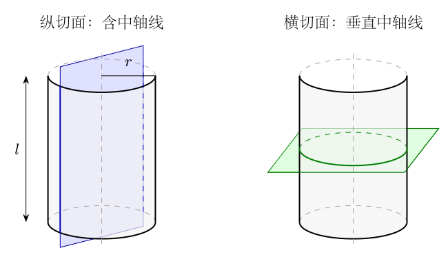{width=68%}

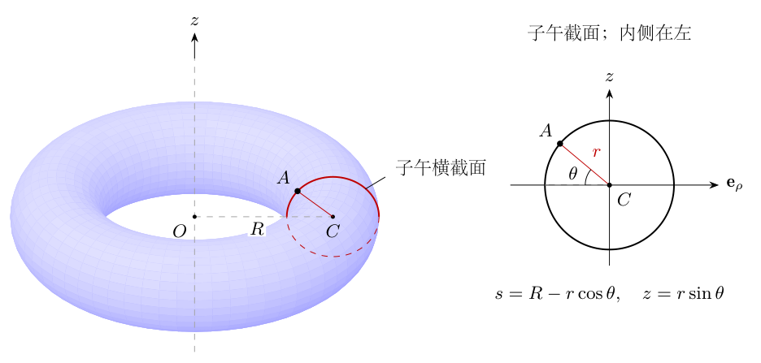{width=92%}

<!-- question-end -->

## 一、题型定位

这是薄膜容器的局部张力与整体压力平衡问题。圆柱用半筒和闭端截面分别求两个方向的膜力；环面用环形膜带的竖向合力先求一个张力，再用带符号的主曲率平衡求另一个。仅用“压强乘面积”而不指明投影方向、切边及拉力方向，会遗漏系数或把两个张力交换。

这里的 $\sigma_1,\sigma_2$ 是膜张力，单位为 $\mathrm{N\,m^{-1}}$，不是通常按单位截面积计量的材料应力。若膜厚为 $t$，相应的材料正应力才是 $\sigma_i/t$，单位为 $\mathrm{Pa}$。两问中的下标按各自切线定义使用，不凭“纵向”或“横向”两个字猜实际拉力方向。

## 二、知识点

压差作用于薄膜的外法向；曲面分布力的投影与积分；膜张力跨过切线传递、且在切平面内垂直于切线；闭端容器的端面压力载荷；两主方向的曲率与局部法向平衡；内凹曲率的负号；连续极限与除零条件；张力极值和裂缝方向；大环半径极限中的局部圆筒对应。

计算采用薄膜静力学，忽略膜厚、弯曲刚度及自身重力；内部压差均匀，记 $p=\Delta p>0$。环面取 $R>r>0$，以保证中心孔存在且表面光滑。只计算稳态膜力，不自行引入未给出的弹性模量或把给定形状的平衡问题改成形变求解。

## 三、物理图像

压力把薄膜向外推，膜张力沿曲面切向拉邻近膜块。相对的两边张力大小可能相同，但方向会因曲面弯曲而不同，其合力可以沿法向抵抗压力。液体界面的各向同性张力是同一个标量；弹性膜的两个主张力可以不同，不能直接设 $\sigma_1=\sigma_2$。

图3-1中沿轴向的纵切线所传递的力是环向力，沿圆周的横切线所传递的力是轴向力。因此圆柱的 $\sigma_1$ 为环向张力，$\sigma_2$ 为轴向张力。图3-2中小圆所在横截面的交线沿子午方向，跨线的 $\sigma_1$ 沿大圆环向；另一条交线沿平行圈，跨线的 $\sigma_2$ 沿小圆子午方向。力方向与切线方向相互垂直。

环面内侧在子午方向是凸曲率、在大圆环向却是凹曲率。一部分环向膜力的法向合力会向外，而不是抵消压力。因此内侧所需的子午张力较大。这一几何原因必须通过真实空间法向和两切向判断，不能把甜甜圈的二维外轮廓当成两个同向弯曲的圆。

## 四、解题入口

先明确每条截线传递哪一方向的力，再选能隔离未知张力的整体膜块。圆柱横向取半筒，轴向取含闭端的筒段；环面先取某平行圈到顶部平行圈之间的上半膜带，利用顶部子午张力没有竖向分量这一条件。

求得环面的子午张力 $\sigma_2(\theta)$ 后，再建立外法向下的曲率符号，代入法向平衡求环向张力 $\sigma_1(\theta)$。最后比较主张力及其随 $\theta$ 的变化，区分“哪个力最大”“哪个位置先到限”与“裂缝沿哪个方向”三个问题。

## 五、解析

**第1步：明确膜力定义、静力模型与端部条件。**

取任意一条膜面切线，长为 $\mathrm d\ell$，相邻膜块通过它传递的拉力大小为 $\sigma\,\mathrm d\ell$。拉力沿膜面，垂直于这条切线；$\sigma$ 是每单位切线长度的力，所以压力 $p$ 与 $\sigma$ 的量纲相差一个长度。

圆柱采用香肠的闭端模型：端面受到的压差合力由圆柱侧壁的轴向膜力承担。$l\gg r$ 使中段远离端部局部应力变化，但端面总载荷仍传到中段，不可因为圆柱很长而删掉。若另有刚性装置独立承担端力，或者使用开放管段，轴向张力便需要另给边界载荷；下面的 $\sigma_2$ 结论有明确的闭端条件。

膜的质量在静态方程中不出现。压差力为 $p\,\mathrm dS\,\mathbf n$，其中 $\mathbf n$ 是由内部指向外部的单位法向。每一处压力方向沿本处法向，不将整个曲面上的压力都画成同一方向。

**第2步：对半圆柱沿横向投影，求环向张力。**

沿轴向取中段长度 $h$，再沿含轴平面切出半筒。以该半筒中央向外方向为 $+x$，截面周向角为 $\varphi$，保留范围 $-\pi/2\le\varphi\le\pi/2$。图3-3左侧的两条切边平行轴线，各边的总拉力为 $\sigma_1h$；两力在本次投影中均向内。

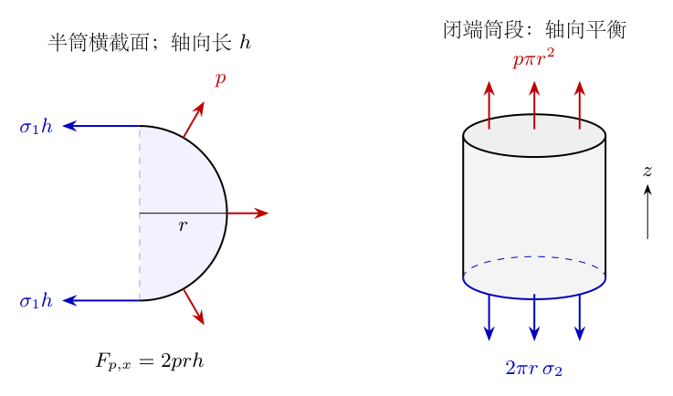{width=92%}

侧壁面积微元为 $\mathrm dS=rh\,\mathrm d\varphi$，压力的 $x$ 分量为 $p\,\mathrm dS\cos\varphi$。先积分方向，再与两切边拉力比较：

$$
\begin{aligned}
F_{p,x}
&=\int_{-\pi/2}^{\pi/2}prh\cos\varphi\,\mathrm d\varphi\\
&=prh[\sin\varphi]_{-\pi/2}^{\pi/2}\\
&=2prh,\\
F_{\sigma_1,x}&=-2\sigma_1h,\\
F_{p,x}+F_{\sigma_1,x}&=0.
\end{aligned}
$$

除以 $2h$，得到

$$
\boxed{\sigma_1=pr=r\Delta p}.
$$

积分结果也等于压差乘半筒在垂直于 $x$ 平面上的投影面积 $2rh$。不是把半筒实际侧面积 $\pi rh$ 直接乘以同一方向的压力；后者忽略了两侧法向倾斜。

**第3步：保留闭端压差载荷，求轴向张力。**

图3-3右侧取含一端的筒段。端面受压差合力大小为 $p\pi r^2$；侧壁压力方向径向，与轴垂直，不提供轴向分量。横切线是周长 $2\pi r$ 的圆，其各处轴向拉力均指向筒段之外，合力大小为 $2\pi r\,\sigma_2$。

沿轴向静力平衡：

$$
\begin{aligned}
p\pi r^2-2\pi r\,\sigma_2&=0,\\
\sigma_2&=\frac{p\pi r^2}{2\pi r}\\
&=\boxed{\frac{pr}{2}=\frac{r\Delta p}{2}}.
\end{aligned}
$$

式中的 $\pi$ 和一项 $r$ 分别约去。这个二分之一来自“端面面积除以切边周长”，不是肥皂泡的双界面因子。本题弹性膜是单层膜，不额外把张力乘二。

圆柱结果为 $\sigma_1=2\sigma_2$。若膜厚、质量及许用张力处处相同，且两个方向的强度没有显著差别，环向拉力先达到强度上限。裂缝两侧主要被该力向圆周方向拉开，因此裂缝延伸方向与环向力垂直，即沿轴线纵向。并不是“轴向张力最大所以纵裂”。

**第4步：固定环面的角度、空间坐标及两个主方向。**

以大圆平面为 $z=0$，其中心轴为 $z$ 轴。大圆上的周向角记作 $\varphi$，距轴的柱坐标半径记作 $s$。在一个子午小圆中，$\theta=0$ 指向中心孔，$\theta=\pi$ 指向最外侧；上半部 $0<\theta<\pi$，下半部按同一有向角继续。

图3-2中的小圆圆心距轴 $R$，点 $A$ 相对圆心的水平位移为 $-r\cos\theta$，竖向位移为 $r\sin\theta$。因此

$$
\boxed{s(\theta)=R-r\cos\theta,\qquad z(\theta)=r\sin\theta}.
$$

$s$ 是该点所在平行圈的几何半径，不是小圆半径 $r$。在 $\theta=0,\pi/2,\pi$ 时，依次为 $R-r,R,R+r$。

取柱坐标单位矢量 $\mathbf e_\rho,\mathbf e_\varphi,\mathbf e_z$，则子午切向及外法向为

$$
\begin{aligned}
\mathbf e_\theta
&=\sin\theta\,\mathbf e_\rho+\cos\theta\,\mathbf e_z,\\
\mathbf n
&=-\cos\theta\,\mathbf e_\rho+\sin\theta\,\mathbf e_z.
\end{aligned}
$$

二者内积为零，长度均为一；在内侧 $\theta=0$，外法向朝中心孔，即 $-\mathbf e_\rho$，与空间图一致。环面中的 $\sigma_1$ 沿 $\mathbf e_\varphi$，$\sigma_2$ 沿 $\mathbf e_\theta$；下面不会将切线方向当作力方向。

**第5步：取内侧上膜带，精确求压力的竖向投影。**

先考虑 $0\le\theta<\pi/2$。取该平行圈至顶部平行圈 $\theta=\pi/2$ 之间的整圈膜带。图3-4中的下边界半径为 $s=R-r\cos\theta$，顶部边界半径为 $R$。顶部的子午切向水平，故沿顶部传递的 $\sigma_2$ 没有竖向分量；下边界所受相邻膜的子午拉力向下，其竖向分量每单位周长为 $\sigma_2(\theta)\cos\theta$。

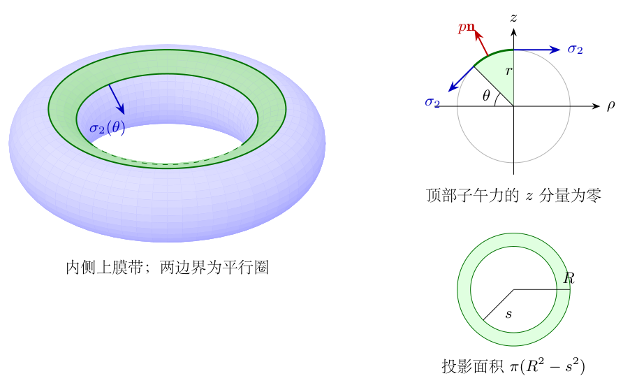{width=92%}

为避免仅凭投影图猜面积，设膜带中间子午角为 $\psi$，面积微元为

$$
\mathrm dS=r\,s(\psi)\,\mathrm d\psi\,\mathrm d\varphi.
$$

法向竖向分量为 $n_z=\sin\psi$。对两个角变量积分：

$$
\begin{aligned}
F_{p,z}
&=\int_0^{2\pi}\int_\theta^{\pi/2}
p\sin\psi\,r(R-r\cos\psi)\,\mathrm d\psi\,\mathrm d\varphi\\
&=2\pi pr\int_\theta^{\pi/2}
(R-r\cos\psi)\sin\psi\,\mathrm d\psi.
\end{aligned}
$$

利用 $s(\psi)=R-r\cos\psi$、$\mathrm ds=r\sin\psi\,\mathrm d\psi$ 换元，积分上下限从 $s$ 到 $R$：

$$
\begin{aligned}
F_{p,z}
&=2\pi p\int_s^R s'\,\mathrm ds'\\
&=2\pi p\left[\frac{(s')^2}{2}\right]_s^R\\
&=\pi p(R^2-s^2).
\end{aligned}
$$

此处 $s'$ 是积分变量，不表示导数。结果正是压差乘图3-4中内半径 $s$、外半径 $R$ 的投影环面积，方向向上。下边界总子午拉力的竖向分量为

$$
F_{\sigma_2,z}=-2\pi s\,\sigma_2(\theta)\cos\theta.
$$

上边界的竖向力为零，膜带又无重力，故

$$
\pi p(R^2-s^2)=2\pi s\,\sigma_2(\theta)\cos\theta.
$$

**第6步：逐项化简并求子午张力。**

在本步范围内 $\cos\theta>0$，可以除以它。先对平方差因式分解：

$$
\begin{aligned}
R^2-s^2
&=(R-s)(R+s),\\
R-s&=r\cos\theta,\\
R+s&=2R-r\cos\theta,\\
R^2-s^2
&=r\cos\theta(2R-r\cos\theta).
\end{aligned}
$$

代入第5步平衡式，约去共同的 $\pi\cos\theta$：

$$
\begin{aligned}
\sigma_2(\theta)
&=\frac{p\,r\cos\theta(2R-r\cos\theta)}
{2s\cos\theta}\\
&=\boxed{\frac{pr(2R-r\cos\theta)}
{2(R-r\cos\theta)}}.
\end{aligned}
$$

将分子拆成 $(R-r\cos\theta)+R$，同一结果也可写成

$$
\sigma_2(\theta)=\frac{pr}{2}
+\frac{prR}{2(R-r\cos\theta)}.
$$

拆分式将用于比较两个张力及求最大值。此时还未求 $\sigma_1$，不能仅根据第（1）问的下标习惯提前把该变量改名。

**第7步：处理外侧、顶部与下半部，不把除零隐藏起来。**

对于 $\pi/2<\theta\le\pi$，取顶部至外侧目标圈的上膜带。压力向上合力为 $\pi p(s^2-R^2)$。目标圈的子午拉力沿 $+\mathbf e_\theta$，其竖向分量因 $\cos\theta<0$ 而向下。因此竖向方程为

$$
\pi p(s^2-R^2)+2\pi s\,\sigma_2(\theta)\cos\theta=0.
$$

移项后仍是

$$
2\pi s\,\sigma_2(\theta)\cos\theta=\pi p(R^2-s^2),
$$

两边均为负值。继续用第6步的平方差，得到相同的正张力式。外侧的两个负号是从受力方向产生的，不对压力大小人为取负。

在 $\theta=\pi/2$，原竖向方程退化为 $0=0$，不能直接除以 $\cos\theta$。从相邻光滑膜带取连续极限：

$$
\sigma_2\left(\frac\pi2\right)
=\lim_{\theta\to\pi/2}
\frac{pr(2R-r\cos\theta)}{2(R-r\cos\theta)}
=pr.
$$

下半部由关于大圆平面的镜面对称给出同一分布；其表达式只含 $\cos\theta$，与上下对称一致。底部 $\theta=3\pi/2$ 的连续值同样为 $pr$。后面的局部法向平衡将独立验证顶部、底部的值。

**第8步：按外法向求两个带符号主曲率。**

图3-5分别标出子午切向、大圆环向和外法向。曲率按“切向沿弧长变化所产生的向内法向合力”取正，写成 $\kappa=-\mathbf n\cdot\mathrm d\mathbf e_t/\mathrm d\ell$。切向的法向变化若朝 $-\mathbf n$，曲率为正；若朝 $+\mathbf n$，则为负。

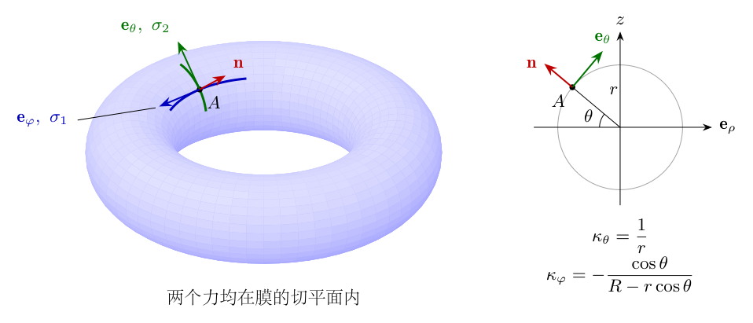{width=92%}

在子午小圆上，$\mathrm d\ell_\theta=r\,\mathrm d\theta$，并且

$$
\begin{aligned}
\frac{\mathrm d\mathbf e_\theta}{\mathrm d\theta}
&=\cos\theta\,\mathbf e_\rho-\sin\theta\,\mathbf e_z
=-\mathbf n,\\
\kappa_\theta
&=-\mathbf n\cdot\frac{-\mathbf n}{r}
=\frac1r.
\end{aligned}
$$

在平行圈上，$\theta$ 固定，$\mathrm d\ell_\varphi=s\,\mathrm d\varphi$。柱坐标切向满足 $\mathrm d\mathbf e_\varphi/\mathrm d\varphi=-\mathbf e_\rho$，而 $\mathbf n\cdot\mathbf e_\rho=-\cos\theta$，因此

$$
\begin{aligned}
\kappa_\varphi
&=-\mathbf n\cdot
\left(-\frac{\mathbf e_\rho}{s}\right)\\
&=-\frac{\cos\theta}{R-r\cos\theta}.
\end{aligned}
$$

这里必须保留负号。内侧 $\cos\theta>0$ 时，环向曲率为负；外侧 $\cos\theta<0$ 时为正；顶部、底部为零。相应的带符号曲率半径在 $\cos\theta\ne0$ 时为 $-s/\cos\theta$，不是直接取平行圈半径 $s$。顶部、底部应使用零曲率，而不是对无限半径进行不明运算。

两相对边张力的法向合力除以膜块面积，是 $-\sigma_i\kappa_i$。因此压力向外、膜力合力向内的局部平衡为

$$
\boxed{
p=\sigma_1\kappa_\varphi+\sigma_2\kappa_\theta
=-\frac{\sigma_1\cos\theta}{s}+\frac{\sigma_2}{r}}.
$$

与题中的 $p=\sigma_1/r_1+\sigma_2/r_2$ 配对时，$1/r_1=\kappa_\varphi$、$1/r_2=\kappa_\theta$。所配对的是张力实际作用方向，不是跨线名称中的“横”或“纵”。

**第9步：代入子午张力，求环向张力并补连续点。**

先计算局部方程中的差：

$$
\begin{aligned}
\frac{\sigma_2}{r}-p
&=\frac{p(2R-r\cos\theta)}{2s}-p\\
&=\frac{p[(2R-r\cos\theta)-2(R-r\cos\theta)]}{2s}\\
&=\frac{pr\cos\theta}{2s}.
\end{aligned}
$$

局部方程给 $\sigma_1\cos\theta/s=\sigma_2/r-p$。在 $\cos\theta\ne0$ 的地方，

$$
\begin{aligned}
\sigma_1
&=\frac{s}{\cos\theta}
\left(\frac{\sigma_2}{r}-p\right)\\
&=\frac{s}{\cos\theta}\frac{pr\cos\theta}{2s}\\
&=\boxed{\frac{pr}{2}}.
\end{aligned}
$$

差式是 $\sigma_2/r-p$，不是 $p-\sigma_2/r$；这一顺序由第8步的负曲率确定。无论内侧或外侧，约去相同的有符号 $\cos\theta$ 后张力均为正。

在 $\cos\theta=0$ 处，局部方程直接给 $\sigma_2=pr$，与第7步一致；它在单独这一点不含 $\sigma_1$，但光滑膜的连续极限给 $\sigma_1=pr/2$。不能因一条局部方程在某点少一个未知量，就宣称该处环向张力任意。

第（2）问两个张力为

$$
\boxed{
\sigma_1(\theta)=\frac{r\Delta p}{2},\qquad
\sigma_2(\theta)
=\frac{r\Delta p(2R-r\cos\theta)}
{2(R-r\cos\theta)}}.
$$

**第10步：比较两主张力并严格求最大位置。**

用第6步拆分式：

$$
\sigma_2-\sigma_1
=\frac{prR}{2(R-r\cos\theta)}>0.
$$

由于 $R>r$，分母处处为正，所以子午张力处处比环向张力大。比较极值可令 $x=\cos\theta$，$-1\le x\le1$：

$$
\begin{aligned}
\frac{\sigma_2}{pr}
&=f(x)=\frac{2R-rx}{2(R-rx)},\\
f'(x)
&=\frac{(-r)\,2(R-rx)-(2R-rx)(-2r)}
{4(R-rx)^2}\\
&=\frac{rR}{2(R-rx)^2}>0.
\end{aligned}
$$

这是商法则；保留分母导数中的负号后，分子化为 $2rR$。因此最大值在 $x=1$，即最内侧 $\theta=0$；最小值在 $x=-1$，即最外侧 $\theta=\pi$：

$$
\begin{aligned}
\sigma_{2,\max}
&=\frac{pr(2R-r)}{2(R-r)},\\
\sigma_{2,\min}
&=\frac{pr(2R+r)}{2(R+r)},\\
\sigma_2\left(\frac\pi2\right)
&=\sigma_2\left(\frac{3\pi}2\right)=pr.
\end{aligned}
$$

图3-6把张力分布与环面内圈位置对应，内圈的子午拉力最大；下标为 $1$ 的张力则在整圈相同。图中的空间形状与曲线取 $R=3r$ 作为示例，所得公式与最大位置对任意 $R>r$ 均成立。后续判别裂缝时使用这两个实际方向，而非只看数值曲线。

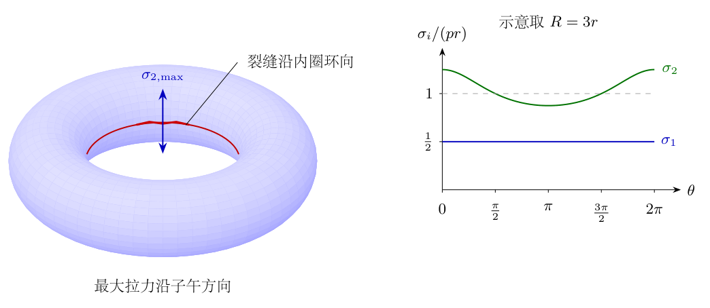{width=92%}

在均匀薄膜、各处许用张力相同且两个方向强度相当的模型下，内圈的子午张力最先到限。裂缝垂直于 $\mathbf e_\theta$，沿内圈的 $\mathbf e_\varphi$ 方向延伸，即沿弯成圆环的香肠的局部轴向；不是沿小圆截面的子午线裂开。若材料方向强度不同或已有局部缺陷，破裂位置还须比较局部张力与对应的许用值，不能只凭最大张力作普遍断言。

<!-- KEEP_TOGETHER_START -->

**第11步：检查量纲、局部圆筒极限与几何边界。**

$pr$ 的单位为 $\mathrm{Pa\,m}=\mathrm{N\,m^{-1}}$；张力式中其余因子均为长度比。法向方程的每一项为张力乘曲率，单位为 $\mathrm{N\,m^{-2}}$，与压差一致。内外侧张力均为正，符合受拉薄膜模型。

<!-- KEEP_TOGETHER_END -->

在 $R/r\to\infty$ 时，令 $\epsilon=r/R\to0$。对子午张力把分子、分母同时除以 $R$：

$$
\begin{aligned}
\sigma_2(\theta)
&=\frac{pr}{2}
\frac{2-\epsilon\cos\theta}{1-\epsilon\cos\theta}\\
&\longrightarrow pr,\qquad
\sigma_1=\frac{pr}{2}.
\end{aligned}
$$

此时一小段弯管接近直圆柱，其局部管轴沿 $\mathbf e_\varphi$，绕管小截面方向沿 $\mathbf e_\theta$。故局部轴向张力为 $pr/2$、局部环绕张力为 $pr$，与第（1）问的物理方向完全一致。两问下标对应不同切线定义，不能只看下标就误判极限。

当 $R\to r^+$ 时，内圈半径 $R-r$ 趋零，负环向曲率和 $\sigma_{2,\max}$ 都增大。数学式显示尖接触附近应力集中，正说明不能把 $R=r$ 的退化环面当作普通光滑薄膜处理。$p=0$ 时两张力均退化为零；若另外施加预张力，则应另给边界和形状条件，本解没有暗中加入它。

## 六、关键洞察

本题的下标不是物理方向的永久名称。两问按不同切线定义两个力，正确做法是先写“切线方向—跨线力方向”的对应，再列面积与周长。由圆柱两整体平衡式得到的 $2:1$ 比例，与环面局部圆筒极限中的 $1:2$ 下标比例并不矛盾，实际的环绕管截面张力始终是 $pr$、沿局部管轴的张力始终是 $pr/2$。

环面也可不先取整体膜带，而从空间膜块的完整矢量平衡独立求两张力。取子午角宽 $\mathrm d\theta$、大圆角宽 $\mathrm d\varphi$ 的小膜块，面积为 $r s\,\mathrm d\theta\,\mathrm d\varphi$。$\theta$ 的两边界长度为 $s\,\mathrm d\varphi$，其传递的是 $\sigma_2$；$\varphi$ 的两边界长度为 $r\,\mathrm d\theta$，其传递的是 $\sigma_1$。

子午两边的合力除以面积，在微元极限下为

$$
\begin{aligned}
\frac{\mathrm d\mathbf F_\theta}{\mathrm dS}
&=\frac1{rs}\frac{\mathrm d}{\mathrm d\theta}
(s\sigma_2\mathbf e_\theta)\\
&=\frac{(s\sigma_2)'}{rs}\mathbf e_\theta
-\frac{\sigma_2}{r}\mathbf n.
\end{aligned}
$$

这里撇号表示对 $\theta$ 求导。第一项保留边界周长 $s$ 的变化，不可只对 $\sigma_2$ 求导。第二项使用 $\mathbf e_\theta'=-\mathbf n$，正是子午曲率所对应的向内力。

环向两边合力为

$$
\frac{\mathrm d\mathbf F_\varphi}{\mathrm dS}
=-\frac{\sigma_1}{s}\mathbf e_\rho.
$$

由第4步两个单位矢量式反解

$$
\mathbf e_\rho
=\sin\theta\,\mathbf e_\theta-\cos\theta\,\mathbf n,
$$

故

$$
\frac{\mathrm d\mathbf F_\varphi}{\mathrm dS}
=-\frac{\sigma_1\sin\theta}{s}\mathbf e_\theta
+\frac{\sigma_1\cos\theta}{s}\mathbf n.
$$

加上压差 $p\mathbf n$，分别令切向与法向分量为零，得到两条不同的平衡式：

$$
\begin{aligned}
(s\sigma_2)'&=r\sin\theta\,\sigma_1=s'\sigma_1,\\
p-\frac{\sigma_2}{r}
+\frac{\sigma_1\cos\theta}{s}&=0.
\end{aligned}
$$

法向式与主解析一致；切向式则约束张力的分布，不能只用一条局部法向式就给两个未知张力赋值。

令 $y=s\sigma_2$。在 $\cos\theta\ne0$ 的一段上，由法向式消去 $\sigma_1$：

$$
\begin{aligned}
\sigma_1
&=\frac{s}{\cos\theta}\left(\frac{y}{rs}-p\right),\\
y'
&=r\sin\theta\,
\frac{s}{\cos\theta}\left(\frac{y}{rs}-p\right)\\
&=\tan\theta(y-prs).
\end{aligned}
$$

采用一阶线性方程的积分因子 $\cos\theta$，同时用乘积求导：

$$
\begin{aligned}
(y\cos\theta)'
&=y'\cos\theta-y\sin\theta\\
&=\sin\theta(y-prs)-y\sin\theta\\
&=-pr(R-r\cos\theta)\sin\theta.
\end{aligned}
$$

逐项积分，不跳过两个三角积分：

$$
\begin{aligned}
y\cos\theta
&=-prR\int\sin\theta\,\mathrm d\theta
+pr^2\int\sin\theta\cos\theta\,\mathrm d\theta\\
&=prR\cos\theta-\frac{pr^2}{2}\cos^2\theta+C,\\
y&=pr\left(R-\frac r2\cos\theta\right)
+\frac{C}{\cos\theta}.
\end{aligned}
$$

后一积分使用 $u=\cos\theta$、$\mathrm du=-\sin\theta\,\mathrm d\theta$。在顶部和底部，$s=R>0$；光滑薄膜的有限张力要求 $y$ 有限，故每段中的 $C/\cos\theta$ 项必须消失，即 $C=0$。恢复 $\sigma_2=y/s$ 后，再代回法向式得 $\sigma_1=pr/2$。上下半部的连续接合排除靠不同积分常数制造的虚假支路。

这一路线解释了为什么整体膜带法有效：顶部边界的竖向张力为零，相当于把有限性条件直接写入积分受力式。完整曲面微元法还能独立检验切向平衡，不只是把已经得到的张力再次代入法向方程。

内圈负曲率不表示膜必须受压。内圈的环向张力仍为正，但其法向合力向孔内外法向方向，增加了子午张力必须抵抗的载荷。区分“张力为负”和“受拉膜的某一主曲率为负”，是理解环面应力集中的关键。

## 七、易错点

将膜张力 $\sigma_i$ 当作 $\mathrm{Pa}$ 为单位的材料应力，会使压力平衡少一个膜厚或长度。先写切边总力 $\sigma_i\ell$；若确需材料应力，最后才除以膜厚。

沿纵切线定义的张力不沿纵切线作用。跨线力方向在膜切平面内垂直于切线，圆柱和环面的下标对应也不同。先画切线与力的直角关系，再给两个力命名。

用半筒实际面积 $\pi rh$ 乘以同一方向的 $p$，会得到错误系数。真正的曲面压力是法向分布力，其横向合力等于 $p$ 乘投影面积 $2rh$。环面膜带同样须取环形投影，不是膜带实际面积。

长圆柱并不意味着端面载荷可以忽略。若未说明端部如何封闭或载荷由谁承担，仅靠中段局部曲率只能确定环向张力，不能唯一确定轴向张力。本题采用闭端香肠模型。

把环向曲率写成 $1/s$、或把两个曲率都取正，会在内圈得到不正确甚至为负的张力。应按外法向计算 $\kappa_\varphi=-\cos\theta/s$，特别检查 $\theta=0$、$\theta=\pi$ 和顶部的符号。

在 $\theta=\pi/2$ 直接约去 $\cos\theta=0$，是隐蔽的除零。该处竖向整体方程为 $0=0$，须用连续极限和局部法向式补值。另解微分方程时也要用有限性排除 $C/\cos\theta$。

最大主张力的方向与裂缝方向垂直，不是平行。环面内圈最大力沿子午方向，裂缝沿内圈环向；圆柱最大力沿绕轴圆周方向，裂缝沿直轴方向。

仅由张力最大就宣称任何材料都在该处破裂，忽略了许用强度、厚度和缺陷。正式结论依赖均匀薄膜和方向强度相当的模型；方向强度不同时应比较 $\sigma_i/\Lambda_i$。

## 八、课堂讲解建议

课堂先用一张纸剪出两种切线，让学生在切线两侧画彼此相反、且垂直切线的面内拉力。教师在图3-1和图3-2上逐一写出实际力方向，不先背“纵向张力”或“横向张力”名称。板书保留切线与拉力的两个方向，避免进入环面后沿用错误下标。

随后只讲圆柱。让学生先把半筒分成几个法向不同的小片，再用 $\cos\varphi$ 投影；算出 $2rh$ 后才指出投影面积捷径。教师再取闭端筒段，让学生说明侧壁压力为何没有轴向分量、端面压力为何仍由中段侧壁传递。

环面课堂从真正三维图开始，先找内侧、外侧、顶部和局部管轴，之后才给 $\theta$。在图3-4上询问顶部子午力为何没有竖向分量，把这一边界条件与环形投影一起作为解题入口；板书逐行做平方差并注明何时能够约去 $\cos\theta$。

最后教师在图3-5的内圈分别沿两个主方向走一小段，比较切向变化与外法向，建立一个正曲率、一个负曲率的直觉。让学生在图3-6上先指出最大力方向，再画垂直于它的裂缝。若时间充足，可用关键洞察中的完整微元推导说明切向平衡与积分常数，不以背诵环面张力式代替理解。

## 九、变式训练

**变式1：薄膜张力与材料应力的换算。**

闭端圆柱半径 $r=2.5\times10^{-2}\,\mathrm m$，膜厚 $t=2.0\times10^{-4}\,\mathrm m$，压差 $p=8.0\times10^3\,\mathrm{Pa}$。求两个膜张力及材料正应力；若两个方向的许用材料应力均为 $S=1.6\times10^6\,\mathrm{Pa}$，求压差上限。

首先按膜张力求力，不把材料应力提前代入同一记号：

$$
\begin{aligned}
\sigma_1&=pr
=(8.0\times10^3)(2.5\times10^{-2})
=200\,\mathrm{N\,m^{-1}},\\
\sigma_2&=\frac{pr}{2}
=100\,\mathrm{N\,m^{-1}}.
\end{aligned}
$$

膜的截面积是切边长度乘厚度，所以两个材料正应力为

$$
\begin{aligned}
S_1&=\frac{\sigma_1}{t}
=\frac{200}{2.0\times10^{-4}}
=1.0\times10^6\,\mathrm{Pa},\\
S_2&=\frac{\sigma_2}{t}
=5.0\times10^5\,\mathrm{Pa}.
\end{aligned}
$$

环向先到限，令 $pr/t=S$，得到

$$
p_{\max}=\frac{St}{r}
=\frac{(1.6\times10^6)(2.0\times10^{-4})}
{2.5\times10^{-2}}
=1.28\times10^4\,\mathrm{Pa}.
$$

轴向在此时仅达到 $S/2$。裂缝沿轴向，不是沿最大材料应力方向。给定压差 $8.0\times10^3\,\mathrm{Pa}$ 低于上限，符合安全条件；若达到许用值即视为失效，则上式表示极限压差而非严格安全端点。

**变式2：半径比为四的环面。**

设 $R=4r$，压差为 $p$。求内侧、顶部、外侧的两个主张力，比较内外子午张力之比及内侧子午张力与环向张力之比。

环向张力处处为 $\sigma_1=pr/2$。对子午张力分别代入 $\cos\theta=1,0,-1$：

$$
\begin{aligned}
\sigma_2(0)
&=\frac{pr(8r-r)}{2(4r-r)}
=\frac76pr,\\
\sigma_2\left(\frac\pi2\right)&=pr,\\
\sigma_2(\pi)
&=\frac{pr(8r+r)}{2(4r+r)}
=\frac9{10}pr.
\end{aligned}
$$

因此

$$
\begin{aligned}
\frac{\sigma_2(0)}{\sigma_2(\pi)}
&=\frac{7/6}{9/10}
=\frac{35}{27}\approx1.2963,\\
\frac{\sigma_2(0)}{\sigma_1}
&=\frac{7/6}{1/2}
=\frac73\approx2.3333.
\end{aligned}
$$

外侧子午张力虽小于 $pr$，仍大于 $pr/2$ 的环向张力。内侧局部法向检查为

$$
-\frac{\sigma_1}{R-r}+\frac{\sigma_2(0)}r
=-\frac{p}{6}+\frac{7p}{6}=p,
$$

明确使用内侧负环向曲率。外侧检查为 $+\sigma_1/(R+r)+\sigma_2(\pi)/r=p/10+9p/10=p$，两个位置均平衡。

**变式3：由许用张力求压差上限和最小大环半径。**

环面两个方向的许用张力均为 $\Lambda>0$。先求 $p_{\max}$。再设 $p,r,\Lambda$ 已给定，求使全部膜面不超限的 $R$ 范围。

因为 $\sigma_2$ 处处大于 $\sigma_1$，只需用内圈最大子午张力限制：

$$
\begin{aligned}
\frac{pr(2R-r)}{2(R-r)}&\le\Lambda,\\
p&\le\boxed{\frac{2\Lambda(R-r)}{r(2R-r)}}.
\end{aligned}
$$

因此 $p_{\max}=2\Lambda(R-r)/[r(2R-r)]$。与相同 $r,\Lambda$ 的闭端直圆柱 $p_{\max,\text{柱}}=\Lambda/r$ 比较，

$$
\frac{p_{\max}}{p_{\max,\text{柱}}}
=\frac{2(R-r)}{2R-r}<1.
$$

把管弯成环后，内侧几何使允许压差下降；当 $R/r\to\infty$ 时比值趋于一。

固定 $p$ 求 $R$ 时，因 $R-r>0$，可乘以正分母而不改变不等号：

$$
\begin{aligned}
pr(2R-r)&\le2\Lambda(R-r),\\
2prR-pr^2&\le2\Lambda R-2\Lambda r,\\
2(\Lambda-pr)R&\ge r(2\Lambda-pr).
\end{aligned}
$$

若 $\Lambda>pr$，除以正的 $2(\Lambda-pr)$：

$$
\boxed{
R\ge R_{\min}
=\frac{r(2\Lambda-pr)}{2(\Lambda-pr)}
=r\left[1+\frac{pr}{2(\Lambda-pr)}\right]}.
$$

$R_{\min}>r$ 自动符合环面几何条件。若 $\Lambda=pr$，不等式化为 $0\ge pr^2$，对 $p,r>0$ 不成立；只有无限大 $R$ 的直管极限能够逼近边界。若 $\Lambda<pr$，任意有限环面的内圈张力都大于 $pr>\Lambda$，仍无解，不可把负分母除过去后给出虚假“最小半径”。

<!-- KEEP_TOGETHER_START -->

**变式4：方向强度不同，还一定在内圈沿环向裂开吗？**

环面膜面均匀，但环向、子午向许用张力分别为 $\Lambda_1,\Lambda_2>0$。求压差上限及先失效的方向；说明内圈结论的适用条件。

环向张力为常数，要求 $pr/2\le\Lambda_1$，故 $p\le2\Lambda_1/r$。子午张力最内侧最大，要求

$$
\frac{pr(2R-r)}{2(R-r)}\le\Lambda_2,
\qquad
p\le\frac{2\Lambda_2(R-r)}{r(2R-r)}.
$$

<!-- KEEP_TOGETHER_END -->

两条件须同时成立：

$$
\boxed{
p_{\max}
=\min\left\{
\frac{2\Lambda_1}{r},
\frac{2\Lambda_2(R-r)}{r(2R-r)}
\right\}}.
$$

比较两个上限，均乘以正数后得到分界：

$$
\frac{\Lambda_1}{\Lambda_2}
\ \begin{cases}
<\dfrac{R-r}{2R-r},&\text{环向强度先到限},\\
=\dfrac{R-r}{2R-r},&\text{两种边界同时到达},\\
>\dfrac{R-r}{2R-r},&\text{内圈子午强度先到限}.
\end{cases}
$$

若内圈子午方向先失效，裂缝沿内圈环向，与主解析一致。若环向方向先失效，环向张力本来处处相同；本模型不能从力的大小挑出唯一破裂位置，裂缝趋向子午方向，具体起裂点还由缺陷决定。方向许用张力相同的情况下，比例为一，而 $(R-r)/(2R-r)<1$，因此确实是内圈子午强度先到限。这个变式说明为什么主解析必须写明方向强度相当的条件。

<!-- question-complete -->

\newpage

# 第4题

<!-- question-start -->

一根轻质细弹簧的初始伸长量为 $\Delta l_1$，两端固定在桌面上的 $A,B$ 两点。在弹簧正中间安置一个小球，使它分别作小幅横向振动和小幅纵向振动，横向振动周期与纵向振动周期之比为 $n_1=4$。将弹簧的伸长量增加 $\Delta x=3.5\,\mathrm{cm}$ 后，周期之比变为 $n_2=3$。

求弹簧原长 $l_0$、第一种情况下的伸长量 $\Delta l_1$ 和第二种情况下的伸长量 $\Delta l_2$。设实验中弹簧满足胡克定律；横向和纵向的定义如图4-1所示。

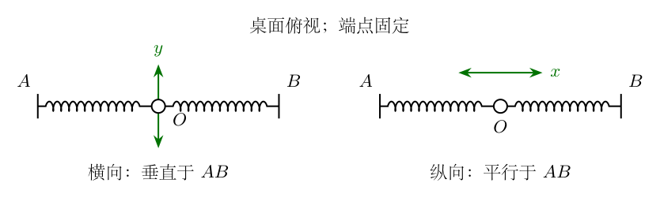{width=88%}

<!-- question-end -->

## 一、题型定位

这是由两个小振动周期反求弹簧几何参数的问题。纵向振动改变两半弹簧的伸长量，横向振动主要改变两半拉力的方向；后者的线性回复力由已有预张力产生。先从真实受力或势能求两个等效劲度，再取周期比，质量和弹簧劲度才会消去。

本题的“原长”是弹簧没有受力时的长度 $l_0$，不是第一次实验中两固定端点的距离。增加的 $\Delta x$ 是两次总伸长量之差，也就是两次端点距离之差，不是小球振动的振幅。

## 二、知识点

均匀弹簧截取一半后劲度加倍；串联弹簧的柔度相加；小球的左右弹簧力与净回复力；小振幅简谐运动；斜向拉力的方向投影；平方根的二阶展开；势能的二次项与等效劲度；预张力引起的横向线性刚度；周期比消元；两次测量的正值条件与回代检验。

采用均匀、左右对称的轻质弹簧模型，忽略弹簧质量、阻尼和桌面内摩擦。桌面支承抵消小球重力，横向振动仍在桌面内，并不是在重力方向上振动。小球质量记作 $m$，整根弹簧的劲度记作 $k$；它们不需要由题目给出，因为周期比中会同时消去。

## 三、物理图像

在平衡位置，两半弹簧都受到预拉伸，向左和向右的力相等。小球沿 $AB$ 向右移动时，左半段进一步拉长，右半段缩短；左拉力增加，右拉力减小，两种变化共同形成向左回复力。

小球在桌面内垂直于 $AB$ 移动时，两半段长度相同，拉力的水平分量相互抵消，垂直于 $AB$ 的分量却同向指向平衡轴线。很小的横向位移只使长度增加一个二阶小量，但原来已有的张力乘上一个一阶小角度，就能给出一阶回复力。因此不能因长度变化小就把横向回复力判为零。

增加预伸长时，纵向线性劲度不变，横向线性劲度增大。横向周期随之缩短，所以周期比由 $4$ 降为 $3$ 与物理趋势一致。

## 四、解题入口

用 $\Delta l$ 暂时表示任意一次实验中的总伸长量，并记

$$
L=l_0+\Delta l,\qquad a=\frac L2,\qquad b=\frac{l_0}{2}.
$$

$L$ 是两个固定端点的距离，$a$ 是平衡时每半段的长度，$b$ 是每半段的原长。先分别求 $T_\parallel$ 和 $T_\perp$，再写 $n=T_\perp/T_\parallel$；不能把频率比与周期比颠倒。

求出一个关于 $l_0/\Delta l$ 的关系后，对两次实验各列一式，并补上 $\Delta l_2-\Delta l_1=\Delta x$。这样恰有三个独立方程求三个长度，不需要另猜小球质量或弹簧劲度。

## 五、解析

**第1步：建立坐标、几何长度与预伸长的统一记号。**

令 $O$ 为两端点的中点，沿 $AB$ 从 $A$ 指向 $B$ 为 $+x$，在桌面内垂直于 $AB$ 取 $+y$。平衡位置小球在 $O$，端点坐标为 $(-a,0)$、$(a,0)$。当前整根原长为 $l_0$，端点距为 $L=l_0+\Delta l$，且 $\Delta l>0$。

每半根的平衡长度为 $a=L/2$，原长为 $b=l_0/2$，所以每半根平衡伸长为

$$
a-b=\frac{L-l_0}{2}=\frac{\Delta l}{2}.
$$

两次实验分别将 $\Delta l$ 换成 $\Delta l_1,\Delta l_2$。小球振动位移 $x,y$ 与端点拉开量 $\Delta x$ 是三种不同的量；在每一次测量周期时，端点不随小球移动。

**第2步：证明每半根的劲度是整根的两倍。**

图4-2将均匀弹簧分为相同的两半。先不讨论振动，对整根施加轴向拉力 $F$。两半串联，因此各自传递的力都为 $F$，不是每半根只受到 $F/2$。

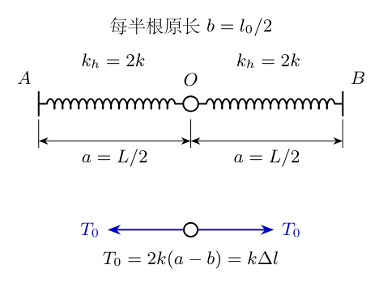{width=68%}

记每半根劲度为 $k_h$。两半伸长量相加：

$$
\begin{aligned}
\Delta l&=\frac F{k_h}+\frac F{k_h}
=\frac{2F}{k_h},\\
F&=k\Delta l,\\
\frac1k&=\frac2{k_h},\\
\boxed{k_h=2k}.
\end{aligned}
$$

半根原长较短，达到相同相对变形所需的绝对伸长较小，所以劲度较大。后面小球受到左右两半的力，各半都要使用 $2k$；不能把整根劲度 $k$ 分成两个 $k/2$。

**第3步：求平衡预张力，并说明其作用。**

由图4-2每半根伸长 $\Delta l/2$，其平衡拉力为

$$
T_0=k_h\frac{\Delta l}{2}
=2k\frac{\Delta l}{2}
=\boxed{k\Delta l}.
$$

小球受到左、右大小均为 $T_0$ 的相反拉力，合力为零。合力为零不表示每根弹簧没有力；这份已有张力将在横向偏转后产生回复分量。

在纵向运动中，$T_0$ 的相反部分会抵消；在横向运动中，两个 $T_0$ 的投影却会相加。这个差别是两种周期不同的根源。

**第4步：对纵向位移逐项列出左右拉力。**

先令小球向右移动 $x$，保持 $y=0$。图4-3左半长度为 $a+x$、右半长度为 $a-x$。只要小球仍在端点之间，两式就是精确的几何长度。

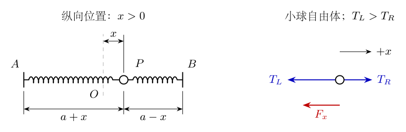{width=92%}

左、右半段的伸长分别为

$$
\begin{aligned}
\delta_L&=a+x-b=\frac{\Delta l}{2}+x,\\
\delta_R&=a-x-b=\frac{\Delta l}{2}-x.
\end{aligned}
$$

左力指向 $A$，右力指向 $B$。按 $+x$ 向右写代数分量：

$$
\begin{aligned}
T_L&=2k\left(\frac{\Delta l}{2}+x\right)
=k\Delta l+2kx,\\
T_R&=2k\left(\frac{\Delta l}{2}-x\right)
=k\Delta l-2kx,\\
F_x&=T_R-T_L\\
&=(k\Delta l-2kx)-(k\Delta l+2kx)\\
&=\boxed{-4kx}.
\end{aligned}
$$

负号表示回复方向与位移相反。取 $x<0$ 时，同一式给正向回复力，不需要为左移另换符号约定。两个弹簧力的变化量各为 $2kx$，总回复量是 $4kx$。

**第5步：由运动方程识别纵向角频率和周期。**

由牛顿第二定律

$$
\begin{aligned}
m\ddot x&=-4kx,\\
\ddot x+\frac{4k}{m}x&=0.
\end{aligned}
$$

与简谐运动标准形式 $\ddot x+\omega_\parallel^2x=0$ 比较：

$$
\begin{aligned}
\omega_\parallel^2&=\frac{4k}{m},\\
T_\parallel&=\frac{2\pi}{\omega_\parallel}
=\boxed{2\pi\sqrt{\frac{m}{4k}}}.
\end{aligned}
$$

例如初始位移 $A_x$、初速度为零时，解为 $x=A_x\cos(\omega_\parallel t)$；相位增加 $2\pi$ 后重复初始状态，所以周期不是 $\pi/\omega_\parallel$。

这里的等效劲度为 $4k$，与预伸长 $\Delta l$ 无关。对只能保持受拉形态的细弹簧，取 $A_x<\Delta l/2$，便可保证两半在整个周期内都有正伸长，避免一侧松弛而破坏上述模型。

**第6步：建立横向位移的真实几何。**

再令小球沿 $+y$ 移到 $P=(0,y)$，保持 $x=0$。图4-4中两半弹簧长度相同，记作 $\ell$；端点、中点和 $P$ 构成两个直角三角形。

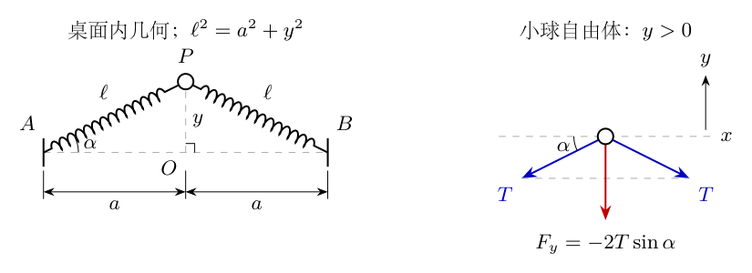{width=92%}

由勾股定理及斜边投影，

$$
\ell=\sqrt{a^2+y^2},
\qquad
\sin\alpha=\frac y\ell,
\qquad
\cos\alpha=\frac a\ell.
$$

对 $y>0$，两拉力分别向左下、右下，两沿图中 $x$ 轴的分量相互抵消，沿 $y$ 轴的分量均向 $-y$。$\alpha$ 是弹簧与平衡轴线的夹角，不是小球的振动相位。

实际长度增加量为 $\ell-a$，不是 $y$。小位移时 $\ell-a$ 为二阶小量，因此不能把每半弹簧的总伸长直接写成 $\Delta l/2+y$。

**第7步：先求横向精确回复力，再作小幅线性化。**

每半段张力大小为 $T=2k(\ell-b)$。图4-4两个 $x$ 分量抵消，两个 $y$ 分量相加：

$$
\begin{aligned}
F_y&=-2T\sin\alpha\\
&=-2\,[2k(\ell-b)]\frac y\ell\\
&=-4ky\left(1-\frac b\ell\right)\\
&=\boxed{-4ky\left(1-\frac{l_0}
{\sqrt{L^2+4y^2}}\right)}.
\end{aligned}
$$

最后一步同时将 $\ell$ 和 $b$ 乘二，使用 $2\ell=\sqrt{L^2+4y^2}$、$2b=l_0$。此式尚未假设 $y$ 很小；$y$ 的正负已经包含在代数分量里。

在固定的 $\Delta l>0$ 下取 $y\to0$，括号的一阶回复系数为

$$
\begin{aligned}
1-\frac{l_0}{L}
&=\frac{L-l_0}{L}
=\frac{\Delta l}{L},\\
F_y&=-\frac{4k\Delta l}{L}\,y+O(y^3).
\end{aligned}
$$

因此横向小振动的等效劲度为

$$
\boxed{K_\perp=\frac{4k\Delta l}{l_0+\Delta l}}.
$$

几何捷径是取 $T\simeq T_0$、$\sin\alpha\simeq y/a$，于是 $F_y\simeq-2T_0y/a$，得到相同系数。但它只保留线性项；上面的精确式说明省略项从三次回复力开始，而不是凭直觉直接指定等效劲度。

**第8步：用完整势能展开核对横纵两个劲度。**

每半段劲度为 $2k$，弹性势能是该半段伸长量平方乘 $\frac12(2k)$。纵向势能为

$$
\begin{aligned}
U_\parallel
&=k\left(\frac{\Delta l}{2}+x\right)^2
+k\left(\frac{\Delta l}{2}-x\right)^2\\
&=k\left[\frac{(\Delta l)^2}{4}
+\Delta l\,x+x^2
+\frac{(\Delta l)^2}{4}
-\Delta l\,x+x^2\right]\\
&=\frac{k(\Delta l)^2}{2}+2kx^2.
\end{aligned}
$$

两一次交叉项抵消。与 $U=U_0+\frac12Kx^2$ 比较，$K_\parallel=4k$；常数 $U_0$ 不产生回复力。

横向两半长度均为 $\ell$，故

$$
\begin{aligned}
U_\perp
&=2\cdot\frac12(2k)(\ell-b)^2\\
&=2k\left(\frac{\sqrt{L^2+4y^2}-l_0}{2}\right)^2\\
&=\frac k2\left(\sqrt{L^2+4y^2}-l_0\right)^2.
\end{aligned}
$$

使用 $\sqrt{1+u}=1+\frac u2+O(u^2)$，令 $u=4y^2/L^2$，得到

$$
\begin{aligned}
\sqrt{L^2+4y^2}
&=L\sqrt{1+\frac{4y^2}{L^2}}\\
&=L+\frac{2y^2}{L}+O(y^4),\\
\sqrt{L^2+4y^2}-l_0
&=\Delta l+\frac{2y^2}{L}+O(y^4).
\end{aligned}
$$

再平方并保留到 $y^2$：

$$
\begin{aligned}
U_\perp
&=\frac k2\left[(\Delta l)^2
+2\Delta l\frac{2y^2}{L}+O(y^4)\right]\\
&=\frac{k(\Delta l)^2}{2}
+\frac{2k\Delta l}{L}y^2+O(y^4).
\end{aligned}
$$

二次项来自“已有伸长 $\Delta l$”与“几何长度的二阶变化”的交叉乘积。若提前把 $\ell$ 完全替换为 $a$，这一项就被误删；若把二次项的系数直接当劲度，又会少一个因子二。

将二次项写成 $\frac12K_\perp y^2$，仍得 $K_\perp=4k\Delta l/L$；再由 $F_y=-\mathrm dU_\perp/\mathrm dy$，得到第7步同一线性回复力。受力法与能量法独立吻合。

**第9步：求横向周期，正确形成周期比。**

横向运动方程为

$$
m\ddot y=-K_\perp y.
$$

因此

$$
\begin{aligned}
\omega_\perp^2&=\frac{4k\Delta l}{mL},\\
T_\perp&=2\pi\sqrt{\frac{mL}{4k\Delta l}}.
\end{aligned}
$$

横向周期除以纵向周期，不是反过来：

$$
\begin{aligned}
n=\frac{T_\perp}{T_\parallel}
&=\frac{2\pi\sqrt{mL/(4k\Delta l)}}
{2\pi\sqrt{m/(4k)}}\\
&=\sqrt{\frac L{\Delta l}}\\
&=\boxed{\sqrt{1+\frac{l_0}{\Delta l}}}.
\end{aligned}
$$

质量 $m$、整根劲度 $k$ 与 $2\pi$ 均消去。由于 $l_0,\Delta l>0$，$n>1$：横向劲度较小，横向周期较长，与图4-4的斜向力投影一致。

**第10步：将两次测量逐式转成长度关系。**

第一次 $n_1=4$，先平方而不是直接令长度比等于 $4$：

$$
\begin{aligned}
16&=1+\frac{l_0}{\Delta l_1},\\
\frac{l_0}{\Delta l_1}&=15,\\
\Delta l_1&=\frac{l_0}{15}.
\end{aligned}
$$

第二次 $n_2=3$，同理

$$
\begin{aligned}
9&=1+\frac{l_0}{\Delta l_2},\\
\frac{l_0}{\Delta l_2}&=8,\\
\Delta l_2&=\frac{l_0}{8}.
\end{aligned}
$$

增加的伸长为两次总伸长之差：

$$
\begin{aligned}
\Delta l_2-\Delta l_1
&=\Delta x=3.5\,\mathrm{cm},\\
\left(\frac18-\frac1{15}\right)l_0
&=3.5\,\mathrm{cm},\\
\frac{15-8}{120}l_0&=3.5\,\mathrm{cm},\\
l_0&=3.5\frac{120}{7}\,\mathrm{cm}
=\boxed{60\,\mathrm{cm}}.
\end{aligned}
$$

通分得到 $7/120$，再乘倒数 $120/7$。厘米在同一组长度关系中可以统一使用，不必先改为米；若后面计算力或能量，才统一改用国际单位。

恢复两个伸长量：

$$
\boxed{
\Delta l_1=\frac{60}{15}\,\mathrm{cm}=4.0\,\mathrm{cm},
\qquad
\Delta l_2=\frac{60}{8}\,\mathrm{cm}=7.5\,\mathrm{cm}}.
$$

**第11步：将答案代回几何、周期比和增量。**

第一、第二次端点距离分别为

$$
L_1=60+4=64\,\mathrm{cm},
\qquad
L_2=60+7.5=67.5\,\mathrm{cm}.
$$

检验三个独立测量条件：

$$
\begin{aligned}
\sqrt{\frac{L_1}{\Delta l_1}}
&=\sqrt{\frac{64}{4}}=\sqrt{16}=4,\\
\sqrt{\frac{L_2}{\Delta l_2}}
&=\sqrt{\frac{67.5}{7.5}}=\sqrt9=3,\\
\Delta l_2-\Delta l_1
&=7.5-4.0=3.5\,\mathrm{cm}.
\end{aligned}
$$

三式同时成立。两个伸长均为正，第二次比第一次大，符合两半均受拉及端点进一步拉开的条件。

由两个等效劲度还可检验趋势：

$$
\frac{K_{\perp,1}}{K_\parallel}=\frac1{16},
\qquad
\frac{K_{\perp,2}}{K_\parallel}=\frac19.
$$

第二次横向劲度更大、纵向劲度不变，所以横向周期缩短。长度反求不依赖 $m/k$，但两次绝对周期仍依赖 $m/k$；题目没有给出它，不能再编出某个唯一的秒数。

**第12步：检查线性化的边界，不暗中增加“小伸长”假设。**

本题在振动位移 $x,y$ 上取小幅极限，并没有对 $\Delta l/l_0$ 作小量展开。因而求得的公式不要求 $\Delta l\ll l_0$。横向精确力展开到三次为

$$
F_y=-\frac{4k\Delta l}{L}y
-\frac{8kl_0}{L^3}y^3+O(y^5).
$$

若横向振幅为 $A_y$，除几何上 $A_y/L\ll1$ 外，还应使三次力相对一次力足够小：

$$
\frac{2l_0A_y^2}{\Delta l\,L^2}\ll1.
$$

在固定正预伸长下，把振幅取得足够小即可。若让预伸长趋零而振幅不相应缩小，线性化不再均匀有效；不能把 $T_\perp\to\infty$ 理解成任意有限幅横向运动都永远不返回。

量纲上，$k$ 与 $K_\perp$ 都为 $\mathrm{N\,m^{-1}}$，$\Delta l/L$ 是纯数，$\sqrt{m/k}$ 的单位为时间；$n$ 则无量纲。强预拉伸极限 $\Delta l/l_0\to\infty$ 时 $K_\perp\to4k$、$n\to1^+$，两方向趋于同一线性劲度。若变形已超出胡克定律有效范围，便不属于本题假设，不能仅靠这个数学极限推断真实弹簧任意拉长后的性质。

## 六、关键洞察

纵向线性劲度来自两个半弹簧拉力大小的反向变化；横向线性劲度来自已有张力的方向变化。横向的额外拉伸从 $y^2$ 才开始，并不妨碍回复力从 $y$ 开始，因为势能中的预伸长与几何二阶量会形成二次交叉项。

可以在同一个二维势能中同时识别两个模式，而不分两次猜回复力。小球位置为 $(x,y)$ 时，两半真实长度为

$$
\ell_L=\sqrt{(a+x)^2+y^2},
\qquad
\ell_R=\sqrt{(a-x)^2+y^2}.
$$

完整势能为

$$
U(x,y)=k(\ell_L-b)^2+k(\ell_R-b)^2.
$$

其在 $(0,0)$ 附近的二次展开是

$$
U=U_0+\frac12(4k)x^2
+\frac12\left(\frac{4k\Delta l}{L}\right)y^2
+\text{高阶项}.
$$

混合二次项 $xy$ 为零，因为几何和弹性势能分别关于 $x\to-x$、$y\to-y$ 对称；二阶展开不能出现奇于某一坐标的项。两个正二次系数说明正预伸长下平衡稳定，并给出已经求得的两个正交小振动模式。

对一般测量数据 $n_1>n_2>1$、伸长增加 $d>0$，由

$$
\Delta l_1=\frac{l_0}{n_1^2-1},
\qquad
\Delta l_2=\frac{l_0}{n_2^2-1}
$$

相减，不能跳过分母通分：

$$
\begin{aligned}
d
&=l_0\left[\frac1{n_2^2-1}-\frac1{n_1^2-1}\right]\\
&=\frac{l_0(n_1^2-n_2^2)}
{(n_1^2-1)(n_2^2-1)}.
\end{aligned}
$$

因此

$$
\begin{aligned}
l_0&=\frac{d(n_1^2-1)(n_2^2-1)}{n_1^2-n_2^2},\\
\Delta l_1&=\frac{d(n_2^2-1)}{n_1^2-n_2^2},\\
\Delta l_2&=\frac{d(n_1^2-1)}{n_1^2-n_2^2}.
\end{aligned}
$$

正分母和 $n_i>1$ 同时保证三个长度为正。若 $d>0$ 却测得 $n_2\ge n_1$，数据不符合本理想模型；若 $n_1,n_2$ 太接近，分母很小，周期比的小测量误差就会使反求长度有较大误差。它是实验反求的条件性问题，不应靠删去数字或随意四舍五入隐藏。

半根劲度加倍还依赖均匀、左右相同的弹簧。对不均匀弹簧，整根劲度只给出串联柔度；若两半劲度不同，纵向总劲度是两半劲度之和，不能直接等同于 $4k$。因此结构对称与预张力条件都是模型的一部分。

## 七、易错点

把小球在桌面内的横向振动画成竖直升降，会引入不属于本题的重力和悬挂平衡。图4-1的 $x,y$ 都在桌面内；重力与支承力在垂直于桌面的方向抵消。

把半根劲度写成 $k/2$，或者给左右半根各分配 $F/2$，混淆串联与并联。切成一半的均匀弹簧劲度为 $2k$，串联时两半传递相同的力；小球纵向运动时两回复变化又同时作用于小球。

把右移时两半伸长都写成 $\Delta l/2+x$，会误以为力仍抵消。左半增加、右半减少，且净力必须按 $T_R-T_L$ 写出正负号。

认为横向伸长是 $y$，误将斜边增量等于直角边。真实长度为 $\sqrt{a^2+y^2}$；必须先通过几何算长度，再用胡克定律求张力并投影。

因为横向长度变化只有二阶就令横向劲度为零，漏掉预张力方向变化。已有 $T_0$ 乘小角度产生一阶回复力，或由势能交叉项产生二次势能，两种解释一致。

把势能中 $Cy^2$ 的系数 $C$ 直接当劲度，少一个因子二。应比较 $\frac12Ky^2$，或者直接对势能求负导数。

把周期比 $n$ 当频率比，或把 $\sqrt{L/\Delta l}=4$ 写成 $L/\Delta l=4$，都会使反求长度错误。先平方得到 $16$、$9$，再扣除式中的常数一。

把增加的 $\Delta x$ 当作横向振幅，或仅让每半根增加 $\Delta x$，使总伸长的差多出一倍。本题 $\Delta x=\Delta l_2-\Delta l_1$ 是整根端点距离的增量。

把小幅条件偷换成小伸长条件，或在零预伸长时仍使用有限的横向简谐频率。解析不要求 $\Delta l/l_0$ 很小；真正需要控制的是位移及高阶力相对线性力的比例。

## 八、课堂讲解建议

课堂先在图4-1上明确两个方向都在桌面内，让学生区分端点拉开量与小球位移。教师先写 $l_0,L,\Delta l,a,b$ 的长度对应，再讲半根劲度；板书用同一个串联拉力 $F$ 证明 $k_h=2k$，不直接给结论。

纵向讲解时，让学生分别说出左半与右半究竟变长还是变短。教师在图4-3自由体图上先规定 $+x$，再逐行写 $T_R-T_L$。此处保留预张力相消的两项，帮助学生看见纵向劲度为何不随伸长改变。

横向课堂先观察图4-4，要求学生指出长度变化与方向变化各从哪一阶开始。教师以精确斜边与力投影作为主路线，再用能量展开交叉核验；板书特别框出 $\Delta l\cdot y^2$ 的交叉项及 $\frac12K$ 的系数，避免仅背周期公式。

最后课堂用三条件回代检查 $60,4,7.5\,\mathrm{cm}$，并让学生先预测增加预伸长后哪一个周期会变。教师可再讨论零预张力及有限幅变式，说明“小振动”是围绕给定平衡的局部近似，而不是把所有几何长度都当作小量。

## 九、变式训练

**变式1：测得纵向绝对周期后，求劲度和预张力。**

在原题条件下，小球质量 $m=0.050\,\mathrm{kg}$，纵向小振动周期为 $0.250\,\mathrm s$。求整根和半根劲度，两次预张力及两次横向周期。

由 $T_\parallel^2=\pi^2m/k$，得到

$$
\begin{aligned}
k&=\frac{\pi^2m}{T_\parallel^2}
=\frac{\pi^2(0.050)}{(0.250)^2}\\
&=0.8\pi^2\,\mathrm{N\,m^{-1}}
\approx7.8957\,\mathrm{N\,m^{-1}},\\
k_h&=2k\approx15.7914\,\mathrm{N\,m^{-1}}.
\end{aligned}
$$

先把伸长改为米，再求预张力：

$$
\begin{aligned}
T_{0,1}&=k\Delta l_1
=(0.8\pi^2)(0.040)
\approx0.31583\,\mathrm N,\\
T_{0,2}&=k\Delta l_2
=(0.8\pi^2)(0.075)
\approx0.59218\,\mathrm N.
\end{aligned}
$$

相应横向周期为

$$
T_{\perp,1}=4(0.250)=1.000\,\mathrm s,
\qquad
T_{\perp,2}=3(0.250)=0.750\,\mathrm s.
$$

纵向总劲度是 $4k$，不是这里求出的半根劲度 $2k$。把它们再代入 $\sqrt{m/K}$ 可独立复算三个周期。

**变式2：改变周期比的测量数据。**

某同类弹簧第一次周期比为 $6$，增加伸长 $1.1\,\mathrm{cm}$ 后周期比为 $5$。求原长及两个伸长量，并判断三个长度是否满足正值条件。

由平方周期比分别得

$$
\Delta l_1=\frac{l_0}{35},
\qquad
\Delta l_2=\frac{l_0}{24}.
$$

相减并通分：

$$
\begin{aligned}
1.1\,\mathrm{cm}
&=\left(\frac1{24}-\frac1{35}\right)l_0\\
&=\frac{35-24}{840}l_0
=\frac{11}{840}l_0,\\
l_0&=1.1\frac{840}{11}\,\mathrm{cm}
=84\,\mathrm{cm}.
\end{aligned}
$$

所以

$$
\Delta l_1=2.4\,\mathrm{cm},
\qquad
\Delta l_2=3.5\,\mathrm{cm}.
$$

回代 $L_1=86.4\,\mathrm{cm}$、$L_2=87.5\,\mathrm{cm}$，得到 $L_1/\Delta l_1=36$、$L_2/\Delta l_2=25$，取正平方根分别为 $6,5$。三个长度均正，且差为 $1.1\,\mathrm{cm}$，满足测量与几何条件。

<!-- KEEP_TOGETHER_START -->

**变式3：有限横向振幅会怎样改变周期？**

仍采用原题第一次条件，令横向振幅为 $A$。求横向周期的首个非线性修正；再取 $m=0.050\,\mathrm{kg}$、$k=0.8\pi^2\,\mathrm{N\,m^{-1}}$、$A=6.4\,\mathrm{mm}$，估计周期并与精确能量积分比较。

<!-- KEEP_TOGETHER_END -->

将平方根展开到 $y^4$，或者将第7步精确力展开到 $y^3$：

$$
\begin{aligned}
U_\perp-U_0
&=\frac{2k\Delta l}{L}y^2
+\frac{2kl_0}{L^3}y^4+O(y^6),\\
\ddot y+\omega_0^2y+\beta y^3&=0,\\
\omega_0^2&=\frac{4k\Delta l}{mL},
\qquad
\beta=\frac{8kl_0}{mL^3}>0.
\end{aligned}
$$

正三次回复力使振动随振幅增大而变硬。用首阶谐波 $y\simeq A\cos(\omega t)$，并利用

$$
\cos^3u=\frac34\cos u+\frac14\cos3u,
$$

保留基频系数得到

$$
\begin{aligned}
(-\omega^2+\omega_0^2)A
+\frac34\beta A^3&=0,\\
\omega^2&=\omega_0^2+\frac34\beta A^2.
\end{aligned}
$$

三倍频项影响波形，但在这一阶不改变所求基频修正。对频率的平方根与周期的倒数依次作展开：

$$
\begin{aligned}
\omega
&=\omega_0\left(1+\frac{3\beta A^2}{8\omega_0^2}
+O(A^4)\right),\\
\frac{T(A)}{T(0)}
&=1-\frac{3\beta A^2}{8\omega_0^2}+O(A^4)\\
&=\boxed{1-\frac{3l_0A^2}{4\Delta l\,L^2}+O(A^4)}.
\end{aligned}
$$

本例 $l_0=0.60\,\mathrm m$、$\Delta l=0.040\,\mathrm m$、$L=0.640\,\mathrm m$，三次力与一次力的幅值比为

$$
\frac{2(0.60)(0.0064)^2}{(0.040)(0.640)^2}=0.003.
$$

线性周期为 $1.000\,\mathrm s$，首阶相对减量为

$$
\frac{3(0.60)(0.0064)^2}{4(0.040)(0.640)^2}
=0.001125,
\qquad
T(A)\simeq0.998875\,\mathrm s.
$$

还可不作小幅展开，由能量守恒进行独立核验。转折点速度为零，设 $D_A=\sqrt{L^2+4A^2}$、$D_y=\sqrt{L^2+4y^2}$，则

$$
\frac12m\dot y^2=U(A)-U(y).
$$

用平方差分解势能差，避免直接相减两相近数：

$$
\begin{aligned}
U(A)-U(y)
&=\frac k2(D_A-D_y)(D_A+D_y-2l_0),\\
D_A-D_y
&=\frac{D_A^2-D_y^2}{D_A+D_y}
=\frac{4(A^2-y^2)}{D_A+D_y},\\
U(A)-U(y)
&=2k(A^2-y^2)
\frac{D_A+D_y-2l_0}{D_A+D_y}.
\end{aligned}
$$

四分之一周期由平衡点积分到转折点，令 $y=A\sin\psi$ 消去端点的平方根因子：

$$
\begin{aligned}
T(A)
&=4\sqrt{\frac m2}
\int_0^A\frac{\mathrm dy}{\sqrt{U(A)-U(y)}}\\
&=2\sqrt{\frac mk}
\int_0^{\pi/2}
\sqrt{\frac{D_A+\sqrt{L^2+4A^2\sin^2\psi}}
{D_A+\sqrt{L^2+4A^2\sin^2\psi}-2l_0}}
\,\mathrm d\psi.
\end{aligned}
$$

代入数值，精确几何模型给 $T(A)\approx0.99887728\,\mathrm s$，直接用两半弹簧矢量力积分运动方程也得到同值。首阶近似差约 $2.28\times10^{-6}\,\mathrm s$；因此给定振幅下近似良好，但周期已不严格等于小幅极限值。

**变式4：完全没有预伸长时，横向还能振动吗？**

令 $\Delta l=0$，保留对称横向运动，问平衡点附近的回复力和势能从哪一阶开始，并求小而有限振幅 $A$ 下周期的主阶关系。这里只讨论横向模式，不将零预拉伸直接套入两半始终受拉的纵向模型。

此时 $L=l_0$，平方根展开为

$$
\sqrt{l_0^2+4y^2}-l_0
=\frac{2y^2}{l_0}+O(y^4).
$$

平方后，

$$
\begin{aligned}
U_\perp
&=\frac k2\left(\frac{2y^2}{l_0}+O(y^4)\right)^2
=\frac{2k}{l_0^2}y^4+O(y^6),\\
F_y&=-\frac{\mathrm dU_\perp}{\mathrm dy}
=-\frac{8k}{l_0^2}y^3+O(y^5).
\end{aligned}
$$

二次势能和一次回复力都为零，但离开平衡点后两半都会拉长，仍产生三次回复力。故它是非线性振动，不是具有非零线性角频率的简谐运动。

<!-- KEEP_TOGETHER_START -->

保留四次势能并在振幅 $A$ 处写总能量：

$$
\begin{aligned}
\frac12m\dot y^2
&=\frac{2k}{l_0^2}(A^4-y^4),\\
|\dot y|
&=\frac{2}{l_0}\sqrt{\frac km}\sqrt{A^4-y^4}.
\end{aligned}
$$

利用对称性，周期为四倍从平衡点到转折点的时间；令 $y=Au$：

$$
\begin{aligned}
T(A)
&\simeq2l_0\sqrt{\frac mk}
\int_0^A\frac{\mathrm dy}{\sqrt{A^4-y^4}}\\
&=\frac{2l_0}{A}\sqrt{\frac mk}
\int_0^1\frac{\mathrm du}{\sqrt{1-u^4}}\\
&\approx\boxed{\frac{2.62205755\,l_0}{A}\sqrt{\frac mk}}.
\end{aligned}
$$

<!-- KEEP_TOGETHER_END -->

积分为 $1.311028777$，其端点虽有可积平方根奇点，积分值有限。$T$ 随振幅按 $1/A$ 增大，说明 $A\to0$ 时周期趋无穷；对任何给定的小正振幅，周期仍有限。

例如 $l_0=0.60\,\mathrm m$、$k=8.0\,\mathrm{N\,m^{-1}}$、$m=0.050\,\mathrm{kg}$、$A=3.0\,\mathrm{mm}$，主阶周期为 $41.4584\,\mathrm s$；用原几何精确力积分得到 $41.4596\,\mathrm s$。这一理想数值忽略阻尼，并非宣称真实桌面实验能在极小预张力下无损振动；它用来说明正预伸长的线性极限与零预伸长的四次势能模型不能混用。

<!-- question-complete -->

\newpage

# 第5题

<!-- question-start -->

空间中存在沿 $+z$ 方向的匀强磁场 $\boldsymbol B=B_0\boldsymbol e_z$。两个电子的电荷均为 $-q$，质量均为 $m$，在 $x$—$y$ 平面内运动。只考虑两个电子之间的静电作用及外磁场的洛伦兹力，不考虑相对论效应。

（1）初始时两个电子相距 $l$，速度大小均为 $v_0$，方向相反。此后两个电子均保持匀速圆周运动。求各参数必须满足的条件，并讨论轨道的稳定性。

（2）初始时一个电子静止，另一个电子的初速度大小为 $v_0$；此后两个电子的距离始终保持为 $l$。求两个电子质心的轨道形态，以及初始运动电子第一次速度为零的时间。

图5-1分别表示两问与恒定距离相容的初始速度方向；磁场沿纸面法向向外。

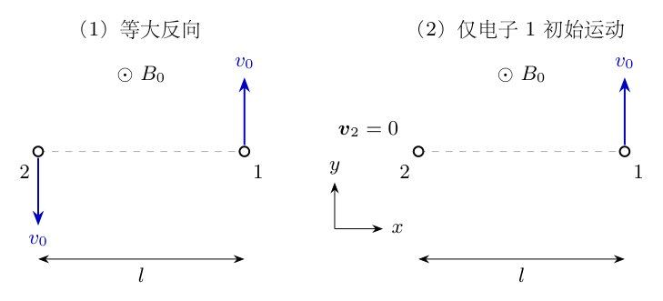{width=88%}

<!-- question-end -->

## 一、题型定位

这是均匀磁场中的两体动力学问题。相同的电荷质量比使质心运动与相对运动能够严格分离：内力在质心方程中抵消，却在相对方程中加倍。圆轨道条件由向内磁力、向外静电斥力和向心加速度共同决定，不是普通的单电子回旋半径公式。

第（1）问中的 $v_0$ 是每个电子的速率；第（2）问中的 $v_0$ 是唯一初始运动电子的速率。两问虽然使用同一个字母，但在相同的 $l$ 和同一角速度分支下，后一速率是前一速率的两倍。先区分质心速度、相对速度与绕质心速度，才能避免错误的因子 $2$。

## 二、知识点

带负电荷粒子的洛伦兹力方向；两等质量粒子的质心和相对坐标；圆周运动的向心加速度；两电子间距与各自轨道半径的区别；正则角动量守恒；径向微扰时切向速度随半径变化；线性恢复力与径向稳定性；均匀磁场中质心回旋运动；两个等模旋转速度矢量的相消；首个零速时刻与瞬时静止的区别。

记库仑常量为 $k_e=1/(4\pi\varepsilon_0)$。采用 $q>0$、$B_0>0$，定义正的回旋角频率

$$
\Omega=\frac{qB_0}{m}>0.
$$

从 $+z$ 方向看向运动平面，逆时针为正角方向。题设只保留库仑力和给定磁场力，因此不存在阻尼、辐射反作用或外部约束力。稳定性首先应在题设的平面运动模型内讨论，不能暗中更换为不受限制的三维运动。

## 三、物理图像

两个电子同号相斥。若它们围绕静止质心作共同圆周运动，磁力必须向内，并且大于向外的库仑力；剩余向内合力才提供向心加速度。由此允许两种正角速度：一支较慢，磁力的大部分用于平衡斥力；另一支较快，更接近单粒子的回旋运动。

检验稳定性时，不能把轨道半径增大而切向速度仍保持不变。磁场对运动电子有力矩，径向移动时切向速度按照正则角动量守恒改变。把这种变化代回真实径向受力，才能判断两支是否具有回复趋势。

第（2）问的质心并不静止。每个电子的速度由“质心的回旋速度”和“绕质心旋转的速度”相加而成。初始运动电子的两部分速度开始同向，后来由于两种角速度不同而逐渐转开；两部分模长相等且首次反向时，总速度为零。

## 四、解题入口

第（1）问先取轨道半径 $\rho_0=l/2$，写向心方向的牛顿方程，再将速率换成角速度 $\omega=2v_0/l$。所得二次方程同时给出两个角速度分支与轨道存在条件。稳定性另作守恒约束下的微扰，不能仅凭二次方程有两个根就猜测一稳一不稳。

第（2）问先相加两个电子的牛顿方程，得到质心回旋频率 $\Omega$；再相减得到相对方程。恒定间距使相对角速度 $\omega$ 恒定，且此时 $\omega=v_0/l$。最后以两旋转速度的相位差判断首个零速时刻。

以下先完成第（1）问，再处理第（2）问；角速度的上下分支始终使用一致的下标。

## 五、解析

**第1步：固定电子编号、坐标与负电荷的磁力方向。**

取初始连线沿 $x$ 轴，电子 $1$ 在右侧，电子 $2$ 在左侧。对平面向量定义

$$
J(v_x,v_y)=(-v_y,v_x).
$$

<!-- KEEP_TOGETHER_START -->

$J$ 把向量逆时针转过 $90^\circ$。由于

$$
\begin{aligned}
\boldsymbol v\times\boldsymbol e_z&=(v_y,-v_x)=-J\boldsymbol v,\\
(-q)\boldsymbol v\times\boldsymbol B
&=qB_0J\boldsymbol v=m\Omega J\boldsymbol v,
\end{aligned}
$$

<!-- KEEP_TOGETHER_END -->

电子位于右侧、向上运动时，磁力向左；位于左侧、向下运动时，磁力向右。这与共同逆时针圆周运动需要的向心方向一致。若换成顺时针，磁力和斥力都向外，不能提供共同圆轨道的向心合力。

这里的 $q$ 是电荷量的正值，电子的电荷才是 $-q$；不能在定义 $\Omega$ 时再多放一个负号。

**第2步：证明第（1）问的质心静止，辨认共同圆心。**

记电子的位置为 $\boldsymbol r_1,\boldsymbol r_2$，速度为 $\boldsymbol v_1,\boldsymbol v_2$，质心位置与速度分别为

$$
\boldsymbol R_c=\frac{\boldsymbol r_1+\boldsymbol r_2}{2},
\qquad
\boldsymbol V_c=\frac{\boldsymbol v_1+\boldsymbol v_2}{2}.
$$

两电子的库仑力等大反向。相加牛顿方程得

$$
\begin{aligned}
m(\dot{\boldsymbol v}_1+\dot{\boldsymbol v}_2)
&=m\Omega J(\boldsymbol v_1+\boldsymbol v_2),\\
\dot{\boldsymbol V}_c&=\Omega J\boldsymbol V_c.
\end{aligned}
$$

第（1）问初速度等大反向，因此 $\boldsymbol V_c(0)=0$。这个线性方程的解始终为 $\boldsymbol V_c(t)=0$，质心固定。取质心为 $O$，则始终有 $\boldsymbol r_2=-\boldsymbol r_1$。

对匀速圆轨道，加速度与磁力都沿该圆的径向，因而剩余库仑力也必须沿该圆的径向。库仑力方向又沿 $\boldsymbol r_1-\boldsymbol r_2=2\boldsymbol r_1$；两个径向方向在整个圆周上重合，只能使圆心位于 $O$。故两电子在同一个圆上相隔半周，各自半径均为

$$
\rho_0=\frac l2.
$$

初始速度必须垂直于两电子连线，并按前述逆时针方向取向。这是圆周运动条件的一部分，不是任意一对等大反向初速度都能成立。

**第3步：用真实的向心受力建立圆轨道方程。**

如图5-2，电子 $1$ 在右侧时，$qB_0v_0$ 向左，库仑斥力 $k_eq^2/l^2$ 向右。图中的 $l$ 是两电子间距，$\rho_0$ 才是向心加速度中的半径。

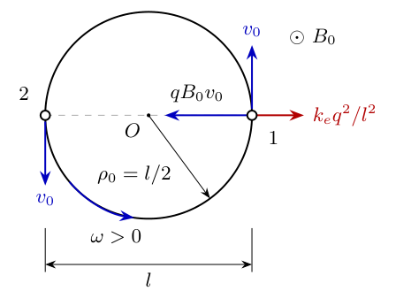{width=60%}

取向内为这一式的正方向：

$$
\begin{aligned}
qB_0v_0-\frac{k_eq^2}{l^2}
&=\frac{mv_0^2}{\rho_0}
=\frac{2mv_0^2}{l},\\
\frac{2m}{l}v_0^2-qB_0v_0+\frac{k_eq^2}{l^2}&=0.
\end{aligned}
$$

右边的向心力不是一项额外真实力，而是两种真实力的合力等于 $m$ 乘向心加速度。只写 $qB_0v_0=mv_0^2/\rho_0$ 会遗漏两电子间的斥力。

也可立即检查，任意可行根都满足

$$
qB_0v_0-\frac{k_eq^2}{l^2}
=\frac{2mv_0^2}{l}>0.
$$

所以磁力确实比斥力大，而不是相互完全抵消。

**第4步：完整解出速率的两个正根。**

先除以 $2m/l$，再配方：

$$
\begin{aligned}
v_0^2-\frac{qB_0l}{2m}v_0+\frac{k_eq^2}{2ml}&=0,\\
\left(v_0-\frac{qB_0l}{4m}\right)^2
&=\left(\frac{qB_0l}{4m}\right)^2-\frac{k_eq^2}{2ml}.
\end{aligned}
$$

因此

$$
\boxed{
v_{0,\pm}^{(1)}
=\frac{qB_0l}{4m}
\pm\sqrt{\left(\frac{qB_0l}{4m}\right)^2-\frac{k_eq^2}{2ml}}
}.
$$

上标 $(1)$ 仅用于提醒这是第（1）问的每个电子速率。根号里的第二项为正，因此只要判别式非负，根号就严格小于 $qB_0l/(4m)$；两个根都为正，不能把减号根误删成负速率。

两个根对应不同的运动状态，而不是一个顺时针、一个逆时针状态。两者均按同一逆时针方向运动。

**第5步：求判别式条件，逐项消去电荷量。**

存在实数圆轨道的必要条件为

$$
\begin{aligned}
\frac{q^2B_0^2l^2}{16m^2}
-\frac{k_eq^2}{2ml}&\geq0,\\
B_0^2l^2-\frac{8k_em}{l}&\geq0,\\
B_0^2l^3&\geq8k_em.
\end{aligned}
$$

第二行是把第一行乘以 $16m^2/q^2$，第三行再乘以正数 $l$，不改变不等号。故

$$
\boxed{
l\geq l_c,\qquad
l_c=2\left(\frac{k_em}{B_0^2}\right)^{1/3}
}.
$$

等价地，在给定 $l$ 时，磁场必须满足

$$
B_0\geq B_c=\sqrt{\frac{8k_em}{l^3}}.
$$

临界长度与 $q$ 无关，是因为斥力含 $q^2$，而磁力与速率共同形成的判别式也含同一个 $q^2$。这不表示运动速率与 $q$ 无关；速率仍与 $q$ 成正比。

判别式为零时两个圆轨道分支合并，只有一个圆轨道角速度值；接下来还须单独检验其稳定性。

**第6步：改用角速度，并固定上下分支的含义。**

定义

$$
C=\frac{2k_eq^2}{m},
\qquad
D=\sqrt{\frac{\Omega^2}{4}-\frac{C}{l^3}}.
$$

第（1）问中每个电子的圆周速率为 $v_0=\omega l/2$。代回第3步的方程：

$$
\begin{aligned}
qB_0\frac{\omega l}{2}-\frac{k_eq^2}{l^2}
&=m\frac{\omega^2l}{2},\\
\omega^2-\Omega\omega+\frac{C}{l^3}&=0.
\end{aligned}
$$

故

$$
\boxed{\omega_\pm=\frac{\Omega}{2}\pm D}.
$$

对有限的 $l$、非零的 $q$，有

$$
0\leq D<\frac{\Omega}{2},
\qquad
0<\omega_-\leq\frac{\Omega}{2}
\leq\omega_+<\Omega.
$$

若 $l=l_c$，则 $D=0$、$\omega_+=\omega_-=\Omega/2$。若 $l>l_c$，两个不等分支都存在。后续任何含 $\pm$ 的式子，都要与 $\omega_\pm$ 的定义相联系。

**第7步：明确稳定性扰动不能把切向速度固定住。**

考察某一圆轨道 $\rho_0=l/2$，让两电子仍关于 $O$ 对称，但半径发生小的径向变化。图5-3把扰动后的半径写为 $\rho=\rho_0(1+x)$，其中 $x$ 是无量纲微扰；图中切向速度 $v(x)$ 随半径变化。

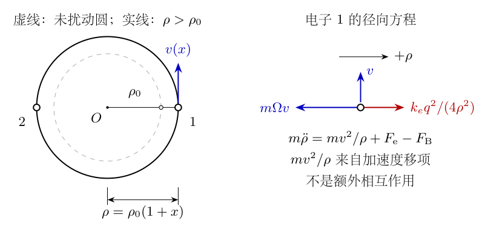{width=86%}

对电子 $1$，库仑力沿径向，对 $O$ 无力矩。洛伦兹力却在存在径向速度时含切向分量。把平面极坐标速度写成

$$
\boldsymbol v=\dot\rho\,\boldsymbol e_\rho
+\rho\dot\theta\,\boldsymbol e_\theta,
$$

则磁力为

$$
m\Omega J\boldsymbol v
=m\Omega\dot\rho\,\boldsymbol e_\theta
-m\Omega\rho\dot\theta\,\boldsymbol e_\rho.
$$

切向牛顿方程因此是

$$
m(\rho\ddot\theta+2\dot\rho\dot\theta)
=m\Omega\dot\rho.
$$

必须使用这一切向方程，才能知道扰动后 $v=\rho\dot\theta$ 如何改变。

**第8步：从切向方程推导正则角动量守恒。**

把前式乘以 $\rho$，整理为两个全导数：

$$
\begin{aligned}
\rho^2\ddot\theta+2\rho\dot\rho\dot\theta
-\Omega\rho\dot\rho&=0,\\
\frac{\mathrm d}{\mathrm dt}
\left(\rho^2\dot\theta-\frac{\Omega}{2}\rho^2\right)&=0.
\end{aligned}
$$

乘以 $m$，并用 $v=\rho\dot\theta$、$m\Omega=qB_0$，得到

$$
m\rho v-\frac{qB_0}{2}\rho^2=\text{常量}.
$$

机械角动量 $m\rho v$ 本身不守恒；与磁场项结合后的量才守恒。磁场沿 $+z$、电子电荷为负时，这里是减号。

初始圆轨道给出守恒常量 $m\rho_0v_0-m\Omega\rho_0^2/2$。于是

$$
\begin{aligned}
\rho v-\frac{\Omega}{2}\rho^2
&=\rho_0v_0-\frac{\Omega}{2}\rho_0^2,\\
v(\rho)&=\frac{\rho_0v_0}{\rho}
+\frac{\Omega}{2}\frac{\rho^2-\rho_0^2}{\rho}.
\end{aligned}
$$

这就是图5-3中 $v(x)$ 的来源，并没有把单粒子回旋半径公式套进双粒子问题。

**第9步：保留微扰速度的全部一阶变化。**

令 $\rho=\rho_0(1+x)$。由第8步：

$$
\begin{aligned}
v(x)
&=\frac{1}{1+x}
\left[v_0+\frac{\Omega\rho_0}{2}
\bigl((1+x)^2-1\bigr)\right],\\
&=\frac{1}{1+x}
\left[v_0+\Omega\rho_0x
+\frac{\Omega\rho_0}{2}x^2\right].
\end{aligned}
$$

此处用 $(1+x)^{-1}=1-x+O(x^2)$，得到

$$
v(x)=v_0+(\Omega\rho_0-v_0)x+O(x^2).
$$

记

$$
a_v=\Omega\rho_0-v_0.
$$

$a_v$ 的单位仍是速度，不是加速度。即使 $v_0$ 为较慢分支，扰动时也要保留 $\Omega\rho_0x$；遗漏这个磁力矩贡献会改变稳定性判断。

<!-- KEEP_TOGETHER_START -->

**第10步：正确建立径向扰动的方程，而非另加一项真实离心力。**

极坐标径向加速度为 $\ddot\rho-\rho\dot\theta^2$。两电子间距现在是 $2\rho$，所以径向牛顿方程为

$$
m\left(\ddot\rho-\frac{v^2}{\rho}\right)
=\frac{k_eq^2}{(2\rho)^2}-m\Omega v.
$$

<!-- KEEP_TOGETHER_END -->

移项可写成

$$
m\ddot\rho
=\frac{mv^2}{\rho}
+\frac{k_eq^2}{4\rho^2}
-m\Omega v.
$$

右边前三项组合是求径向加速度的表达式；$mv^2/\rho$ 来自坐标加速度的移项，并不是在惯性系额外施加给电子的一种相互作用。代入 $\rho=\rho_0(1+x)$、$2\rho_0=l$：

$$
F_{\rm out}(x)
=\frac{mv(x)^2}{\rho_0(1+x)}
+\frac{k_eq^2}{l^2(1+x)^2}
-m\Omega v(x).
$$

这里 $F_{\rm out}$ 表示 $m\ddot\rho$ 的右端。圆轨道上 $F_{\rm out}(0)=0$；若一阶项与 $x$ 异号，才构成径向回复趋势。

**第11步：逐项展开径向表达式，不能漏掉库仑项。**

由第9步，平方速度、逆半径和逆距离平方分别为

$$
\begin{aligned}
v(x)^2&=v_0^2+2v_0a_vx+O(x^2),\\
(1+x)^{-1}&=1-x+O(x^2),\\
(1+x)^{-2}&=1-2x+O(x^2).
\end{aligned}
$$

所以

$$
\begin{aligned}
F_{\rm out}(x)
={}&\left(\frac{mv_0^2}{\rho_0}
+\frac{k_eq^2}{l^2}-m\Omega v_0\right)\\
&+\left[
\frac m{\rho_0}(2v_0a_v-v_0^2)
-\frac{2k_eq^2}{l^2}-m\Omega a_v
\right]x+O(x^2).
\end{aligned}
$$

第一行由圆轨道方程严格等于零。对一阶系数，使用

$$
v_0=\omega\rho_0,\quad
a_v=(\Omega-\omega)\rho_0,\quad
\frac{k_eq^2}{l^2}
=m\rho_0(\Omega\omega-\omega^2).
$$

最后一式就是第3步的圆轨道平衡关系，使用前要保留其符号。逐项代入：

$$
\begin{aligned}
\frac{F_{\rm out}(x)}{m\rho_0}
={}&\bigl[
2\omega(\Omega-\omega)-\omega^2
-2(\Omega\omega-\omega^2)
-\Omega(\Omega-\omega)
\bigr]x+O(x^2)\\
={}&\bigl[
2\Omega\omega-3\omega^2
-2\Omega\omega+2\omega^2
-\Omega^2+\Omega\omega
\bigr]x+O(x^2)\\
={}&-\bigl(\Omega^2-\Omega\omega+\omega^2\bigr)x
+O(x^2).
\end{aligned}
$$

磁力、几何项、库仑项的一阶变化都参与最后的系数。不能只根据 $\Omega-2\omega$ 的符号判断，否则会错误地把较慢分支判成不稳定。

**第12步：给出两支与临界圆轨道的平面稳定性。**

因为 $\ddot\rho=\rho_0\ddot x$，一阶径向方程为

$$
\ddot x+\kappa^2x=0,
\qquad
\kappa^2=\Omega^2-\Omega\omega+\omega^2.
$$

完成平方，或利用圆轨道关系，均可检查其正值：

$$
\begin{aligned}
\kappa^2
&=\left(\omega-\frac{\Omega}{2}\right)^2
+\frac{3\Omega^2}{4}>0,\\
&=\Omega^2-\frac{C}{l^3}
\geq\frac{3\Omega^2}{4}.
\end{aligned}
$$

故

$$
\boxed{\text{两支圆轨道在题设平面内均为径向、轨道稳定。}}
$$

同一个 $l$ 的两支有相同的 $\kappa$，尽管圆周角速度 $\omega_+$、$\omega_-$ 不同。在临界点 $l=l_c$，$\kappa=\sqrt3\,\Omega/2$，仍不为零；两个代数根合并不等于径向回复力消失。

这里的稳定允许相位漂移：稍改初值可能使邻近轨道的角速度略变，长期相位不必与未扰动解完全一致。径向微扰却不会指数发散，轨道到相应圆轨道的距离保持小。无阻尼模型也不会自行衰减回原轨道。

量纲上，$C$ 为长度三次方除以时间平方，$C/l^3$、$\Omega^2$、$\kappa^2$ 均为时间的负二次方；上述恢复系数具备正确的频率量纲。

**第13步：转入第（2）问，严格分离质心与相对运动。**

沿用电子 $1$ 为初始运动者，选取

$$
\begin{aligned}
\boldsymbol r_1(0)&=\left(\frac l2,0\right),&
\boldsymbol r_2(0)&=\left(-\frac l2,0\right),\\
\boldsymbol v_1(0)&=(0,v_0),&
\boldsymbol v_2(0)&=(0,0).
\end{aligned}
$$

这些方向由恒定间距要求确定：$\mathrm d|\boldsymbol r_1-\boldsymbol r_2|^2/\mathrm dt=0$ 使初始相对速度垂直于连线；允许的定距旋向仍为逆时针。

记相对位置为 $\boldsymbol R=\boldsymbol r_1-\boldsymbol r_2$。两个电子的牛顿方程分别为

$$
\begin{aligned}
m\ddot{\boldsymbol r}_1
&=\frac{k_eq^2}{R^3}\boldsymbol R
+m\Omega J\dot{\boldsymbol r}_1,\\
m\ddot{\boldsymbol r}_2
&=-\frac{k_eq^2}{R^3}\boldsymbol R
+m\Omega J\dot{\boldsymbol r}_2.
\end{aligned}
$$

两式相加、相减，分别得到

$$
\boxed{
\ddot{\boldsymbol R}_c=\Omega J\dot{\boldsymbol R}_c,
\qquad
\ddot{\boldsymbol R}=\Omega J\dot{\boldsymbol R}
+\frac{C}{R^3}\boldsymbol R
}.
$$

内力在前式消失，在后式出现系数 $2$。两电子的绝对运动不是单纯的绕固定质心圆周运动，不能在此令 $\boldsymbol R_c$ 不动。

**第14步：由恒定间距证明相对角速度恒定，并求初速条件。**

写 $\boldsymbol R=R\boldsymbol e_r$，其切向方程为

$$
R\ddot\theta+2\dot R\dot\theta=\Omega\dot R.
$$

题设 $R=l$ 恒定，故 $\dot R=0$，进一步得 $\ddot\theta=0$。记恒定相对角速度为 $\omega$，则

$$
\boldsymbol R(t)=l(\cos\omega t,\sin\omega t).
$$

相对径向方程给出

$$
-\omega^2l=-\Omega\omega l+\frac{C}{l^2},
$$

仍为 $\omega^2-\Omega\omega+C/l^3=0$。但初始相对速度为

$$
\dot{\boldsymbol R}(0)
=\boldsymbol v_1(0)-\boldsymbol v_2(0)
=v_0\boldsymbol e_y.
$$

故此问中 $\omega l=v_0$，不是 $\omega l/2=v_0$。于是允许的初速为

$$
\boxed{
v_{0,\pm}^{(2)}
=l\left(\frac{\Omega}{2}\pm D\right)
=2v_{0,\pm}^{(1)}
}.
$$

定距运动也要求 $l\geq l_c$。如果任意选取一个 $v_0$ 而不满足这个条件，恒定间距这个前提就不能实现。

**第15步：积分质心速度，明确圆心、半径、频率和旋向。**

图5-4区分质心绕固定圆心的运动与电子绕运动质心的旋转。设 $a_c=v_0/(2\Omega)$，质心初始位于 $O$，它的圆心为 $G=(-a_c,0)$，不是电子间的运动中点。图中的 $M$ 表示当前质心；其位置向量为 $\boldsymbol R_c(t)=\overrightarrow{OM(t)}$，不要把这个位置向量与质心圆的半径混淆。

图中的实线小圆表示质心轨道；虚线大圆只表示以当前质心为中心、半径为 $l/2$ 的相对位置关系，不是任一电子在固定坐标中的完整轨迹。橙色连线的中点是当前质心，两端分别是电子 $1,2$，不能把固定圆心 $G$ 与这个运动中点混为一谈。

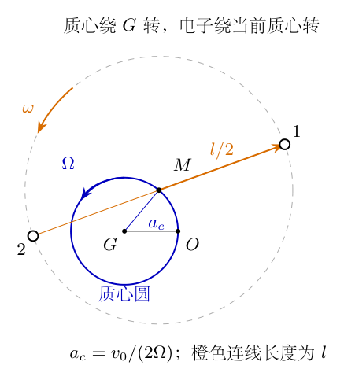{width=56%}

对图中的 $M(t)$，第13步质心方程的分量为

$$
\dot V_{c,x}=-\Omega V_{c,y},
\qquad
\dot V_{c,y}=\Omega V_{c,x}.
$$

初始 $\boldsymbol V_c(0)=(0,v_0/2)$，解为

$$
\boldsymbol V_c(t)
=\frac{v_0}{2}(-\sin\Omega t,\cos\Omega t).
$$

逐分量从 $0$ 积分到 $t$：

$$
\begin{aligned}
X_c(t)&=-\frac{v_0}{2}\int_0^t\sin\Omega t'\,\mathrm dt'
=\frac{v_0}{2\Omega}(\cos\Omega t-1),\\
Y_c(t)&=\frac{v_0}{2}\int_0^t\cos\Omega t'\,\mathrm dt'
=\frac{v_0}{2\Omega}\sin\Omega t.
\end{aligned}
$$

常数 $-1$ 来自初始 $X_c(0)=0$，不能删去后改变圆心。消去时间：

$$
\left(X_c+\frac{v_0}{2\Omega}\right)^2+Y_c^2
=\left(\frac{v_0}{2\Omega}\right)^2.
$$

故

$$
\boxed{
\text{质心作逆时针匀速圆周运动，}\quad
R_c=\frac{v_0}{2\Omega}=\frac{mv_0}{2qB_0},
\quad T_c=\frac{2\pi}{\Omega}
}.
$$

圆心位置依赖坐标原点，但半径、频率与旋向不依赖这一选择。库仑力不改变质心回旋频率。

**第16步：写出绕质心的位置和速度，说明两个角速度的来源。**

由质心与相对坐标的定义：

$$
\begin{aligned}
\boldsymbol r_1(t)&=\boldsymbol R_c(t)+\frac l2(\cos\omega t,\sin\omega t),\\
\boldsymbol r_2(t)&=\boldsymbol R_c(t)-\frac l2(\cos\omega t,\sin\omega t).
\end{aligned}
$$

电子间连线长度始终为 $l$，但其中点按第15步的圆运动移动。每个电子的绝对轨迹一般是两个不同频率圆运动的叠加，而不是围绕 $G$ 的单个圆。

定义单位切向量

$$
\boldsymbol e_\phi(\alpha)=(-\sin\alpha,\cos\alpha).
$$

对上面两位置式求导，并使用 $\omega l=v_0$：

$$
\begin{aligned}
\boldsymbol v_1(t)&=\frac{v_0}{2}
\left[\boldsymbol e_\phi(\Omega t)+\boldsymbol e_\phi(\omega t)\right],\\
\boldsymbol v_2(t)&=\frac{v_0}{2}
\left[\boldsymbol e_\phi(\Omega t)-\boldsymbol e_\phi(\omega t)\right].
\end{aligned}
$$

回代 $t=0$，立即得到 $\boldsymbol v_1(0)=v_0\boldsymbol e_y$、$\boldsymbol v_2(0)=0$，确认编号和两个系数正确。绕质心速度的模为 $\omega l/2=v_0/2$，与质心速度模相同，这才使速度相消有可能发生。

**第17步：利用等模矢量相消，求第一次零速时间。**

图5-5中两速度矢量分别以 $\Omega$、$\omega$ 旋转。它们初始同向，第一次反向时相位差为 $\pi$；不需要等待两个运动各完成整数周。

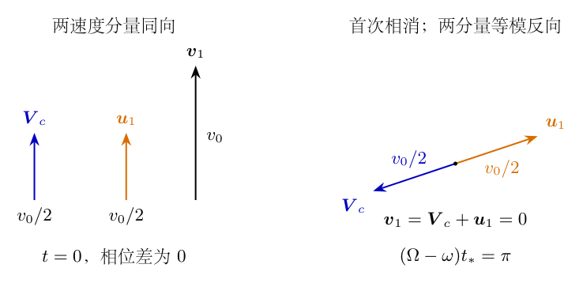{width=86%}

两单位切向量的点积为 $\cos[(\Omega-\omega)t]$，所以

$$
\begin{aligned}
|\boldsymbol v_1(t)|^2
&=\frac{v_0^2}{4}
\left(1+1+2\cos[(\Omega-\omega)t]\right)\\
&=v_0^2\cos^2\left(\frac{\Omega-\omega}{2}t\right).
\end{aligned}
$$

使用恒等式 $1+\cos\alpha=2\cos^2(\alpha/2)$。由第6步，$0<\omega<\Omega$，故相位差随时间正向增加。全部零速时刻为

$$
(\Omega-\omega)t=(2n+1)\pi,
\qquad n=0,1,2,\ldots.
$$

第一次对应 $n=0$，因此

$$
\boxed{t_*=\frac{\pi}{\Omega-\omega}}.
$$

如果直接用相消矢量判断，也得到同一条件；速度模平方的推导则额外证明在 $0<t<t_*$ 内没有遗漏更早的零点。

**第18步：绑定分支符号，完成边界和物理检查。**

将 $\omega_\pm=\Omega/2\pm D$ 代入，注意减号会反转根号前的符号：

$$
\boxed{
t_{*,+}=\frac{\pi}{\Omega/2-D},
\qquad
t_{*,-}=\frac{\pi}{\Omega/2+D}
}.
$$

因此较快相对旋转支的首次停止反而更晚，因为它与质心角速度 $\Omega$ 的差更小。两个时间均为正，单位均为时间。

临界条件 $D=0$ 时，两支合并，$t_*=2\pi/\Omega$。当保持 $B_0$ 不变并使 $l$ 很大，较慢支 $\omega_-\to0$，$t_{*,-}\to\pi/\Omega$；较快支 $\omega_+\to\Omega$，$t_{*,+}\to\infty$。这些只是经典模型的形式极限，实际应用仍须检查速率远小于光速。

首次停止时 $\boldsymbol e_\phi(\omega t_*)=-\boldsymbol e_\phi(\Omega t_*)$，于是

$$
|\boldsymbol v_2(t_*)|=v_0.
$$

而电子 $1$ 此刻的磁力为零，库仑斥力仍非零：

$$
\ddot{\boldsymbol r}_1(t_*)
=\frac{k_eq^2}{ml^3}\boldsymbol R(t_*)\neq0.
$$

所以它只是瞬时静止，随后马上继续运动。两电子速度在此刻发生角色交换，但静电力不会消失。

## 六、关键洞察

第（1）问的两个圆轨道分支并非“一个稳定、一个不稳定”。它们在同一个 $l$ 上具有相同的径向频率，区别主要在旋转方向一致时角速度的大小，以及正则角动量的正负。用有效势能可以进一步检验一般平面微扰，而不限于第7步选取的固定守恒量微扰。

令相对距离为 $R$，约化质量为 $\mu=m/2$。相对角运动满足

$$
\frac{\mathrm d}{\mathrm dt}
\left[R^2\left(\dot\theta-\frac{\Omega}{2}\right)\right]=0.
$$

记单位约化质量的正则角动量为 $j$，则

$$
j=R^2\left(\dot\theta-\frac{\Omega}{2}\right),
\qquad
\dot\theta=\frac{\Omega}{2}+\frac j{R^2}.
$$

$j$ 可以为正、负或零；它与第8步单电子守恒量相差固定倍数，不要由于名字相同就直接混用数值。相对径向方程为

$$
\begin{aligned}
\ddot R
&=R(\dot\theta^2-\Omega\dot\theta)+\frac C{R^2}\\
&=-\frac{\Omega^2R}{4}+\frac{j^2}{R^3}+\frac C{R^2}.
\end{aligned}
$$

中间的交叉项相消：

$$
\left(\frac\Omega2+\frac j{R^2}\right)^2
-\Omega\left(\frac\Omega2+\frac j{R^2}\right)
=-\frac{\Omega^2}{4}+\frac{j^2}{R^4}.
$$

故单位约化质量的有效势能是

$$
U_{\rm eff}(R)
=\frac{\Omega^2R^2}{8}+\frac{j^2}{2R^2}+\frac C R.
$$

逐项求负导数便得到上面的径向方程。库仑势能项是正的 $C/R$，因为相同电荷相斥。该有效势能不是全部实际势能，而是固定正则角动量后的一维径向描述。

其二阶导数为

$$
U_{\rm eff}''(R)
=\frac{\Omega^2}{4}+\frac{3j^2}{R^4}+\frac{2C}{R^3}>0.
$$

而 $R\to0^+$ 与 $R\to\infty$ 时，$U_{\rm eff}$ 都趋于正无穷，故每个 $j$ 都有唯一稳定径向最低点。在指定圆轨道 $R=l$ 上，

$$
j=l^2\left(\omega-\frac\Omega2\right),
$$

代入二阶导数，并用 $C/l^3=\Omega\omega-\omega^2$：

$$
\begin{aligned}
U_{\rm eff}''(l)
&=\frac{\Omega^2}{4}
+3\left(\omega-\frac\Omega2\right)^2
+2(\Omega\omega-\omega^2)\\
&=\Omega^2-\Omega\omega+\omega^2=\kappa^2.
\end{aligned}
$$

这是对径向受力逐项展开的独立能量核验。较小的初值变化使 $j$ 和径向能量连续变化，轨道仍在邻近最低点附近作有界径向运动；质心初速度的微扰又只产生有界回旋运动。因此平面内的轨道稳定结论不只依赖完全对称的某一种特殊扰动。

还可检验旋转坐标的全部平面线性模式。随圆轨道以 $\omega$ 旋转，令相对位置微扰的径向、切向分量为 $\xi,\eta$，设

$$
s=\frac C{l^3}=\Omega\omega-\omega^2,\qquad
\gamma=\Omega-2\omega.
$$

为说明两个耦合项的来源，设 $Q(t)$ 为转过 $\omega t$ 的二维旋转矩阵：

$$
Q(t)=
\begin{pmatrix}
\cos\omega t&-\sin\omega t\\
\sin\omega t&\cos\omega t
\end{pmatrix}.
$$

令 $\boldsymbol R=Q(t)\boldsymbol u$。逐项求矩阵元素的导数可得 $\dot Q=\omega JQ$，且 $J^2=-I$，其中 $I$ 是二维单位矩阵。逐次求位置向量的导数：

$$
\begin{aligned}
\dot{\boldsymbol R}
&=Q(\dot{\boldsymbol u}+\omega J\boldsymbol u),\\
\ddot{\boldsymbol R}
&=Q(\ddot{\boldsymbol u}+2\omega J\dot{\boldsymbol u}
-\omega^2\boldsymbol u).
\end{aligned}
$$

把它们代入第13步的相对牛顿方程，左乘 $Q^{-1}$。旋转不改变向量长度，且 $JQ=QJ$，所以

$$
\begin{aligned}
\ddot{\boldsymbol u}+2\omega J\dot{\boldsymbol u}
-\omega^2\boldsymbol u
&=\Omega J\dot{\boldsymbol u}
-\Omega\omega\boldsymbol u+\frac C{u^3}\boldsymbol u,\\
\ddot{\boldsymbol u}
&=(\Omega-2\omega)J\dot{\boldsymbol u}
+(\omega^2-\Omega\omega)\boldsymbol u
+\frac C{u^3}\boldsymbol u.
\end{aligned}
$$

在该旋转坐标中，未扰动相对位置为 $\boldsymbol u_0=(l,0)$。写 $\boldsymbol u=(l+\xi,\eta)$，常数项由圆轨道平衡抵消。库仑矢量的导数不能用一个标量系数同时替代两个方向：

记 $u=|\boldsymbol u|$；下面的 $\delta_{ij}$ 在 $i=j$ 时为 $1$，在 $i\neq j$ 时为 $0$，$i,j$ 分别标记两个平面分量。

$$
\begin{aligned}
\frac{\partial}{\partial u_j}
\left(\frac{u_i}{u^3}\right)
&=\frac{\delta_{ij}}{u^3}-\frac{3u_iu_j}{u^5},\\
\left.\frac{\partial(\boldsymbol u/u^3)}
{\partial\boldsymbol u}\right|_{(l,0)}
&=\frac1{l^3}
\begin{pmatrix}-2&0\\0&1\end{pmatrix}.
\end{aligned}
$$

库仑项的线性变化为 $(-2s\xi,s\eta)$，而 $(\omega^2-\Omega\omega)(\xi,\eta)=-s(\xi,\eta)$；两者相加为 $(-3s\xi,0)$。又有 $J(\dot\xi,\dot\eta)=(-\dot\eta,\dot\xi)$，故两个分量方程是

$$
\ddot\xi=-3s\xi-\gamma\dot\eta,
\qquad
\ddot\eta=\gamma\dot\xi.
$$

代入 $\xi,\eta\propto e^{\lambda t}$：

$$
\begin{aligned}
(\lambda^2+3s)\xi+\gamma\lambda\eta&=0,\\
-\gamma\lambda\xi+\lambda^2\eta&=0.
\end{aligned}
$$

行列式条件为

$$
\lambda^2(\lambda^2+3s+\gamma^2)
=\lambda^2(\lambda^2+\kappa^2)=0.
$$

非零特征根是纯虚的 $\pm i\kappa$。零特征根允许相位改变及邻近圆轨道参数改变，不能把由此导致的长期相位差说成径向指数不稳定。

题设限定运动在平面内非常重要。若放开相对轴向位移 $\zeta$，磁场不提供沿 $z$ 的回复力，线性相对方程为

$$
\ddot\zeta=\frac C{l^3}\zeta.
$$

它有增长解 $\zeta\propto e^{\sqrt{C/l^3}\,t}$，说明不受限制的三维模型不同于题设的平面模型。这个范围辨析不改变本题所问的平面稳定结论。

## 七、易错点

把 $l$ 当成每个电子的圆周半径，导致向心加速度少一个因子 $2$。第（1）问必须先用质心静止和对称性确定 $\rho_0=l/2$。

将负电荷的磁力方向画反。对于 $+z$ 磁场，右侧电子向上运动时磁力向左，共同旋转是逆时针；两个角速度分支不是两种相反旋向。

只保留磁力而忽略两电子的库仑斥力，或者把向心力当成第三种真实力。应按图5-2写磁力减斥力，再等于向心加速度对应的 $m$。

径向扰动后固定切向速度，或错误地保持机械角动量不变。图5-3所需守恒量是 $m\rho v-qB_0\rho^2/2$；磁力矩正是微扰速度中 $\Omega\rho_0x$ 的来源。

一阶化简时遗漏 $-2k_eq^2x/l^2$ 或弄错磁力变化的符号，会把慢速支误判为不稳定。正确系数是 $-m\rho_0\kappa^2$，对两支都为负。

把圆轨道判别式为零当成稳定性临界。判别式判断指定 $l$ 是否存在圆轨道；径向稳定性则由另一个二阶导数或线性恢复系数判断，两者不同。

把“稳定”理解为微扰自行衰减，或者所有未来时刻的角位置都与原解相同。无阻尼的径向振动会持续存在，微小频率变化也可造成相位漂移；这些不等于轨道径向发散。

第（2）问仍写 $\omega=2v_0/l$，是把两问的初始速度混用。应先写 $\dot{\boldsymbol R}(0)=\boldsymbol v_1(0)-\boldsymbol v_2(0)$，再由相对距离得到 $\omega=v_0/l$。

质心运动半径用 $mv_0/(qB_0)$ 会大一倍，因为质心初速只有 $v_0/2$。积分时遗漏位置常数又会把圆心错放到初始质心处。

在 $t_*=\pi/(\Omega-\omega)$ 中照抄 $\omega$ 的根号符号，使快支、慢支停时交换。应分开写 $t_{*,+}$ 与 $t_{*,-}$，并用“角速度越接近 $\Omega$，相消越慢”检验。

把首次速度为零等同于最终停止。此时磁力虽为零，库仑斥力却仍在，电子立即获得非零加速度；也不能把电子 $2$ 的初始零速误当成电子 $1$ 的首次零速。

## 八、课堂讲解建议

课堂先在图5-1确定电子编号、磁场向外和两问的初始速度。教师让学生分别计算两问的质心初速度与相对初速度，板书同时保留 $0,v_0/2$ 和 $2v_0,v_0$，避免后续仅靠记忆区分因子 $2$。

讲圆轨道时，在图5-2先标向内磁力和向外斥力，再确定半径是 $l/2$。教师可先让学生判断磁力必须大于斥力，然后列方程、配方并讨论两个正根，不直接告知哪个分支更快。

讲稳定性时，课堂先问“半径略变，切向速度是否仍为原值”。教师从图5-3的径向速度产生切向磁力讲起，再从切向牛顿方程推出守恒量。板书把径向一阶变化分成几何、库仑、磁力三列，全部代入后才合并，尤其检查慢速支的回复系数。

课堂可用有效势能作第二条验证路线，强调“代数根合并”和“势能二阶导数为零”不是同一件事。教师不宜仅用结论性的稳定、不稳定标签，要让学生指出到底是哪一个小量有界，哪一个相位允许漂移。

讲第（2）问时，在图5-4区分固定圆心 $G$、初始质心 $O$、当前质心 $M$ 和相对连线。教师先完成质心速度积分，再加上绕质心速度；课堂用图5-5演示两个等长箭头从同向转到反向，最后以模平方证明没有更早的零点。

结束时让学生逐项回代初值、检查两停时的根号符号，并分析瞬时静止后的加速度。板书留出临界点和大间距两个极限，但同时提醒非相对论速率约束，避免把形式极限误当成任意真实电子实验都可实现。

## 九、变式训练

**变式1：间距是临界间距的两倍时，比较两支圆轨道。**

保持 $m,q,B_0$ 不变，取 $l=2l_c$。求 $\omega_\pm/\Omega$、第（1）问两个速率、两支径向小振动频率，并写第（2）问的首次停止时间。

由临界关系 $C/l_c^3=\Omega^2/4$：

$$
\frac C{l^3}
=\frac{C}{8l_c^3}=\frac{\Omega^2}{32}.
$$

因而

$$
\begin{aligned}
D&=\frac\Omega2\sqrt{1-\frac18}
=\frac\Omega2\sqrt{\frac78},\\
\frac{\omega_\pm}{\Omega}
&=\frac{1\pm\sqrt{7/8}}2,\\
v_{0,\pm}^{(1)}
&=\frac{\Omega l}{4}\left(1\pm\sqrt{\frac78}\right).
\end{aligned}
$$

两支径向频率均为

$$
\boxed{\kappa=\Omega\sqrt{\frac{31}{32}}}.
$$

第（2）问的初速为 $2v_{0,\pm}^{(1)}$，对应

$$
\boxed{
t_{*,+}=\frac{2\pi}{\Omega(1-\sqrt{7/8})},
\qquad
t_{*,-}=\frac{2\pi}{\Omega(1+\sqrt{7/8})}
}.
$$

分母都是正数。将较慢根取极限，停时接近 $\pi/\Omega$；较快根更接近 $\Omega$，停时明显更长。径向频率相同不代表圆周运动或停时相同。

<!-- KEEP_TOGETHER_START -->

**变式2：用给定电子参数检验速度、长度与时间量级。**

给定

$$
\begin{aligned}
m&=9.1093837139\times10^{-31}\,\mathrm{kg},\\
q&=1.602176634\times10^{-19}\,\mathrm C,\\
k_e&=8.9875517923\times10^9\,\mathrm{N\,m^2\,C^{-2}},\\
B_0&=1.00\,\mathrm T,\qquad l=1.00\times10^{-6}\,\mathrm m.
\end{aligned}
$$

求两问允许速率、质心半径、首次停时，并检验非相对论近似。以下额外给定 $c=2.99792458\times10^8\,\mathrm{m\,s^{-1}}$。

<!-- KEEP_TOGETHER_END -->

先算基本参数：

$$
\begin{aligned}
\Omega
&=\frac{(1.602176634\times10^{-19})(1.00)}
{9.1093837139\times10^{-31}}
\approx1.7588200084\times10^{11}\,\mathrm{s^{-1}},\\
l_c
&=2\left[
\frac{(8.9875517923\times10^9)(9.1093837139\times10^{-31})}
{(1.00)^2}
\right]^{1/3}\\
&\approx4.0309442941\times10^{-7}\,\mathrm m.
\end{aligned}
$$

题给 $l>l_c$，所以两根存在。为了避免电荷量数量级掩盖判断，可先算无量纲组合

$$
\frac{C}{\Omega^2l^3}
=\frac{2k_em}{B_0^2l^3}
\approx0.0163742,
$$

它小于 $1/4$。代入二次根式，得到

$$
\begin{aligned}
\omega_-&\approx2.9286962327\times10^9\,\mathrm{s^{-1}},\\
\omega_+&\approx1.7295330461\times10^{11}\,\mathrm{s^{-1}}.
\end{aligned}
$$

第（1）问每个电子速率为 $\omega_\pm l/2$：

$$
v_{0,-}^{(1)}\approx1464.35\,\mathrm{m\,s^{-1}},
\qquad
v_{0,+}^{(1)}\approx86476.65\,\mathrm{m\,s^{-1}}.
$$

第（2）问只有一个电子初始运动，所以其速率为 $\omega_\pm l$：

$$
v_{0,-}^{(2)}\approx2928.70\,\mathrm{m\,s^{-1}},
\qquad
v_{0,+}^{(2)}\approx172953.30\,\mathrm{m\,s^{-1}}.
$$

相应质心半径为

$$
\begin{aligned}
R_{c,-}
&=\frac{\omega_-l}{2\Omega}
\approx8.32574\times10^{-9}\,\mathrm m,\\
R_{c,+}
&=\frac{\omega_+l}{2\Omega}
\approx4.91674\times10^{-7}\,\mathrm m.
\end{aligned}
$$

首停时按分支分别代入：

$$
\begin{aligned}
t_{*,-}
&=\frac{\pi}{1.7588200084\times10^{11}-2.9286962327\times10^9}
\approx1.81644\times10^{-11}\,\mathrm s,\\
t_{*,+}
&=\frac{\pi}{1.7588200084\times10^{11}-1.7295330461\times10^{11}}
\approx1.07269\times10^{-9}\,\mathrm s.
\end{aligned}
$$

较快支的分母是两相近角速度之差，数值计算必须保留足够有效数字，不能先把 $\omega_+$ 取成 $\Omega$ 再作减法。若需更稳健地求这个小分母，可利用两根乘积：

$$
\Omega-\omega_+=\omega_-=\frac{C/l^3}{\omega_+}.
$$

最大初速与光速之比约为 $5.77\times10^{-4}$，非相对论速率条件满足；这只核对题设的经典速度近似，不意味着已加入题外的辐射或量子模型。两支径向频率都约为 $1.74436\times10^{11}\,\mathrm{s^{-1}}$。

**变式3：两个电子初始都运动时，是否还能出现零速？**

取初始位置仍为 $(l/2,0)$、$(-l/2,0)$，但初速度改成 $a\boldsymbol e_y$、$b\boldsymbol e_y$，其中 $a>b\geq0$。求保持间距 $l$ 的条件，并判断电子 $1$ 是否能再次瞬时停止。

质心初速度与相对初速度分别为

$$
\boldsymbol V_c(0)=\frac{a+b}{2}\boldsymbol e_y,
\qquad
\dot{\boldsymbol R}(0)=(a-b)\boldsymbol e_y.
$$

因此恒距条件为

$$
\omega=\frac{a-b}{l}\in\{\omega_-,\omega_+\},
\qquad l\geq l_c.
$$

和 $a+b$ 只决定质心运动幅度，并不进入相对圆轨道方程；差 $a-b$ 才决定相对角速度。电子 $1$ 速度为

$$
\boldsymbol v_1(t)
=\frac{a+b}{2}\boldsymbol e_\phi(\Omega t)
+\frac{a-b}{2}\boldsymbol e_\phi(\omega t).
$$

将模平方展开：

$$
\begin{aligned}
|\boldsymbol v_1(t)|^2
&=\frac{(a+b)^2+(a-b)^2}{4}
+\frac{a^2-b^2}{2}\cos[(\Omega-\omega)t]\\
&=\frac{a^2+b^2}{2}
+\frac{a^2-b^2}{2}\cos[(\Omega-\omega)t].
\end{aligned}
$$

因为 $a^2-b^2>0$，最小值在相位差为奇数倍 $\pi$ 时取得：

$$
\min|\boldsymbol v_1|^2
=\frac{a^2+b^2-a^2+b^2}{2}=b^2.
$$

所以 $b>0$ 时电子 $1$ 永远不能零速；$b=0$ 时才回到原题的首停时。等模矢量是精确相消的必要条件，不能把原题的相位差条件机械套给两个不等模分量。

此刻电子 $2$ 的最大速率为 $a$，而初始速率为 $b$；两粒子在相位差 $\pi$ 时交换速率大小。整个过程中库仑势能因间距不变而固定，总动能也保持不变，可再用 $a^2+b^2$ 检查。

**变式4：临界场附近分支合并，径向恢复频率是否也消失？**

固定 $l,m,q$，令临界场为 $B_c=\sqrt{8k_em/l^3}$，并取 $B_0=B_c(1+\epsilon)$，其中 $0<\epsilon\ll1$。定义 $\Omega_c=qB_c/m$。求两个角速度分支的首要分裂量、径向频率及两个首次停止时间的首要变化。

由临界条件 $C/l^3=\Omega_c^2/4$，而 $\Omega=\Omega_c(1+\epsilon)$：

$$
\begin{aligned}
D
&=\sqrt{\frac{\Omega_c^2}{4}(1+\epsilon)^2-\frac{\Omega_c^2}{4}}\\
&=\frac{\Omega_c}{2}\sqrt{2\epsilon+\epsilon^2}.
\end{aligned}
$$

因此精确两根为

$$
\omega_\pm
=\frac{\Omega_c}{2}
\left(1+\epsilon\pm\sqrt{2\epsilon+\epsilon^2}\right).
$$

使用 $\sqrt{2\epsilon+\epsilon^2}
=\sqrt{2\epsilon}\,[1+\epsilon/4+O(\epsilon^2)]$：

$$
\omega_\pm
=\frac{\Omega_c}{2}
\left[1\pm\sqrt{2\epsilon}+\epsilon
+O(\epsilon^{3/2})\right].
$$

分支分裂的首要量为 $\omega_+-\omega_-=\Omega_c\sqrt{2\epsilon}+O(\epsilon^{3/2})$，它是 $\sqrt\epsilon$ 级，不是 $\epsilon$ 级。临界附近对参数的灵敏度较大。

径向频率却为

$$
\begin{aligned}
\kappa^2
&=\Omega^2-\frac C{l^3}
=\Omega_c^2\left(\frac34+2\epsilon+\epsilon^2\right),\\
\kappa
&=\frac{\sqrt3\,\Omega_c}{2}
\left[1+\frac43\epsilon+O(\epsilon^2)\right].
\end{aligned}
$$

$\epsilon\to0^+$ 时径向频率仍趋于 $\sqrt3\,\Omega_c/2$，没有软化至零；两根合并与径向失稳是不同的判断。

最后，首停时的精确式为

$$
t_{*,\pm}
=\frac{2\pi}{\Omega_c}
\frac1{1+\epsilon\mp\sqrt{2\epsilon+\epsilon^2}}.
$$

<!-- KEEP_TOGETHER_START -->

令分母偏离 $1$ 的量为 $h=\epsilon\mp\sqrt{2\epsilon+\epsilon^2}$。展开 $(1+h)^{-1}=1-h+h^2+O(h^3)$，并保留到 $\epsilon$：

$$
\boxed{
t_{*,\pm}
=\frac{2\pi}{\Omega_c}
\left[1\pm\sqrt{2\epsilon}+\epsilon
+O(\epsilon^{3/2})\right]
}.
$$

平方项贡献 $2\epsilon$，与一次项中的 $-\epsilon$ 合成 $+\epsilon$；若只保留线性倒数而漏掉 $h^2$，便会弄错二阶项。较快支停时增加、较慢支停时减少，均回到临界值 $2\pi/\Omega_c$。

<!-- KEEP_TOGETHER_END -->

这里还有一个精确的有理化核验：两种分母的乘积为

$$
(1+\epsilon)^2-(2\epsilon+\epsilon^2)=1.
$$

因此可直接把精确停时写成

$$
t_{*,\pm}
=\frac{2\pi}{\Omega_c}
\left(1+\epsilon\pm\sqrt{2\epsilon+\epsilon^2}\right).
$$

它与上述展开一致，且不需要在数值上相减两个接近的量。这种有理化与变式2中利用两根乘积求小根的思想相同。

<!-- question-complete -->

\newpage

# 第6题

<!-- question-start -->

工业中常用高温废水预热低温水。将装置理想化为图6-1所示的同轴逆流换热管：低温水的入口温度为 $T_L$，在内管中从左向右流动；高温水的入口温度为 $T_H$，在外管的环形通道中从右向左流动，且 $T_H>T_L$。管道总长为 $l$。管道足够细，在同一轴向位置，每股水流在其横截面内的温度可视为均匀。

冷、热两股水流的质量流率相同，均为

$$
\alpha=\frac{\Delta m}{\Delta t},
$$

水的比热容为

$$
c=\frac{\Delta Q}{\Delta m\,\Delta T}.
$$

内、外两股水流之间的管壁半径为 $r$，厚度为 $h\ll r$，热导率为 $\kappa$。薄壁导热满足

$$
\Delta Q=\frac{\kappa\,\Delta T}{h}\,\Delta A\,\Delta t,
$$

其中 $\Delta T$ 是壁两侧水流的局部温差，$\Delta A$ 是相应的换热面积。

（1）求内管水温随轴向坐标 $x$ 的分布。

（2）求单位时间内换热过程引起的两股水流总熵变化。

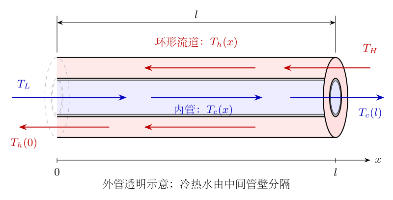{width=90%}

<!-- question-end -->

## 一、题型定位

本题是稳态逆流换热与不可逆传热的熵分析。需要先对同一小段中的两股水流分别列能量平衡，建立局部温度的联立微分方程，再利用位于不同管端的两个入口条件确定积分常量。

两股水流质量流率及比热相同，是温差沿管长保持不变的关键；“恒定温差”不是由管壁薄自动得到的。管壁薄只决定题设导热系数的形式。第（2）问同时涉及熵随水流的输运和换热产生的熵，必须区分流体熵变化与稳态装置中的熵积累。

## 二、知识点

质量流率与热容流率；薄圆柱壁的换热面积；稳态控制体能量守恒；逆流的入口与出口辨认；统一空间坐标下的温度梯度；联立一阶微分方程及异端边界条件；恒温差与线性温度分布；定比热流体的对数熵变化；局部熵产生与整体熵流平衡；量纲、温差正值及弱、强换热极限。

采用题设的理想热交换模型：水的比热容 $c$ 和热导率 $\kappa$ 不随温度变化；只有两股水流之间的径向换热，不计向环境散热、壁的稳态储热和轴向导热，也不额外加入压降、黏性耗散或机械功引起的熵变化。这些约定限定本题公式的适用范围，不是对实际换热设备所有效应的描述。所有熵公式中的温度必须是绝对温度。

## 三、物理图像

冷水沿 $+x$ 方向流动，越向右越热。热水沿 $-x$ 方向流动，越向左越冷；但若把它的温度也画在同一个向右增加的 $x$ 坐标上，曲线同样向右上升。沿水流方向的降温与沿共同坐标方向的正梯度不是一回事。

每一小段中，热水放出的热量等于冷水吸收的热量。两股水流的热容流率相等，因此同一段内两条温度曲线的增量相同，曲线保持平行。在任何一个位置，热水仍比冷水热；然而两股水流的出口位于相反管端，比较两处出口温度不能代替比较同一位置的温度。

有限温差传热使冷水获得的熵大于热水失去的熵。装置在稳态下并不持续积累这份熵，而是由出流水将产生的熵带走。

## 四、解题入口

从冷水入口取 $x=0$，向右为正方向，右端为 $x=l$。入口温度 $T_L,T_H$ 是给定常数；局部冷、热水温度分别写作 $T_c(x),T_h(x)$，避免把热水入口温度误当作全管恒温。

先定义热容流率和单位管长的导热系数：

$$
C=\alpha c,\qquad
G=\frac{2\pi r\kappa}{h}.
$$

$C$ 的单位为 $\mathrm{W\,K^{-1}}$，$G$ 的单位为 $\mathrm{W\,m^{-1}\,K^{-1}}$。对小段列式后，先相减求 $T_h-T_c$，再用 $T_c(0)=T_L$ 与 $T_h(l)=T_H$；不能把两个入口条件都放在 $x=0$。

## 五、解析

**第1步：明确研究对象、局部温度和两个入口条件。**

图6-1外侧环形流道与内管只通过中间薄壁交换热量，两股水不混合。取任意固定的小段 $[x,x+dx]$ 为研究对象；小段内两股水分别是两个稳态控制体。

冷水从左侧面进入、右侧面流出；热水从右侧面进入、左侧面流出。因此边界条件是

$$
\boxed{T_c(0)=T_L,\qquad T_h(l)=T_H.}
$$

未知的是右端冷水出口 $T_c(l)$ 和左端热水出口 $T_h(0)$。质量流率 $\alpha$ 是每秒通过截面的质量，而不是管中已有水的总质量。后面每个能量方程使用的是单位时间内流入、流出的焓差，不是整段水温随时间的变化。

**第2步：从真实换热面积得到小段的热流率。**

半径为 $r$ 的圆柱壁，在轴向长度 $dx$ 内的面积为周长乘长度：

$$
dA=2\pi r\,dx.
$$

按薄壁模型，壁两侧温差就是同一位置的 $T_h(x)-T_c(x)$。记从热水传给冷水的小段热流率为 $d\dot Q$；点表示“每单位时间”，$d$ 表示“这一小段所占的部分”。由题给导热关系，

$$
\begin{aligned}
d\dot Q
&=\frac{\kappa}{h}[T_h(x)-T_c(x)]\,dA\\
&=\frac{2\pi r\kappa}{h}[T_h(x)-T_c(x)]\,dx\\
&=\boxed{G[T_h(x)-T_c(x)]\,dx}.
\end{aligned}
$$

这里没有再乘水流速度。流速只通过质量流率影响水流携带热量的能力，不能重复计入壁的导热式。有限厚度圆柱壁的精确热阻不同；本题先严格使用已给的薄壁定律。

**第3步：对冷水列出流入、吸热、流出三项。**

图6-2把同一小段中的冷、热水分开显示。先辨认每个箭头是进入还是离开该控制体，再确定能量方程中的符号。

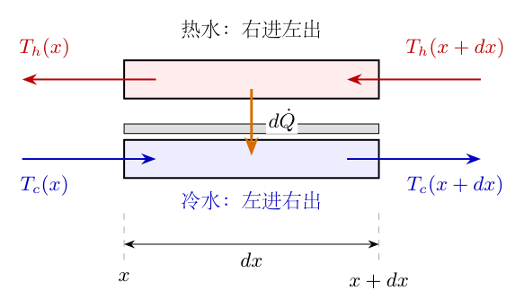{width=76%}

冷水在时间 $dt$ 内通过的质量为 $\alpha\,dt$。定比热情况下，从 $T_c(x)$ 到 $T_c(x+dx)$ 所需的热量为

$$
\alpha c\,dt\,[T_c(x+dx)-T_c(x)].
$$

吸收的热量为 $d\dot Q\,dt$。稳态没有该段能量积累，故

$$
\begin{aligned}
C\,T_c(x)+d\dot Q&=C\,T_c(x+dx),\\
C[T_c(x+dx)-T_c(x)]&=G[T_h(x)-T_c(x)]\,dx.
\end{aligned}
$$

固定比热时焓基准可以取在任意温度，因为流入和流出的同一基准项抵消；不需要把 $cT$ 理解为从绝对零度积分得到的真实总焓。将温度差除以 $dx$ 并取极限，得到

$$
\boxed{C\,\frac{dT_c}{dx}=G(T_h-T_c).}
$$

这是空间微分方程，不是 $C\,dT_c/dt$。稳态只说明每个固定位置的温度不随时间变化，不说明沿管长处处等温。

**第4步：对热水列式，核对反向流动的符号。**

图6-2中的热水从右侧 $x+dx$ 进入，从左侧 $x$ 离开。热水失去热量 $d\dot Q\,dt$，所以

$$
\begin{aligned}
C\,T_h(x+dx)&=C\,T_h(x)+d\dot Q,\\
C[T_h(x+dx)-T_h(x)]&=G[T_h(x)-T_c(x)]\,dx,\\
C\,\frac{dT_h}{dx}&=G(T_h-T_c).
\end{aligned}
$$

两个导数都为正，这与热水沿自己的流向降温完全一致。若改为沿热水流向的坐标 $s=l-x$，则

$$
\frac{dT_h}{ds}
=\frac{dT_h}{dx}\frac{dx}{ds}
=-\frac{dT_h}{dx}<0.
$$

必须在共同 $x$ 坐标下解联立方程，不能一条方程用向右的 $x$，另一条暗中换成向左的 $s$。

**第5步：相减方程，证明局部温差恒定。**

将第3、4步相减，因为两股水的热容流率都是同一个 $C$，

$$
\begin{aligned}
\frac{dT_h}{dx}-\frac{dT_c}{dx}
&=\frac GC(T_h-T_c)-\frac GC(T_h-T_c)=0,\\
\frac{d}{dx}(T_h-T_c)&=0.
\end{aligned}
$$

因此可以记

$$
T_h(x)-T_c(x)=\delta,
$$

其中 $\delta$ 是待由边界条件确定的常数。它不是两入口温差 $T_H-T_L$，也不是冷水通过全管的升温量。

此时任一温度的导数为 $G\delta/C$，所以曲线是直线。若两流率或比热不同，两个导数不再相同，这个结论便不能直接沿用。

**第6步：逐项积分，再用异端边界求出常数。**

由冷水方程，从 $0$ 积分到任意 $x$：

$$
\begin{aligned}
\int_{T_L}^{T_c(x)}dT
&=\frac{G\delta}{C}\int_0^x d\xi,\\
T_c(x)&=T_L+\frac{G\delta}{C}x.
\end{aligned}
$$

热水温度比它高 $\delta$，因此

$$
T_h(x)=T_L+\delta+\frac{G\delta}{C}x.
$$

将热水入口条件代入 $x=l$，得到

$$
\begin{aligned}
T_H&=T_L+\delta+\frac{G\delta l}{C},\\
T_H-T_L&=\delta\left(1+\frac{Gl}{C}\right),\\
\delta&=\frac{T_H-T_L}{1+Gl/C}
=\frac{\alpha c h(T_H-T_L)}{\alpha c h+2\pi r\kappa l}.
\end{aligned}
$$

分母中 $1$ 不能遗漏。它来自右端两股水仍相差 $\delta$，不是积分中凭空加上的修正常量。因 $G,C,l>0$、$T_H>T_L$，所以 $\delta>0$，每处热流始终从热水指向冷水。

**第7步：给出温度分布，统一长度与无量纲参数。**

定义换热长度和无量纲换热强度

$$
\ell_0=\frac CG=\frac{\alpha c h}{2\pi r\kappa},
\qquad N=\frac l{\ell_0}=\frac{Gl}{C},
\qquad D=T_H-T_L.
$$

$\ell_0$ 表示导热与水流携热相竞争的长度尺度，不是管子的原长。代入上一步，内管冷水分布为

$$
\boxed{\begin{aligned}
T_c(x)&=T_L+D\,\frac{x/\ell_0}{1+l/\ell_0}\\
&=T_L+\frac{2\pi r\kappa(T_H-T_L)}
{\alpha c h+2\pi r\kappa l}\,x,
\quad 0\le x\le l.
\end{aligned}}
$$

同时，为后续熵计算保留热水分布：

$$
\begin{aligned}
T_h(x)
&=T_c(x)+\frac{D}{1+N}\\
&=T_H-D\,\frac{N}{1+N}\left(1-\frac xl\right).
\end{aligned}
$$

后一式在 $x=l$ 自动给出 $T_H$；前一式在 $x=0$ 自动给出 $T_L$。图6-3用同一坐标展示两条平行曲线、两个入口和两个出口；右端的竖直间距为 $\delta$，与左端相同。

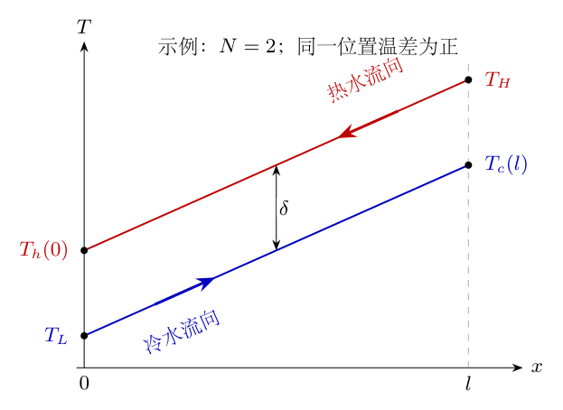{width=68%}

图中每一竖直连线都连接同一个 $x$ 的两股水，故温差为正。后面计算局部熵产生时，使用的正是这样的局部温差，而不是跨管两端的出口温差。

**第8步：求两个出口与总热流率，作能量回代。**

令

$$
\varepsilon=\frac{N}{1+N},\qquad 0<\varepsilon<1.
$$

它表示冷水实际升温占两入口温差的比例。由温度分布，

$$
\begin{aligned}
T_{c,\mathrm{out}}=T_c(l)&=T_L+\varepsilon D=T_H-\delta,\\
T_{h,\mathrm{out}}=T_h(0)&=T_H-\varepsilon D=T_L+\delta.
\end{aligned}
$$

两股出口温度之和为 $T_L+T_H$。每秒冷水获得的热量与热水失去的热量分别为

$$
\begin{aligned}
\dot Q_c&=C[T_c(l)-T_L]=C\varepsilon D,\\
\dot Q_h&=C[T_H-T_h(0)]=C\varepsilon D.
\end{aligned}
$$

从壁面沿管长积分也给出

$$
\dot Q=\int_0^l G\delta\,dx
=Gl\delta
=\frac{GlD}{1+Gl/C}
=C\varepsilon D.
$$

三种计算一致。特别地，$N>1$ 时 $\varepsilon>1/2$，冷水出口可以高于热水出口，但这两个出口分别在右端和左端；每一处仍有 $T_h(x)-T_c(x)=\delta>0$，没有热从冷处自发流向热处。

**第9步：辨认“熵变化”在稳态开放系统中的含义。**

以 $S_{\mathrm{cv}}$ 表示固定管段这一控制体内物质的熵。若研究的是固定管段中的全部物质，稳态时其熵不随时间积累，即

$$
\frac{dS_{\mathrm{cv}}}{dt}=0.
$$

这不表示换热没有熵产生。水不断流入、流出，必须把熵流也计入。无外界传热的理想装置满足

$$
0=\dot S_{\mathrm{in}}-\dot S_{\mathrm{out}}
+\dot S_{\mathrm{gen}},
$$

所以

$$
\boxed{\dot S_{\mathrm{gen}}
=\dot S_{\mathrm{out}}-\dot S_{\mathrm{in}}.}
$$

本题第（2）问所求的是通过装置的两股水流总熵变化率，即上述出、入熵流之差；它等于有限温差换热的熵产生率。不能把这个正值与固定稳态控制体的零积累量混为一谈。

<!-- KEEP_TOGETHER_START -->

**第10步：写出局部水流熵变化并判断正负。**

图6-4以一小段的热交换为对象。该段每秒把 $d\dot Q$ 从局部热水 $T_h$ 传给局部冷水 $T_c$。在本题定比热、无额外机械耗散模型中，水流温度变化的熵可由平衡态关系 $ds=c\,dT/T$ 计算。

<!-- KEEP_TOGETHER_END -->

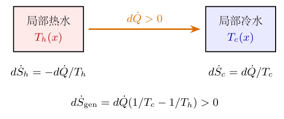{width=70%}

将冷水吸热和热水放热分别计入，

$$
\begin{aligned}
d\dot S_c&=\frac{d\dot Q}{T_c},\\
d\dot S_h&=-\frac{d\dot Q}{T_h},\\
d\dot S_{\mathrm{gen}}
&=d\dot Q\left(\frac1{T_c}-\frac1{T_h}\right)\\
&=G(T_h-T_c)
\left(\frac1{T_c}-\frac1{T_h}\right)dx\\
&=\boxed{\frac{G\delta^2}{T_cT_h}\,dx>0.}
\end{aligned}
$$

$dQ/T$ 不是把整个非等温流体当成一个恒温热库；这里在每个微小空间段分别采用其局部温度，然后再积分。由于 $T_h>T_c>0$，热水少失去一些熵，冷水多获得一些熵，两者不抵消。

**第11步：逐项计算熵积分，明确温差因子的消去。**

总熵产生率为

$$
\dot S_{\mathrm{gen}}
=G\delta\int_0^l
\left[\frac1{T_c(x)}-\frac1{T_h(x)}\right]dx.
$$

记两条温度曲线的斜率为

$$
b=\frac{G\delta}{C},
\quad T_c(x)=T_L+bx,
\quad T_h(x)=T_L+\delta+bx.
$$

这里 $b>0$。分别积分两个倒数，数学技巧是线性换元 $u=a+bx$：

$$
\begin{aligned}
\int_0^l\frac{dx}{T_L+bx}
&=\frac1b\left[\ln(T_L+bx)\right]_0^l
=\frac1b\ln\frac{T_c(l)}{T_L},\\
\int_0^l\frac{dx}{T_L+\delta+bx}
&=\frac1b\ln\frac{T_h(l)}{T_h(0)}
=\frac1b\ln\frac{T_H}{T_h(0)}.
\end{aligned}
$$

再代回整体系数，不省略关键约分：

$$
\begin{aligned}
\dot S_{\mathrm{gen}}
&=\frac{G\delta}{b}
\left[\ln\frac{T_c(l)}{T_L}
-\ln\frac{T_H}{T_h(0)}\right],\\
\frac{G\delta}{b}
&=\frac{G\delta}{G\delta/C}=C,\\
\dot S_{\mathrm{gen}}
&=C\left[
\ln\frac{T_H-\delta}{T_L}
-\ln\frac{T_H}{T_L+\delta}
\right].
\end{aligned}
$$

最终对数前的系数只有 $C=\alpha c$，没有额外乘上 $\delta$。若保留额外温差，既没有正确完成换元约分，也会使单位由熵流率变成热功率。

当 $D=0$ 或 $G=0$ 时，上面为积分方便而引入的 $b$ 为零，不能直接除以 $b$；此时原始热流和熵产生均为零，可直接处理或取连续极限。

**第12步：由出、入水流的熵变化独立核对。**

定比热水在温度从 $T_a$ 变为 $T_b$ 时，比熵变化为

$$
s_b-s_a=\int_{T_a}^{T_b}\frac cT\,dT
=c\ln\frac{T_b}{T_a}.
$$

每秒有质量 $\alpha$ 通过，所以冷水、热水的熵流变化分别为

$$
\begin{aligned}
\dot S_c&=\alpha c\ln\frac{T_c(l)}{T_L}>0,\\
\dot S_h&=\alpha c\ln\frac{T_h(0)}{T_H}<0.
\end{aligned}
$$

二者相加，

$$
\begin{aligned}
\dot S_c+\dot S_h
&=C\ln\frac{T_c(l)T_h(0)}{T_LT_H}\\
&=\boxed{
\alpha c\ln\frac{(T_H-\delta)(T_L+\delta)}{T_LT_H}},
\end{aligned}
$$

与局部积分完全一致。这条方法不需要先求熵产生的空间分布，却仍需第（1）问提供两个正确的出口温度。

为了不只凭直觉判断正号，利用 $T_c(l)=T_L+\varepsilon D$、$T_h(0)=T_H-\varepsilon D$ 展开乘积：

$$
\begin{aligned}
&(T_L+\varepsilon D)(T_H-\varepsilon D)\\
&\quad=T_LT_H+\varepsilon D(T_H-T_L)-\varepsilon^2D^2\\
&\quad=T_LT_H+\varepsilon(1-\varepsilon)D^2.
\end{aligned}
$$

故还可写成

$$
\boxed{
\dot S_{\mathrm{gen}}
=C\ln\left[
1+\frac{N}{(1+N)^2}
\frac{(T_H-T_L)^2}{T_LT_H}
\right]\ge0.
}
$$

所有对数的真数均为无量纲正数，且在有限正换热强度、非零入口温差下严格大于 $1$。出口在不同位置“温度交换”并不使熵产生为负。

**第13步：检查弱换热、强换热和无温差极限。**

当 $N\to0$ 时，$\delta\to D$、$\varepsilon\to0$，两股水几乎保持各自入口温度，熵产生趋零。若这个极限由 $G\to0$ 或 $l\to0$ 实现，热流率也趋零。

当固定 $G,l$ 而 $C\to\infty$ 时，虽然 $N\to0$、每股水的温升降趋零，但

$$
\dot Q=\frac{GlD}{1+Gl/C}\longrightarrow GlD,
$$

不必趋零。几乎不变的水温不等于小质量流率下的微小传热量，必须说明参数怎样趋于极限。

<!-- KEEP_TOGETHER_START -->

当固定 $C$ 而 $Gl\to\infty$ 时，$N\to\infty$，

$$
\begin{aligned}
\delta&\to0,\\
T_c(l)&\to T_H,\qquad T_h(0)\to T_L,\\
\dot Q&\to CD,\qquad \dot S_{\mathrm{gen}}\to0.
\end{aligned}
$$

这是无限换热能力的理想极限：相等热容的两股逆流水流几乎交换入口温度，每处温差趋小，可以在有有限总热交换的同时使熵产生趋零。有限正 $N$ 时不能提前把 $\delta$ 设为零。

若强换热比例来自 $C\to0$，则 $\dot Q\le CD\to0$，不是仍有同一有限热功率。最后，当 $T_H=T_L$ 时，两条温度曲线都恒定，热流与熵产生均为零。

**第14步：核对量纲与摄氏温度的使用范围。**

由定义，

$$
\begin{aligned}
[C]&=\mathrm{kg\,s^{-1}}\,
\mathrm{J\,kg^{-1}\,K^{-1}}
=\mathrm{W\,K^{-1}},\\
[G]&=\frac{\mathrm{m}\,
\mathrm{W\,m^{-1}\,K^{-1}}}{\mathrm{m}}
=\mathrm{W\,m^{-1}\,K^{-1}},\\
[\ell_0]&=[C/G]=\mathrm m,\qquad [N]=1,\\
[\dot Q]&=[GlD]=\mathrm W,\\
[\dot S_{\mathrm{gen}}]&=[C]
=\mathrm{J\,K^{-1}\,s^{-1}}.
\end{aligned}
$$

温差和线性温度分布可以用摄氏数值进行温升计算，但熵的对数必须先转成开尔文。不能将 $\ln(T_b/T_a)$ 中的 $T_a,T_b$ 直接换成摄氏温度，因为比例而非温差依赖温标零点。

本题的 $\Delta A$ 是壁面面积，$\Delta S$ 或 $\dot S$ 是熵，二者不能因字母相似而混用。

<!-- KEEP_TOGETHER_END -->

## 六、关键洞察

本题两个温度梯度同号的原因，是两股水的进出面反向，而不是热水也沿 $+x$ 运动。质量流率和比热相等，又使两个正梯度相等，最终给出恒定局部温差。这个推理顺序是“方向确定符号—热容确定系数—相减确定温差”，不能倒过来先猜平行直线。

若将两股热容流率分别记作 $C_c,C_h$，相同小段的能量平衡变为

$$
T_c'=\frac G{C_c}(T_h-T_c),\qquad
T_h'=\frac G{C_h}(T_h-T_c).
$$

相减后令 $\Delta(x)=T_h(x)-T_c(x)$，则

$$
\Delta'=a\Delta,\qquad
a=G\left(\frac1{C_h}-\frac1{C_c}\right).
$$

用分离变量法，

$$
\frac{d\Delta}{\Delta}=a\,dx,\qquad
\Delta(x)=\Delta_0e^{ax}.
$$

再对冷水积分。为了避免 $C_c=C_h$ 时形式上除以零，定义连续函数

$$
E(x)=
\begin{cases}
\dfrac{e^{ax}-1}{a},&a\ne0,\\[4pt]
x,&a=0.
\end{cases}
$$

由于 $E'(x)=e^{ax}$，

$$
\begin{aligned}
T_c(x)&=T_L+\frac{G\Delta_0}{C_c}E(x),\\
T_h(x)&=T_c(x)+\Delta_0e^{ax}.
\end{aligned}
$$

从热水右端入口求出

$$
\begin{aligned}
T_H-T_L
&=\Delta_0\left[e^{al}+\frac G{C_c}E(l)\right],\\
\Delta_0
&=\frac{T_H-T_L}{e^{al}+(G/C_c)E(l)}.
\end{aligned}
$$

分母为正，因为指数为正，而且 $E(l)=\int_0^l e^{ax}dx>0$，不管 $a$ 为何符号。$a\to0$ 时 $E(l)\to l$，正好连续回到本题的 $\delta=D/(1+Gl/C)$。这给出了本题等热容特例的独立结构解释，不宜在不等流率问题中强行使用平行线。

不等热容情况下，总热流率和熵产生仍分别满足

$$
\begin{aligned}
\dot Q&=C_c[T_c(l)-T_L]
=C_h[T_H-T_h(0)]
=G\Delta_0E(l),\\
\dot S_{\mathrm{gen}}
&=C_c\ln\frac{T_c(l)}{T_L}
+C_h\ln\frac{T_h(0)}{T_H}.
\end{aligned}
$$

第二条不能再合并为同一个 $C$ 乘一个温度乘积对数。局部熵积分仍为

$$
\dot S_{\mathrm{gen}}
=G\int_0^l\frac{\Delta(x)^2}{T_c(x)T_h(x)}\,dx\ge0,
$$

因此在适用热模型下，不等热容并不改变局部传热的非负熵产生。

薄壁定律的来源也可通过精确圆柱导热检验。图6-5表示内半径为 $r$、外半径为 $r+h$ 的导热壁及径向坐标 $s$；厚度为辨认结构而放大显示。取单位轴向长度，稳态向内导热的正热流率记作 $q'$，有

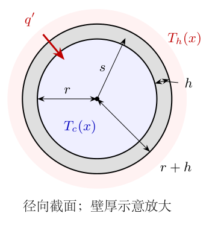{width=54%}

$$
q'=2\pi s\kappa\,\frac{dT}{ds}.
$$

温度由内壁的 $T_c$ 向外壁的 $T_h$ 增加，导数为正，而实际热流向内。径向傅里叶定律的负号已由“向内为正”的热流约定处理，不可再多加一次负号。分离变量、逐项积分：

$$
\begin{aligned}
dT&=\frac{q'}{2\pi\kappa}\frac{ds}{s},\\
T_h-T_c
&=\frac{q'}{2\pi\kappa}\int_r^{r+h}\frac{ds}{s}\\
&=\frac{q'}{2\pi\kappa}\ln\frac{r+h}{r},\\
G_{\mathrm{exact}}
&=\frac{q'}{T_h-T_c}
=\frac{2\pi\kappa}{\ln(1+h/r)}.
\end{aligned}
$$

令 $u=h/r\ll1$，使用 $\ln(1+u)=u-u^2/2+u^3/3+\cdots$，得到

$$
\frac{G_{\mathrm{exact}}}{G}
=\frac{u}{\ln(1+u)}
=1+\frac u2-\frac{u^2}{12}+O(u^3).
$$

所以题设 $G=2\pi r\kappa/h$ 是取内壁半径时的薄壁主阶近似。主解析不能一边使用这个给定模型，一边把高阶修正只加在某个公式中；若采用精确热阻，应在全部温度、出口与熵公式中一致替换 $G$。

## 七、易错点

热水从右向左流动，容易误写 $dT_h/dx<0$；应先标注小段的流入面在 $x+dx$、流出面在 $x$。其沿流向的导数为负，但沿共同向右坐标的导数为正。

把 $T_H$ 同时当作入口温度和每处热水温度，会把真实的两有限热容水流改成一个恒温热库；这样得到指数而不是本题的线性分布。记号 $T_h(x)$ 与 $T_H$ 必须区分。

把壁面面积错写成 $\pi r^2$ 会将换热侧面积换成管口面积。图6-1的轴向长度配圆周 $2\pi r$，所以小段面积是 $2\pi r\,dx$。

直接用 $T_c(0)=T_L,T_h(0)=T_H$ 是将逆流的两入口放在同一端。若如此列边界，求出的并非本题装置。

认为热水一定比“冷水出口”热，容易否定逆流中可能出现的出口温度顺序交换；需要比较图6-3同一个 $x$ 的两点，而非两端各取一个点。

熵积分中的斜率 $b=G\delta/C$ 必须完整带入，$G\delta/b=C$；多留下一个 $\delta$ 会破坏量纲。所有对数均需绝对温度，不用摄氏比值。

稳态的零熵积累不等于零熵产生。有限温差产生的熵由出流水带走；无耗散的温差极限才可能使熵产生趋零。

把 $N\to\infty$ 一概解释为热流趋同一非零值，也忽略了参数路径。固定 $C$ 增加面积与降低 $C$ 是两种不同过程，后者的最大热功率本身趋零。

## 八、课堂讲解建议

课堂先只展示图6-1，请学生分别指出冷、热入口及两个出口，再在图6-2把四个穿过控制面的箭头辨认完整。教师板书先保留“流入加获得等于流出”，然后才整理为微分方程，让学生通过进出方向决定热水方程的正号。

在两条方程写完后，让学生尝试相减；只有看到两个热容流率相等，才宣布温差恒定。随后教师将两个入口条件分别放在图6-3的左下和右上，帮助学生理解异端边界而不是同一端的初值问题。

讲解熵时，先用图6-4比较同一份热量除以两个不同绝对温度所得的熵，再完成空间积分。教师特别展示 $G\delta/(G\delta/C)$ 的约分，避免学生只记住最后对数式而遗漏换元系数。

课堂可设置 $N=2$ 的出口比较，让学生在图6-3分别找出冷水出口和热水出口；教师同时保留任一竖直截线，说明出口顺序交换并不违背局部第二定律。

最后用局部积分与出入熵流两条路线交叉检验，并让学生解释“稳态管内熵不变，但通过它的水流熵增加”。变式中的流率不等和最大熵产生问题可用于检验模型适用条件，不将几何薄壁与等热容两种条件混为一谈。

## 九、变式训练

<!-- KEEP_TOGETHER_START -->

**变式1：按给定参数计算温度、热功率与熵产生。**

取

$$
\begin{aligned}
T_L&=293.15\,\mathrm K,\quad T_H=353.15\,\mathrm K,\\
\alpha&=0.100\,\mathrm{kg\,s^{-1}},\quad
c=4200\,\mathrm{J\,kg^{-1}\,K^{-1}},\\
r&=0.0100\,\mathrm m,\quad h=5.00\times10^{-4}\,\mathrm m,\\
\kappa&=0.600\,\mathrm{W\,m^{-1}\,K^{-1}},\quad l=5.00\,\mathrm m.
\end{aligned}
$$

求两条温度分布、两个出口温度、热功率及熵产生率。

<!-- KEEP_TOGETHER_END -->

先求组合系数，不将所有常量直接堆进最后对数：

$$
\begin{aligned}
C&=0.100\times4200=420\,\mathrm{W\,K^{-1}},\\
G&=\frac{2\pi(0.0100)(0.600)}{5.00\times10^{-4}}
\approx75.3982\,\mathrm{W\,m^{-1}\,K^{-1}},\\
\ell_0&=\frac{420}{75.3982}\approx5.57042\,\mathrm m,\\
N&=\frac5{5.57042}\approx0.897598.
\end{aligned}
$$

入口温差为 $60.00\,\mathrm K$，所以

$$
\delta=\frac{60.00}{1+0.897598}
\approx31.6189\,\mathrm K,
\qquad
b=\frac{G\delta}{C}\approx5.67622\,\mathrm{K\,m^{-1}}.
$$

因此温度分布及出口为

$$
\begin{aligned}
T_c(x)&=(293.15\,\mathrm K)
+(5.67622\,\mathrm{K\,m^{-1}})x,\\
T_h(x)&=(324.76892\,\mathrm K)
+(5.67622\,\mathrm{K\,m^{-1}})x,\\
T_{c,\mathrm{out}}&\approx321.53108\,\mathrm K,\\
T_{h,\mathrm{out}}&\approx324.76892\,\mathrm K.
\end{aligned}
$$

回代 $T_h(5\,\mathrm m)=353.15\,\mathrm K$，且两出口升、降温量均为 $28.38108\,\mathrm K$。热功率为

$$
\dot Q=420(321.53108-293.15)
\approx1.19201\times10^4\,\mathrm W.
$$

熵产生分别由两水流温度比例计算：

$$
\begin{aligned}
\dot S_{\mathrm{gen}}
&=420\left[
\ln\frac{321.53108}{293.15}
+\ln\frac{324.76892}{353.15}\right]\\
&\approx\boxed{3.62494\,\mathrm{W\,K^{-1}}}.
\end{aligned}
$$

第一个对数为正，第二个为负，和仍为正；这里熵不是热功率除以任意“平均温度”。

**变式2：为达到指定预热比例，反求所需管长。**

保持变式1除 $l$ 外的参数不变，要求冷水升温至少达到两入口温差的 $90\%$。求最小管长，并辨认有限厚度导热修正的方向。

令目标比例为 $\varepsilon_*=0.90$。因 $\varepsilon=N/(1+N)$ 随 $N$ 单调增加，最小长度满足等号：

$$
\begin{aligned}
\frac N{1+N}&=\varepsilon_*,\\
N&=\varepsilon_*+\varepsilon_*N,\\
N(1-\varepsilon_*)&=\varepsilon_*,\\
N_*&=\frac{\varepsilon_*}{1-\varepsilon_*}=9.
\end{aligned}
$$

所以

$$
\boxed{l_{\min}=9\ell_0
=9(5.57042\,\mathrm m)
\approx50.1338\,\mathrm m.}
$$

此时冷水出口为 $293.15+0.9(60)=347.15\,\mathrm K$，热水出口为 $353.15-54=299.15\,\mathrm K$。两出口相隔管道两端，每处局部温差仍是 $60/10=6\,\mathrm K$，不能因出口先后颠倒而删去此设计解。

若一致采用精确圆柱导热，$h/r=0.05$，

$$
G_{\mathrm{exact}}
=\frac{2\pi(0.600)}{\ln(1.05)}
\approx77.2679\,\mathrm{W\,m^{-1}\,K^{-1}}>G.
$$

导热能力略大，故所需长度略小：

$$
l_{\min,\mathrm{exact}}
=9\frac{C}{G_{\mathrm{exact}}}
\approx48.9207\,\mathrm m.
$$

这只是超出题设薄壁主阶模型的完整替代计算，不能只换分母而仍保留旧的 $N$ 或出口公式。完全达到 $100\%$ 要求 $N\to\infty$，在本理想模型中没有有限正管长解。

**变式3：两股水的热容流率不相等。**

取 $T_L=290\,\mathrm K$、$T_H=350\,\mathrm K$，$C_c=200\,\mathrm{W\,K^{-1}}$、$C_h=400\,\mathrm{W\,K^{-1}}$，$G=20.0\,\mathrm{W\,m^{-1}\,K^{-1}}$，$l=10.0\,\mathrm m$。求两条温度曲线、出口、热流率和熵产生。

采用第六模块已逐项求出的不等热容方程：

$$
\begin{aligned}
a&=20\left(\frac1{400}-\frac1{200}\right)
=-0.0500\,\mathrm{m^{-1}},\\
e^{al}&=e^{-0.5}\approx0.60653066,\\
E(l)&=\frac{e^{-0.5}-1}{-0.05}
\approx7.8693868\,\mathrm m.
\end{aligned}
$$

初始局部温差不是 $60\,\mathrm K$，而是

$$
\begin{aligned}
\Delta_0
&=\frac{60}{0.60653066+(20/200)(7.8693868)}\,\mathrm K\\
&\approx43.0580\,\mathrm K.
\end{aligned}
$$

对任意 $x$，取 $x$ 以米计，则

$$
\begin{aligned}
E(x)&=\frac{\exp[-(0.0500\,\mathrm{m^{-1}})x]-1}
{-0.0500\,\mathrm{m^{-1}}},\\
T_c(x)&=290\,\mathrm K
+(4.30580\,\mathrm{K\,m^{-1}})E(x),\\
T_h(x)&=T_c(x)+(43.0580\,\mathrm K)
\exp[-(0.0500\,\mathrm{m^{-1}})x].
\end{aligned}
$$

指数中的 $ax$ 是无量纲乘积，$E(x)$ 具有长度单位。两出口及热流率为

$$
\begin{aligned}
T_c(l)&\approx323.8840\,\mathrm K,\\
T_h(0)&\approx333.0580\,\mathrm K,\\
\dot Q&=200(323.8840-290)
\approx6776.80\,\mathrm W.
\end{aligned}
$$

热水放热计算独立给出 $400(350-333.0580)\approx6776.80\,\mathrm W$。两水温改变量不相同，因为各自热容流率不同；不能检查“升温量等于降温量”，应检查热功率相等。

熵产生为

$$
\begin{aligned}
\dot S_{\mathrm{gen}}
&=200\ln\frac{323.8840}{290}
+400\ln\frac{333.0580}{350}\\
&\approx\boxed{2.25430\,\mathrm{W\,K^{-1}}}.
\end{aligned}
$$

温差从 $43.0580\,\mathrm K$ 减小到约 $26.1160\,\mathrm K$，两曲线并不平行，仍始终满足局部热水温度较高。

<!-- KEEP_TOGETHER_START -->

**变式4：熵产生是否随管长一直增大？**

固定 $C,G,T_L,T_H$，只改变 $l$。求最大熵产生率对应的管长，并解释长管极限。

利用主解析已完成的温度乘积展开，

$$
\dot S_{\mathrm{gen}}(N)
=C\ln\left[1+
\frac{D^2}{T_LT_H}\frac{N}{(1+N)^2}\right].
$$

$C>0$ 且对数单调增加，所以只需最大化 $f(N)=N/(1+N)^2$，不能最大化热流率来代替这个问题。商法则给出

$$
\begin{aligned}
f'(N)
&=\frac{(1+N)^2-2N(1+N)}{(1+N)^4}\\
&=\frac{1-N}{(1+N)^3}.
\end{aligned}
$$

在 $0<N<1$ 上导数为正，在 $N>1$ 上为负。因此唯一最大值发生在

$$
\boxed{N=1,\qquad l=\ell_0=\frac CG.}
$$

此时 $\varepsilon=1/2$，两出口均为 $(T_L+T_H)/2$，但仍位于不同管端，局部温差为 $D/2$。最大熵产生为

$$
\boxed{
\dot S_{\max}
=C\ln\frac{(T_L+T_H)^2}{4T_LT_H}.
}
$$

例如 $C=200\,\mathrm{W\,K^{-1}}$、$T_L=280\,\mathrm K$、$T_H=360\,\mathrm K$、$G=30\,\mathrm{W\,m^{-1}\,K^{-1}}$ 时，

$$
\begin{aligned}
l_*&=\frac{200}{30}\,\mathrm m\approx6.66667\,\mathrm m,\\
T_{c,\mathrm{out}}=T_{h,\mathrm{out}}&=320\,\mathrm K,\\
\dot S_{\max}
&=200\ln\frac{320^2}{280\times360}
\approx3.14967\,\mathrm{W\,K^{-1}}.
\end{aligned}
$$

增加管长时，参与换热的壁面积增大，却使每处驱动温差减小；有限温差不可逆性不是单由总热量决定。$N\to\infty$ 时两股等热容逆流水流接近互换入口温度，热流趋 $CD$，熵产生却趋零。因而“更多热交换必然产生更多熵”不成立。

<!-- KEEP_TOGETHER_END -->

<!-- question-complete -->

\newpage

# 第7题

<!-- question-start -->

一束平行光沿 $+z$ 方向传播，在垂直于传播方向的平面内放置理想光学元件，如图7-1。$P_1$ 和 $P_2$ 是验偏器，只允许沿各自通光方向的线偏振光通过；其初始通光方向分别为 $x$ 轴和 $y$ 轴。

（1）只有 $P_1,P_2$ 时，最终光强透过率为零。在两者之间加入验偏器 $P_3$，其通光方向与 $x$ 轴的夹角为 $\theta$。求通过 $P_2$ 后的光强与通过 $P_1$ 后的光强之比。

（2）在 $P_1,P_2$ 之间加入厚度为 $l$ 的波片。波片光轴平行于片面，与 $x$ 轴的夹角为 $\theta_3$；沿光轴方向振动和垂直光轴方向振动的光，其折射率分别为 $n_e,n_o$。将 $P_2$ 的通光方向转至与 $x$ 轴成 $\theta_2$ 的方向，且该方向不与 $x$ 轴重合。发现一定条件下光强透过率为 $1$，求 $\theta_3$ 与 $l$ 应满足的条件。真空波长记为 $\lambda$。

（3）在 $P_1,P_2$ 之间放入两片四分之一波片，每片厚度 $l'$ 满足

$$
l'(n_e-n_o)=\frac{\lambda}{4}.
$$

两片波片的光轴分别与 $x$ 轴成 $\beta_1,\beta_2$。$P_2$ 的方向与第（2）问相同，求透过率为 $1$ 的全部 $\beta_1,\beta_2$ 组合条件。

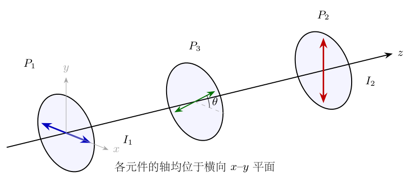{width=86%}

<!-- question-end -->

## 一、题型定位

本题比较两种改变偏振状态的操作：验偏器把电场投影到一条通光轴上，波片则对两个互相垂直的分量施加不同相位。前者一般损失光强，后者在理想模型中不损失光强。因此插入第三个验偏器与插入合适波片，都能使原本正交的两验偏器之间出现透射，但两种机制的最高透过率不同。

第（1）问是连续两次投影，第（2）问是单片波片把一种线偏振完整转换为另一种线偏振，第（3）问则要求两片四分之一波片的完整解集。最后一问不能只举出“同轴合成半波片”的一种配置，也不能把两个光轴相差直角与相同混为一谈。

## 二、知识点

电场振幅与时间平均光强；马吕斯定律；偏振轴作为无向直线的角度周期；正交分解中的带符号投影；双折射产生的光程差与相位差；公共相位与相对相位的区别；半波片的线偏振方向变换；四分之一波片产生的椭圆偏振和圆偏振；复振幅的实部、虚部与模平方；理想无损变换的总强度守恒；沿通光轴与被挡轴的两次正交投影；零透射分量的实、虚两条件；分支筛选、退化条件与量纲检查。

采用题设的理想模型：单色光正入射，无吸收、无界面反射损失，两个主轴方向正交，波片只改变相位。实际波片若存在吸收或未消除的反射，即使偏振方向完全匹配，绝对光强也未必达到此理想值。全文以通过 $P_1$ 后的非零光强 $I_1$ 为分母，不额外假设入射光一定是自然光。

## 三、物理图像

经过 $P_1$，电场只沿 $x$ 方向振动。直接遇到沿 $y$ 的 $P_2$，投影为零。加入 $P_3$ 时，先从 $x$ 方向取出沿 $\theta$ 的分量，再从此分量中取出沿 $y$ 的部分，每次都要把投影振幅平方才能得到光强。

波片不是新的验偏器。经过它的两个分量都还存在，但到达出口时的相位关系改变。半波片使两分量相差半个周期，相当于把输入振动方向关于光轴作一次反射；适当选择角平分线，可以让输出方向恰好与转过的 $P_2$ 重合。

两片四分之一波片至少有两种完整转换机制：相同光轴时，相位差叠加成半波片；第一片以合适角度把线偏振变成圆偏振时，第二片可以把圆偏振变为所需的线偏振。第二种机制中，圆偏振的旋向与第一片光轴是哪一条四十五度方向有关，第二片的角度不能随意取相反号。

## 四、解题入口

建立固定的右手坐标系 $\mathbf e_x,\mathbf e_y,\mathbf e_z$，传播方向为 $+\mathbf e_z$。所有横向角度都按从 $x$ 朝 $y$ 的方向为正定义，不在不同图或不同波片处交换观察方向。

任意角度 $\gamma$ 对应两条单位向量：

$$
\mathbf e(\gamma)=
\begin{pmatrix}\cos\gamma\\ \sin\gamma\end{pmatrix},
\qquad
\mathbf q(\gamma)=
\begin{pmatrix}-\sin\gamma\\ \cos\gamma\end{pmatrix}.
$$

$\mathbf e(\gamma)$ 是所选轴，$\mathbf q(\gamma)$ 是沿正方向再转过 $\pi/2$ 的轴。它们的点积为零，模均为 $1$。对波片，前者规定为对应 $n_e$ 的光轴，后者对应 $n_o$；不能只交换轴名而不同时改变相位约定。

验偏器的轴是一条无向直线，所以 $\gamma$ 与 $\gamma+\pi$ 表示同一配置。以下把第（2）、（3）问的非重合目标写为 $\theta_2\not\equiv0\pmod\pi$；这说明“不为零”应对实际轴方向理解。平行目标的退化情形另作完整辨析。

## 五、解析

**第1步：规定光强基准，并从实际振动说明为什么振幅必须平方。**

通过 $P_1$ 后，可在某一横截面写

$$
\mathbf E_1(t)=E_0\cos(\omega t)\,\mathbf e_x.
$$

在同一介质中，光强正比于电场平方的时间平均。设共同的比例系数为 $K>0$，则

$$
\begin{aligned}
I_1&=K\left\langle E_0^2\cos^2(\omega t)\right\rangle\\
&=\frac{K E_0^2}{2}.
\end{aligned}
$$

其中平均是对一个或若干完整周期进行的，

$$
\left\langle\cos^2(\omega t)\right\rangle
=\frac{1}{2\pi}\int_0^{2\pi}\cos^2u\,du=\frac12.
$$

若验偏器通光方向为 $\mathbf e(\gamma)$，投影电场为

$$
\begin{aligned}
\mathbf E_{\rm out}(t)
&=[\mathbf e(\gamma)\cdot\mathbf E_1(t)]\,\mathbf e(\gamma)\\
&=E_0\cos\gamma\cos(\omega t)\,\mathbf e(\gamma).
\end{aligned}
$$

因此 $I_{\rm out}/I_1=\cos^2\gamma$，而不是 $\cos\gamma$。投影振幅为负，只表示振动整体相差 $\pi$，不会使光强为负。

**第2步：分别列两次投影，得到第（1）问的透过率。**

图7-2中，第一幅先从输入 $x$ 方向投影到 $P_3$，第二幅再从 $P_3$ 的方向投影到 $P_2$。两幅都在同一个横向坐标中，虚线表示被投影的几何分量。

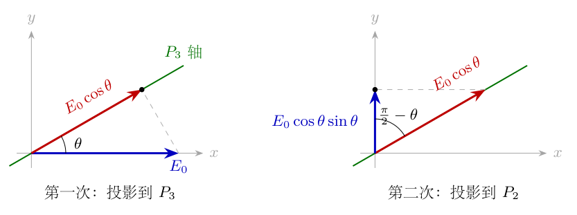{width=80%}

<!-- KEEP_TOGETHER_START -->

通过 $P_3$ 后的振幅为 $E_0\cos\theta$，光强为 $I_1\cos^2\theta$。$P_3$ 与 $y$ 轴之间的夹角为 $\pi/2-\theta$，所以末级振幅和光强分别为

$$
\begin{aligned}
E_2&=E_0\cos\theta\cos\left(\frac{\pi}{2}-\theta\right)
=E_0\cos\theta\sin\theta,\\
I_2&=I_1\cos^2\theta\sin^2\theta.
\end{aligned}
$$

<!-- KEEP_TOGETHER_END -->

利用 $\sin2\theta=2\sin\theta\cos\theta$，得到

$$
\boxed{\frac{I_2}{I_1}=\frac14\sin^2(2\theta).}
$$

分母已经是通过 $P_1$ 后的强度，不能在这里再无条件乘一次 $1/2$。只有另行说明入射光为自然光，并要求相对其原始强度的比值时，才需把理想 $P_1$ 的一半损失计入。

**第3步：核对第（1）问的极值与两个零点。**

因为 $0\le\sin^2(2\theta)\le1$，所以

$$
0\le\frac{I_2}{I_1}\le\frac14.
$$

最大值在 $2\theta=\pi/2+k\pi$ 时取得，即

$$
\theta=\frac{\pi}{4}+\frac{k\pi}{2},\qquad k\in\mathbb Z.
$$

这两类实际通光轴都是输入轴与输出轴的角平分线。若 $\theta=0$，$P_3$ 虽不损失输入光，却不能改变它沿 $x$ 的方向，随后仍被 $P_2$ 全部挡住；若 $\theta=\pi/2$，光在 $P_3$ 处就已全被挡住。两端零值与中间极大值都能由两次投影直接解释。

**第4步：在波片自己的两条主轴上分解输入，并保留负号。**

第（2）问记 $\gamma=\theta_3$。图7-3中蓝色输入矢量沿 $x$，其沿光轴的投影为 $\cos\gamma$，沿正交轴的带符号投影为 $-\sin\gamma$。

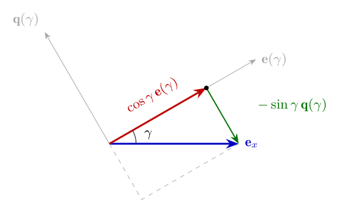{width=60%}

具体计算为

$$
\begin{aligned}
\mathbf e(\gamma)\cdot\mathbf e_x&=\cos\gamma,\\
\mathbf q(\gamma)\cdot\mathbf e_x&=-\sin\gamma,\\
\mathbf e_x&=\cos\gamma\,\mathbf e(\gamma)
-\sin\gamma\,\mathbf q(\gamma).
\end{aligned}
$$

最后一式可按两个坐标核对：

$$
\begin{aligned}
x:\quad \cos^2\gamma+\sin^2\gamma&=1,\\
y:\quad \cos\gamma\sin\gamma-\sin\gamma\cos\gamma&=0.
\end{aligned}
$$

这里的负号来自定义好的轴方向，不是波片额外给出的相位。改变坐标轴后可以换一种分解写法，但相应的分量和后续相位必须同时变化。

**第5步：由传播光程建立相位差，分清共同相位与相对相位。**

采用复数记号

$$
\mathbf E(t)=E_0\,\operatorname{Re}
[\mathbf F e^{-i\omega t}],
\qquad i^2=-1.
$$

若某分量的复振幅为 $a+ib$，它对应的真实振动是 $a\cos\omega t+b\sin\omega t$；复数没有引入另一种物理电场，只是同时记录余弦和正弦的系数。

真空波数为 $k_0=2\pi/\lambda$。两主轴穿过厚度 $l$ 后分别获得传播相位

$$
\phi_e=k_0n_e l,\qquad \phi_o=k_0n_o l.
$$

定义有符号相位差

$$
\delta=\phi_e-\phi_o
=\frac{2\pi(n_e-n_o)l}{\lambda}.
$$

于是输出复振幅为

$$
\begin{aligned}
\mathbf F_{\rm full}
&=\cos\gamma\,e^{i\phi_e}\mathbf e(\gamma)
-\sin\gamma\,e^{i\phi_o}\mathbf q(\gamma)\\
&=e^{i\phi_e}\left[
\cos\gamma\,\mathbf e(\gamma)
-e^{-i\delta}\sin\gamma\,\mathbf q(\gamma)\right].
\end{aligned}
$$

前面的 $e^{i\phi_e}$ 同时乘在两个分量上，只使全部振动的时间原点改变，不改变偏振状态和时间平均光强，故可略去。括号内的 $e^{-i\delta}$ 不能略去，它决定两个分量能否沿固定直线合成。

**第6步：证明无损波片保持总强度，并把“透过率为一”改写成零被挡分量。**

波片后的归一化复振幅为

$$
\mathbf F=
\cos\gamma\,\mathbf e(\gamma)
-e^{-i\delta}\sin\gamma\,\mathbf q(\gamma).
$$

利用主轴正交，得到

$$
\begin{aligned}
\|\mathbf F\|^2
&=|\cos\gamma|^2+
|e^{-i\delta}\sin\gamma|^2\\
&=\cos^2\gamma+\sin^2\gamma=1.
\end{aligned}
$$

末级验偏器的通光轴为 $\mathbf e(\theta_2)$，被挡轴为 $\mathbf q(\theta_2)$。记两者的复振幅系数为 $A_\parallel,A_\perp$，则

$$
\begin{aligned}
A_\parallel&=\mathbf e(\theta_2)\cdot\mathbf F,\\
A_\perp&=\mathbf q(\theta_2)\cdot\mathbf F,\\
|A_\parallel|^2+|A_\perp|^2&=1.
\end{aligned}
$$

通过 $P_2$ 的强度比为 $|A_\parallel|^2$。因此它等于 $1$ 当且仅当 $A_\perp=0$，即余弦振动和正弦振动在被挡轴上的系数都为零。仅在某一瞬间电场碰巧沿通光轴，不足以保证整个周期没有损失。

**第7步：求单片波片的被挡振幅，严格筛选相位差。**

两个点积分别是

$$
\mathbf q(\theta_2)\cdot\mathbf e(\gamma)
=\sin(\gamma-\theta_2),
\qquad
\mathbf q(\theta_2)\cdot\mathbf q(\gamma)
=\cos(\gamma-\theta_2).
$$

代入第6步得

$$
A_\perp=
\cos\gamma\sin(\gamma-\theta_2)
-e^{-i\delta}\sin\gamma\cos(\gamma-\theta_2).
$$

为看清条件，记两个实数

$$
a=\cos\gamma\sin(\gamma-\theta_2),
\qquad
b=\sin\gamma\cos(\gamma-\theta_2).
$$

若 $a=0$ 且要求 $A_\perp=0$，便还须 $b=0$。分别检查 $\cos\gamma=0$ 或 $\sin(\gamma-\theta_2)=0$，两种情况都迫使 $\theta_2\equiv0\pmod\pi$；反过来从 $b=0$ 检查也相同。所以在本问非重合目标下，$a,b$ 均不为零，可以由 $a=e^{-i\delta}b$ 得

$$
e^{-i\delta}=\frac ab.
$$

右侧为非零实数，左侧模为 $1$，因此只能为 $+1$ 或 $-1$，即 $\delta=m\pi$。若 $\delta=2m\pi$，两主轴的相对相位等效为零，输出仍为输入 $\mathbf e_x$，此时 $A_\perp=-\sin\theta_2\ne0$，必须排除。

剩下的可能只有

$$
\boxed{\delta=(2m+1)\pi.}
$$

这就是半波条件，包括高阶奇数半波条件。不能因“输出是线偏振”就保留整波条件，因为整波片不把非重合的输入轴变成目标轴。

**第8步：在半波条件下求光轴方向，并给出正厚度解。**

半波条件使 $e^{-i\delta}=-1$，所以被挡振幅化为

$$
\begin{aligned}
A_\perp
&=\cos\gamma\sin(\gamma-\theta_2)
+\sin\gamma\cos(\gamma-\theta_2)\\
&=\sin(2\gamma-\theta_2).
\end{aligned}
$$

此处用的是正弦的和角公式。令其为零：

$$
\begin{aligned}
2\gamma-\theta_2&=k\pi,\\
\theta_3=\gamma&=\frac{\theta_2}{2}+\frac{k\pi}{2},
\qquad k\in\mathbb Z.
\end{aligned}
$$

结合相位差定义，厚度条件为

$$
(n_e-n_o)l=\frac{2m+1}{2}\lambda.
$$

如果 $n_e-n_o$ 为正，可以取 $m=0,1,2,\ldots$。若其为负，整数必须使右端同号，确保 $l>0$。不依赖差值符号的写法是

$$
\boxed{
l=\frac{(2j+1)\lambda}{2|n_e-n_o|},
\quad j=0,1,2,\ldots;
\qquad
\theta_3\equiv\frac{\theta_2}{2}\pmod{\pi/2}.
}
$$

若 $n_e=n_o$，没有双折射相位差，不能以有限厚度完成本问所需的非重合方向变换。这里不把分母为零的形式误当成可用解。

**第9步：用真实矢量反射核对半波片的角度因子二。**

如图7-4，把沿光轴的分量保留，把沿正交轴的分量反号。输入 $\mathbf e_x$ 关于光轴反射后，输出偏振轴为 $2\theta_3$。

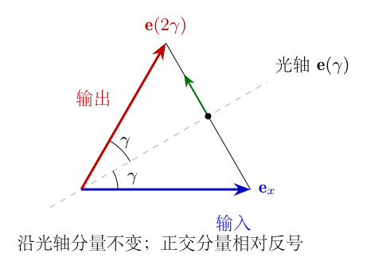{width=48%}

不依赖图形直觉的坐标验证为

$$
\begin{aligned}
\mathbf F_{\rm H}
&=\cos\gamma\,\mathbf e(\gamma)
+\sin\gamma\,\mathbf q(\gamma)\\
&=
\begin{pmatrix}
\cos^2\gamma-\sin^2\gamma\\
2\sin\gamma\cos\gamma
\end{pmatrix}
=
\begin{pmatrix}\cos2\gamma\\ \sin2\gamma\end{pmatrix}
=\mathbf e(2\gamma).
\end{aligned}
$$

当 $\gamma=\theta_2/2$ 时，$\mathbf F_{\rm H}=\mathbf e(\theta_2)$；当 $\gamma=\theta_2/2+\pi/2$ 时，$\mathbf F_{\rm H}=-\mathbf e(\theta_2)$。两者相差整体相位 $\pi$，实际通光轴相同，强度都完整通过。这解释了为什么轴角条件是模 $\pi/2$，而通常单一轴方向的周期是 $\pi$。

**第10步：对两片四分之一波片逐片分解，不跳过中间偏振。**

第（3）问给出的厚度条件固定了每片有符号相位差 $\delta=\pi/2$，两片符号相同。省略每片自己的共同相位后，沿光轴的分量不变，沿正交轴的分量乘 $e^{-i\pi/2}=-i$。

第一片分解必须使用 $\beta_1$，不能把它的一个分量先写成第二片的角度。通过第一片后

$$
\begin{aligned}
\mathbf F_1
&=\cos\beta_1\,\mathbf e(\beta_1)
-(-i)\sin\beta_1\,\mathbf q(\beta_1)\\
&=\cos\beta_1\,\mathbf e(\beta_1)
+i\sin\beta_1\,\mathbf q(\beta_1).
\end{aligned}
$$

这一状态一般是椭圆偏振，不能马上使用某一条“线偏振方向”再套马吕斯定律。令

$$
d=\beta_1-\beta_2.
$$

对第二片的两条主轴分别求投影，四个几何点积为

$$
\begin{aligned}
\mathbf e(\beta_2)\cdot\mathbf e(\beta_1)&=\cos d,\\
\mathbf e(\beta_2)\cdot\mathbf q(\beta_1)&=-\sin d,\\
\mathbf q(\beta_2)\cdot\mathbf e(\beta_1)&=\sin d,\\
\mathbf q(\beta_2)\cdot\mathbf q(\beta_1)&=\cos d.
\end{aligned}
$$

于是进入第二片的两个复分量分别为

$$
\begin{aligned}
A_e&=\cos\beta_1\cos d-i\sin\beta_1\sin d,\\
A_o&=\cos\beta_1\sin d+i\sin\beta_1\cos d.
\end{aligned}
$$

第二片让 $A_o$ 再乘一次 $-i$，而不改变 $A_e$：

$$
\begin{aligned}
\mathbf F_2&=A_e\mathbf e(\beta_2)-iA_o\mathbf q(\beta_2)\\
&=(\cos\beta_1\cos d-i\sin\beta_1\sin d)\mathbf e(\beta_2)\\
&\quad+(\sin\beta_1\cos d-i\cos\beta_1\sin d)\mathbf q(\beta_2).
\end{aligned}
$$

这里 $(-i)(i)=1$，$(-i)^2=-1$，两个不同的乘积都要区分。每一项都来自先投影、再改变相位，不是假定第二片“抵消掉第一片”而直接写出目标。

**第11步：合并第二片输出的实部和虚部，保留所有方向。**

另记

$$
u=\beta_1+\beta_2.
$$

把第10步的实部、虚部分组：

$$
\begin{aligned}
\operatorname{Re}\mathbf F_2
&=\cos d[\cos\beta_1\,\mathbf e(\beta_2)
+\sin\beta_1\,\mathbf q(\beta_2)],\\
\operatorname{Im}\mathbf F_2
&=-\sin d[\sin\beta_1\,\mathbf e(\beta_2)
+\cos\beta_1\,\mathbf q(\beta_2)].
\end{aligned}
$$

实部括号的两个坐标为

$$
\begin{aligned}
x&=\cos\beta_1\cos\beta_2-\sin\beta_1\sin\beta_2
=\cos u,\\
y&=\cos\beta_1\sin\beta_2+\sin\beta_1\cos\beta_2
=\sin u.
\end{aligned}
$$

虚部括号的两个坐标为

$$
\begin{aligned}
x&=\sin\beta_1\cos\beta_2-\cos\beta_1\sin\beta_2
=\sin d,\\
y&=\sin\beta_1\sin\beta_2+\cos\beta_1\cos\beta_2
=\cos d.
\end{aligned}
$$

因此

$$
\boxed{
\mathbf F_2=\cos d\,\mathbf e(u)
-i\sin d\,\mathbf e\left(\frac{\pi}{2}-d\right).
}
$$

两组实向量分别乘余弦时间项和正弦时间项，不能只把它们的几何方向做一次普通实矢量加法。总强度仍为

$$
\|\mathbf F_2\|^2=\cos^2d+\sin^2d=1,
$$

因为复振幅模平方是各坐标实部平方与虚部平方之和，实、虚两组之间没有这一时间平均交叉项。

**第12步：把满透射条件写成两个实方程。**

投影到 $P_2$ 的被挡轴 $\mathbf q(\theta_2)$。对第11步实部与虚部分别投影：

$$
\begin{aligned}
\mathbf q(\theta_2)\cdot\mathbf e(u)&=\sin(u-\theta_2),\\
\mathbf q(\theta_2)\cdot
\mathbf e\left(\frac{\pi}{2}-d\right)
&=\cos(d+\theta_2).
\end{aligned}
$$

故

$$
A_\perp=\cos d\sin(u-\theta_2)
-i\sin d\cos(d+\theta_2).
$$

模平方必须把实部和虚部分别平方再相加：

$$
\begin{aligned}
|A_\perp|^2
&=\cos^2d\sin^2(u-\theta_2)
+\sin^2d\cos^2(d+\theta_2),\\
\frac{I_2}{I_1}
&=1-\cos^2d\sin^2(u-\theta_2)
-\sin^2d\cos^2(d+\theta_2).
\end{aligned}
$$

两个非负项之和为零，当且仅当它们各自为零，得到完整条件

$$
\boxed{
\cos d\sin(u-\theta_2)=0,
\qquad
\sin d\cos(d+\theta_2)=0.
}
$$

不要把两个实方程改成单个三角方程，也不要直接除去 $\sin d$ 或 $\cos d$；这样会漏掉主要分支。

**第13步：先处理主轴相同与主轴正交的两个特殊分支。**

若 $\sin d=0$，即 $\beta_1-\beta_2=m\pi$，两光轴是同一无向直线。此时 $\cos d=\pm1$，第一个方程要求 $u-\theta_2=k\pi$。结合两式：

$$
\begin{aligned}
\beta_2&\equiv\beta_1\pmod\pi,\\
2\beta_1&\equiv\theta_2\pmod\pi.
\end{aligned}
$$

这给出第一类完整组合：

$$
\boxed{
\beta_2\equiv\beta_1\pmod\pi,\qquad
\beta_1\equiv\frac{\theta_2}{2}\pmod{\pi/2}.
}
$$

它是两片相同轴向的四分之一波片合成半波片，不要求中间状态一定是圆偏振。

若 $\cos d=0$，则两光轴相差 $\pi/2$，第一个方程自动成立。第二个方程还要求 $\cos(d+\theta_2)=0$。代入 $d=\pi/2+m\pi$ 后，这等价于 $\sin\theta_2=0$，与本题非重合目标冲突，因此这一分支排除。

从第11步也可直接核对：$\cos d=0$ 时只有虚部，$\mathbf e(\pi/2-d)$ 沿 $x$，输出仍是输入方向，只多一个公共相位。两个实际光轴相差直角时，第一片的 $e$ 轴正好是第二片的 $o$ 轴，两个相位差抵消，而非叠加成半波片。

**第14步：在两个系数均非零时，解出线偏振—圆偏振—线偏振分支。**

剩下 $\sin d\ne0$ 且 $\cos d\ne0$。此时可分别除去两个非零系数，得到

$$
\begin{aligned}
u-\theta_2&=k\pi,\\
d+\theta_2&=\frac{\pi}{2}+m\pi.
\end{aligned}
$$

把 $u=\beta_1+\beta_2$、$d=\beta_1-\beta_2$ 代入，两式相加消去 $\beta_2,\theta_2$：

$$
\begin{aligned}
2\beta_1&=\frac{\pi}{2}+(k+m)\pi,\\
\beta_1&=\frac{\pi}{4}+\frac{k+m}{2}\pi.
\end{aligned}
$$

再由第一式回代 $\beta_2$，得到第二类组合：

$$
\boxed{
\beta_1\equiv\frac{\pi}{4}\pmod{\pi/2},
\qquad
\beta_2\equiv\theta_2-\beta_1\pmod\pi.
}
$$

具体包含两条不同光轴配置：

$$
\begin{aligned}
\beta_1\equiv\frac{\pi}{4}\pmod\pi
&:\quad\beta_2\equiv\theta_2-\frac{\pi}{4}\pmod\pi,\\
\beta_1\equiv-\frac{\pi}{4}\pmod\pi
&:\quad\beta_2\equiv\theta_2+\frac{\pi}{4}\pmod\pi.
\end{aligned}
$$

第二条对应另一种圆偏振旋向，不能因为都写成“四十五度”而漏去或把两个正负号任意搭配。两式同时整体取复共轭会改变旋向描述，却不改变光强及完整组合条件。

图7-5展示同轴叠加与经过圆偏振的两种机制；中间曲线由真实输出复振幅的实、虚部画出，不是任意椭圆。

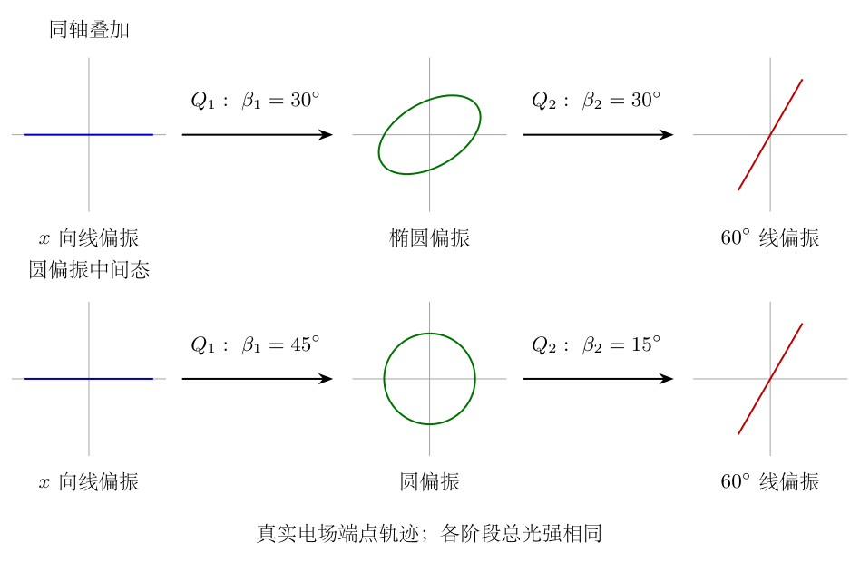{width=88%}

同轴路线中，后续使用的是 $\beta_2=\beta_1$ 与 $2\beta_1=\theta_2$；圆偏振路线中，第一片两分量等幅并相差 $\pi/2$，后续使用的是 $\beta_1+\beta_2=\theta_2$。图中第二片轴角因此不能在两条路线之间互换。

<!-- KEEP_TOGETHER_START -->

**第15步：合并完整解集，并说明重复解不应重复计数。**

在 $\theta_2\not\equiv0\pmod\pi$ 下，第（3）问全部解为第13、14步两类的并集。前一类给两种角平分线配置，后一类给两种圆偏振旋向配置，轴角均按模 $\pi$ 识别。

<!-- KEEP_TOGETHER_END -->

以 $\theta_2=\pi/3$ 为例，在 $0\le\beta_1,\beta_2<\pi$ 的基本区间内，四组实际配置是

$$
\begin{aligned}
(\beta_1,\beta_2)
&=\left(\frac{\pi}{6},\frac{\pi}{6}\right),
\quad\left(\frac{2\pi}{3},\frac{2\pi}{3}\right),\\
&\quad\left(\frac{\pi}{4},\frac{\pi}{12}\right),
\quad\left(\frac{3\pi}{4},\frac{7\pi}{12}\right).
\end{aligned}
$$

如图7-6，四个离散点而不是整条角度曲线满足满透射。横坐标是第一片光轴，纵坐标是第二片光轴，交换两片的先后顺序一般不会保留同一输出。

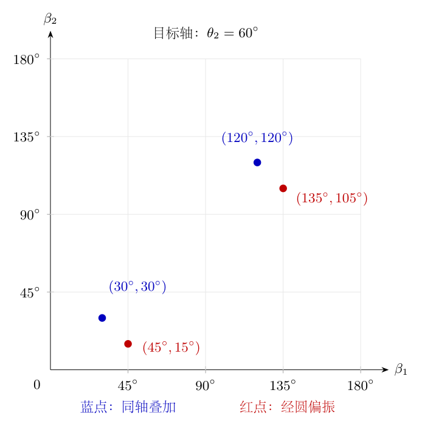{width=65%}

若目标恰好为 $\theta_2=\pi/2$，两类的角度解重合：第一片取 $\pi/4$ 或 $3\pi/4$，第二片取同一方向。物理机制的两种描述在这里指向相同装置，不能把它们当成四组不同解。分支方程先完整保留再求并集，既避免漏解，也避免重复计数。

**第16步：验证第二类确实先产生圆偏振，并在末级保留全部强度。**

以 $\beta_1=\pi/4$ 为例，由第10步

$$
\mathbf F_1=
\begin{pmatrix}
(1-i)/2\\
(1+i)/2
\end{pmatrix}.
$$

两个坐标分量模相同，均为 $1/\sqrt2$，相对相位为 $\pi/2$。对应真实电场为

$$
\begin{aligned}
E_x/E_0&=\tfrac12\cos\omega t-\tfrac12\sin\omega t,\\
E_y/E_0&=\tfrac12\cos\omega t+\tfrac12\sin\omega t.
\end{aligned}
$$

平方相加得

$$
(E_x^2+E_y^2)/E_0^2=\frac12,
$$

所以矢量端点走半径 $E_0/\sqrt2$ 的圆。圆的半径不是 $E_0$，但总光强仍为 $I_1$，因为输入线偏振的电场平方本来就有周期平均的一半。

再取 $\beta_2=\theta_2-\pi/4$。第12步实、虚被挡系数同时为零，第6步总模为 $1$，因而沿通光轴的强度正好是 $I_1$。对于 $\beta_1=-\pi/4$，第一片两坐标相对相位反号，第二片必须取 $\theta_2+\pi/4$。若保留第一片为 $+\pi/4$ 却误把第二片取为 $\theta_2+\pi/4$，输出方向反而与目标正交，透过率为零；这一检查能立即发现符号搭配错误。

**第17步：区分三种看起来相似而结论不同的操作。**

第三个验偏器作真实投影，去掉被挡分量；第（1）问最高只剩 $I_1/4$。无损半波片不去掉分量，只改变相对相位，使输出重新成为目标线偏振，因此可以保留全部 $I_1$。四分之一波片对一般输入产生椭圆偏振，不存在一条固定振动轴可直接再套一次普通线偏振马吕斯定律；必须对两个相差相位的分量投影，再作时间平均或复振幅模平方。

同样，波片光轴转过 $\pi/2$ 与验偏器通光轴转过 $\pi$ 是不同操作。前者交换 $n_e,n_o$ 的几何方向；对单片半波片，两者仅差公共相位，但对单片四分之一波片会反转相对相位意义。两片四分之一波片一同转过 $\pi/2$ 仍可有完整转换，而只把其中一片转过 $\pi/2$ 一般不保留原解。

**第18步：完成量纲、边界、能量和相位约定的交叉检查。**

$\delta=2\pi(n_e-n_o)l/\lambda$ 无量纲，$l,l',\lambda$ 都是长度；三个强度比也均无量纲。波片的归一化模从始至终为 $1$，验偏器把模平方拆成两部分，没有生成额外光能。

单片 $\delta=0$ 时，前述输出恢复 $\mathbf e_x$，目标非重合时不可能满透射；半波片 $\gamma=0$ 时，输入本来沿主轴，只获公共相位，也不能转向。两片光轴相同，则两次 $-i$ 相乘成为 $-1$，回到半波片；两光轴正交，则两个主轴各得到一次相同相位，输出回到输入。第一片光轴沿输入方向时，它不改变线偏振状态；只有第二片四分之一波片，仍不可能把它完整转成非重合线偏振。这些特殊值均与完整分支相符。

若改用 $e^{+i\omega t}$ 表示真实波动，传播因子及全部复振幅取共轭，所有强度比不变。不能只在中间某个步骤改变相位符号，随后仍沿用原旋向和角度搭配。公共相位可以逐片移除，相对相位不能逐片随意改号。

## 六、关键洞察

最直接的满透射判据是“被挡振幅为零”，而不是先猜测输出方向。无损波片使总强度不变，末级验偏器只需检验一条被挡轴。复振幅的实、虚部必须各自满足零条件，这正是最后一问能完整分类的原因。

为用另一条组织方式复核，定义波片的线性作用矩阵

$$
W(\gamma,\delta)
=\mathbf e(\gamma)\mathbf e(\gamma)^{\mathsf T}
+e^{-i\delta}\mathbf q(\gamma)\mathbf q(\gamma)^{\mathsf T}.
$$

每个外积先把任意输入向量投影到相应轴，再把投影矢量还原到横向坐标，因此矩阵不是额外假设。逐项展开为

$$
W(\gamma,\delta)=
\begin{pmatrix}
\cos^2\gamma+e^{-i\delta}\sin^2\gamma&
(1-e^{-i\delta})\sin\gamma\cos\gamma\\
(1-e^{-i\delta})\sin\gamma\cos\gamma&
\sin^2\gamma+e^{-i\delta}\cos^2\gamma
\end{pmatrix}.
$$

因为两投影矩阵彼此正交且平方仍为自身，记 $P_e,P_o$ 后

$$
\begin{aligned}
W^\dagger W
&=(P_e+e^{i\delta}P_o)(P_e+e^{-i\delta}P_o)\\
&=P_e^2+P_o^2+e^{i\delta}P_oP_e
+e^{-i\delta}P_eP_o\\
&=P_e+P_o=\mathbb I.
\end{aligned}
$$

这里 $\dagger$ 表示转置后再取复共轭；这从矩阵角度证明了全部输入偏振的强度守恒。两片作用的顺序是 $W(\beta_2,\pi/2)W(\beta_1,\pi/2)$，右边先作用，不能倒置后仍把第一片的圆偏振条件放在 $\beta_1$。

另一种先判定“输出是线偏振”的方法，可以不预先给定目标。对复矢量 $\mathbf F=\mathbf R+i\mathbf V$，真实场为 $\mathbf R\cos\omega t+\mathbf V\sin\omega t$。只有 $\mathbf R,\mathbf V$ 共线，才沿固定直线振动，二维行列式应为零。第11步给出

$$
\begin{aligned}
R_xV_y-R_yV_x
&=-\cos d\sin d
\sin\left(\frac{\pi}{2}-d-u\right)\\
&=-\cos d\sin d\cos(d+u)\\
&=-\frac12\sin(2d)\cos(2\beta_1).
\end{aligned}
$$

因此线偏振的必要充分条件为

$$
\sin(2d)\cos(2\beta_1)=0.
$$

它把可能性分成同轴、正交轴以及第一片轴在 $\pm\pi/4$。但“输出是线偏振”还不是“通过既定 $P_2$ 无损”，必须继续核对方向：同轴时输出沿 $2\beta_1$，正交轴时沿 $x$，圆偏振分支时沿 $\beta_1+\beta_2$。这一步的方向筛选与主解析的两个零被挡方程完全一致。

平行目标的退化条件也可以完整列出。若 $\theta_2\equiv0\pmod\pi$，第12步变为

$$
\cos d\sin u=0,\qquad \sin d\cos d=0.
$$

后一式要求 $\sin d=0$ 或 $\cos d=0$。如果 $\cos d=0$，两片光轴正交，任意第一片轴角都可使输出回到 $x$；如果 $\sin d=0$，还需 $\sin u=0$，即两片同轴且 $\beta_1\equiv0\pmod{\pi/2}$。没有第三类。单片的平行目标条件则为

$$
\sin\gamma\cos\gamma\,[1-e^{-i\delta}]=0,
$$

对应输入沿某一主轴，或相位差为整波；厚度不再必须为奇数半波。这样既说明了非重合前提的作用，也避免把角度字面上不等于零误当成方向一定不平行。

第（1）问还能推广为连续多个中间验偏器。设从 $x$ 转到 $y$ 共经过 $N$ 个相邻角度间隔，角差为 $\Delta_j$，满足 $0\le\Delta_j<\pi/2$ 且 $\sum_j\Delta_j=\pi/2$。强度比为 $\prod_j\cos^2\Delta_j$。对数函数

$$
f(x)=\ln\cos x,\qquad
f''(x)=-\sec^2x<0
$$

为严格凹函数，在固定角差和下平均分配取得最大值：

$$
\frac1N\sum_{j=1}^N f(\Delta_j)
\le f\left(\frac{\pi}{2N}\right).
$$

于是

$$
T_{\max,N}
=\cos^{2N}\left(\frac{\pi}{2N}\right).
$$

$N=2$ 即本问的 $1/4$。对 $N$ 很大，用 $\ln\cos x=-x^2/2+O(x^4)$：

$$
\begin{aligned}
\ln T_{\max,N}
&=2N\ln\cos\left(\frac{\pi}{2N}\right)\\
&=-\frac{\pi^2}{4N}+O(N^{-3})\longrightarrow0,
\end{aligned}
$$

因此理想连续缓慢投影的总透过率趋近 $1$，但每个有限步骤仍是有损投影，机制与单片无损波片不同。

## 七、易错点

光强基准错放在 $P_1$ 之前，导致额外因子 $1/2$；只乘振幅的余弦而未平方；看见加入元件就以为光能增加；把波片也当成只保留一个投影分量的验偏器。

把第一片波片的两个分解角写成 $\beta_1,\beta_2$ 混用；忘记 $\mathbf q(\gamma)\cdot\mathbf e_x=-\sin\gamma$；第二次投影的两个正弦点积使用同一符号；把 $(-i)(i)=1$ 写成 $-1$。这些错误都可以用零角、同轴和正交轴特殊值立即核对。

只要求输出为线偏振，却不核对它是否与 $P_2$ 重合；把整波片与半波片都留下；求厚度时不筛选正值，或在 $n_e=n_o$ 时直接代入除零公式；遗漏较高阶奇数半波厚度。

在最后一问直接除去 $\sin d$、$\cos d$，漏掉同轴分支；只写一条正四十五度的圆偏振路线，漏另一种旋向；把第二片取角的正负号与第一片任意搭配；把两主轴相差直角的四分之一波片说成半波片，实际这时输出回到输入。

将模 $\pi$ 的实际轴角当成带方向箭头的模 $2\pi$ 角；把半波片输出的整体负号当成方向不匹配；两类解在正交通光目标时重复计数；换观察方向或复时间约定后只改单个相位符号，最终前后不一致。

认为波片产生圆偏振后场矢量圆的半径仍为输入线偏振峰值，误算一倍强度；在一般椭圆偏振中挑某一瞬间方向套马吕斯定律，而未对完整周期平均；把理想无反射、无吸收的满透射结论直接当成实际器件绝对效率。

## 八、课堂讲解建议

课堂先用第7-2图连续做两个带符号电场投影，再对振幅平方，让学生明确第（1）问每一级强度的分母。板书把输入、第一投影、第二投影各列一行，不从最后的倍角公式开始，以免“为何是一第四”只剩记忆。

教师引入波片时，应先说明两个分量都存在，分别沿主轴传播，再用光程除波长得到相位差。先展示零相位、半周期、四分之一周期三个真实振动状态，最后才引入复振幅。对尚不熟悉复数的学生，把实部理解为余弦系数、虚部理解为正弦系数，所有投影都可以分别对这两行完成。

在第7-3图上让学生亲自计算四个坐标点积，特别指出沿正交轴的负投影与波片相位是两种不同来源。讲半波片时先作关于光轴的几何反射，再展开两个坐标验证方向转过两倍轴角；板书同时保留两个角平分线解，并用整体相位解释为何都满透射。

两片波片部分，教师按“第一片输出—第二片两主轴投影—第二次相位—末级被挡轴”四列推进。第10步中每个复项都标清它来自第一片哪一个分量，不先假定输出线偏振。随后以两个非负平方项引导学生分类，先查可能被除掉的零系数，再处理普通分支。

课堂最后比较同轴合成半波片与线—圆—线两条路线，要求学生用第7-6图判断指定目标下有哪些离散解，以及交换两片会怎样。可用变式的角度误差和波长偏离帮助理解理想解的敏感性；不能只检查输出“似乎有光”，还要核验与目标轴的被挡幅是否严格为零。

## 九、变式训练

<!-- KEEP_TOGETHER_START -->

**变式1：第三个验偏器的不同角度与最佳方向。**

通过 $P_1$ 后的强度为 $I_1=8.00\ \mathrm{W\,m^{-2}}$，末级 $P_2$ 沿 $y$。分别取中间轴 $\theta=30^\circ,45^\circ,60^\circ$，求输出强度，再用求导核验最高值的条件。

<!-- KEEP_TOGETHER_END -->

由主解析的两次投影，而非直接猜比值：

$$
\begin{aligned}
\theta=30^\circ:\quad
T&=\left(\frac{\sqrt3}{2}\right)^2
\left(\frac12\right)^2=\frac{3}{16},\\
I_2&=8.00\times\frac{3}{16}
=1.50\ \mathrm{W\,m^{-2}},\\
\theta=45^\circ:\quad
T&=\left(\frac{1}{\sqrt2}\right)^4=\frac14,\\
I_2&=2.00\ \mathrm{W\,m^{-2}},\\
\theta=60^\circ:\quad
T&=\left(\frac12\right)^2
\left(\frac{\sqrt3}{2}\right)^2=\frac{3}{16},\\
I_2&=1.50\ \mathrm{W\,m^{-2}}.
\end{aligned}
$$

两侧角度的结果相同，因为交换两级投影的余弦、正弦因子不改变乘积。对 $T(\theta)=\tfrac14\sin^22\theta$ 求导：

$$
\begin{aligned}
T'(\theta)
&=\tfrac14\cdot2\sin2\theta\cdot\cos2\theta\cdot2
=\frac12\sin4\theta,\\
T''(\theta)&=2\cos4\theta.
\end{aligned}
$$

在 $0<\theta<\pi/2$ 内，唯一驻点为 $\theta=\pi/4$，其二阶导为 $-2<0$。再比较两个边界值零，确认全区间最高值为 $1/4$，而非只确认一个局部驻点。输入若改为 $16.00\ \mathrm{W\,m^{-2}}$ 的自然光，理想 $P_1$ 先给本题的 $8.00$，相对自然入射光的最终最高比才是 $1/8$。

**变式2：半波片的厚度、两个光轴解和小误差。**

设 $\lambda=632.8\ \mathrm{nm}$，$n_e=1.55,n_o=1.54$，目标轴 $\theta_2=60^\circ$。求最薄半波片厚度及光轴条件；再分别讨论光轴多转 $1^\circ$、相位差多出 $5^\circ$ 和两者同时发生时的强度比。

折射率差为 $0.0100$，最薄厚度为

$$
\begin{aligned}
l_{\min}
&=\frac{632.8\times10^{-9}\ \mathrm m}{2(0.0100)}\\
&=31.64\times10^{-6}\ \mathrm m
=31.64\ \mu\mathrm m.
\end{aligned}
$$

两种不同光轴为 $30^\circ$ 和 $120^\circ$，其余按 $180^\circ$ 周期等效。更厚的有效奇数半波片依次为 $3l_{\min},5l_{\min},\ldots$，轴角条件不变。

记实际光轴 $\gamma=\theta_2/2+\varepsilon$、实际相位差 $\delta=\pi+\eta$。第7步两个实系数仍为

$$
a=\cos\gamma\sin(\gamma-\theta_2),
\qquad
b=\sin\gamma\cos(\gamma-\theta_2).
$$

被挡振幅为 $a+e^{-i\eta}b$，因此

$$
\begin{aligned}
L\equiv1-T
&=a^2+b^2+2ab\cos\eta\\
&=(a+b)^2-2ab(1-\cos\eta)\\
&=\sin^2(2\varepsilon)-4ab\sin^2(\eta/2).
\end{aligned}
$$

最后一式中的 $ab$ 仍按实际 $\gamma$ 求，不能在有限光轴误差时直接换成零误差值。若只有光轴误差，$\eta=0$：

$$
T=\cos^2(2\varepsilon)
=\cos^2(2^\circ)\approx0.998782.
$$

若只有相位误差，$\varepsilon=0$，则 $a=-\tfrac12\sin\theta_2$、$b=\tfrac12\sin\theta_2$：

$$
\begin{aligned}
L&=\sin^2\theta_2\sin^2(\eta/2),\\
T&=1-\sin^2(60^\circ)\sin^2(2.5^\circ)
\approx0.998573.
\end{aligned}
$$

两者同时出现时，在完整 $a,b$ 中代入 $\gamma=31^\circ$、$\eta=5^\circ$，得到 $T\approx0.997357$。小误差按弧度展开还可给

$$
L=4\varepsilon^2+\frac{\sin^2\theta_2}{4}\eta^2
+O(\varepsilon^4+\varepsilon\eta^2+\eta^4).
$$

这是二阶近似，误差无一阶项；但它不能代替有限角度的精确表达。轴误差使反射后的方向多转两倍，而相位误差使原本线偏振重新出现椭圆成分，两种损失来源不同。

<!-- KEEP_TOGETHER_START -->

**变式3：列出三十度目标的全部四分之一波片组合。**

目标为 $\theta_2=30^\circ$，两片均满足题设四分之一波厚度。要求在 $0\le\beta_1,\beta_2<180^\circ$ 中列出全部组合，并核对正、负四十五度旋向。

同轴分支满足 $\beta_2=\beta_1$ 且 $2\beta_1\equiv30^\circ\pmod{180^\circ}$，所以

$$
(\beta_1,\beta_2)=(15^\circ,15^\circ),
\quad(105^\circ,105^\circ).
$$

圆偏振分支满足 $\beta_1=45^\circ$ 或 $135^\circ$，$\beta_2\equiv30^\circ-\beta_1\pmod{180^\circ}$：

$$
\begin{aligned}
\beta_1=45^\circ&:\quad
\beta_2=-15^\circ\equiv165^\circ,\\
\beta_1=135^\circ&:\quad
\beta_2=-105^\circ\equiv75^\circ.
\end{aligned}
$$

因此另外两组为 $(45^\circ,165^\circ)$、$(135^\circ,75^\circ)$。后者也可写作 $(-45^\circ,75^\circ)$；不能先把第一片换成等价角，再忘记同时核对第二片的条件。

四组均可在第12步独立检查。第一组 $d=0,u=30^\circ$，被挡两项零；第二组 $d=0,u=210^\circ$，仍有 $\sin(u-\theta_2)=0$。第三组取代表角 $(45^\circ,-15^\circ)$，则 $d=60^\circ,u=30^\circ$，$\cos(d+\theta_2)=\cos90^\circ=0$；第四组取 $(-45^\circ,75^\circ)$，则 $d=-120^\circ,u=30^\circ$，$\cos(d+\theta_2)=\cos(-90^\circ)=0$。所有情况下 $\|\mathbf F_2\|^2=1$，故 $T=1$。

若错误地把第三组第二片取为 $75^\circ=30^\circ+45^\circ$，则 $u=120^\circ,d=-30^\circ$：

$$
\begin{aligned}
1-T
&=\cos^2(-30^\circ)\sin^2(90^\circ)
+\sin^2(-30^\circ)\cos^2(0^\circ)\\
&=\frac34+\frac14=1,
\end{aligned}
$$

即 $T=0$。这不是轻微误差，而是把第二片完整输出转到了末级被挡轴。

<!-- KEEP_TOGETHER_END -->

<!-- KEEP_TOGETHER_START -->

**变式4：离开设计波长后，同轴与正交轴组合是否仍等效？**

设一片半波片在波长 $\lambda_0$ 处设计为 $\delta_0=\pi$，光轴为 $45^\circ$，目标为沿 $y$ 的末级验偏器。暂忽略折射率差随波长的变化，求 $\lambda=0.9\lambda_0$ 与 $1.1\lambda_0$ 时透过率；再与两片同轴、两片正交轴的四分之一波片比较。

厚度固定时

$$
\delta(\lambda)
=\frac{2\pi(n_e-n_o)l}{\lambda}
=\pi\frac{\lambda_0}{\lambda}.
$$

输入沿两个主轴的振幅分别为 $E_0/\sqrt2$ 和带符号的 $-E_0/\sqrt2$，不是各为原振幅的一半；两个主轴向 $y$ 投影时又各出现一个 $1/\sqrt2$ 因子。由第5步代入 $\gamma=\pi/4$，归一化 $y$ 分量为

$$
\begin{aligned}
F_y&=\cos(\pi/4)\sin(\pi/4)
-e^{-i\delta}\sin(\pi/4)\cos(\pi/4)\\
&=\frac{1-e^{-i\delta}}2.
\end{aligned}
$$

因此

$$
\begin{aligned}
T(\lambda)
&=\frac14|1-e^{-i\delta}|^2\\
&=\frac14[2-2\cos\delta]
=\sin^2\left(\frac{\pi\lambda_0}{2\lambda}\right).
\end{aligned}
$$

代入两种波长：

$$
\begin{aligned}
\lambda=0.9\lambda_0:\quad
T&=\sin^2(5\pi/9)
=\cos^2(\pi/18)\approx0.969846,\\
\lambda=1.1\lambda_0:\quad
T&=\sin^2(5\pi/11)
=\cos^2(\pi/22)\approx0.979746.
\end{aligned}
$$

两片同轴的四分之一波片，在设计波长的单片相位差为 $\pi/2$，偏离后单片相位差为 $\delta(\lambda)/2$。同轴乘积使两条主轴的相位直接相加，合成相位差仍为 $\delta(\lambda)$，所以每个波长的透过率都与上述半波片相同。

若两片实际光轴正交，设第一片两投影为 $P_e,P_o$，单片相位差为 $\rho$，第二片的两投影互换：

$$
\begin{aligned}
W_2W_1
&=(P_o+e^{-i\rho}P_e)(P_e+e^{-i\rho}P_o)\\
&=e^{-i\rho}P_o^2+e^{-i\rho}P_e^2\\
&=e^{-i\rho}\mathbb I.
\end{aligned}
$$

输出只改变公共相位，始终沿 $x$，正交末级透过率始终为零。这不仅在设计波长成立。真实材料存在色散时，应改用 $(n_e(\lambda)-n_o(\lambda))l/\lambda$，不能仍把相位简单按 $\lambda_0/\lambda$ 缩放；本变式的忽略色散前提已明确给出。

<!-- KEEP_TOGETHER_END -->

<!-- question-complete -->

\newpage

# 第8题

<!-- question-start -->

拟前往距地球 $1520$ 光年的恒星 $\mathrm{CZ}$。考虑以正、反物质湮灭产生的光子推进飞船：加速时，光子沿航线的反方向发射；减速时，光子沿航线方向发射。推进器和不含燃料的飞船总静质量为 $m_0$，比较以下两种方案。

方案一：飞船携带总静质量为 $M=Zm_0$ 的正、反物质燃料，两种物质的质量比为 $1:1$。

方案二：飞船只携带静质量为 $M/2$ 的正物质，沿途收集相对于地球参考系静止的反物质，再将等质量的正、反物质湮灭为光子。

（1）将全部燃料用于加速，分别求两方案的最大速度 $v_{\max}$。

（2）设在飞船参考系中，推进器单位时间能消耗的燃料质量为 $\alpha$。当消耗的燃料质量达到 $\lambda M$ 时，其中 $0\leq\lambda<1/2$，求地球参考系中方案一的速度 $v_1/c$。

（3）在同样的消耗条件下，求方案二的速度 $v_2/c$。

（4）在第（2）问的状态下，求地球参考系中方案一的加速度 $a_1$，用无量纲形式 $a_1m_0/(c\alpha)$ 表示。

（5）在第（3）问的状态下，求地球参考系中方案二的加速度 $a_2$，用无量纲形式 $a_2m_0/(c\alpha)$ 表示。

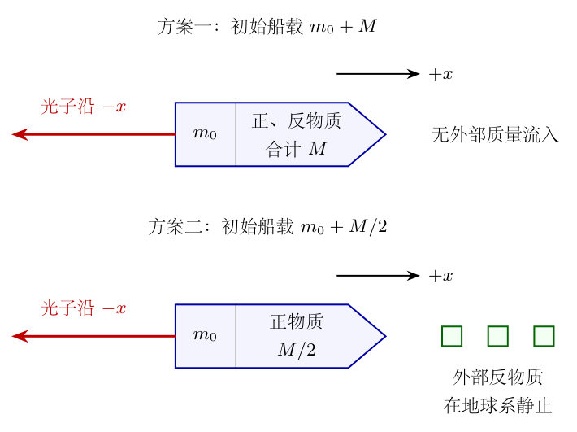{width=88%}

<!-- question-end -->

## 一、题型定位

本题是狭义相对论中的变质量光子火箭。速度问题需要把飞船剩余静质量、光子能量与动量放进同一套守恒方程；加速度问题则需要在飞船的瞬时静止系列微元方程，再把本征加速度转换为地球系的坐标加速度。

两方案的区别不仅是“是否携带反物质”。方案二收集的反物质在地球系动量为零，在飞船瞬时静止系却以负速度入射，具有非零的能量和动量。若只计湮灭释放的静能而漏掉入射动量，就会得到错误的推力。反过来，若在总体守恒中把已收集的反物质再计入一次飞船初始质量，也会造成重复计算。

## 二、知识点

静质量与总能量；相对论动量；光子的能量—动量关系；一维四动量守恒；正、反物质质量预算；瞬时共动惯性系；固有时间与时间膨胀；速度叠加公式的微分；纵向加速度的 $\gamma^3$ 因子；有理式求导、消元及根的筛选；快度与光锥分量；小速度、无燃料及大质量比极限。

采用题设的理想光子推进模型：湮灭产物全部汇成沿航线反向的光束，没有未利用的热、非光子残留、捕获损失和额外外力；忽略引力及星际介质。各次向后发出的光子在地球系仍向后，因而可以将它们的能量与动量分别相加。距离 $1520$ 光年不进入这五问的局部推进方程；“全部燃料用于加速”只规定最高速度，不表示抵达目的地后还能静止停靠。

题中的消耗量按船上携带的燃料静质量计：方案一的 $\lambda M$ 是船内正、反物质的总消耗；方案二的 $\lambda M$ 是船内正物质的消耗，同时还收集并消耗相等质量的外部反物质。因此方案二实际参与湮灭的两种物质总静质量为 $2\lambda M$。$\alpha$ 相应表示每单位固有时间减少的船内燃料静质量。这个口径也使方案二的耗尽条件恰为 $\lambda=1/2$；若另把 $\alpha$ 定义为两种物质合计的湮灭率，方案二必须作相应的二倍换算。

## 三、物理图像

飞船沿 $+x$ 前进，光束沿 $-x$ 发射。方案一没有质量流入：飞船的前向动量与向后光子的动量大小相等，飞船总能量与累计光子能量之和等于最初船载系统的静能。

方案二有质量流入，但外部反物质在地球系静止。对“最初的飞船、已经收集的那部分反物质、所有已发射光子”这个完整系统，初始动量仍为零。收集的物质增加系统初始能量；与此同时，正物质在船内被消耗，飞船剩余静质量下降。这两个变化都要进入方程，不能只修改其中一个。

加速度描述的是短时间内的变化。在当时随船运动的惯性系中，飞船在过程开始时静止，微小反冲速度便于求解。地球系的速度增量却比该反冲速度小一个 $\gamma^2$ 因子，地球系时间又长一个 $\gamma$ 因子，合起来才得到纵向加速度的 $\gamma^3$ 变换。

## 四、解题入口

用 $\tau$ 表示飞船世界线上的固有时间，$t$ 表示地球系时间。消耗的船内静质量记为

$$
\mu=\lambda M=\lambda Zm_0.
$$

为便于把质量与速度公式逐项核对，定义无量纲量

$$
\begin{aligned}
U&=1+Z,& A&=1+\frac Z2,& X&=\frac{\mu}{m_0}=\lambda Z,\\
f_1&=U-X=1+(1-\lambda)Z,&
f_2&=A-X=1+\left(\frac12-\lambda\right)Z.
\end{aligned}
$$

两方案最初船载静质量分别为 $m_0U,m_0A$，当前飞船静质量分别为 $m_1=m_0f_1,m_2=m_0f_2$。速度写作 $\beta_i=v_i/c$，洛伦兹因子写作 $\gamma_i=(1-\beta_i^2)^{-1/2}$。先对每种方案建立全局能量和动量方程，再处理微元推力；不要把 $\alpha$ 当成地球系的质量消耗率。

## 五、解析

**第1步：建立静质量、能量和动量之间的关系。**

静质量为 $m$、沿 $+x$ 以速度 $v=\beta c$ 运动的飞船，在地球系的能量和动量分别为

$$
E_{\rm ship}=\gamma mc^2,\qquad
p_{\rm ship}=\gamma m\beta c,\qquad
\gamma=\frac1{\sqrt{1-\beta^2}}.
$$

$m$ 包含尚未消耗的船内燃料，但不包含已经飞离的光子，也不包含尚未收集的外部物质。这里始终使用静质量，没有把 $\gamma m$ 当成随速度改变的燃料质量。

若已向后发出的全部光子在地球系的总能量为 $E_\gamma>0$，由于每个光子均沿 $-x$，它们的总动量为

$$
p_\gamma=-\frac{E_\gamma}{c}.
$$

负号只来自方向，不表示光子能量为负。整体列式时，未知的 $E_\gamma$ 是地球系累计光子能量，不是后面瞬时静止系中的微元光子能量。

**第2步：对方案一选完整系统，并列出两条守恒方程。**

图8-2的上行把出发前的整个船载系统与加速后的“飞船加累计光子”对照。出发前静质量为 $m_0U$，速度为零；当消耗 $\mu=m_0X$ 后，飞船静质量为 $m_0f_1$。

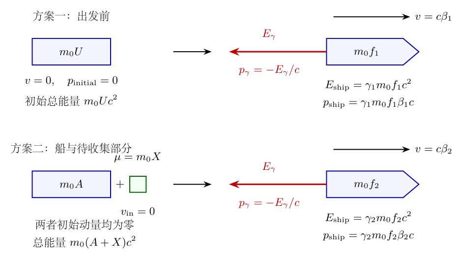{width=90%}

能量与动量守恒依次给出

$$
\begin{aligned}
m_0Uc^2&=\gamma_1m_0f_1c^2+E_\gamma,\\
0&=\gamma_1m_0f_1\beta_1c-\frac{E_\gamma}{c}.
\end{aligned}
$$

第二式先确定 $E_\gamma=\gamma_1m_0f_1\beta_1c^2$。代回第一式，并约去正数 $m_0c^2$，得到

$$
U=\gamma_1f_1(1+\beta_1).
$$

不能把能量式写成 $m_0Uc^2=m_0f_1c^2+E_\gamma$，因为剩余飞船已经具有动能；也不能在动量式中用 $mv$ 替代相对论动量。

**第3步：逐项消元，求方案一的速度与洛伦兹因子。**

先把上式写成

$$
\frac U{f_1}
=\frac{1+\beta_1}{\sqrt{1-\beta_1^2}}
=\sqrt{\frac{1+\beta_1}{1-\beta_1}}.
$$

根号化简用到了 $1-\beta_1^2=(1-\beta_1)(1+\beta_1)$，并使用 $0\leq\beta_1<1$。两边均非负，因此平方不会产生方向相反的额外根：

$$
\begin{aligned}
U^2(1-\beta_1)&=f_1^2(1+\beta_1),\\
U^2-f_1^2&=(U^2+f_1^2)\beta_1,\\
\boxed{\displaystyle
\beta_1=\frac{U^2-f_1^2}{U^2+f_1^2}.}
\end{aligned}
$$

再直接核对 $\gamma_1$，而不是只给结论：

$$
\begin{aligned}
1-\beta_1^2
&=\frac{(U^2+f_1^2)^2-(U^2-f_1^2)^2}
{(U^2+f_1^2)^2}\\
&=\frac{4U^2f_1^2}{(U^2+f_1^2)^2},\\
\gamma_1&=\frac{U^2+f_1^2}{2Uf_1}.
\end{aligned}
$$

因此第（2）问为

$$
\boxed{\displaystyle
\frac{v_1}{c}
=\frac{(1+Z)^2-[1+(1-\lambda)Z]^2}
{(1+Z)^2+[1+(1-\lambda)Z]^2}.}
$$

该式在题设 $0\leq\lambda<1/2$ 内成立；对方案一也可连续使用到船内燃料全部耗尽的 $\lambda=1$。$f_1\geq1$，分母始终为正，故不需要选择任何负质量或超光速支路。

**第4步：求方案一全部燃料用于加速时的最大速度。**

随着消耗增加，$f_1$ 从 $U$ 降至 $1$。把速度看成 $f_1$ 的函数，有

$$
\frac{d\beta_1}{df_1}
=-\frac{4U^2f_1}{(U^2+f_1^2)^2}<0.
$$

所以静质量越小，速度越大；最高速度在 $\lambda=1,f_1=1$ 达到。代入并展开：

$$
\begin{aligned}
\frac{v_{1\max}}c
&=\frac{(1+Z)^2-1}{(1+Z)^2+1}\\
&=\frac{1+2Z+Z^2-1}{1+2Z+Z^2+1}\\
&=\boxed{\displaystyle\frac{Z(2+Z)}{Z^2+2Z+2}.}
\end{aligned}
$$

“最大”来自给定燃料预算下的单调加速，不是把速度设为 $c$。对任何有限 $Z$，分母比分子恰多 $2$，速度严格小于光速。

**第5步：对方案二重新作初始与剩余质量预算。**

方案二出发时只带正物质，船载静质量为 $m_0A=m_0(1+Z/2)$。消耗船内正物质 $\mu=m_0X$ 后，剩余飞船静质量为

$$
m_2=m_0(A-X)=m_0f_2.
$$

同时它已收集并消耗等质量 $\mu$ 的反物质。图8-2下行把这部分外部反物质列在初始系统中：它最初相对于地球系静止，能量为 $\mu c^2$，动量为零。

于是完整系统的初始总能量为 $m_0(A+X)c^2$，初始总动量仍为零。不能把初始船载质量写成 $m_0(A+X)$ 后，又另外加 $\mu c^2$；那样会把同一部分外部反物质计算两次。

守恒方程是

$$
\begin{aligned}
m_0(A+X)c^2&=\gamma_2m_0(A-X)c^2+E_\gamma,\\
0&=\gamma_2m_0(A-X)\beta_2c-\frac{E_\gamma}{c}.
\end{aligned}
$$

消去本方案的 $E_\gamma$，得到

$$
A+X=\gamma_2(A-X)(1+\beta_2).
$$

这与方案一有相同的代数结构，但初始系统能量和剩余质量两处都不同。

**第6步：完整化简方案二的速度与洛伦兹因子。**

由上一式，

$$
\sqrt{\frac{1+\beta_2}{1-\beta_2}}
=\frac{A+X}{A-X}.
$$

因此

$$
\begin{aligned}
\beta_2
&=\frac{(A+X)^2-(A-X)^2}
{(A+X)^2+(A-X)^2}\\
&=\frac{4AX}{2(A^2+X^2)}
=\frac{2AX}{A^2+X^2}.
\end{aligned}
$$

这一步使用平方和、平方差展开；保留中间的 $4AX$ 和 $2(A^2+X^2)$ 可避免误漏因子 $2$。再求

$$
\begin{aligned}
1-\beta_2^2
&=\frac{(A^2+X^2)^2-4A^2X^2}{(A^2+X^2)^2}\\
&=\frac{(A^2-X^2)^2}{(A^2+X^2)^2},\\
\gamma_2&=\frac{A^2+X^2}{A^2-X^2}.
\end{aligned}
$$

题设范围内 $0\leq X<Z/2<A$，故 $A^2-X^2>0$，去绝对值是有依据的。第（3）问为

$$
\boxed{\displaystyle
\frac{v_2}{c}
=\frac{2\lambda Z(1+Z/2)}
{(1+Z/2)^2+(\lambda Z)^2}.}
$$

<!-- KEEP_TOGETHER_START -->

**第7步：求方案二最高速度，并与方案一核对。**

方案二正物质全部耗尽时 $\mu=M/2$，即 $\lambda=1/2$、$X=Z/2$、$f_2=1$。在 $0\leq X\leq Z/2$ 内，

$$
\frac{d\beta_2}{dX}
=\frac{2A(A^2-X^2)}{(A^2+X^2)^2}>0,
$$

<!-- KEEP_TOGETHER_END -->

所以最高速度在这个端点取得：

$$
\begin{aligned}
\frac{v_{2\max}}c
&=\frac{Z(1+Z/2)}
{(1+Z/2)^2+(Z/2)^2}\\
&=\frac{Z+Z^2/2}{1+Z+Z^2/2}\\
&=\frac{2Z+Z^2}{2+2Z+Z^2}
=\boxed{\displaystyle\frac{Z(2+Z)}{Z^2+2Z+2}.}
\end{aligned}
$$

于是第（1）问的两种最高速度相同。方案二的初始船载质量较小，但最终完整系统已经加入 $M/2$ 的外部反物质；两方案用尽全部可用正、反物质后，总初始静能都是 $(m_0+M)c^2$，最终飞船静质量都是 $m_0$，向后光束的能量—动量关系也相同。这是最高速度相同的物理原因，不表示中途速度、燃烧时间或加速度相同。

**第8步：确定消耗率的时间口径，分清固有时间与地球系时间。**

题给 $\alpha$ 是船内静质量对固有时间的消耗率，因而

$$
\frac{d\mu}{d\tau}=\alpha,\qquad
\frac{d\lambda}{d\tau}=\frac{\alpha}{M}
=\frac{\alpha}{Zm_0}.
$$

若从出发时取 $\tau=0$，恒定 $\alpha$ 对应 $\mu=\alpha\tau$。两方案各自沿飞船世界线满足

$$
dt=\gamma_i\,d\tau.
$$

因此地球系的船内燃料消耗率是

$$
\frac{d\mu}{dt}=\frac{\alpha}{\gamma_i},
$$

不是 $\alpha$。方案二虽同时消耗外部反物质，其船内剩余质量仍满足 $dm_2/d\tau=-\alpha$；两种物质合计的静质量湮灭率则是 $2\alpha$。在方案一和方案二之间比较时，这两个不同口径不能混用。

**第9步：从速度叠加的微分推导纵向加速度变换。**

取过程开始时以速度 $u=v_i$ 随船运动的惯性系 $S'$。该瞬间飞船在 $S'$ 中静止；过固有时间 $d\tau$ 后，它在 $S'$ 中获得微小速度 $dv'$。地球系 $S$ 中相应的新速度为

$$
v_{\rm new}=\frac{u+dv'}{1+u\,dv'/c^2}.
$$

在这个局部比较中，$S'$ 的参考速度 $u$ 固定；不能把它同时当成随时间变化的未知量求导。对 $v'$ 求导并在 $v'=0$ 取值：

$$
\begin{aligned}
\left.\frac{\partial}{\partial v'}
\frac{u+v'}{1+uv'/c^2}\right|_{v'=0}
&=\left.
\frac{1+uv'/c^2-(u+v')u/c^2}
{(1+uv'/c^2)^2}\right|_{v'=0}\\
&=1-\frac{u^2}{c^2}
=\frac1{\gamma_i^2}.
\end{aligned}
$$

故 $dv=dv'/\gamma_i^2$。图8-3的两条共动轴和微元事件同时说明时间关系。

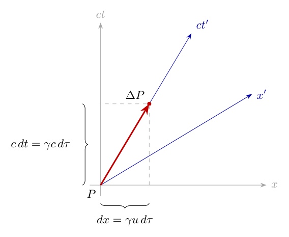{width=58%}

相邻飞船事件在瞬时共动系的空间差为一阶意义下的零，洛伦兹变换给 $c\,dt=\gamma_i c\,d\tau$、$dx=\gamma_i u\,d\tau$。图中的斜边表示时空方向，不能用欧氏几何长度把它当成 $c\,d\tau$。

将速度增量与时间增量合起来，

$$
\begin{aligned}
a_i=\frac{dv}{dt}
&=\frac{dv'/\gamma_i^2}{\gamma_i\,d\tau}\\
&=\boxed{\displaystyle\frac{a'_i}{\gamma_i^3}},
\qquad
a'_i=\lim_{d\tau\to0}\frac{dv'}{d\tau}.
\end{aligned}
$$

这里 $a'_i$ 是瞬时本征加速度，不是用同一个加速坐标系跨整个航程求出的普通坐标导数。只写时间膨胀会漏掉两个 $\gamma$，只写速度微分又会漏掉另一个 $\gamma$。

**第10步：在方案一的瞬时静止系列能量与动量微元。**

图8-4表示当前飞船静质量为 $m_1$，微小过程中船内燃料消耗 $d\mu=\alpha\,d\tau$，剩余飞船质量变为 $m_1-d\mu$，向后发出能量为 $d\varepsilon'$ 的光束，并获得微小正速度 $dv'_1$。

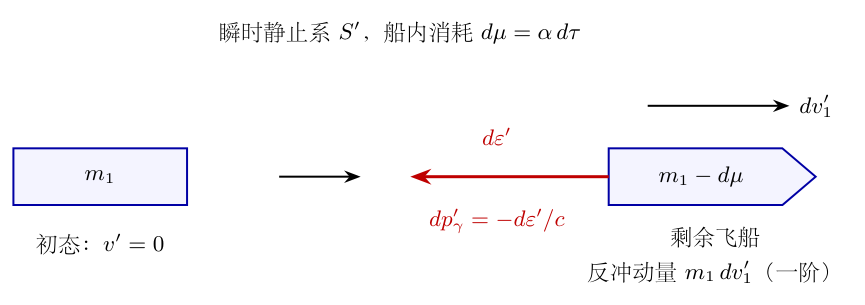{width=82%}

过程开始时的飞船动能为零；结束时反冲动能是 $O(m_1(dv'_1)^2)$。按无量纲微元 $d\mu/m_1$ 展开，$dv'_1/c=O(d\mu/m_1)$，所以反冲动能是静能尺度 $m_1c^2$ 的二阶小量，在一阶微分方程中可忽略。因此

$$
\begin{aligned}
m_1c^2
&=(m_1-d\mu)c^2+d\varepsilon'
+O\!\left(\frac{c^2(d\mu)^2}{m_1}\right),\\
0&=(m_1-d\mu)\,dv'_1-\frac{d\varepsilon'}c
+O\!\left(\frac{c(d\mu)^3}{m_1^2}\right).
\end{aligned}
$$

能量式的高阶项具有能量单位；动量式的高阶项来自反冲洛伦兹因子的修正，具有动量单位。后一式中的 $d\mu\,dv'_1$ 则是二阶小量，因为 $dv'_1/c=O(d\mu/m_1)$。只取一阶微分，先由能量式得 $d\varepsilon'=c^2d\mu$，再由动量式得

$$
m_1\,dv'_1=c\,d\mu.
$$

所以

$$
a'_1=\frac{\alpha c}{m_1}
=\frac{\alpha c}{m_0f_1}.
$$

这是瞬时一阶推力结果，并非把有限消耗量的反冲能量全部忽略。有限全过程的动能已经在第2—3步的精确守恒中完整保留。

**第11步：求方案一地球系加速度，并完成分式化简。**

把第10步结果代入第9步，

$$
\boxed{\displaystyle
\frac{a_1m_0}{c\alpha}
=\frac1{f_1\gamma_1^3}.}
$$

再代入 $\gamma_1=(U^2+f_1^2)/(2Uf_1)$：

$$
\begin{aligned}
\frac1{f_1\gamma_1^3}
&=\frac1{f_1}
\left(\frac{2Uf_1}{U^2+f_1^2}\right)^3\\
&=\frac{8U^3f_1^3}{f_1(U^2+f_1^2)^3}\\
&=\frac{8U^3f_1^2}{(U^2+f_1^2)^3}.
\end{aligned}
$$

第（4）问因而也可写成只含题给参数的形式：

$$
\boxed{\displaystyle
\frac{a_1m_0}{c\alpha}
=\frac{8(1+Z)^3[1+(1-\lambda)Z]^2}
{\left\{(1+Z)^2+[1+(1-\lambda)Z]^2\right\}^3}.}
$$

在出发瞬间 $\lambda=0$，有 $\gamma_1=1,f_1=U$，结果回到 $a_1=\alpha c/[m_0(1+Z)]$，与当时地球系就是飞船静止系的事实一致。

**第12步：求方案二入射反物质在瞬时静止系中的能量与动量。**

图8-5中外部反物质在地球系静止，但飞船以 $v_2=\beta_2c$ 前进。在飞船瞬时静止系 $S'$ 中，这部分物质向后运动，速度为 $-\beta_2c$。一个静质量为 $d\mu$ 的入射微元，其四动量由洛伦兹变换给出

$$
dE'_{\rm in}=\gamma_2d\mu\,c^2,\qquad
dp'_{\rm in}=-\gamma_2\beta_2d\mu\,c.
$$

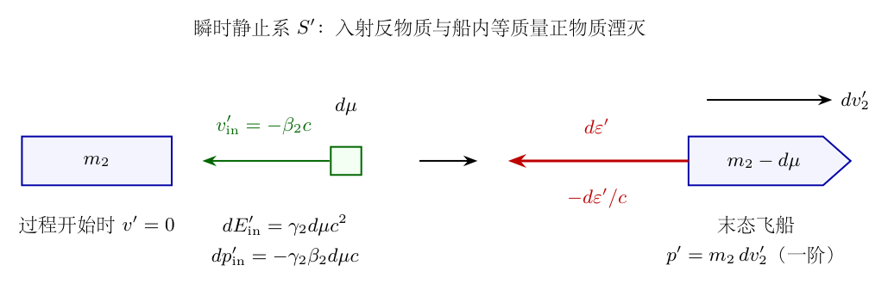{width=88%}

图中负动量箭头是入射反物质在 $S'$ 中的真实运动方向。它的静质量仍为 $d\mu$；$\gamma_2d\mu c^2$ 是含动能的总能量，不是“收集到的静质量变大了”。船内参与湮灭的正物质本来已包含在 $m_2$ 中，不在过程开始时另加一份 $d\mu c^2$。

**第13步：对方案二微元列式，保留入射动量。**

在 $d\tau$ 内消耗船内正物质 $d\mu=\alpha d\tau$，并收集、消耗等静质量反物质。结束后飞船静质量为 $m_2-d\mu$，微小反冲速度为 $dv'_2$。保留一阶量，能量与动量式是

$$
\begin{aligned}
m_2c^2+\gamma_2d\mu\,c^2
&=(m_2-d\mu)c^2+d\varepsilon',\\
-\gamma_2\beta_2d\mu\,c
&=m_2\,dv'_2-\frac{d\varepsilon'}c.
\end{aligned}
$$

与方案一相同，反冲动能及 $d\mu\,dv'_2$ 为二阶量；但 $\gamma_2,\beta_2$ 是过程开始时的有限速度状态，不能把入射反物质动量作为二阶量丢掉。

由第一式，

$$
d\varepsilon'=(1+\gamma_2)d\mu\,c^2.
$$

第二式于是给

$$
\begin{aligned}
m_2\,dv'_2
&=\frac{d\varepsilon'}c-\gamma_2\beta_2d\mu\,c\\
&=[1+\gamma_2-\gamma_2\beta_2]c\,d\mu\\
&=[1+\gamma_2(1-\beta_2)]c\,d\mu.
\end{aligned}
$$

光子的向后动量产生前向反冲，收集到的负动量则抵消其中一部分。只计光子能量会错误地保留 $1+\gamma_2$，只计静能又会错误地将光子能量恒写成 $2d\mu c^2$。

因此

$$
a'_2=\frac{\alpha c}{m_2}
[1+\gamma_2(1-\beta_2)].
$$

**第14步：转换并化简方案二加速度。**

应用 $a_2=a'_2/\gamma_2^3$，第（5）问首先得到

$$
\boxed{\displaystyle
\frac{a_2m_0}{c\alpha}
=\frac{1+\gamma_2(1-\beta_2)}
{f_2\gamma_2^3}.}
$$

逐项化简括号中的量：

$$
\begin{aligned}
1-\beta_2
&=\frac{A^2+X^2-2AX}{A^2+X^2}
=\frac{(A-X)^2}{A^2+X^2},\\
\gamma_2(1-\beta_2)
&=\frac{A^2+X^2}{(A-X)(A+X)}
\frac{(A-X)^2}{A^2+X^2}\\
&=\frac{A-X}{A+X},\\
1+\gamma_2(1-\beta_2)&=\frac{2A}{A+X}.
\end{aligned}
$$

由于 $f_2=A-X$，继续约分：

$$
\begin{aligned}
\frac{a_2m_0}{c\alpha}
&=\frac{2A}{(A+X)(A-X)}
\left(\frac{A^2-X^2}{A^2+X^2}\right)^3\\
&=\frac{2A}{A^2-X^2}
\frac{(A^2-X^2)^3}{(A^2+X^2)^3}\\
&=\frac{2A(A^2-X^2)^2}{(A^2+X^2)^3}.
\end{aligned}
$$

回到原参数：

$$
\boxed{\displaystyle
\frac{a_2m_0}{c\alpha}
=\frac{2(1+Z/2)\left[(1+Z/2)^2-(\lambda Z)^2\right]^2}
{\left[(1+Z/2)^2+(\lambda Z)^2\right]^3}.}
$$

出发时 $\beta_2=0,\gamma_2=1$，故 $a_2=2\alpha c/[m_0(1+Z/2)]$。因当时收集来的物质在船系也静止，湮灭的两份静能全部可用于光束；这个因子 $2$ 与 $\alpha$ 只计船内正物质的口径相符。

**第15步：直接对全过程速度求导，独立核对方案一加速度。**

这条核验不使用微元推力结论。由 $f_1=U-\lambda Z$，

$$
\begin{aligned}
\frac{d\beta_1}{df_1}
&=\frac{-2f_1(U^2+f_1^2)-2f_1(U^2-f_1^2)}
{(U^2+f_1^2)^2}\\
&=-\frac{4U^2f_1}{(U^2+f_1^2)^2},\\
\frac{d\beta_1}{d\lambda}
&=\frac{4U^2f_1Z}{(U^2+f_1^2)^2}.
\end{aligned}
$$

时间关系给

$$
\frac{dt}{d\lambda}=\gamma_1\frac{Zm_0}{\alpha}.
$$

所以

$$
\begin{aligned}
a_1
&=c\,\frac{d\beta_1/d\lambda}{dt/d\lambda}\\
&=\frac{\alpha c}{m_0}
\frac{4U^2f_1}{\gamma_1(U^2+f_1^2)^2}\\
&=\frac{\alpha c}{m_0}
\frac{8U^3f_1^2}{(U^2+f_1^2)^3},
\end{aligned}
$$

与第11步完全一致。这里的 $Z$ 分别来自 $\lambda$ 的质量尺度和速度导数，约去后仍通过 $U,f_1$ 影响结果；不是加速度与燃料质量比无关。

<!-- KEEP_TOGETHER_START -->

**第16步：直接求导核对方案二加速度及捕获负动量的必要性。**

由 $X=\lambda Z$，对方案二速度求导：

<!-- KEEP_TOGETHER_END -->

$$
\begin{aligned}
\frac{d\beta_2}{dX}
&=\frac{2A(A^2+X^2)-2AX\cdot2X}{(A^2+X^2)^2}\\
&=\frac{2A(A^2-X^2)}{(A^2+X^2)^2},\\
\frac{d\beta_2}{d\lambda}
&=\frac{2AZ(A^2-X^2)}{(A^2+X^2)^2}.
\end{aligned}
$$

用 $dt/d\lambda=\gamma_2Zm_0/\alpha$，

$$
\begin{aligned}
a_2
&=\frac{\alpha c}{m_0}
\frac{2A(A^2-X^2)}{\gamma_2(A^2+X^2)^2}\\
&=\frac{\alpha c}{m_0}
\frac{2A(A^2-X^2)^2}{(A^2+X^2)^3}.
\end{aligned}
$$

这与微元守恒结果一致。若第13步漏掉入射反物质的负动量，得到的加速度就不能由已精确守恒的全过程速度求导重现；因此这项不是可有可无的修正。

**第17步：按相同的总湮灭质量比较中途速度。**

在相同 $\lambda$ 下，方案二实际湮灭的总静质量是方案一的两倍，不能只看 $\lambda$ 相同便称“燃料总投入相同”。若按两种方案已使用的全部正、反物质总量均为 $\rho M$ 比较，则

$$
\lambda_1=\rho,\qquad \lambda_2=\frac{\rho}{2},
\qquad 0\leq\rho\leq1.
$$

图8-6以 $Z=4$ 展示这一个明确口径；图中横轴不是两方案相同的 $\lambda$。

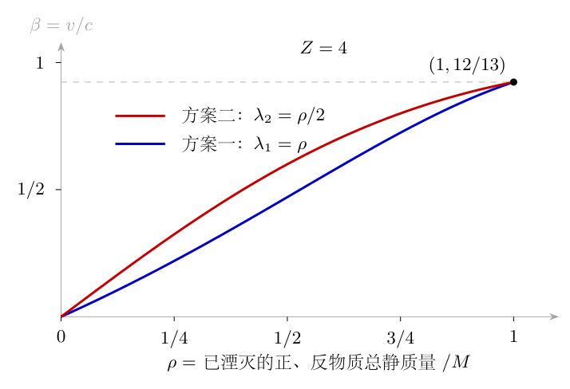{width=72%}

为证明图示关系而非只凭曲线判断，令 $y=\rho Z/2$，并记

$$
D_i=\sqrt{\frac{1+\beta_i}{1-\beta_i}}.
$$

相同 $\rho$ 对应

$$
D_1=\frac U{U-2y},\qquad
D_2=\frac{A+y}{A-y}.
$$

所有分母为正。两分式相减的分子可完整展开为

$$
\begin{aligned}
(A+y)(U-2y)-U(A-y)
&=AU+Uy-2Ay-2y^2-AU+Uy\\
&=2y(U-A-y)\\
&=\frac{\rho(1-\rho)Z^2}{2}.
\end{aligned}
$$

故 $0<\rho<1$ 时 $D_2>D_1$。又

$$
\beta=\frac{D^2-1}{D^2+1},\qquad
\frac{d\beta}{dD}=\frac{4D}{(D^2+1)^2}>0,
$$

因此方案二在相同总湮灭质量的中途状态速度较大，而出发与全部耗尽两个端点速度相同。它在前段不需要携带尚未收集的反物质，却仍必须付出捕获负动量的代价；两点同时成立，不矛盾。

**第18步：检查量纲、边界与模型适用范围。**

$Z,\lambda,U,A,X,f_i,\beta_i,\gamma_i$ 均无量纲。$\alpha$ 的单位是 $\mathrm{kg\,s^{-1}}$，因此

$$
\left[\frac{\alpha c}{m_0}\right]
=\frac{(\mathrm{kg\,s^{-1}})(\mathrm{m\,s^{-1}})}
{\mathrm{kg}}
=\mathrm{m\,s^{-2}},
$$

两个所求加速度比均确为无量纲。

当 $\lambda=0$ 时，两速度均为零；两加速度却分别为 $\alpha c/[m_0(1+Z)]$ 和 $2\alpha c/[m_0(1+Z/2)]$，反映质量预算与单位船内消耗所对应的反应总量不同。当 $Z\to0$ 时，最高速度满足 $v_{\max}/c\sim Z$；没有燃料时最高速度为零。

对任意有限 $Z$，

$$
1-\frac{v_{\max}}c
=\frac2{Z^2+2Z+2}>0.
$$

大 $Z$ 只能使速度趋近 $c$，不能达到或超过 $c$。第（2）—（5）问在恒定 $\alpha$ 且仍有燃料、反物质供应足够时适用。达到耗尽端点后必须令消耗率停止，不能把公式中的恒定 $\alpha$ 继续用于没有燃料的飞船。全部用于加速的最高速度也不能直接作为“加速、减速并静止抵达”所需的质量预算。

## 六、关键洞察

**能量加动量的组合把全部光子自动消掉。** 对沿 $-x$ 的光子，$E_\gamma+cp_\gamma=0$。定义飞船快度 $\eta$：

$$
\beta=\tanh\eta,\quad
\gamma=\cosh\eta,\quad
\gamma\beta=\sinh\eta.
$$

于是

$$
E_{\rm ship}+cp_{\rm ship}
=mc^2(\cosh\eta+\sinh\eta)
=mc^2e^\eta.
$$

方案一没有外部流入，因而 $m_1e^{\eta_1}=m_0U$。方案二每收集一份地球系静止质量 $d\mu$，这个组合增加 $c^2d\mu$，因而

$$
m_2e^{\eta_2}=m_0A+\mu.
$$

用 $m_1=m_0U-\mu$、$m_2=m_0A-\mu$ 即得到主解析中的两个 $D_i=e^{\eta_i}$。这是一条完整替代推导；它没有忽略入射动量，而是选用了能将反向光束贡献恰好消去的四动量分量。

再对固有时间求导，方案一有

$$
\begin{aligned}
\frac d{d\tau}(m_1e^{\eta_1})&=0,\\
(-\alpha+m_1\dot\eta_1)e^{\eta_1}&=0,\\
m_1\dot\eta_1&=\alpha.
\end{aligned}
$$

方案二有

$$
\begin{aligned}
\frac d{d\tau}(m_2e^{\eta_2})&=\alpha,\\
(-\alpha+m_2\dot\eta_2)e^{\eta_2}&=\alpha,\\
m_2\dot\eta_2&=\alpha(1+e^{-\eta_2}).
\end{aligned}
$$

由 $e^{-\eta_2}=\gamma_2(1-\beta_2)$，得到与微元反冲相同的本征加速度 $a'_i=c\dot\eta_i$。又 $d\beta/d\eta=\operatorname{sech}^2\eta=1/\gamma^2$、$dt/d\tau=\gamma$，因此

$$
a=\frac{c\,d\beta}{dt}
=\frac{c\,\dot\eta}{\gamma^3}.
$$

这同时把全局速度、局部推力与时间变换连在一起，而不是三条彼此无关的公式。

**本征加速度增大，不保证地球系加速度单调增大。** 方案一的本征加速度 $\alpha c/m_1$ 随质量减少而增大，但坐标加速度还受 $\gamma^3$ 抑制。令

$$
B_1(f)=\frac{a_1m_0}{\alpha c}
=\frac{8U^3f^2}{(U^2+f^2)^3}.
$$

其对数导数为

$$
\begin{aligned}
\frac{d\ln B_1}{df}
&=\frac2f-\frac{6f}{U^2+f^2}\\
&=\frac{2(U^2-2f^2)}{f(U^2+f^2)}.
\end{aligned}
$$

燃烧使 $f$ 递减。出发时 $f=U$，上式为负，故 $B_1$ 随燃烧先增大；若能达到 $f=U/\sqrt2$，导数变号，随后 $B_1$ 降低。这个极大点在燃料可行区间 $1\leq f\leq U$ 内的条件是

$$
U\geq\sqrt2,\qquad Z\geq\sqrt2-1.
$$

在极大点，

$$
\beta_1=\frac{U^2-U^2/2}{U^2+U^2/2}=\frac13,
\qquad
B_{1\max}=\frac{32}{27U}.
$$

若 $0<Z<\sqrt2-1$，这一个质量值低于干质量，燃料耗尽之前达不到；实际区间内加速度一直增大，不能把题外驻点当成可达状态。

方案二则令

$$
B_2(X)=\frac{2A(A^2-X^2)^2}{(A^2+X^2)^3},
$$

在 $0<X\leq Z/2$ 内

$$
\frac{d\ln B_2}{dX}
=-\frac{4X}{A^2-X^2}
-\frac{6X}{A^2+X^2}<0.
$$

其地球系加速度从出发值开始单调降低。这说明两方案即使最高速度相同，整个推进过程的力学特征仍明显不同。

**理想收集不是无代价的推力来源。** 在船系，入射反物质贡献 $\gamma d\mu c^2$ 的能量，也带入 $-\gamma\beta d\mu c$ 的动量。有效反冲系数是

$$
1+\gamma-\gamma\beta=1+e^{-\eta},
$$

随速度增大从 $2$ 逐渐趋向 $1$，不是一直等于 $2$，也不是随 $\gamma$ 无限制增大。真实捕获效率、光束准直效率和辐射损失若改变，这条理想守恒路线就需重新建立，而不能只在最终速度式上任意乘一个效率。

## 七、易错点

第一，将燃料静质量、总能量除以 $c^2$ 和 $\gamma m$ 混为一谈。质量预算写的是船内剩余静质量；运动能量另由 $\gamma$ 计入。

第二，只用能量守恒或只用动量守恒。累计光子能量必须先由第二条方程消去，速度才能唯一确定；向后动量的负号与光子的正能量同时存在。

第三，方案二把“出发时只带 $M/2$”理解成完整系统一共只投入 $M/2$。外部反物质需要计入所选系统初始能量，但不应提前加进船载静质量，也不应在后面再重复加一次。

第四，方案二消耗 $\lambda M$ 正物质，却从船质量中减去 $2\lambda M$。另一份反物质来自船外；船内初始质量本来没有包含它。正确剩余质量是 $m_0+M/2-\lambda M$。

第五，用相同 $\lambda$ 或相同 $\alpha$ 声称两方案总湮灭质量相同。方案二外部供应同样一份物质，反应总量和船内消耗量差一个因子 $2$；比较前必须声明口径。

第六，把收集的物质在所有参考系中都当成静止。地球系零动量经过洛伦兹变换后是船系负动量；漏项会与全过程速度求导不一致。

第七，把微元光子能量写成有限过程的全部燃料静能，而忽略反冲的阶次区别。仅在一阶微元中可忽略相对于静能尺度的二阶反冲动能；整体过程的动能不能忽略。

第八，在 $a=a'/\gamma^3$ 中漏掉速度叠加或时间膨胀之一，或把一个瞬时共动惯性系用作整个加速航程的全局惯性系。分子速度微分给 $\gamma^{-2}$，分母时间微分再给 $\gamma^{-1}$。

第九，平方后选择负速度或让 $A-X$ 变为负数。燃料可行范围保证所有静质量正，速度沿设定正方向，解的符号应先由物理方向限制。

第十，用 $v_{\max}$ 当作完整星际往返或静止抵达的结果。全部燃料用于加速与预留减速燃料是两个不同的边界条件。

## 八、课堂讲解建议

教师宜先用图8-1区分“船上已有的”和“尚在外部的”物质。课堂板书分别列出初始船载质量、已消耗船内质量、已收集外部质量、剩余飞船质量四栏，让学生在任何公式之前完成两方案的预算，不把全部湮灭量直接从船质量中扣去。

再用图8-2让学生按方向写动量。先只引入飞船的 $\gamma mv$ 与光束的 $-E_\gamma/c$，随后用动量式代回能量式。板书保留平方前的正根式、平方差和分母正值，让学生看清速度根为什么不是任意选择。

处理加速度时，教师可先用图8-3说明速度微分与时间微分是两件事。课堂不要先要求记住 $\gamma^3$，而应从速度叠加的商法则求出 $\gamma^{-2}$，再用 $dt=\gamma d\tau$。共动系只在所取瞬间惯性，提醒学生不要把前后不同的共动系直接当成同一个参考系。

图8-4与图8-5应并排比较。让学生检查能量式中的入射项和动量式中的负入射项来自同一份反物质；教师在板书中用同一颜色连起这两个项，但不把它们相互抵消。完成局部推力后再让学生对全局速度求导，作为漏项自查。

课堂结尾可用图8-6讨论比较口径：同一 $\lambda$、同一船内消耗率和同一总湮灭质量分数并不是同一种比较。最后将最高速度相同与中途轨迹不同联系起来，并用带减速的变式区分“达到某速度”和“静止抵达”。

## 九、变式训练

**变式1：从目标速度反求最低燃料质量比。**

在两种理想方案中，将全部燃料用于加速。分别求达到 $0.80c$ 与 $0.99c$ 所需的最低 $Z$，并核对耗尽后光子能量和飞船动量。

设目标 $\beta_*$，由耗尽条件下的

$$
\sqrt{\frac{1+\beta_*}{1-\beta_*}}=1+Z
$$

得到

$$
Z_{\min}=\sqrt{\frac{1+\beta_*}{1-\beta_*}}-1.
$$

两种方案最大速度相同，故最低 $Z$ 也相同；不过方案二出发时只携带其中一半的反应物质量。代入：

$$
\begin{aligned}
\beta_*=0.80:\quad
1+Z&=\sqrt{\frac{1.80}{0.20}}=3,& Z_{\min}&=2,\\
\beta_*=0.99:\quad
1+Z&=\sqrt{\frac{1.99}{0.01}}=\sqrt{199},&
Z_{\min}&\approx13.106736.
\end{aligned}
$$

耗尽后 $\gamma_*=(1-\beta_*^2)^{-1/2}$，光子累计能量由动量式得

$$
E_\gamma=\gamma_*\beta_*m_0c^2.
$$

对 $0.80c$，$\gamma_*=5/3$，故 $E_\gamma=(4/3)m_0c^2$、$p_{\rm ship}=(4/3)m_0c$；飞船能量与光子能量之和为 $(5/3+4/3)m_0c^2=3m_0c^2$，回到初始系统静能。

对 $0.99c$，$\gamma_*\approx7.088812$、$\gamma_*\beta_*\approx7.017924$。两能量之和约为 $14.106736m_0c^2=(1+Z)m_0c^2$，而非仅剩下干质量的静能。

**变式2：同一船内消耗量下计算两种速度和加速度。**

取 $Z=4,\lambda=1/4$。求两方案的剩余静质量、速度、洛伦兹因子及两种加速度；$\alpha$ 仍按船内静质量消耗率定义。

此时

$$
U=5,\quad A=3,\quad X=1,\quad f_1=4,\quad f_2=2.
$$

方案一逐项代入：

$$
\begin{aligned}
m_1&=4m_0,\\
\beta_1&=\frac{25-16}{25+16}=\frac9{41}\approx0.219512,\\
\gamma_1&=\frac{25+16}{2\cdot5\cdot4}=\frac{41}{40}=1.025,\\
\frac{a'_1m_0}{\alpha c}&=\frac14=0.25,\\
\frac{a_1m_0}{\alpha c}
&=\frac1{4(41/40)^3}\approx0.232150.
\end{aligned}
$$

方案二：

$$
\begin{aligned}
m_2&=2m_0,\\
\beta_2&=\frac{2\cdot3\cdot1}{9+1}=\frac35=0.60,\\
\gamma_2&=\frac{9+1}{9-1}=\frac54=1.25,\\
1+\gamma_2(1-\beta_2)
&=1+\frac54\frac25=\frac32,\\
\frac{a'_2m_0}{\alpha c}
&=\frac{3/2}{2}=\frac34=0.75,\\
\frac{a_2m_0}{\alpha c}
&=\frac{3/4}{(5/4)^3}
=\frac{48}{125}=0.384.
\end{aligned}
$$

方案二在此状态速度和加速度都较大，但它已实际湮灭 $2m_0$ 的两种物质，方案一只湮灭 $m_0$；此外出发船载质量和当前质量均不同。这组数值不能被解读为在同一总物质投入下“加速度恰好翻倍”。

若改为两种物质合计的反应率均为 $\alpha_{\rm tot}$，方案一取原来的 $\alpha=\alpha_{\rm tot}$，方案二取 $\alpha=\alpha_{\rm tot}/2$。在同样速度状态下，方案二坐标加速度变为 $0.192\,\alpha_{\rm tot}c/m_0$；速度公式不变，因为速度由已消耗质量而不是燃烧快慢决定。

**变式3：求恒定船内消耗率下的地球系时间和加速距离。**

仍用理想直线推进，从静止出发，$\alpha$ 为常数。求消耗至给定 $\lambda$ 的固有时间、地球系时间和位移；再以 $Z=4$ 计算两方案全部耗尽的结果。

固有时间在两方案中均为

$$
\tau=\frac{\mu}{\alpha}
=\frac{m_0X}{\alpha}.
$$

但耗尽端点分别是 $X=Z$ 和 $X=Z/2$。地球系时间与位移要积分

$$
dt=\gamma\,d\tau,\qquad
dx=v\,dt=c\gamma\beta\,d\tau.
$$

对方案一令积分变量 $s=U-\mu/m_0$，则 $d\tau=-(m_0/\alpha)\,ds$，并有

$$
\gamma_1(s)=\frac12\left(\frac Us+\frac sU\right),
\qquad
\gamma_1(s)\beta_1(s)=\frac12\left(\frac Us-\frac sU\right).
$$

因此从 $s=U$ 积分至 $s=f_1$：

$$
\begin{aligned}
t_1
&=\frac{m_0}{2\alpha}
\int_{f_1}^{U}\left(\frac Us+\frac sU\right)ds\\
&=\frac{m_0}{2\alpha}
\left[U\ln s+\frac{s^2}{2U}\right]_{f_1}^{U}\\
&=\frac{m_0}{2\alpha}
\left[U\ln\frac U{f_1}+\frac{U^2-f_1^2}{2U}\right],\\
x_1
&=\frac{m_0c}{2\alpha}
\int_{f_1}^{U}\left(\frac Us-\frac sU\right)ds\\
&=\frac{m_0c}{2\alpha}
\left[U\ln\frac U{f_1}-\frac{U^2-f_1^2}{2U}\right].
\end{aligned}
$$

对方案二以收集并消耗的无量纲质量 $y=\mu/m_0$ 为积分变量。当前 $\gamma_2=(A^2+y^2)/(A^2-y^2)$、$\gamma_2\beta_2=2Ay/(A^2-y^2)$，故

$$
\begin{aligned}
t_2
&=\frac{m_0}{\alpha}
\int_0^X\left(-1+\frac{2A^2}{A^2-y^2}\right)dy,\\
x_2
&=\frac{m_0c}{\alpha}
\int_0^X\frac{2Ay}{A^2-y^2}\,dy.
\end{aligned}
$$

第一积分使用部分分式

$$
\frac{2A^2}{A^2-y^2}
=\frac A{A-y}+\frac A{A+y};
$$

第二积分使用 $d(A^2-y^2)=-2y\,dy$。逐项积分给

$$
\begin{aligned}
t_2
&=\frac{m_0}{\alpha}
\left[-y-A\ln(A-y)+A\ln(A+y)\right]_0^X\\
&=\frac{m_0}{\alpha}
\left[A\ln\frac{A+X}{A-X}-X\right],\\
x_2
&=\frac{m_0cA}{\alpha}
\left[-\ln(A^2-y^2)\right]_0^X\\
&=\frac{m_0cA}{\alpha}
\ln\frac{A^2}{A^2-X^2}.
\end{aligned}
$$

所有对数最终都为无量纲正比值，$X<A$ 保证没有越过积分奇点。对 $Z=4$：

$$
\begin{aligned}
\tau_{1,\rm full}&=\frac{4m_0}{\alpha},&
\tau_{2,\rm full}&=\frac{2m_0}{\alpha},\\
t_{1,\rm full}
&=\frac{m_0}{2\alpha}
\left(5\ln5+\frac{24}{10}\right)
\approx5.223595\,\frac{m_0}{\alpha},\\
x_{1,\rm full}
&=\frac{m_0c}{2\alpha}
\left(5\ln5-\frac{24}{10}\right)
\approx2.823595\,\frac{m_0c}{\alpha},\\
t_{2,\rm full}
&=\frac{m_0}{\alpha}(3\ln5-2)
\approx2.828314\,\frac{m_0}{\alpha},\\
x_{2,\rm full}
&=\frac{3m_0c}{\alpha}\ln\frac95
\approx1.763360\,\frac{m_0c}{\alpha}.
\end{aligned}
$$

两方案耗尽最高速度均为 $12c/13$，但达到该速度的时间和位移不同。时间与位移积分也可用来反查 $dx/dt=v$、$dv/dt=a$；不能从相同终速推断相同航程。

**变式4：预留燃料，在达到巡航速度后减速至静止。**

只考虑方案一，全部正、反物质燃料都随船携带。飞船从静止加速至 $\beta_*c$，随后通过向前发射光子减速至静止；两段之间允许无耗料巡航。若最终干质量为 $m_0$，求最低初始燃料比，并计算 $\beta_*=0.80$ 时两段消耗的质量。

记 $D_*=\sqrt{(1+\beta_*)/(1-\beta_*)}$，设巡航开始时仍在船内的总静质量为 $m_b$。加速段后向光子满足

$$
\frac{m_{\rm initial}}{m_b}=D_*.
$$

减速段光子沿 $+x$，因此要改用 $E-cp$，而不是继续沿用后向光子的 $E+cp$。前向光子的 $E-cp=0$，故飞船的 $m e^{-\eta}$ 在该段守恒：

$$
m_b e^{-\eta_*}=m_0e^0=m_0.
$$

由于 $e^{\eta_*}=D_*$，得到 $m_b=D_*m_0$，再代回加速段：

$$
\begin{aligned}
m_{\rm initial}&=D_*m_b=D_*^2m_0,\\
Z_{\rm both}
&=\frac{m_{\rm initial}-m_0}{m_0}
=D_*^2-1\\
&=\frac{1+\beta_*}{1-\beta_*}-1
=\boxed{\displaystyle\frac{2\beta_*}{1-\beta_*}}.
\end{aligned}
$$

在 $\beta_*=0.80$ 时，$D_*=3$，所以初始总质量为 $9m_0$，燃料为 $8m_0$；加速结束时仍有总质量 $3m_0$，其中 $2m_0$ 是减速燃料。加速段消耗 $9m_0-3m_0=6m_0$，减速段消耗 $3m_0-m_0=2m_0$。

两段达到相反的相同快度变化，质量比都为 $3$，但消耗质量不是各占一半，因为加速段还要携带减速用的燃料。这与只用于加速时的 $Z=2$ 明显不同；因此题设的 $1520$ 光年距离不能使“全部用于加速”的答案自动具备停靠条件。

<!-- question-complete -->
