# 第1题

<!-- question-start -->

一个质量均匀分布的椭圆薄片，半长轴为$a$，半短轴为$b=\sqrt6\,a/3$，竖立在水平桌面上后由静止释放。开始时长轴竖直；薄片与桌面间无摩擦。设重力加速度为$g$。

（1）当长轴相对初始竖直方向转过$\theta=\pi/3$时，求上方焦点$F_1$的速度和椭圆薄片的角速度。

（2）求同一时刻$F_1$的加速度和椭圆薄片的角加速度。

（3）将接触条件改为纯滚动，重新求前两问中的各量。

约定向右倾倒，$x$轴向右、$y$轴向上，$\theta$沿顺时针增加；角速度和角加速度的标量均以顺时针为正。精确竖立、严格静止的理想状态是一个不稳定平衡，不会自行离开；题设通常所指的倾倒过程，应按向右无初速微小偏角释放的$\theta_0\to0^+$极限理解。严格不加扰动时不存在到达$\pi/3$的时刻。以下同时说明这个适用条件，不凭空给予初始动能。

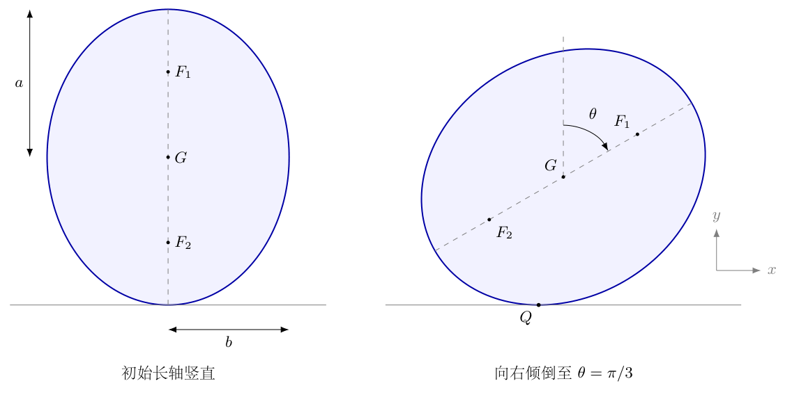{width=82%}

<!-- question-end -->

## 一、题型定位

图1-1给出初始位置与所求位置。本题是具有移动接触点的平面刚体动力学。椭圆并非圆盘，质心到桌面的高度随转角变化，质心的水平位置又取决于接触是否滑动。光滑接触和纯滚动的势能变化相同，但平动动能不同，因而角速度、焦点速度及加速度都不同。

第一层是几何：确定质心高度、接触点、焦点相对质心的向量和转动惯量。第二层是运动学：依据实际约束写质心速度，随后用刚体速度叠加求焦点速度。第三层是动力学：能量只直接确定速度，还需对运动方程求导或列力与力矩方程求角加速度；最后必须同时保留切向和法向加速度。

最敏感的区别在于“接触材料点”与“接触位置”。接触位置不断改变材料身份。纯滚动只要求当前接触材料点的速度为零，不要求它的加速度为零，更不意味着薄片绕一个固定地面点一直转动。

## 二、知识点

均匀椭圆薄片绕质心、垂直片面的转动惯量为$I_G=m(a^2+b^2)/4$。焦距参数$c=\sqrt{a^2-b^2}$，两个焦点分别位于质心沿长轴正、负方向距离$c$处。这里$m$仅用于列动力学方程，最后所求运动量均与$m$无关。

机械能守恒必须以整个薄片为研究对象。光滑面法向力作用处的竖直速度为零，不做功；纯滚动时静摩擦和法向力所作用的当前材料点瞬时静止，也不做功。因此两种接触都可用机械能守恒，却不能由此认为它们的动能表达式相同。

若刚体上固定材料点$F$相对质心的位置为$\boldsymbol r$，则

$$
\begin{aligned}
\boldsymbol v_F&=\boldsymbol v_G+\boldsymbol\Omega\times\boldsymbol r,\\
\boldsymbol a_F&=\boldsymbol a_G+\dot{\boldsymbol\Omega}\times\boldsymbol r
+\boldsymbol\Omega\times(\boldsymbol\Omega\times\boldsymbol r).
\end{aligned}
$$

本题$\boldsymbol\Omega=-\omega\boldsymbol e_z$，$\dot{\boldsymbol\Omega}=-\alpha\boldsymbol e_z$。最后一项为$-\omega^2\boldsymbol r$，不能漏掉或改成向外的项。对某一瞬间的接触材料点也可用同样公式，但不可把该点当作以后每一瞬间的同一接触点。

## 三、物理图像

设$G$为质心，当前接触点为$Q$，质心高度记$h(\theta)$。长轴向上单位向量和短轴向右单位向量分别为

$$
\boldsymbol e=(\sin\theta,\cos\theta),\qquad
\boldsymbol e_\perp=(\cos\theta,-\sin\theta).
$$

上焦点是相对薄片固定的$F_1=G+c\boldsymbol e$。它的$x$坐标会随转动改变，即使光滑接触时$G$的$x$坐标不变，$F_1$也不只做竖直运动。相反，纯滚动时$G$还向右平移，焦点的水平速度包含这项平动贡献。

在$\theta=\pi/3$处，图1-2中接触点位于质心竖直投影的左侧，$GQ$不是竖直半径。两焦点到接触点的距离分别为$4a/3$、$2a/3$；质心高度为$\sqrt3 a/2$，质心与接触点的水平距离为$a/6$。这些几何量分别进入力矩、平动速度、动能和焦点加速度，不能只用一个“等效半径”替代。

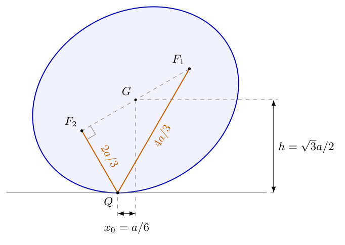{width=66%}

## 四、解题入口

先从椭圆最低点求$h(\theta)$，同时得到接触点相对质心的横坐标。随后将$\dot h=h'\omega$代入动能：光滑面没有质心水平动能，纯滚动则另有$\dot X=h\omega$。把两种动能写成$mD(\theta)\omega^2/2$，就能用统一的能量式求速度，但求导时必须保留$D'(\theta)$。

求焦点加速度宜用固定的地面直角坐标。先写$F_1$的坐标，再连续求导两次，能够逐项对应平动、切向和法向项。最后用接触力、质心力矩、曲率与量纲检验核对符号。把瞬时转动中心直接当固定铰链求角加速度，是本题最需要避免的入口。

## 五、解析

（1）明确质量分布并从面积积分求转动惯量。

薄片面内取长轴坐标$u=a r\cos\varphi$、短轴坐标$v=b r\sin\varphi$，$0\le r\le1$、$0\le\varphi<2\pi$。坐标变换的面积元为$\mathrm dS=ab r\,\mathrm dr\,\mathrm d\varphi$。均匀面密度为$m/(\pi ab)$，因此

$$
\begin{aligned}
I_G&=\int(u^2+v^2)\,\mathrm dm\\
&=\frac m\pi\int_0^1 r^3\,\mathrm dr
\int_0^{2\pi}(a^2\cos^2\varphi+b^2\sin^2\varphi)\,\mathrm d\varphi\\
&=\frac m\pi\cdot\frac14\cdot\pi(a^2+b^2)
=\frac m4(a^2+b^2)=\frac5{12}ma^2.
\end{aligned}
$$

这里利用了$\int_0^{2\pi}\cos^2\varphi\,\mathrm d\varphi=\int_0^{2\pi}\sin^2\varphi\,\mathrm d\varphi=\pi$。不能套用均匀椭圆细线框的惯量，二者的质量分布不同。记$j=I_G/m=5a^2/12$，并有$c=a/\sqrt3$。

（2）从旋转椭圆的最低点建立高度函数。

任一边界材料点相对$G$的坐标可写成

$$
\begin{aligned}
x_{ \mathrm{rel}}&=a\cos\varphi\sin\theta+b\sin\varphi\cos\theta,\\
y_{ \mathrm{rel}}&=a\cos\varphi\cos\theta-b\sin\varphi\sin\theta.
\end{aligned}
$$

第二式是形如$A\cos\varphi+B\sin\varphi$的线性组合，最小值为$-\sqrt{A^2+B^2}$。这是振幅合成，也可由柯西不等式并检查取等条件证明。桌面高度为零，故最低点相对质心的$y$坐标为$-h$，得到

$$
\boxed{h(\theta)=\sqrt{a^2\cos^2\theta+b^2\sin^2\theta}}.
$$

取到最低值时，$\cos\varphi=-a\cos\theta/h$、$\sin\varphi=b\sin\theta/h$。代入边界点的$x$坐标，得到

$$
\begin{aligned}
(Q-G)_x
&=-\frac{a^2\sin\theta\cos\theta}{h}
+\frac{b^2\sin\theta\cos\theta}{h}\\
&=\frac{(b^2-a^2)\sin\theta\cos\theta}{h}=h'(\theta),\\
\boldsymbol r_{Q/G}&=(h',-h).
\end{aligned}
$$

于是图1-2中的水平偏置为$x_0=-h'>0$。$h'$的单位仍是长度，因为转角采用无量纲弧度；它不是一段时间内的下降速度。

（3）保留二阶几何导数并代入目标转角。

记$\Delta=b^2-a^2=-a^2/3$。对$h$求导两次，使用商法则得到

$$
\begin{aligned}
h'&=\frac{\Delta\sin\theta\cos\theta}{h},\\
h''&=\frac{\Delta\cos2\theta}{h}
-\frac{\Delta^2\sin^2\theta\cos^2\theta}{h^3}
=\frac{\Delta\cos2\theta-(h')^2}{h}.
\end{aligned}
$$

在$\theta=\pi/3$处，$\sin\theta=\sqrt3/2$、$\cos\theta=1/2$、$\cos2\theta=-1/2$，所以

$$
\begin{aligned}
h^2&=\frac{a^2}4+\frac{2a^2}3\cdot\frac34=\frac34a^2,
\qquad h=\frac{\sqrt3}2a,\\
h'&=\frac{(-a^2/3)(\sqrt3/4)}{\sqrt3 a/2}=-\frac a6,\\
h''&=\frac{a^2/6-a^2/36}{\sqrt3 a/2}
=\frac{5a}{18\sqrt3},\\
h+h''&=\frac{\sqrt3}2a+\frac{5a}{18\sqrt3}
=\frac{16a}{9\sqrt3}.
\end{aligned}
$$

尤其$h''>0$；它反映高度随转角的下降速率正逐渐减小，但不单独决定质心的竖直加速度。实际加速度还包含$h'\alpha$。

（4）用焦点几何交叉核对接触位置。

图1-2中，水平切线的法线平分两个焦点连线在$Q$处形成的角。结合焦距$c=a/\sqrt3$和转角，可得到$\triangle F_2QF_1$在$F_2$处为直角，$\angle QF_1F_2=30^\circ$。因此$QF_1=2QF_2$。椭圆定义给出$QF_1+QF_2=2a$，故

$$
QF_1=\frac43a,\qquad QF_2=\frac23a.
$$

反过来也可直接检查：取$G=(0,\sqrt3 a/2)$、$Q=(-a/6,0)$，则$F_1=(a/2,2a/\sqrt3)$、$F_2=(-a/2,a/\sqrt3)$。分别计算平方距离得$|QF_1|^2=16a^2/9$、$|QF_2|^2=4a^2/9$；$(F_1-F_2)\cdot(Q-F_2)=0$，确实为上述直角三角形。

质心是焦点连线的中点。由三角形中线公式

$$
\begin{aligned}
GQ^2&=\frac{2(QF_1)^2+2(QF_2)^2-(F_1F_2)^2}{4}\\
&=\frac{2(16a^2/9)+2(4a^2/9)-4a^2/3}{4}
=\frac79a^2,\\
x_0^2&=GQ^2-h^2=\frac79a^2-\frac34a^2=\frac1{36}a^2.
\end{aligned}
$$

这里的$a/6$是水平力臂，不是$GQ$的长度；后者是$\sqrt7 a/3$。

（5）分别建立光滑接触和纯滚动的质心速度。

光滑面只有重力和竖直法向力，如图1-3左侧，薄片的水平合外力为零。初始水平动量为零，故$\dot X=0$，而$\dot h=h'\omega$，即

$$
\boldsymbol v_G^{\mathrm s}=(0,h'\omega).
$$

纯滚动时有静摩擦，如图1-3右侧，质心水平动量不守恒。用当前接触材料点的刚体速度公式计算

$$
\begin{aligned}
\boldsymbol v_Q
&=(\dot X,h'\omega)+(-\omega\boldsymbol e_z)\times(h',-h)\\
&=(\dot X-h\omega,0).
\end{aligned}
$$

无滑动要求$\boldsymbol v_Q=\boldsymbol0$，所以

$$
\boxed{\dot X=h\omega},\qquad
\boldsymbol v_G^{\mathrm r}=(h\omega,h'\omega).
$$

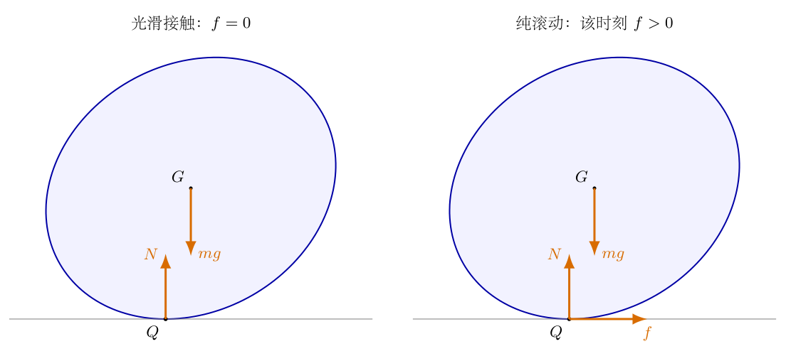{width=87%}

图中力均作用于真实材料接触点$Q$或质心$G$。后续力矩的水平力臂使用$x_0=-h'$；摩擦力的力臂使用$h$。图中纯滚动摩擦向右是本题该时刻的计算结果，不是“滚动摩擦总与运动方向相反”的经验判断。

（6）用完整动能求光滑接触的角速度。

机械能守恒为$T+mg h=mg a$，其中$mg a$是微扰释放极限的初始能量。光滑面只有质心竖直平动动能和绕质心转动动能：

$$
T_{\mathrm s}=\frac m2(h')^2\omega^2+\frac{I_G}2\omega^2
=\frac m2D_{\mathrm s}\omega^2,
\qquad D_{\mathrm s}=j+(h')^2.
$$

在目标转角，$D_{\mathrm s}=5a^2/12+a^2/36=4a^2/9$，因此

$$
\begin{aligned}
\frac12\cdot\frac49a^2\omega_{\mathrm s}^2
&=g\left(a-\frac{\sqrt3}2a\right),\\
\omega_{\mathrm s}^2&=\frac94(2-\sqrt3)\frac ga,\\
\boxed{\omega_{\mathrm s}=\frac32\sqrt{(2-\sqrt3)\frac ga}}.
\end{aligned}
$$

正根对应向右顺时针倾倒。没有负初始动能，也没有把法向力作的虚功计入真实机械能。

（7）用坐标连续求导求光滑面焦点速度。

焦点坐标为$x_F=X+c\sin\theta$、$y_F=h+c\cos\theta$。连续求导一次得

$$
\begin{aligned}
v_{Fx}&=\dot X+c\cos\theta\,\omega,\\
v_{Fy}&=h'\omega-c\sin\theta\,\omega.
\end{aligned}
$$

光滑面$\dot X=0$，故在目标转角

$$
\begin{aligned}
v_{Fx}^{\mathrm s}&=\frac a{2\sqrt3}\cdot\frac32
\sqrt{(2-\sqrt3)\frac ga}
=\frac{\sqrt3}4\sqrt{(2-\sqrt3)ga},\\
v_{Fy}^{\mathrm s}&=\left(-\frac a6-\frac a2\right)\omega_{\mathrm s}
=-\sqrt{(2-\sqrt3)ga},\\
|\boldsymbol v_F^{\mathrm s}|&=\sqrt{\frac3{16}+1}\sqrt{(2-\sqrt3)ga}
=\frac{\sqrt{19}}4\sqrt{(2-\sqrt3)ga}.
\end{aligned}
$$

焦点向右下方运动。图1-4中的光滑面质心只向下，但焦点还有绕质心转动的水平速度，两者并不矛盾。

（8）用统一能量微分求角加速度，保留几何系数变化。

两种情况都可以写成$mD\omega^2/2=mg(a-h)$。对时间求导时，$D$是$\theta$的函数，故

$$
\begin{aligned}
\frac12mD'\dot\theta\,\omega^2+mD\omega\dot\omega
&=-mg h'\dot\theta,\\
\frac12D'\omega^3+D\omega\alpha&=-g h'\omega,\\
\boxed{D\alpha+\frac12D'\omega^2+g h'=0}.
\end{aligned}
$$

约去$\omega$用于已经转动的目标时刻；初始$\omega=0$处应使用连续延拓或牛顿方程，不能以“除以零”推导初始动力学。光滑面的$D'_{\mathrm s}=2h'h''$，于是

$$
\alpha_{\mathrm s}=-\frac{h'(g+h''\omega_{\mathrm s}^2)}{j+(h')^2}.
$$

先化简括号中的全部项：

$$
\begin{aligned}
h''\omega_{\mathrm s}^2
&=\frac{5a}{18\sqrt3}\cdot\frac94(2-\sqrt3)\frac ga
=\frac5{8\sqrt3}(2-\sqrt3)g,\\
g+h''\omega_{\mathrm s}^2
&=\left(1-\frac58+\frac5{4\sqrt3}\right)g
=\frac{9+10\sqrt3}{24}g,\\
\alpha_{\mathrm s}
&=\frac{a/6}{4a^2/9}\cdot\frac{9+10\sqrt3}{24}g
=\boxed{\frac{9+10\sqrt3}{64}\frac ga}.
\end{aligned}
$$

它为正，约为$0.411258g/a$，即在该时刻顺时针角速度仍在增大。式中必须是$9+10\sqrt3$，符号可由下面的接触力独立检验。

（9）用牛顿方程独立检查角加速度和接触保持。

质心竖直加速度为$a_{Gy}=h''\omega^2+h'\alpha$。光滑面的受力与绕质心力矩为

$$
N-mg=m a_{Gy},\qquad I_G\alpha=x_0N=-h'N.
$$

代入$N=m(g+h''\omega^2+h'\alpha)$并消元，得到$(j+(h')^2)\alpha=-h'(g+h''\omega^2)$，与能量微分完全相同。再逐项代入可得

$$
\begin{aligned}
a_{Gy}^{\mathrm s}
&=\frac{5(2-\sqrt3)}{8\sqrt3}g
-\frac{9+10\sqrt3}{384}g\\
&=\frac{50\sqrt3-83}{128}g\simeq0.02814485g,\\
N_{\mathrm s}&=\frac{45+50\sqrt3}{128}mg>0.
\end{aligned}
$$

注意质心仍向下运动，但此时竖直加速度已经向上，是下降逐渐变慢；不能把“速度向下”当成“加速度必向下”。正法向力说明目标时刻仍与桌面接触。

（10）完整求出光滑面焦点加速度。

在光滑面$\ddot X=0$。对第（7）步的速度再求导，使用乘积法则：

$$
\begin{aligned}
a_{Fx}^{\mathrm s}&=c\cos\theta\,\alpha_{\mathrm s}
-c\sin\theta\,\omega_{\mathrm s}^2,\\
a_{Fy}^{\mathrm s}&=(h''-c\cos\theta)\omega_{\mathrm s}^2
+(h'-c\sin\theta)\alpha_{\mathrm s}.
\end{aligned}
$$

第一式分别是切向和法向贡献；第二式另外包含质心加速度。在目标转角化简系数为

$$
\begin{aligned}
a_{Fx}^{\mathrm s}&=\frac a{2\sqrt3}\alpha_{\mathrm s}-\frac a2\omega_{\mathrm s}^2,\\
a_{Fy}^{\mathrm s}&=-\frac{2a}{9\sqrt3}\omega_{\mathrm s}^2-\frac{2a}3\alpha_{\mathrm s}.
\end{aligned}
$$

逐项通分后得到

$$
\begin{aligned}
\frac{a_{Fx}^{\mathrm s}}g
&=\frac{9+10\sqrt3}{128\sqrt3}-\frac98(2-\sqrt3)\\
&=\frac{3\sqrt3+10-288+144\sqrt3}{128}
=\frac{147\sqrt3-278}{128},\\
\frac{a_{Fy}^{\mathrm s}}g
&=-\frac{2-\sqrt3}{2\sqrt3}-\frac{9+10\sqrt3}{96}\\
&=\frac{48-32\sqrt3-9-10\sqrt3}{96}
=\frac{13-14\sqrt3}{32}.
\end{aligned}
$$

因此

$$
\boxed{\boldsymbol a_F^{\mathrm s}
=\frac{147\sqrt3-278}{128}g\boldsymbol e_x
+\frac{13-14\sqrt3}{32}g\boldsymbol e_y}.
$$

两分量约为$-0.182723g$、$-0.351522g$。焦点速度向右下方，却加速向左下方，不应把加速度方向画成与速度方向必然相同。

（11）重新计算纯滚动动能和角速度。

纯滚动时质心速度平方为$(h^2+(h')^2)\omega^2$，所以

$$
T_{\mathrm r}=\frac m2D_{\mathrm r}\omega^2,
\qquad D_{\mathrm r}=j+h^2+(h')^2.
$$

也可用瞬时接触材料点的平行轴惯量$I_Q=I_G+mGQ^2$计算瞬时动能，两者一致。在目标转角

$$
\begin{aligned}
D_{\mathrm r}&=\frac5{12}a^2+\frac34a^2+\frac1{36}a^2
=\frac{43}{36}a^2,\\
\frac12\cdot\frac{43}{36}a^2\omega_{\mathrm r}^2
&=\frac{2-\sqrt3}{2}ga,\\
\boxed{\omega_{\mathrm r}=6\sqrt{\frac{2-\sqrt3}{43}\frac ga}}.
\end{aligned}
$$

相同势能下降还要供给水平平动，故$\omega_{\mathrm r}<\omega_{\mathrm s}$。准确的比值为$\omega_{\mathrm r}/\omega_{\mathrm s}=4/\sqrt{43}$，不是凭“摩擦耗能”判断：本题理想静摩擦没有耗散机械能。

（12）用纯滚动速度关系求焦点速度。

将$\dot X=h\omega$代入第（7）步，有

$$
\begin{aligned}
v_{Fx}^{\mathrm r}&=(h+c\cos\theta)\omega_{\mathrm r}
=\frac{2a}{\sqrt3}\omega_{\mathrm r},\\
v_{Fy}^{\mathrm r}&=(h'-c\sin\theta)\omega_{\mathrm r}
=-\frac{2a}3\omega_{\mathrm r},\\
\boxed{\boldsymbol v_F^{\mathrm r}}
&=\boxed{4\sqrt{\frac{2-\sqrt3}{43}ga}
(\sqrt3\boldsymbol e_x-\boldsymbol e_y)},\\
|\boldsymbol v_F^{\mathrm r}|&=\frac{4a}3\omega_{\mathrm r}
=8\sqrt{\frac{2-\sqrt3}{43}ga}.
\end{aligned}
$$

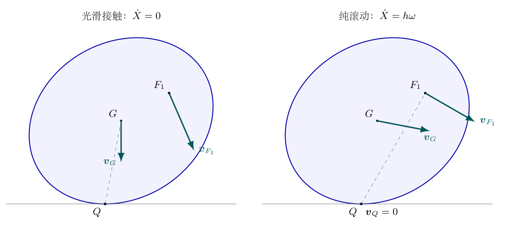{width=88%}

图1-4中的纯滚动焦点速度垂直$QF_1$。因为当前接触材料点零速，此瞬间可以用$|\boldsymbol v_F|=\omega QF_1$；$QF_1=4a/3$使几何路线与坐标路线完全一致。这种瞬时速度关系不能未经检查延伸成固定点转动的加速度关系。

（13）完整求纯滚动角加速度。

对$D_{\mathrm r}$求导时，必须连$h^2$也求导：

$$
D'_{\mathrm r}=2hh'+2h'h''=2h'(h+h'').
$$

代入统一能量微分式，得到

$$
\alpha_{\mathrm r}
=-\frac{h'[g+(h+h'')\omega_{\mathrm r}^2]}{j+h^2+(h')^2}.
$$

按顺序保留全部中间运算：

$$
\begin{aligned}
(h+h'')\omega_{\mathrm r}^2
&=\frac{16a}{9\sqrt3}\cdot\frac{36}{43}(2-\sqrt3)\frac ga
=\frac{64(2-\sqrt3)}{43\sqrt3}g,\\
g+(h+h'')\omega_{\mathrm r}^2
&=\frac{43\sqrt3+128-64\sqrt3}{43\sqrt3}g
=\frac{128-21\sqrt3}{43\sqrt3}g,\\
\alpha_{\mathrm r}
&=\frac{a/6}{43a^2/36}\cdot\frac{128-21\sqrt3}{43\sqrt3}g\\
&=\boxed{\frac{2(128\sqrt3-63)}{1849}\frac ga}.
\end{aligned}
$$

这里$1849=43^2$，有理化用$6/\sqrt3=2\sqrt3$。结果约为$0.171663g/a$，顺时针为正。不能只对$\omega^2$中势能下降求导，而把分母惯量当作常数。

（14）求纯滚动焦点加速度，明确新增平动项。

质心水平加速度来自$\dot X=h\omega$的乘积求导，$a_{Gx}=h'\omega^2+h\alpha$。将这一项加到第（10）步，或直接对纯滚动焦点速度求导，得到

$$
\begin{aligned}
a_{Fx}^{\mathrm r}&=(h'-c\sin\theta)\omega_{\mathrm r}^2
+(h+c\cos\theta)\alpha_{\mathrm r}\\
&=-\frac{2a}3\omega_{\mathrm r}^2+\frac{2a}{\sqrt3}\alpha_{\mathrm r},\\
a_{Fy}^{\mathrm r}&=(h''-c\cos\theta)\omega_{\mathrm r}^2
+(h'-c\sin\theta)\alpha_{\mathrm r}\\
&=-\frac{2a}{9\sqrt3}\omega_{\mathrm r}^2-\frac{2a}3\alpha_{\mathrm r}.
\end{aligned}
$$

水平分量的两项分别为$[-24(2-\sqrt3)/43]g$与$[4(128\sqrt3-63)/(1849\sqrt3)]g$；竖直分量的两项分别为$[-8(2-\sqrt3)/(43\sqrt3)]g$与$[-4(128\sqrt3-63)/(3\cdot1849)]g$。将分母统一为$1849$，有

$$
\begin{aligned}
\frac{a_{Fx}^{\mathrm r}}g
&=\frac{-1032(2-\sqrt3)+512-84\sqrt3}{1849}
=\frac{948\sqrt3-1552}{1849},\\
\frac{a_{Fy}^{\mathrm r}}g
&=\frac{344-\frac{688}3\sqrt3+84-\frac{512}3\sqrt3}{1849}
=\frac{428-400\sqrt3}{1849}.
\end{aligned}
$$

所以

$$
\boxed{\boldsymbol a_F^{\mathrm r}
=\frac{948\sqrt3-1552}{1849}g\boldsymbol e_x
+\frac{428-400\sqrt3}{1849}g\boldsymbol e_y}.
$$

分量约为$+0.0486664g$、$-0.143224g$，方向为右下方。其水平符号与光滑面不同，正是水平平动贡献不能省略的直接证据。

（15）用接触材料点的非零加速度独立复核。

图1-5中的$K$是椭圆在$Q$处的曲率中心，$\rho=QK$。由参数曲线曲率公式，若未旋转椭圆为$(b\sin\varphi,a\cos\varphi)$，有

$$
\rho=\frac{(b^2\cos^2\varphi+a^2\sin^2\varphi)^{3/2}}{ab}.
$$

接触参数满足$\cos^2\varphi=1/3$、$\sin^2\varphi=2/3$，故分子中的平方为$8a^2/9$，从而

$$
\rho=\frac{(8a^2/9)^{3/2}}{\sqrt{2/3}a^2}
=\frac{16a}{9\sqrt3}=h+h''.
$$

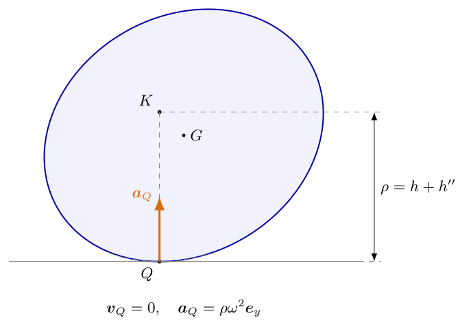{width=56%}

使用图中同一瞬间的固定材料点$Q$，刚体加速度公式给出

$$
\begin{aligned}
a_{Qx}&=a_{Gx}-h\alpha-h'\omega^2=0,\\
a_{Qy}&=a_{Gy}-h'\alpha+h\omega^2
=(h+h'')\omega^2=\rho\omega^2>0.
\end{aligned}
$$

因此它零速而有向上的加速度。绕该瞬间材料点列转动方程，必须计入参考点加速度项，得到$I_Q\alpha=m x_0(g+a_{Qy})$。代入$x_0=a/6$、$I_Q=43ma^2/36$及$a_{Qy}=\rho\omega^2$，正好重现第（13）步；若误设$a_Q=0$，将漏掉曲率项。

（16）求实际接触力，检查纯滚动约束的物理可实现性。

由图1-3中的实际作用点，取顺时针力矩为正，完整牛顿方程为

$$
f=m a_{Gx},\qquad N=m(g+a_{Gy}),\qquad
I_G\alpha=-h'N-hf.
$$

将$a_{Gx}=h'\omega^2+h\alpha$、$a_{Gy}=h''\omega^2+h'\alpha$代入，所有$\alpha$项移到左侧后为

$$
(j+h^2+(h')^2)\alpha=-h'[g+(h+h'')\omega^2],
$$

与前两条路线一致。在目标转角的结果为

$$
\begin{aligned}
f&=\frac{195\sqrt3-132}{1849}mg\simeq0.1112763mg>0,\\
N&=\frac{1440+244\sqrt3}{1849}mg\simeq1.0073664mg>0,\\
\frac{|f|}{N}&=\frac{195\sqrt3-132}{1440+244\sqrt3}\simeq0.1104626.
\end{aligned}
$$

因此接触点摩擦向右，法向力向上。纯滚动要求静摩擦足够提供所需$f$；$0.1104626$只是该时刻的系数需求，并不自动保证此前整个过程都未滑动。

（17）统一最终答案、单位和释放条件。

光滑面结果为

$$
\begin{aligned}
\omega_{\mathrm s}&=\frac32\sqrt{(2-\sqrt3)g/a},\qquad
\alpha_{\mathrm s}=\frac{9+10\sqrt3}{64}\frac ga,\\
\boldsymbol v_F^{\mathrm s}&=\sqrt{(2-\sqrt3)ga}
\left(\frac{\sqrt3}4\boldsymbol e_x-\boldsymbol e_y\right),\\
\boldsymbol a_F^{\mathrm s}&=g\left(
\frac{147\sqrt3-278}{128}\boldsymbol e_x
+\frac{13-14\sqrt3}{32}\boldsymbol e_y\right).
\end{aligned}
$$

纯滚动结果为

$$
\begin{aligned}
\omega_{\mathrm r}&=6\sqrt{(2-\sqrt3)g/(43a)},\qquad
\alpha_{\mathrm r}=\frac{2(128\sqrt3-63)}{1849}\frac ga,\\
\boldsymbol v_F^{\mathrm r}&=4\sqrt{(2-\sqrt3)ga/43}
(\sqrt3\boldsymbol e_x-\boldsymbol e_y),\\
\boldsymbol a_F^{\mathrm r}&=g\left(
\frac{948\sqrt3-1552}{1849}\boldsymbol e_x
+\frac{428-400\sqrt3}{1849}\boldsymbol e_y\right).
\end{aligned}
$$

$\sqrt{g/a}$的单位为$\mathrm{s^{-1}}$，$g/a$为$\mathrm{s^{-2}}$，$\sqrt{ga}$为速度，$g$为加速度，四类结果量纲正确。两种能量路线都约去了$m$。若向左倾倒，速度和加速度的水平分量反号，竖直分量不变；相应角矢量反向，不能只改焦点水平运动而保持角矢量方向不变。

若从实际有限偏角$\theta_0>0$无初速释放，应将能量式右侧的$a$换为$h(\theta_0)$，再由对应$D$求$\omega^2$和$\alpha$。本文所列数值是$\theta_0\to0^+$的极限；到达时刻在该极限下趋于无穷，并不等于精确不稳定平衡能在有限时间自行开始运动。

\newpage

# 第2题

<!-- question-start -->

一根长度为$l$的柔软导线，两端分别固定在$A(0,0,0)$和$B(l/2,0,0)$处。电流$I$从$A$端流入、从$B$端流出。忽略导线中电流自身产生的磁场，$B_0>0$。

（1）空间中存在均匀磁场$\boldsymbol B=(0,0,B_0)$，求静力平衡时的导线形状及张力大小。

（2）将磁场改为$\boldsymbol B=(B_0,0,0)$，求静力平衡时的导线形状及张力大小。

以下采用不可伸长、可自由弯曲的理想导线模型，只计外磁场安培力、张力和端点约束，不计重力、弯曲刚度及自磁场。求解的是具有正张力的光滑平衡曲线；“静力平衡”本身不等于已证明该形状对任意扰动稳定。

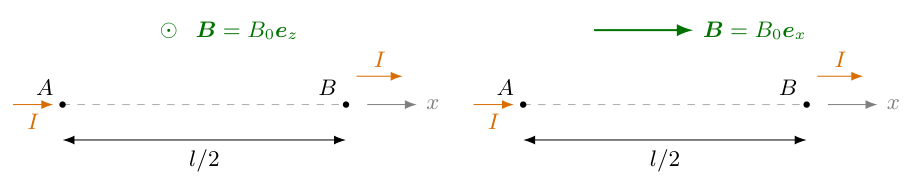{width=78%}

<!-- question-end -->

## 一、题型定位

这是柔软载流线的连续体静力学。图2-1中端点距离只有导线总长的一半，因此导线不可能在两端之间直接拉成一条直线。局部安培力随导线方向变化，不能把全段安培力简单画成一个恒力后猜测形状。

决定形状的是相邻微元张力方向的变化，而不是张力大小沿线的变化。第一问的磁场垂直端点连线，导线成为同一平面内的一段圆弧；第二问的磁场沿端点连线，切线沿磁场的分量不变，横向分量旋转，形成三维螺旋线。两者的局部平衡方程相同，但端点闭合条件完全不同。

第一问还必须区分所取圆弧是优弧还是劣弧；第二问则必须保留整匝数$n=1,2,\ldots$及绕端点连线旋转的相位自由度。仅给一个未说明匝数的螺旋图，不能构成完整答案。

## 二、知识点

以弧长$s$作为导线参数，$0\le s\le l$。位置为$\boldsymbol r(s)$，单位切向量为$\boldsymbol t=\mathrm d\boldsymbol r/\mathrm ds$，故$|\boldsymbol t|=1$。正向取从$A$到$B$，与电流方向一致。长度微元$\mathrm ds$所受安培力为

$$
\mathrm d\boldsymbol F_{\mathrm B}
=I\,\mathrm d\boldsymbol r\times\boldsymbol B
=I(\boldsymbol t\times\boldsymbol B)\,\mathrm ds.
$$

柔软导线没有弯矩，张力沿局部切线。对同一小段，前端张力为$T(s+\mathrm ds)\boldsymbol t(s+\mathrm ds)$，后端张力为$-T(s)\boldsymbol t(s)$。负号来自后一段拉着微元向后，而不是人为选取相反电流。

单位切向量的导数垂直于切向量：由$\boldsymbol t\cdot\boldsymbol t=1$求导得$\boldsymbol t\cdot\boldsymbol t'=0$。磁力也垂直于切线。这两条关系共同保证张力大小为常数。平面圆弧的曲率为$1/R$；螺旋线绕圆柱轴的半径则不等于其三维曲率半径。

## 三、物理图像

微元图2-2中的两端张力并不共线，其矢量差指向曲线凹侧；安培力指向相反的凸侧。磁场只负责改变张力方向，不能在无其他切向载荷时造成沿线张力大小增加或减少。

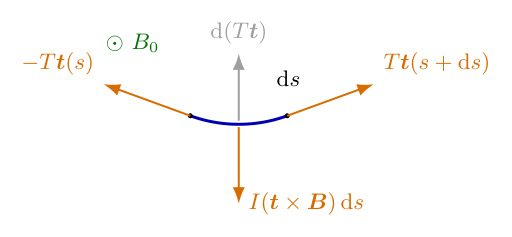{width=48%}

第一问的导线位于$xy$平面。按电流从$A$到$B$、磁场沿$+z$的方向，它沿圆周逆时针经过下方优弧。圆心在端点连线的下方，电流在$A$附近先向左下方、在$B$附近向左上方，因此两端切线并不都沿$+x$。这些方向由右手定则和局部平衡共同确定。

第二问不能沿用平面圆弧图。磁场沿$x$，导线沿$x$的切向分量恒为$1/2$，另有大小为$\sqrt3/2$的横向分量。导线绕一条平行于$AB$的轴旋转，但该轴不经过$A$和$B$；两端在圆柱同一条母线上，端点连线是母线，不是圆柱轴。这一区别在三维题图中必须真实表现。

## 四、解题入口

先对微元列矢量平衡，而不是先假设“必然是圆”。点乘切线消去横向载荷，得到$T$为常数；再写切向量的一阶旋转方程。利用磁场方向分别确定平面性或轴向分量，最后才施加两个端点的位置和总长度。

对第一问，把圆弧的总转角记为$2\beta$，弧长$l=2R\beta$，弦长$l/2=2R\sin\beta$，由两者比值得到非零根$\sin\beta/\beta=1/2$。对第二问，横向位移必须同时闭合，要求切线相位转过整数个$2\pi$，这才给出离散的张力分支。

## 五、解析

（1）从微元建立统一的矢量静力方程。

使用图2-2中同一微元的两端张力及安培力，有

$$
\begin{aligned}
& T(s+\mathrm ds)\boldsymbol t(s+\mathrm ds)
-T(s)\boldsymbol t(s)
+I(\boldsymbol t\times\boldsymbol B)\,\mathrm ds=0,\\
& \frac{\mathrm d(T\boldsymbol t)}{\mathrm ds}
+I\boldsymbol t\times\boldsymbol B=0.
\end{aligned}
$$

第二行是第一行除以$\mathrm ds$并取极限，并非将微元张力简单相减成一个标量。展开乘积导数，再与$\boldsymbol t$点乘：

$$
\begin{aligned}
T'\boldsymbol t+T\boldsymbol t'
+I\boldsymbol t\times\boldsymbol B&=0,\\
T'|\boldsymbol t|^2
+T\boldsymbol t\cdot\boldsymbol t'
+I\boldsymbol t\cdot(\boldsymbol t\times\boldsymbol B)&=0,\\
T'&=0.
\end{aligned}
$$

所以沿一条平衡导线$T$处处相等。注意这里结论是大小相等，而张力矢量方向仍随位置变化。剩余方程为

$$
\boxed{\boldsymbol t'
=\frac I T\,\boldsymbol B\times\boldsymbol t}.
$$

把叉乘换序产生了负号：$-\boldsymbol t\times\boldsymbol B=\boldsymbol B\times\boldsymbol t$。它决定后续圆弧和螺旋的旋转方向，不能漏掉。

（2）证明第一问的导线必须位于$xy$平面。

磁场为$B_0\boldsymbol e_z$，令$k=IB_0/T>0$，则分量方程为

$$
t_x'=-kt_y,\qquad t_y'=kt_x,\qquad t_z'=0.
$$

因此$t_z$为常数。两个端点的$z$坐标均为零，而

$$
z_B-z_A=\int_0^l t_z\,\mathrm ds=l t_z=0,
$$

所以$t_z=0$。这不是凭二维图“看出”的，而是局部方程和端点条件的共同结果。又有$t_x^2+t_y^2=1$，可写$t_x=\cos u$、$t_y=\sin u$。代回方程得到$u'=k$：切线沿弧长匀速转动，平面曲率为常量$k$。

于是导线是一段半径为

$$
R=\frac1k=\frac{T}{IB_0}
$$

的圆弧。等价地，微元两端张力的凹向合力大小为$T\,\mathrm ds/R$，安培力大小为$IB_0\,\mathrm ds$，从而$T=IB_0R$。这里每段导线均与磁场垂直，因此没有额外正弦因子。

（3）由长度与端点弦长筛选正确的圆弧。

记沿电流方向的总切线转角为$2\beta$。图2-3中$O$为圆心，端点弦长为$d=l/2$，并画出实际经过的下方优弧。若暂不限制绕行圈数，圆弧的长度与端点距离给出

$$
l=2R\beta,\qquad d=2R|\sin\beta|.
$$

消去$R$后$|\sin\beta|/\beta=1/2$。由于$|\sin\beta|\le1$，必有$\beta\le2<\pi$。因此不存在绕过完整一圈以上的分支，并且这一范围内$\sin\beta>0$，绝对值可以去掉。不能先随意选择短弧，再用错误的弧长公式计算。

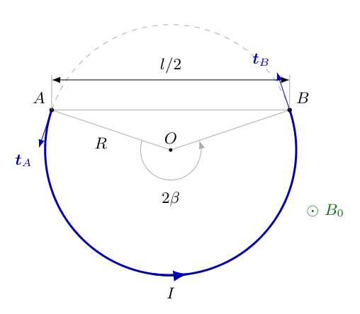{width=60%}

几何方程最终成为

$$
\boxed{\frac{\sin\beta}{\beta}=\frac12,\qquad 0<\beta<\pi}.
$$

它在该区间只有一个根。证明时对函数求导：

$$
\begin{aligned}
\frac{\mathrm d}{\mathrm d\beta}
\left(\frac{\sin\beta}{\beta}\right)
&=\frac{\beta\cos\beta-\sin\beta}{\beta^2},\\
\frac{\mathrm d}{\mathrm d\beta}
(\sin\beta-\beta\cos\beta)&=\beta\sin\beta>0.
\end{aligned}
$$

因$\sin\beta-\beta\cos\beta$在零点极限为零，在$0<\beta<\pi$为正，故上面的比值严格递减，从$1$降到$0$。又在$\beta=\pi/2$处比值为$2/\pi>1/2$，所以所求根大于$\pi/2$，总弧角大于$\pi$，确实是优弧。

（4）把超越方程的数值求解与张力计算写完整。

令$f(\beta)=\sin\beta-\beta/2$。因为$f(1.8)>0$而$f(2)<0$，可先用二分法把非零根锁定，再用牛顿迭代

$$
\beta_{j+1}
=\beta_j-\frac{\sin\beta_j-\beta_j/2}
{\cos\beta_j-1/2}
$$

求得

$$
\begin{aligned}
\beta&=1.895494267\ldots,\\
2\beta&=3.790988534\ldots,\\
R&=\frac{l}{2\beta}=0.263783\ldots\,l,\\
T&=\boxed{\frac{IB_0l}{2\beta}
=0.263783\ldots\,IB_0l.}
\end{aligned}
$$

这里$\beta=0$虽然使$\sin\beta-\beta/2=0$，却不是原比值方程的解，且会使$R=l/(2\beta)$失去意义，必须排除。数值根若未经这一筛选，很容易被求根程序返回的零根误导。

也可沿用圆心端点锐角$\theta=\pi-\beta$，得到$\pi-\theta=2\sin\theta$。其值是$\theta=1.246098\ldots$弧度，即约$71.396^\circ$；角度数与弧度数不可互相直接代入三角函数。$2\beta$约为$217.208^\circ$，不是一段小于半圆的短弧。

（5）写出圆弧的完整参数方程，检查它确实连接端点。

令$u=ks-\beta$，$k=2\beta/l$。切线为$(\cos u,\sin u,0)$。从$A$出发积分：

$$
\begin{aligned}
x(s)&=R[\sin(ks-\beta)+\sin\beta],\\
y(s)&=R[\cos\beta-\cos(ks-\beta)],\\
z(s)&=0,\qquad 0\le s\le l.
\end{aligned}
$$

在$s=0$处，$x=y=0$；在$s=l$处，$ks-\beta=\beta$，所以$x=2R\sin\beta=l/2$、$y=0$。圆心为

$$
O=(R\sin\beta,R\cos\beta,0)
=(l/4,R\cos\beta,0).
$$

因为$\cos\beta<0$，圆心位于$AB$下方。图2-3中的下方路径与上述$y(s)$一致：中点$s=l/2$处$y=R(\cos\beta-1)<0$。点沿圆周逆时针走过$2\beta$；在局部曲率指向圆心的同时，安培力指向外侧。这也核对了最初叉乘方程的符号。

（6）用全导线的总磁力和端点反力进行独立检查。

均匀磁场中，全段安培力只取决于端点位移：

$$
\begin{aligned}
\boldsymbol F_{\mathrm B,tot}
&=I\int_A^B\mathrm d\boldsymbol r\times\boldsymbol B\\
&=I(\boldsymbol r_B-\boldsymbol r_A)\times\boldsymbol B\\
&=-\frac12IB_0l\,\boldsymbol e_y.
\end{aligned}
$$

支座对导线的端点力分别为$-T\boldsymbol t(0)$和$+T\boldsymbol t(l)$，其和为$2T\sin\beta\,\boldsymbol e_y$。利用$T=IB_0R$与$2R\sin\beta=l/2$，两者恰好抵消。端点水平分量也互相抵消。

这条全局检验不能单独决定圆弧形状，却能查出电流方向、受力方向及张力系数是否错误。若把两端力都写成$+T\boldsymbol t$，即使局部计算正确，全局平衡也不能成立。

（7）第二问先由轴向投影求切线与磁场的夹角。

现在$\boldsymbol B=B_0\boldsymbol e_x$。统一方程给出

$$
t_x'=0,\qquad t_y'=-kt_z,\qquad t_z'=kt_y,\qquad k=\frac{IB_0}{T}.
$$

$t_x$为常数。端点的$x$位移为$l/2$，故

$$
\frac l2=x_B-x_A=\int_0^l t_x\,\mathrm ds=l t_x,
\qquad \boxed{t_x=\frac12}.
$$

由单位切线条件，横向分量大小为

$$
t_\perp=\sqrt{t_y^2+t_z^2}
=\sqrt{1-\frac14}=\frac{\sqrt3}{2}.
$$

因此切线与圆柱轴$x$的夹角$\alpha$满足$\cos\alpha=1/2$，即$\alpha=60^\circ$。若将导线与横向圆周方向的夹角记作$\alpha'$，则$\alpha'=30^\circ$。这两个角互余；不能把$30^\circ$说成与磁场的夹角。

（8）解横向旋转方程，保留任意初始相位。

由$t_y'=-kt_z$、$t_z'=kt_y$，可取

$$
t_y=\frac{\sqrt3}{2}\cos(ks+\delta),\qquad
t_z=\frac{\sqrt3}{2}\sin(ks+\delta).
$$

$\delta$是导线绕$x$方向的初始相位，由端点位置并不能唯一确定。对$s$积分并令起点为$A$，得

$$
\begin{aligned}
x(s)&=\frac s2,\\
y(s)&=\frac{\sqrt3}{2k}
[\sin(ks+\delta)-\sin\delta],\\
z(s)&=\frac{\sqrt3}{2k}
[\cos\delta-\cos(ks+\delta)].
\end{aligned}
$$

横截面中的两个分量都是同一角度的正弦和余弦，所以曲线是圆柱螺旋线，不是平面正弦曲线。由于$x$随$s$严格增加，每个有限匝数分支本身没有交叉重合。

（9）由两个横向端点条件得到整匝数。

在$s=l$处必须同时有$y(l)=0$和$z(l)=0$。它们要求

$$
\sin(kl+\delta)=\sin\delta,\qquad
\cos(kl+\delta)=\cos\delta.
$$

只有正弦等式不能推出完整闭合，必须与余弦等式共同使用。两式等价于角度相差$2\pi$的整数倍，故

$$
\boxed{kl=2\pi n,\qquad n=1,2,3,\ldots}.
$$

$k>0$排除负$n$；$n=0$会要求$k=0$，与有限正张力及非零$IB_0$不相容。若试图直接取直线，它又只能有长度$l/2$，违背既定长度$l$。因此不能添加一个“零匝直线”作为本题的有限张力解。

（10）求每个分支的张力、圆柱半径和螺距。

由$k=IB_0/T=2\pi n/l$得到

$$
\boxed{T_n=\frac{IB_0l}{2\pi n}}.
$$

从参数方程读出圆柱半径$r_n=t_\perp/k$，而一匝导线弧长为$l/n$，其中轴向位移占一半，故

$$
\boxed{r_n=\frac{\sqrt3\,l}{4\pi n},
\qquad p_n=\frac{l}{2n}}.
$$

$p_n$是每匝轴向前进量，不是每匝导线长度。展开图2-5的直角三角形可再次核对：轴向边为$l/(2n)$，圆周边为$2\pi r_n=\sqrt3\,l/(2n)$，斜边为$l/n$。勾股关系与$\cos\alpha=1/2$同时成立。

$n=1$时$T_1=0.159154943\ldots\,IB_0l$，$r_1=0.137832224\ldots\,l$；每增加匝数，张力、半径和螺距均按$1/n$减小。$T_1$是这些平衡分支中的最大张力，不是最小张力。题目没有规定$n$，因此必须列出整个分支族。

（11）明确螺旋轴的位置，避免把轴线错误画在端点连线上。

令$r_n=\sqrt3/(2k)$，则横截面的圆满足

$$
(y+r_n\sin\delta)^2+(z-r_n\cos\delta)^2=r_n^2.
$$

所以圆柱轴是

$$
\mathcal A:\quad
y=-r_n\sin\delta,\qquad z=r_n\cos\delta,
$$

一条平行$x$方向的直线。该轴距端点连线$AB$为$r_n$，不经过两端点。图2-4取$\delta=0$和$n=1$：轴线为$(x,0,r_1)$，而端点为$(0,0,0)$、$(l/2,0,0)$，位于圆柱的同一底部母线。

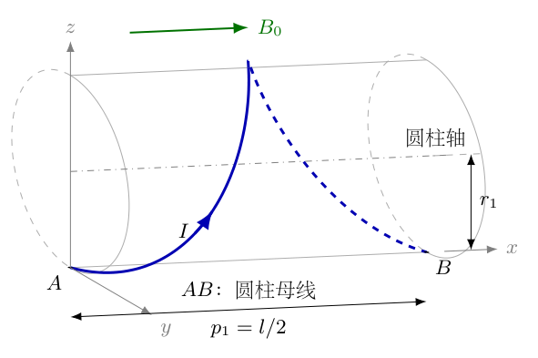{width=76%}

在这幅图对应的取相下，

$$
y=r_1\sin(2\pi s/l),\qquad
z=r_1[1-\cos(2\pi s/l)].
$$

因此在$x=l/4$处$y=0$、$z=2r_1$，是相对圆柱轴的另一侧，不是沿$AB$来回穿越的正弦波。初始切线的横向分量沿$+y$，曲率指向$+z$，安培力沿$-z$，与图2-2的微元平衡一致。任意$\delta$对应绕端点连线刚性旋转后的同类曲线。

（12）用圆柱展开关系及局部曲率再次核验张力。

图2-5把一匝圆柱面展开成矩形。导线是跨越横向圆周边$2\pi r_n$与轴向边$p_n$的斜线；与轴的夹角为$60^\circ$，与圆周方向的夹角为$30^\circ$。

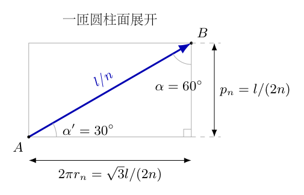{width=54%}

螺旋的单位切线导数大小为$|\boldsymbol t'|=k t_\perp$。因此三维曲率半径为

$$
\begin{aligned}
\rho_{\mathrm h}
&=\frac1{k t_\perp}
=\frac{2}{\sqrt3 k}
=\frac{4r_n}{3},\\
\frac{T}{\rho_{\mathrm h}}
&=IB_0 t_\perp
=IB_0\sin\alpha.
\end{aligned}
$$

代入$\rho_{\mathrm h}$后，$T=IB_0/k=IB_0l/(2\pi n)$，与旋转方程一致。若错误地用圆柱半径$r_n$代替曲率半径，就会得到错误的$\sqrt3/2$系数。

也可以把一小段的张力变化投影到横截面。沿圆周方向的张力分量为$Tt_\perp$，旋转相位增量为$k\,\mathrm ds$，横向合力为$Tt_\perp k\,\mathrm ds$；微元安培力为$IB_0t_\perp\,\mathrm ds$。约去非零$t_\perp\,\mathrm ds$，同样得$Tk=IB_0$。这是投影路线，而非误把整个张力都放在圆周方向。

（13）做全局受力、单位和分支检查，汇总答案。

第二问的端点位移与磁场平行，所以

$$
\boldsymbol F_{\mathrm B,tot}
=I(l\boldsymbol e_x/2)\times(B_0\boldsymbol e_x)=0.
$$

局部各段磁力不为零，但矢量积分相互抵消。整匝闭合又使$\boldsymbol t(l)=\boldsymbol t(0)$，两端支座对导线的力互为相反数。不能由总磁力为零推断各段都没有磁力，更不能据此声称任意松弛形状都能平衡。

$IB_0$的单位为$\mathrm{N/m}$，所以两个答案中的$IB_0l$都具有张力单位。半径、螺距按$l$缩放；形状的无量纲参数由端点距离与总长的比值决定，电流或场强改变时张力成比例改变，而理想形状不变。

最终第一问为唯一的下方平面优弧：

$$
\frac{\sin\beta}{\beta}=\frac12,\quad
R=\frac l{2\beta},\quad T=IB_0R,\quad
\beta=1.895494267\ldots.
$$

第二问为三维螺旋族：

$$
T_n=\frac{IB_0l}{2\pi n},\qquad
r_n=\frac{\sqrt3 l}{4\pi n},\qquad
p_n=\frac l{2n},\qquad n=1,2,\ldots,
$$

并保留任意相位$\delta$。这些是理想柔软、正张力模型下的静力解；实际线材的弯曲刚度、线径、重力及扰动稳定性会进一步限制可实现的形状，但不能在未给相应条件时擅自选择某一个$n$。

\newpage

# 第3题

<!-- question-start -->

一根长度为$L$、质量为$M$的均匀柔软消防水管，卷成半径为$R$的圆盘，竖立在水平地面上。卷绕的匝数很多，满足$L/(2\pi R)\gg1$。忽略水管的弹性和管段之间的摩擦，地面足够粗糙，重力加速度为$g$。

（1）为使卷盘不自行铺展，需要在圆心处施加水平推力$F_0$。求其大小和方向。

（2）推动卷盘，使其向左滚动并在地面铺展，假定水管与地面不发生滑动。初始水平速率为$v_0$，满足$v_0\gg\sqrt{gR}$，且$v_0$与$\sqrt{gL}$同量级。忽略重力势能的变化、摩擦和形变损耗，按能量守恒计算圆心向左移动$x$时的水平速率$v_x(x)$。

（3）在上一问的运动条件下，求地面对整根水管的水平摩擦合力$f(x)$，以及卷盘正下方地面对卷盘的支持力$N(x)$。

（4）以地面为参考系，取初始圆盘正下方的地面固定点$O$为角动量参考点，写出移动$x$时整根水管的角动量及所受总外力矩，验证角动量定理。

以下采用多匝卷绕的连续近似，保留题设高速铺展的主阶结果。随着剩余匝数变少，此近似会失效；不把接近完全展开时的形式发散当成真实物理结果。

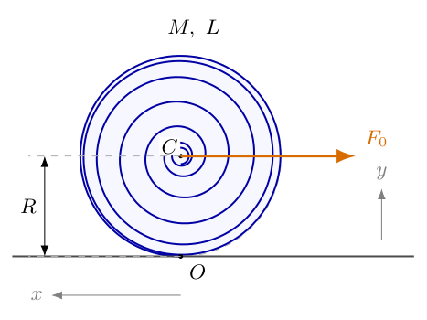{width=58%}

<!-- question-end -->

## 一、题型定位

本题属于质量转移系统的滚动与动量分析。整根水管的质量始终为$M$，但正在运动的卷盘质量不断减小，铺在地面的管段不断增加。不能把卷盘看成质量和半径都不变的普通刚体圆盘，也不能把卷盘的几何圆心直接当成固定质量系统的质心。

第一问讨论静止能否维持，重力势能正是自行铺展的驱动因素。后三问讨论高速铺展，题设允许忽略重力势能相对动能的变化。两种近似对应不同问题，并不意味着第一问也应把重力删去。

最容易遗漏的量是整根水管的竖直动量。它比水平动量小，但在关于固定点$O$的角动量中乘以水平距离$x$，可以与卷盘自转角动量同阶。小量能否舍去，必须根据它在目标公式中的组合方式判断。

## 二、知识点

设水管线密度为$\lambda=M/L$，剩余未铺展长度为$s=L-x$，卷盘剩余质量和半径分别为$m(x)$、$r(x)$。采用向左为$x$正方向、向上为$y$正方向，速率$v=\dot x>0$。角动量和力矩另行约定为图面逆时针为正。由于横轴向左，计算逆时针力矩时应使用$yF_x-xF_y$，不能直接沿用横轴向右时的符号。

多匝水管紧密卷绕时，横截面所占面积与管长成正比。由相同的卷绕密度，剩余盘可按均匀圆盘求主阶转动惯量$I_C=mr^2/2$。这一关系来自各圈管段的连续分布，不是把水管材料改成了刚性薄片。

对质量固定的整根水管，动量等于质量位置一阶矩的时间导数。记

$$
\mathcal M_x=\int X\,\mathrm dm,\qquad
\mathcal M_y=\int Y\,\mathrm dm,
$$

则$P_x=\dot{\mathcal M}_x$、$P_y=\dot{\mathcal M}_y$。这里$X,Y$是材料微元相对于固定点$O$的坐标，不能把对开放卷盘的$m\dot x$和$m\dot r$不加区别地作为全部动量。

将固定参考点的角动量拆成几何圆心处的自转项与平移项时，逆时针正的平移项为$rP_x-xP_y$。而对移动参考点$C$，角动量定理还含参考点速度引起的修正；只有固定点才能直接使用$\dot L_O=\tau_O$。

## 三、物理图像

解析中的图3-2区分初始接触点$O$和当前接触点$Q$：前者始终固定，后者随卷盘向左移动。$OQ=x$，这一段管道已经铺在地面且静止。卷盘圆心$C$的坐标为$(x,r)$，但$x$增加时$r$下降。卷盘不是一边保持原半径、一边留下松散的另一条线，而是同一根连续水管在下方切向铺开。

在连续近似中，已铺管段长度为$x$、质量为$\lambda x$，其位置质心在$OQ$的中点$S$。剩余卷盘的质量位置中心为$C$，但卷盘中的材料不断改变，因此“$C$向下移动”不能直接解释为“质量为$m$的固定物体整体下落”。

解析中的图3-4专门区分三个方向：卷盘水平速度向左；圆心水平加速度也向左；地面水平摩擦合力却向右。摩擦力反向不等于卷盘一定减速，因为它所作用的整根水管总水平动量，和卷盘速率，不是同一个变化量。

## 四、解题入口

先由“剩余管长对应剩余盘面积”求$m(x)$和$r(x)$，再求导，避免在后续运算中反复猜测质量与半径如何变化。静态推力由重力势能对展开坐标的导数求得；动态速率由平动与转动动能共同求得。

受力部分改用整根水管作为研究对象。这样没有穿过系统边界的质量流量项，水平合力可以由$P_x$求导，竖向支持可由$P_y$求导。为了不漏掉质量转移对$P_y$的贡献，先求整根水管的竖向位置一阶矩$mr$，再求导，而不是先假定$P_y=m\dot r$。

最后在固定点$O$处核验角动量。先独立计算角动量，后独立计算外力矩，不能以“应当守恒”为理由反过来删去不一致的项。图3-5中的水平力臂$r$、竖向动量力臂$x$都必须进入公式。

## 五、解析

（1）建立剩余长度、质量及半径的关系。

先按图3-2辨认连接关系：当前卷盘下方的$Q$与初始地面点$O$之间是同一根水管已经铺好的部分，不是穿过卷盘圆心的另一条绳线。$OQ=x$，剩余半径为$r$。

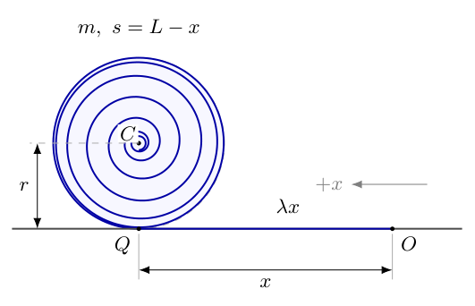{width=60%}

图中的地面管段不伸长、铺好后静止，圆心向左移动$x$时，地面增加的管长在主阶近似中为$x$。扣除该段后，卷盘中剩余长度$s$和质量$m$满足

$$
s=L-x,\qquad \lambda=\frac ML,\qquad
\boxed{m(x)=\lambda s=M\frac{L-x}{L}}.
$$

同一根水管的卷绕密度不变。初态面积为$\pi R^2$、对应长度$L$；当前面积为$\pi r^2$、对应长度$s$，故

$$
\begin{aligned}
\frac{\pi r^2}{s}&=\frac{\pi R^2}{L},\\
r^2&=R^2\frac{s}{L},\\
\boxed{r(x)}&\boxed{=R\sqrt{\frac{L-x}{L}}}.
\end{aligned}
$$

平方根取正，因为$r$是半径。在下面全部计算中，$s>0$；越过$x=L$后继续使用根式，已经不属于本题的物理状态。

（2）把需要的导数先算清楚。

由$\mathrm ds/\mathrm dx=-1$，得到

$$
\begin{aligned}
\frac{\mathrm dm}{\mathrm dx}&=-\lambda=-\frac ML,\\
\frac{\mathrm dr}{\mathrm dx}
&=\frac{R}{\sqrt L}\frac12s^{-1/2}(-1)
=-\frac{r}{2s},\\
\frac{\mathrm d(mr)}{\mathrm dx}
&=m'r+mr'
=-\lambda r-\frac{\lambda s\,r}{2s}
=-\frac32\lambda r.
\end{aligned}
$$

这里第三行必须采用乘积求导。只保留$mr'$而漏掉$m'r$，后续竖直动量会小了三倍。展开导致质量减少与圆心降低，两者都在改变卷盘的质量位置一阶矩。

（3）第一问：确定自行铺展的趋势与维持力方向。

已铺管段位于地面，取它的重力势能为零。剩余卷盘的质量位置中心高度为$r$，所以整根水管的重力势能为

$$
\begin{aligned}
U(x)&=m(x)g r(x)\\
&=\frac{MgR}{L^{3/2}}(L-x)^{3/2}.
\end{aligned}
$$

随$x$增加，$U$减小，故重力倾向于让水管向左铺展。要维持初态，圆心处的水平外力必须向右，如图3-1。对向左的虚位移$\delta x>0$，向右外力所做的虚功为$-F_0\delta x$，重力所做的虚功为$-\delta U$。平衡要求两者之和为零：

$$
-F_0\delta x-\frac{\mathrm dU}{\mathrm dx}\delta x=0,
\qquad
F_0=-\left.\frac{\mathrm dU}{\mathrm dx}\right|_{x=0}.
$$

纯滚动静止接触点的虚位移为零，地面约束力不做虚功。这是使用虚功的依据，不是说地面没有摩擦力。代入势能导数：

$$
\begin{aligned}
\frac{\mathrm dU}{\mathrm dx}
&=\frac{MgR}{L^{3/2}}\frac32(L-x)^{1/2}(-1),\\
F_0&=\frac{3MgR}{2L^{3/2}}\sqrt L
=\boxed{\frac{3MgR}{2L}}.
\end{aligned}
$$

因此维持初始卷盘不自行铺展的推力大小为$3MgR/(2L)$，方向向右。因$R/L\ll1$，它比$Mg$小得多，量纲为力。

（4）第二问：说明高速运动中的能量近似。

推动结束后，不再保留第一问的维持力$F_0$。在纯滚动的主阶近似中，角速率为$\omega=v/r$，转动方向为逆时针。卷盘半径缓慢改变带来的内部径向速度及竖向速度，相对$v$为$r/s$量级；它们的动能相对主阶动能为$(r/s)^2$量级。

主阶动能包括卷盘的水平平动和绕圆心转动，已铺管段没有动能。卷盘按连续均匀面积分布计算转动惯量。若面积质量密度为$\sigma_m=m/(\pi r^2)$，取半径为$u$、厚度为$\mathrm du$的圆环，则

$$
\begin{aligned}
\mathrm dm&=2\pi\sigma_m u\,\mathrm du,\\
I_C&=\int_0^r u^2\,\mathrm dm
=2\pi\sigma_m\int_0^r u^3\,\mathrm du\\
&=\frac{\pi\sigma_m r^4}{2}
=\frac12mr^2.
\end{aligned}
$$

积分中的$u$是圆环坐标，不是卷盘外半径$r$。若错误地把所有质量都放在最外层，会得到$I_C=mr^2$，从而改变整个能量系数。

（5）完整写出动能守恒并解出速率。

由上一步的转动惯量和滚动关系，当前动能为

$$
\begin{aligned}
K(x)&=\frac12mv^2+\frac12I_C\omega^2\\
&=\frac12mv^2+\frac12\left(\frac12mr^2\right)
\left(\frac vr\right)^2\\
&=\frac12mv^2+\frac14mv^2
=\frac34mv^2.
\end{aligned}
$$

初态动能$K(0)=3Mv_0^2/4$。题设允许忽略势能变化和耗散，于是

$$
\begin{aligned}
\frac34m(x)v^2&=\frac34Mv_0^2,\\
\frac{L-x}{L}v^2&=v_0^2,\\
v^2&=v_0^2\frac{L}{L-x},\\
\boxed{v_x(x)=v(x)}&\boxed{=v_0\sqrt{\frac L{L-x}}}.
\end{aligned}
$$

速率取正根；向左的矢量方向已经由$x$轴定义。卷盘加速并非能量增加，而是同一主阶动能分配给越来越小的运动质量。地面静摩擦在无滑动的接触材料点处不做功，与能量守恒相容。

量级上，初态势能与动能之比为$U(0)/K(0)=4gR/(3v_0^2)\ll1$，正好解释了第二问为何可以忽略重力势能，而第一问不能。

（6）由位置函数求加速度，而不是把$v'(x)$当加速度。

加速度是$\mathrm dv/\mathrm dt$。先对$x$求导，再乘以$\dot x=v$，即使用链式法则：

$$
\begin{aligned}
\frac{\mathrm dv}{\mathrm dx}
&=\frac{v_0\sqrt L}{2}(L-x)^{-3/2}
=\frac{v}{2s},\\
a=\frac{\mathrm dv}{\mathrm dt}
&=\frac{\mathrm dv}{\mathrm dx}\frac{\mathrm dx}{\mathrm dt}
=\frac{v^2}{2s}\\
&=\boxed{\frac{v_0^2L}{2(L-x)^2}}>0.
\end{aligned}
$$

同时有一个后面反复使用的恒等式：

$$
rv=R\sqrt{\frac sL}\,v_0\sqrt{\frac Ls}=Rv_0.
$$

注意$rv$恒定，而$mrv$不恒定，因为$m$仍在减小。

（7）第三问：先求整根水管的位置一阶矩。

图3-3用$C$和$S$表示两部分的质量位置中心。这里把分布质量等效在两个点，只用于计算位置一阶矩，不用来替代卷盘的转动惯量。已铺段各材料点静止，位置质心却随铺展长度变化；这不意味着已铺材料整体向左移动。

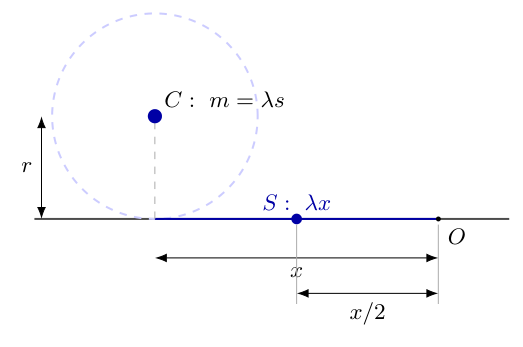{width=50%}

已铺段线密度为$\lambda$，其水平一阶矩也可直接积分：

$$
\int_0^x X\lambda\,\mathrm dX=\frac12\lambda x^2.
$$

加上卷盘的$m x$，整根水管有

$$
\begin{aligned}
\mathcal M_x
&=m x+\frac12\lambda x^2\\
&=\lambda(L-x)x+\frac12\lambda x^2
=M\left(x-\frac{x^2}{2L}\right),\\
\mathcal M_y&=m r.
\end{aligned}
$$

整根水管质量固定，因此对上述一阶矩求时间导数，自动包含材料由卷盘转移到地面的过程。无需另猜质量流出的冲量方向。

（8）求水平动量并逐项求导。

由$P_x=\dot{\mathcal M}_x$，得到

$$
\begin{aligned}
P_x
&=M\left(1-\frac xL\right)v
=m v\\
&=Mv_0\sqrt{\frac{L-x}{L}}.
\end{aligned}
$$

使用图3-4区分水平地面合力$f$和竖向支持$N$。水平运动正向取左，图中摩擦向右的方向将由下面的负号检验，而不是凭“阻碍运动”先行假定。向左的速度与加速度则由能量解确定。

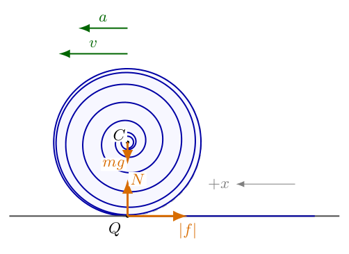{width=50%}

图中水管所受水平总外力仅为地面摩擦合力，故$f=\dot P_x$。用乘积求导把质量变化和速率变化都保留：

$$
\begin{aligned}
f&=\dot m\,v+m a,\\
\dot m&=m'v=-\lambda v,\\
f&=-\lambda v^2+\lambda s\frac{v^2}{2s}
=-\frac12\lambda v^2\\
&=\boxed{-\frac{Mv_0^2}{2(L-x)}}.
\end{aligned}
$$

负号表示摩擦合力向右，$Mv_0^2/(L-x)$具有力的量纲。若只写$f=ma$，会漏掉$\dot m\,v=-\lambda v^2$，不仅大小错误，连方向都会反过来。这里$f$是整根水管的水平地面合力；在未给出管段内张力分布时，不另行断言每一小段地面摩擦如何分担。

（9）求不能提前删去的竖直动量。

由$P_y=\dot{\mathcal M}_y$和第（2）步的导数，得到

$$
\begin{aligned}
P_y&=\frac{\mathrm d(mr)}{\mathrm dx}v
=-\frac32\lambda rv\\
&=\boxed{-\frac{3MRv_0}{2L}}.
\end{aligned}
$$

因此整根水管的竖直动量向下，且在本题的主阶动态近似中为常量；$MRv_0/L$的量纲为动量。若只写$m\dot r$，会得到$-\lambda rv/2$，少了$m'r v=-\lambda rv$。漏项来自材料离开卷盘造成的位置一阶矩变化。

它比$P_x$小，其比值为

$$
\frac{|P_y|}{P_x}=\frac{3r}{2s}\ll1.
$$

然而这并不能推出任何公式中都可取$P_y=0$。在下一问中，它乘以$x$后成为角动量的一部分，必须重新与其他角动量项比较。

（10）由全系统竖向动量求盘下支持力。

因$P_y$恒定，$\dot P_y=0$。设地面对全部水管的竖向支持合力为$N_{\mathrm{tot}}$，则

$$
N_{\mathrm{tot}}-Mg=\dot P_y=0,
\qquad N_{\mathrm{tot}}=Mg.
$$

已铺管段水平静置、竖向加速度为零，在下方切向铺展的主阶模型中，其地面支持合力等于自重$\lambda xg$。图3-4的$N$仅指卷盘正下方的支持，不能把已铺段的支持再重复计入。扣除这一部分后，盘下支持为

$$
\begin{aligned}
N&=N_{\mathrm{tot}}-\lambda xg\\
&=Mg-\frac MLxg
=\boxed{Mg\frac{L-x}{L}=mg}.
\end{aligned}
$$

这个结论是由整根水管的竖直动量和已铺段静止状态推出的，不是由“圆心没有竖直加速度”推出的。事实上$r$在下降，卷盘又在失去质量，直接把几何圆心当固定材料物体套$N-mg=m\ddot r$，研究对象已经选错。

（11）第四问：以固定点$O$拆分角动量。

图3-5中$C$到$O$的水平距离为$x$，高度为$r$。$P_x$向左、$P_y$向下。两者关于$O$的物理转动趋势都是逆时针：水平动量贡献$rP_x$，竖直动量贡献$-xP_y$。卷盘自转也为逆时针。

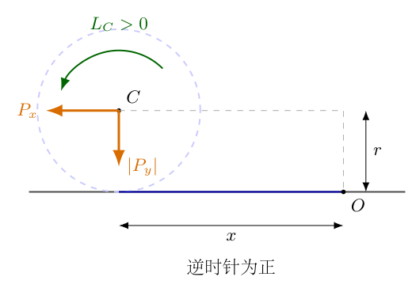{width=50%}

已铺段各材料点静止，其角动量为零。卷盘主阶自转角动量为

$$
L_C=I_C\omega
=\frac12mr^2\frac vr
=\frac12mrv.
$$

将位置拆为相对于$O$的圆心位置与相对于$C$的内部位置，角动量线性分解得到

$$
L_O=L_C+rP_x-xP_y.
$$

这里的$L_C$是主阶自转项；内部缓慢变形速度对自转角动量的更高阶影响不在题设连续主阶模型中保留。另一方面，由全系统一阶矩确定的$P_y$在平移项中被$x$放大，不能与内部动能小修正一并删除。

（12）代入三个角动量项，逐步消元。

把$m=\lambda s$、$P_x=mv$和$P_y=-3\lambda rv/2$代入：

$$
\begin{aligned}
L_O
&=\frac12mrv+r(mv)
-x\left(-\frac32\lambda rv\right)\\
&=\frac32mrv+\frac32\lambda xrv\\
&=\frac32\lambda(s+x)rv\\
&=\frac32\lambda L\,Rv_0\\
&=\boxed{\frac32MRv_0}.
\end{aligned}
$$

第三行是提取共同因子$3\lambda rv/2$，第四行同时用了$s+x=L$和$rv=Rv_0$。$MRv_0$的量纲为角动量，结果与$x$无关，因此$\mathrm dL_O/\mathrm dt=0$。

三个分量各自并不守恒。具体地，$L_C=MRv_0s/(2L)$和$rP_x=MRv_0s/L$都在减小，$-xP_y=3MRv_0x/(2L)$却在增大，恰好补足前两项的减少。守恒属于总和，不能把它错误地分别赋给每个分量。

（13）不使用角动量结论，独立计算总外力矩。

地面水平摩擦的作用点都在$y=0$，所以对地面点$O$没有力矩。已铺段的重力与地面竖向支持逐段抵消，其合力矩为零。卷盘的重力$mg$和盘下支持$N$作用在同一条竖直线上，横向距离均为$x$，故以逆时针为正：

$$
\begin{aligned}
\tau_{O,g}&=-x(-mg)=xmg,\\
\tau_{O,N}&=-xN,\\
\tau_O&=x(mg-N)=\boxed{0}.
\end{aligned}
$$

由此得到独立的核验：

$$
\boxed{\frac{\mathrm dL_O}{\mathrm dt}=0=\tau_O}.
$$

不需要假想在圆心有一个固定铰链；$O$只是选定的地面惯性参考点，也不是始终跟随卷盘的当前接触点$Q$。

（14）明确为什么不能以“竖直动量很小”为由删项。

若强行取$P_y=0$，将得到所谓角动量

$$
L_O^{\mathrm{omit}}=\frac32mrv
=\frac{3MRv_0}{2L}(L-x).
$$

对时间求导：

$$
\begin{aligned}
\frac{\mathrm dL_O^{\mathrm{omit}}}{\mathrm dt}
&=-\frac{3MRv_0}{2L}\dot x\\
&=-\frac{3MRv_0^2}{2\sqrt L\sqrt{L-x}}\ne0.
\end{aligned}
$$

它与第（13）步独立得到的零外力矩冲突，说明删去的项不是所求角动量中的可忽略项。比较量级时，$x|P_y|$与$mrv$的比值为$3x/(2s)$；当$x$与$s$同量级时，此项当然不可忽略。判断误差应比较目标量中的完整组合，而非只比较$P_y$与$P_x$。

（15）检查静摩擦条件与多匝近似的适用边界。

地面“足够粗糙”必须理解为当前所需静摩擦可以提供。若以$\mu$表示接触可用的静摩擦系数，在摩擦主要由盘下接触提供的理想化情形中，至少需要

$$
\begin{aligned}
|f|&\le\mu N,\\
\frac{|f|}{N}
&=\frac{Mv_0^2}{2s}\frac{L}{Mgs}
=\frac{v_0^2L}{2g s^2}\le\mu.
\end{aligned}
$$

若已铺段的地面摩擦也承担水平载荷，则各处接触分担还需另给管段张力模型；这里不把上式冒充任意接触分布的充分条件。它给出了盘下承担所需水平合力时的清楚检验。

多匝数条件也会随铺展变化。剩余卷盘的有效圈数量级为

$$
\frac{s}{2\pi r}
=\frac{\sqrt{Ls}}{2\pi R}\gg1,
\qquad
s\gg\frac{4\pi^2R^2}{L}.
$$

因此不能把主阶解一直延伸到$s=0$。随着剩余长度减少，所需摩擦增大，剩余匝数减少；无滑动或均匀盘近似可能先失效。$v$和$|f|$的形式发散表示理想化超出了适用范围，不表示真实水管具有无穷速率或无穷力。

（16）在一个中间位置检查全部结果与单位。

取$x=L/2$，此时$s=L/2$。逐项代入得到

$$
\begin{aligned}
m&=\frac M2,&r&=\frac R{\sqrt2},&v&=\sqrt2\,v_0,&P_x&=\frac{Mv_0}{\sqrt2},\\
P_y&=-\frac{3MRv_0}{2L},&f&=-\frac{Mv_0^2}{L},&N&=\frac{Mg}{2},\\
L_C&=\frac14MRv_0,&rP_x&=\frac12MRv_0,&-xP_y&=\frac34MRv_0,&L_O&=\frac32MRv_0.
\end{aligned}
$$

\newpage

# 第4题

<!-- question-start -->

有$A_0,A_1,\ldots,A_6$共$7$个节点，任意两个不同节点之间连接一个二极管。各二极管的极性按以下规则确定：若$(i-j)\bmod 7\in\{3,5,6\}$，则二极管正极连接$A_i$，负极连接$A_j$。这里“$\bmod 7$”表示取除以$7$后的非负余数。

每个二极管的伏安特性均为

$$
I(U)=I_0(\mathrm e^{\alpha U}-1),\qquad
I_0=1.000\,\mathrm{mA},\quad \alpha=1.000\,\mathrm{V}^{-1},
$$

其中$U$为正极相对于负极的电势差，电流正方向由正极指向负极。$A_0$连接电源正极，$A_1$连接电源负极，两端电势差为$U_s=1.000\,\mathrm V$。求从电源正极流出的电流。

图4-1将全部连接分成三组表示。三幅图中的同名节点是同一个节点，每个箭头代表一个二极管的正极至负极参考方向；三组支路应合在一起使用。线条交叉处不相连，只有标出的$A_i$是节点。

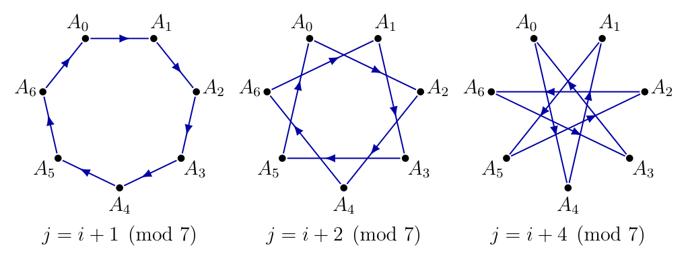{width=100%}

<!-- question-end -->

## 一、题型定位

本题是含指数伏安特性的多节点非线性直流电路。七个节点两两连接，支路数量为$\binom72=21$，但只有$A_0$和$A_1$的电势由电源固定，其余五个节点的电势须由电流守恒确定。不能把每个二极管替换成固定电阻，也不能只数正向支路而删去反向支路。

核心路线是“极性核对—节点电势—反射变换—两个非线性方程—数值迭代—端口电流”。反射变换能把五个内部电势减少为两个未知量，但这里的对称并非普通电阻网络中的等势对称：反射同时反转了每条二极管的极性，所以配对节点的电势互为相反数，而不是彼此相等。

最后的数值计算也是解答的一部分。必须说明方程如何求根、指数变量如何还原成电势以及六条端口支路怎样求和，不能把“解得某根”代替这些步骤。

## 二、知识点

对正极在$A_i$、负极在$A_j$的支路，定义

$$
U_{ij}=V_i-V_j,\qquad
I_{ij}=I_0[\mathrm e^{\alpha(V_i-V_j)}-1].
$$

$I_{ij}$是按极性方向定义的有符号电流。若$V_i<V_j$，则$I_{ij}<0$，实际电流与该参考方向相反。负值仍须参与基尔霍夫电流定律，不能因其“反偏”而取零。

如果同一支路在某节点以负极接入，则从该节点流出的电流是$-I_{ij}$。指数伏安关系不是奇函数：

$$
\begin{aligned}
I(-U)&=I_0(\mathrm e^{-\alpha U}-1),\\
-I(U)&=I_0(1-\mathrm e^{\alpha U}).
\end{aligned}
$$

两式一般不相等。因此不能不管器件极性，统一写成$I_0[\mathrm e^{\alpha(V_{\text{本节点}}-V_{\text{另一节点}})}-1]$再相加。

内部节点无外接电源，其净流出电流为零。电源端节点则有外接电流，净流出电流不为零。指数参数$\alpha$的量纲为电压的倒数，故$\alpha U$无量纲；电势以伏特代入，结果才与给出的$\alpha$一致。

指数代换$x=\mathrm e^{\alpha u_1}$、$y=\mathrm e^{\alpha u_2}$可以把指数方程写成含$x,y$及其倒数的代数方程。此时$x,y>0$，但$u_1,u_2$不一定为正。牛顿法在每次近似根处作一阶展开，通过解一个二元线性方程组得到修正量，再用残差检验收敛。

## 三、物理图像

图4-1的三组箭头分别对应$j-i\equiv1,2,4\pmod7$。每个节点有三条以它为正极端的支路，也有三条以它为负极端的支路；这不是说实际电流恰好三进三出，而是说有六个确定的极性端口。

电源将$A_0$、$A_1$拉到不同电势。其余节点不能任意指定为零，而会调整到使各自净流出电流为零的位置。所有内部电势都处在两个电源端电势之间：一个无外接电流的节点不可能严格高于所有相邻节点，否则它沿每条支路都实际向外放电，无法保持稳态。最低电势也可用相同方法排除。

解析中的图4-3只画反射配对与电势，不重复画出二十一条支路，避免把几何配对误读成新增导线。图4-4抽出$A_6$周围六条真实支路，图4-5抽出$A_0$端口六条支路；它们都是同一网络的局部表示，不是另一个电路。

在$A_0$电势最高的本题状态下，三条以$A_0$为负极的支路电流为负；这些支路实际也把电流从$A_0$输送到内部节点。因此总电源电流并不只等于三条正向偏置支路的电流。

## 四、解题入口

先把模运算转换成明确的极性表，尤其注意负数的余数。例如$(0-1)\bmod7=6$，所以支路是$A_0$为正极、$A_1$为负极，而不是相反。选择电势零点，使$V_0=U_s/2$、$V_1=-U_s/2$，可以让反射变换后的边界条件保持不变。

随后先证明内部电势解唯一，再使用“节点反射、所有电势反号”的复合对称。这样$V_4=0$，其余四个内部电势组成两对相反数。分别对$A_5$和$A_6$列出三条参考流出与三条参考流入，得两个方程；两侧各有三个常数项$-1$，约去后再作指数代换。

求得$x,y$后先还原全部节点电势，并核对剩余内部节点的电流守恒；最后才对$A_0$求净流出电流。这个次序能在端口求和前发现极性错误或指数倒数错误。

## 五、解析

（1）把极性规则转化为全部支路的连接表。

条件$(i-j)\bmod7\in\{3,5,6\}$等价于

$$
(j-i)\bmod7\in\{4,2,1\}.
$$

因此，对每个$i$，正极在$A_i$的三条支路分别连向$A_{i+1}$、$A_{i+2}$、$A_{i+4}$，下标超出$0$至$6$时取模$7$。例如$A_5$连向$A_6,A_0,A_2$；三者分别来自$5+1=6$、$5+2\equiv0$、$5+4\equiv2$。

|节点|以本节点为正极，箭头指向的节点|以本节点为负极，箭头来自的节点|
|---|---|---|
|$A_0$|$A_1,A_2,A_4$|$A_3,A_5,A_6$|
|$A_1$|$A_2,A_3,A_5$|$A_0,A_4,A_6$|
|$A_2$|$A_3,A_4,A_6$|$A_0,A_1,A_5$|
|$A_3$|$A_0,A_4,A_5$|$A_1,A_2,A_6$|
|$A_4$|$A_1,A_5,A_6$|$A_0,A_2,A_3$|
|$A_5$|$A_0,A_2,A_6$|$A_1,A_3,A_4$|
|$A_6$|$A_0,A_1,A_3$|$A_2,A_4,A_5$|

表中每行三条正极支路，计数为$7\times3=21$；每条只在它的正极端计入一次。任意两节点间恰有一个二极管，因为非零余数$1$至$6$分为两组互相相反的集合，正向或反向恰满足一次给定条件。没有并联的反向第二个二极管。

（2）统一支路电压与电流的正方向。

按图4-2，以二极管的正极至负极为$I_{ij}$正方向；电压$U_{ij}$也按正极减负极定义。

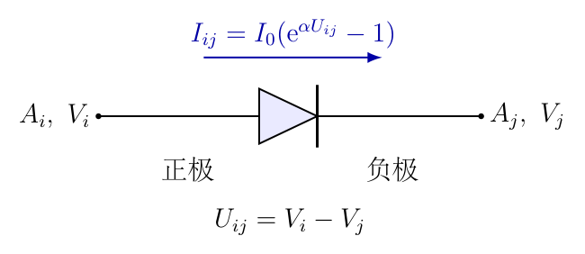{width=70%}

于是该支路在$A_i$的净流出贡献为$I_{ij}$，在$A_j$的净流出贡献为$-I_{ij}$。同一电流在两个端点的符号相反，符合电荷守恒。比如支路$A_3\to A_0$中，$A_0$的流出贡献是

$$
-I_{30}=I_0[1-\mathrm e^{\alpha(V_3-V_0)}],
$$

不是$I_0[\mathrm e^{\alpha(V_0-V_3)}-1]$。即使两者都可为正，它们的大小也不相同。

（3）选择电势零点，并证明电势解的唯一性。

电流只由电势差决定，所有节点同时加一个常数不影响网络。故选取

$$
V_0=\frac{U_s}{2}=0.5000\,\mathrm V,\qquad
V_1=-\frac{U_s}{2}=-0.5000\,\mathrm V.
$$

为合法地使用对称性，先说明同一端电势下不可能有两组不同的内部电势。假设存在两组稳态解$\{V_i\}$和$\{W_i\}$，记$\delta V_i=V_i-W_i$。端电势固定，故$\delta V_0=\delta V_1=0$。用$R_i$表示节点净流出电流，内部节点两组解均满足$R_i=0$。因此

$$
\sum_{i=0}^6\delta V_i[R_i(V)-R_i(W)]=0.
$$

端节点的$R_i$不必为零，但它们乘的是零电势差；内部节点则乘的是零电流残差。对任一有向支路$i\to j$，在此总和中的两端贡献合并为

$$
\begin{aligned}
&\delta V_i\,\delta I_{ij}-\delta V_j\,\delta I_{ij}\\
&=(\delta V_i-\delta V_j)\delta I_{ij}\\
&=[U_{ij}(V)-U_{ij}(W)]\,[I(U_{ij}(V))-I(U_{ij}(W))].
\end{aligned}
$$

伏安函数的导数为

$$
I'(U)=I_0\alpha\mathrm e^{\alpha U}>0.
$$

严格递增意味着上述乘积非负，且只有两个支路电压相同时才等于零。二十一项非负数的总和为零，迫使每条支路的$\delta V_i-\delta V_j=0$。网络连通，所有$\delta V_i$相同；再用$\delta V_0=0$，得到全部$\delta V_i=0$。故内部电势解唯一。

此处使用的是“把节点守恒式按电势差加权，再按支路合并”的技巧；它不要求二极管伏安关系是奇函数，只要求严格单调。

（4）利用复合反射确定电势配对。

图4-3的反射对应下标变换$\phi(i)=1-i\pmod7$，依次将$0$与$1$、$2$与$6$、$3$与$5$交换，$4$保持不动。

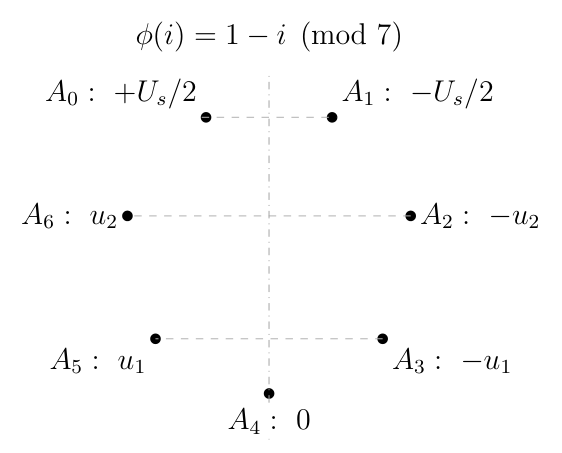{width=55%}

若原来$i\to j$满足$j-i\in\{1,2,4\}$，则反射后的真实支路是$\phi(j)\to\phi(i)$，因为

$$
\phi(i)-\phi(j)=j-i\pmod7.
$$

反射不保持箭头方向，而将它反转。再同时令所有电势反号，即设$V'_{\phi(i)}=-V_i$，映射支路的正极减负极电压为

$$
V'_{\phi(j)}-V'_{\phi(i)}=-V_j+V_i=V_i-V_j.
$$

它和原支路电压相同，所以参考电流相同；但节点原来的流出角色变为流入角色，净流出残差满足$R'_{\phi(i)}=-R_i$。原内部节点残差为零，变换后仍为零。边界也保持：$V'_0=-V_1=U_s/2$，$V'_1=-V_0=-U_s/2$。

由唯一性，变换后的电势就是原电势，因此

$$
\begin{aligned}
V_4&=-V_4=0,\\
V_5&=u_1,\qquad V_3=-u_1,\\
V_6&=u_2,\qquad V_2=-u_2.
\end{aligned}
$$

这里只定义两个有符号未知量$u_1,u_2$，没有要求它们为正。图中“$-u_2$”是代数表示，不是预先说$A_2$的电势为负。

（5）对节点$A_6$逐条列电流守恒式。

图4-4左侧三条箭头从$A_6$出发，右侧三条箭头指向$A_6$。两侧名称直接对应下面的方程；箭头只表示二极管极性方向。

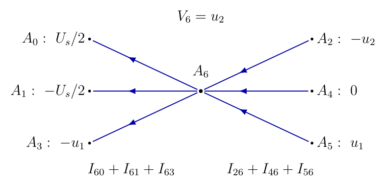{width=75%}

内部节点没有电源注入，故

$$
I_{60}+I_{61}+I_{63}=I_{26}+I_{46}+I_{56}.
$$

把正极减负极电势差逐个算出：

$$
\begin{aligned}
U_{60}&=u_2-U_s/2,& U_{61}&=u_2+U_s/2,\\
U_{63}&=u_2+u_1,& U_{26}&=-2u_2,\\
U_{46}&=-u_2,& U_{56}&=u_1-u_2.
\end{aligned}
$$

特别是$U_{26}=V_2-V_6=-u_2-u_2=-2u_2$，不能只写成$-u_2$。将这六项代入伏安关系，约去公共因子$I_0$，得到

$$
\begin{aligned}
&[\mathrm e^{\alpha(u_2-U_s/2)}-1]
+[\mathrm e^{\alpha(u_2+U_s/2)}-1]
+[\mathrm e^{\alpha(u_2+u_1)}-1]\\
&=[\mathrm e^{-2\alpha u_2}-1]
+[\mathrm e^{-\alpha u_2}-1]
+[\mathrm e^{\alpha(u_1-u_2)}-1].
\end{aligned}
$$

左右各有三个$-1$，相消后为

$$
\mathrm e^{\alpha(u_2-U_s/2)}+\mathrm e^{\alpha(u_2+U_s/2)}
+\mathrm e^{\alpha(u_1+u_2)}
=\mathrm e^{-2\alpha u_2}+\mathrm e^{-\alpha u_2}
+\mathrm e^{\alpha(u_1-u_2)}.
$$

这里常数相消是因为两组各有三条支路，并不是把二极管的反向饱和电流忽略了。

（6）对节点$A_5$同样列出独立方程。

根据极性表，节点$A_5$满足

$$
I_{56}+I_{50}+I_{52}=I_{15}+I_{35}+I_{45}.
$$

六个电压依次为$u_1-u_2$、$u_1-U_s/2$、$u_1+u_2$、$-U_s/2-u_1$、$-2u_1$、$-u_1$。因此完整的电流式为

$$
\begin{aligned}
&[\mathrm e^{\alpha(u_1-u_2)}-1]
+[\mathrm e^{\alpha(u_1-U_s/2)}-1]
+[\mathrm e^{\alpha(u_1+u_2)}-1]\\
&=[\mathrm e^{\alpha(-U_s/2-u_1)}-1]
+[\mathrm e^{-2\alpha u_1}-1]
+[\mathrm e^{-\alpha u_1}-1].
\end{aligned}
$$

再次消去左右各三个$-1$：

$$
\mathrm e^{\alpha(u_1-u_2)}+\mathrm e^{\alpha(u_1-U_s/2)}
+\mathrm e^{\alpha(u_1+u_2)}
=\mathrm e^{\alpha(-U_s/2-u_1)}+\mathrm e^{-2\alpha u_1}
+\mathrm e^{-\alpha u_1}.
$$

其余内部节点不是被省略了。复合反射给出$R_2=-R_6$、$R_3=-R_5$，故这两式满足后$A_2,A_3$自动满足。固定点$A_4$则有$R_4=-R_4$，所以$R_4=0$。也可逐项检查：$A_4$的参考流出电压为$U_s/2,-u_1,-u_2$，参考流入电压为$U_s/2,-u_2,-u_1$，两组完全一致。

（7）作指数代换，形成两个明确的求根函数。

令

$$
x=\mathrm e^{\alpha u_1},\qquad y=\mathrm e^{\alpha u_2},\qquad
a=\mathrm e^{\alpha U_s/2}=\mathrm e^{0.5000}=1.648721270700\ldots .
$$

利用指数的加法变乘法、减法变除法。例如

$$
\begin{aligned}
\mathrm e^{\alpha(u_1-u_2)}&=x/y,\\
\mathrm e^{\alpha(-U_s/2-u_1)}&=1/(ax),\\
\mathrm e^{-2\alpha u_2}&=1/y^2.
\end{aligned}
$$

于是$A_5,A_6$的方程分别变为

$$
\boxed{\begin{aligned}
F(x,y)&=\frac xy+\frac xa+xy-\frac1{ax}-\frac1{x^2}-\frac1x=0,\\
G(x,y)&=\frac ya+ay+xy-\frac1{y^2}-\frac1y-\frac xy=0.
\end{aligned}}
$$

求根范围必须满足$x,y>0$。内部电势范围还给出$1/a\le x,y\le a$；这是稳态网络的最大、最小电势原理，不是任意施加的数值约束。

（8）先用小电压极限检查模型，并选择迭代初值。

若$|\alpha U_{ij}|\ll1$，指数一阶展开为$\mathrm e^{\alpha U_{ij}}-1\approx\alpha U_{ij}$，每条支路近似为电导$g_d=I_0\alpha$的电阻。此时极性在一阶近似中不影响电阻网络，网络是七节点完全图。

对任一内部节点$i$，线性化守恒式为

$$
g_d\sum_{j\ne i}(V_i-V_j)=0,
\qquad 7V_i-\sum_{j=0}^6V_j=0.
$$

所有内部电势相等。设共同值为$v$，两端电势和为零，则$7v-5v=0$，故$v=0$。从$A_0$出发，一条支路接$A_1$、压差$U_s$，另五条接内部节点、压差$U_s/2$，所以

$$
I\approx g_d\left(U_s+5\frac{U_s}{2}\right)
=\frac72 I_0\alpha U_s.
$$

零电压附近端口电导为$3.500\,\mathrm{mA/V}$，等效电阻约$285.7\,\Omega$。本题$\alpha U_s=1$，并不处在足够小的线性区，不能将线性外推的$3.500\,\mathrm{mA}$作为最终答案。它给出内部电势接近零时的参照，可据此选择$x=y=1$为数值迭代的初值；然后必须求解完整指数方程，并检查实际残差。这是用近似提供解题入口，而不是用近似取代精确模型。

（9）写出牛顿修正所需的全部偏导数。

从近似值$(x_k,y_k)$出发，设修正为$(\delta x_k,\delta y_k)$，对$F,G$各作一阶泰勒展开：

$$
\begin{aligned}
F(x_k+\delta x_k,y_k+\delta y_k)
&\approx F_k+F_x\delta x_k+F_y\delta y_k,\\
G(x_k+\delta x_k,y_k+\delta y_k)
&\approx G_k+G_x\delta x_k+G_y\delta y_k.
\end{aligned}
$$

令线性近似值为零，即求解$J_k\delta\boldsymbol z_k=-\boldsymbol r_k$。这里$J$为雅可比矩阵，其四项逐一求导如下：

$$
\begin{aligned}
F_x&=\frac1y+\frac1a+y+\frac1{ax^2}+\frac2{x^3}+\frac1{x^2},\\
F_y&=-\frac{x}{y^2}+x,\\
G_x&=y-\frac1y,\\
G_y&=\frac1a+a+x+\frac2{y^3}+\frac1{y^2}+\frac{x}{y^2}.
\end{aligned}
$$

例如$\partial(-x/y)/\partial y=+x/y^2$，故它在$G_y$中为正；$\partial[-1/(ax)]/\partial x=+1/(ax^2)$，也为正。两个倒数项的正号不能遗漏。

若$D=F_xG_y-F_yG_x\ne0$，用二元消元得

$$
\begin{aligned}
\delta x&=\frac{-FG_y+F_yG}{D},\\
\delta y&=\frac{G_xF-F_xG}{D},\\
x_{k+1}&=x_k+\delta x_k,\qquad
y_{k+1}=y_k+\delta y_k.
\end{aligned}
$$

所有函数值和偏导都要在当前$(x_k,y_k)$计算，不能沿用第一步的导数而仍称作完整牛顿迭代。

（10）完成前两次迭代的具体运算。

取$x_0=y_0=1$，对应两个内部未知电势的初值为零。代入得

$$
\begin{aligned}
F_0&=1+1/a+1-1/a-1-1=0,\\
G_0&=1/a+a+1-1-1-1
=a+1/a-2\\
&=0.255251930413.
\end{aligned}
$$

此时$F_y=G_x=0$，所以两个修正方程暂时解耦：

$$
\begin{aligned}
F_x&=1+1/a+1+1/a+2+1=5+2/a
=6.213061319425,\\
G_y&=1/a+a+1+2+1+1=5+a+1/a
=7.255251930413,\\
\delta x_0&=0,\\
\delta y_0&=-\frac{0.255251930413}{7.255251930413}
=-0.0351816770611.
\end{aligned}
$$

因此$x_1=1$、$y_1=0.964818322939$，仍在正值范围内。代入这组数值后，残差与雅可比分别为

$$
\begin{aligned}
F_1&=0.00128288442643,\\
G_1&=-0.00646120195020,\\
J_1&=\begin{pmatrix}
6.21434420385&-0.07425878722\\
-0.07164623855&7.63063183049
\end{pmatrix}.
\end{aligned}
$$

这次两变量已经耦合。代入二元消元公式，而不是分别除以对角项。由这四个矩阵元素先求行列式，再求两个分子：

$$
\begin{aligned}
D_1&=(6.21434420385)(7.63063183049)\\
&\quad-(-0.07425878722)(-0.07164623855)\\
&=47.41405232476,\\
-F_1G_y+F_yG_1&=-0.00930941771835,\\
G_xF_1-F_xG_1&=+0.04006021904547.
\end{aligned}
$$

分别除以$D_1$，得到

$$
\begin{aligned}
\delta x_1&=-0.000196343009338,\\
\delta y_1&=+0.000844901818792,\\
x_2&=1-0.000196343009338
=0.999803656990662,\\
y_2&=0.964818322938892+0.000844901818792\\
&=0.965663224757684.
\end{aligned}
$$

<!-- KEEP_TOGETHER_START -->

继续使用同一算法，得到下表。残差用未提前舍入的内部数值计算。

|迭代次数$k$|$x_k$|$y_k$|$\max(|F_k|,|G_k|)$|
|---|---|---|---|
|$0$|$1.000000000000$|$1.000000000000$|$2.5525\times10^{-1}$|
|$1$|$1.000000000000$|$0.964818322939$|$6.4612\times10^{-3}$|
|$2$|$0.999803656991$|$0.965663224758$|$4.4008\times10^{-6}$|
|$3$|$0.999803562567$|$0.965663801375$|小于$3\times10^{-12}$|
|$4$|$0.999803562567$|$0.965663801375$|小于$10^{-14}$|

<!-- KEEP_TOGETHER_END -->

求得

$$
x=0.999803562566922\ldots,\qquad
y=0.965663801375257\ldots .
$$

这里保留较多位数是为了防止后面的对数和电流求和放大过早舍入的影响；最终答案仍按已知量精度报告。

（11）由指数变量还原全部节点电势。

取自然对数，而不是以$10$为底的对数：

$$
\begin{aligned}
u_1&=\frac{\ln x}{\alpha}
=-0.000196456729437\ldots\,\mathrm V,\\
u_2&=\frac{\ln y}{\alpha}
=-0.034939537049340\ldots\,\mathrm V.
\end{aligned}
$$

$x,y$均略小于$1$，因此两者对数为负，与所得$u_1,u_2$符号一致。注意$\alpha=1.000\,\mathrm V^{-1}$，所以除以$\alpha$后有电压量纲；不能因为它的数值为$1$而把单位删去。

<!-- KEEP_TOGETHER_START -->

将配对节点并列列出，全部电势的单位均为$\mathrm V$：

|节点|电势|配对节点|电势|
|---|---|---|---|
|$A_0$|$+0.500000000000$|$A_1$|$-0.500000000000$|
|$A_2$|$+0.034939537049$|$A_6$|$-0.034939537049$|
|$A_3$|$+0.000196456729$|$A_5$|$-0.000196456729$|
|$A_4$|$0$|$A_4$|$0$|

<!-- KEEP_TOGETHER_END -->

五个内部电势全在$[-0.5,0.5]\,\mathrm V$内，配对电势和为零。$u_1$很小，但不能在列方程前先认定它恰为零；那会使$A_5$的精确电流守恒不成立。

（12）按电源端六条支路计算总电流。

图4-5中橙色$I$为电源注入$A_0$的电流。右侧是以$A_0$为正极的三条参考流出，左侧是以$A_0$为负极的三条参考流入。

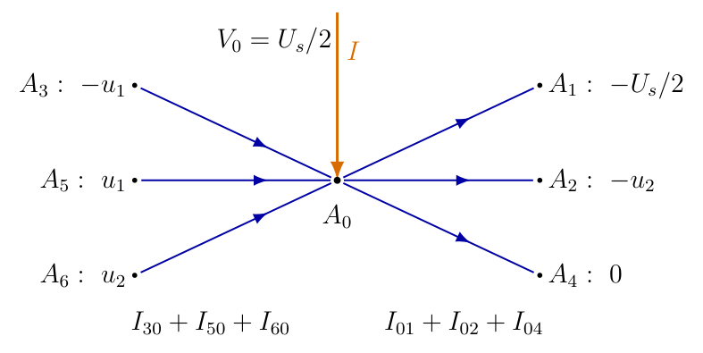{width=75%}

对$A_0$守恒：电源注入加参考流入等于参考流出，故

$$
I=I_{01}+I_{02}+I_{04}-I_{30}-I_{50}-I_{60}.
$$

图中六个端点电势给出

$$
\begin{aligned}
I_{01}/I_0&=\mathrm e^{\alpha U_s}-1=a^2-1,\\
I_{02}/I_0&=\mathrm e^{\alpha(U_s/2+u_2)}-1=ay-1,\\
I_{04}/I_0&=\mathrm e^{\alpha U_s/2}-1=a-1,\\
I_{30}/I_0&=\mathrm e^{\alpha(-u_1-U_s/2)}-1=1/(ax)-1,\\
I_{50}/I_0&=\mathrm e^{\alpha(u_1-U_s/2)}-1=x/a-1,\\
I_{60}/I_0&=\mathrm e^{\alpha(u_2-U_s/2)}-1=y/a-1.
\end{aligned}
$$

三条流出中的$-3$与减去三条流入产生的$+3$相消，于是

$$
\boxed{\frac I{I_0}=a^2+ay+a-\frac1{ax}-\frac xa-\frac ya}.
$$

这个式子里的后三个负号来自端口电流守恒，不是说后三条支路实际把电流送入$A_0$。本题三个反偏支路的$I_{30},I_{50},I_{60}<0$，减去它们反而增加$I$。

（13）把六个数值项完整求和。

用收敛后的$x,y$计算：

$$
\begin{aligned}
a^2&=2.718281828459, & ay&=1.592110449673,\\
a&=1.648721270700, & 1/(ax)&=0.606649828448,\\
x/a&=0.606411514387, & y/a&=0.585704702509.
\end{aligned}
$$

正、负两组先分别相加，再相减：

$$
\begin{aligned}
a^2+ay+a&=5.959113548832,\\
1/(ax)+x/a+y/a&=1.798766045344,\\
I/I_0&=5.959113548832-1.798766045344\\
&=4.160347503488.
\end{aligned}
$$

由于$I_0=1.000\,\mathrm{mA}$，所得电流不是$4.160\,\mathrm A$而是

$$
I=4.160347503488\ldots\,\mathrm{mA},\qquad
\boxed{I\approx4.160\,\mathrm{mA}}.
$$

最终保留四位有效数字。若只保留两位有效数字，可写成$4.2\,\mathrm{mA}$；它是较粗的舍入，不是另一个解。

（14）用全节点、端口守恒与功率独立检查。

不使用反射约束，直接把$V_2$至$V_6$作为五个独立未知量，对二十一条支路逐个按极性生成电流，再求五个节点残差。独立求根所得电势与上表一致。用未舍入值计算，五个内部节点的$|R_i|/I_0$均小于$2\times10^{-12}$；在$A_1$算得净流出电流为$-I$，与电源正端互相抵消。

功率核验不能只重复端口电流公式。任一二极管的耗散功率为$p_{ij}=U_{ij}I_{ij}$。当$U_{ij}>0$时电流为正，当$U_{ij}<0$时电流为负，所以$p_{ij}\ge0$，反偏支路仍吸收能量。把全部支路功率合并：

$$
\begin{aligned}
\sum_{i\to j}(V_i-V_j)I_{ij}
&=\sum_iV_iR_i\\
&=V_0I+V_1(-I)\\
&=(V_0-V_1)I=U_sI.
\end{aligned}
$$

第一行由每条支路在正、负端分别贡献$+V_iI_{ij}$、$-V_jI_{ij}$得到；内部节点因$R_i=0$没有净贡献。逐条数值求和得总功率$4.160347503488\,\mathrm{mW}$，与$1.000\,\mathrm V\times I$相同，且每条支路功率非负。

\newpage

# 第5题

<!-- question-start -->

肥皂泡表面的张力系数为$\sigma$。用一根绝缘、绝热的细管，将两个半径均为$r_0$的球形肥皂泡连通起来。泡外气压可以忽略，泡内装有温度为$T_0$、定体摩尔热容为$C_v=\frac32R$的理想气体。已知一个肥皂泡的总质量为$m$。

（1）求此时泡内的压强$p_0$，并判断两个等大的连通泡在微扰下是否处于稳定平衡。

（2）封闭细管，在其中一个肥皂泡上加入电荷量$Q$。在保持球形、各方向同步均匀膨胀和收缩的小扰动下，求该泡的振动周期。

（3）打开细管，使气体可以自由流通。设任何时刻气体各处的温度相等，在两个球面上分别加入固定电荷量$Q$。求两个等大肥皂泡保持稳定平衡所需的$Q$的范围。

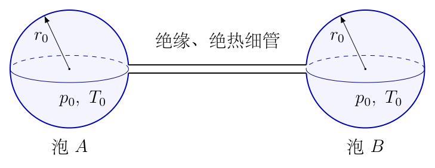{width=80%}

<!-- question-end -->

## 一、题型定位

本题把球面表面张力、固定电荷的静电斥力、理想气体的绝热压缩和两个振动自由度结合在一起。研究对象不是泡的整体平移，而是球面半径的变化；两泡连通之后，又须区分两者同时变大、变小的同相变化，以及一大一小的反相变化。

前两问的关键是把三种压强放入同一个径向力平衡中。第三问的关键则是：共同气体压强取决于两泡的总容积，而不是分别取决于各泡的容积。不能把两个封闭泡的小振动公式直接用于连通泡，也不能只检验两泡同时膨胀这一种扰动。

## 二、知识点

肥皂泡有内、外两个气液界面。设泡膜很薄，两个界面的半径都近似为$r$，两个界面的总面积为$8\pi r^2$，表面能为$8\pi\sigma r^2$。由此产生的向内等效压强是$4\sigma/r$，不是单一液滴界面的$2\sigma/r$。

均匀带电球壳的表面外侧电场为$Q/(4\pi\varepsilon_0r^2)$，内侧电场为零。电荷不能对自身施加力；面电荷受力应使用两侧电场的平均值，故向外的电压力为$\varepsilon_0E_{\rm out}^2/2$。因子$1/2$不能漏掉。

理想气体满足$pV=nRT$。在气体空间均匀、变化足够缓慢且无耗散的绝热过程中，第一定律导出$pV^\gamma=\text{常量}$，其中$\gamma=(C_v+R)/C_v$。本题$\gamma=5/3$，球形容积$V\propto r^3$，所以封闭泡内的$p\propto r^{-5}$。连通两泡则须把$V$换成两泡的总容积。

小振动的线性化须先写完整的力方程，再保留位移的一阶项。若在线性化过程中出现面积的变化，面积一阶变化与平衡时的零净压差相乘，因此该部分不贡献一阶恢复力；不能把面积在任意非平衡状态下当成常量。

对于两个相同泡，变量$x+y$和$x-y$能够分别描述同相与反相模式。稳定要求每一个允许模式均有正的频率平方；一个正特征值不能抵消另一个负特征值。零频率只能说明线性恢复力消失，不能据此证明非线性稳定。

## 三、物理图像

泡膜表面张力趋于减小面积，始终提供向内的作用。泡内气体压强和同号球面电荷的斥力则向外。初始未带电时，气体压强恰好抵消表面张力压强。带电后，在相同气体熵的条件下，平衡半径变大，气体压强下降，新增的电压力补足向外作用。

封管后的单泡若稍微膨胀，气体压强按$r^{-5}$下降，电压力按$r^{-4}$下降，表面张力压强仅按$r^{-1}$下降。三者原本相等的平衡关系被打破，产生向内的恢复作用。这里必须比较它们下降的速率，而不能仅凭“电荷相斥”就判断振动不稳定。

连通泡存在更危险的变化：一个变大，另一个等量变小。两泡总容积在一阶近似下不变，共同气体压强也不变。未带电的大泡表面张力压强较小，小泡表面张力压强较大，因而大泡继续变大，小泡继续变小，原来的等大状态并不稳定。

固定电荷改变这一反馈。变小的泡电压力显著增加，变大的泡电压力显著降低，若这种差异强于表面张力压强的差异，就可恢复两泡等大的状态。第三问求的正是这个竞争的临界条件，不是第二问单泡振动是否存在的条件。

## 四、解题入口

把气体压强、电压力、表面张力压强分别记为$p_g,p_e,p_s$，统一以径向向外为正方向。先推导$p_s=4\sigma/r$与$p_e=Q^2/(32\pi^2\varepsilon_0r^4)$，再用第一定律确定$p_g(r)$。带电泡的平衡半径不是初始$r_0$，须另记为$r_1$。

单泡先写$m\ddot r=4\pi r^2(p_g+p_e-p_s)$，再令$r=r_1(1+x)$作一阶展开。连通两泡则令$r_A=r_1(1+x)$、$r_B=r_1(1+y)$，先展开总容积，得到共同气体压强的一阶变化，然后分别列两个径向方程。

将两个方程相加、相减，就能找出两个模式的恢复力。最后把压强比例条件与平衡半径方程结合，消去未知的$r_1$，将稳定范围明确写成已知量$r_0,\sigma,\varepsilon_0$与$Q$的关系。只给包含$r_1$的隐式不等式，还没有完成电荷范围的计算。

## 五、解析

（1）明确近似模型与三个不同层次的“稳定”。

下面只研究保持球形的径向扰动，电荷在每个球面均匀分布并各自保持不变。两个泡之间只保留气体连通，不计球面电荷的相互作用；图5-1的管长只是示意，不是题目给出的距离参数。若两泡相距很近，互场会改变面电荷分布和电压力，不能继续使用独立球壳的公式。

泡膜为均匀薄膜，径向运动时的惯性质量记为$m$，气体提供热力学压强但其动能忽略。这个处理把题设总质量近似视为泡膜质量。气体质量占比显著时，需要单独给出膜质量与气体质量及气流模型，不能从一个总质量数值唯一推出精确周期。

气体在主模型中始终空间均匀。微小径向变化按可逆绝热处理；由未带电初态比较到带电平衡态时，也取缓慢、无耗散的加电路径，所以气体的等熵常量不变。绝热仅表示不通过边界交换热量，本身不保证没有耗散。若加电造成额外发热，应使用最终状态实际的气体常量，末尾给出对应的阈值形式。

由此区分：球面径向静力平衡、径向线性恢复稳定、任意非球形扰动的稳定。这三者不是同一个命题。本题按上述球形集总模型给出前两者，不能用两个径向方程冒充全部形变模式的证明。

（2）从两个界面的面积变化求表面张力压强。

图5-2用中央截面标出两个界面。膜厚在图中放大以便区分，但计算时内、外界面半径都取$r$。

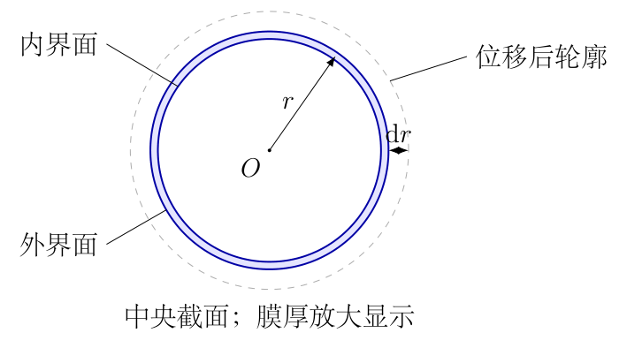{width=60%}

当半径向外增加$\mathrm dr$时，每个界面的面积变化为$\mathrm d(4\pi r^2)=8\pi r\,\mathrm dr$。两个界面的表面能变化为

$$
\begin{aligned}
E_s&=2\sigma(4\pi r^2)=8\pi\sigma r^2,\\
\mathrm dE_s&=16\pi\sigma r\,\mathrm dr.
\end{aligned}
$$

克服表面张力所做的径向功，也可写成等效向内压强乘容积增量：$p_s\,\mathrm dV=p_s4\pi r^2\mathrm dr$。因此

$$
\begin{aligned}
p_s4\pi r^2\mathrm dr&=16\pi\sigma r\mathrm dr,\\
p_s&=\frac{16\pi\sigma r}{4\pi r^2}
=\boxed{\frac{4\sigma}{r}}.
\end{aligned}
$$

这里使用的是虚功法：表面能的增加需要外界克服向内的张力作用。$p_s$取正值表示作用大小，在向外为正的动力学方程中须加负号。两个界面已经在面积因子$2$中计入，后面不能再把$p_s$乘以$2$。

初态没有电荷，泡外气压忽略，静力平衡给出

$$
\boxed{p_0=p_s(r_0)=\frac{4\sigma}{r_0}}.
$$

量纲上，$[\sigma]=\mathrm{N/m}$，所以$[\sigma/r]=\mathrm{N/m^2}$，确实是压强。稳定性尚未由这一静力等式决定，须另考察微扰后的净作用。

（3）从球壳自场求固定电荷的电压力。

半径为$r$的均匀球壳带电$Q$。高斯定律给出壳外径向场

$$
E_{\rm out}=\frac{Q}{4\pi\varepsilon_0r^2},\qquad E_{\rm in}=0.
$$

面电荷密度记为$\eta_e=Q/(4\pi r^2)$，避免与表面张力系数$\sigma$混用。一个小面元受其余电荷的场力，所用场为两侧场的平均值：

$$
\begin{aligned}
E_{\rm others}&=\frac{E_{\rm out}+E_{\rm in}}2
=\frac{Q}{8\pi\varepsilon_0r^2},\\
p_e&=\eta_eE_{\rm others}
=\frac{Q}{4\pi r^2}\frac{Q}{8\pi\varepsilon_0r^2}
=\boxed{\frac{Q^2}{32\pi^2\varepsilon_0r^4}}.
\end{aligned}
$$

无论$Q$正负，$p_e$都向外，因为改变全体电荷的符号并不改变它们之间的排斥作用。把$\eta_eE_{\rm out}$直接当成压力会多算一倍。

也可用能量独立检查。固定$Q$的球壳静电能是

$$
E_e=\frac12Q\frac{Q}{4\pi\varepsilon_0r}
=\frac{Q^2}{8\pi\varepsilon_0r}.
$$

半径增加时静电能下降，其减小量变为向外作用所做的功：

$$
\begin{aligned}
p_e4\pi r^2\mathrm dr&=-\mathrm dE_e
=\frac{Q^2}{8\pi\varepsilon_0r^2}\mathrm dr,\\
p_e&=\frac{Q^2}{32\pi^2\varepsilon_0r^4}.
\end{aligned}
$$

两种方法得到同一个结果。为简化后续代数，定义

$$
b=\frac{Q^2}{32\pi^2\varepsilon_0},\qquad p_e=\frac b{r^4},\qquad b\ge0.
$$

$b$不是压强，量纲为压强乘长度四次方；只有$b/r^4$才能与$p_g,p_s$相加。

（4）由第一定律推导等熵气体压强与半径的关系。

封管后泡内气体的物质的量$n$不变。取气体为热力学系统，气体向外做功为$p_g\,\mathrm dV$。无热量交换且无耗散的准静态过程中，第一定律写为

$$
\begin{aligned}
\mathrm dU&=-p_g\,\mathrm dV,\\
nC_v\,\mathrm dT&=-\frac{nRT}{V}\mathrm dV,\\
\frac{\mathrm dT}{T}&=-\frac R{C_v}\frac{\mathrm dV}{V}.
\end{aligned}
$$

此处分离变量并在两个平衡态之间积分：

$$
\begin{aligned}
\ln\frac T{T_0}&=-\frac R{C_v}\ln\frac V{V_0},\\
\frac T{T_0}&=\left(\frac{V_0}{V}\right)^{R/C_v},\\
p_gV&=nRT
=nRT_0\left(\frac{V_0}{V}\right)^{R/C_v},\\
p_gV^{1+R/C_v}&=p_0V_0^{1+R/C_v}.
\end{aligned}
$$

$C_v=3R/2$使$R/C_v=2/3$，故$\gamma=1+R/C_v=5/3$。代入$V=4\pi r^3/3$，两边相同的几何因子约去，得到

$$
\begin{aligned}
p_g(r^3)^{5/3}&=p_0(r_0^3)^{5/3},\\
p_gr^5&=p_0r_0^5=4\sigma r_0^4.
\end{aligned}
$$

定义气体常量$C=p_0r_0^5=4\sigma r_0^4$，则

$$
\boxed{p_g(r)=\frac C{r^5}=\frac{4\sigma r_0^4}{r^5}}.
$$

初温$T_0$并不是遗漏的条件。初态气体量由

$$
n=\frac{p_0V_0}{RT_0}
=\frac{(4\sigma/r_0)(4\pi r_0^3/3)}{RT_0}
=\frac{16\pi\sigma r_0^2}{3RT_0}
$$

确定。沿该等熵路径，$T=T_0(r_0/r)^2$；将$n$与$T$一起代回状态方程，$T_0$抵消，留下上面的压强关系。这解释了周期及阈值终式为何没有显式出现$T_0$。

（5）确定带电后的平衡半径，并筛选物理根。

设带电泡的新平衡半径为$r_1$，各压强在此状态的值记为$P_g,P_e,P_s$，大写表示平衡值，小写表示运动时的函数。静力条件是

$$
\begin{aligned}
P_g+P_e&=P_s,\\
\frac C{r_1^5}+\frac b{r_1^4}&=\frac{4\sigma}{r_1},\\
C+br_1&=4\sigma r_1^4,\\
\boxed{4\sigma r_1^4-br_1-C=0}.&
\end{aligned}
$$

这里不能仍把$r_0$代入所有带电压强：$r_0$只表示未带电初态。方程虽为四次方程，但不必写冗长的四次根式；给出唯一正根的定义，配合明确的筛选依据，已能确定物理状态。

把方程改写成“给定半径时所需的$b$”更易证明唯一性：

$$
\begin{aligned}
b(r)&=4\sigma r^3-\frac C r,\\
\frac{\mathrm db}{\mathrm dr}&=12\sigma r^2+\frac C{r^2}>0\qquad(r>0).
\end{aligned}
$$

当$r\to0^+$，$b(r)\to-\infty$；当$r\to+\infty$，$b(r)\to+\infty$。严格单调且连续，保证任意给定$b$恰有一个正半径解。又因为$b(r_0)=4\sigma r_0^3-C/r_0=0$，所以$b\ge0$对应$r_1\ge r_0$，$Q\ne0$时$r_1>r_0$。

另一项重要限制来自气体正压：

$$
P_g=P_s-P_e>0\quad\Longrightarrow\quad0\le P_e<P_s.
$$

后续稳定条件必须与此限制同时使用。$P_e=P_s$意味着$P_g=0$，不是有限半径、含正气体量的实际平衡态。

（6）从球面微元建立径向动力学，而不是平移动力学。

如图5-3，取固定立体角$\mathrm d\Omega$内的均匀泡膜微元。面积为$\mathrm dS=r^2\mathrm d\Omega$，质量为$\mathrm dm=m\mathrm d\Omega/(4\pi)$。在球形同步运动中，该微元始终沿同一径向运动，加速度大小为$\ddot r$。

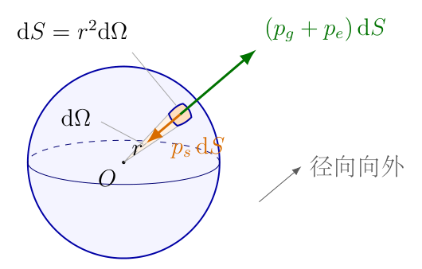{width=65%}

按图中的径向正方向，微元方程为

$$
\begin{aligned}
\mathrm dm\,\ddot r&=(p_g+p_e-p_s)\,\mathrm dS,\\
\frac{m\,\mathrm d\Omega}{4\pi}\ddot r
&=(p_g+p_e-p_s)r^2\mathrm d\Omega,\\
\boxed{m\ddot r=4\pi r^2(p_g+p_e-p_s)}.&
\end{aligned}
$$

张力实际沿膜面分布，对弯曲微元的合效果可用$p_s$表示；图中向内箭头是该曲率合效果，不是把一条实际张力误画成径向力。气体、电压力箭头向外，三个项的符号与图一致。

整个球面在对称径向运动时，各微元力的矢量和为零，泡心不平移。但半径这一广义坐标仍受非零广义力，正是$4\pi r^2(p_g+p_e-p_s)$。把“整体矢量合力为零”误用于半径方程，就会错误地得到永远不振动。

（7）逐项展开三个压强，求单泡的一阶恢复力。

设$r=r_1(1+x)$，其中$x$为无量纲小量，$|x|\ll1$，正值表示膨胀。$\ddot r=r_1\ddot x$。利用二项式的一阶展开$(1+x)^a=1+ax+O(x^2)$：

$$
\begin{aligned}
p_g&=P_g(1+x)^{-5}=P_g(1-5x)+O(x^2),\\
p_e&=P_e(1+x)^{-4}=P_e(1-4x)+O(x^2),\\
p_s&=P_s(1+x)^{-1}=P_s(1-x)+O(x^2).
\end{aligned}
$$

因此净压差为

$$
\begin{aligned}
p_g+p_e-p_s
&=(P_g+P_e-P_s)+(-5P_g-4P_e+P_s)x+O(x^2)\\
&=(-5P_g-4P_e+P_s)x+O(x^2).
\end{aligned}
$$

常数项消失是平衡条件的结果。面积$4\pi r^2=4\pi r_1^2(1+2x+O(x^2))$也在变化，但其$2x$项与已经是一阶的净压差相乘，成为二阶小量。因此线性方程为

$$
\begin{aligned}
mr_1\ddot x&=4\pi r_1^2(-5P_g-4P_e+P_s)x,\\
\ddot x&=\frac{4\pi r_1}{m}(-5P_g-4P_e+P_s)x.
\end{aligned}
$$

再代入$P_g=P_s-P_e$，完整化简系数：

$$
\begin{aligned}
-5P_g-4P_e+P_s
&=-5(P_s-P_e)-4P_e+P_s\\
&=(-5+1)P_s+(5-4)P_e\\
&=P_e-4P_s.
\end{aligned}
$$

故$\ddot x+\omega_1^2x=0$，其中

$$
\boxed{\omega_1^2=\frac{4\pi r_1}{m}(4P_s-P_e)}.
$$

$P_e<P_s$使$4P_s-P_e>3P_s>0$，所以每个存在的带电平衡态，在本单泡球形径向模式下都有恢复作用。不能误把第三问的$P_e>P_s/4$要求加到封管单泡上。

在此用完整能量导数独立检查恢复系数。封闭单泡的气体内能是$U_g=p_gV/(\gamma-1)$，本题$\gamma-1=2/3$。先算内能，再把气体、两个界面及球壳电场的能量相加：

$$
\begin{aligned}
U_g&=\frac{C/r^5}{2/3}\frac{4\pi r^3}{3}
=\frac{2\pi C}{r^2},\\
\mathcal E(r)&=\frac{2\pi C}{r^2}+8\pi\sigma r^2+\frac{4\pi b}{r}.
\end{aligned}
$$

直接微分，而不是再次代入周期终式：

$$
\begin{aligned}
-\mathcal E'(r)
&=\frac{4\pi C}{r^3}-16\pi\sigma r+\frac{4\pi b}{r^2}\\
&=4\pi r^2\left(\frac C{r^5}+\frac b{r^4}-\frac{4\sigma}r\right),\\
\mathcal E''(r)&=\frac{12\pi C}{r^4}+16\pi\sigma+\frac{8\pi b}{r^3}.
\end{aligned}
$$

在$r_1$处用$C=4\sigma r_1^4-br_1$，完整化简：

$$
\begin{aligned}
\mathcal E''(r_1)
&=48\pi\sigma-\frac{12\pi b}{r_1^3}
+16\pi\sigma+\frac{8\pi b}{r_1^3}\\
&=64\pi\sigma-\frac{4\pi b}{r_1^3}\\
&=4\pi r_1(4P_s-P_e)=m\omega_1^2.
\end{aligned}
$$

能量梯度与第（6）步的完整广义力一致，能量曲率与本步的恢复系数一致，也独立检查了面积变化项及电能中的$1/2$。

（8）写出振动周期，并进行零电荷与量纲检查。

简谐方程的一般解是$x=A\cos(\omega_1t)+B\sin(\omega_1t)$，一个完整周期对应相位增加$2\pi$。由此

$$
\begin{aligned}
\mathcal T_1&=\frac{2\pi}{\omega_1}\\
&=\boxed{2\pi\sqrt{\frac{m}{4\pi r_1\left(\dfrac{16\sigma}{r_1}-\dfrac{Q^2}{32\pi^2\varepsilon_0r_1^4}\right)}}}.
\end{aligned}
$$

周期用$\mathcal T_1$表示，避免与气体温度$T$混淆；$r_1$是第（5）步四次方程的唯一正根。式中$4\pi r_1(4P_s-P_e)$量纲为$\mathrm{N/m}$，相当于径向有效劲度系数，所以根号内为$\mathrm{kg}/(\mathrm{N/m})=\mathrm{s^2}$。

若$Q=0$，则$b=0$、$r_1=r_0$、$P_e=0$，逐项代入得

$$
\begin{aligned}
\omega_1^2&=\frac{4\pi r_0}{m}\frac{16\sigma}{r_0}
=\frac{64\pi\sigma}{m},\\
\boxed{\mathcal T_1(Q=0)=\sqrt{\frac{\pi m}{16\sigma}}}.&
\end{aligned}
$$

这里半径约去并不表示不同大小的实际泡必有相同周期：比较的是有效质量$m$和表面张力系数$\sigma$相同的模型。若膜厚相同导致$m\propto r_0^2$，实际周期仍随尺寸改变。

（9）连通后改用总容积，重新推导共同气体压强。

考虑两个相同的带电泡在共同半径$r_1$处的平衡。它们各自带固定电荷$Q$，平衡压强仍为$P_g,P_e,P_s$。气体自由连通且管内惯性忽略，取各处共同压强$p_g$和温度$T$；两泡的气体量可以分别改变，但总气体量$2n$守恒。

图5-4分别表示同相、反相扰动。实线表示扰动半径，虚线表示共同平衡半径$r_1$，不是额外的泡膜。用图中的$x,y$建立总容积关系：

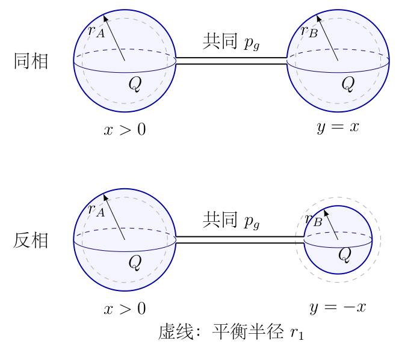{width=80%}

$$
\begin{aligned}
r_A&=r_1(1+x),\qquad r_B=r_1(1+y),\\
V_{\rm tot}&=\frac{4\pi r_1^3}{3}\big[(1+x)^3+(1+y)^3\big],\\
V_{\rm eq}&=2\frac{4\pi r_1^3}{3},\\
\frac{V_{\rm tot}}{V_{\rm eq}}
&=\frac{(1+x)^3+(1+y)^3}{2}\\
&=1+\frac32(x+y)+O(x^2,xy,y^2).
\end{aligned}
$$

把全部气体作为一个热力学系统，气体向两泡做的总功是$p_g(\mathrm dV_A+\mathrm dV_B)=p_g\mathrm dV_{\rm tot}$。第一定律仍给$p_gV_{\rm tot}^{5/3}=P_gV_{\rm eq}^{5/3}$，而不是分别给每个泡$p_{gA}r_A^5$、$p_{gB}r_B^5$不变。

将总容积展开式代入，使用一阶二项式展开：

$$
\begin{aligned}
p_g&=P_g\left(\frac{V_{\rm tot}}{V_{\rm eq}}\right)^{-5/3}\\
&=P_g\left[1+\frac32(x+y)\right]^{-5/3}+O(x^2,xy,y^2)\\
&=P_g\left[1-\frac53\frac32(x+y)\right]+O(x^2,xy,y^2)\\
&=P_g\left[1-\frac52(x+y)\right]+O(x^2,xy,y^2).
\end{aligned}
$$

系数$5/2$来自“总容积平均”中的$1/2$，不是封闭单泡的$5$。若$x=-y$，总容积与共同压强的一阶变化都为零，这一点决定反相模式的性质。

（10）分别列两个泡的线性方程，核对各项符号。

泡$A$的电压力、表面张力压强分别是$P_e(1-4x)$与$P_s(1-x)$；泡$B$对应$P_e(1-4y)$与$P_s(1-y)$。注意电荷没有通过绝缘管转移，所以每泡的$Q$保持不变，不能用“总电荷不变而各泡重新分配”的导体模型。

从第（6）步微元方程分别得到

$$
\begin{aligned}
\ddot x&=\frac{4\pi r_1}{m}
\left[-\frac52P_g(x+y)+(P_s-4P_e)x\right],\\
\ddot y&=\frac{4\pi r_1}{m}
\left[-\frac52P_g(x+y)+(P_s-4P_e)y\right].
\end{aligned}
$$

共同气体项在两个式子中完全相同。利用$P_g=P_s-P_e$化简第一个式子的$x,y$系数：

$$
\begin{aligned}
-\frac52P_g+P_s-4P_e
&=-\frac52(P_s-P_e)+P_s-4P_e\\
&=-\frac32P_s-\frac32P_e,\\
-\frac52P_g&=-\frac52(P_s-P_e).
\end{aligned}
$$

若记$c=4\pi r_1/m$，则两个方程写成对称矩阵形式：

$$
\begin{pmatrix}\ddot x\\\ddot y\end{pmatrix}
=c\begin{pmatrix}
-\frac32(P_s+P_e)&-\frac52(P_s-P_e)\\
-\frac52(P_s-P_e)&-\frac32(P_s+P_e)
\end{pmatrix}
\begin{pmatrix}x\\y\end{pmatrix}.
$$

矩阵的非对角项并非静电互场，而是气体共同压强导致的耦合。此处正好体现图5-4中两个泡通过细管联系的物理意义。

（11）相加求同相模式，相减求反相模式。

定义$u=x+y$、$v=x-y$，则$x=(u+v)/2$、$y=(u-v)/2$。两个方程相加：

$$
\begin{aligned}
\ddot u&=c[-5P_gu+(P_s-4P_e)u]\\
&=c[-5(P_s-P_e)+P_s-4P_e]u\\
&=c(P_e-4P_s)u.
\end{aligned}
$$

所以

$$
\ddot u+\omega_+^2u=0,\qquad
\boxed{\omega_+^2=c(4P_s-P_e)}.
$$

同相时$x=y$，每泡容积同比变化，气体压强恢复作用与封管单泡相同，故$\omega_+=\omega_1$。因为$P_e<P_s$，同相模式一直具有正恢复系数。

两个方程相减，共同气体项逐项抵消：

$$
\begin{aligned}
\ddot v&=c\left\{-\frac52P_g(x+y)+(P_s-4P_e)x
+\frac52P_g(x+y)-(P_s-4P_e)y\right\}\\
&=c(P_s-4P_e)(x-y)\\
&=c(P_s-4P_e)v.
\end{aligned}
$$

因此

$$
\ddot v+\omega_-^2v=0,\qquad
\boxed{\omega_-^2=c(4P_e-P_s)}.
$$

任意小扰动都可分解为$u,v$两个模式；稳定要求二者都有恢复作用。若反相频率平方为负，解中就存在指数增长分量，不能称为稳定振动。

这两个模式也可由完整能量独立检查，不能只把频率代入一个二次式。记$\zeta=[(1+x)^3+(1+y)^3]/2$，总气体内能按$V_{\rm tot}^{1-\gamma}$变化，所以

$$
\mathcal E_{AB}=4\pi P_gr_1^3\zeta^{-2/3}
+8\pi\sigma r_1^2[(1+x)^2+(1+y)^2]
+\frac{4\pi b}{r_1}\left(\frac1{1+x}+\frac1{1+y}\right).
$$

其中平衡气体内能为$P_gV_{\rm eq}/(\gamma-1)=4\pi P_gr_1^3$。为求能量曲率，容积必须保留二阶项，不能只用前面的一阶压强展开。二项式展开逐项给出

$$
\begin{aligned}
\zeta&=1+\frac32(x+y)+\frac32(x^2+y^2)+O(3),\\
\zeta^{-2/3}&=1-(x+y)-(x^2+y^2)+\frac54(x+y)^2+O(3),\\
(1+x)^2+(1+y)^2&=2+2(x+y)+(x^2+y^2),\\
\frac1{1+x}+\frac1{1+y}&=2-(x+y)+(x^2+y^2)+O(3).
\end{aligned}
$$

$O(3)$表示总次数不小于三的项。容积函数的平方项系数为$\frac{(-2/3)(-5/3)}2\left(\frac32\right)^2=\frac54$。代入完整能量，一阶项为$4\pi r_1^3(-P_g+P_s-P_e)(x+y)=0$，二阶项为

$$
\begin{aligned}
\delta^2\mathcal E_{AB}
&=4\pi r_1^3\left[\left(-P_g+\frac12P_s+P_e\right)(x^2+y^2)
+\frac54P_g(x+y)^2\right]\\
&=\pi r_1^3\left[(4P_e-P_s+5P_g)u^2+(4P_e-P_s)v^2\right]\\
&=\pi r_1^3\left[(4P_s-P_e)u^2+(4P_e-P_s)v^2\right].
\end{aligned}
$$

第二行使用$x^2+y^2=(u^2+v^2)/2$，第三行再使用$P_g=P_s-P_e$。因此能量展开中实际的二阶项确实是

$$
\delta^2\mathcal E
=\frac{mr_1^2}{4}\left[\omega_+^2(x+y)^2+
\omega_-^2(x-y)^2\right].
$$

动能相应为$mr_1^2(\dot u^2+\dot v^2)/4$，因为$\dot x^2+\dot y^2=(\dot u^2+\dot v^2)/2$。两个频率平方同时为正，正好等价于能量在两个径向方向上都有正曲率；这与单泡仅检查一个方向的能量曲率不同。

（12）返回第一问，明确未带电连通泡为什么不稳定。

未带电时$r_1=r_0$、$P_e=0$、$P_s=4\sigma/r_0$。反相方程变成

$$
\begin{aligned}
\ddot v&=\frac{4\pi r_0}{m}\frac{4\sigma}{r_0}v
=\frac{16\pi\sigma}{m}v,\\
v(t)&=A\mathrm e^{\lambda t}+B\mathrm e^{-\lambda t},\qquad
\lambda=\sqrt{\frac{16\pi\sigma}{m}}.
\end{aligned}
$$

一般微扰具有$A\ne0$的增长分量。即使两泡的同相模式稳定，反相扰动仍会被放大，故第一问的完整结论是

$$
\boxed{p_0=\frac{4\sigma}{r_0},\qquad
\text{未带电的两个等大连通泡不是稳定平衡。}}
$$

从压力角度也能看清这一符号：若泡$A$略大，$x>0$，泡$B$略小，$y=-x$，共同气体压强一阶不变。泡$A$的张力压强减少$P_sx$，向外净压差增加$P_sx$，故继续膨胀；泡$B$则继续收缩。气体会从较小泡流向较大泡，进一步加强大小差异。

（13）给出稳定的压强比例条件，解释其两端。

同相条件$4P_s-P_e>0$由$P_g>0$自动保证。反相模式要求$4P_e-P_s>0$。合起来有

$$
\boxed{\frac14<\frac{P_e}{P_s}<1}.
$$

下限来自反相恢复力，上限来自含气体平衡态的正压；并不是两条独立的有限电荷上下限。等号$P_e/P_s=1/4$时$\omega_-^2=0$，线性反相恢复力消失；在严格恢复型稳定判据下不纳入范围。只做一阶分析不能据此断言更高阶扰动也稳定。

将图5-5中的$q=P_e/P_s$看作随平衡半径增加的函数，可以把隐式条件转换为显式电荷范围。

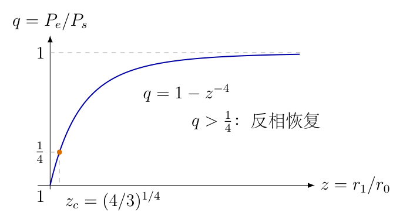{width=65%}

（14）先由平衡消去压强比例，再求临界半径。

由于$P_g+P_e=P_s$，有

$$
\begin{aligned}
q=\frac{P_e}{P_s}
&=1-\frac{P_g}{P_s}\\
&=1-\frac{C/r_1^5}{4\sigma/r_1}\\
&=1-\frac{C}{4\sigma r_1^4}\\
&=1-\left(\frac{r_0}{r_1}\right)^4.
\end{aligned}
$$

令$z=r_1/r_0$，则图5-5的曲线是$q=1-z^{-4}$，$z\ge1$。其导数$\mathrm dq/\mathrm dz=4z^{-5}>0$，所以随着平衡半径增加，电压力所占比例单调增大。将$q>1/4$逐步消元：

$$
\begin{aligned}
1-\left(\frac{r_0}{r_1}\right)^4&>\frac14,\\
\left(\frac{r_0}{r_1}\right)^4&<\frac34,\\
\left(\frac{r_1}{r_0}\right)^4&>\frac43,\\
\boxed{r_1>r_c=r_0\left(\frac43\right)^{1/4}}.&
\end{aligned}
$$

所有半径为正，取倒数与四次根不会产生符号分支。临界半径约为$1.074570r_0$；相等时只到达零频边界，不满足严格不等式。

（15）利用半径—电荷的单调关系，给出显式$Q$范围。

第（5）步已证明$b(r)$严格递增，因而$r_1>r_c$等价于$b>b_c=b(r_c)$，不会在代入临界半径时反转不等号。利用$r_c^4=(4/3)r_0^4$，可先计算临界值：

$$
\begin{aligned}
b_c&=4\sigma r_c^3-\frac{4\sigma r_0^4}{r_c}\\
&=4\sigma r_c^3-\frac{4\sigma(3r_c^4/4)}{r_c}\\
&=4\sigma r_c^3-3\sigma r_c^3\\
&=\sigma r_c^3
=\sigma r_0^3\left(\frac43\right)^{3/4}.
\end{aligned}
$$

代入$b=Q^2/(32\pi^2\varepsilon_0)$，得到

$$
\boxed{Q^2>32\pi^2\varepsilon_0\sigma r_0^3
\left(\frac43\right)^{3/4}}.
$$

若$Q$表示非负的加电量，可定义

$$
Q_c=4\sqrt2\,\pi\sqrt{\varepsilon_0\sigma r_0^3}
\left(\frac43\right)^{3/8},\qquad \boxed{Q>Q_c}.
$$

若允许$Q$为有符号电荷，则写成$\boxed{|Q|>Q_c}$。因只保留自场，整体电荷符号不影响本径向稳定判据。

没有额外的有限$Q$上限：任意有限$b$都有一个有限正平衡半径，并且$P_g=C/r_1^5>0$，所以$q<1$自动成立。只有$b\to\infty$的形式极限使$q\to1^-$。这一“无有限上限”限定于目前薄膜、固定$\sigma$、忽略互场的球形模型，不能用来断言任意大的实际电荷不会破坏泡膜。

量纲检查为$[\varepsilon_0\sigma r_0^3]=\mathrm{C^2}$，故右端确有电荷平方量纲；$4/3$的分数次幂无量纲。若把半径写成$r_0^4$，就会立即暴露量纲错误。

上述显式阈值的气体路径条件也可直接在本步检查。若带电过程不沿初态等熵路径，仍可在最终平衡附近以实际常量$C_*$写$p_g=C_*/r^5$，但不能再自动使用$C_*=4\sigma r_0^4$。单泡周期及两个模式的压强形式不变；电荷阈值的已知量表达须重新消元：

$$
\begin{aligned}
q_c&=\frac14,\qquad P_g=\frac34P_s=\frac{3\sigma}{r_c},\\
\frac{C_*}{r_c^5}&=\frac{3\sigma}{r_c},\qquad
r_c=\left(\frac{C_*}{3\sigma}\right)^{1/4},\\
b_c&=\sigma r_c^3
=\sigma\left(\frac{C_*}{3\sigma}\right)^{3/4},\\
Q^2&>32\pi^2\varepsilon_0\sigma
\left(\frac{C_*}{3\sigma}\right)^{3/4}.
\end{aligned}
$$

这不是额外指定某种加热，而是说明缺少充电热力学路径时不能唯一把最终气体状态还原为初态$r_0$。在本题主模型的无耗散等熵约定下，代回$C_*=4\sigma r_0^4$就恢复本步的显式范围。

\newpage

# 第6题

<!-- question-start -->

如图6-1，高为$h$、质量为$M$的三角形滑块置于水平地面上，顶端放有质量为$m$的质点。右侧固定墙上装有劲度系数为$k$的轻弹簧，弹簧预先压缩$x_0$，并用细绳保持这一状态。所有接触面均光滑。给质点一个向右的微扰，质点沿滑块下滑；在到达水平地面前，质点经过光滑的小圆弧过渡，且不损失机械能。

（1）求质点滑到地面后，相对于滑块的速度大小$u$。

（2）质点开始接触弹簧时，固定弹簧的细绳立即消失。要使质点反弹后能够越过滑块，求预压缩量$x_0$的临界值。

（3）求从开始接触弹簧到与弹簧分离的总时间$t$。

（4）求质点在接触弹簧期间，相对于初接触位置的位移随时间的关系。

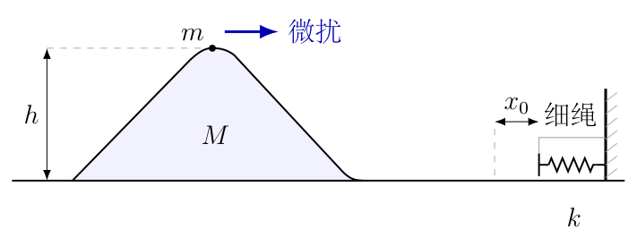{width=85%}

<!-- question-end -->

## 一、题型定位

本题是自由滑块、弹簧与分阶段守恒的综合题。它看似只有重力势能和弹性势能的相互转化，实质上包含三个不同的动力学系统：质点第一次下滑时，质点与滑块组成水平动量守恒的系统；质点与墙上弹簧接触时，墙提供水平外力，原系统的水平动量不再守恒；质点返回滑块之后，水平动量重新守恒，但守恒的值已经不是零。

第一问要区分地面速度与相对速度。第二问要区分总动能与能够用于相对上坡的动能。后两问则属于具有非零初位移、非零初速度的简谐运动初值问题，而且弹簧只在被压缩时与质点接触。运动方程的数学延拓不能代替实际接触条件。

## 二、知识点

水平动量守恒要求所选系统没有水平外力。重力、光滑地面的支持力均竖直，但固定墙通过弹簧施加的力水平，因此必须在系统边界与运动阶段明确之后再判断动量是否守恒。墙不移动，其约束力可以有非零冲量却不做功；冲量与功不能混淆。

机械能守恒要求没有机械能损失。光滑运动并不意味着每一个物体的动能都单独守恒：质点与滑块之间的法向力可以分别做功，只是对于包含两者的系统，其内部约束作用不改变总机械能。下滑的$mgh$同时转化为质点与滑块的动能。

两个质量分别为$m,M$、速度分别为$v_1,v_2$的物体，其动能可分解为质心平动动能与相对运动动能。记总动量$P=mv_1+Mv_2$，约化质量为$\mu=Mm/(M+m)$，则

$$
K=\frac{P^2}{2(M+m)}+\frac12\mu(v_1-v_2)^2.
$$

这个等式是代数恒等式，不需要预先假设$P=0$。返回上坡时，质心平动不能凭空消失；真正能够转化为重力势能的是第二项。

弹簧受压时遵从胡克定律。若以自然长左端所在的位置为坐标零点，向右为正，质点的压缩坐标为$\xi$，则$m\ddot\xi=-k\xi$，角频率为$\omega=\sqrt{k/m}$。确定解需要同时使用$\xi(0)$与$\dot\xi(0)$；相位和振幅不是任意选择的装饰参数。

位置与位移是不同的量。位置$\xi(t)$取决于空间原点，位移$s(t)=\xi(t)-\xi(0)$以初始位置为基准，必须满足$s(0)=0$。本题第（4）问要给后者。

## 三、物理图像

质点向右下滑，滑块向左退让。到达水平地面之后，质点仍向右，滑块仍向左，相对速度大小是两个地面速度大小之和，而不是两者之差。滑块越轻，越容易退让，质点获得的地面速度反而越小；相对下滑速度却可以变大。

质点撞上预压缩弹簧时，原有弹性势能并没有消失。质点先向右使弹簧进一步压缩，速度逐渐减小到零，然后向左加速。弹簧恢复自然长度时，质点分离，向左的速度大小一般大于入射速度。此时滑块仍保持原来向左的匀速运动，因为质点接触弹簧期间没有与滑块相互作用。

反弹质点与滑块同向向左运动。只有质点比滑块更快，才会从右侧追上滑块并沿右坡上升。因此回坡相对速度是两个向左速度大小之差。第一次下滑是“相向运动取和”，第二次返回是“同向追赶取差”，这正是本题最重要的速度方向变化。

临界返回过程中，质点到达峰顶时，相对于滑块的速度趋于零，但两者对地仍可一起平移。不能把“相对速度为零”写成“质点与滑块都静止”。这个共同平移带有非零动能，是第二问中必须扣除的部分。

## 四、解题入口

全程使用地面惯性系，水平向右为正。下滑到底时，质点向右速度记为$v>0$，滑块向左速度大小记为$V>0$；滑块的带符号速度是$-V$。先由$mv-MV=0$与机械能守恒求出$v,V$，再得$u=v+V$。

接触弹簧时另将时间重新记为$t=0$。先用弹簧阶段的能量守恒求分离速度大小$w$，再用返回阶段的相对运动能量求越过高度$h$的条件。不能把墙上弹簧阶段与自由滑块阶段合并成一个“总动量始终为零”的过程。

后两问先保留一般预压缩量$x_0$：写出$\xi(0)=x_0$、$\dot\xi(0)=v$，解简谐运动方程，选择第一次从正压缩量下降到零的时刻。最后再代入第二问的临界$x_0$，得到只含质量比的特殊时间式。这样既给出完整答案，又避免把一个临界特例错误地当成任意预压缩量的结论。

## 五、解析

（1）划分阶段并固定符号约定。

图6-1中弹簧的右端固定于墙，不与滑块连接；细绳仅用于保持弹簧的预压状态。绳消失理解为解除约束，不额外给质点有限冲量或附加能量。给出的初始微扰取趋于零的极限，故第一次下滑的初始动能忽略，初始机械能为$mgh$。

全过程分为：第一次下滑及底部圆弧过渡；地面上向右的自由运动；与弹簧接触；分离后向左的自由运动；再次与滑块接触并上坡。地面上的两段自由运动不改变速度，所以求底部速度即可作为接触弹簧前的入射速度。

下面采用题图所表示的分离后再回坡的阶段顺序，即弹簧接触期间质点不提前碰回滑块。若实际装置距离很小，需要另核验这一条件，后面给出间距判据。滑块的底部和峰顶按光滑轮廓处理；关于“最小预压”，严格区分恰能达到顶端的能量阈值和确实越过顶端的运动。

（2）建立第一次下滑的水平动量方程。

图6-2标出底部圆弧过渡结束后的速度。质点与滑块的速度都已水平，因此相对速度直接是两个水平速度之差。

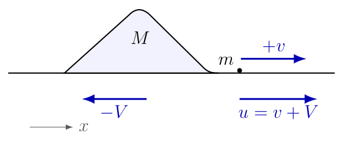{width=75%}

对包含质点与滑块的系统，重力与地面支持力均竖直；墙上弹簧尚未与质点接触，因而没有水平外力。初始水平动量为零，故

$$
\begin{aligned}
P_x&=mv+M(-V)=0,\\
mv&=MV,\\
V&=\frac mM v.
\end{aligned}
$$

图中向左箭头的标记$-V$是带符号速度，$V$本身是正的大小。质点相对于滑块的速度为

$$
\begin{aligned}
u&=v-(-V)=v+V,\\
u&=v\left(1+\frac mM\right)
=\frac{M+m}{M}v,\\
v&=\frac{M}{M+m}u,\qquad
V=\frac{m}{M+m}u.
\end{aligned}
$$

这里的$u$只对应质点已到达水平地面后的时刻。在斜面中途，质点还具有竖直分速度，不能把其完整相对速度简单写成两个水平速度之和。

（3）从机械能守恒求底部三个速度。

滑块只水平平移，它的重心高度不变；只有质点降低了高度$h$。题设的光滑圆弧过渡不损失能量，因此

$$
\frac12mv^2+\frac12MV^2=mgh.
$$

代入上一步以$u$表示的两个速度，逐项化简：

$$
\begin{aligned}
\frac12m\frac{M^2}{(M+m)^2}u^2
+\frac12M\frac{m^2}{(M+m)^2}u^2&=mgh,\\
\frac{mM^2+Mm^2}{2(M+m)^2}u^2&=mgh,\\
\frac{mM(M+m)}{2(M+m)^2}u^2&=mgh,\\
\frac12\frac{Mm}{M+m}u^2&=mgh.
\end{aligned}
$$

约去正的$m$，并取右向相对运动的正根，得到第一问：

$$
\boxed{u=\sqrt{\frac{2gh(M+m)}{M}}}.
$$

随后代回$v,V$：

$$
\begin{aligned}
v^2&=\frac{M^2}{(M+m)^2}\frac{2gh(M+m)}M
=\frac{2ghM}{M+m},\\
V^2&=\frac{m^2}{(M+m)^2}\frac{2gh(M+m)}M
=\frac{2ghm^2}{M(M+m)}.
\end{aligned}
$$

所以

$$
\boxed{v=\sqrt{\frac{2ghM}{M+m}},\qquad
V=m\sqrt{\frac{2gh}{M(M+m)}}}.
$$

量纲上$gh$是速度平方，$m/M$等质量比无量纲。极限$M\to\infty$时，$V\to0$，$v,u\to\sqrt{2gh}$，回到固定斜面的结果；这也检查了质量比没有倒置。

（4）说明约化质量公式的来源，而不是直接套用。

设两个物体在某一水平状态下的带符号速度为$v_1,v_2$，其总动量为$P=mv_1+Mv_2$，质心速度为$V_C=P/(M+m)$，相对速度为$r_v=v_1-v_2$。联立这两个关系，可得

$$
\begin{aligned}
v_1&=V_C+\frac{M}{M+m}r_v,\\
v_2&=V_C-\frac{m}{M+m}r_v.
\end{aligned}
$$

将这两式代入动能并展开平方，交叉项正好抵消：

$$
\begin{aligned}
K&=\frac12m\left(V_C+\frac{M}{M+m}r_v\right)^2
+\frac12M\left(V_C-\frac{m}{M+m}r_v\right)^2,\\
&=\frac12(M+m)V_C^2
+\left(\frac{mM}{M+m}-\frac{Mm}{M+m}\right)V_Cr_v\\
&\quad+\frac12\frac{mM^2+Mm^2}{(M+m)^2}r_v^2,\\
&=\frac{P^2}{2(M+m)}+\frac12\frac{Mm}{M+m}r_v^2.
\end{aligned}
$$

此处使用配方和质心分解。第一次到底时$P=0,r_v=u$，故全部动能等于$\frac12\mu u^2=mgh$，与上一步完全一致。返回上坡时$P\ne0$，仍能使用同一分解，但不能删除第一项。

（5）确定弹簧坐标、受力和初始状态。

图6-3把固定墙与弹簧自然长左端位置$O_s$作为地面上的固定参考。上图是首次接触，下图是恢复自然长度、即将分离。小圆点表示质点，弹簧左端的短竖线只表示接触端面，不是额外杆件；两幅图的水平位置可以直接比较。

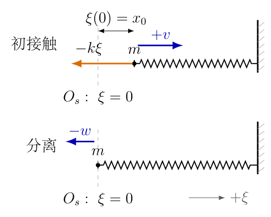{width=80%}

向右、向墙为正。弹簧受压时，其左端比自然长左端向右移动$\xi$，故$\xi\ge0$。开始接触时

$$
\xi(0)=x_0,\qquad \dot\xi(0)=v>0.
$$

弹簧对质点的水平力向左，大小为$k\xi$，因此带符号力为$F_x=-k\xi$。地面支持力与重力平衡，不贡献水平加速度。在轻弹簧近似下，没有弹簧质量要加入运动惯性，故

$$
m\ddot\xi=-k\xi.
$$

滑块此时不受水平力，速度仍是$-V$。不能把$m+M$作为这一弹簧振子的惯性质量，也不能采用$\sqrt{k/\mu}$：弹簧固定于墙，只有质点被它推动。

（6）先由弹簧阶段的能量求分离速度。

开始接触时的质点动能为$\frac12mv^2$，弹簧原来已有弹性势能$\frac12kx_0^2$。先增加压缩、再反弹，不改变这两者的总机械能。恢复自然长时，弹性势能为零，质点向左的速度记为$-w$，其中$w>0$。

这一阶段的能量守恒给出

$$
\begin{aligned}
\frac12mv^2+\frac12kx_0^2&=\frac12mw^2,\\
mw^2&=mv^2+kx_0^2,\\
w^2&=v^2+\frac{k}{m}x_0^2,\\
w&=\boxed{\sqrt{v^2+\frac{k}{m}x_0^2}}.
\end{aligned}
$$

平方根给的是速度大小；实际速度是$-w$。若$x_0=0$，弹簧仅把质点的速度由$+v$反向成$-v$，其大小不变。若$x_0>0$，预存弹性势能转化为额外的质点动能，故$w>v$。

最大压缩时质点瞬时静止，设最大压缩量为$A$，同一能量关系还给出

$$
\frac12kA^2=\frac12kx_0^2+\frac12mv^2,
\qquad
A=\sqrt{x_0^2+\frac{mv^2}{k}}.
$$

$A$是最大压缩量，不是题设的预压缩量$x_0$。它也正是随后简谐运动的振幅，且$w=\omega A$。

（7）检查弹簧阶段的外力与冲量。

对质点应用冲量定理，初末速度分别为$+v,-w$，故弹簧给出的水平冲量为

$$
J_x=m(-w)-mv=-m(w+v).
$$

对质点、滑块与轻弹簧组成的系统，固定墙是外界。墙通过弹簧传递同样的水平外冲量；初始系统水平动量为$mv-MV=0$，分离后的动量则为

$$
\begin{aligned}
P_{\mathrm{out}}&=m(-w)+M(-V),\\
&=-mw-MV,\\
&=-mw-mv=-m(w+v)=J_x.
\end{aligned}
$$

这不是违反动量守恒，而是该阶段根本不满足无水平外力的前提。墙的固定点没有位移，因此墙的约束力不做机械功；非零冲量改变动量，初始弹簧势能改变最终动能，两件事可以同时成立。

（8）返回滑块首先要满足同向追赶条件。

图6-4左侧给出返回地面上的两个速度，右侧给出达到顶端的临界状态。质点在滑块右侧，它必须向左追上滑块，才有再次上坡的可能。

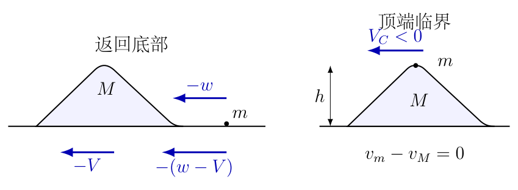{width=85%}

分离后的带符号速度分别是$-w$和$-V$，因此质点相对滑块的速度为

$$
(-w)-(-V)=-(w-V).
$$

向左上坡对应这个差为负，也就是$w>V$。能用来表示接近速率的量是$w-V>0$。如果$w\le V$，质点不会从右侧追上滑块，此时把$(w-V)^2$代入某个“上升高度”公式并不能创造出实际的上坡过程。

（9）扣除返回阶段不能用于爬坡的质心动能。

再次接触滑块以后，弹簧已经分离，系统不再受水平外力，故上一步的非零$P_{\mathrm{out}}$保持不变。重力只改变内部相对运动和势能，不改变水平质心速度

$$
V_C=\frac{P_{\mathrm{out}}}{M+m}
=-\frac{mw+MV}{M+m}.
$$

返回底部时两物体都水平运动，动能按第（4）步分解：

$$
\begin{aligned}
K_{\mathrm{bottom}}
&=\frac12mw^2+\frac12MV^2,\\
&=\frac{P_{\mathrm{out}}^2}{2(M+m)}
+\frac12\mu(w-V)^2.
\end{aligned}
$$

在恰能达到峰顶的临界状态，质点相对滑块的速度为零，两者共同以$V_C$运动。因此临界顶端的动能为

$$
K_{\mathrm{crest}}=
\frac12(M+m)V_C^2
=\frac{P_{\mathrm{out}}^2}{2(M+m)}.
$$

由底部到顶端的机械能守恒，

$$
\begin{aligned}
K_{\mathrm{bottom}}&=K_{\mathrm{crest}}+mgh,\\
\frac{P_{\mathrm{out}}^2}{2(M+m)}+\frac12\mu(w-V)^2
&=\frac{P_{\mathrm{out}}^2}{2(M+m)}+mgh,\\
\frac12\mu(w-V)^2&=mgh.
\end{aligned}
$$

两侧相同的质心平动能抵消，剩下的才是爬坡能量。由第一问$\frac12\mu u^2=mgh$，且返回接近速率为正，临界条件等价于

$$
w-V=u,
\qquad w_{\mathrm{crit}}=u+V=v+2V.
$$

若要求具有正的相对越顶速度，则应写$w-V>u$。这个条件自动包含$w>V$，但方向判断必须在平方之前明确。

（10）把临界速度条件转化为预压缩量。

由弹簧阶段的能量式，临界时有

$$
v^2+\frac{k}{m}x_{\mathrm{crit}}^2=(v+2V)^2.
$$

展开平方并消去相同的$v^2$：

$$
\begin{aligned}
\frac{k}{m}x_{\mathrm{crit}}^2
&=v^2+4vV+4V^2-v^2,\\
&=4V(v+V)=4Vu,\\
x_{\mathrm{crit}}^2&=\frac{4m}{k}Vu.
\end{aligned}
$$

再代入$V=m\,u/(M+m)$和$u^2=2gh(M+m)/M$，

$$
\begin{aligned}
x_{\mathrm{crit}}^2
&=\frac{4m}{k}\frac{m}{M+m}u^2,\\
&=\frac{4m^2}{k(M+m)}\frac{2gh(M+m)}M,\\
&=\frac{8m^2gh}{kM}.
\end{aligned}
$$

由于预压缩量非负，第二问的能量阈值为

$$
\boxed{x_{\mathrm{crit}}=\sqrt{\frac{8m^2gh}{kM}}}.
$$

通常所说的“最小压缩量”指这个临界值：$x_0=x_{\mathrm{crit}}$恰能达到顶端，$x_0>x_{\mathrm{crit}}$才有正的相对越顶速度。在圆滑峰顶，临界轨迹还可能渐近接近顶端，不能把等号描述成有限时间内确实翻过；严格越顶的预压集合是$(x_{\mathrm{crit}},\infty)$，其下确界为$x_{\mathrm{crit}}$。

量纲核验：$k$的量纲为质量除以时间平方，$m^2gh/(kM)$的量纲是长度平方，根号后才是压缩量。$M\to\infty$时$x_{\mathrm{crit}}\to0$；固定滑块与无预压弹簧构成可逆的往返路线，能恰好回到原高度，而严格越顶仍需要正的附加能量。

（11）求一般预压缩量下的简谐运动初值解。

令$\omega=\sqrt{k/m}$，接触方程化为

$$
\ddot\xi+\omega^2\xi=0.
$$

该常系数二阶方程的实解写成

$$
\xi(t)=C_1\cos\omega t+C_2\sin\omega t.
$$

逐一使用两个初始条件：

$$
\begin{aligned}
\xi(0)&=C_1=x_0,\\
\dot\xi(t)&=-\omega C_1\sin\omega t
+\omega C_2\cos\omega t,\\
\dot\xi(0)&=\omega C_2=v,\\
C_2&=\frac v\omega.
\end{aligned}
$$

所以一般位置函数为

$$
\boxed{\xi(t)=x_0\cos\omega t+\frac v\omega\sin\omega t}.
$$

直接求导还可检查：

$$
\begin{aligned}
\dot\xi(t)&=-\omega x_0\sin\omega t+v\cos\omega t,\\
\ddot\xi(t)&=-\omega^2x_0\cos\omega t
-\omega v\sin\omega t=-\omega^2\xi(t).
\end{aligned}
$$

初始压缩量已非零，所以不能写成单一的$(v/\omega)\sin\omega t$；初始速度也非零，所以不能写成$x_0\cos\omega t$。两个项都必须保留。

（12）确定振幅、相位及运动所处的分支。

为了找分离时刻，将同一解写成

$$
\xi(t)=A\sin(\omega t+\theta).
$$

用和角公式展开，与上一步比较系数：

$$
\begin{aligned}
A\sin(\omega t+\theta)
&=A\cos\theta\sin\omega t+A\sin\theta\cos\omega t,\\
A\sin\theta&=x_0,\\
A\cos\theta&=\frac v\omega.
\end{aligned}
$$

平方后相加得到$A^2=x_0^2+(v/\omega)^2$，与能量求出的最大压缩量一致。因$x_0\ge0,v>0$，应取

$$
\begin{aligned}
0&\le\theta<\frac\pi2,\\
\theta&=\arctan\frac{\omega x_0}{v}
=\arcsin\frac{x_0}{A}
=\arcsin\frac{\omega x_0}{w}.
\end{aligned}
$$

这里$w=\omega A$，反三角函数均取与上述第一象限相容的主值。可以用$\operatorname{atan2}(\omega x_0,v)$统一写法；因为本题$v>0$，普通$\arctan$已经没有象限歧义。

图6-5显示接触阶段的正压缩部分。初始相位是$\theta$，随后先到$\pi/2$的最大压缩点，再到$\pi$的第一次回零点。

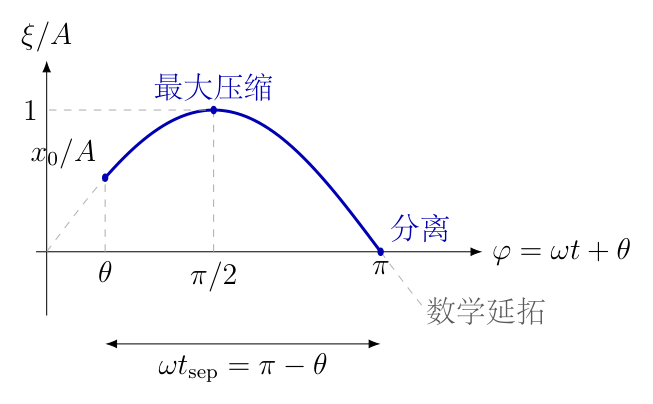{width=75%}

图中的横坐标$\varphi=\omega t+\theta$用于确定事件先后，而不是把时间原点移动到自然长状态。$t=0$仍对应图上$\varphi=\theta$。

（13）选取第一次回到自然长度的分离时刻。

最大压缩时，$\dot\xi=0$，对应$\varphi=\pi/2$，故

$$
t_{\mathrm{max}}=\frac{\pi/2-\theta}{\omega}.
$$

从最大压缩点返回，弹簧恢复自然长时$\xi=0$且$\dot\xi<0$，对应$\varphi=\pi$。所以

$$
\omega t_{\mathrm{sep}}+\theta=\pi,
\qquad t_{\mathrm{sep}}=\frac{\pi-\theta}{\omega}.
$$

第三问的一般答案为

$$
\boxed{t_{\mathrm{sep}}=\sqrt{\frac mk}
\left[\pi-\arctan\!\left(\frac{\sqrt{k/m}\,x_0}{v}\right)\right]},
\qquad v=\sqrt{\frac{2ghM}{M+m}}.
$$

不能取$\omega t+\theta=0$，那是初接触之前的另一个零点。也不能取$\varphi=2\pi$，那已经越过实际分离事件。对于$x_0=0$，初接触本身是零压缩，但速度向右，接触随即建立；应选择下一个速度向左的零点，时间仍是$\pi/\omega$。

在分离点，

$$
\dot\xi(t_{\mathrm{sep}})
=\omega A\cos\pi=-\omega A=-w,
$$

与能量计算一致。此后若继续简谐函数，会得到$\xi<0$和弹簧“拉回”质点的力，这是数学上的延拓而不是题设运动；没有黏结或连接绳时，分离后弹簧不再作用于质点。

（14）写出以首次接触位置为基准的位移。

坐标零点$O_s$固定在弹簧自然长左端的位置，而首次接触位置是$\xi(0)=x_0$，所以题目要求的位移为

$$
\begin{aligned}
s(t)&=\xi(t)-\xi(0),\\
s(t)&=\boxed{x_0(\cos\omega t-1)+\frac v\omega\sin\omega t},
\qquad 0\le t\le t_{\mathrm{sep}}.
\end{aligned}
$$

将题给参数全部代入，可写为

$$
\boxed{
s(t)=x_0\left(\cos\sqrt{\frac km}\,t-1\right)
+\sqrt{\frac{2ghmM}{k(M+m)}}\,
\sin\sqrt{\frac km}\,t}.
$$

该式的三项初末检查是

$$
\begin{aligned}
s(0)&=x_0(1-1)+0=0,\\
\dot s(0)&=v>0,\\
s(t_{\mathrm{sep}})&=0-x_0=-x_0.
\end{aligned}
$$

最后一式表示分离位置比初接触位置向左移了$x_0$。这不表示质点在接触期间一直向左：它先向右移动$A-x_0$，再向左移动$A$，两段路程之和是$2A-x_0$，但净位移是$-x_0$。路程与位移也应区分。

若喜欢余弦形式，由$\delta=\pi/2-\theta=\arccos(x_0/A)$可得

$$
\xi(t)=A\cos(\omega t-\delta),\qquad
s(t)=A\cos(\omega t-\delta)-x_0.
$$

减去$x_0$不能遗漏。小时间展开独立检查初始加速度：利用$\cos\omega t=1-\omega^2t^2/2+\cdots$、$\sin\omega t=\omega t+\cdots$，有

$$
s(t)=vt-\frac12\omega^2x_0t^2+O(t^3),
$$

与初始力$-kx_0$产生的加速度$-kx_0/m$一致。

（15）给出第二问临界预压下的特殊时间和位移。

后两问没有规定必须取临界预压，所以前两步的一般式应当保留。若专门取$x_0=x_{\mathrm{crit}}$，则$w_{\mathrm{crit}}=v+2V$。为避免根式代入混乱，先定义正量

$$
B=\sqrt{\frac{2gh}{M(M+m)}}.
$$

于是$v=MB$、$V=mB$、$w_{\mathrm{crit}}=(M+2m)B$。由$\omega^2x_{\mathrm{crit}}^2=8mgh/M$，计算临界相位：

$$
\begin{aligned}
\sin\theta_{\mathrm{crit}}
&=\frac{\omega x_{\mathrm{crit}}}{w_{\mathrm{crit}}},\\
\sin^2\theta_{\mathrm{crit}}
&=\frac{8mgh/M}{(M+2m)^2\,2gh/[M(M+m)]},\\
&=\frac{4m(M+m)}{(M+2m)^2},\\
\sin\theta_{\mathrm{crit}}
&=\frac{2\sqrt{m(M+m)}}{M+2m}.
\end{aligned}
$$

因为$(M+2m)^2-4m(M+m)=M^2>0$，此比例严格小于$1$，反正弦实数且处在第一象限。因此临界接触时间为

$$
\boxed{t_{\mathrm{crit}}=\sqrt{\frac mk}
\left[\pi-\arcsin\!\left(\frac{2\sqrt{m(M+m)}}{M+2m}\right)\right]}.
$$

临界振幅为

$$
\begin{aligned}
A_{\mathrm{crit}}
&=\frac{w_{\mathrm{crit}}}\omega,\\
&=(M+2m)\sqrt{\frac{2ghm}{kM(M+m)}}.
\end{aligned}
$$

临界位移可直接把$x_{\mathrm{crit}}$代入第（14）步，或写成

$$
\boxed{s_{\mathrm{crit}}(t)=A_{\mathrm{crit}}
\cos\!\left[\sqrt{\frac km}t
-\arccos\!\left(\frac{2\sqrt{m(M+m)}}{M+2m}\right)\right]
-x_{\mathrm{crit}}}.
$$

这里余弦前的振幅与反余弦中的比例都已明确，适用区间为$0\le t\le t_{\mathrm{crit}}$。不带最后的$-x_{\mathrm{crit}}$时，给出的是位置而不是位移；只有临界情况下，相位比例才只含质量比而不含任意$x_0$。

（16）检查接触时间的范围与分阶段几何条件。

对任意有限$x_0\ge0$，$0\le\theta<\pi/2$，因此

$$
\frac{\pi}{2\omega}<t_{\mathrm{sep}}\le\frac\pi\omega.
$$

无预压时等于半周期；预压很大、而$v$固定时，初接触点已非常接近最大压缩点，接触时间趋于四分之一周期。随着$x_0$增大，接触时间单调减小，因为

$$
\frac{\mathrm dt_{\mathrm{sep}}}{\mathrm dx_0}
=-\frac{1}{v[1+(\omega x_0/v)^2]}<0.
$$

最后检查空间阶段顺序。设初接触时质点到滑块右脚的水平间距为$D_0>0$。质点相对初位置移动$s(t)$，滑块右脚向左移动$Vt$，所以两者间距为

$$
D(t)=D_0+s(t)+Vt.
$$

接触区间内$\xi(t)\ge0$，故$\ddot D=\ddot s=-\omega^2\xi\le0$。图像向下凹，任意内点不低于两端连线，所以区间最小值在端点。两个端点为

$$
D(0)=D_0,\qquad
D(t_{\mathrm{sep}})=D_0-x_0+Vt_{\mathrm{sep}}.
$$

分离前不再次撞到滑块的充分且在此模型内必要条件是

$$
\boxed{D_0>\max\{0,\ x_0-Vt_{\mathrm{sep}}\}}.
$$

题中未给$D_0$，不能擅自赋值；通常的分阶段解答按图示足够间距理解。若装置不满足这一条件，质点会在弹簧接触中再次碰到滑块，上述独立弹簧方程不再适用于整个接触段，需要重新建立同时接触的模型。这个限制说明了答案的适用条件，而不是在题目中加入一个未给定的距离数值。

\newpage

# 第7题

<!-- question-start -->

假设太阳为黑体，温度为$T_S$，半径为$R_S$，地球到太阳的距离为$r_E$。在地球轨道附近，垂直于阳光方向放置一个半径为$r$、焦距为$f$的理想透镜。在焦点附近放置一个导热良好的球形小黑体（修订：补充球形条件），其热平衡温度为$T_B$。

（1）求$T_B$可能达到的最高值。

（2）仅通过改变这个透镜的形状，是否可能使$T_B>T_S$？

（3）如果允许使用任意器件，是否可能使$T_B>T_S$？器件自身的状态和熵均不得随时间改变。若可能，请举例；若不可能，请说明理由。

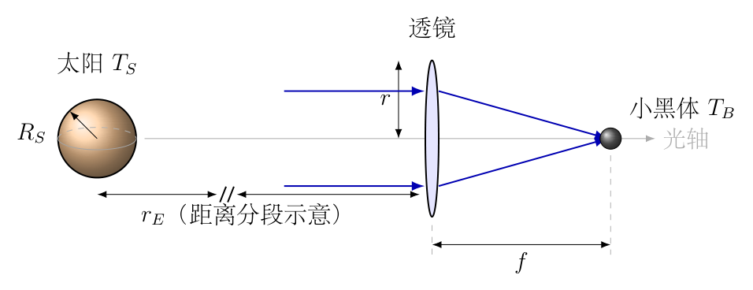{width=90%}

<!-- question-end -->

## 一、题型定位

本题连接几何光学、热辐射和热力学第二定律。第一问不是把所有阳光集中到一个没有大小的数学点，而是计算有限角宽太阳在像面形成的照明区域，再比较受热物体吸收和散热的功率。第二问讨论被动光学的极限，第三问允许把太阳能先变成功再用于加热，不能混为一谈。

题干修订说明：补充球形条件，以明确受热物体的几何模型。吸收功率取决于沿来光方向的投影面积，散热功率取决于辐射表面积，因此形状影响第一问的系数。主解按题干的球形小黑体计算；随后将形状改为薄圆片，作为模型对照。黑体是一种辐射性质，不是球形的同义词。

## 二、知识点

温度为$T$的黑体，单位表面的总辐射功率称为辐射出射度，等于$\sigma T^4$，$\sigma$是斯忒藩—玻尔兹曼常量。面积为$A$、温度统一的黑表面向外辐射功率为$A\sigma T^4$；这个表面积不同于沿来光方向的投影面积。

辐照度$E$是单位面积接收的入射功率。辐亮度$L$还区分方向：对投影面积$\mathrm dA_\perp$及方向立体角$\mathrm d\Omega$，功率微元是$L\,\mathrm dA_\perp\,\mathrm d\Omega$。黑体遵从朗伯角分布，辐亮度$L=\sigma T^4/\pi$，其中$\pi$来自向外半球的方向积分。

远处太阳的角半径近似为$\theta_S=R_S/r_E$，近轴透镜把这一角宽映射为像面半径$a\simeq f\theta_S$。太阳像是二维圆盘，面积$\pi a^2$，不是向四面辐射的小球。

能量稳态和熵稳态分别要求器件不持续积累能量和熵，但允许这些量流过器件。热机必须同时写能量与熵的收支，不能仅凭能量守恒判断热流能否全部转化为功。

## 三、物理图像

太阳中心与太阳边缘发来的光方向略有不同。中心方向形成轴上像，边缘方向形成偏离光轴的像；所有太阳表面点的像组成一个圆盘，不是同一个焦点。导热良好只使受热物体自身接近均匀温度，不会消除太阳像的有限面积。

球远小于太阳像且位于其内部时，整个迎光投影都处于均匀焦区照明内。背面虽然不直接接受近轴阳光，也因导热而升温并辐射。吸收按一个圆的投影计算，散热按整个球面计算，产生球形模型的面积比$1/4$。

透镜重排光线的位置和方向，不增加太阳本身的黑体辐亮度。增大孔径可使更多方向带来太阳辐射，但方向立体角有限。把近轴公式外推到任意大的$r/f$，算出的超高温已经不属于原来的近轴模型。

主动器件可以在太阳与冷环境之间提取功，再让电功在小球内耗散为热。功不是温度为$T_S$的热流，电炉因此可以维持更高温度，但整个装置仍须向外界排出熵。

## 四、解题入口

主解明确取半径$b$的球形小黑体，$b\ll a$；太阳和透镜满足$r_E\gg R_S$、$r_E\gg f$，主计算采用$r/f\ll1$的近轴模型，忽略环境和透镜自身回辐射。理想无损透镜排除吸收损失，良好导热使球温统一。球与像区尺寸接近时，必须重新计算非均匀照明和遮挡，不能继续使用一个统一的$E\pi b^2$。

先求透镜收集功率，再求太阳圆像面积，由此得像面辐照度。通过球面投影和完整表面积积分建立热平衡。随后另从辐亮度和立体角重算温度，交叉检验面积系数并给出实际光锥表达式。

第二问用被动、互易的灰体交换模型解释上限，并说明适用范围。第三问加入热机、冷源与电炉，核对能量、熵和长期稳态；不能用不断耗尽的电池满足“器件自身状态不变”。

## 五、解析

（1）明确研究对象及形状条件。

图7-1用分段距离表示$r_E$与$f$，不按同一比例；太阳的$R_S$、透镜的$r$与受热物体尺寸也不同。主解将受热物体取为半径$b$的小球，$b$用于追踪两个面积，最后从温度式约去。

修订后的题干已明确球形；下面第一问的温度式还须满足近轴、小尺寸及暗背景条件，不能外推到任意孔径或任意大小的球。热平衡要求整个球的总入射功率等于总出射功率，不要求每一球面点局部吸收与辐射相等；导热在各区域之间输送能量。

（2）从太阳表面求透镜处辐照度。

太阳表面积为$4\pi R_S^2$，总辐射功率
$$
P_S=4\pi R_S^2\sigma T_S^4.
$$
这些能量在远处均匀通过半径$r_E$的球面。忽略透镜尺寸相对于$r_E$的差别，垂直于径向光线的接收面辐照度为
$$
\begin{aligned}
E_E&=\frac{P_S}{4\pi r_E^2}\\
&=\frac{4\pi R_S^2\sigma T_S^4}{4\pi r_E^2}
=\sigma T_S^4\frac{R_S^2}{r_E^2}.
\end{aligned}
$$
两个$4\pi$来自太阳总表面积与传播球面，并在这一步相约。不能因此在后面又把圆像面积写成球面面积。量纲上$\sigma T_S^4$和$E_E$都是功率除以面积，$R_S^2/r_E^2$是无量纲稀释比例。

（3）计算透镜收集功率。

透镜迎光圆孔面积是$\pi r^2$。透镜平面垂直于太阳中心光线，太阳角宽很小，可忽略各来光方向的余弦差别，故
$$
\begin{aligned}
P_L&=E_E\pi r^2\\
&=\pi r^2\sigma T_S^4\frac{R_S^2}{r_E^2}.
\end{aligned}
$$
理想无损透镜只重排光线，传到像区的总功率仍是$P_L$。焦距改变的是已收集光能的分布，不是在入口处产生新能量。

（4）建立太阳圆像的几何关系。

图7-2上半是含光轴的截面，太阳中心和边缘两个方向形成不同像点；下半把像盘与小球的前后位置用空间投影表示。像盘是平面，球是三维物体。

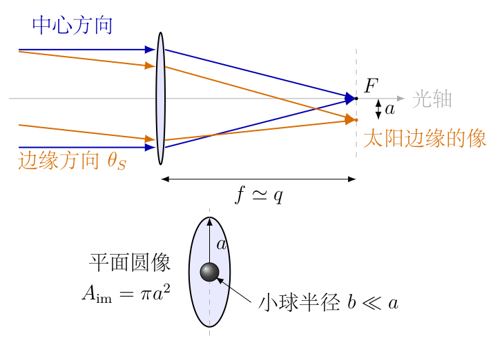{width=85%}

图中太阳角半径$\theta_S$满足
$$
\begin{aligned}
\sin\theta_S&=\frac{R_S}{r_E},\\
\theta_S&\simeq\frac{R_S}{r_E},\\
a&\simeq f\tan\theta_S\simeq f\theta_S
=\frac{fR_S}{r_E}.
\end{aligned}
$$
此处使用小角近似$\sin\theta\simeq\tan\theta\simeq\theta$。若保留有限物距的近轴薄透镜关系，像距$q$满足
$$
\begin{aligned}
\frac1f&=\frac1{r_E}+\frac1q,\\
q&=\frac{fr_E}{r_E-f},\\
a&=\frac{qR_S}{r_E}
=\frac{fR_S}{r_E-f}.
\end{aligned}
$$
$f/r_E\ll1$时$q\simeq f$，回到焦区像半径。这个修正仍属于近轴成像，不是任意大孔径无像差成像的证明。太阳表面辐亮度一致，忽略近轴像面渐晕后，圆像内部照明近乎均匀。

（5）把功率除以正确的像面面积。

图7-2中的二维圆盘面积为
$$
A_{\mathrm{im}}=\pi a^2
=\pi\frac{f^2R_S^2}{r_E^2}.
$$
于是
$$
\begin{aligned}
E_{\mathrm{im}}
&=\frac{P_L}{A_{\mathrm{im}}}\\
&=\frac{\pi r^2\sigma T_S^4R_S^2/r_E^2}
{\pi f^2R_S^2/r_E^2}\\
&=\sigma T_S^4\frac{r^2}{f^2}.
\end{aligned}
$$
太阳半径与距离约去，是因为较远的太阳既使入口更暗，也使太阳像同比例缩小。集光功率和像面积都含$R_S^2/r_E^2$，局部辐照度中这一比例抵消。若太阳像与衍射斑或球尺寸接近，仍不能忽略这些尺度约束。

不能除以$4\pi a^2$，因为太阳像不是三维发光球。此处多除一次$4$，再在热平衡使用球的投影与表面积比$1/4$，就是混淆了两个不同几何对象。

（6）通过球面投影积分求吸收截面。

图7-3中球面法向与朝向光源的方向夹角为$\vartheta$。各处吸收功率密度因入射角不同而不同，黑体吸收率仍为一；导热使球温相同，迎光半球的真实面积不能直接当成投影。

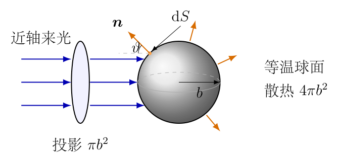{width=80%}

球面真实面积微元和迎光投影为
$$
\mathrm dS=b^2\sin\vartheta\,\mathrm d\vartheta\,\mathrm d\phi,
\qquad
\mathrm dA_\perp=\cos\vartheta\,\mathrm dS.
$$
只积分$0\le\vartheta\le\pi/2$的迎光半球：
$$
\begin{aligned}
A_{\mathrm{proj}}
&=\int_0^{2\pi}\int_0^{\pi/2}
b^2\cos\vartheta\sin\vartheta\,
\mathrm d\vartheta\,\mathrm d\phi\\
&=2\pi b^2\left[\frac12\sin^2\vartheta\right]_0^{\pi/2}
=\pi b^2.
\end{aligned}
$$
先对极角再对方位角积分，得到圆盘投影，而非半球面积$2\pi b^2$。在$b\ll a$且$r/f\ll1$时，整个投影处于均匀焦区照明内，
$$
P_{\mathrm{abs}}
=E_{\mathrm{im}}\pi b^2
=\pi b^2\sigma T_S^4\frac{r^2}{f^2}.
$$

（7）计算完整球面散热并求温度。

完整表面积需要对全部极角积分：
$$
\begin{aligned}
A_B&=\int_0^{2\pi}\int_0^\pi
b^2\sin\vartheta\,\mathrm d\vartheta\,\mathrm d\phi\\
&=2\pi b^2[-\cos\vartheta]_0^\pi=4\pi b^2.
\end{aligned}
$$
忽略暗环境回辐射，$P_{\mathrm{em}}=4\pi b^2\sigma T_B^4$。无其他传热时，稳态为$P_{\mathrm{abs}}=P_{\mathrm{em}}$，逐项约去正数：
$$
\begin{aligned}
\pi b^2\sigma T_S^4\frac{r^2}{f^2}
&=4\pi b^2\sigma T_B^4,\\
T_B^4&=\frac{r^2}{4f^2}T_S^4,\\
\frac{T_B}{T_S}
&=\left(\frac{r^2}{4f^2}\right)^{1/4}
=\frac1{\sqrt2}\sqrt{\frac rf}.
\end{aligned}
$$
取温度的非负实根，得到球形近轴小尺寸模型的第一问：
$$
\boxed{T_{B,\max}=T_S\sqrt{\frac{r}{2f}}}.
$$
$b$约去，因为吸收与辐射均正比于$b^2$。有附加导热损失、有限尺寸遮挡时，同样约消并不保证同一温度。这个温度比把圆像误写为球面积所得温度大$\sqrt2$；差别是明确的面积错误，不是舍入。

（8）理解焦区最高温位置与平衡稳定性。

球置于太阳圆像内部、远离像盘边缘时，可接收完整的均匀近轴照明。偏离像面会让同一太阳点的光散成更大光斑；靠近或超出像区边缘会失去部分来光方向。不能通过寻找一个“更精确的焦点”，把扩展太阳源变成无面积点源。

若球总热容为$C_B>0$，固定入射功率下
$$
C_B\frac{\mathrm dT}{\mathrm dt}
=P_{\mathrm{abs}}-4\pi b^2\sigma T^4.
$$
令$T=T_B+\delta T$，一阶展开
$$
(T_B+\delta T)^4=T_B^4+4T_B^3\delta T+O(\delta T^2).
$$
利用平衡功率相消，得
$$
\frac{\mathrm d(\delta T)}{\mathrm dt}
=-\frac{16\pi b^2\sigma T_B^3}{C_B}\delta T.
$$
系数为负，略冷则净吸热、略热则净散热，扰动衰减。热平衡温度不是零热容物体瞬间达到的温度；此处没有假定热容消失。

（9）独立建立黑体辐亮度。

对面积$\mathrm dA$的表面，出射方向与外法向夹角$\vartheta$，朗伯辐亮度$L_S$不随方向改变：
$$
\begin{aligned}
\mathrm dP
&=\mathrm dA\int_0^{2\pi}\int_0^{\pi/2}
L_S\cos\vartheta\sin\vartheta\,
\mathrm d\vartheta\,\mathrm d\phi\\
&=\pi L_S\,\mathrm dA.
\end{aligned}
$$
与$\sigma T_S^4\,\mathrm dA$比较，
$$
L_S=\frac{\sigma T_S^4}{\pi}.
$$
它的单位含立体角，不能把$L_S$当成$E_{\mathrm{im}}$。无损被动真空成像保持辐亮度，不能把多个同温光线方向无限叠入同一光学模式，获得更高的黑体辐亮度。

（10）从空间入射光锥求球的吸收。

图7-4从球看见透镜圆孔，圆孔与球心形成有前后关系的三维光锥。实际填充的半角是$\alpha$，立体角是$\Omega$；它不是平面扇形面积。

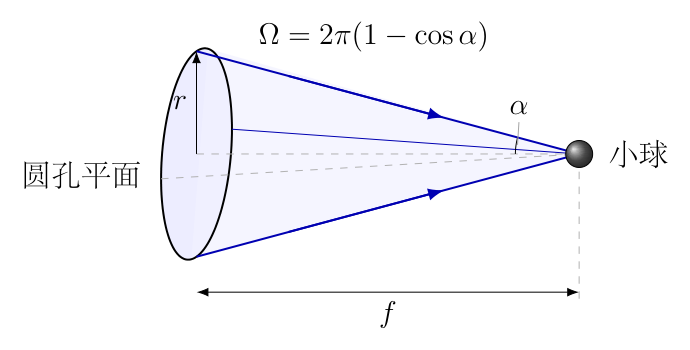{width=85%}

方向微元$\mathrm d\Omega=\sin\vartheta\,\mathrm d\vartheta\,\mathrm d\phi$，故
$$
\begin{aligned}
\Omega&=\int_0^{2\pi}\int_0^\alpha
\sin\vartheta\,\mathrm d\vartheta\,\mathrm d\phi\\
&=2\pi[-\cos\vartheta]_0^\alpha
=2\pi(1-\cos\alpha).
\end{aligned}
$$
球对每个方向都有投影$\pi b^2$，方向旋转不改变这个积分。若整个光锥被太阳辐亮度填充，
$$
\begin{aligned}
P_{\mathrm{abs}}
&=\int_\Omega L_S\pi b^2\,\mathrm d\Omega
=L_S\pi b^2\Omega\\
&=\sigma T_S^4b^2\Omega.
\end{aligned}
$$
与完整球面出射功率平衡：
$$
\boxed{\frac{T_B^4}{T_S^4}
=\frac{\Omega}{4\pi}
=\frac{1-\cos\alpha}{2}}.
$$
图中的理想孔径—焦点几何可给$\tan\alpha=r/f$，但“大孔径仍无像差且光锥均匀填满”是额外条件。没有该条件，应使用实际$\alpha$和实际被照亮方向，不能只凭焦距宣称全部几何孔径方向均已填满。

（11）检验近轴极限并阻止越界外推。

余弦小角展开至四阶：
$$
\begin{aligned}
\cos\alpha&=1-\frac{\alpha^2}{2}
+\frac{\alpha^4}{24}+O(\alpha^6),\\
\frac{1-\cos\alpha}{2}
&=\frac{\alpha^2}{4}
-\frac{\alpha^4}{48}+O(\alpha^6).
\end{aligned}
$$
$\alpha\simeq r/f$时，最低阶给$T_B^4/T_S^4\simeq r^2/(4f^2)$，正好核对圆像与球面投影路线，而非只把结果代回自身。

一侧透镜最多提供半球方向，$\alpha\le\pi/2$。另一半球暗时，球形模型满足
$$
\frac{T_B^4}{T_S^4}\le\frac12,\qquad
T_B\le2^{-1/4}T_S<T_S.
$$
若用反射腔等被动装置从更多方向提供同样辐亮度，最多覆盖$4\pi$，球温也只能趋于$T_S$。单透镜的$2^{-1/4}$与一般被动装置的$1$是不同覆盖范围的上限。近轴式在$r/f>2$时形式上给超温，但已违反$r/f\ll1$，不是可实现方案。

（12）比较改变受热物体形状的模型。

把小球改成导热良好、两面均黑、边缘面积可忽略的薄圆片，法向沿近轴来光，记一面面积$A$。投影面积$A$，散热面积近似$2A$：
$$
\begin{aligned}
P_{\mathrm{abs}}&=AE_{\mathrm{im}},\\
P_{\mathrm{em}}&=2A\sigma T_{\mathrm{plate}}^4,\\
T_{\mathrm{plate}}^4
&=\frac{E_{\mathrm{im}}}{2\sigma}
=\frac{r^2}{2f^2}T_S^4,\\
T_{\mathrm{plate}}
&=2^{-1/4}T_S\sqrt{\frac rf}.
\end{aligned}
$$
因此
$$
\frac{T_{\mathrm{plate}}}{T_{B,\mathrm{sphere}}}
=\left(\frac{1/2}{1/4}\right)^{1/4}=2^{1/4}.
$$
两物体均是导热良好的小黑体，温度却不同。一般近轴小物体应保留
$$
T^4=\frac{A_{\mathrm{proj}}}{A_{\mathrm{em}}}
\frac{r^2}{f^2}T_S^4.
$$
球形题干对应面积比$1/4$；薄圆片对应另一个面积比，属于改变物体形状后的模型，不是本题第一问的另一答案。这个对照说明球形条件不能省略，但不改变第二问的被动限制和第三问的主动稳态可能性。

（13）以互易交换说明第二问。

图7-5把太阳$S$、小球$B$、冷背景$C$分开，$T_C<T_S$。每条双向连接代表正反向辐射路径，不能只保留太阳到球而漏掉球返回太阳的辐射。

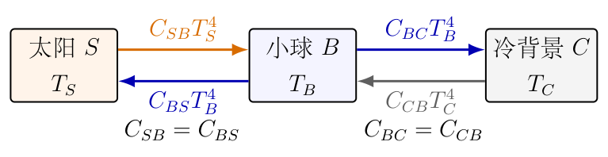{width=80%}

对灰体、几何不随温度改变的被动系统，令从$S$到$B$功率为$C_{SB}T_S^4$，反向为$C_{BS}T_B^4$。互易性和等温平衡给
$$
C_{SB}=C_{BS}\ge0,\qquad C_{CB}=C_{BC}\ge0.
$$
同温时若仍有单向净热交换，会在无其他改变时制造温差，与被动平衡不相容。球的平衡为
$$
\begin{aligned}
C_{BS}T_S^4+C_{BC}T_C^4
&=(C_{BS}+C_{BC})T_B^4,\\
T_B^4&=\frac{C_{BS}T_S^4+C_{BC}T_C^4}
{C_{BS}+C_{BC}}.
\end{aligned}
$$
分母为正，这是非负权重平均。直接求差：
$$
\begin{aligned}
T_S^4-T_B^4&=\frac{C_{BC}(T_S^4-T_C^4)}
{C_{BS}+C_{BC}}\ge0,\\
T_B^4-T_C^4&=\frac{C_{BS}(T_S^4-T_C^4)}
{C_{BS}+C_{BC}}\ge0.
\end{aligned}
$$
故$T_C\le T_B\le T_S$；两连接均非零且冷热不同，则两端严格。改透镜形状只改变被动几何，不制造负交换权重或功源，所以第二问不能。

若系统频率选择性明显，不能对所有温度都写成同一常数$C$乘$T^4$，应逐频率积分。但被动模态辐亮度不能高于热源的限制仍在。这里的灰体式说明机制，不冒充一切滤光器的通式。

（14）区分自身熵恒定与不能排熵。

对第三问的开放稳态装置，热端温度$T_H$、冷端温度$T_C$，吸热率$\dot Q_H$、排热率$\dot Q_C$与输出功率$\dot W$满足
$$
\frac{\mathrm dU_{\mathrm{dev}}}{\mathrm dt}
=\dot Q_H-\dot Q_C-\dot W=0.
$$
熵收支还含产生项：
$$
\begin{aligned}
\frac{\mathrm dS_{\mathrm{dev}}}{\mathrm dt}
&=\frac{\dot Q_H}{T_H}
-\frac{\dot Q_C}{T_C}
+\dot S_{\mathrm{gen}}=0,\\
\dot S_{\mathrm{gen}}
&=\frac{\dot Q_C}{T_C}
-\frac{\dot Q_H}{T_H}\ge0.
\end{aligned}
$$
自身熵不变表示流入、流出、产生相抵，不表示三个都为零，也不表示外界熵不变。机械功或电功不以$\dot W/T$携带热流熵，不能把功直接塞进热流项。

（15）建立太阳热机与电炉的稳态例子。

图7-6区分吸热、排热、功：太阳持续给集热器供能，$T_H$可低于$T_S$；冷环境接收排热，电炉将功耗散于球。三个连接缺一不可，不能换成不断耗尽的电池。

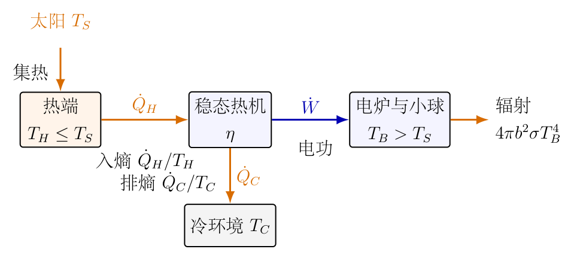{width=90%}

令$\eta=\dot W/\dot Q_H$，能量方程给$\dot Q_C=(1-\eta)\dot Q_H$。代入熵产生率：
$$
\begin{aligned}
\frac{(1-\eta)\dot Q_H}{T_C}
-\frac{\dot Q_H}{T_H}&\ge0,\\
\frac{1-\eta}{T_C}&\ge\frac1{T_H},\\
\eta&\le1-\frac{T_C}{T_H}.
\end{aligned}
$$
这是热边界$T_H,T_C$的卡诺效率上限。太阳辐射被集热器吸收成较低温热流时可另有不可逆损失，并不允许热机超出此上限。

电炉的功补偿暗环境中小球散热：
$$
\dot W=4\pi b^2\sigma T_B^4,\qquad
T_B=\left(\frac{\eta\dot Q_H}{4\pi b^2\sigma}\right)^{1/4}.
$$
有足够集热面积时，可选择足够小而黑体/连续介质模型仍有效的球，使$T_B>T_S$。能量来自热机的功，而非透镜增大太阳辐亮度；这就是第三问可行的主动方案。

（16）核对数值例子及唯一热库的相反限制。

选$T_S=6000\,\mathrm K$、$T_H=2000\,\mathrm K$、$T_C=300\,\mathrm K$，$\dot Q_H=200\,\mathrm W$、$\eta=0.70$。这些数字只是存在性例子，不是原题新增已知量：
$$
\begin{aligned}
\eta_{\mathrm{Carnot}}&=1-\frac{300}{2000}=0.85,\\
\dot W&=0.70\times200=140\,\mathrm W,\\
\dot Q_C&=200-140=60\,\mathrm W,\\
\dot S_{\mathrm{gen}}
&=\frac{60}{300}-\frac{200}{2000}
=0.10\,\mathrm{W/K}>0.
\end{aligned}
$$
效率低于卡诺限，能量、熵都合格。取$T_B=7000\,\mathrm K>T_S$，由球面辐射求所需半径：
$$
\begin{aligned}
b^2&=\frac{140}{4\pi\sigma(7000)^4},\\
(7000)^4&=2.401\times10^{15},\\
\sigma&=5.670374419\times10^{-8}\,
\mathrm{W/(m^2K^4)},\\
b&\simeq2.86060\times10^{-4}\,\mathrm m
=0.286060\,\mathrm{mm}.
\end{aligned}
$$
代回$4\pi b^2\sigma T_B^4=140\,\mathrm W$，与电功相符。这个尺寸远大于高温热辐射典型波长。材料耐温与损耗限制实际实现，但不改变理想题的热力学可能性；电炉产生并向外排熵，自身状态仍可稳态。

若只允许唯一$T_S$热库，没有冷源、外功或其他熵出口，就不能套用该方案。将$Q>0$从$T_S$单独送往更热的$T_B$，循环器件自身不变，两个热边界的总熵变
$$
\Delta S=-\frac Q{T_S}+\frac Q{T_B}<0
\qquad(T_B>T_S).
$$
在没有其他变化时违反第二定律。第三问的主动可能性依赖持续供能与外排熵，不是第二定律失效。第一问的形状条件、第二问的被动限制、第三问的开放稳态条件须分别保留。

\newpage

# 第8题

<!-- question-start -->

考虑两个电荷分别为$+Ze$和$-Ze$、静质量均为$m_0$的微观带电粒子，形成束缚态。采用类似玻尔氢原子模型的描述：两个粒子在质心参考系中绕质心做匀速率圆周运动。不考虑电磁辐射，只考虑静电相互作用。若两粒子的瞬时位置为$\boldsymbol r_+$、$\boldsymbol r_-$，间距为$r=|\boldsymbol r_+-\boldsymbol r_-|$，作用在正电荷上的力为
$$
\boldsymbol F_+=-\frac{KZ^2e^2}{r^3}
(\boldsymbol r_+-\boldsymbol r_-),\qquad
\boldsymbol F_-=-\boldsymbol F_+,
$$
其中$K$为库仑常量，$e$为元电荷，$Z>0$。动力学关系为
$$
\boldsymbol F=\frac{\mathrm d\boldsymbol p}{\mathrm dt},
\qquad
\boldsymbol p=\frac{m_0\boldsymbol v}{\sqrt{1-v^2/c^2}},
$$
$c$为真空光速。在质心参考系中，体系总角动量满足$L=n\hbar$，$n=1$对应基态，$\hbar$为约化普朗克常量。

（1）计算基态两粒子之间的间距$r_0$。

（2）要使上述模型的基态存在，$Z$应满足什么条件？

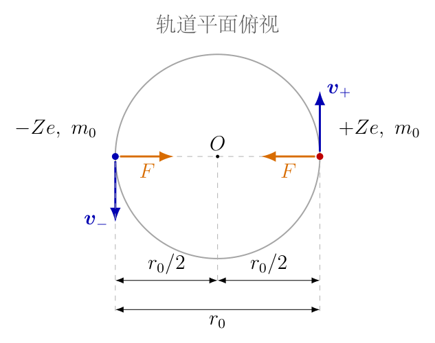{width=76%}

<!-- question-end -->

## 一、题型定位

本题是等质量二体圆周运动与相对论动量的结合。量子化的是体系关于质心的总角动量，不是某一个粒子的角动量；库仑力的距离是两粒子间距，不是单个粒子的轨道半径。先把这两个“二体因素”分清，再用动量方向变化建立向心方程。

两个关键式分别为$L=rp$和$KZ^2e^2/r^2=2pv/r$。它们先确定速率，再确定动量和间距。第二问不仅要求根号内非负，还要求粒子速率严格小于$c$、间距严格大于零，因此临界等号不属于允许圆轨道。

模型按题设保留瞬时静电力和相对论动量，明确忽略磁相互作用、场的传播延迟及辐射。这是一种半经典模型；本题得到的“基态存在”指$n=1$的有限半径圆轨道存在，不等同于完整量子理论中真实粒子的基态判据。

## 二、知识点

质心静止、质量相等且轨道对称时，两粒子位于同一直径的两端，各自轨道半径为$\rho=r/2$，速率相同，瞬时速度和动量相反。总动量可以为零，但两项关于质心的角动量方向相同，不能由总动量零推断总角动量零。

圆周运动中速率$v$不变，动量大小$p$也不变，但动量矢量的方向不断转动。若角速度为$\omega$，则$|\mathrm d\boldsymbol p/\mathrm dt|=\omega p$。本题$\omega=v/\rho=2v/r$，应使用$\gamma m_0v^2/\rho$，不能使用不含$\gamma$的$m_0v^2/\rho$。

定义无量纲速率和洛伦兹因子
$$
\beta=\frac vc,\qquad
\gamma=\frac{1}{\sqrt{1-\beta^2}},\qquad 0<\beta<1.
$$
静质量$m_0$在计算中保持不变；相对论效应由$p=\gamma m_0v$体现，不另把$\gamma m_0$重复代入。

定义精细结构常量
$$
\alpha=\frac{Ke^2}{\hbar c}.
$$
这里的库仑常量$K$与约化普朗克常量$\hbar$均不可省略。$Ke^2$量纲为能量乘长度，$\hbar c$具有同一量纲，所以$\alpha$无量纲。数值估算可取$\alpha\simeq1/137$。

## 三、物理图像

图8-1中两电荷始终关于$O$对称。正电荷在右端时向上运动，负电荷在左端时向下运动，整个直径逆时针旋转。两个库仑力相向，均指向共同中心；图中一个粒子的半径是$r_0/2$，两粒子的间距才是$r_0$。

当粒子沿圆周前进时，速度大小不变，方向转动。同一时间段内，动量矢量也转过同样的角度。这个几何事实把题设$\boldsymbol F=\mathrm d\boldsymbol p/\mathrm dt$转换为可计算的径向方程，不需凭记忆猜一个“相对论向心力公式”。

引力或吸引库仑力越来越强时，并非任何强度都能由越来越小的圆轨道适应。固定总角动量后，消元会把速率直接锁定为$v=KZ^2e^2/(2L)$。若这个值达到或超过$c$，便不再存在有静质量粒子的允许圆轨道；缩小半径不能绕过速率上限。

## 四、解题入口

取质心为原点$O$，轨道为$x$—$y$平面，逆时针运动对应总角动量沿$+z$方向。设一般量子数$n$时两粒子间距为$r$、单粒子动量大小为$p$、速率为$v$。计算完成后令$n=1$并记$r=r_0$。

为避免反复书写，把正的库仑耦合强度记为
$$
A=KZ^2e^2=\alpha Z^2\hbar c>0.
$$
先从几何导出$\rho=r/2$，再分别建立单粒子向心方程和总角动量方程。两个方程相除时消掉未知动量；确定$v$后再通过相对论动量关系求$r$，这比直接对含根式的方程平方更容易控制正负号。

最后独立检查量纲、严格存在条件、弱耦合极限和二体总能量。仅将最终半径代回同一个已化简公式，不足以检查轨道半径和间距是否混淆。

## 五、解析

（1）建立二体几何与符号。

等质量对称轨道在质心系中满足
$$
\boldsymbol r_-=-\boldsymbol r_+,\qquad
\boldsymbol p_-=-\boldsymbol p_+.
$$
记$|\boldsymbol r_+|=|\boldsymbol r_-|=\rho$，则
$$
r=|\boldsymbol r_+-\boldsymbol r_-|
=|2\boldsymbol r_+|=2\rho,\qquad \rho=\frac r2.
$$
图8-1同时标出$r_0$与两段$r_0/2$，就是为了防止把库仑分母写成$\rho^2$。库仑定律计算两粒子相互作用时使用$r$；圆周运动计算单粒子向心加速度时使用$\rho$。

若取一般时刻相位$\varphi=\omega t$，两位置可写成
$$
\begin{aligned}
\boldsymbol r_+&=\rho(\cos\varphi,\sin\varphi,0),\\
\boldsymbol r_-&=-\rho(\cos\varphi,\sin\varphi,0),\\
\boldsymbol v_+&=\rho\omega(-\sin\varphi,\cos\varphi,0),\\
\boldsymbol v_-&=-\boldsymbol v_+.
\end{aligned}
$$
由此$v=\rho\omega$，所以$\omega=2v/r$。两速度之差的大小$2v$是在同一质心系中的坐标变化率，不是某粒子自身参考系测得的另一粒子速率；此处不使用相对论速度合成公式。

（2）从动量方向变化计算力。

图8-2左侧画实际位置空间，右侧把先后两个动量矢量移到共同起点。动量矢量等长，转角为$\Delta\varphi$；橙色弦是$\Delta\boldsymbol p$，不是沿切向增加的动量大小。

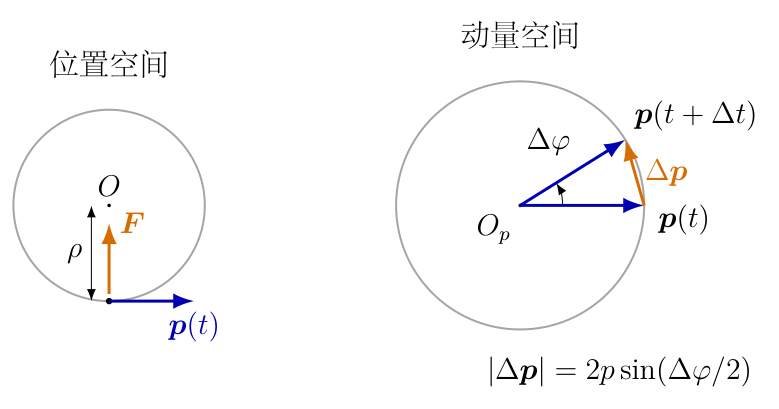{width=88%}

右侧两个长度为$p$的动量矢量形成等腰三角形，弦长
$$
|\Delta\boldsymbol p|
=2p\sin\frac{\Delta\varphi}{2}.
$$
取$\Delta t\to0$，并利用小角极限$\sin u/u\to1$：
$$
\begin{aligned}
\left|\frac{\mathrm d\boldsymbol p}{\mathrm dt}\right|
&=\lim_{\Delta t\to0}
\frac{2p\sin(\Delta\varphi/2)}{\Delta t}\\
&=\lim_{\Delta t\to0}
p\frac{\Delta\varphi}{\Delta t}
\frac{\sin(\Delta\varphi/2)}{\Delta\varphi/2}\\
&=p\omega
=\frac{pv}{\rho}
=\frac{2pv}{r}.
\end{aligned}
$$
虽然$p$不变，$\boldsymbol p$仍在变化。把$\mathrm dp/\mathrm dt=0$当成$\mathrm d\boldsymbol p/\mathrm dt=0$，会错误地得到没有向心力。

（3）用矢量微分核对向心方向。

由于$p=\gamma m_0v$且$v$恒定，$\gamma$也恒定。正粒子的动量为
$$
\boldsymbol p_+=p(-\sin\omega t,\cos\omega t,0).
$$
逐分量求导：
$$
\begin{aligned}
\frac{\mathrm d\boldsymbol p_+}{\mathrm dt}
&=p\omega(-\cos\omega t,-\sin\omega t,0)\\
&=-p\omega\frac{\boldsymbol r_+}{\rho}.
\end{aligned}
$$
其方向正好指向$O$。负粒子的结果相反，也指向自己的内侧。这一检查同时确定力的方向和大小，不会把吸引力写成使轨道向外发散的斥力。

也可从乘积微分检查：
$$
\frac{\mathrm d\boldsymbol p}{\mathrm dt}
=m_0\left(\gamma\boldsymbol a+
\frac{\mathrm d\gamma}{\mathrm dt}\boldsymbol v\right),
\qquad
\frac{\mathrm d\gamma}{\mathrm dt}
=\frac{\gamma^3}{c^2}\boldsymbol v\cdot\boldsymbol a=0.
$$
圆周运动中$\boldsymbol v\perp\boldsymbol a$，所以本题径向力为$\gamma m_0\boldsymbol a$。不能把直线加速时出现的$\gamma^3m_0$直接用在横向加速度上。

（4）建立单粒子径向方程。

异号电荷的力是吸引力，大小为$A/r^2$。与图8-2的动量变化率比较：
$$
\boxed{\frac{A}{r^2}=\frac{2pv}{r}}.
$$
两边乘$r^2$：
$$
A=2pvr.
$$
代入$p=\gamma m_0v$，也可写成
$$
\frac{A}{r^2}
=\frac{2\gamma m_0v^2}{r}.
$$
这里方程只针对一个粒子，不要因为体系有两粒子而再将左边乘$2$。另一个粒子满足相同大小的方程，提供的是对称性而不是额外倍数。

（5）计算总角动量而非单粒子角动量。

图8-3中两个位置和两个动量都相反，但每个叉乘同时改变两次符号。因此两个角动量同向，$\odot$表示垂直轨道平面向外。

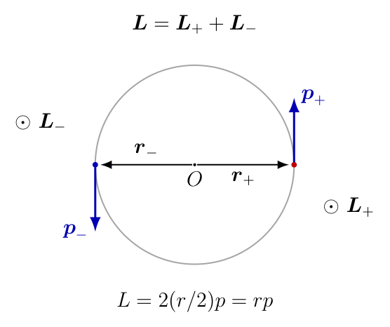{width=65%}

两粒子的切向动量均与各自位置垂直：
$$
\begin{aligned}
\boldsymbol L_+&=\boldsymbol r_+\times\boldsymbol p_+,\\
\boldsymbol L_-&=\boldsymbol r_-\times\boldsymbol p_-
=(-\boldsymbol r_+)\times(-\boldsymbol p_+)
=\boldsymbol L_+,\\
L_+&=L_-=\rho p=\frac{rp}{2},\\
L&=L_++L_-=2\rho p=rp.
\end{aligned}
$$
题设要求
$$
\boxed{rp=n\hbar}.
$$
基态$n=1$，因此$rp=\hbar$，每个粒子自己的角动量为$\hbar/2$。不能分别令两个粒子均有$\hbar$，否则总角动量变成$2\hbar$，已经是另一个量子数。

（6）先消去动量并求速率。

把$rp=L$代入单粒子的$A=2pvr$：
$$
\begin{aligned}
A&=2v(rp)=2vL,\\
v&=\frac{A}{2L}=\frac{KZ^2e^2}{2n\hbar},\\
\beta_n&=\frac{v}{c}
=\frac{A}{2n\hbar c}
=\frac{\alpha Z^2}{2n}.
\end{aligned}
$$
这是整题的关键消元：速率不再含$r$或$m_0$。它由耦合强度与指定的总角动量确定，而不是靠调节半径任意选择。若该式已经给出$v\ge c$，随后不能再求一个合法的有限半径来“修复”。

（7）由相对论动量求一般间距。

在$0<\beta_n<1$的合法域内，
$$
p=\frac{m_0c\beta_n}{\sqrt{1-\beta_n^2}}>0.
$$
从$r=L/p$逐步代入：
$$
\begin{aligned}
r_n
&=\frac{L\sqrt{1-\beta_n^2}}{m_0c\beta_n}\\
&=\frac{n\hbar}{m_0c}
\frac{\sqrt{1-\alpha^2Z^4/(4n^2)}}{\alpha Z^2/(2n)}\\
&=\frac{2n^2\hbar}{m_0c\alpha Z^2}
\sqrt{1-\frac{\alpha^2Z^4}{4n^2}}\\
&=\frac{n\hbar}{m_0c\alpha Z^2}
\sqrt{4n^2-\alpha^2Z^4}.
\end{aligned}
$$
最后一步利用$n>0$，把根号中的$4n^2$提出为正的$2n$，不能漏掉外面的$n$。注意$r_n$仍是两粒子间距，单粒子轨道半径是$r_n/2$。

（8）取基态并变换为不含$\alpha$的形式。

令$n=1$：
$$
\boxed{
r_0=\frac{\hbar}{m_0c\alpha Z^2}
\sqrt{4-\alpha^2Z^4}
}.
$$
若直接用题干的$K$、$e$书写，利用$\alpha Z^2=A/(\hbar c)$：
$$
\begin{aligned}
r_0
&=\frac{2\hbar^2}{m_0A}
\sqrt{1-\frac{A^2}{4\hbar^2c^2}}\\
&=\frac{\hbar}{m_0cA}
\sqrt{4\hbar^2c^2-A^2}\\
&=\frac{\sqrt{4c^2\hbar^4-K^2Z^4e^4\hbar^2}}
{m_0cKZ^2e^2}.
\end{aligned}
$$
第二步把根号分母$2\hbar c$提出，并与前面的$2\hbar^2$约分。第三步把正的$\hbar$移入根号。两种表达完全相同，不是两个不同物理解答。

量纲检查可用最简形式：$\hbar/(m_0c)$量纲是长度，$\alpha Z^2$和根号均无量纲。又可检查$2\hbar^2/(m_0A)$：$A$为能量乘长度，所以这个整体仍为长度。

（9）在平方路线中筛选根。

为检查上面的直接消元，也从$L=rp=\hbar$写
$$
\hbar=\frac{rm_0v}{\sqrt{1-v^2/c^2}}.
$$
此式左右为正，平方后得
$$
\begin{aligned}
\hbar^2\left(1-\frac{v^2}{c^2}\right)
&=r^2m_0^2v^2,\\
r^2
&=\frac{\hbar^2}{m_0^2v^2}
-\frac{\hbar^2}{m_0^2c^2}\\
&=\frac{4\hbar^4}{m_0^2A^2}
-\frac{\hbar^2}{m_0^2c^2}.
\end{aligned}
$$
代入$v=A/(2\hbar)$后，只有正的$r$对应间距；负平方根不是“反向转动”的另一个半径。反向转动只改变角动量矢量方向，不改变其大小和间距。

当$v=c$时，相对论动量关系发散，不能代入前一未平方方程；因此即使平方后的式子允许$r^2=0$，也不能将其算成有效圆轨道。平方后的代数条件须与原式定义域合并。

（10）给出严格存在条件。

基态要求$0<v<c$：
$$
\begin{aligned}
0&<\frac{A}{2\hbar}<c,\\
0&<A<2\hbar c,\\
0&<\alpha Z^2<2.
\end{aligned}
$$
因为$Z>0$，得到
$$
\boxed{0<Z<\sqrt{\frac{2}{\alpha}}
=\sqrt{\frac{2\hbar c}{Ke^2}}}.
$$
这与$r_0>0$要求$4-\alpha^2Z^4>0$完全一致。根号内必须严格为正，不能写大于等于零。$\alpha\simeq1/137$时
$$
Z_{\mathrm{crit}}\simeq\sqrt{274}\simeq16.55.
$$
若$Z$限为正整数，则允许$Z=1,2,\ldots,16$，即$Z\le16$；$Z=17$已不满足基态条件。若只把$Z$视作连续的正耦合参数，应保留严格不等式而不写整数上限。

（11）结合阈值图解释临界行为。

定义同一耦合和同一$n$的非相对论间距
$$
r_{\mathrm{NR}}=\frac{2n^2\hbar^2}{m_0A}.
$$
图8-4纵轴是$r_n/r_{\mathrm{NR}}$，不是$r_n$本身；横轴为刚由消元得到的$\beta_n$。图中两端空心点表示极限，不是允许的零电荷轨道或光速轨道。

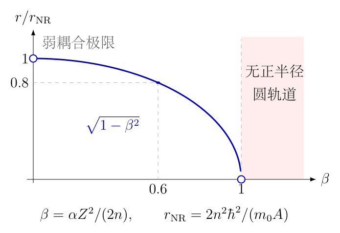{width=86%}

由一般间距可得
$$
\frac{r_n}{r_{\mathrm{NR}}}=\sqrt{1-\beta_n^2}.
$$
如图$\beta_n=0.6$处比值为$\sqrt{1-0.36}=0.8$。当$\beta_n\to1^-$，$p\to\infty$、$r_n=L/p\to0$；该轨道族可以接近端点，但端点本身不成立。

当$Z\to0^+$，$\beta_n\to0$，比值趋$1$，但$r_{\mathrm{NR}}\propto1/Z^2$发散，所以$r_n\to\infty$而非趋于有限常量。$Z=0$时没有吸引力，不能把图中的弱耦合极限解读为一个有限半径束缚态。

（12）检查弱耦合和等质量约化质量。

对$\beta_n\ll1$，使用二阶及四阶泰勒展开：
$$
\begin{aligned}
\sqrt{1-\beta_n^2}
&=1-\frac{\beta_n^2}{2}
-\frac{\beta_n^4}{8}+O(\beta_n^6),\\
r_n&=\frac{2n^2\hbar^2}{m_0A}
\left(1-\frac{\alpha^2Z^4}{8n^2}
-\frac{\alpha^4Z^8}{128n^4}+\cdots\right).
\end{aligned}
$$
最低阶$r_n\simeq2n^2\hbar^2/(m_0A)$。这个因子$2$可由独立的非相对论二体路线核对。两等质量的约化质量为
$$
\mu=\frac{m_0m_0}{m_0+m_0}=\frac{m_0}{2}.
$$
相对坐标的圆周速率$u=2v$，非相对论关系为$L=\mu ru$、$A/r^2=\mu u^2/r$。逐步消元：
$$
\begin{aligned}
u&=\frac{L}{\mu r},\\
\frac{A}{r^2}
&=\frac{\mu}{r}\frac{L^2}{\mu^2r^2}
=\frac{L^2}{\mu r^3},\\
r_{\mathrm{NR}}
&=\frac{L^2}{\mu A}
=\frac{2n^2\hbar^2}{m_0A}.
\end{aligned}
$$
相对论主解没有把$2v$塞进单粒子的$\gamma$。约化质量路线在此仅用于非相对论极限；离开低速条件，不能直接照搬这个简化。

（13）用体系能量检查束缚性质。

每粒子总能量为$\gamma m_0c^2$，两粒子静电势能只有一份$-A/r$。因此体系能量
$$
E=2\gamma m_0c^2-\frac Ar.
$$
由径向方程$A/r=2pv=2\gamma m_0v^2$，得到
$$
\begin{aligned}
E&=2\gamma m_0c^2-2\gamma m_0v^2\\
&=2\gamma m_0c^2(1-\beta_n^2)\\
&=2m_0c^2\sqrt{1-\beta_n^2}.
\end{aligned}
$$
在合法域内$0<E<2m_0c^2$。与两粒子相距无限远、均静止的能量$2m_0c^2$比较，本轨道具有正的结合能
$$
B=2m_0c^2-E
=2m_0c^2\left(1-\sqrt{1-\beta_n^2}\right)>0.
$$
不是要求包含静能的$E<0$。用泰勒展开检查弱耦合：
$$
B\simeq m_0c^2\beta_n^2
=\frac{m_0A^2}{4n^2\hbar^2}.
$$
非相对论库仑结合能$\mu A^2/(2L^2)$取$\mu=m_0/2$后与此相同，又一次核对两体因子。这个能量检查不能取代第二问的$v<c$条件，但可以发现漏写一个粒子动能或重复计势能的错误。

（14）核对数值尺度与量子数条件。

为展示计算而非增加原题条件，暂取$m_0$为电子静质量。约化康普顿长度$\bar\lambda_C=\hbar/(m_0c)\simeq3.86159\times10^{-13}\,\mathrm m$，使用$\alpha\simeq0.00729735$。$Z=1$基态：
$$
\begin{aligned}
\beta_1&=\frac{\alpha}{2}\simeq0.00364868,\\
\sqrt{1-\beta_1^2}
&\simeq0.99999334,\\
r_0&=\bar\lambda_C\frac{\sqrt{1-\beta_1^2}}{\beta_1}\\
&\simeq3.86159\times10^{-13}
\times\frac{0.99999334}{0.00364868}\,\mathrm m\\
&\simeq1.05835\times10^{-10}\,\mathrm m,\\
\rho_0&=\frac{r_0}{2}\simeq5.29174\times10^{-11}\,\mathrm m.
\end{aligned}
$$
间距是两倍单粒子半径；本题两粒子等质量，不能将这个$r_0$与固定重核模型的电子半径直接混同。

$Z=16$时：
$$
\begin{aligned}
\beta_1&=\frac{\alpha\,16^2}{2}
=128\alpha\simeq0.934061<1,\\
\sqrt{1-\beta_1^2}&\simeq0.357113,\\
r_0&\simeq3.86159\times10^{-13}
\times\frac{0.357113}{0.934061}\,\mathrm m\\
&\simeq1.47638\times10^{-13}\,\mathrm m.
\end{aligned}
$$
此时非相对论近似明显不合适，仍可在题设模型内使用完整根式。$Z=17$给$\beta_1=144.5\alpha\simeq1.05447>1$，不是将根号取绝对值后继续计算，而是判定$n=1$轨道不存在。

一般量子数的条件是$\alpha Z^2<2n$。基态不存在不等于所有较大$n$的半经典轨道都不存在；本题第二问仅检查$n=1$。近临界的极小尺度和强相对论运动还会使真实体系的忽略磁场、辐射等条件失效，不能把模型的整数上限当成现实中一切带电粒子的普遍限制。
