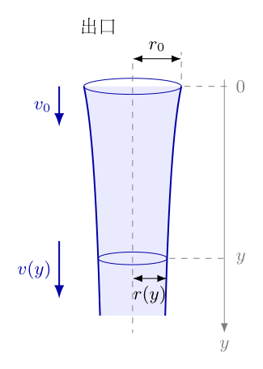
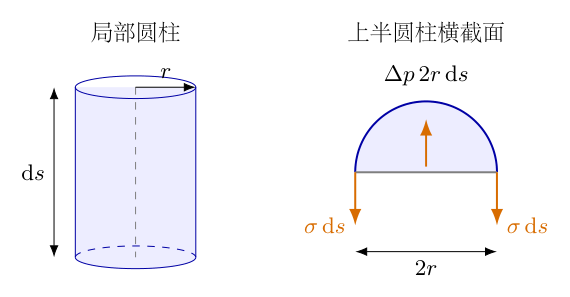
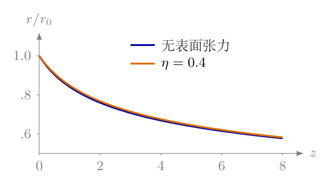
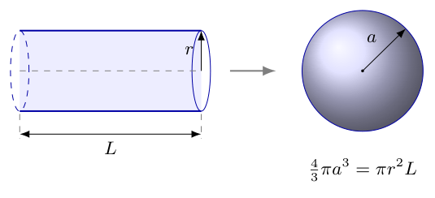

# 第1题

<!-- question-start -->

一个半径为$r_0$的水龙头竖直向下，以速度$v_0$流出水。不考虑黏滞阻力，将水视为理想流体。重力加速度为$g$，水的密度为$\rho$。以出口处为下落高度$y=0$。

（1）不考虑表面张力，求水流半径$r$随下落高度$y$的变化。

（2）表面张力系数为$\sigma$，但不是太大，并认为水流较快。求水流半径$r$随下落高度$y$的变化。

（3）仅从表面张力的能量角度考虑，估算水柱在下落至什么高度时变成半径为$a$的小水滴。给出一个模型，列出可求解$y$的方程即可。

<!-- question-end -->

## 一、题型定位

这是稳态不可压缩射流的形状与表面能估算问题。流速增大不意味着单位时间流出的水量增大，而意味着同一体积流量需要更小的横截面积。第（1）问使用流量守恒和重力作用下的速度关系；第（2）问在当地近似圆柱的条件下引入曲率压强，再沿流线使用伯努利方程；第（3）问比较同一体积的水在连续水柱和孤立球滴两种形态下的表面能。

三问采用不同层次的模型。前两问描述破裂前的平均水流轮廓，不处理颈缩扰动。最后一问只给形态变化在能量上开始有利的估算条件，不包含扰动幅度和增长时间，因此不能把其解读成精确可测的首次断裂高度。

## 二、知识点

稳态不可压缩流体的体积流量满足$Q=A v$。圆截面面积是$\pi r^2$，因此半径与速度的关系是$r\propto v^{-1/2}$，而不是$r\propto v^{-1}$。

同一条流线上的伯努利方程为$p+\rho g z+\rho v^2/2=\text{常量}$，其中$z$必须是向上的高度。本题改用向下的距离$y$，故$z=-y$，重力项变成$-\rho g y$。这里的$p$是水内的压力，不能在有表面张力时直接令它等于外界空气压力。

曲面两侧的拉普拉斯压差为$\Delta p=\sigma(1/R_1+1/R_2)$。圆柱面一个主曲率为$1/r$、另一个为零，故$\Delta p=\sigma/r$；球面两个主曲率均为$1/a$，故为$2\sigma/a$。圆柱与球的因子不能互换。

液体表面能为$E_s=\sigma S$。比较两个形态时必须先固定同一体积；若球滴体积任意、水柱长度不随之改变，所得表面能比较便不是同一批水的比较。

## 三、物理图像

取竖直向下为$y$正方向，水流的平均速度$v(y)$也向下。图1-1中，上截面半径为$r_0$、速度为$v_0$；下截面半径为$r(y)$、速度为$v(y)$。两截面之间没有水流从侧面漏出，故通过它们的体积流量相同。图中的轴向轮廓是建模示意，圆截面用空间投影表示；它不表示真实射流会一直保持光滑而不破裂。

{width=72%}

有表面张力时，较细水柱的曲率较大，水内压力反而较高。水向下运动时遇到向下逐渐增大的压力，压强梯度对加速有阻碍作用。它并不把水柱变成一串处处平衡的静止水滴；这里仍是连续的稳态流动。

## 四、解题入口

先把连续性写成$r^2v=r_0^2v_0$，使速度可以由半径唯一表示。无表面张力时直接用$v^2=v_0^2+2gy$；有表面张力时，将$p(y)=p_{\mathrm a}+\sigma/r(y)$代入伯努利方程，再消去$v$。外界空气压力$p_{\mathrm a}$在两处相同，会相消，但曲率造成的压差不能相消。

第三问另取一段当地近似圆柱的水柱，长度记作$L$，避免把它与下落高度$y$混淆。先由$\pi r^2L=4\pi a^3/3$确定这段水柱包含的水量，再比较水柱侧面积与球滴面积。得到临界半径后，回到第二问的$r(y)$关系求高度，而不是重新假设另一条下落轨迹。

## 五、解析

（1）确定研究对象、边界条件与近似范围。

研究对象是已离开出口、尚未破裂的稳态水流。假设水密度不变，空气压力在所研究高度内可视为常量，空气阻力忽略；每个截面的轴向速度近似均匀。出口量$r_0,v_0$取自由射流建立后的边界值，不额外推算水龙头内部压强或供水管损失。边界条件为

$$
r(0)=r_0,\qquad v(0)=v_0>0,\qquad y\geq0.
$$

第（2）问的“水流较快”还支持细长、缓变轮廓的近似。在该近似下，截面速度可以用$v(y)$描述，轴向曲率比周向曲率小。若出口附近形状剧烈改变，或水柱已形成明显颈缩，下面的近似就不能覆盖该区域。

（2）由质量守恒得到连续性关系。

取图1-1的两个固定截面。在时间$\mathrm dt$内，上截面流入的体积是$\pi r_0^2v_0\mathrm dt$，下截面流出的体积是$\pi r^2v\mathrm dt$。稳态意味着两截面之间储存的水量不随时间改变，不可压缩意味着密度相同，因此

$$
\begin{aligned}
\rho\pi r_0^2v_0\,\mathrm dt&=\rho\pi r^2v\,\mathrm dt,\\
r^2v&=r_0^2v_0,\\
v&=v_0\frac{r_0^2}{r^2},\\
v^2&=v_0^2\frac{r_0^4}{r^4}.
\end{aligned}
$$

最后一行将用于消元。守恒的是$r^2v$，不是$rv$；平方与四次方分别来自圆截面面积及后续速度平方。

（3）第（1）问：无表面张力时求速度与半径。

不计表面张力时，自由表面与外界空气压力相同；在截面速度近似均匀的模型中，两截面水压均取$p_{\mathrm a}$。以出口为重力势能零点，沿同一流线写

$$
\begin{aligned}
p_{\mathrm a}+\frac12\rho v_0^2
&=p_{\mathrm a}-\rho gy+\frac12\rho v^2,\\
\frac12\rho(v^2-v_0^2)&=\rho gy,\\
v^2&=v_0^2+2gy,\\
v(y)&=\sqrt{v_0^2+2gy}.
\end{aligned}
$$

正平方根由向下的流向决定。把速度代入连续性并依次开平方，可得

$$
\begin{aligned}
r^2&=r_0^2\frac{v_0}{\sqrt{v_0^2+2gy}},\\
r&=r_0\left(\frac{v_0^2}{v_0^2+2gy}\right)^{1/4}.
\end{aligned}
$$

因此第（1）问答案为

$$
\boxed{r(y)=r_0\left(1+\frac{2gy}{v_0^2}\right)^{-1/4}.}
$$

四次根并不是经验拟合。先由重力关系得到$v\propto\sqrt{v_0^2+2gy}$，再由面积守恒得到$r\propto v^{-1/2}$，两个平方根叠加才产生四次根。

（4）无表面张力结果的边界、量纲与局部检验。

在$y=0$处括号等于一，得到$r=r_0$；$2gy/v_0^2$无量纲，因此半径的量纲只来自$r_0$。当$y$增加时，括号增大且指数为负，水柱变细。对结果求导，使用复合函数求导法，有

$$
\begin{aligned}
\frac{\mathrm dr}{\mathrm dy}
&=-\frac{gr_0}{2v_0^2}\left(1+\frac{2gy}{v_0^2}\right)^{-5/4}<0,\\
\left.\frac{\mathrm dr}{\mathrm dy}\right|_{0}
&=-\frac{gr_0}{2v_0^2}.
\end{aligned}
$$

若$2gy/v_0^2\ll1$，利用$(1+s)^n=1+ns+n(n-1)s^2/2+\cdots$展开至二阶：

$$
\frac r{r_0}
=1-\frac{gy}{2v_0^2}+\frac{5g^2y^2}{8v_0^4}
+O\!\left(\frac{g^3y^3}{v_0^6}\right).
$$

一阶系数与导数相符。远离出口、且模型尚未因破裂失效时，$r\sim r_0(v_0^2/2g)^{1/4}y^{-1/4}$；不能把这一趋势延伸成真实水柱到任意高度仍光滑连续的结论。

（5）第（2）问：先建立局部圆柱压强，而非直接写球滴压强。

图1-2中取一小段水柱，半径为$r$，长度为$\mathrm ds$。用过轴线的平面把它切成两半。水内相对于空气的压力作用在投影矩形面$2r\,\mathrm ds$上，向外推；两条长边上的表面张力分别为$\sigma\mathrm ds$，向内拉。局部径向平衡给出

{width=68%}

$$
\begin{aligned}
(p-p_{\mathrm a})\,2r\,\mathrm ds&=2\sigma\,\mathrm ds,\\
p-p_{\mathrm a}&=\frac{\sigma}{r}.
\end{aligned}
$$

这里的二同时出现在受压面积和两条受力边上，约去后没有球面压差中的二。图1-2的$\mathrm ds$是所取局部段长，不是第三问的整段$L$。

轴对称细长自由表面的更完整曲率表达为

$$
p-p_{\mathrm a}
=\sigma\left[\frac1{r\sqrt{1+r_y^2}}
-\frac{r_{yy}}{(1+r_y^2)^{3/2}}\right],
\qquad r_y=\frac{\mathrm dr}{\mathrm dy}.
$$

当$|r_y|\ll1$且$|r r_{yy}|\ll1$时，第一项近似$1/r$，第二项可忽略，才退化成$\sigma/r$。因此当地圆柱近似不仅是“看起来像圆柱”，而是对两个主曲率大小作了明确选择。后续解是这一近似模型的解，不声称已经求解完整自由边界问题。

（6）代入伯努利方程，保留表面张力项的正确符号。

出口压力为$p(0)=p_{\mathrm a}+\sigma/r_0$，当地压力为$p(y)=p_{\mathrm a}+\sigma/r$。在$y$向下为正的约定下，有

$$
\begin{aligned}
p_{\mathrm a}+\frac{\sigma}{r_0}+\frac12\rho v_0^2
&=p_{\mathrm a}+\frac{\sigma}{r}-\rho gy+\frac12\rho v^2,\\
\frac12\rho(v^2-v_0^2)
&=\rho gy+\sigma\left(\frac1{r_0}-\frac1r\right),\\
v^2&=v_0^2+2gy+\frac{2\sigma}{\rho}\left(\frac1{r_0}-\frac1r\right).
\end{aligned}
$$

若$r<r_0$，则$1/r_0-1/r<0$。表面张力项降低同一高度处的速度，符合下方水压较大、压强梯度阻碍加速的判断。把它写成正的加速项，会与压强变化的物理方向冲突。

（7）利用连续性消元，得到可求解半径的方程。

代入$v^2=v_0^2(r_0/r)^4$，再除以$v_0^2$，逐步得到

$$
\begin{aligned}
v_0^2\left(\frac{r_0}{r}\right)^4
&=v_0^2+2gy+\frac{2\sigma}{\rho r_0}\left(1-\frac{r_0}{r}\right),\\
\left(\frac{r_0}{r}\right)^4
&=1+\frac{2gy}{v_0^2}
+\frac{2\sigma}{\rho v_0^2r_0}\left(1-\frac{r_0}{r}\right).
\end{aligned}
$$

第（2）问可用这一隐式方程回答。题目没有要求把四次方程写成冗长的根式；关键是保证所选根满足$r>0$、出口边界以及向下流动。为明确根的选择，定义

$$
w=\frac{r_0}{r},\qquad z=\frac{2gy}{v_0^2},\qquad
\eta=\frac{2\sigma}{\rho v_0^2r_0}\geq0.
$$

注意$w$是半径之比，$z$是无量纲下落高度，不是原先向上的高度坐标。方程化为

$$
\boxed{w^4+\eta(w-1)=1+z,\qquad r=\frac{r_0}{w},\quad w\geq1.}
$$

它同时保留有限表面张力与出口条件；当$\eta=0$时，立刻返回第（1）问。

（8）证明物理解唯一，并给出计算区间。

令$f(w)=w^4+\eta(w-1)-(1+z)$。对$w>0$有$f'(w)=4w^3+\eta>0$，所以$f$严格递增。对于$z\geq0$，

$$
\begin{aligned}
f(1)&=-z\leq0,\\
f\big((1+z)^{1/4}\big)
&=\eta\big((1+z)^{1/4}-1\big)\geq0.
\end{aligned}
$$

因此存在且仅存在一个物理根，位于

$$
1\leq w\leq(1+z)^{1/4}.
$$

实际计算可在此区间用二分法：每次取中点，若$f$为负则增大下界，若$f$为正则减小上界。严格单调保证不会选到另一条支路。该区间也直接给出同一高度处半径的比较：

$$
\boxed{r_0(1+z)^{-1/4}\leq r\leq r_0.}
$$

左端是无表面张力半径。非零表面张力时，速度较小，固定通量需要较大截面，因此水柱比忽略表面张力时稍粗，而不是稍细。这一比较是在相同出口$r_0,v_0$和同一$y$下作出的。

（9）将隐式式反解为$y(r)$，并验证下落单调性。

由上一方程移项，不经过任何近似根式，可得

$$
\begin{aligned}
\frac{2gy}{v_0^2}
&=\left(\frac{r_0}{r}\right)^4-1
+\frac{2\sigma}{\rho v_0^2}\left(\frac1r-\frac1{r_0}\right),\\
y(r)&=\frac{v_0^2}{2g}\left[\left(\frac{r_0}{r}\right)^4-1\right]
+\frac{\sigma}{\rho g}\left(\frac1r-\frac1{r_0}\right).
\end{aligned}
$$

第一项中的$v_0^2/g$具有长度量纲。第二项中$\sigma/(\rho g)$具有长度平方量纲，乘倒数长度后也是长度。这一量纲检查排除在式外再乘额外$r_0$的写法。

对$y(r)$求导并取倒数，得到

$$
\begin{aligned}
\frac{\mathrm dy}{\mathrm dr}
&=-\frac{2v_0^2r_0^4}{g r^5}-\frac{\sigma}{\rho g r^2}<0,\\
\frac{\mathrm dr}{\mathrm dy}
&=-\frac{g r}{2v^2+\sigma/(\rho r)}<0.
\end{aligned}
$$

因$v^2=v_0^2r_0^4/r^4$，两个表达完全一致。半径随下落高度严格减小，故第三问的某一临界半径至多对应一个正高度。再由$r^2v$求导，得到$r_y=-r v_y/(2v)$，代入上式可检验

$$
v\frac{\mathrm dv}{\mathrm dy}
=\frac{g}{1+\sigma/(2\rho r v^2)}<g
\quad(\sigma>0).
$$

左边是沿流向的材料加速度，不是单独的$\mathrm dv/\mathrm dy$。它说明表面张力减缓加速，但并不把加速度改变为负值。

（10）弱表面张力下给出显式一阶近似。

若$\eta\ll1$，取$w_*= (1+z)^{1/4}$，设$w=w_*+\eta w_1+O(\eta^2)$。将其代入$w^4+\eta(w-1)=1+z$，用二项式展开并比较一阶系数：

$$
\begin{aligned}
w_*^4+4\eta w_*^3w_1+\eta(w_*-1)+O(\eta^2)
&=1+z,\\
4w_*^3w_1+w_*-1&=0,\\
w_1&=-\frac{w_*-1}{4w_*^3}.
\end{aligned}
$$

随后用$(1+s)^{-1}=1-s+O(s^2)$展开$r=r_0/w$，而不是直接把$w$的修正量当$r$的修正量：

$$
\boxed{r(y)=\frac{r_0}{w_*}
\left[1+\frac{\eta(w_*-1)}{4w_*^4}+O(\eta^2)\right].}
$$

一阶项为正，符合上一节的半径比较。$z=0$时修正项为零，因此出口边界没有因展开被改变。若$\eta$不小，应回到隐式方程数值求根，不能为了写出显式式而继续使用这一阶近似。

图1-3取代表性的$\eta=0.4$，横坐标为$z$，纵坐标为$r/r_0$。蓝线是无表面张力解，橙线是同一隐式模型的正根；两线从同一出口条件开始，橙线始终略高。示例只用于检验比较方向，不给题目添加数值条件。

{width=69%}

模型中的局部惯性与曲率比可写成$\mathrm{We}(y)=\rho v^2r/\sigma$。利用连续性可得$\mathrm{We}(y)=\mathrm{We}_0 w^3$，其中$\mathrm{We}_0=\rho v_0^2r_0/\sigma=2/\eta$。因此在光滑平均流动范围内，下落后惯性相对曲率压强更强。这个结论并不保证水柱稳定；平均轮廓变化和扰动能否增长是两个不同问题。

（11）第（3）问：建立等体积圆柱变球模型。

取某一高度处半径为$r$的短水柱，长度为$L$，并把其中全部水变成一个半径为$a$的球滴。图1-4的左右两部分表示相同体积；尺寸只表示关系，不表示流动的中间形态。假定段内$r$变化很小，即$L|r_y|\ll r$，并忽略与邻段连接的颈缩细节。

{width=75%}

体积守恒先确定$L$：

$$
\begin{aligned}
\pi r^2L&=\frac43\pi a^3,\\
L&=\frac{4a^3}{3r^2}.
\end{aligned}
$$

连续水柱原本没有这段水的两个封闭端面，因此原始表面只取侧面$S_{\mathrm{cyl}}=2\pi rL$。不能为方便画有限圆柱，就给它额外加两个不存在的液气端面。球滴的完整表面积为$S_{\mathrm{drop}}=4\pi a^2$。消去$L$，得到

$$
\begin{aligned}
E_{\mathrm{cyl}}&=\sigma\,2\pi rL=\frac{8\pi\sigma a^3}{3r},\\
E_{\mathrm{drop}}&=4\pi\sigma a^2,\\
\Delta E_s&=E_{\mathrm{drop}}-E_{\mathrm{cyl}}
=4\pi\sigma a^2\left(1-\frac{2a}{3r}\right).
\end{aligned}
$$

对于$\sigma>0$，当$r<2a/3$时，$\Delta E_s<0$，球滴形态的表面能更低。等能量边界为

$$
\boxed{r_{\mathrm c}=\frac{2a}{3}.}
$$

这一条件表示终态能量低于初态，不证明水柱能无障碍地通过所有中间形态，也没有给出转换所需时间。

（12）把临界半径代回流动方程，求能量模型的估算高度。

由$r_0/r_{\mathrm c}=3r_0/(2a)$，第二问直接给出待求$y_{\mathrm c}$的方程：

$$
\left(\frac{3r_0}{2a}\right)^4
=1+\frac{2gy_{\mathrm c}}{v_0^2}
+\frac{2\sigma}{\rho v_0^2r_0}
\left(1-\frac{3r_0}{2a}\right).
$$

若将它显式整理，先移走一和表面张力项，再乘$v_0^2/(2g)$，得到

$$
\boxed{y_{\mathrm c}
=\frac{v_0^2}{2g}\left[\left(\frac{3r_0}{2a}\right)^4-1\right]
+\frac{\sigma}{\rho g}\left(\frac{3}{2a}-\frac1{r_0}\right).}
$$

这一式外不再乘$r_0$。两个加项各自都有长度量纲；若多乘$r_0$，结果会变成长平方，不能表示下落高度。

若$0<a<3r_0/2$，则$r_{\mathrm c}<r_0$，上式给出唯一正的估算高度。若$a=3r_0/2$，等能边界就在出口$y=0$。若$a>3r_0/2$，形式代入会得到负高度，说明对这种目标水滴，出口处已满足球滴表面能较低的条件；模型没有正的“首次等能高度”，只能说能量有利区间从$y=0$开始，不能把负数当实际下落距离。

在临界半径处，等体积段长为

$$
L_{\mathrm c}
=\frac{4a^3}{3(2a/3)^2}=3a=\frac92 r_{\mathrm c}.
$$

这个段长来自有限形变的表面能比较，不是小扰动的稳定性波长。能量终态比较不能自动代替线性稳定性分析，因而不能据此宣称所有长度$L>9r/2$的微小扰动立即增长。

（13）用一组数值完整检查方程、临界条件与近似。

以下仅取示例$r_0=1.50\times10^{-3}\,\mathrm m$、$v_0=0.800\,\mathrm{m/s}$、$\rho=1.00\times10^3\,\mathrm{kg/m^3}$、$\sigma=0.0720\,\mathrm{N/m}$、$g=9.80\,\mathrm{m/s^2}$，目标$a=1.50\times10^{-3}\,\mathrm m$。先换算所有长度为米，再算

$$
\begin{aligned}
\eta&=\frac{2(0.0720)}{(1000)(0.800)^2(0.00150)}=0.150,\\
r_{\mathrm c}&=\frac{2a}{3}=1.00\times10^{-3}\,\mathrm m,\\
w_{\mathrm c}&=\frac{r_0}{r_{\mathrm c}}=1.50,\\
z_{\mathrm c}&=w_{\mathrm c}^4-1+\eta(w_{\mathrm c}-1)\\
&=5.0625-1+0.150(0.50)=4.1375,\\
y_{\mathrm c}&=\frac{0.640}{19.60}(4.1375)
=0.135102\,\mathrm m.
\end{aligned}
$$

其中不计表面张力的临界高度是$0.132653\,\mathrm m$，表面张力增加的高度为$0.002449\,\mathrm m$。两者之差来自在相同半径下压力增加消耗的能量，方向与前述减缓加速一致。

再由流量守恒求临界速度，而不是重新套用无表面张力速度：

$$
v_{\mathrm c}=v_0w_{\mathrm c}^2=0.800(2.25)=1.800\,\mathrm{m/s}.
$$

代回含表面张力的速度方程，右边为

$$
\begin{aligned}
v_0^2+2gy_{\mathrm c}
+\frac{2\sigma}{\rho}\left(\frac1{r_0}-\frac1{r_{\mathrm c}}\right)
&=0.640+2.648-0.048\\
&=3.240=v_{\mathrm c}^2.
\end{aligned}
$$

临界等体积段长为$L_{\mathrm c}=0.00450\,\mathrm m$。计算局部坡度，得

$$
|r_y|_{\mathrm c}
=\frac{9.80(0.00100)}{2(1.800)^2+0.0720/(1000\times0.00100)}
\simeq0.001496.
$$

故$L_{\mathrm c}|r_y|/r_{\mathrm c}\simeq0.00673\ll1$，该例中局部等半径水段近似成立。表面能也可回查：$2\pi r_{\mathrm c}L_{\mathrm c}=4\pi a^2$，因此临界两形态面积相同。数值核验只检验这里选定的模型，不提供真实射流的断裂时间。

<!-- KEEP_STUDENT_START -->

（14）汇总答案及三个必要限定。

第（1）问的显式式为$r=r_0(1+2gy/v_0^2)^{-1/4}$。第（2）问的物理解由$w^4+\eta(w-1)=1+z$唯一确定，$w\in[1,(1+z)^{1/4}]$，且$r=r_0/w$。第（3）问的等体积模型给$r_{\mathrm c}=2a/3$和上述$y_{\mathrm c}$方程。

限定分别是：稳态光滑射流、当地圆柱曲率近似、只比较表面能的估算。若$\sigma=0$，前两问仍有明确下落半径，但第三问的两形态表面能恒为零，不能再用除去$\sigma$后的等面积条件来声称有由表面张力驱动的成滴高度。若扰动幅度、扰动波长和增长过程没有给定，实际破裂位置无法由本题参数唯一确定。

<!-- KEEP_STUDENT_END -->

## 六、关键洞察

（1）材料的自由落体关系与稳态水柱的轮廓关系不是同一层次。

即使忽略表面张力，一小团水的速度也只是确定了沿流线的运动；截面半径还需要流量守恒。设该水团从出口运动了时间$t$，则

$$
y=v_0t+\frac12gt^2,\qquad v=v_0+gt.
$$

解第一式的正根，$t=(\sqrt{v_0^2+2gy}-v_0)/g$，代入第二式得到同一个速度平方关系。再令$Q=\pi r^2v$固定，才得到四次根半径。这条以时间为中介的路线可交叉核验重力项与根的选择，但不能把不同高度的截面误认为同一时刻的一团水的边界。

（2）弱表面张力时可直接对$r(y)$作隐函数微分。

令$F(w,\eta)=w^4+\eta(w-1)-1-z$。固定$z$时，隐函数求导给出

$$
\begin{aligned}
\left.\frac{\partial w}{\partial\eta}\right|_z
&=-\frac{w-1}{4w^3+\eta}\leq0,\\
\left.\frac{\partial r}{\partial\eta}\right|_z
&=\frac{r_0(w-1)}{w^2(4w^3+\eta)}\geq0.
\end{aligned}
$$

在$y>0$处不等式为严格。这无需写任何四次根公式，就能证明增加表面张力会使同高度的平均水柱变粗；把$\eta=0$代入导数还直接恢复一阶近似系数。

固定$w>1$时，$y=v_0^2(w^4-1)/(2g)+\sigma(w-1)/(\rho g r_0)$。因此达到同一收缩比所需高度对$\sigma$线性增大。固定高度与固定半径是两种不同比较，不能混着代数消元。

（3）扰动稳定性不能由有限终态面积比较替代。

考虑当地静止近似的圆柱，原半径为$r$，一个周期的轴向长度为$\lambda$，用小量$\varepsilon\ll1$和$k=2\pi/\lambda$写出保持体积至二阶的波纹：

$$
R(s)=r\left[1+\varepsilon\cos ks-\frac{\varepsilon^2}{4}\right].
$$

这里$s$是当地轴向坐标。平方后对整周期平均，因$\langle\cos ks\rangle=0$、$\langle\cos^2ks\rangle=1/2$，有

$$
\begin{aligned}
\langle R^2\rangle
&=r^2\left[1-\frac{\varepsilon^2}{2}
+\varepsilon^2\langle\cos^2ks\rangle\right]+O(\varepsilon^3)\\
&=r^2+O(\varepsilon^3).
\end{aligned}
$$

因此体积修正$-\varepsilon^2/4$不能省略。该波纹表面积为$S=2\pi\int_0^\lambda R\sqrt{1+R_s^2}\,\mathrm ds$；用平方根二阶展开，得到

$$
\begin{aligned}
R_s^2&=r^2\varepsilon^2 k^2\sin^2ks+O(\varepsilon^3),\\
\frac{S}{2\pi r\lambda}
&=1-\frac{\varepsilon^2}{4}
+\frac{r^2\varepsilon^2 k^2}{4}+O(\varepsilon^3),\\
\Delta S&=\frac{2\pi r\lambda\varepsilon^2}{4}(k^2r^2-1)
+O(\varepsilon^3).
\end{aligned}
$$

小扰动能降低表面能的条件为$kr<1$，即$\lambda>2\pi r$。这是无限或周期圆柱的局部稳定性条件，与整段变成一个球滴的有限形变终态比较不同，并不与$L_{\mathrm c}=9r/2$矛盾。前者检验圆柱附近的能量二阶变化，后者比较相距很远的两个形态。

能量条件本身还不含增长速度；实际断裂需要扰动长大到半径量级。即使写出某一增长率$s_{\mathrm g}$，也必须给出初始扰动幅度$\varepsilon_0$，才能由$\varepsilon_0e^{s_{\mathrm g}t}\sim1$估计$t$。本题不提供这些量，故不能给唯一的动态断裂高度。

## 七、易错点

（1）把流量守恒写成$rv=r_0v_0$，会使最终半径变成二次根规律。必须先写圆截面面积，约去$\pi$之后才得到$r^2v$不变。

（2）把$y$既当向下距离又当向上高度，会在伯努利式中给重力项错号。用出口势能为零，向下运动的单位体积势能是$-\rho gy$，两边移项后动能增加量才是正的$\rho gy$。

（3）把水柱当地压差写成$2\sigma/r$，混淆圆柱和球面。图1-2的受压投影面积与两条表面张力边逐项抵消后，只留下$\sigma/r$。球滴的两个主曲率相同，才会有二。

（4）因为空气压力相同，就把所有压力项一起删掉。外压$p_{\mathrm a}$可以消去，但$\sigma/r_0$与$\sigma/r$不同，保留它们才能得到减缓加速的修正。

（5）认为表面张力倾向于缩小表面积，所以同一高度水柱一定更细。这里比较的是同一出口通量的连续稳态流，曲率压力降低当地速度，连续性反而要求截面较大；孤立滴收缩和连续水流平均半径变化不能混为一谈。

（6）看到四次方程就随意选择软件给出的一个根。$w>0$域内严格单调，物理根还应位于$[1,(1+z)^{1/4}]$。负根、复根及不满足出口条件的表达均不能使用。

（7）对$r$和$w=r_0/r$使用同号微扰。增加$\eta$会减小$w$，但增大$r$；开倒数时必须再次展开，不能直接转抄修正量。

（8）固定球滴半径$a$比较表面积，却把圆柱长度$L$随意固定。二者必须由等体积关系绑定；另一常见错误是在连续柱段上加两个液气端面，从而人为改变初始能量。

（9）把$y_{\mathrm c}<0$解释成水滴在出口上方已经形成。负值只说明该目标滴半径的等能条件不在$y\geq0$的物理域内；模型给出的是出口已在能量有利区间，不是上游流动状态。

（10）先约去$\sigma$，再把$\sigma=0$代入成滴结论。约去时已假定$\sigma>0$；零表面张力时两形态的表面能都为零，没有由该能量差驱动的转变，也不能沿用非零$\sigma$的动态结论。

## 八、课堂讲解建议

先让学生判断：“水流下落更快，固定出口通量时截面应该变大还是变小？”不要立即给最终式。板书先保留$Q=\pi r^2v$，再写$v^2=v_0^2+2gy$，让学生明确每一个根号来自哪一层关系。若出现$r\propto1/v$，用单位时间流过圆截面的体积反问其面积写在哪里。

随后用图1-2单独讲圆柱压差。教师可先给一段轴向长度$\mathrm ds$，让学生算半圆柱受压面的投影面积，再数出两条表面张力受力边。完成这一平衡以后，再与球面两个主曲率对照；此处不应只凭记忆要求学生背诵两个看似相近的公式。

建立坐标时在图1-1旁明确写$y$向下和势能$-\rho gy$。把出口与下截面的所有压力、速度、势能分别列出后，再写伯努利。让学生先按“下方压强更高”预测修正方向，再检查代数结果；若算出表面张力使同高度速度增大，应先追查曲率压差和移项符号。

四次方程的处理重点是物理解，不是根式技巧。教师可让学生计算$f(1)$及$f((1+z)^{1/4})$，再判断导数是否变号，以此得到唯一根的区间。这样既建立数值求根依据，又在未求根前完成有、无表面张力半径的比较。

第三问先问：“比较的是否是同一批水？”只有写出等体积方程后才讨论面积。图1-4左右分别用$r,L$和$a$标注，板书强调$L$不是下落高度。最后让学生说明负估算高度、零表面张力及未知扰动条件各意味着什么，避免把一个能量模型包装成真实流动的精确预报。

若安排拓展，先讲关键洞察中的保持体积波纹，再计算表面积二阶变化。课堂不必引入特殊函数和完整增长率；应先让学生理解有限终态比较、局部稳定性和动态增长时间这三个层次的区别。最终回到题目，只交付其要求的能量估算方程及成立条件。

## 九、变式训练

（1）已知出口半径$r_0$及某一高度$y_1>0$处的半径$r_1<r_0$，忽略黏滞和空气阻力，仍采用当地圆柱曲率模型。由这些量反求出口速度，并说明数据何时不允许正的出口速度。

设$w_1=r_0/r_1>1$。从已推得的$y(r)$式出发，不能把未知$v_0$同时偷偷代入未知的$\eta$，而应使用有量纲式整理：

$$
\begin{aligned}
2gy_1&=v_0^2(w_1^4-1)+\frac{2\sigma}{\rho r_0}(w_1-1),\\
v_0^2&=\frac{2gy_1-2\sigma(w_1-1)/(\rho r_0)}{w_1^4-1},\\
&\boxed{v_0=\sqrt{\frac{2gy_1-2\sigma(w_1-1)/(\rho r_0)}{w_1^4-1}}.}
\end{aligned}
$$

分母为正，正的出口速度要求分子严格大于零，即$gy_1>\sigma(w_1-1)/(\rho r_0)$。若分子为负，观测数据与该理想模型不相容；若等于零，反解只有$v_0=0$，不属于原题给定的连续流出情形。

使用解析中的示例，令$r_1=0.00100\,\mathrm m$、$y_1=0.1351020408\,\mathrm m$，则$w_1=1.50$，分子为$2.648-0.048=2.600\,\mathrm{m^2/s^2}$，分母为$4.0625$，得到$v_0^2=0.640$、$v_0=0.800\,\mathrm{m/s}$。若反演时漏掉曲率压强，得到$v_0=\sqrt{2.648/4.0625}\simeq0.80735\,\mathrm{m/s}$，会高估出口速度。

（2）保持解析示例的出口条件，但目标球滴半径改为$a=0.750\,\mathrm{mm}$，求能量模型的临界半径、高度和当地速度。是否能据此得到实际断裂时间？

先将$a$换为$0.000750\,\mathrm m$，再计算

$$
\begin{aligned}
r_{\mathrm c}&=\frac23a=0.000500\,\mathrm m,\\
w_{\mathrm c}&=\frac{0.00150}{0.000500}=3,\\
z_{\mathrm c}&=3^4-1+0.150(3-1)=80.30,\\
y_{\mathrm c}&=\frac{0.640}{19.60}(80.30)
=2.62204\,\mathrm m,\\
v_{\mathrm c}&=0.800(3)^2=7.200\,\mathrm{m/s},\\
L_{\mathrm c}&=3a=0.002250\,\mathrm m.
\end{aligned}
$$

速度平方回查为$0.640+2g(2.62204)+0.000144(666.667-2000)\simeq51.840$，与$7.200^2$一致。这是指定小球滴对应的形式能量阈值；真实水柱很可能已在更上方因其他扰动破裂，故不能把$2.62\,\mathrm m$当保证可达的光滑射流长度。题目仍未给扰动初值和增长规律，实际断裂时间不能唯一算出。

（3）假设某个外加周期扰动将全部水量均匀分配成半径$a$的单一球滴，每周期恰好一滴。求滴频率$f_{\mathrm d}$，并证明当地每滴对应的水柱长度仍满足等体积关系。

每滴体积为$V_{\mathrm d}=4\pi a^3/3$，单位时间体积为$Q=\pi r_0^2v_0$。不是用重力运动时间决定滴频率，而是先按体积流量计数：

$$
\begin{aligned}
f_{\mathrm d}V_{\mathrm d}&=Q,\\
&\boxed{f_{\mathrm d}=\frac{3r_0^2v_0}{4a^3}.}
\end{aligned}
$$

当地相邻两个周期对应的轴向长度为$L=v/f_{\mathrm d}$。使用连续性$v=v_0r_0^2/r^2$，逐项约去得到

$$
L=\frac{v_0r_0^2}{r^2}\frac{4a^3}{3r_0^2v_0}
=\frac{4a^3}{3r^2},
$$

恰是主解析的等体积关系。若$r=2a/3$，则$L=3a$。原示例$a=r_0=0.00150\,\mathrm m$给$f_{\mathrm d}=400\,\mathrm{Hz}$，当地$v=1.800\,\mathrm{m/s}$，故$L=1.800/400=0.00450\,\mathrm m$。这个频率来自外加周期及单滴假设，并非表面能比较自动预测的天然滴频；若有卫星滴或一周期多滴，体积计数必须相应改写。

<!-- question-complete -->
