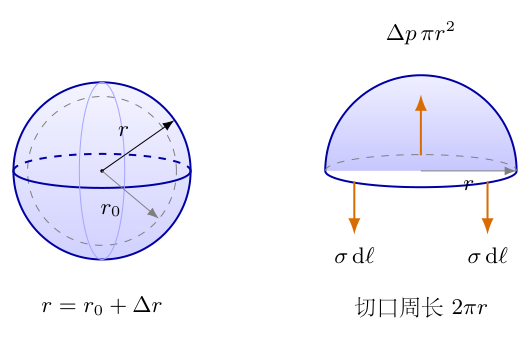
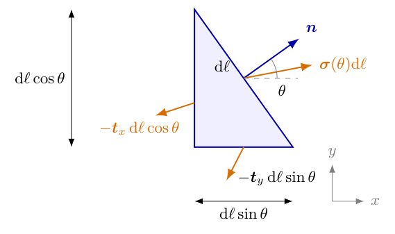
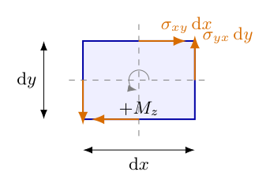
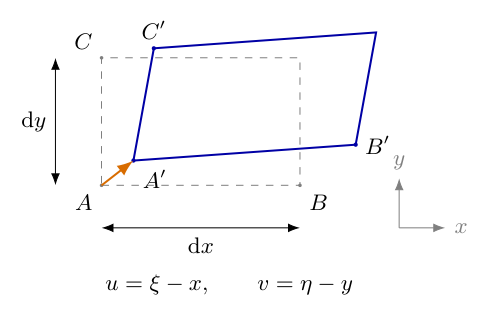

# 第4题

<!-- question-start -->

研究一张均匀、各向同性弹性薄膜的力学性质。一个面积为$\mathrm dS$的小面元，在各向同性拉伸后面积变为$(1+\varepsilon)\mathrm dS$，其中$|\varepsilon|\ll1$；各方向单位长度上的张力均为$\sigma=\alpha\varepsilon$，称$\alpha$为拉伸系数。

若对长为$l$、宽为$h$的矩形薄膜只沿长度方向施加拉力，使长度变为$(1+\varepsilon_1)l$，宽度同时变为$(1-\varepsilon_2)h$，定义泊松比$\delta=\varepsilon_2/\varepsilon_1$。用$\alpha,\delta$表征薄膜的线性弹性性质。

（1）一个初始半径为$r_0$的球形薄膜，向内充气后内外压强差为$\Delta p$。在小变形条件下，求气球体积的相对变化量$\Delta V/V_0$，其中$V_0$是初始体积。

（2）薄膜在外力作用下保持平面静力平衡。在平面内建立直角坐标系，在点$A$附近取长为$\mathrm d\ell$的小线段，其单位法向与$x$轴成角$\theta$。线段两侧的相互作用力为$\mathrm d\boldsymbol F=\boldsymbol\sigma(\theta)\mathrm d\ell$。用$\boldsymbol\sigma(0)$、$\boldsymbol\sigma(\pi/2)$表达$\boldsymbol\sigma(\theta)$，并证明在任意一点至少存在两个相互垂直的方向，使应力向量沿线段法向。这两个方向称为主方向。

（3）薄膜最初无应力，在边界施加一定拉力后仍静止于同一平面。初始坐标为$(x,y)$的点移动到$(\xi(x,y),\eta(x,y))$。若点$A(x,y)$的主方向恰为$x,y$轴，主张力分别为$\sigma_1,\sigma_2$，写出该点的变形与张力应满足的方程。

补充：用$\xi(x,y),\eta(x,y)$表达一般点的应力，并写出无面内体力时平衡位移场的方程。

<!-- question-end -->

## 一、题型定位

本题把球膜压强平衡、二维应力变换与线性弹性联系起来。第一问用球形几何和各向同性面积应变求张力，再由半球受力平衡求体积变化；第二问只使用局部的力与力矩平衡，不依赖具体弹性常数；第三问才引入材料性质，把位移导数与应力联系起来。

这三个层次不能倒置：应力是内力如何跨过一条切线的描述，应变是形状如何改变的描述，材料本构把二者联系起来。主方向存在来自应力张量的对称性，并非来自“薄膜各向同性”这一条材料假设。

## 二、知识点

题中$\sigma$是单位切线长度上的膜张力，单位为$\mathrm{N/m}$，并非三维材料中单位面积的应力$\mathrm{Pa}$。$\alpha$同样为$\mathrm{N/m}$，$\varepsilon$与$\delta$无量纲。内外压强差$\Delta p$仍为$\mathrm{Pa}$；压强乘面积给力，膜张力乘切线长度也给力。

小球面半径增量与面积、体积增量分别满足$\Delta S/S_0\simeq2\Delta r/r_0$、$\Delta V/V_0\simeq3\Delta r/r_0$。薄球膜张力与压差的关系为$\Delta p=2\sigma/r$，可由半球受力平衡推导，不能把本题当一个仅受单方向拉力的弹性细线。

线性各向同性薄膜只有两个独立弹性常数。可用题给的$\alpha,\delta$，也可用二维单轴模量$Y$与泊松比$\delta$；这里$Y$把单位长度张力换成纵向应变，单位仍为$\mathrm{N/m}$。两种表述的换算需要从题给的面积拉伸定义推导，不能把面积应变直接当某一个方向的线应变。

变形后的坐标与位移是不同的量。本题定义$\xi,\eta$为新坐标，因此真正的位移为$u=\xi-x$、$v=\eta-y$。线性应变是位移梯度的对称部分，刚体平移和微小刚体转动不产生应变；这是核对表达式的重要依据。

## 三、物理图像

球形膜的膨胀是沿两个切向方向同时伸长，半径增大一小部分$s=\Delta r/r_0$时，每个切向长度的一阶应变为$s$，面积应变约为$2s$。图4-1左侧显示初始与膨胀球面，右侧截出上半球；切口周长$2\pi r$上的膜张力向下，内外压强差的合力向上。球面与切口应保留空间关系，不能只画一条圆弧便把压力合力当$\Delta p\,2\pi r$。

平面膜在一条切线上的应力向量一般不垂直于切线。图4-2中的$\boldsymbol n$是法向，$\boldsymbol\sigma(\theta)$是牵引向量，它们可有夹角；证明主方向就是寻找这夹角为零的切线方向。图4-3只画面元的剪力对，用于核验应力分量的对称性。

图4-4把原矩形微元与变形微元叠合，显示原点$A(x,y)$到新点$A'(\xi,\eta)$的位移；它提供长度变化和边线转角的几何依据。后面分别使用图中的$\mathrm dx,\mathrm dy$求纵向应变与剪应变。

## 四、解题入口

第一问先设$r=r_0+\Delta r$，展开面积和体积至一阶，再用$\sigma=\alpha\Delta S/S_0$与半球受力平衡消去$\sigma,\Delta r$。第二问先取三角形面元，用边长投影建立牵引的线性组合，再取矩形面元用力矩平衡得到交叉分量相等；最后令牵引的切向分量为零求主方向。

第三问先用单轴拉伸定义$Y$，利用泊松收缩和叠加求双轴应变，并以等双轴拉伸和面积定义确定$Y=2\alpha(1-\delta)$。再从位移几何写应变，把这组线性关系联立、消元。无体力平衡的偏微分方程是应力散度为零与本构关系的结合，不是仅凭某一点处于主方向就断言全膜无剪应力。

## 五、解析

（1）展开球膜几何，确定面积应变与体积应变的系数。

令$r=r_0+\Delta r=r_0(1+s)$，其中$|s|\ll1$。初始面积与体积为$S_0=4\pi r_0^2$、$V_0=4\pi r_0^3/3$。先写精确几何式，再按$s$保留一阶：

$$
\begin{aligned}
\frac{S-S_0}{S_0}&=(1+s)^2-1=2s+s^2\simeq2s,\\
\frac{V-V_0}{V_0}&=(1+s)^3-1=3s+3s^2+s^3\simeq3s.
\end{aligned}
$$

球膜均匀膨胀时，各小面元的相对面积变化相同，故题给$\varepsilon$就是$\Delta S/S_0$。由定义得$\sigma=\alpha\varepsilon\simeq2\alpha s$，不是$\alpha s$。两者之差来自面积是两个切向长度的乘积。

（2）对半球列受力平衡，从力的量纲推出压力关系。

如图4-1，将球膜沿赤道截成上半球。压强差作用沿球面法向，水平分量按对称性相消。竖直合力可按投影面积计算，也可沿球面积分；令极角为$\vartheta$，则

{width=74%}

$$
\begin{aligned}
F_{p,z}&=\int_{\text{上半球}}\Delta p\cos\vartheta\,\mathrm dS\\
&=\Delta p\int_0^{2\pi}\!\mathrm d\varphi
\int_0^{\pi/2}\!r^2\sin\vartheta\cos\vartheta\,\mathrm d\vartheta\\
&=2\pi\Delta p r^2\left[\frac12\sin^2\vartheta\right]_0^{\pi/2}
=\Delta p\pi r^2.
\end{aligned}
$$

赤道切线的膜张力是上半球边界处沿经线切向的力；在赤道它竖直向下。每单位周长的张力为$\sigma$，总量为$2\pi r\sigma$。平衡给出

$$
\Delta p\pi r^2=2\pi r\sigma,
\qquad\Delta p=\frac{2\sigma}{r}.
$$

这里的因子$2$来自半球投影面积与周长的比，不是两层肥皂膜表面的因子。本题是一张弹性膜，$\sigma$已经是该膜的总单位长度张力，不能再把它乘二。

（3）统一保留一阶，求第一问的体积变化。

由于$\sigma$本身已是一阶小量，压力式中的$1/r$可用$1/r_0$替代；修正$1/r=(1-s+\cdots)/r_0$与一阶$\sigma$相乘只贡献二阶项。因此

$$
\begin{aligned}
\Delta p&\simeq\frac{2(2\alpha s)}{r_0}
=\frac{4\alpha}{r_0}s,\\
s&\simeq\frac{\Delta p r_0}{4\alpha},\\
&\boxed{\frac{\Delta V}{V_0}\simeq\frac{3\Delta p r_0}{4\alpha}}.
\end{aligned}
$$

该式要求$\Delta p r_0/\alpha\ll1$，从而$s$与面积应变都很小。$\Delta p>0$给出膨胀，$\alpha$越大变化越小。$\Delta p r_0$单位为$\mathrm{N/m}$，与$\alpha$相同，因此相对体积无量纲。若初始球膜已经有预张力，须以初始平衡状态为基准重建增量关系；不能沿用“初始无应力”的起式。

例如$r_0=0.10\,\mathrm m$、$\alpha=400\,\mathrm{N/m}$、$\Delta p=80\,\mathrm{Pa}$时，$s=0.005$、面积应变约为$0.010$、$\sigma\simeq4.0\,\mathrm{N/m}$，体积相对变化约为$0.015$。反算$2\sigma/r_0=80\,\mathrm{Pa}$，与输入一致；这些数值均按同一一阶近似使用。

（4）规定切线法向与应力分量，避免一条线出现两个未说明的方向。

对一条切线，指定单位法向$\boldsymbol n=(\cos\theta,\sin\theta)$，将法向正侧对所取微元的牵引记为$\boldsymbol\sigma(\theta)$。反转法向时，作用—反作用给出$\boldsymbol\sigma(\theta+\pi)=-\boldsymbol\sigma(\theta)$。

定义

$$
\boldsymbol t_x=\boldsymbol\sigma(0)=
\begin{pmatrix}\sigma_{xx}\\\sigma_{yx}\end{pmatrix},
\qquad
\boldsymbol t_y=\boldsymbol\sigma(\pi/2)=
\begin{pmatrix}\sigma_{xy}\\\sigma_{yy}\end{pmatrix}.
$$

下标第一个字母表示力的分量方向，第二个表示切线法向。例如$\sigma_{xy}$是法向沿$y$的切线上、沿$x$方向的张力分量。各分量均为单位线长的力，后面用矩阵乘法时采用这一约定。

（5）取三角形微元，利用边长投影求任意切线的牵引。

图4-2斜边长为$\mathrm d\ell$，其外法向为$\boldsymbol n$；另外两边的外法向分别为$-\boldsymbol e_x$、$-\boldsymbol e_y$。斜边的切向可取$(-\sin\theta,\cos\theta)$，所以竖直边长为$\mathrm d\ell\cos\theta$，水平边长为$\mathrm d\ell\sin\theta$。图先画第一象限情形；其他角度按带符号法向延拓。

{width=64%}

微元面积按$\mathrm d\ell^2$计，有限的体力密度所给体力也是二阶小量；三条边上的牵引按$\mathrm d\ell$计。把微元缩到点$A$，应力的空间变化也仅带来二阶修正，领先阶的力平衡为

$$
\boldsymbol\sigma(\theta)\mathrm d\ell
-\boldsymbol t_x\mathrm d\ell\cos\theta
-\boldsymbol t_y\mathrm d\ell\sin\theta=\boldsymbol0.
$$

约去$\mathrm d\ell$，得到第二问的应力变换：

$$
\boxed{\boldsymbol\sigma(\theta)
=\boldsymbol\sigma(0)\cos\theta
+\boldsymbol\sigma(\pi/2)\sin\theta}.
$$

按分量写，即

$$
\boldsymbol\sigma(\theta)=
\begin{pmatrix}
\sigma_{xx}\cos\theta+\sigma_{xy}\sin\theta\\
\sigma_{yx}\cos\theta+\sigma_{yy}\sin\theta
\end{pmatrix}
=\boldsymbol\Sigma\boldsymbol n,
\qquad
\boldsymbol\Sigma=
\begin{pmatrix}\sigma_{xx}&\sigma_{xy}\\\sigma_{yx}&\sigma_{yy}\end{pmatrix}.
$$

此时尚未用力矩平衡，所以暂不能直接认定$\sigma_{xy}=\sigma_{yx}$。对两个坐标法向代入$\theta=0,\pi/2$，分别恢复定义的$\boldsymbol t_x,\boldsymbol t_y$，是该投影关系的基本检查。

（6）对矩形微元求力矩，证明交叉分量相等。

图4-3取宽$\mathrm dx$、高$\mathrm dy$的微元，关于中心求力矩。只画剪力对；均匀法向张力对中心不产生净力矩。右、左两边的竖直剪力大小各为$\sigma_{yx}\mathrm dy$，力臂各为$\mathrm dx/2$，合力矩按逆时针为正；上、下边水平剪力各为$\sigma_{xy}\mathrm dx$，力臂各为$\mathrm dy/2$，合力矩为负。

{width=48%}

$$
\begin{aligned}
M_z&=2\left(\sigma_{yx}\mathrm dy\frac{\mathrm dx}{2}\right)
-2\left(\sigma_{xy}\mathrm dx\frac{\mathrm dy}{2}\right)\\
&=(\sigma_{yx}-\sigma_{xy})\mathrm dx\mathrm dy=0,\\
&\boxed{\sigma_{yx}=\sigma_{xy}}.
\end{aligned}
$$

这里假设薄膜没有独立的内部力偶；有限体力与应力梯度的力矩在微元极限下是更高阶量。于是$\boldsymbol\Sigma$为实对称矩阵。两个交叉分量不是因为下标看起来对称才相等，而是角动量平衡的结果。

（7）令切向牵引为零，证明存在两个正交主方向。

对法向$\boldsymbol n=(\cos\theta,\sin\theta)$，取单位切向$\boldsymbol s=(-\sin\theta,\cos\theta)$。应力向量沿法向的条件是$\boldsymbol s\cdot\boldsymbol\sigma(\theta)=0$。使用上一问的交叉分量相等，逐项展开：

$$
\begin{aligned}
t_{\mathrm{tan}}
&=-\sin\theta(\sigma_{xx}\cos\theta+\sigma_{xy}\sin\theta)
+\cos\theta(\sigma_{xy}\cos\theta+\sigma_{yy}\sin\theta)\\
&=\sigma_{xy}(\cos^2\theta-\sin^2\theta)
+(\sigma_{yy}-\sigma_{xx})\sin\theta\cos\theta\\
&=\sigma_{xy}\cos2\theta
-\frac{\sigma_{xx}-\sigma_{yy}}2\sin2\theta.
\end{aligned}
$$

若$\sigma_{xx}\ne\sigma_{yy}$，可写$\tan2\theta=2\sigma_{xy}/(\sigma_{xx}-\sigma_{yy})$。更一般的、包括分母为零情况的条件是

$$
\boxed{2\sigma_{xy}\cos2\theta
-(\sigma_{xx}-\sigma_{yy})\sin2\theta=0}.
$$

若$\theta_0$满足该式，换成$\theta_0+\pi/2$时，正弦、余弦都变号，仍满足。因此主方向成对正交。除$\sigma_{xx}=\sigma_{yy}$且$\sigma_{xy}=0$外，总可以为线性组合$a\cos2\theta-b\sin2\theta$找到零点；在那个特殊情形，牵引对任意法向都平行于法向，所有方向均为主方向。

（8）求主张力，检查角度解与矩阵特征值的一致性。

主方向上$\boldsymbol\Sigma\boldsymbol n=\lambda\boldsymbol n$，$\lambda$是单位长度主张力。非零$\boldsymbol n$要求

$$
\begin{aligned}
\det(\boldsymbol\Sigma-\lambda\boldsymbol I)
&=(\sigma_{xx}-\lambda)(\sigma_{yy}-\lambda)-\sigma_{xy}^2=0,\\
\lambda^2-(\sigma_{xx}+\sigma_{yy})\lambda
+\sigma_{xx}\sigma_{yy}-\sigma_{xy}^2&=0.
\end{aligned}
$$

用二次方程求根并化简判别式，得到

$$
\boxed{\lambda_\pm=
\frac{\sigma_{xx}+\sigma_{yy}}2
\pm\sqrt{\left(\frac{\sigma_{xx}-\sigma_{yy}}2\right)^2+\sigma_{xy}^2}}.
$$

根号内是平方和，故根恒为实数；这也是主方向存在的代数解释。对不同特征值的主法向$\boldsymbol n_+,\boldsymbol n_-$，由矩阵对称性有

$$
\lambda_-\boldsymbol n_+\cdot\boldsymbol n_-
=\boldsymbol n_+\cdot\boldsymbol\Sigma\boldsymbol n_-
=\boldsymbol\Sigma\boldsymbol n_+\cdot\boldsymbol n_-
=\lambda_+\boldsymbol n_+\cdot\boldsymbol n_-.
$$

因$\lambda_+\ne\lambda_-$，点积为零。若两根相同，矩阵必为各向同性倍数$\lambda\boldsymbol I$，可任选一对正交方向。主方向是无向直线，法向反转$\pi$后代表同一方向；反正切求角时应考虑象限与这一等价关系。

（9）从单轴拉伸与泊松收缩求双轴应变。

定义二维单轴拉伸模量$Y$：仅沿$x$方向施加单位长度张力$\sigma_1$、横向自由时，纵向应变为$\sigma_1/Y$，横向应变为$-\delta\sigma_1/Y$。仅沿$y$方向施加$\sigma_2$时，各向同性使两方向角色交换，分别得到$-\delta\sigma_2/Y$与$\sigma_2/Y$。

小变形线性弹性允许叠加，因此两方向同时施加主张力时

$$
\begin{aligned}
e_x&=\frac{\sigma_1}{Y}-\frac{\delta\sigma_2}{Y},\\
e_y&=-\frac{\delta\sigma_1}{Y}+\frac{\sigma_2}{Y}.
\end{aligned}
$$

这两式同时包含直接伸长与泊松收缩。若只写$e_x=\sigma_1/Y$、$e_y=\sigma_2/Y$，相当于把材料的泊松比强行改成零，不能对应题给一般$\delta$。

（10）用等双轴拉伸与题给面积定义，确定$Y$与$\alpha$的关系。

令$\sigma_1=\sigma_2=\sigma$，则$e_x=e_y=(1-\delta)\sigma/Y$。矩形面积从$lh$变为$lh(1+e_x)(1+e_y)$；舍去$e_xe_y$这一二阶项，得

$$
\begin{aligned}
\varepsilon&=\frac{\Delta S}{S_0}\simeq e_x+e_y
=\frac{2(1-\delta)\sigma}{Y},\\
\sigma&=\alpha\varepsilon
=\alpha\frac{2(1-\delta)\sigma}{Y}.
\end{aligned}
$$

对非零但足够小的$\sigma$约去$\sigma$，得到

$$
\boxed{Y=2\alpha(1-\delta)}.
$$

这一定义换算使用了两个相同的切向伸长，并未使用球面曲率，所以同样适用于平面膜。它也说明本题的$\alpha$不是通常单轴张力—线应变斜率；即使$\delta=0$，也有$Y=2\alpha$。

（11）从变形微元的长度与夹角推导位移—应变关系。

令$u(x,y)=\xi(x,y)-x$、$v(x,y)=\eta(x,y)-y$。图4-4取原微元的两条相邻边$AB=(\mathrm dx,0)$、$AC=(0,\mathrm dy)$。变形后的一阶边向量为

{width=72%}

$$
\begin{aligned}
\overrightarrow{A'B'}
&=\begin{pmatrix}1+u_x\\v_x\end{pmatrix}\mathrm dx,\\
\overrightarrow{A'C'}
&=\begin{pmatrix}u_y\\1+v_y\end{pmatrix}\mathrm dy,
\end{aligned}
$$

其中$u_x$表示$\partial u/\partial x$，其他下标同理。第一条边的长度为$\mathrm dx\sqrt{(1+u_x)^2+v_x^2}$；因位移梯度均小，根式一阶展开为$\mathrm dx(1+u_x)$。另一条边同理，所以

$$
\varepsilon_{xx}=u_x,\qquad\varepsilon_{yy}=v_y.
$$

两边原来夹角为$\pi/2$。其单位向量点积在一阶为$u_y+v_x$；若夹角减少$\gamma_{xy}$，则$\cos(\pi/2-\gamma_{xy})\simeq\gamma_{xy}$，因此工程剪应变为

$$
\gamma_{xy}=u_y+v_x,\qquad
\varepsilon_{xy}=\frac12\gamma_{xy}=\frac12(u_y+v_x).
$$

张量剪应变$\varepsilon_{xy}$与夹角改变量$\gamma_{xy}$差一个二分之一，使用哪一种必须明示。这里位移梯度的反对称部分表示局部微小转动，不进入应变；例如$u=-\Omega y$、$v=\Omega x$时$u_y+v_x=0$，刚体转动不造成拉伸或剪切。

（12）写出第三问在点$A$的完整局部方程。

点$A$的主方向恰为$x,y$轴，主张力为$\sigma_1,\sigma_2$，故$\sigma_{xx}=\sigma_1$、$\sigma_{yy}=\sigma_2$、$\sigma_{xy}=0$。把第（9）、（10）步的双轴关系与位移应变结合，得到

$$
\boxed{
\begin{aligned}
u_x&=\frac{\sigma_1-\delta\sigma_2}{2\alpha(1-\delta)},\\
v_y&=\frac{\sigma_2-\delta\sigma_1}{2\alpha(1-\delta)},\\
u_y+v_x&=0.
\end{aligned}}
$$

最后一式来自该点无剪应力及各向同性材料的非零剪切刚度。它不要求$u_y$、$v_x$分别为零，二者可以表示相反的局部转动分量。

题中用的是新坐标$\xi,\eta$，所以$u_x=\xi_x-1$、$v_y=\eta_y-1$，而$u_y=\xi_y$、$v_x=\eta_x$。按原有坐标符号，正确形式为

$$
\boxed{
\begin{aligned}
\xi_x-1&=\frac{\sigma_1-\delta\sigma_2}{2\alpha(1-\delta)},\\
\eta_y-1&=\frac{\sigma_2-\delta\sigma_1}{2\alpha(1-\delta)},\\
\xi_y+\eta_x&=0.
\end{aligned}}
$$

所有关系在点$A$评价。若未变形，$\xi=x$、$\eta=y$，左侧三项均为零，张力也为零；省去两个$-1$则无法通过这个最基本的检验。

（13）联立消元，给出主张力关于新坐标的表达式。

令$e_x=u_x$、$e_y=v_y$，双轴方程为$Ye_x=\sigma_1-\delta\sigma_2$、$Ye_y=\sigma_2-\delta\sigma_1$。第一式加上第二式的$\delta$倍，消去$\sigma_2$：

$$
\begin{aligned}
Y(e_x+\delta e_y)&=(1-\delta^2)\sigma_1,\\
\sigma_1&=\frac{Y}{1-\delta^2}(e_x+\delta e_y)
=\frac{2\alpha}{1+\delta}(e_x+\delta e_y).
\end{aligned}
$$

交换$x,y$得到$\sigma_2$，代入$e_x=\xi_x-1$、$e_y=\eta_y-1$：

$$
\boxed{
\begin{aligned}
\sigma_1&=\frac{2\alpha}{1+\delta}
[\xi_x+\delta\eta_y-(1+\delta)],\\
\sigma_2&=\frac{2\alpha}{1+\delta}
[\delta\xi_x+\eta_y-(1+\delta)].
\end{aligned}}
$$

化简使用$1-\delta^2=(1-\delta)(1+\delta)$，与$Y=2\alpha(1-\delta)$约去共同因子。该式在局部主轴条件下回答第三问；不能把它误称为已经求出了整张膜的位移，因为边界拉力的具体分布尚未给定。

（14）推导一般点的剪切关系，完成题目补充。

一般点未必以$x,y$为主方向，必须保留$\sigma_{xy}$。为推导剪切常数，取纯剪应力$\sigma_{xx}=\sigma_{yy}=0$、$\sigma_{xy}=\tau$。它的两个主张力为$+\tau,-\tau$，主方向在坐标轴的$45^\circ$方向。按第（9）步，主应变为

$$
e_+=\frac{(1+\delta)\tau}{Y},\qquad
e_-=-\frac{(1+\delta)\tau}{Y}.
$$

把这两个主应变旋转回$x,y$轴，因$\sin45^\circ\cos45^\circ=1/2$，张量剪应变为$(e_+-e_-)/2=(1+\delta)\tau/Y$；工程剪应变为两倍。因此

$$
\begin{aligned}
\tau&=G\gamma_{xy}=2G\varepsilon_{xy},\\
G&=\frac{Y}{2(1+\delta)}
=\frac{\alpha(1-\delta)}{1+\delta}.
\end{aligned}
$$

连同正常张力，一般点的完整应力表达为

$$
\boxed{
\begin{aligned}
\sigma_{xx}&=\frac{2\alpha}{1+\delta}(u_x+\delta v_y),\\
\sigma_{yy}&=\frac{2\alpha}{1+\delta}(\delta u_x+v_y),\\
\sigma_{xy}=\sigma_{yx}
&=\frac{\alpha(1-\delta)}{1+\delta}(u_y+v_x).
\end{aligned}}
$$

改用新坐标时，前两式按第（13）步减去$1+\delta$，第三式为$\alpha(1-\delta)(\xi_y+\eta_x)/(1+\delta)$。未变形与刚体平移都使三个分量为零；微小刚体转动只产生反对称梯度，也使应力为零。等双轴伸长$u=sx,v=sy$给出$\sigma_{xx}=\sigma_{yy}=2\alpha s$，恢复最初的$\sigma=\alpha\varepsilon$。

（15）由微元力平衡写平衡场方程，逐项代入本构关系。

薄膜内部无面内体力，$\alpha,\delta$为常数。对矩形微元，左右边应力之差与上下边应力之差的领先阶给出

$$
\frac{\partial\sigma_{xx}}{\partial x}
+\frac{\partial\sigma_{xy}}{\partial y}=0,\qquad
\frac{\partial\sigma_{xy}}{\partial x}
+\frac{\partial\sigma_{yy}}{\partial y}=0.
$$

代入第（14）步的应力关系，先保留各项来源：

$$
\begin{aligned}
\frac{2\alpha}{1+\delta}(u_{xx}+\delta v_{xy})
+\frac{\alpha(1-\delta)}{1+\delta}(u_{yy}+v_{xy})&=0,\\
\frac{\alpha(1-\delta)}{1+\delta}(u_{xy}+v_{xx})
+\frac{2\alpha}{1+\delta}(\delta u_{xy}+v_{yy})&=0.
\end{aligned}
$$

乘$(1+\delta)/\alpha$，再合并混合导数系数$2\delta+(1-\delta)=1+\delta$，得到

$$
\boxed{
\begin{aligned}
2u_{xx}+(1-\delta)u_{yy}+(1+\delta)v_{xy}&=0,\\
(1-\delta)v_{xx}+2v_{yy}+(1+\delta)u_{xy}&=0.
\end{aligned}}
$$

因$x,y$的一切二阶导数为零，改用$\xi=x+u$、$\eta=y+v$时，这两式形式相同，只需把$u,v$换成$\xi,\eta$。这不意味着一阶本构式也可省去$-1$：二阶导数会消去初始坐标，一阶导数不会。

这些方程适用于一般点，包括有剪应力的点。只有点$A$的局部主轴条件才能额外取$\sigma_{xy}(A)=0$；不能把这个局部条件当作整个场恒为零。要解出具体位移，还须给定边界位移或边界牵引，单靠这两个偏微分方程不确定唯一函数。

（16）核对材料常数、应变量纲与几个独立极限。

$Y,G,\alpha$均为$\mathrm{N/m}$，位移导数无量纲，故应力表达式有正确单位。$\partial\sigma/\partial x$为$\mathrm{N/m^2}$，对应单位膜面积上的合力密度。对稳定的二维各向同性线性弹性，取$\alpha>0$、$G>0$，其相应泊松比范围为$-1<\delta<1$；来自普通三维各向同性材料的薄膜还受到三维材料稳定性的更严格限制。题中不是把$\alpha$作为三维压强模量使用。

若$\delta=0$，正应力只与本方向的线应变有关，但剪切常数仍为$G=\alpha$，不能把所有剪应力一并删去。若$\sigma_1=\sigma_2$，两方向应变相等，面积变化仍是各自线应变的两倍。若只施加$\sigma_1$，便有$v_y=-\delta u_x$，恢复题给泊松比。

对$\boldsymbol\Sigma=\begin{pmatrix}4&1\\1&2\end{pmatrix}\,\mathrm{N/m}$，主张力为$3\pm\sqrt2\,\mathrm{N/m}$，一对主方向为$22.5^\circ$与$112.5^\circ$。用对应单位向量直接相乘，牵引切向分量为零；应力变换与特征值求根结果一致。对球膜例、双轴本构矩阵逆、任意位移场的应力散度及刚体运动零应力，也可分别进行独立核验，不能仅靠最后式的形式相似宣称正确。

## 六、关键洞察

球膜问题可用虚功独立核对。一阶面积应变为$\varepsilon=2s$，各向同性伸长时面积变化的共轭量是单位长度张力$\sigma$，增量弹性能为$\mathrm dE_{\mathrm{el}}=\sigma\,\mathrm dS$。由$\sigma=\alpha\varepsilon$、$S-S_0=S_0\varepsilon$，从无应力状态积分得

$$
E_{\mathrm{el}}=\int_0^\varepsilon\alpha\varepsilon' S_0\,\mathrm d\varepsilon'
=\frac12\alpha S_0\varepsilon^2
\simeq8\pi\alpha r_0^2s^2.
$$

恒定压差的领先阶外力功为$W_p=\Delta p\Delta V\simeq4\pi\Delta p r_0^3s$。平衡要求总势能$E_{\mathrm{el}}-W_p$对$s$驻值，所以

$$
16\pi\alpha r_0^2s-4\pi\Delta p r_0^3=0,
\qquad s=\frac{\Delta p r_0}{4\alpha}.
$$

这与半球受力法一致。二阶弹性能对一阶位移求导给出一阶恢复力；外力功只需保留相应的领先阶。该验证不是允许把小变形本构任意推广到大膨胀：题目只给出了线性规律，有限应变下的材料关系还需要额外信息。

主方向存在与材料本构无关。局部力矩平衡先给出$\sigma_{xy}=\sigma_{yx}$，随后实对称矩阵的特征向量提供正交方向。即使材料各向异性，满足普通角动量平衡的应力张量仍有主方向；只是应力主方向与应变主方向未必一致。本题各向同性才使第（12）步“无剪应力对应无剪应变”成立。

从本构式可以辨认面积伸长与形状改变的两种独立刚度。令应变张量为$\boldsymbol\varepsilon$，$e=\operatorname{tr}\boldsymbol\varepsilon$，偏应变为$\boldsymbol\varepsilon_{\mathrm d}=\boldsymbol\varepsilon-(e/2)\boldsymbol I$。把主解析的分量整理为

$$
\boldsymbol\Sigma=2G\boldsymbol\varepsilon+\lambda e\boldsymbol I,
\qquad
G=\frac{\alpha(1-\delta)}{1+\delta},
\qquad\lambda=\frac{2\alpha\delta}{1+\delta}.
$$

因$G+\lambda=\alpha$，其迹为$\operatorname{tr}\boldsymbol\Sigma=2\alpha e$。因此等双轴膜张力$\sigma$与面积应变$e$满足$\sigma=\alpha e$，题给$\alpha$正是二维面积压缩或扩张的刚度。弹性能密度为

$$
\begin{aligned}
w&=\frac12\boldsymbol\Sigma:\boldsymbol\varepsilon
=G\boldsymbol\varepsilon:\boldsymbol\varepsilon+\frac\lambda2e^2\\
&=G\boldsymbol\varepsilon_{\mathrm d}:\boldsymbol\varepsilon_{\mathrm d}
+\frac\alpha2e^2.
\end{aligned}
$$

冒号表示各分量乘积求和，剪应变$\varepsilon_{xy}=\varepsilon_{yx}$应计算两次。两个二次项分别对应不改变面积的形变与面积改变；正能量要求$G>0$、$\alpha>0$。把二维刚度和三维体积模量混为一谈，会使泊松比范围及系数换算全部失去对应。

平衡场还可以用应力函数作为替代入口。令$\Psi(x,y)$满足

$$
\sigma_{xx}=\Psi_{yy},\qquad
\sigma_{yy}=\Psi_{xx},\qquad
\sigma_{xy}=-\Psi_{xy}.
$$

由混合导数可交换，两个应力散度自动为零。但不是任意这样的应力都对应一个连续位移场，还须满足应变相容性。由$\varepsilon_{xx}=u_x$、$\varepsilon_{yy}=v_y$、$2\varepsilon_{xy}=u_y+v_x$，直接微分得

$$
\varepsilon_{xx,yy}+\varepsilon_{yy,xx}-2\varepsilon_{xy,xy}=0.
$$

应力到应变的逆关系是

$$
\varepsilon_{xx}=\frac{\sigma_{xx}-\delta\sigma_{yy}}Y,
\quad\varepsilon_{yy}=\frac{\sigma_{yy}-\delta\sigma_{xx}}Y,
\quad\varepsilon_{xy}=\frac{(1+\delta)\sigma_{xy}}Y.
$$

将应力函数逐项代入相容条件，得到

$$
\begin{aligned}
0&=\frac1Y[\Psi_{yyyy}-\delta\Psi_{xxyy}
+\Psi_{xxxx}-\delta\Psi_{xxyy}
+2(1+\delta)\Psi_{xxyy}]\\
&=\frac1Y(\Psi_{xxxx}+2\Psi_{xxyy}+\Psi_{yyyy}),\\
\Delta^2\Psi&=0.
\end{aligned}
$$

这里$\Delta=\partial_x^2+\partial_y^2$为平面拉普拉斯算子。该路线把力平衡吸收在应力函数定义中，再用几何相容性约束它；它与主解析的“位移—本构—平衡”路线相互补充，适合处理已知边界牵引而不便直接猜位移的情形。

平面静力解不自动保证膜不发生面外失稳。若某个主张力为负，线性二维方程可给出形式上的压缩解，但极薄且无支撑的膜可能起皱。题目明确保持平面，推导是在该模型内进行；在拓展应用中应再检查主张力符号与面外约束，不能把负主张力解释成无条件可维持的平面状态。

## 七、易错点

把面积应变与单方向线应变混同。球膜膨胀的$\varepsilon\simeq2s$，体积相对变化为$3s$；单轴拉伸则面积应变约为$(1-\delta)e_x$。三个系数来自不同几何过程，不可凭同一个“伸长量”互换。

把二维单位长度张力当三维单位面积应力，或把压强乘周长求压力合力。半球压力合力为$\Delta p\pi r^2$，切口张力合力为$\sigma2\pi r$；分别检查单位就能发现错误。

套用肥皂泡的$4\gamma/r$。本题$\sigma$已是整个弹性薄膜的单位长度张力，半球平衡只有$2\sigma/r$；再加一个表面数因子会把压力关系重复计数。

令$\boldsymbol\sigma(\theta)$始终沿法向，直接跳过第二问。一般牵引含切向分量；恰恰需要证明特殊方向能使它消失。图4-2有意把牵引与法向分开，防止受力图先假定待证结论。

只用平动力平衡就断言应力矩阵对称。三角形给出牵引线性变换，矩形力矩平衡才给出交叉分量相等。两个证明回答不同问题，应保留各自的研究对象与小量阶次。

对$\tan2\theta$直接取普通反正切，漏掉象限、零分母或退化情况。应先使用不含除法的正弦余弦条件；两主方向差$\pi/2$，同一方向的法向可差$\pi$。各向同性应力下没有唯一主轴，而是所有方向皆可。

把$\xi_x,\eta_y$当位移梯度而不减一。未变形时新坐标导数是$1$，位移梯度是$0$。如果公式在$\xi=x,\eta=y$下给出非零张力，就与初始无应力条件冲突。二阶平衡方程可以用新坐标直接替换，一阶本构不可以。

把工程剪应变$u_y+v_x$与张量剪应变$(u_y+v_x)/2$混用。前者乘$G$给剪应力，后者乘$2G$；独立计算矩阵逆时也须说明剪切分量的约定，否则极易出现二倍误差。

把点$A$的局部主轴推广成全域主轴，删去$\sigma_{xy}$及其梯度。局部剪应力为零不要求邻点也为零，更不要求其空间导数为零。一般平衡方程必须保留完整场。

只列偏微分方程就宣称已确定唯一位移。纯牵引边界还允许刚体平移、转动，需要附加定位条件；给定位移边界与给定牵引边界是不同问题。具体解必须与相应边界、总力及总力矩条件一起核对。

## 八、课堂讲解建议

先让学生把题目中的量按“力、几何、材料”分类。教师可在板书分别写$\Delta p,\sigma$、$s,\varepsilon$、$\alpha,\delta$，然后用图4-1要求学生指出压力的投影面积及张力的切口周长。课堂首先稳住单位与球面两个切向伸长，再推第一问，不必先引入张量术语。

第二问从图4-2开始。教师应让学生分别读出法向、牵引与边长投影，特别确认牵引不是预先沿法向。接着让学生沿三边列平衡，把$\cos\theta,\sin\theta$的来源留在图旁；然后用图4-3单独求力矩，说明为何这一步不能省略。

主方向的讲解先用“切向牵引为零”的几何条件，随后再给特征值视角。课堂可用$\begin{pmatrix}4&1\\1&2\end{pmatrix}$作为可检查例子，让学生验证$22.5^\circ$与其垂线都没有切向力，最后讨论各向同性应力的退化情况，避免只记一个反正切公式。

第三问不要直接板书现成胡克定律。教师先引导学生做两个单轴拉伸的叠加，再以等双轴拉伸确定$Y$和$\alpha$；课堂随后使用图4-4，从边向量长度求线应变、从夹角变化求剪应变。这样每一个材料系数与位移导数都有来源。

收束时让学生代入$\xi=x,\eta=y$，检查所有应力是否为零，再代入微小刚体转动检查剪切项。教师应明确这一检查不是额外技巧，而是题干的初始条件与几何客观性。应力函数及非均匀变式可在核心三问完成后展开，仍须保留完整答案。

## 九、变式训练

变式一：半径$r_0=0.10\,\mathrm m$的无预张力球膜在小压差$80\,\mathrm{Pa}$下，体积增加$1.5\%$。求拉伸系数及膜张力，并用虚功或半球平衡核对。

由$\Delta V/V_0=3\Delta p r_0/(4\alpha)$反解

$$
\alpha=\frac{3\Delta p r_0}{4(\Delta V/V_0)}
=\frac{3\times80\times0.10}{4\times0.015}
=\boxed{400\,\mathrm{N/m}}.
$$

相对半径增量为$s=0.015/3=0.005$，面积应变约为$0.010$，故$\sigma=\alpha\varepsilon\simeq4.0\,\mathrm{N/m}$。以半球平衡检查$2\sigma/r_0=80\,\mathrm{Pa}$。若用虚功，$s=\Delta p r_0/(4\alpha)$同样为$0.005$；二者保持相同一阶近似。体积百分数须先转成$0.015$，不能把$1.5$直接代入。

变式二：某点应力张量为$\boldsymbol\Sigma=\begin{pmatrix}6&2\\2&3\end{pmatrix}\,\mathrm{N/m}$，材料$\alpha=400\,\mathrm{N/m}$、$\delta=0.30$。求主张力、主方向及该点应变；再构造一个无局部刚体转动的均匀位移场产生这一应力。

迹为$9\,\mathrm{N/m}$，行列式为$14\,\mathrm{(N/m)^2}$，特征方程为$\lambda^2-9\lambda+14=0$，得到$\lambda_+=7\,\mathrm{N/m}$、$\lambda_-=2\,\mathrm{N/m}$。对较大根，$(6-7)n_x+2n_y=0$，所以$n_y=n_x/2$，单位法向可取$(2,1)/\sqrt5$；另一主法向为$(-1,2)/\sqrt5$。对应无向角度为$26.565^\circ$与$116.565^\circ$。

先计算$Y=2\alpha(1-\delta)=560\,\mathrm{N/m}$，$G=Y/[2(1+\delta)]=215.3846\,\mathrm{N/m}$。逆本构给出

$$
\begin{aligned}
\varepsilon_{xx}&=(6-0.30\times3)/560=0.009107143,\\
\varepsilon_{yy}&=(3-0.30\times6)/560=0.002142857,\\
\varepsilon_{xy}&=2/(2G)=0.004642857,\\
\gamma_{xy}&=2\varepsilon_{xy}=0.009285714.
\end{aligned}
$$

无局部转动要求$u_y=v_x$；可取

$$
\begin{aligned}
u(x,y)&=0.009107143x+0.004642857y,\\
v(x,y)&=0.004642857x+0.002142857y.
\end{aligned}
$$

代回完整本构，得到$\sigma_{xx}\simeq6$、$\sigma_{yy}\simeq3$、$\sigma_{xy}\simeq2$，单位为$\mathrm{N/m}$，误差仅为小数舍入。应力空间常量，散度为零，因此该位移场与相应均匀边界牵引构成平衡解。新坐标为$\xi=x+u$、$\eta=y+v$，不是把上面两个位移式直接命名为$\xi,\eta$。

变式三：在半径$L$的平面膜区域，取

$$
u=\frac{p_0}{2\alpha}x+a(x^2-y^2),\qquad
v=\frac{p_0}{2\alpha}y-2axy,
$$

其中$p_0>0$为单位长度张力，$a$单位为$\mathrm{m^{-1}}$，所有位移梯度足够小。求应力，检查无体力平衡，并给出区域内两主张力均非负的条件。

直接求导，不先代入最终平衡方程：

$$
u_x=\frac{p_0}{2\alpha}+2ax,\quad
v_y=\frac{p_0}{2\alpha}-2ax,\quad
u_y=v_x=-2ay.
$$

代入本构，记$G=\alpha(1-\delta)/(1+\delta)$，得

$$
\sigma_{xx}=p_0+4Gax,\qquad
\sigma_{yy}=p_0-4Gax,\qquad
\sigma_{xy}=-4Gay.
$$

逐分量求散度：$\sigma_{xx,x}+\sigma_{xy,y}=4Ga-4Ga=0$，$\sigma_{xy,x}+\sigma_{yy,y}=0+0=0$，所以体力为零时平衡。为求主张力，先把均匀张力与偏应力分开：

$$
\boldsymbol\Sigma=p_0\boldsymbol I+
4Ga\begin{pmatrix}x&-y\\-y&-x\end{pmatrix}.
$$

设偏应力的特征值为$\mu$，写出行列式并逐项展开：

$$
\begin{aligned}
0&=\begin{vmatrix}4Gax-\mu&-4Gay\\-4Gay&-4Gax-\mu\end{vmatrix}\\
&=(4Gax-\mu)(-4Gax-\mu)-16G^2a^2y^2\\
&=\mu^2-16G^2a^2(x^2+y^2).
\end{aligned}
$$

因为$G>0$而$a$可以取任一符号，开平方必须保留$|a|$：$\mu_\pm=\pm4G|a|\sqrt{x^2+y^2}$。加入$p_0\boldsymbol I$只平移特征值，不改变特征向量，故总主张力为

$$
\lambda_\pm=p_0\pm4G|a|\sqrt{x^2+y^2}.
$$

区域内最大半径为$L$，较小主张力的最小值是$p_0-4G|a|L$。若$p_0\geq4G|a|L$，对每个$\sqrt{x^2+y^2}\leq L$都有$\lambda_-\geq0$，而$\lambda_+\geq\lambda_-$，故条件充分。反之若$p_0<4G|a|L$，取边界任一点便有$\lambda_-<0$，故条件必要。因此两者均非负的充要条件为$\boxed{p_0\geq4G|a|L}$。当$a=0$时两主张力均为$p_0$；当等号成立且$a\ne0$时，仅边界的较小主张力达到零，内部仍为正。

<!-- KEEP_TOGETHER_START -->

还须给出与这个解相容的边界，而不能把“无体力”误写成“边界也无力”。在圆周上$\boldsymbol n=(x,y)/L$，所需牵引逐分量为

$$
\begin{aligned}
t_x&=\frac{\sigma_{xx}x+\sigma_{xy}y}{L}
=\frac{p_0x+4Ga(x^2-y^2)}{L},\\
t_y&=\frac{\sigma_{xy}x+\sigma_{yy}y}{L}
=\frac{p_0y-8Gaxy}{L}.
\end{aligned}
$$

此处$t_x,t_y$是圆周牵引的两个标量分量，与第二问的切面牵引向量$\boldsymbol t_x,\boldsymbol t_y$区别使用。令$x=L\cos\varphi$、$y=L\sin\varphi$，可把边界载荷写成

$$
\begin{aligned}
t_x&=p_0\cos\varphi+4GaL\cos2\varphi,\\
t_y&=p_0\sin\varphi-4GaL\sin2\varphi.
\end{aligned}
$$

沿圆周的单位切向为$\boldsymbol s=(-\sin\varphi,\cos\varphi)$，所以切向牵引为

$$
\begin{aligned}
t_{\mathrm{tan}}&=\boldsymbol s\cdot\boldsymbol t\\
&=-4GaL(\sin\varphi\cos2\varphi+\cos\varphi\sin2\varphi)\\
&=-4GaL\sin3\varphi.
\end{aligned}
$$

利用整周期内正弦、余弦积分均为零，且$\mathrm d\ell=L\,\mathrm d\varphi$，可独立检查边界总力与总力矩：

$$
\begin{aligned}
F_x&=L\int_0^{2\pi}t_x\,\mathrm d\varphi=0,\\
F_y&=L\int_0^{2\pi}t_y\,\mathrm d\varphi=0,\\
M_z&=L^2\int_0^{2\pi}t_{\mathrm{tan}}\,\mathrm d\varphi
=-4GaL^3\int_0^{2\pi}\sin3\varphi\,\mathrm d\varphi=0.
\end{aligned}
$$

这与内部逐点平衡及应力对称同时一致，但总力、总力矩为零并不表示圆周每点的牵引为零。

边界必须施加该应力场对应的牵引$\boldsymbol\Sigma\boldsymbol n$。若去掉$p_0$而$a\ne0$，任意非零半径处都有一个负主张力；形式上的平面平衡依然满足，但自由极薄膜可能面外起皱。加入足够的各向同性张力，才可同时通过平衡与非负主张力检查，不能把这两个验收条件互相替代。

<!-- KEEP_TOGETHER_END -->

<!-- question-complete -->
