# 第1题

<!-- question-start -->

一个半径为$r_0$的水龙头竖直向下，以速度$v_0$流出水。不考虑黏滞阻力，将水视为理想流体。重力加速度为$g$，水的密度为$\rho$。以出口处为下落高度$y=0$。

（1）不考虑表面张力，求水流半径$r$随下落高度$y$的变化。

（2）表面张力系数为$\sigma$，但不是太大，并认为水流较快。求水流半径$r$随下落高度$y$的变化。

（3）仅从表面张力的能量角度考虑，估算水柱在下落至什么高度时变成半径为$a$的小水滴。给出一个模型，列出可求解$y$的方程即可。

<!-- question-end -->

## 一、题型定位

这是稳态不可压缩射流的形状与表面能估算问题。流速增大不意味着单位时间流出的水量增大，而意味着同一体积流量需要更小的横截面积。第（1）问使用流量守恒和重力作用下的速度关系；第（2）问在当地近似圆柱的条件下引入曲率压强，再沿流线使用伯努利方程；第（3）问比较同一体积的水在连续水柱和孤立球滴两种形态下的表面能。

三问采用不同层次的模型。前两问描述破裂前的平均水流轮廓，不处理颈缩扰动。最后一问只给形态变化在能量上开始有利的估算条件，不包含扰动幅度和增长时间，因此不能把其解读成精确可测的首次断裂高度。

## 二、知识点

稳态不可压缩流体的体积流量满足$Q=A v$。圆截面面积是$\pi r^2$，因此半径与速度的关系是$r\propto v^{-1/2}$，而不是$r\propto v^{-1}$。

同一条流线上的伯努利方程为$p+\rho g z+\rho v^2/2=\text{常量}$，其中$z$必须是向上的高度。本题改用向下的距离$y$，故$z=-y$，重力项变成$-\rho g y$。这里的$p$是水内的压力，不能在有表面张力时直接令它等于外界空气压力。

曲面两侧的拉普拉斯压差为$\Delta p=\sigma(1/R_1+1/R_2)$。圆柱面一个主曲率为$1/r$、另一个为零，故$\Delta p=\sigma/r$；球面两个主曲率均为$1/a$，故为$2\sigma/a$。圆柱与球的因子不能互换。

液体表面能为$E_s=\sigma S$。比较两个形态时必须先固定同一体积；若球滴体积任意、水柱长度不随之改变，所得表面能比较便不是同一批水的比较。

## 三、物理图像

取竖直向下为$y$正方向，水流的平均速度$v(y)$也向下。图1-1中，上截面半径为$r_0$、速度为$v_0$；下截面半径为$r(y)$、速度为$v(y)$。两截面之间没有水流从侧面漏出，故通过它们的体积流量相同。图中的轴向轮廓是建模示意，圆截面用空间投影表示；它不表示真实射流会一直保持光滑而不破裂。

{width=72%}

有表面张力时，较细水柱的曲率较大，水内压力反而较高。水向下运动时遇到向下逐渐增大的压力，压强梯度对加速有阻碍作用。它并不把水柱变成一串处处平衡的静止水滴；这里仍是连续的稳态流动。

## 四、解题入口

先把连续性写成$r^2v=r_0^2v_0$，使速度可以由半径唯一表示。无表面张力时直接用$v^2=v_0^2+2gy$；有表面张力时，将$p(y)=p_{\mathrm a}+\sigma/r(y)$代入伯努利方程，再消去$v$。外界空气压力$p_{\mathrm a}$在两处相同，会相消，但曲率造成的压差不能相消。

第三问另取一段当地近似圆柱的水柱，长度记作$L$，避免把它与下落高度$y$混淆。先由$\pi r^2L=4\pi a^3/3$确定这段水柱包含的水量，再比较水柱侧面积与球滴面积。得到临界半径后，回到第二问的$r(y)$关系求高度，而不是重新假设另一条下落轨迹。

## 五、解析

（1）确定研究对象、边界条件与近似范围。

研究对象是已离开出口、尚未破裂的稳态水流。假设水密度不变，空气压力在所研究高度内可视为常量，空气阻力忽略；每个截面的轴向速度近似均匀。出口量$r_0,v_0$取自由射流建立后的边界值，不额外推算水龙头内部压强或供水管损失。边界条件为

$$
r(0)=r_0,\qquad v(0)=v_0>0,\qquad y\geq0.
$$

第（2）问的“水流较快”还支持细长、缓变轮廓的近似。在该近似下，截面速度可以用$v(y)$描述，轴向曲率比周向曲率小。若出口附近形状剧烈改变，或水柱已形成明显颈缩，下面的近似就不能覆盖该区域。

（2）由质量守恒得到连续性关系。

取图1-1的两个固定截面。在时间$\mathrm dt$内，上截面流入的体积是$\pi r_0^2v_0\mathrm dt$，下截面流出的体积是$\pi r^2v\mathrm dt$。稳态意味着两截面之间储存的水量不随时间改变，不可压缩意味着密度相同，因此

$$
\begin{aligned}
\rho\pi r_0^2v_0\,\mathrm dt&=\rho\pi r^2v\,\mathrm dt,\\
r^2v&=r_0^2v_0,\\
v&=v_0\frac{r_0^2}{r^2},\\
v^2&=v_0^2\frac{r_0^4}{r^4}.
\end{aligned}
$$

最后一行将用于消元。守恒的是$r^2v$，不是$rv$；平方与四次方分别来自圆截面面积及后续速度平方。

（3）第（1）问：无表面张力时求速度与半径。

不计表面张力时，自由表面与外界空气压力相同；在截面速度近似均匀的模型中，两截面水压均取$p_{\mathrm a}$。以出口为重力势能零点，沿同一流线写

$$
\begin{aligned}
p_{\mathrm a}+\frac12\rho v_0^2
&=p_{\mathrm a}-\rho gy+\frac12\rho v^2,\\
\frac12\rho(v^2-v_0^2)&=\rho gy,\\
v^2&=v_0^2+2gy,\\
v(y)&=\sqrt{v_0^2+2gy}.
\end{aligned}
$$

正平方根由向下的流向决定。把速度代入连续性并依次开平方，可得

$$
\begin{aligned}
r^2&=r_0^2\frac{v_0}{\sqrt{v_0^2+2gy}},\\
r&=r_0\left(\frac{v_0^2}{v_0^2+2gy}\right)^{1/4}.
\end{aligned}
$$

因此第（1）问答案为

$$
\boxed{r(y)=r_0\left(1+\frac{2gy}{v_0^2}\right)^{-1/4}.}
$$

四次根并不是经验拟合。先由重力关系得到$v\propto\sqrt{v_0^2+2gy}$，再由面积守恒得到$r\propto v^{-1/2}$，两个平方根叠加才产生四次根。

（4）无表面张力结果的边界、量纲与局部检验。

在$y=0$处括号等于一，得到$r=r_0$；$2gy/v_0^2$无量纲，因此半径的量纲只来自$r_0$。当$y$增加时，括号增大且指数为负，水柱变细。对结果求导，使用复合函数求导法，有

$$
\begin{aligned}
\frac{\mathrm dr}{\mathrm dy}
&=-\frac{gr_0}{2v_0^2}\left(1+\frac{2gy}{v_0^2}\right)^{-5/4}<0,\\
\left.\frac{\mathrm dr}{\mathrm dy}\right|_{0}
&=-\frac{gr_0}{2v_0^2}.
\end{aligned}
$$

若$2gy/v_0^2\ll1$，利用$(1+s)^n=1+ns+n(n-1)s^2/2+\cdots$展开至二阶：

$$
\frac r{r_0}
=1-\frac{gy}{2v_0^2}+\frac{5g^2y^2}{8v_0^4}
+O\!\left(\frac{g^3y^3}{v_0^6}\right).
$$

一阶系数与导数相符。远离出口、且模型尚未因破裂失效时，$r\sim r_0(v_0^2/2g)^{1/4}y^{-1/4}$；不能把这一趋势延伸成真实水柱到任意高度仍光滑连续的结论。

（5）第（2）问：先建立局部圆柱压强，而非直接写球滴压强。

图1-2中取一小段水柱，半径为$r$，长度为$\mathrm ds$。用过轴线的平面把它切成两半。水内相对于空气的压力作用在投影矩形面$2r\,\mathrm ds$上，向外推；两条长边上的表面张力分别为$\sigma\mathrm ds$，向内拉。局部径向平衡给出

{width=68%}

$$
\begin{aligned}
(p-p_{\mathrm a})\,2r\,\mathrm ds&=2\sigma\,\mathrm ds,\\
p-p_{\mathrm a}&=\frac{\sigma}{r}.
\end{aligned}
$$

这里的二同时出现在受压面积和两条受力边上，约去后没有球面压差中的二。图1-2的$\mathrm ds$是所取局部段长，不是第三问的整段$L$。

轴对称细长自由表面的更完整曲率表达为

$$
p-p_{\mathrm a}
=\sigma\left[\frac1{r\sqrt{1+r_y^2}}
-\frac{r_{yy}}{(1+r_y^2)^{3/2}}\right],
\qquad r_y=\frac{\mathrm dr}{\mathrm dy}.
$$

当$|r_y|\ll1$且$|r r_{yy}|\ll1$时，第一项近似$1/r$，第二项可忽略，才退化成$\sigma/r$。因此当地圆柱近似不仅是“看起来像圆柱”，而是对两个主曲率大小作了明确选择。后续解是这一近似模型的解，不声称已经求解完整自由边界问题。

（6）代入伯努利方程，保留表面张力项的正确符号。

出口压力为$p(0)=p_{\mathrm a}+\sigma/r_0$，当地压力为$p(y)=p_{\mathrm a}+\sigma/r$。在$y$向下为正的约定下，有

$$
\begin{aligned}
p_{\mathrm a}+\frac{\sigma}{r_0}+\frac12\rho v_0^2
&=p_{\mathrm a}+\frac{\sigma}{r}-\rho gy+\frac12\rho v^2,\\
\frac12\rho(v^2-v_0^2)
&=\rho gy+\sigma\left(\frac1{r_0}-\frac1r\right),\\
v^2&=v_0^2+2gy+\frac{2\sigma}{\rho}\left(\frac1{r_0}-\frac1r\right).
\end{aligned}
$$

若$r<r_0$，则$1/r_0-1/r<0$。表面张力项降低同一高度处的速度，符合下方水压较大、压强梯度阻碍加速的判断。把它写成正的加速项，会与压强变化的物理方向冲突。

（7）利用连续性消元，得到可求解半径的方程。

代入$v^2=v_0^2(r_0/r)^4$，再除以$v_0^2$，逐步得到

$$
\begin{aligned}
v_0^2\left(\frac{r_0}{r}\right)^4
&=v_0^2+2gy+\frac{2\sigma}{\rho r_0}\left(1-\frac{r_0}{r}\right),\\
\left(\frac{r_0}{r}\right)^4
&=1+\frac{2gy}{v_0^2}
+\frac{2\sigma}{\rho v_0^2r_0}\left(1-\frac{r_0}{r}\right).
\end{aligned}
$$

第（2）问可用这一隐式方程回答。题目没有要求把四次方程写成冗长的根式；关键是保证所选根满足$r>0$、出口边界以及向下流动。为明确根的选择，定义

$$
w=\frac{r_0}{r},\qquad z=\frac{2gy}{v_0^2},\qquad
\eta=\frac{2\sigma}{\rho v_0^2r_0}\geq0.
$$

注意$w$是半径之比，$z$是无量纲下落高度，不是原先向上的高度坐标。方程化为

$$
\boxed{w^4+\eta(w-1)=1+z,\qquad r=\frac{r_0}{w},\quad w\geq1.}
$$

它同时保留有限表面张力与出口条件；当$\eta=0$时，立刻返回第（1）问。

（8）证明物理解唯一，并给出计算区间。

令$f(w)=w^4+\eta(w-1)-(1+z)$。对$w>0$有$f'(w)=4w^3+\eta>0$，所以$f$严格递增。对于$z\geq0$，

$$
\begin{aligned}
f(1)&=-z\leq0,\\
f\big((1+z)^{1/4}\big)
&=\eta\big((1+z)^{1/4}-1\big)\geq0.
\end{aligned}
$$

因此存在且仅存在一个物理根，位于

$$
1\leq w\leq(1+z)^{1/4}.
$$

实际计算可在此区间用二分法：每次取中点，若$f$为负则增大下界，若$f$为正则减小上界。严格单调保证不会选到另一条支路。该区间也直接给出同一高度处半径的比较：

$$
\boxed{r_0(1+z)^{-1/4}\leq r\leq r_0.}
$$

左端是无表面张力半径。非零表面张力时，速度较小，固定通量需要较大截面，因此水柱比忽略表面张力时稍粗，而不是稍细。这一比较是在相同出口$r_0,v_0$和同一$y$下作出的。

（9）将隐式式反解为$y(r)$，并验证下落单调性。

由上一方程移项，不经过任何近似根式，可得

$$
\begin{aligned}
\frac{2gy}{v_0^2}
&=\left(\frac{r_0}{r}\right)^4-1
+\frac{2\sigma}{\rho v_0^2}\left(\frac1r-\frac1{r_0}\right),\\
y(r)&=\frac{v_0^2}{2g}\left[\left(\frac{r_0}{r}\right)^4-1\right]
+\frac{\sigma}{\rho g}\left(\frac1r-\frac1{r_0}\right).
\end{aligned}
$$

第一项中的$v_0^2/g$具有长度量纲。第二项中$\sigma/(\rho g)$具有长度平方量纲，乘倒数长度后也是长度。这一量纲检查排除在式外再乘额外$r_0$的写法。

对$y(r)$求导并取倒数，得到

$$
\begin{aligned}
\frac{\mathrm dy}{\mathrm dr}
&=-\frac{2v_0^2r_0^4}{g r^5}-\frac{\sigma}{\rho g r^2}<0,\\
\frac{\mathrm dr}{\mathrm dy}
&=-\frac{g r}{2v^2+\sigma/(\rho r)}<0.
\end{aligned}
$$

因$v^2=v_0^2r_0^4/r^4$，两个表达完全一致。半径随下落高度严格减小，故第三问的某一临界半径至多对应一个正高度。再由$r^2v$求导，得到$r_y=-r v_y/(2v)$，代入上式可检验

$$
v\frac{\mathrm dv}{\mathrm dy}
=\frac{g}{1+\sigma/(2\rho r v^2)}<g
\quad(\sigma>0).
$$

左边是沿流向的材料加速度，不是单独的$\mathrm dv/\mathrm dy$。它说明表面张力减缓加速，但并不把加速度改变为负值。

（10）弱表面张力下给出显式一阶近似。

若$\eta\ll1$，取$w_*= (1+z)^{1/4}$，设$w=w_*+\eta w_1+O(\eta^2)$。将其代入$w^4+\eta(w-1)=1+z$，用二项式展开并比较一阶系数：

$$
\begin{aligned}
w_*^4+4\eta w_*^3w_1+\eta(w_*-1)+O(\eta^2)
&=1+z,\\
4w_*^3w_1+w_*-1&=0,\\
w_1&=-\frac{w_*-1}{4w_*^3}.
\end{aligned}
$$

随后用$(1+s)^{-1}=1-s+O(s^2)$展开$r=r_0/w$，而不是直接把$w$的修正量当$r$的修正量：

$$
\boxed{r(y)=\frac{r_0}{w_*}
\left[1+\frac{\eta(w_*-1)}{4w_*^4}+O(\eta^2)\right].}
$$

一阶项为正，符合上一节的半径比较。$z=0$时修正项为零，因此出口边界没有因展开被改变。若$\eta$不小，应回到隐式方程数值求根，不能为了写出显式式而继续使用这一阶近似。

图1-3取代表性的$\eta=0.4$，横坐标为$z$，纵坐标为$r/r_0$。蓝线是无表面张力解，橙线是同一隐式模型的正根；两线从同一出口条件开始，橙线始终略高。示例只用于检验比较方向，不给题目添加数值条件。

{width=69%}

模型中的局部惯性与曲率比可写成$\mathrm{We}(y)=\rho v^2r/\sigma$。利用连续性可得$\mathrm{We}(y)=\mathrm{We}_0 w^3$，其中$\mathrm{We}_0=\rho v_0^2r_0/\sigma=2/\eta$。因此在光滑平均流动范围内，下落后惯性相对曲率压强更强。这个结论并不保证水柱稳定；平均轮廓变化和扰动能否增长是两个不同问题。

（11）第（3）问：建立等体积圆柱变球模型。

取某一高度处半径为$r$的短水柱，长度为$L$，并把其中全部水变成一个半径为$a$的球滴。图1-4的左右两部分表示相同体积；尺寸只表示关系，不表示流动的中间形态。假定段内$r$变化很小，即$L|r_y|\ll r$，并忽略与邻段连接的颈缩细节。

{width=75%}

体积守恒先确定$L$：

$$
\begin{aligned}
\pi r^2L&=\frac43\pi a^3,\\
L&=\frac{4a^3}{3r^2}.
\end{aligned}
$$

连续水柱原本没有这段水的两个封闭端面，因此原始表面只取侧面$S_{\mathrm{cyl}}=2\pi rL$。不能为方便画有限圆柱，就给它额外加两个不存在的液气端面。球滴的完整表面积为$S_{\mathrm{drop}}=4\pi a^2$。消去$L$，得到

$$
\begin{aligned}
E_{\mathrm{cyl}}&=\sigma\,2\pi rL=\frac{8\pi\sigma a^3}{3r},\\
E_{\mathrm{drop}}&=4\pi\sigma a^2,\\
\Delta E_s&=E_{\mathrm{drop}}-E_{\mathrm{cyl}}
=4\pi\sigma a^2\left(1-\frac{2a}{3r}\right).
\end{aligned}
$$

对于$\sigma>0$，当$r<2a/3$时，$\Delta E_s<0$，球滴形态的表面能更低。等能量边界为

$$
\boxed{r_{\mathrm c}=\frac{2a}{3}.}
$$

这一条件表示终态能量低于初态，不证明水柱能无障碍地通过所有中间形态，也没有给出转换所需时间。

（12）把临界半径代回流动方程，求能量模型的估算高度。

由$r_0/r_{\mathrm c}=3r_0/(2a)$，第二问直接给出待求$y_{\mathrm c}$的方程：

$$
\left(\frac{3r_0}{2a}\right)^4
=1+\frac{2gy_{\mathrm c}}{v_0^2}
+\frac{2\sigma}{\rho v_0^2r_0}
\left(1-\frac{3r_0}{2a}\right).
$$

若将它显式整理，先移走一和表面张力项，再乘$v_0^2/(2g)$，得到

$$
\boxed{y_{\mathrm c}
=\frac{v_0^2}{2g}\left[\left(\frac{3r_0}{2a}\right)^4-1\right]
+\frac{\sigma}{\rho g}\left(\frac{3}{2a}-\frac1{r_0}\right).}
$$

这一式外不再乘$r_0$。两个加项各自都有长度量纲；若多乘$r_0$，结果会变成长平方，不能表示下落高度。

若$0<a<3r_0/2$，则$r_{\mathrm c}<r_0$，上式给出唯一正的估算高度。若$a=3r_0/2$，等能边界就在出口$y=0$。若$a>3r_0/2$，形式代入会得到负高度，说明对这种目标水滴，出口处已满足球滴表面能较低的条件；模型没有正的“首次等能高度”，只能说能量有利区间从$y=0$开始，不能把负数当实际下落距离。

在临界半径处，等体积段长为

$$
L_{\mathrm c}
=\frac{4a^3}{3(2a/3)^2}=3a=\frac92 r_{\mathrm c}.
$$

这个段长来自有限形变的表面能比较，不是小扰动的稳定性波长。能量终态比较不能自动代替线性稳定性分析，因而不能据此宣称所有长度$L>9r/2$的微小扰动立即增长。

（13）用一组数值完整检查方程、临界条件与近似。

以下仅取示例$r_0=1.50\times10^{-3}\,\mathrm m$、$v_0=0.800\,\mathrm{m/s}$、$\rho=1.00\times10^3\,\mathrm{kg/m^3}$、$\sigma=0.0720\,\mathrm{N/m}$、$g=9.80\,\mathrm{m/s^2}$，目标$a=1.50\times10^{-3}\,\mathrm m$。先换算所有长度为米，再算

$$
\begin{aligned}
\eta&=\frac{2(0.0720)}{(1000)(0.800)^2(0.00150)}=0.150,\\
r_{\mathrm c}&=\frac{2a}{3}=1.00\times10^{-3}\,\mathrm m,\\
w_{\mathrm c}&=\frac{r_0}{r_{\mathrm c}}=1.50,\\
z_{\mathrm c}&=w_{\mathrm c}^4-1+\eta(w_{\mathrm c}-1)\\
&=5.0625-1+0.150(0.50)=4.1375,\\
y_{\mathrm c}&=\frac{0.640}{19.60}(4.1375)
=0.135102\,\mathrm m.
\end{aligned}
$$

其中不计表面张力的临界高度是$0.132653\,\mathrm m$，表面张力增加的高度为$0.002449\,\mathrm m$。两者之差来自在相同半径下压力增加消耗的能量，方向与前述减缓加速一致。

再由流量守恒求临界速度，而不是重新套用无表面张力速度：

$$
v_{\mathrm c}=v_0w_{\mathrm c}^2=0.800(2.25)=1.800\,\mathrm{m/s}.
$$

代回含表面张力的速度方程，右边为

$$
\begin{aligned}
v_0^2+2gy_{\mathrm c}
+\frac{2\sigma}{\rho}\left(\frac1{r_0}-\frac1{r_{\mathrm c}}\right)
&=0.640+2.648-0.048\\
&=3.240=v_{\mathrm c}^2.
\end{aligned}
$$

临界等体积段长为$L_{\mathrm c}=0.00450\,\mathrm m$。计算局部坡度，得

$$
|r_y|_{\mathrm c}
=\frac{9.80(0.00100)}{2(1.800)^2+0.0720/(1000\times0.00100)}
\simeq0.001496.
$$

故$L_{\mathrm c}|r_y|/r_{\mathrm c}\simeq0.00673\ll1$，该例中局部等半径水段近似成立。表面能也可回查：$2\pi r_{\mathrm c}L_{\mathrm c}=4\pi a^2$，因此临界两形态面积相同。数值核验只检验这里选定的模型，不提供真实射流的断裂时间。

<!-- KEEP_STUDENT_START -->

（14）汇总答案及三个必要限定。

第（1）问的显式式为$r=r_0(1+2gy/v_0^2)^{-1/4}$。第（2）问的物理解由$w^4+\eta(w-1)=1+z$唯一确定，$w\in[1,(1+z)^{1/4}]$，且$r=r_0/w$。第（3）问的等体积模型给$r_{\mathrm c}=2a/3$和上述$y_{\mathrm c}$方程。

限定分别是：稳态光滑射流、当地圆柱曲率近似、只比较表面能的估算。若$\sigma=0$，前两问仍有明确下落半径，但第三问的两形态表面能恒为零，不能再用除去$\sigma$后的等面积条件来声称有由表面张力驱动的成滴高度。若扰动幅度、扰动波长和增长过程没有给定，实际破裂位置无法由本题参数唯一确定。

<!-- KEEP_STUDENT_END -->

## 六、关键洞察

（1）材料的自由落体关系与稳态水柱的轮廓关系不是同一层次。

即使忽略表面张力，一小团水的速度也只是确定了沿流线的运动；截面半径还需要流量守恒。设该水团从出口运动了时间$t$，则

$$
y=v_0t+\frac12gt^2,\qquad v=v_0+gt.
$$

解第一式的正根，$t=(\sqrt{v_0^2+2gy}-v_0)/g$，代入第二式得到同一个速度平方关系。再令$Q=\pi r^2v$固定，才得到四次根半径。这条以时间为中介的路线可交叉核验重力项与根的选择，但不能把不同高度的截面误认为同一时刻的一团水的边界。

（2）弱表面张力时可直接对$r(y)$作隐函数微分。

令$F(w,\eta)=w^4+\eta(w-1)-1-z$。固定$z$时，隐函数求导给出

$$
\begin{aligned}
\left.\frac{\partial w}{\partial\eta}\right|_z
&=-\frac{w-1}{4w^3+\eta}\leq0,\\
\left.\frac{\partial r}{\partial\eta}\right|_z
&=\frac{r_0(w-1)}{w^2(4w^3+\eta)}\geq0.
\end{aligned}
$$

在$y>0$处不等式为严格。这无需写任何四次根公式，就能证明增加表面张力会使同高度的平均水柱变粗；把$\eta=0$代入导数还直接恢复一阶近似系数。

固定$w>1$时，$y=v_0^2(w^4-1)/(2g)+\sigma(w-1)/(\rho g r_0)$。因此达到同一收缩比所需高度对$\sigma$线性增大。固定高度与固定半径是两种不同比较，不能混着代数消元。

（3）扰动稳定性不能由有限终态面积比较替代。

考虑当地静止近似的圆柱，原半径为$r$，一个周期的轴向长度为$\lambda$，用小量$\varepsilon\ll1$和$k=2\pi/\lambda$写出保持体积至二阶的波纹：

$$
R(s)=r\left[1+\varepsilon\cos ks-\frac{\varepsilon^2}{4}\right].
$$

这里$s$是当地轴向坐标。平方后对整周期平均，因$\langle\cos ks\rangle=0$、$\langle\cos^2ks\rangle=1/2$，有

$$
\begin{aligned}
\langle R^2\rangle
&=r^2\left[1-\frac{\varepsilon^2}{2}
+\varepsilon^2\langle\cos^2ks\rangle\right]+O(\varepsilon^3)\\
&=r^2+O(\varepsilon^3).
\end{aligned}
$$

因此体积修正$-\varepsilon^2/4$不能省略。该波纹表面积为$S=2\pi\int_0^\lambda R\sqrt{1+R_s^2}\,\mathrm ds$；用平方根二阶展开，得到

$$
\begin{aligned}
R_s^2&=r^2\varepsilon^2 k^2\sin^2ks+O(\varepsilon^3),\\
\frac{S}{2\pi r\lambda}
&=1-\frac{\varepsilon^2}{4}
+\frac{r^2\varepsilon^2 k^2}{4}+O(\varepsilon^3),\\
\Delta S&=\frac{2\pi r\lambda\varepsilon^2}{4}(k^2r^2-1)
+O(\varepsilon^3).
\end{aligned}
$$

小扰动能降低表面能的条件为$kr<1$，即$\lambda>2\pi r$。这是无限或周期圆柱的局部稳定性条件，与整段变成一个球滴的有限形变终态比较不同，并不与$L_{\mathrm c}=9r/2$矛盾。前者检验圆柱附近的能量二阶变化，后者比较相距很远的两个形态。

能量条件本身还不含增长速度；实际断裂需要扰动长大到半径量级。即使写出某一增长率$s_{\mathrm g}$，也必须给出初始扰动幅度$\varepsilon_0$，才能由$\varepsilon_0e^{s_{\mathrm g}t}\sim1$估计$t$。本题不提供这些量，故不能给唯一的动态断裂高度。

## 七、易错点

（1）把流量守恒写成$rv=r_0v_0$，会使最终半径变成二次根规律。必须先写圆截面面积，约去$\pi$之后才得到$r^2v$不变。

（2）把$y$既当向下距离又当向上高度，会在伯努利式中给重力项错号。用出口势能为零，向下运动的单位体积势能是$-\rho gy$，两边移项后动能增加量才是正的$\rho gy$。

（3）把水柱当地压差写成$2\sigma/r$，混淆圆柱和球面。图1-2的受压投影面积与两条表面张力边逐项抵消后，只留下$\sigma/r$。球滴的两个主曲率相同，才会有二。

（4）因为空气压力相同，就把所有压力项一起删掉。外压$p_{\mathrm a}$可以消去，但$\sigma/r_0$与$\sigma/r$不同，保留它们才能得到减缓加速的修正。

（5）认为表面张力倾向于缩小表面积，所以同一高度水柱一定更细。这里比较的是同一出口通量的连续稳态流，曲率压力降低当地速度，连续性反而要求截面较大；孤立滴收缩和连续水流平均半径变化不能混为一谈。

（6）看到四次方程就随意选择软件给出的一个根。$w>0$域内严格单调，物理根还应位于$[1,(1+z)^{1/4}]$。负根、复根及不满足出口条件的表达均不能使用。

（7）对$r$和$w=r_0/r$使用同号微扰。增加$\eta$会减小$w$，但增大$r$；开倒数时必须再次展开，不能直接转抄修正量。

（8）固定球滴半径$a$比较表面积，却把圆柱长度$L$随意固定。二者必须由等体积关系绑定；另一常见错误是在连续柱段上加两个液气端面，从而人为改变初始能量。

（9）把$y_{\mathrm c}<0$解释成水滴在出口上方已经形成。负值只说明该目标滴半径的等能条件不在$y\geq0$的物理域内；模型给出的是出口已在能量有利区间，不是上游流动状态。

（10）先约去$\sigma$，再把$\sigma=0$代入成滴结论。约去时已假定$\sigma>0$；零表面张力时两形态的表面能都为零，没有由该能量差驱动的转变，也不能沿用非零$\sigma$的动态结论。

## 八、课堂讲解建议

先让学生判断：“水流下落更快，固定出口通量时截面应该变大还是变小？”不要立即给最终式。板书先保留$Q=\pi r^2v$，再写$v^2=v_0^2+2gy$，让学生明确每一个根号来自哪一层关系。若出现$r\propto1/v$，用单位时间流过圆截面的体积反问其面积写在哪里。

随后用图1-2单独讲圆柱压差。教师可先给一段轴向长度$\mathrm ds$，让学生算半圆柱受压面的投影面积，再数出两条表面张力受力边。完成这一平衡以后，再与球面两个主曲率对照；此处不应只凭记忆要求学生背诵两个看似相近的公式。

建立坐标时在图1-1旁明确写$y$向下和势能$-\rho gy$。把出口与下截面的所有压力、速度、势能分别列出后，再写伯努利。让学生先按“下方压强更高”预测修正方向，再检查代数结果；若算出表面张力使同高度速度增大，应先追查曲率压差和移项符号。

四次方程的处理重点是物理解，不是根式技巧。教师可让学生计算$f(1)$及$f((1+z)^{1/4})$，再判断导数是否变号，以此得到唯一根的区间。这样既建立数值求根依据，又在未求根前完成有、无表面张力半径的比较。

第三问先问：“比较的是否是同一批水？”只有写出等体积方程后才讨论面积。图1-4左右分别用$r,L$和$a$标注，板书强调$L$不是下落高度。最后让学生说明负估算高度、零表面张力及未知扰动条件各意味着什么，避免把一个能量模型包装成真实流动的精确预报。

若安排拓展，先讲关键洞察中的保持体积波纹，再计算表面积二阶变化。课堂不必引入特殊函数和完整增长率；应先让学生理解有限终态比较、局部稳定性和动态增长时间这三个层次的区别。最终回到题目，只交付其要求的能量估算方程及成立条件。

## 九、变式训练

（1）已知出口半径$r_0$及某一高度$y_1>0$处的半径$r_1<r_0$，忽略黏滞和空气阻力，仍采用当地圆柱曲率模型。由这些量反求出口速度，并说明数据何时不允许正的出口速度。

设$w_1=r_0/r_1>1$。从已推得的$y(r)$式出发，不能把未知$v_0$同时偷偷代入未知的$\eta$，而应使用有量纲式整理：

$$
\begin{aligned}
2gy_1&=v_0^2(w_1^4-1)+\frac{2\sigma}{\rho r_0}(w_1-1),\\
v_0^2&=\frac{2gy_1-2\sigma(w_1-1)/(\rho r_0)}{w_1^4-1},\\
&\boxed{v_0=\sqrt{\frac{2gy_1-2\sigma(w_1-1)/(\rho r_0)}{w_1^4-1}}.}
\end{aligned}
$$

分母为正，正的出口速度要求分子严格大于零，即$gy_1>\sigma(w_1-1)/(\rho r_0)$。若分子为负，观测数据与该理想模型不相容；若等于零，反解只有$v_0=0$，不属于原题给定的连续流出情形。

使用解析中的示例，令$r_1=0.00100\,\mathrm m$、$y_1=0.1351020408\,\mathrm m$，则$w_1=1.50$，分子为$2.648-0.048=2.600\,\mathrm{m^2/s^2}$，分母为$4.0625$，得到$v_0^2=0.640$、$v_0=0.800\,\mathrm{m/s}$。若反演时漏掉曲率压强，得到$v_0=\sqrt{2.648/4.0625}\simeq0.80735\,\mathrm{m/s}$，会高估出口速度。

（2）保持解析示例的出口条件，但目标球滴半径改为$a=0.750\,\mathrm{mm}$，求能量模型的临界半径、高度和当地速度。是否能据此得到实际断裂时间？

先将$a$换为$0.000750\,\mathrm m$，再计算

$$
\begin{aligned}
r_{\mathrm c}&=\frac23a=0.000500\,\mathrm m,\\
w_{\mathrm c}&=\frac{0.00150}{0.000500}=3,\\
z_{\mathrm c}&=3^4-1+0.150(3-1)=80.30,\\
y_{\mathrm c}&=\frac{0.640}{19.60}(80.30)
=2.62204\,\mathrm m,\\
v_{\mathrm c}&=0.800(3)^2=7.200\,\mathrm{m/s},\\
L_{\mathrm c}&=3a=0.002250\,\mathrm m.
\end{aligned}
$$

速度平方回查为$0.640+2g(2.62204)+0.000144(666.667-2000)\simeq51.840$，与$7.200^2$一致。这是指定小球滴对应的形式能量阈值；真实水柱很可能已在更上方因其他扰动破裂，故不能把$2.62\,\mathrm m$当保证可达的光滑射流长度。题目仍未给扰动初值和增长规律，实际断裂时间不能唯一算出。

（3）假设某个外加周期扰动将全部水量均匀分配成半径$a$的单一球滴，每周期恰好一滴。求滴频率$f_{\mathrm d}$，并证明当地每滴对应的水柱长度仍满足等体积关系。

每滴体积为$V_{\mathrm d}=4\pi a^3/3$，单位时间体积为$Q=\pi r_0^2v_0$。不是用重力运动时间决定滴频率，而是先按体积流量计数：

$$
\begin{aligned}
f_{\mathrm d}V_{\mathrm d}&=Q,\\
&\boxed{f_{\mathrm d}=\frac{3r_0^2v_0}{4a^3}.}
\end{aligned}
$$

当地相邻两个周期对应的轴向长度为$L=v/f_{\mathrm d}$。使用连续性$v=v_0r_0^2/r^2$，逐项约去得到

$$
L=\frac{v_0r_0^2}{r^2}\frac{4a^3}{3r_0^2v_0}
=\frac{4a^3}{3r^2},
$$

恰是主解析的等体积关系。若$r=2a/3$，则$L=3a$。原示例$a=r_0=0.00150\,\mathrm m$给$f_{\mathrm d}=400\,\mathrm{Hz}$，当地$v=1.800\,\mathrm{m/s}$，故$L=1.800/400=0.00450\,\mathrm m$。这个频率来自外加周期及单滴假设，并非表面能比较自动预测的天然滴频；若有卫星滴或一周期多滴，体积计数必须相应改写。

<!-- question-complete -->

\newpage

# 第2题

<!-- question-start -->

如图，两块理想平行导体板均接地，板间距离为$2l$。在两板中面的悬点，用长为$h$的细线悬挂质量为$m$、电荷量为$q$的小球。求小球在垂直于板面的方向上作微小振动时的周期$T$。重力加速度$g$竖直向下，静电常数为$K$；答案用$m,g,h,K,q,l$表示。可利用

$$
\frac1{1^3}+\frac1{3^3}+\frac1{5^3}+\frac1{7^3}+\cdots\simeq1.052.
$$

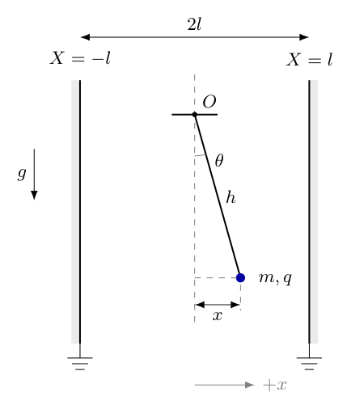{width=66%}

<!-- question-end -->

## 一、题型定位

这是接地边界引起的感应电荷与单摆小振动耦合问题。两板都接地，不存在预先给定的均匀外电场；电场由小球和板上随位置改变的感应电荷共同产生。小球居于中面时电吸引力左右抵消，偏向某一板时较近一侧吸引更强，电力促使偏离继续增大。因此重力提供回复作用，感应电力提供反回复作用。

周期公式不仅需要计算两个作用的差，还需要检查该差是否为正。若电吸引的反回复强度超过重力回复强度，中面位置不会有题目所指的微小稳定振动。

## 二、知识点

镜像电荷法在物理区内构造满足导体边界的等效电势。真实板上的感应电荷可以用板外的虚拟点电荷替代计算，但这些镜像不是实际运动的粒子，不应把真实小球与镜像的完整库仑相互作用直接当实际系统势能。

对接地边界，排除小球自身电势后的感应势能为$U_{\mathrm e}=q\phi_{\mathrm{ind}}/2$。这里的二分之一属于能量，不属于对小球的力；力仍是$q\boldsymbol E_{\mathrm{ind}}$。两种计算必须给同一个小振动系数。

若以水平位移$x$描述摆动，则$x=h\sin\theta$，小角时$x\simeq h\theta$。重力势能增加量为$mgh(1-\cos\theta)\simeq mgx^2/(2h)$。小振动频率由总势能的二阶项确定；有$U\simeq k_{\mathrm{eff}}x^2/2$、动能$\simeq m\dot x^2/2$时，$\omega^2=k_{\mathrm{eff}}/m$。

## 三、物理图像

图2-1中，板面坐标分别为$X=-l$和$X=l$，悬点投影在中面$X=0$。用$x$表示小球相对于中面的水平位移，向右为正；$x$不是球到右板的距离，后者为$l-x$。细线摆长为$h$，板间距$2l$和摆长$h$是两个独立几何量。

图2-2将小球当前所在的水平直线展开，显示一部分镜像。中面两边的浅色分界线表示导体板位置；仅两板之间是物理计算区域。左右镜像均与真实小球保持相同竖直高度，故镜像电力没有竖直分量。构造序列需要反复对两板反射，不能只画最靠近的两个像就当作精确解。

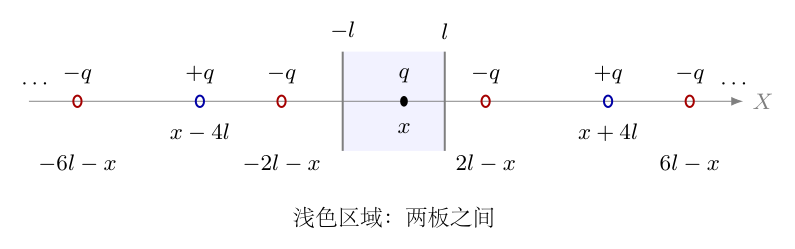{width=90%}

小球向右偏时，电力向右，重力在切向的分量向平衡位置。图2-3中的$\boldsymbol e_\theta$表示增大$\theta$的切向，细线张力$\mathcal T$沿线指向悬点，因此在该切向没有分量。后面直接力法会使用图中的$F_{\mathrm e}$、$mg$及这两个投影。

## 四、解题入口

先写出全部镜像的位置与电荷符号，分辨哪些镜像对水平方向的力为零、哪些对位置的势能变化有贡献。用感应能量的二分之一因子计算$U_{\mathrm e}(x)-U_{\mathrm e}(0)$，只展开到$x^2$，再与$mgx^2/(2h)$合并。

最后检查$k_{\mathrm{eff}}>0$，再求$T=2\pi\sqrt{m/k_{\mathrm{eff}}}$。同时用直接库仑力的一阶展开交叉验证，防止镜像能量因子或重力势能符号出错。小量条件是$|x|\ll l$且$|x|\ll h$，分别保证镜像距离展开与单摆小角展开。

## 五、解析

（1）明确理想接地板模型和研究变量。

两板按无限大平行板处理，忽略边缘效应；小球按点电荷处理，细线绝缘、不可伸长且质量可忽略。导体感应电荷能够随摆动准静态调整，不考虑辐射、空气阻力和耗散。小球的水平位置为$x$，物理区要求$|x|<l$，微小振动进一步要求$|x|\ll\min(l,h)$。

即使两板电势都为零，小球仍能在板上感应电荷。所谓“接地电容器”不是充好电后电场处处为零且永不改变的空腔；接地限定的是边界电势，不能取消小球自己造成的场。

（2）从单次反射生成无限镜像序列。

对右板$X=l$反射，真实$q$在$x$处的像为$-q$，位于$2l-x$；对左板$X=-l$反射，像为$-q$，位于$-2l-x$。单独这两个负像会使另一块板的电势受到影响，所以还要继续反射。

例如把右侧负像对左板反射，得到$+q$在$x-4l$；把左侧负像对右板反射，得到$+q$在$x+4l$。再反射这两个正像，又得负像在$-6l-x$和$6l-x$。依此继续，图2-2中的两类位置为

$$
\begin{aligned}
X_n^{(+)}&=x+4nl, &&q_n^{(+)}=q,\qquad n\in\mathbb Z,\\
X_n^{(-)}&=-x+(4n+2)l, &&q_n^{(-)}=-q,\qquad n\in\mathbb Z.
\end{aligned}
$$

正类的$n=0$是真实电荷，计算感应场时必须剔除。正像成对分布于$x\pm4nl$，到真实小球的距离不随$x$改变；负像成对分布于$\pm2(2j+1)l-x$，其中$j=0,1,2,\ldots$。

对任一板的点，这些电荷可配成关于该板对称、符号相反的对，故在板上电势相消。反复镜像序列同时满足两板接地条件，唯一性定理保证其在两板间给出正确电势。板外的像电荷仅是计算工具，不是导体外真实存在的点电荷。

（3）先确定镜像电势中的位置变化。

记$d_j=(2j+1)l$。小球到一对负像的距离分别为$2(d_j-x)$和$2(d_j+x)$。它们都为正，因$|x|<l\leq d_j$。这一对像在真实球处产生的电势为

$$
\phi_j(x)=-Kq\left[\frac1{2(d_j-x)}+\frac1{2(d_j+x)}\right].
$$

正像到真实球的距离为$4|n|l$，不随球的水平位置改变，所以在$\phi_{\mathrm{ind}}(x)-\phi_{\mathrm{ind}}(0)$中消去。使用位置差而非把各类绝对电势发散级数分开相加，可写

$$
\phi_{\mathrm{ind}}(x)-\phi_{\mathrm{ind}}(0)
=-Kq\sum_{j=0}^{\infty}
\left[\frac1{2(d_j-x)}+\frac1{2(d_j+x)}-\frac1{d_j}\right].
$$

这一差级数的项按$d_j^{-3}$衰减，绝对收敛，适合继续展开。不能把正像、负像的两个单独发散绝对和各赋一个值，再相减求能量。

（4）推导感应能量中的二分之一因子。

固定小球位置，假想从零逐步增加其电荷$q'$至$q$。由于静电边值问题线性，感应电势可写$\phi_{\mathrm{ind}}(q')=A(x)q'$。每次增加的电荷要在已有感应电势下做功，因此

$$
\begin{aligned}
U_{\mathrm e}(q,x)&=\int_0^q A(x)q'\,\mathrm dq'\\
&=\frac12A(x)q^2=\frac12q\phi_{\mathrm{ind}}(q,x).
\end{aligned}
$$

这是感应电荷随真实电荷共同建立的能量，不是把像当固定独立电荷后写$q\phi_{\mathrm{ind}}$。由此位置相关部分为

$$
\Delta U_{\mathrm e}(x)
=-\frac{Kq^2}{2}\sum_{j=0}^{\infty}
\left[\frac1{2(d_j-x)}+\frac1{2(d_j+x)}-\frac1{d_j}\right].
$$

若漏掉这一步，电势能二阶项会多一倍，周期就会错误。后面的直接力法不含这个二分之一，可作为独立检验。

（5）通分后展开，得到感应能量的二阶项。

对每一对负像，先进行精确的代数化简，再作小量展开。这样可看出奇次项为何相消，也能避免把距离中的因子$2$遗漏：

$$
\begin{aligned}
\frac1{2(d_j-x)}+\frac1{2(d_j+x)}-\frac1{d_j}
&=\frac{(d_j+x)+(d_j-x)}{2(d_j^2-x^2)}-\frac1{d_j}\\
&=\frac{d_j}{d_j^2-x^2}-\frac1{d_j}\\
&=\frac{x^2}{d_j(d_j^2-x^2)}\\
&=\frac{x^2}{d_j^3}\frac1{1-x^2/d_j^2}.
\end{aligned}
$$

此处使用几何级数$1/(1-u)=1+u+u^2+\cdots$，其中$u=x^2/d_j^2$。由于最小的$d_j$为$l$，$|x|\ll l$使所有项都可一致地按$x/l$展开。记

$$
S_3=\sum_{j=0}^{\infty}\frac1{(2j+1)^3},\qquad
S_5=\sum_{j=0}^{\infty}\frac1{(2j+1)^5},
$$

则

$$
\begin{aligned}
\Delta U_{\mathrm e}(x)
&=-\frac{Kq^2x^2}{2}\sum_{j=0}^{\infty}
\frac1{d_j(d_j^2-x^2)}\\
&=-\frac{Kq^2S_3}{2l^3}x^2
-\frac{Kq^2S_5}{2l^5}x^4
+O\!\left(\frac{Kq^2x^6}{l^7}\right).
\end{aligned}
$$

求线性小振动只需第一项，故$S_3$可用题给数值$1.052$。左右对称使$\Delta U_{\mathrm e}(x)=\Delta U_{\mathrm e}(-x)$，因此不存在一次项或三次项；这与中面电力为零一致。二阶项为负，则偏离中面使电势能下降，体现电力的反回复作用。

这里不是先假定只保留一对镜像：每一对都已进入求和，再对总表达式作位移展开。最靠近的一对给出$1$，其余对给出约$0.0518$，它们小但不为零。

（6）从摆的几何关系求重力势能，而非猜测恢复系数。

以小球位于中面最低点时为重力势能零点。细线偏角为$\theta$时，竖直向下的线长投影从$h$变为$h\cos\theta$，故小球上升

$$
\Delta z=h-h\cos\theta=h(1-\cos\theta).
$$

图2-1中的水平位移满足$x=h\sin\theta$。对所讨论的最低点附近分支，$\cos\theta>0$，于是

$$
\begin{aligned}
U_{\mathrm g}(x)
&=mg\Delta z=mgh\left(1-\sqrt{1-\frac{x^2}{h^2}}\right)\\
&=mgh\left(\frac{x^2}{2h^2}+\frac{x^4}{8h^4}
+O\!\left(\frac{x^6}{h^6}\right)\right)\\
&=\frac{mg}{2h}x^2+\frac{mg}{8h^3}x^4
+O\!\left(\frac{mgx^6}{h^5}\right).
\end{aligned}
$$

此处利用$(1-u)^{1/2}=1-u/2-u^2/8+O(u^3)$，小量为$u=x^2/h^2$。重力项为正，因为小球离开最低点必然上升；它不能与感应电势能的负号混为一谈。只保留二阶项时，重力等效弹性系数是$mg/h$，不是$mg$。

（7）核对水平坐标的动能，说明为何线性方程可使用质量$m$。

摆的真实运动是圆弧运动，速率为$h|\dot\theta|$。由$x=h\sin\theta$求导得

$$
\dot x=h\cos\theta\,\dot\theta,
\qquad h^2\dot\theta^2=\frac{\dot x^2}{1-x^2/h^2}.
$$

因此精确动能为

$$
E_{\mathrm k}=\frac12mh^2\dot\theta^2
=\frac{m\dot x^2}{2(1-x^2/h^2)}.
$$

在线性小振动近似中，$x$与$\dot x$都按振幅的一阶量计。上式分母展开产生的修正$mx^2\dot x^2/(2h^2)$属于振幅的四阶量，不影响线性频率；二阶动能就是$m\dot x^2/2$。这一步把几何约束与所用坐标联系起来，不能在有限摆角下仍把水平坐标动能当精确形式。

（8）合并二阶能量，建立微小振动方程。

把两个势能的二阶项放在同一表达式中：

$$
\begin{aligned}
U(x)-U(0)&=\frac12\left(\frac{mg}{h}
-\frac{Kq^2S_3}{l^3}\right)x^2+O(x^4),\\
k_{\mathrm{eff}}&=\frac{mg}{h}-\frac{Kq^2S_3}{l^3}.
\end{aligned}
$$

在此近似阶次，能量守恒写为

$$
\frac12m\dot x^2+\frac12k_{\mathrm{eff}}x^2=\text{常量}.
$$

对时间求导得$(m\ddot x+k_{\mathrm{eff}}x)\dot x=0$。在运动中$\dot x\ne0$的区间可约去$\dot x$；在转折点用运动方程的连续性延拓，最终得到

$$
m\ddot x+k_{\mathrm{eff}}x=0.
$$

也可直接用$F_x=-\mathrm dU/\mathrm dx=-k_{\mathrm{eff}}x$得到同一式，避免误认为约去$\dot x$排除了转折点。当$k_{\mathrm{eff}}>0$，定义$\omega^2=k_{\mathrm{eff}}/m$，通解为$x=A\cos(\omega t+\varphi)$。故所求周期为

$$
\boxed{
T=2\pi\sqrt{\frac{m}{\displaystyle\frac{mg}{h}-\frac{1.052Kq^2}{l^3}}}
=\frac{2\pi}{\sqrt{\displaystyle\frac gh-\frac{1.052Kq^2}{ml^3}}}
}.
$$

题给$S_3\simeq1.052$是近似值；需要更高数值精度时，保留$S_3=1.051799790\ldots$。这里的结果是振幅趋于零时的周期，有限振幅会有高阶修正。

（9）先筛选稳定条件，再解释周期随电荷改变的趋势。

根号内必须为正，所以该微小稳定振动的条件是

$$
\begin{aligned}
\frac{mg}{h}&>\frac{Kq^2S_3}{l^3},\\
|q|&<q_{\mathrm c},\qquad
q_{\mathrm c}=\sqrt{\frac{mgl^3}{hKS_3}}.
\end{aligned}
$$

引入无量纲竞争强度与中性单摆周期

$$
\chi=\frac{Kq^2S_3h}{mgl^3},\qquad
T_0=2\pi\sqrt{\frac hg},
$$

则$T=T_0/\sqrt{1-\chi}$，要求$0\leq\chi<1$。电荷绝对值增加，$\chi$增加，恢复作用减弱，周期变长；$q$变号不改变结果。图2-4用同一$h/l$展示电荷强度改变时的势能形状；其横坐标$u=x/h$、纵坐标$[U(x)-U(0)]/(mgh)$与上述几何及能量定义相同。

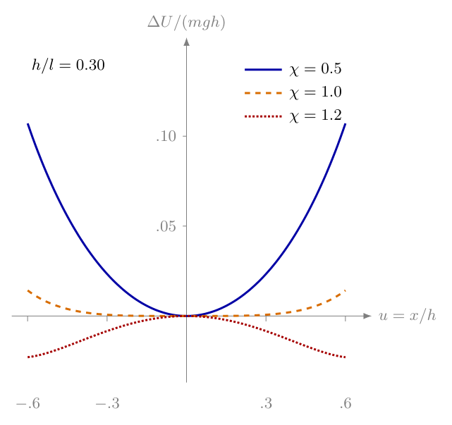{width=78%}

图中取$h/l=0.30$仅用于展示形状，并非给题目补充数值。$\chi=0.5$的曲线在原点有正曲率；$\chi=1.2$有负曲率。$\chi=1$时二阶曲率恰为零，不能继续套用简谐周期公式；这一图示几何下四阶项为正，可能有非线性稳定运动，但不存在非零的线性固有频率。四阶项是否为正还与$h/l$有关，不能从一幅示意曲线推广至所有摆长。

当$\chi>1$，线性方程变为$\ddot x-\gamma^2x=0$，其中$\gamma^2=g(\chi-1)/h>0$；解中含有增长的指数项，不是周期振动。$\chi\to1^-$时$T$趋于无穷，是在稳定一侧取极限，不等于临界位置本身仍能作有限周期的简谐运动。

（10）用直接电力法独立核对电势能因子及恢复力符号。

图2-2中的正像位于$x\pm4nl$，其斥力等大反向，逐对抵消。对第$j$对负像，右像吸引向右、左像吸引向左；按$x$正方向取代数值，有

$$
\begin{aligned}
F_j(x)
&=\frac{Kq^2}{[2(d_j-x)]^2}
-\frac{Kq^2}{[2(d_j+x)]^2}\\
&=\frac{Kq^2}{4}\frac{(d_j+x)^2-(d_j-x)^2}{(d_j^2-x^2)^2}\\
&=\frac{Kq^2d_jx}{(d_j^2-x^2)^2}.
\end{aligned}
$$

分子使用平方差$(d_j+x)^2-(d_j-x)^2=4d_jx$。对小位移，$F_j=Kq^2x/d_j^3+O(x^3)$，求和得

$$
F_{\mathrm e}(x)=\frac{Kq^2S_3}{l^3}x+O(x^3).
$$

这是作用在真实球上的力，没有二分之一。再对精确势能求导，可逐对检查

$$
-\frac{\mathrm d}{\mathrm dx}
\left[-\frac{Kq^2x^2}{2d_j(d_j^2-x^2)}\right]
=\frac{Kq^2d_jx}{(d_j^2-x^2)^2}=F_j(x).
$$

由于镜像位置随真实球一起改变，能量求导会同时包含镜像位置的变化，恰好给出完整的库仑力。若先把能量多写一倍，再用力中额外二分之一“修补”，两个物理量都会被错误定义。

如图2-3，选增大$\theta$的切向$\boldsymbol e_\theta$。电力水平向右，与该切向的夹角为$\theta$；重力切向分量为$-mg\sin\theta$，张力沿细线，切向分量为零。

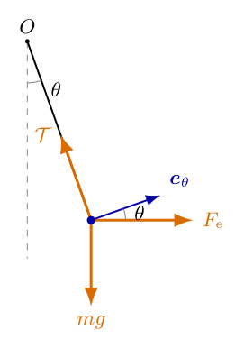{width=38%}

用图中的作用力建立精确切向方程，再作线性近似：

$$
\begin{aligned}
mh\ddot\theta&=F_{\mathrm e}(h\sin\theta)\cos\theta-mg\sin\theta,\\
mh\ddot\theta&\simeq\frac{Kq^2S_3h}{l^3}\theta-mg\theta,\\
\ddot\theta+\left(\frac gh-\frac{Kq^2S_3}{ml^3}\right)\theta&=0.
\end{aligned}
$$

这与能量法的$\omega^2$完全一致。这里没有写$F_{\mathrm e}-mg$作为水平合力，因为重力并不水平；必须先沿实际轨迹取切向，再用小角几何把重力换成恢复作用。

（11）检查量纲、特殊极限及镜像级数的数值影响。

由库仑定律，$Kq^2$的量纲为$\mathrm{N\,m^2}$，故$Kq^2/l^3$为$\mathrm{N/m}$，与$mg/h$相同；除以$m$后二者都是$\mathrm{s^{-2}}$。根号分母是频率平方，不是力或能量。

在$q=0$或$l\to\infty$且$h$固定的极限，电力系数消失，得到$T=T_0$。在稳定范围内电力系数为正而被减去，因此$T\geq T_0$。若算出电荷使周期缩短，应优先检查电吸引的方向或势能符号，而非寻找代数理由。

若只用最近两个负像，把$S_3$错取为$1$，则近似周期为$T_{\mathrm{near}}=T_0/\sqrt{1-\chi/S_3}$。它与正确值之比为

$$
\frac{T_{\mathrm{near}}}{T}
=\sqrt{\frac{1-\chi}{1-\chi/S_3}}.
$$

例如$\chi=0.95$时，该比值约为$0.719$：电力系数中约$5\%$的遗漏，可能造成周期约$28\%$的低估。这是因为周期由两个接近的系数之差决定，并非所有“较小修正”都对最终答案影响较小。

（12）用一组独立数值核验计算过程。

仅作检验，取$m=0.010\,\mathrm{kg}$、$h=0.20\,\mathrm m$、$l=0.10\,\mathrm m$、$g=9.8\,\mathrm{m/s^2}$、$K=9.0\times10^9\,\mathrm{N\,m^2/C^2}$，并采用精确的$S_3$。先算临界电荷，而不是先往可能为负的根号中代入：

$$
\begin{aligned}
\frac{mg}{h}&=0.490\,\mathrm{N/m},\\
q_{\mathrm c}^2
&=\frac{0.010\times9.8\times(0.10)^3}
{0.20\times9.0\times10^9\times1.051799790}\\
&\simeq5.17631\times10^{-14}\,\mathrm{C^2},\\
q_{\mathrm c}&\simeq2.27515\times10^{-7}\,\mathrm C.
\end{aligned}
$$

若$|q|=q_{\mathrm c}/2$，则$\chi=1/4$，电力系数为$0.490/4=0.1225\,\mathrm{N/m}$，净回复系数为$0.3675\,\mathrm{N/m}$。继续计算

$$
\begin{aligned}
T_0&=2\pi\sqrt{0.20/9.8}=0.897598\,\mathrm s,\\
\omega^2&=0.3675/0.010=36.75\,\mathrm{s^{-2}},\\
T&=\frac{2\pi}{\sqrt{36.75}}=1.036457\,\mathrm s
=\frac{2T_0}{\sqrt3}.
\end{aligned}
$$

直接求和镜像库仑力、对完整感应能量取数值导数，均给出$Kq^2S_3/l^3$的一阶电力系数。对完整切向运动方程进行积分，逐次减半小角振幅时，周期与线性式的差按振幅平方下降。这同时核对了镜像序列、能量因子及小角近似的适用阶次。

## 六、关键洞察

接地边界与预设电场是不同模型。板上电荷不是固定不动的给定源，而是随着球的位置和电荷改变；因此系统的能量必须包含这种感应建立过程。固定位置充电给出$q\phi_{\mathrm{ind}}/2$，固定最终电荷移动给出$-\mathrm dU_{\mathrm e}/\mathrm dx$。两个过程的自变量不同，但得到的作用力相同。镜像是求场的等效构造，并非可任意作为独立物体计能的真实第二电荷。

可以用单板极限检查这个逻辑。球到右板的距离为$\delta=l-x$，当$\delta\ll l$时，最近负像到球的距离为$2\delta$，其余镜像给出的力相对有限。因此

$$
F_{\mathrm e}\sim\frac{Kq^2}{4\delta^2},\qquad
U_{\mathrm e}\sim-\frac{Kq^2}{4\delta}.
$$

以$x=l-\delta$为坐标，$-\mathrm d[-Kq^2/(4(l-x))]/\mathrm dx=Kq^2/(4\delta^2)$，二者一致。若把$q\phi_{\mathrm{ind}}$当能量，会得到$-Kq^2/(2\delta)$，求导后把电力错误加倍。这是无需重新求无限级数的局部检验。

镜像求和常数可从全部正整数和中剔除偶数项。定义$\zeta(s)=\sum_{n=1}^\infty n^{-s}$，则

$$
\begin{aligned}
S_s&=\sum_{n=1}^\infty n^{-s}-\sum_{n=1}^\infty(2n)^{-s}\\
&=(1-2^{-s})\zeta(s),\\
S_3&=\frac78\zeta(3)=1.051799790\ldots,\\
S_5&=\frac{31}{32}\zeta(5)=1.004523763\ldots.
\end{aligned}
$$

这不是答题必须调用的特殊函数公式，而是独立核对题给常数及高阶项的便捷办法。若截断奇数和，$f(u)=(2u+1)^{-s}$单调下降，尾项可由相邻积分夹住；因此数值求和误差有可控制的界，不必把有限项求和当精确值。

周期的敏感性来自“差”的结构。固定$m,g,h,l$时，$\chi\propto q^2$。对$\ln T=\ln T_0-\frac12\ln(1-\chi)$取微分，逐步得

$$
\begin{aligned}
\frac{\mathrm dT}{T}
&=\frac{\mathrm d\chi}{2(1-\chi)},\\
\mathrm d\chi&=2\chi\frac{\mathrm d|q|}{|q|},\\
\frac{\mathrm dT}{T}
&=\frac{\chi}{1-\chi}\frac{\mathrm d|q|}{|q|}.
\end{aligned}
$$

例如$\chi=0.95$时放大因子为$19$，电荷约$1\%$的微小相对变化可引起周期约$19\%$的一阶变化。线性误差估计还要求变化不能跨越$\chi=1$，且$|\mathrm d\chi|\ll1-\chi$；接近临界时，连误差传播公式也有其局部适用范围。

临界不等于一概失稳。把主解析已经求出的四阶项保留下来，得到

$$
U-U(0)=\frac{k_{\mathrm{eff}}}2x^2+A_4x^4+O(x^6),
\qquad A_4=\frac{mg}{8h^3}-\frac{Kq^2S_5}{2l^5}.
$$

在$|q|=q_{\mathrm c}$时，用$Kq_{\mathrm c}^2= mgl^3/(hS_3)$消元：

$$
\begin{aligned}
A_{4,\mathrm c}
&=\frac{mg}{8h^3}-\frac{mgS_5}{2hl^2S_3}\\
&=\frac{mg}{8h^3}\left(1-\frac{4h^2S_5}{l^2S_3}\right).
\end{aligned}
$$

若$h/l<\frac12\sqrt{S_3/S_5}\simeq0.51163$，原点附近四阶势能上升，存在非线性局部稳定；若大于该值，四阶势能下降，临界原点失稳。恰好等于该值时四阶项也消失，必须继续检查六阶及更高阶项，不能沿用四阶判据。不论这三种情况中的哪一种，二阶系数都为零，没有非零的线性固有频率；本题给出的简谐周期公式均不能在该点直接使用。

图2-4取$h/l=0.30$，属于四阶系数为正的一支，这解释了临界曲线在原点虽平坦但仍向上弯的形状。该图必须与几何参数一起阅读；只标“临界曲线”而不说明参数，会使局部非线性稳定与线性稳定被混淆。

## 七、易错点

把两板接地理解成整个板间电场永远为零。边界条件是板面电势为零，小球所引起的感应场仍然存在。若题目给的是板带固定电荷或固定非零电势差，则镜像构造及外场项需要重新处理。

只取左右各一个负像。它们满足各自那一块板的反射条件，却不同时满足另一块板的电势条件。无限反射序列不是可有可无的装饰；题给奇数三次方级数正是提示必须把远处镜像纳入。

把相邻板距$l\mp x$当球到像的距离。像在板面另一侧，对最近一对实际距离是$2(l\mp x)$，所以库仑力先有分母因子$4$。化简平方差后这个$4$会消去，但不能在起式时就漏写。

能量忘记二分之一，或在电力上也加二分之一。能量为感应体系建立的功，电力为真实电荷在感应场中受到的力。应分别从各自物理定义计算，再用求导关系交叉核对，不允许通过两个错误彼此抵消。

把水平位移$x$与摆弧长$h\theta$完全等同。二者仅在线性阶相同；有限摆角的动能含$1/(1-x^2/h^2)$，重力势能含根式，切向投影含$\cos\theta$。保留高阶项时，几何、动能与势能应使用同一近似阶次。

未经稳定检查就给出根式周期。$k_{\mathrm{eff}}<0$时是指数增长，$k_{\mathrm{eff}}=0$时线性频率为零。把负数根号写成虚数周期没有回答“稳定振动周期”的物理问题。

认为电荷变负会反转电力。板上的像电荷也同时变号，乘积始终对应吸引，最终结果含$q^2$。符号检验应针对实际的成对电荷与几何方向，而不是只看真实电荷的正负。

认为近临界时题给$1.052$与精确值差很小，任何位移都可以视为简谐。二阶恢复项变小后，四阶项可能在较小振幅就重要；要保持简谐近似，除$|x|\ll h,l$外，还需$|4A_4x^2|\ll k_{\mathrm{eff}}$，并按实际参数判断。若$A_4$很小，还要继续比较更高阶项。

## 八、课堂讲解建议

先让学生判断偏右时电力向哪边，再给出周期问题。板距左右不等，近板吸引更强，学生应先建立“电力向外、重力回复”的物理图像；板书保留两个箭头方向，最后才把它们变成两个系数之差。

第二步围绕图2-2做两次反射。教师可以先画真实$q$和左右两个$-q$，再让学生检查每块板上的电势是否同时为零；随后补出$x\pm4l$的正像，使无限序列来自边界检验而非记忆。只需画有限几项，延拓用省略号，不能让密集标签淹没镜像符号。

第三步把能量法与力法分成相互独立的两列。左列从充电积分写$U_{\mathrm e}=q\phi_{\mathrm{ind}}/2$，右列从一对负像的库仑力开始；让学生检查左列势能导数是否等于右列力。在课堂中可用单板极限作较短的检验，不必重复全部级数代数。

第四步再引入摆的约束。教师应让学生用图2-1写出$x=h\sin\theta$及上升高度，明确$mg$不直接等于水平回复力。接着用图2-3沿切向列式，强调张力虽决定圆弧约束，却不进入切向运动方程。

收束时先写$\chi<1$，再给周期。课堂不应把临界情况简化成“周期无穷所以永不运动”；可对照图2-4说明线性频率消失与非线性局部稳定是两个层次。四阶判据和临界非线性周期适合在核心公式掌握后展开。

## 九、变式训练

变式一：仍在同一理想接地模型中，测得微小振动周期为中性单摆周期的两倍。求$|q|/q_{\mathrm c}$；若测得周期小于中性单摆周期，本模型能否解释？

由$T/T_0=(1-\chi)^{-1/2}=2$，逐步解得

$$
\begin{aligned}
1-\chi&=\frac14,\qquad\chi=\frac34,\\
\chi&=\frac{q^2}{q_{\mathrm c}^2},\qquad
\boxed{\frac{|q|}{q_{\mathrm c}}=\frac{\sqrt3}{2}}.
\end{aligned}
$$

此值小于$1$，满足稳定条件。在该模型中$\chi\geq0$，故$T/T_0\geq1$；周期小于$T_0$不可能由板上感应吸引造成。它提示几何、外加电场、有效摆长或其他作用不符合当前假设，不能通过给$q$选负号解释。

变式二：保持$m,h,q,g$不变，把两板总间距由$2l$增大到$4l$。原来的强度参数为$\chi=0.80$，求新旧周期比及新临界电荷与旧临界电荷之比。

新半间距为$l'=2l$。电力的一阶系数与$l^{-3}$成正比，所以

$$
\begin{aligned}
\chi'&=\frac{\chi}{2^3}=0.10,\\
\frac{T'}{T}
&=\frac{T_0/\sqrt{1-\chi'}}{T_0/\sqrt{1-\chi}}\\
&=\sqrt{\frac{0.20}{0.90}}=\boxed{\frac{\sqrt2}{3}}\simeq0.471405,\\
\frac{q_{\mathrm c}'}{q_{\mathrm c}}
&=\left(\frac{l'}l\right)^{3/2}=\boxed{2\sqrt2}.
\end{aligned}
$$

板移远使感应反回复作用减弱，周期下降但仍高于$T_0$。新的临界电荷更大，说明较远的板允许更大的电荷而仍保持中面线性稳定。这两个趋势分别从周期与稳定阈值交叉检查了$l$的三次方。

变式三：把电荷调整到临界值，分别取$h/l=0.20$和$0.80$。判断中面是否局部稳定；对于四阶势能为正的一种情况，求很小但非零水平振幅$a$对应的主导非线性周期。

用$S_5/S_3\simeq0.955052$，临界四阶系数括号中的数分别为

$$
\begin{aligned}
B(0.20)&=1-4(0.20)^2\frac{S_5}{S_3}\simeq0.847192>0,\\
B(0.80)&=1-4(0.80)^2\frac{S_5}{S_3}\simeq-1.44493<0.
\end{aligned}
$$

因此前一种局部稳定，后一种局部失稳；二者均没有线性简谐频率。对前一种，记$A=A_{4,\mathrm c}>0$，在$a\ll\min(h,l)$且更高阶项可忽略时，势能主项为$Ax^4$，动能主项为$m\dot x^2/2$。从转折点$x=a$释放，总能量为$Aa^4$，有

$$
\begin{aligned}
\frac12m\dot x^2&=A(a^4-x^4),\\
|\dot x|&=\sqrt{\frac{2A}{m}}\sqrt{a^4-x^4}.
\end{aligned}
$$

运动关于原点及转折点对称，四分之一周期是从$x=0$走到$x=a$所需时间。分离变量，再令$u=x/a$，得到

$$
\begin{aligned}
\frac{T_{\mathrm{nl}}}{4}
&=\sqrt{\frac{m}{2A}}\int_0^a\frac{\mathrm dx}{\sqrt{a^4-x^4}}\\
&=\frac1a\sqrt{\frac{m}{2A}}\int_0^1\frac{\mathrm du}{\sqrt{1-u^4}},\\
&\boxed{T_{\mathrm{nl}}=\frac{4I}{a}\sqrt{\frac{m}{2A}},\qquad
I=\int_0^1\frac{\mathrm du}{\sqrt{1-u^4}}\simeq1.311029.}
\end{aligned}
$$

积分端点$u=1$的被积函数按$(1-u)^{-1/2}$发散，但积分收敛，所以非零振幅下时间有限。$A$量纲为$\mathrm{J/m^4}$，$\sqrt{m/A}/a$的量纲为时间。最重要的是$T_{\mathrm{nl}}\propto a^{-1}$，振幅趋零时周期趋于无穷；这一非线性结果与临界线性频率为零并不矛盾，也说明不能把它称作振幅无关的简谐周期。

<!-- question-complete -->

\newpage

# 第3题

<!-- question-start -->

在一个硅钢环形磁芯上绕有三个理想线圈，匝数分别为$N_1,N_2,N_3$。磁芯的磁导率足够大，不漏磁。$N_1$线圈连接正弦交流电源$u_1(t)=U_0\sin(\omega t)$；另外两个线圈与两个阻值均为$r$的电阻按图示三种方式连接。导线交叉处不相连。求三种情况下两个电阻发热的总平均功率。

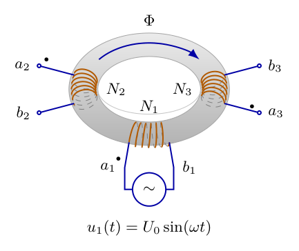{width=40%}

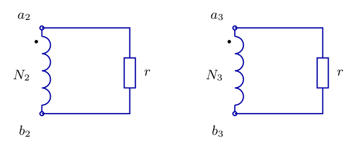{width=55%}

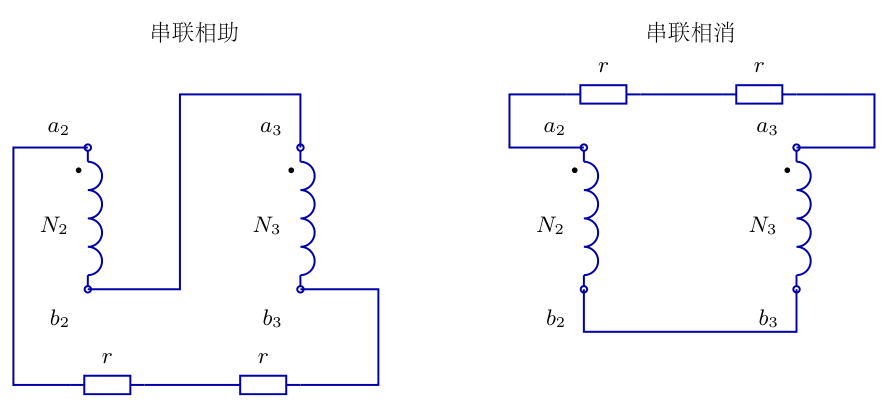{width=80%}

<!-- question-end -->

## 一、题型定位

这是同一闭合磁芯上的多绕组理想变压器与交流功率问题。共同磁通决定各绕组电压与匝数的比例，接线方式决定这些电压在负载回路中相加还是相减；电阻发热则由实际流过它的电流平方决定。必须先把磁耦合、电路连接、时间平均三个层次分清，再计算总功率。

图3-2对应两个互相独立的副边回路；图3-3左图把两个副边串联相助，右图把它们串联相消。这里“独立”只指没有导线连接，并不表示磁通独立。两个副边均与原边共用磁芯磁通，且理想电压源在不同负载下维持相同的$u_1(t)$。

## 二、知识点

法拉第电磁感应定律给出绕组的感应电动势与匝数、磁通变化率的关系。没有漏磁时，每匝链过同一磁通$\Phi(t)$，因此各绕组电压幅值与匝数成正比。端点方向必须同时规定；所谓同名端，是在共同磁通变化下具有相同瞬时电压极性的端点。

本题以$a_i$为第$i$个绕组的同名端，用黑点表示；$b_i$为另一端，定义$u_i=V(a_i)-V(b_i)$。当$u_1>0$时，$u_2,u_3$也为正；当交流半周反转时，三者同时反转。这是相位关系，不是说同名端始终带正电。

对纯电阻，瞬时功率为$p(t)=u(t)i(t)=i^2(t)r=u^2(t)/r$，始终非负。正弦交流的峰值与有效值不同：若$u(t)=\widehat U\sin(\omega t)$，则$U_{\mathrm{rms}}=\widehat U/\sqrt2$，平均功率为$\widehat U^2/(2r)$。不能把电压的时间平均零误当发热功率零。

若两个相同电阻在同一串联回路，电流相同，总发热为$2rI_{\mathrm{rms}}^2$；若各接一个不同副边，电流通常不同，应分别求功率再加。相同阻值不保证电流相同，是否同一回路才是关键。

## 三、物理图像

图3-1把环形磁芯及绕线的前后关系画开：绕组跨过磁芯截面，在可见面用实线表示，在背侧用虚线表示。磁芯内的$\Phi$沿闭合环路通过三个绕组，没有漏磁支路。$N_1$是电源驱动绕组，$N_2,N_3$是与电阻连接的副边绕组；它们不因空间画在左右就成为两个互不相关的变压器。

图3-2把两副边的导线连接关系展开，标出$a_2,b_2,a_3,b_3$；两个电阻分别跨接各自绕组的两端。图3-3保留同名端黑点，用端点连接区分两种串联：左图接$b_2$与$a_3$，负载跨接$a_2$与$b_3$；右图接$b_2$与$b_3$，负载跨接$a_2$与$a_3$。这些连接正是后续电压方程中的节点等势条件。

这种展开没有改变磁耦合，只把导线拓扑与磁芯的空间形状分开说明。导线在折点连续；绕组边上的黑点只标同名端，不是跨线连接节点。沿实际回路从一个端点走到另一个端点，比凭“左图同向、右图反向”的外观记忆更可靠。

## 四、解题入口

先由共磁通得到$u_2=(N_2/N_1)u_1$、$u_3=(N_3/N_1)u_1$，而不要先从负载反推电压。再按每一幅接线图写节点等势条件，得到负载电压或回路电流。最后把$\sin^2(\omega t)$在一个周期内平均，求两个电阻的总发热。

所有计算使用题给峰值$U_0$。若先转成有效值，则$U_{1,\mathrm{rms}}=U_0/\sqrt2$，后续不再额外乘$1/2$。末尾用原边输入功率与副边发热相等、相同匝数时的相消极限等方式交叉检验。

## 五、解析

（1）明确理想化假设及共同磁通的含义。

三个绕组电阻可忽略，导线无电阻，磁芯无铁损，磁导率足够大且无漏磁，电源维持给定的正弦电压。这一模型忽略励磁电流；磁芯中建立有限磁通所需的磁场强度可趋于零。负载变化主要改变原边供电电流，而不改变理想源已经限定的磁通变化率。

“不漏磁”意味着各绕组每匝均链过同一个$\Phi(t)$，不是要求整个磁芯任一点的磁感应强度数值完全相同。求匝数比只需要共同磁通，既不需要磁芯的截面积，也不需要沿环路积分求各处的磁场强度。

（2）用同名端约定建立三个电压的关系。

选磁通正向与绕组端点方向一致，使端电压写为$u_i=N_i\mathrm d\Phi/\mathrm dt$。这包含了统一的符号约定；法拉第定律中回路感应电动势的负号应与选取的绕行方向一起使用，不能只给某一个副边随意另加负号。

由于$u_1(t)=U_0\sin(\omega t)$，有

$$
\begin{aligned}
\frac{u_1(t)}{N_1}&=\frac{u_2(t)}{N_2}
=\frac{u_3(t)}{N_3}=\frac{\mathrm d\Phi}{\mathrm dt},\\
u_2(t)&=\frac{N_2}{N_1}U_0\sin(\omega t),\\
u_3(t)&=\frac{N_3}{N_1}U_0\sin(\omega t).
\end{aligned}
$$

记峰值$\widehat U_2=N_2U_0/N_1$、$\widehat U_3=N_3U_0/N_1$。二者同频同相。若把某一绕组的端点电压定义反过来，其表达式会变号，但接线的节点条件也必须随之改变，最终发热功率不能依赖任意命名。

对磁通积分可作额外检验：

$$
\Phi(t)=-\frac{U_0}{\omega N_1}\cos(\omega t)+\Phi_{\mathrm{dc}}.
$$

求导确实恢复$u_1/N_1$；常量偏置$\Phi_{\mathrm{dc}}$不影响感应电压。本题理想模型只求交流发热，不据此保证实际磁芯任意频率都不会饱和。

（3）先计算正弦平方的时间平均，固定峰值的使用规则。

设交流周期为$\tau=2\pi/\omega$，避免与电压符号混淆。对一周期平均，利用二倍角恒等式，得

$$
\begin{aligned}
\left\langle\sin^2(\omega t)\right\rangle
&=\frac1\tau\int_0^\tau\frac{1-\cos(2\omega t)}2\,\mathrm dt\\
&=\frac12-\frac{\sin(2\omega\tau)-\sin0}{4\omega\tau}\\
&=\frac12.
\end{aligned}
$$

因此$\langle u_i^2\rangle=\widehat U_i^2/2$。平均是先平方、再积分，不能写成$\langle u_i\rangle^2$。后面每个功率式中的$1/2$只来自这一平均，不来自变压器匝数比。

（4）第一种接线：两个副边各带一个电阻。

按图3-2，每个电阻两端就是相应副边两端，电压分别为$u_2(t)$和$u_3(t)$。两回路没有电连接，不能把$r+r$当它们共同的总电阻，也不能把两个电压相加后除以某一等效电阻。各回路电流为

$$
i_2(t)=\frac{u_2(t)}r,\qquad i_3(t)=\frac{u_3(t)}r.
$$

两个电阻的瞬时功率与平均功率依次为

$$
\begin{aligned}
p_{\mathrm{ind}}(t)
&=r i_2^2(t)+r i_3^2(t)\\
&=\frac{u_2^2(t)+u_3^2(t)}r\\
&=\frac{(N_2^2+N_3^2)U_0^2}{rN_1^2}\sin^2(\omega t),\\
&\boxed{P_{\mathrm{ind}}=\frac{(N_2^2+N_3^2)U_0^2}{2rN_1^2}}.
\end{aligned}
$$

也可分别写$P_2=N_2^2U_0^2/(2rN_1^2)$、$P_3=N_3^2U_0^2/(2rN_1^2)$再相加。若$N_2\ne N_3$，两个电流与发热不等；答案求的是总量，不能把较大副边的功率乘二代替。

（5）第二种接线：串联相助，先用节点等势推出电压相加。

按图3-3左图，$b_2$与$a_3$以理想导线连接，因此$V(b_2)=V(a_3)$。负载跨接$a_2$与$b_3$，其端电压分解为

图3-4把同一时刻的端点电势画成水平线。左图以$b_3$为电势零点，有$V(a_3)=V(b_2)=u_3$，再从$b_2$到$a_2$上升$u_2$，所以负载跨过两个上升量；右图供下一步使用，共接的$b_2,b_3$为零点，两个$a$端各自高出$u_2,u_3$，负载只跨过它们之差。零点只是电势参考，不表示另加一根接地线。

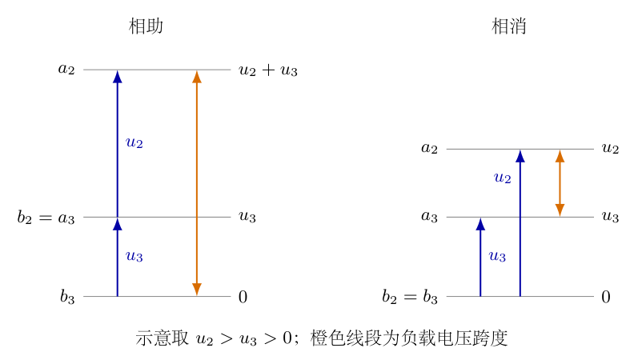{width=90%}

$$
\begin{aligned}
V(a_2)-V(b_3)
&=[V(a_2)-V(b_2)]+[V(a_3)-V(b_3)]\\
&=u_2+u_3.
\end{aligned}
$$

两个电阻串联于同一回路，总电阻为$2r$。以从$a_2$流向外部负载为电流正方向，得到

$$
\begin{aligned}
i_+(t)&=\frac{u_2(t)+u_3(t)}{2r}\\
&=\frac{(N_2+N_3)U_0}{2rN_1}\sin(\omega t).
\end{aligned}
$$

两电阻都流过这个$i_+$，故

$$
\begin{aligned}
p_+(t)&=2r i_+^2(t)\\
&=\frac{[u_2(t)+u_3(t)]^2}{2r}\\
&=\frac{(N_2+N_3)^2U_0^2}{2rN_1^2}\sin^2(\omega t),\\
P_+&=\frac{(N_2+N_3)^2U_0^2}{2rN_1^2}\times\frac12,\\
&\boxed{P_+=\frac{(N_2+N_3)^2U_0^2}{4rN_1^2}}.
\end{aligned}
$$

分母$4r$来自“总电阻$2r$”与“正弦平均$1/2$”共同作用，不是每个副边电压都被除以二。两个电阻各发热$P_+/2$，因为串联电流相同且阻值相同。

（6）第三种接线：串联相消，用另一组节点等势推出电压相减。

图3-3右图连接$b_2$与$b_3$，所以$V(b_2)=V(b_3)$。负载跨接$a_2$与$a_3$，于是

$$
\begin{aligned}
V(a_2)-V(a_3)
&=[V(a_2)-V(b_2)]-[V(a_3)-V(b_3)]\\
&=u_2-u_3.
\end{aligned}
$$

规定负载中从$a_2$流向$a_3$为正方向。总电阻仍为$2r$，故

$$
\begin{aligned}
i_-(t)&=\frac{u_2(t)-u_3(t)}{2r}
=\frac{(N_2-N_3)U_0}{2rN_1}\sin(\omega t),\\
p_-(t)&=2r i_-^2(t)
=\frac{(N_2-N_3)^2U_0^2}{2rN_1^2}\sin^2(\omega t),\\
&\boxed{P_-=\frac{(N_2-N_3)^2U_0^2}{4rN_1^2}}.
\end{aligned}
$$

若$N_2<N_3$，所定义电流的系数为负，只表示正半周实际电流方向与所选正向相反；功率仍由平方给出正数。相消不是把两个电阻的功率相减，而是先把电压相减，求电流后再平方。

（7）比较三种结果，分辨“电压加起来”与“功率加起来”。

设公共正系数$C=U_0^2/(4rN_1^2)$，则三种平均总功率为

$$
\begin{aligned}
P_{\mathrm{ind}}&=2C(N_2^2+N_3^2),\\
P_+&=C(N_2+N_3)^2,\\
P_-&=C(N_2-N_3)^2.
\end{aligned}
$$

利用平方展开而不是凭直觉比较大小，得到

$$
\begin{aligned}
P_++P_-&=C[(N_2+N_3)^2+(N_2-N_3)^2]\\
&=2C(N_2^2+N_3^2)=P_{\mathrm{ind}},\\
P_{\mathrm{ind}}-P_+&=P_-\geq0,\\
P_+-P_-&=4CN_2N_3\geq0.
\end{aligned}
$$

因此$P_{\mathrm{ind}}\geq P_+\geq P_-$。这并不与相助电压更大矛盾：相助时总电阻也从每个独立回路的$r$变成$2r$，而独立情况还需加上两个回路的功率。不能只比较电压而忽略负载连接。

若$N_2=N_3=N$，独立与相助均给出$N^2U_0^2/(rN_1^2)$，相消为零。这时相助回路电压为单副边的两倍、总电阻也为两倍，电流与独立回路的电流相同，两个电阻的发热当然相同。

（8）从原边输入功率独立检查副边发热结果。

设原边电流$i_1$流入$a_1$，副边电流$i_2,i_3$均按流出$a_2,a_3$为正。在忽略励磁电流的理想极限，安匝平衡为

$$
N_1i_1=N_2i_2+N_3i_3.
$$

两独立回路直接取$i_2=u_2/r$、$i_3=u_3/r$；相助回路中$i_2=i_3=i_+$；相消回路则$i_2=i_-$、$i_3=-i_-$，因为电流在一个绕组流出同名端，在另一个绕组流入同名端。代入共磁通电压关系，逐种检查瞬时输入：

$$
\begin{aligned}
p_{1,\mathrm{ind}}
&=u_1\frac{N_2i_2+N_3i_3}{N_1}
=u_2i_2+u_3i_3=r(i_2^2+i_3^2),\\
p_{1,+}&=u_1\frac{N_2+N_3}{N_1}i_+
=(u_2+u_3)i_+=2ri_+^2,\\
p_{1,-}&=u_1\frac{N_2-N_3}{N_1}i_-
=(u_2-u_3)i_-=2ri_-^2.
\end{aligned}
$$

每一式均与相应电阻的瞬时总发热相等，时间平均自然也相等。这是电源—磁耦合—负载的能量检验，不仅是把同一个功率公式再写一遍。

相消时，若$N_2>N_3$，$u_2i_-$为正而$u_3(-i_-)$为负：第二副边向回路供能，第三副边从回路吸收电能并经磁耦合返还。两个电阻仍各自耗散正功率。不能把“某个绕组端口吸能”误当“某个电阻负发热”。

（9）按有效值进行独立数值核验，并逐项核对单位。

取$N_1=200$、$N_2=100$、$N_3=60$、$r=10\,\Omega$，原边有效值为$12\,\mathrm V$，即题干峰值$U_0=12\sqrt2\,\mathrm V$。副边有效值为

$$
U_{2,\mathrm{rms}}=\frac{100}{200}\times12=6\,\mathrm V,
\qquad U_{3,\mathrm{rms}}=\frac{60}{200}\times12=3.6\,\mathrm V.
$$

独立回路电流有效值分别为$0.60\,\mathrm A$与$0.36\,\mathrm A$，故

$$
\begin{aligned}
P_{\mathrm{ind}}&=10(0.60)^2+10(0.36)^2\\
&=3.600+1.296=4.896\,\mathrm W.
\end{aligned}
$$

相助与相消回路有效电压分别为$9.6\,\mathrm V$、$2.4\,\mathrm V$，总电阻均为$20\,\Omega$，于是

$$
\begin{aligned}
I_{+,\mathrm{rms}}&=9.6/20=0.48\,\mathrm A,\\
P_+&=20(0.48)^2=4.608\,\mathrm W,\\
I_{-,\mathrm{rms}}&=2.4/20=0.12\,\mathrm A,\\
P_-&=20(0.12)^2=0.288\,\mathrm W.
\end{aligned}
$$

结果满足$4.608+0.288=4.896$。由安匝平衡算得三种原边电流有效值分别为$0.408\,\mathrm A$、$0.384\,\mathrm A$、$0.024\,\mathrm A$；乘原边有效电压$12\,\mathrm V$，依次得到同样的三种功率。这里纯电阻理想模型的原边电流与电压同相，因此可以直接相乘；有无功分量时不能省略相位因素。

匝数比无量纲，功率表达式的单位均为$\mathrm{V}^2/\Omega=\mathrm W$。$U_0$固定时，$r\to\infty$使功率趋零；$N_1$增大而其他量不变时，副边电压及功率分别按$N_1^{-1}$、$N_1^{-2}$减小。$r\to0$时理想式发散，表示理想源与无内阻模型的短路极限，不是现实线圈可以承受无穷电流。

（10）汇总所求答案与成立范围。

在共磁通、无损耗、励磁电流可忽略、输入$U_0$为峰值且两个电阻均为$r$的条件下，三种接线的总平均发热功率为

$$
\boxed{
\begin{aligned}
P_{\mathrm{ind}}&=\frac{(N_2^2+N_3^2)U_0^2}{2rN_1^2},\\
P_+&=\frac{(N_2+N_3)^2U_0^2}{4rN_1^2},\\
P_-&=\frac{(N_2-N_3)^2U_0^2}{4rN_1^2}.
\end{aligned}}
$$

连接方式由图3-2及图3-3的实际节点关系决定，不由绕组在纸上处于左边或右边决定。若改接导线、把交叉处接成节点，或把原边电压改成给定电流源，上述推导需重新建立，不能继续照套。

## 六、关键洞察

变压器没有凭空增加功率。匝数比决定电压，副边负载及安匝平衡共同决定电流；把副边电压提高的同时，原边必须供应相应的输入电流。三种接线下理想电压源保持$u_1$相同，不意味着输入电流也相同。图3-1的共同磁通是磁耦合纽带，图3-2、3-3的导线则是实际电流通道，二者不能合成一张错误的“串并联磁路电路”。

可以从原边的等效电阻再推一遍结果。对一个匝数为$N_i$、负载为$r$的副边，有$u_i=(N_i/N_1)u_1$，供能电流关系为$i_1=(N_i/N_1)i_i$。消去$i_i=u_i/r$，得到

$$
i_1=\frac{N_i^2}{rN_1^2}u_1,\qquad
R_{\mathrm{in},i}=r\left(\frac{N_1}{N_i}\right)^2.
$$

两个独立副边的输入电流相加，所以它们折算到原边的电导相加，而不是电阻相加：

$$
\begin{aligned}
\frac1{R_{\mathrm{in,ind}}}
&=\frac1{R_{\mathrm{in},2}}+\frac1{R_{\mathrm{in},3}}
=\frac{N_2^2+N_3^2}{rN_1^2},\\
R_{\mathrm{in,ind}}&=\frac{rN_1^2}{N_2^2+N_3^2}.
\end{aligned}
$$

串联相助可视为有效匝数$N_2+N_3$、负载$2r$，串联相消对应带符号的有效匝数$N_2-N_3$。于是

$$
R_{\mathrm{in},+}=\frac{2rN_1^2}{(N_2+N_3)^2},\qquad
R_{\mathrm{in},-}=\frac{2rN_1^2}{(N_2-N_3)^2}.
$$

三式分别代入$P=U_{1,\mathrm{rms}}^2/R_{\mathrm{in}}=U_0^2/(2R_{\mathrm{in}})$，恢复主解析三种答案。相消时$N_2=N_3$，应理解为$R_{\mathrm{in},-}\to\infty$，而不是把零有效匝数代入一个未定义的变比后说原边被短路。副边回路的合成电压为零，理想励磁电流也为零，因此没有有功输入。

对于主解析数值，三种输入电阻分别为$29.4118\,\Omega$、$31.25\,\Omega$、$500\,\Omega$。用$12^2/R_{\mathrm{in}}$计算，仍给出$4.896\,\mathrm W$、$4.608\,\mathrm W$、$0.288\,\mathrm W$。原边等效方法强调负载反射，节点法强调极性与回路；两条路线共享理想变压器物理，但消元过程不同，可以互相检查。

相消时的能流尤其值得辨析。取$N_2>N_3$，回路电流为$i_-=(u_2-u_3)/(2r)$。平均端口供能分别为

$$
\begin{aligned}
\overline p_2&=\frac{N_2(N_2-N_3)U_0^2}{4rN_1^2},\\
\overline p_3&=-\frac{N_3(N_2-N_3)U_0^2}{4rN_1^2},\\
\overline p_2+\overline p_3
&=\frac{(N_2-N_3)^2U_0^2}{4rN_1^2}=P_-.
\end{aligned}
$$

数值例中$\overline p_2=6\times0.12=0.720\,\mathrm W$，$\overline p_3=-3.6\times0.12=-0.432\,\mathrm W$；二者相加为$0.288\,\mathrm W$，每个电阻发热$0.144\,\mathrm W$。第三绕组没有电阻损耗，它的负供能代表回送，并不违反总能量守恒。若$N_3>N_2$，能流角色互换；总电阻发热仍为正。

“功率和恒等式”还可解释为同相电压组合的平方恒等式：$2(u_2^2+u_3^2)=(u_2+u_3)^2+(u_2-u_3)^2$。本题两个电阻相等，使这一代数结构直接变成$P_{\mathrm{ind}}=P_++P_-$。若电阻不等，三种回路仍可按节点法计算，但这一特定关系通常不成立；不能把它上升为一切变压器接线的普适守恒式。

理想结果中没有显式$\omega$，并非频率完全无关。给定电压峰值时磁通峰值为$U_0/(\omega N_1)$，实际低频时更容易使磁芯饱和；有限磁导率还使励磁电流、漏感与铜损不可忽略。本题功率的频率消去仅在既定理想模型及电阻负载内成立。无损共磁通不等于任意现实磁芯都能实现所有极限。

## 七、易错点

把$U_0$当有效值。题干给$U_0\sin(\omega t)$，$U_0$是峰值。若用它直接代入$U^2/r$计算平均功率，结果多一倍；若先转成有效值又乘$1/2$，结果少一半。

把相助电压平方写成$u_2^2+u_3^2$，漏掉交叉项。两个副边同相，同一回路的电压必须先相加再平方；独立回路的总功率才分别平方后相加。能否出现$2u_2u_3$由实际连接决定。

相消时写$P_2-P_3$。消去的是回路的电压，不是电阻的发热；两个电阻的$I^2r$都非负。绕组端口供能的正负与负载发热的正负是不同量。

只看线圈画在左或右就判断电动势方向。绕线方向、共磁通正向与端点定义必须共同考虑；同名端可把这些信息压缩成可检查的黑点约定。图3-4的电势差分解比“图上箭头同向”更不易误判。

把导线交叉处接成节点，改变原有拓扑。本题导线交叉不相连，重绘采用展开布线减少交叉，但仍须从$a_i,b_i$逐点确认连接。只有沿连续导线到达的端点才等势。

串联回路忘记第二个电阻，写$i=(u_2\pm u_3)/r$。原有两个电阻都在回路中，必须用$2r$；由此再算总发热$2ri^2$。电流多算两倍会使功率多算四倍，不是仅多算两倍。

把独立副边各自电阻折算到原边后再串联。实际原边需要提供两股负载反射电流，故电导相加。安匝平衡中两个副边电流带符号相加，是判断折算方式的物理依据。

忽略理想电压源假设，认定两个副边电流增加就必然使副边电压降低。实际设备可能有电压降，但本题绕组与电源均理想，$u_1$固定，匝数比固定。若把给定电压源改为给定电流源，负载反射阻抗会影响电压，需从新边界条件开始。

## 八、课堂讲解建议

先让学生只读电路，不计算功率。教师可要求学生在图3-2、图3-3逐个说出哪些端点有理想导线连接，再板书$b_2=a_3$或$b_2=b_3$所代表的电势相等；不要一开始就给“相助、相消”结论，让命名来自可验证的节点关系。

随后结合图3-1说明共同磁通。课堂应区分“共用磁芯”与“有导线连接”：两个独立副边可以电隔离，却仍共享原边限定的感应电压比例。教师可先保留匝数符号，不引入磁芯尺寸，帮助学生识别本题不需要求磁场强度分布。

在图3-4旁板书两次电势差的分解，让学生从$V(a)-V(b)$相加相减得到负载电压，而非凭绕组位置猜测。然后再画两个串联电阻，明确为什么总电阻为$2r$。这一顺序把几何极性、拓扑、欧姆定律各自的作用分开。

功率部分可先用峰值写瞬时功率，再让学生积分$\sin^2$；教师随后用有效值复算同一数值，检查是否重复乘$1/2$。课堂中只需选一种作为主线，另一种用于核验，不能把两种记号混在同一式中。

最后用$N_2=N_3$作诊断提问：相消时两个电阻是否可以一正一负发热？学生应说合成电压为零、回路无电流、两者均零。再用不等匝数的数值展示某一绕组回送能量，教师应特别区分绕组端口功率与电阻耗散功率，防止此前的判断被过度推广。

## 九、变式训练

变式一：把两个负载改为$r_2,r_3$，保持两个副边及原边理想，求三种接线的总平均功率。再取$U_{2,\mathrm{rms}}=6\,\mathrm V$、$U_{3,\mathrm{rms}}=3.6\,\mathrm V$、$r_2=10\,\Omega$、$r_3=20\,\Omega$计算。

独立回路分别应用欧姆定律，串联回路总电阻为$r_2+r_3$，电压仍由相同节点关系给出。故

$$
\begin{aligned}
P_{\mathrm{ind}}&=\frac{U_0^2}{2N_1^2}
\left(\frac{N_2^2}{r_2}+\frac{N_3^2}{r_3}\right),\\
P_+&=\frac{(N_2+N_3)^2U_0^2}{2N_1^2(r_2+r_3)},\\
P_-&=\frac{(N_2-N_3)^2U_0^2}{2N_1^2(r_2+r_3)}.
\end{aligned}
$$

数值直接用有效值，不再乘二分之一：

$$
\begin{aligned}
P_{\mathrm{ind}}&=6^2/10+3.6^2/20=4.248\,\mathrm W,\\
P_+&=(6+3.6)^2/(10+20)=3.072\,\mathrm W,\\
P_-&=(6-3.6)^2/(10+20)=0.192\,\mathrm W.
\end{aligned}
$$

两种串联电流有效值为$0.32\,\mathrm A$、$0.08\,\mathrm A$。相助时两个电阻分别发热$10(0.32)^2=1.024\,\mathrm W$与$20(0.32)^2=2.048\,\mathrm W$；相消时分别为$0.064\,\mathrm W$与$0.128\,\mathrm W$。相同电流下功率与电阻成正比，但不再各占总量一半。此时$P_++P_-=3.264\,\mathrm W\ne P_{\mathrm{ind}}$，原有恒等式不可照搬。

变式二：两个电阻仍均为$10\,\Omega$，原边有效电压为$12\,\mathrm V$，$N_1=200$。两次测量分别得到串联相助总功率$4.608\,\mathrm W$、串联相消总功率$0.288\,\mathrm W$，求两个副边匝数。只给功率是否能辨认哪个在左、哪个在右？

先从负载功率反推出相助与相消的电压有效值：

$$
\begin{aligned}
U_{+,\mathrm{rms}}&=\sqrt{2rP_+}
=\sqrt{20\times4.608}=9.6\,\mathrm V,\\
|U_{-,\mathrm{rms}}|&=\sqrt{2rP_-}
=\sqrt{20\times0.288}=2.4\,\mathrm V.
\end{aligned}
$$

功率丢失了差的符号。设较大的副边电压有效值为$U_A$、较小的为$U_B$，则$U_A+U_B=9.6$、$U_A-U_B=2.4$，相加及相减消元得

$$
\begin{aligned}
U_A&=(9.6+2.4)/2=6.0\,\mathrm V,\\
U_B&=(9.6-2.4)/2=3.6\,\mathrm V,\\
N_A&=200\times6/12=100,\\
N_B&=200\times3.6/12=60.
\end{aligned}
$$

因此两个匝数为$100$与$60$，但仅凭这两次总功率测量不能决定左右归属。交换$N_2,N_3$后相助功率不变，相消的电压符号反转而平方不变。要确定归属，需要再测其中一个副边电压，或同时记录相消电压的相位及端点方向。

变式三：保持$N_2+N_3=S$固定且两个电阻相同，比较如何分配匝数才能使三种总功率取极值。先把匝数视为连续正量，最后说明整数匝数的处理。

令$d=N_2-N_3$，则$N_2=(S+d)/2$、$N_3=(S-d)/2$。两者为正时$|d|<S$。平方相加得

$$
N_2^2+N_3^2=\frac{(S+d)^2+(S-d)^2}{4}
=\frac{S^2+d^2}{2}.
$$

用$C=U_0^2/(4rN_1^2)$，三种功率变成

$$
P_{\mathrm{ind}}=C(S^2+d^2),\qquad P_+=CS^2,
\qquad P_-=Cd^2.
$$

相助功率与分配无关；独立与相消均在$d=0$即两副边等匝数时最小，最小值分别为$CS^2$与$0$。连续正量条件下$|d|\to S$时，它们的上确界分别趋近$2CS^2$与$CS^2$，但一绕组匝数趋零，不在严格正匝数范围内取得最大值。

若$S$为整数且每副边至少一匝，最大差为$|d|=S-2$，最大值实际取得于$(N_2,N_3)=(1,S-1)$或交换的组合。$S$为偶数时最小差为$0$，为奇数时最小差为$1$，取最接近的两整数匝数。代入$d=0$或$1$即可得到对应最小功率，不能把连续模型的零相消功率强行赋给奇数总匝数。

<!-- question-complete -->

\newpage

# 第4题

<!-- question-start -->

研究一张均匀、各向同性弹性薄膜的力学性质。一个面积为$\mathrm dS$的小面元，在各向同性拉伸后面积变为$(1+\varepsilon)\mathrm dS$，其中$|\varepsilon|\ll1$；各方向单位长度上的张力均为$\sigma=\alpha\varepsilon$，称$\alpha$为拉伸系数。

若对长为$l$、宽为$h$的矩形薄膜只沿长度方向施加拉力，使长度变为$(1+\varepsilon_1)l$，宽度同时变为$(1-\varepsilon_2)h$，定义泊松比$\delta=\varepsilon_2/\varepsilon_1$。用$\alpha,\delta$表征薄膜的线性弹性性质。

（1）一个初始半径为$r_0$的球形薄膜，向内充气后内外压强差为$\Delta p$。在小变形条件下，求气球体积的相对变化量$\Delta V/V_0$，其中$V_0$是初始体积。

（2）薄膜在外力作用下保持平面静力平衡。在平面内建立直角坐标系，在点$A$附近取长为$\mathrm d\ell$的小线段，其单位法向与$x$轴成角$\theta$。线段两侧的相互作用力为$\mathrm d\boldsymbol F=\boldsymbol\sigma(\theta)\mathrm d\ell$。用$\boldsymbol\sigma(0)$、$\boldsymbol\sigma(\pi/2)$表达$\boldsymbol\sigma(\theta)$，并证明在任意一点至少存在两个相互垂直的方向，使应力向量沿线段法向。这两个方向称为主方向。

（3）薄膜最初无应力，在边界施加一定拉力后仍静止于同一平面。初始坐标为$(x,y)$的点移动到$(\xi(x,y),\eta(x,y))$。若点$A(x,y)$的主方向恰为$x,y$轴，主张力分别为$\sigma_1,\sigma_2$，写出该点的变形与张力应满足的方程。

补充：用$\xi(x,y),\eta(x,y)$表达一般点的应力，并写出无面内体力时平衡位移场的方程。

<!-- question-end -->

## 一、题型定位

本题把球膜压强平衡、二维应力变换与线性弹性联系起来。第一问用球形几何和各向同性面积应变求张力，再由半球受力平衡求体积变化；第二问只使用局部的力与力矩平衡，不依赖具体弹性常数；第三问才引入材料性质，把位移导数与应力联系起来。

这三个层次不能倒置：应力是内力如何跨过一条切线的描述，应变是形状如何改变的描述，材料本构把二者联系起来。主方向存在来自应力张量的对称性，并非来自“薄膜各向同性”这一条材料假设。

## 二、知识点

题中$\sigma$是单位切线长度上的膜张力，单位为$\mathrm{N/m}$，并非三维材料中单位面积的应力$\mathrm{Pa}$。$\alpha$同样为$\mathrm{N/m}$，$\varepsilon$与$\delta$无量纲。内外压强差$\Delta p$仍为$\mathrm{Pa}$；压强乘面积给力，膜张力乘切线长度也给力。

小球面半径增量与面积、体积增量分别满足$\Delta S/S_0\simeq2\Delta r/r_0$、$\Delta V/V_0\simeq3\Delta r/r_0$。薄球膜张力与压差的关系为$\Delta p=2\sigma/r$，可由半球受力平衡推导，不能把本题当一个仅受单方向拉力的弹性细线。

线性各向同性薄膜只有两个独立弹性常数。可用题给的$\alpha,\delta$，也可用二维单轴模量$Y$与泊松比$\delta$；这里$Y$把单位长度张力换成纵向应变，单位仍为$\mathrm{N/m}$。两种表述的换算需要从题给的面积拉伸定义推导，不能把面积应变直接当某一个方向的线应变。

变形后的坐标与位移是不同的量。本题定义$\xi,\eta$为新坐标，因此真正的位移为$u=\xi-x$、$v=\eta-y$。线性应变是位移梯度的对称部分，刚体平移和微小刚体转动不产生应变；这是核对表达式的重要依据。

## 三、物理图像

球形膜的膨胀是沿两个切向方向同时伸长，半径增大一小部分$s=\Delta r/r_0$时，每个切向长度的一阶应变为$s$，面积应变约为$2s$。图4-1左侧显示初始与膨胀球面，右侧截出上半球；切口周长$2\pi r$上的膜张力向下，内外压强差的合力向上。球面与切口应保留空间关系，不能只画一条圆弧便把压力合力当$\Delta p\,2\pi r$。

平面膜在一条切线上的应力向量一般不垂直于切线。图4-2中的$\boldsymbol n$是法向，$\boldsymbol\sigma(\theta)$是牵引向量，它们可有夹角；证明主方向就是寻找这夹角为零的切线方向。图4-3只画面元的剪力对，用于核验应力分量的对称性。

图4-4把原矩形微元与变形微元叠合，显示原点$A(x,y)$到新点$A'(\xi,\eta)$的位移；它提供长度变化和边线转角的几何依据。后面分别使用图中的$\mathrm dx,\mathrm dy$求纵向应变与剪应变。

## 四、解题入口

第一问先设$r=r_0+\Delta r$，展开面积和体积至一阶，再用$\sigma=\alpha\Delta S/S_0$与半球受力平衡消去$\sigma,\Delta r$。第二问先取三角形面元，用边长投影建立牵引的线性组合，再取矩形面元用力矩平衡得到交叉分量相等；最后令牵引的切向分量为零求主方向。

第三问先用单轴拉伸定义$Y$，利用泊松收缩和叠加求双轴应变，并以等双轴拉伸和面积定义确定$Y=2\alpha(1-\delta)$。再从位移几何写应变，把这组线性关系联立、消元。无体力平衡的偏微分方程是应力散度为零与本构关系的结合，不是仅凭某一点处于主方向就断言全膜无剪应力。

## 五、解析

（1）展开球膜几何，确定面积应变与体积应变的系数。

令$r=r_0+\Delta r=r_0(1+s)$，其中$|s|\ll1$。初始面积与体积为$S_0=4\pi r_0^2$、$V_0=4\pi r_0^3/3$。先写精确几何式，再按$s$保留一阶：

$$
\begin{aligned}
\frac{S-S_0}{S_0}&=(1+s)^2-1=2s+s^2\simeq2s,\\
\frac{V-V_0}{V_0}&=(1+s)^3-1=3s+3s^2+s^3\simeq3s.
\end{aligned}
$$

球膜均匀膨胀时，各小面元的相对面积变化相同，故题给$\varepsilon$就是$\Delta S/S_0$。由定义得$\sigma=\alpha\varepsilon\simeq2\alpha s$，不是$\alpha s$。两者之差来自面积是两个切向长度的乘积。

（2）对半球列受力平衡，从力的量纲推出压力关系。

如图4-1，将球膜沿赤道截成上半球。压强差作用沿球面法向，水平分量按对称性相消。竖直合力可按投影面积计算，也可沿球面积分；令极角为$\vartheta$，则

{width=74%}

$$
\begin{aligned}
F_{p,z}&=\int_{\text{上半球}}\Delta p\cos\vartheta\,\mathrm dS\\
&=\Delta p\int_0^{2\pi}\!\mathrm d\varphi
\int_0^{\pi/2}\!r^2\sin\vartheta\cos\vartheta\,\mathrm d\vartheta\\
&=2\pi\Delta p r^2\left[\frac12\sin^2\vartheta\right]_0^{\pi/2}
=\Delta p\pi r^2.
\end{aligned}
$$

赤道切线的膜张力是上半球边界处沿经线切向的力；在赤道它竖直向下。每单位周长的张力为$\sigma$，总量为$2\pi r\sigma$。平衡给出

$$
\Delta p\pi r^2=2\pi r\sigma,
\qquad\Delta p=\frac{2\sigma}{r}.
$$

这里的因子$2$来自半球投影面积与周长的比，不是两层肥皂膜表面的因子。本题是一张弹性膜，$\sigma$已经是该膜的总单位长度张力，不能再把它乘二。

（3）统一保留一阶，求第一问的体积变化。

由于$\sigma$本身已是一阶小量，压力式中的$1/r$可用$1/r_0$替代；修正$1/r=(1-s+\cdots)/r_0$与一阶$\sigma$相乘只贡献二阶项。因此

$$
\begin{aligned}
\Delta p&\simeq\frac{2(2\alpha s)}{r_0}
=\frac{4\alpha}{r_0}s,\\
s&\simeq\frac{\Delta p r_0}{4\alpha},\\
&\boxed{\frac{\Delta V}{V_0}\simeq\frac{3\Delta p r_0}{4\alpha}}.
\end{aligned}
$$

该式要求$\Delta p r_0/\alpha\ll1$，从而$s$与面积应变都很小。$\Delta p>0$给出膨胀，$\alpha$越大变化越小。$\Delta p r_0$单位为$\mathrm{N/m}$，与$\alpha$相同，因此相对体积无量纲。若初始球膜已经有预张力，须以初始平衡状态为基准重建增量关系；不能沿用“初始无应力”的起式。

例如$r_0=0.10\,\mathrm m$、$\alpha=400\,\mathrm{N/m}$、$\Delta p=80\,\mathrm{Pa}$时，$s=0.005$、面积应变约为$0.010$、$\sigma\simeq4.0\,\mathrm{N/m}$，体积相对变化约为$0.015$。反算$2\sigma/r_0=80\,\mathrm{Pa}$，与输入一致；这些数值均按同一一阶近似使用。

（4）规定切线法向与应力分量，避免一条线出现两个未说明的方向。

对一条切线，指定单位法向$\boldsymbol n=(\cos\theta,\sin\theta)$，将法向正侧对所取微元的牵引记为$\boldsymbol\sigma(\theta)$。反转法向时，作用—反作用给出$\boldsymbol\sigma(\theta+\pi)=-\boldsymbol\sigma(\theta)$。

定义

$$
\boldsymbol t_x=\boldsymbol\sigma(0)=
\begin{pmatrix}\sigma_{xx}\\\sigma_{yx}\end{pmatrix},
\qquad
\boldsymbol t_y=\boldsymbol\sigma(\pi/2)=
\begin{pmatrix}\sigma_{xy}\\\sigma_{yy}\end{pmatrix}.
$$

下标第一个字母表示力的分量方向，第二个表示切线法向。例如$\sigma_{xy}$是法向沿$y$的切线上、沿$x$方向的张力分量。各分量均为单位线长的力，后面用矩阵乘法时采用这一约定。

（5）取三角形微元，利用边长投影求任意切线的牵引。

图4-2斜边长为$\mathrm d\ell$，其外法向为$\boldsymbol n$；另外两边的外法向分别为$-\boldsymbol e_x$、$-\boldsymbol e_y$。斜边的切向可取$(-\sin\theta,\cos\theta)$，所以竖直边长为$\mathrm d\ell\cos\theta$，水平边长为$\mathrm d\ell\sin\theta$。图先画第一象限情形；其他角度按带符号法向延拓。

{width=64%}

微元面积按$\mathrm d\ell^2$计，有限的体力密度所给体力也是二阶小量；三条边上的牵引按$\mathrm d\ell$计。把微元缩到点$A$，应力的空间变化也仅带来二阶修正，领先阶的力平衡为

$$
\boldsymbol\sigma(\theta)\mathrm d\ell
-\boldsymbol t_x\mathrm d\ell\cos\theta
-\boldsymbol t_y\mathrm d\ell\sin\theta=\boldsymbol0.
$$

约去$\mathrm d\ell$，得到第二问的应力变换：

$$
\boxed{\boldsymbol\sigma(\theta)
=\boldsymbol\sigma(0)\cos\theta
+\boldsymbol\sigma(\pi/2)\sin\theta}.
$$

按分量写，即

$$
\boldsymbol\sigma(\theta)=
\begin{pmatrix}
\sigma_{xx}\cos\theta+\sigma_{xy}\sin\theta\\
\sigma_{yx}\cos\theta+\sigma_{yy}\sin\theta
\end{pmatrix}
=\boldsymbol\Sigma\boldsymbol n,
\qquad
\boldsymbol\Sigma=
\begin{pmatrix}\sigma_{xx}&\sigma_{xy}\\\sigma_{yx}&\sigma_{yy}\end{pmatrix}.
$$

此时尚未用力矩平衡，所以暂不能直接认定$\sigma_{xy}=\sigma_{yx}$。对两个坐标法向代入$\theta=0,\pi/2$，分别恢复定义的$\boldsymbol t_x,\boldsymbol t_y$，是该投影关系的基本检查。

（6）对矩形微元求力矩，证明交叉分量相等。

图4-3取宽$\mathrm dx$、高$\mathrm dy$的微元，关于中心求力矩。只画剪力对；均匀法向张力对中心不产生净力矩。右、左两边的竖直剪力大小各为$\sigma_{yx}\mathrm dy$，力臂各为$\mathrm dx/2$，合力矩按逆时针为正；上、下边水平剪力各为$\sigma_{xy}\mathrm dx$，力臂各为$\mathrm dy/2$，合力矩为负。

{width=48%}

$$
\begin{aligned}
M_z&=2\left(\sigma_{yx}\mathrm dy\frac{\mathrm dx}{2}\right)
-2\left(\sigma_{xy}\mathrm dx\frac{\mathrm dy}{2}\right)\\
&=(\sigma_{yx}-\sigma_{xy})\mathrm dx\mathrm dy=0,\\
&\boxed{\sigma_{yx}=\sigma_{xy}}.
\end{aligned}
$$

这里假设薄膜没有独立的内部力偶；有限体力与应力梯度的力矩在微元极限下是更高阶量。于是$\boldsymbol\Sigma$为实对称矩阵。两个交叉分量不是因为下标看起来对称才相等，而是角动量平衡的结果。

（7）令切向牵引为零，证明存在两个正交主方向。

对法向$\boldsymbol n=(\cos\theta,\sin\theta)$，取单位切向$\boldsymbol s=(-\sin\theta,\cos\theta)$。应力向量沿法向的条件是$\boldsymbol s\cdot\boldsymbol\sigma(\theta)=0$。使用上一问的交叉分量相等，逐项展开：

$$
\begin{aligned}
t_{\mathrm{tan}}
&=-\sin\theta(\sigma_{xx}\cos\theta+\sigma_{xy}\sin\theta)
+\cos\theta(\sigma_{xy}\cos\theta+\sigma_{yy}\sin\theta)\\
&=\sigma_{xy}(\cos^2\theta-\sin^2\theta)
+(\sigma_{yy}-\sigma_{xx})\sin\theta\cos\theta\\
&=\sigma_{xy}\cos2\theta
-\frac{\sigma_{xx}-\sigma_{yy}}2\sin2\theta.
\end{aligned}
$$

若$\sigma_{xx}\ne\sigma_{yy}$，可写$\tan2\theta=2\sigma_{xy}/(\sigma_{xx}-\sigma_{yy})$。更一般的、包括分母为零情况的条件是

$$
\boxed{2\sigma_{xy}\cos2\theta
-(\sigma_{xx}-\sigma_{yy})\sin2\theta=0}.
$$

若$\theta_0$满足该式，换成$\theta_0+\pi/2$时，正弦、余弦都变号，仍满足。因此主方向成对正交。除$\sigma_{xx}=\sigma_{yy}$且$\sigma_{xy}=0$外，总可以为线性组合$a\cos2\theta-b\sin2\theta$找到零点；在那个特殊情形，牵引对任意法向都平行于法向，所有方向均为主方向。

（8）求主张力，检查角度解与矩阵特征值的一致性。

主方向上$\boldsymbol\Sigma\boldsymbol n=\lambda\boldsymbol n$，$\lambda$是单位长度主张力。非零$\boldsymbol n$要求

$$
\begin{aligned}
\det(\boldsymbol\Sigma-\lambda\boldsymbol I)
&=(\sigma_{xx}-\lambda)(\sigma_{yy}-\lambda)-\sigma_{xy}^2=0,\\
\lambda^2-(\sigma_{xx}+\sigma_{yy})\lambda
+\sigma_{xx}\sigma_{yy}-\sigma_{xy}^2&=0.
\end{aligned}
$$

用二次方程求根并化简判别式，得到

$$
\boxed{\lambda_\pm=
\frac{\sigma_{xx}+\sigma_{yy}}2
\pm\sqrt{\left(\frac{\sigma_{xx}-\sigma_{yy}}2\right)^2+\sigma_{xy}^2}}.
$$

根号内是平方和，故根恒为实数；这也是主方向存在的代数解释。对不同特征值的主法向$\boldsymbol n_+,\boldsymbol n_-$，由矩阵对称性有

$$
\lambda_-\boldsymbol n_+\cdot\boldsymbol n_-
=\boldsymbol n_+\cdot\boldsymbol\Sigma\boldsymbol n_-
=\boldsymbol\Sigma\boldsymbol n_+\cdot\boldsymbol n_-
=\lambda_+\boldsymbol n_+\cdot\boldsymbol n_-.
$$

因$\lambda_+\ne\lambda_-$，点积为零。若两根相同，矩阵必为各向同性倍数$\lambda\boldsymbol I$，可任选一对正交方向。主方向是无向直线，法向反转$\pi$后代表同一方向；反正切求角时应考虑象限与这一等价关系。

（9）从单轴拉伸与泊松收缩求双轴应变。

定义二维单轴拉伸模量$Y$：仅沿$x$方向施加单位长度张力$\sigma_1$、横向自由时，纵向应变为$\sigma_1/Y$，横向应变为$-\delta\sigma_1/Y$。仅沿$y$方向施加$\sigma_2$时，各向同性使两方向角色交换，分别得到$-\delta\sigma_2/Y$与$\sigma_2/Y$。

小变形线性弹性允许叠加，因此两方向同时施加主张力时

$$
\begin{aligned}
e_x&=\frac{\sigma_1}{Y}-\frac{\delta\sigma_2}{Y},\\
e_y&=-\frac{\delta\sigma_1}{Y}+\frac{\sigma_2}{Y}.
\end{aligned}
$$

这两式同时包含直接伸长与泊松收缩。若只写$e_x=\sigma_1/Y$、$e_y=\sigma_2/Y$，相当于把材料的泊松比强行改成零，不能对应题给一般$\delta$。

（10）用等双轴拉伸与题给面积定义，确定$Y$与$\alpha$的关系。

令$\sigma_1=\sigma_2=\sigma$，则$e_x=e_y=(1-\delta)\sigma/Y$。矩形面积从$lh$变为$lh(1+e_x)(1+e_y)$；舍去$e_xe_y$这一二阶项，得

$$
\begin{aligned}
\varepsilon&=\frac{\Delta S}{S_0}\simeq e_x+e_y
=\frac{2(1-\delta)\sigma}{Y},\\
\sigma&=\alpha\varepsilon
=\alpha\frac{2(1-\delta)\sigma}{Y}.
\end{aligned}
$$

对非零但足够小的$\sigma$约去$\sigma$，得到

$$
\boxed{Y=2\alpha(1-\delta)}.
$$

这一定义换算使用了两个相同的切向伸长，并未使用球面曲率，所以同样适用于平面膜。它也说明本题的$\alpha$不是通常单轴张力—线应变斜率；即使$\delta=0$，也有$Y=2\alpha$。

（11）从变形微元的长度与夹角推导位移—应变关系。

令$u(x,y)=\xi(x,y)-x$、$v(x,y)=\eta(x,y)-y$。图4-4取原微元的两条相邻边$AB=(\mathrm dx,0)$、$AC=(0,\mathrm dy)$。变形后的一阶边向量为

{width=72%}

$$
\begin{aligned}
\overrightarrow{A'B'}
&=\begin{pmatrix}1+u_x\\v_x\end{pmatrix}\mathrm dx,\\
\overrightarrow{A'C'}
&=\begin{pmatrix}u_y\\1+v_y\end{pmatrix}\mathrm dy,
\end{aligned}
$$

其中$u_x$表示$\partial u/\partial x$，其他下标同理。第一条边的长度为$\mathrm dx\sqrt{(1+u_x)^2+v_x^2}$；因位移梯度均小，根式一阶展开为$\mathrm dx(1+u_x)$。另一条边同理，所以

$$
\varepsilon_{xx}=u_x,\qquad\varepsilon_{yy}=v_y.
$$

两边原来夹角为$\pi/2$。其单位向量点积在一阶为$u_y+v_x$；若夹角减少$\gamma_{xy}$，则$\cos(\pi/2-\gamma_{xy})\simeq\gamma_{xy}$，因此工程剪应变为

$$
\gamma_{xy}=u_y+v_x,\qquad
\varepsilon_{xy}=\frac12\gamma_{xy}=\frac12(u_y+v_x).
$$

张量剪应变$\varepsilon_{xy}$与夹角改变量$\gamma_{xy}$差一个二分之一，使用哪一种必须明示。这里位移梯度的反对称部分表示局部微小转动，不进入应变；例如$u=-\Omega y$、$v=\Omega x$时$u_y+v_x=0$，刚体转动不造成拉伸或剪切。

（12）写出第三问在点$A$的完整局部方程。

点$A$的主方向恰为$x,y$轴，主张力为$\sigma_1,\sigma_2$，故$\sigma_{xx}=\sigma_1$、$\sigma_{yy}=\sigma_2$、$\sigma_{xy}=0$。把第（9）、（10）步的双轴关系与位移应变结合，得到

$$
\boxed{
\begin{aligned}
u_x&=\frac{\sigma_1-\delta\sigma_2}{2\alpha(1-\delta)},\\
v_y&=\frac{\sigma_2-\delta\sigma_1}{2\alpha(1-\delta)},\\
u_y+v_x&=0.
\end{aligned}}
$$

最后一式来自该点无剪应力及各向同性材料的非零剪切刚度。它不要求$u_y$、$v_x$分别为零，二者可以表示相反的局部转动分量。

题中用的是新坐标$\xi,\eta$，所以$u_x=\xi_x-1$、$v_y=\eta_y-1$，而$u_y=\xi_y$、$v_x=\eta_x$。按原有坐标符号，正确形式为

$$
\boxed{
\begin{aligned}
\xi_x-1&=\frac{\sigma_1-\delta\sigma_2}{2\alpha(1-\delta)},\\
\eta_y-1&=\frac{\sigma_2-\delta\sigma_1}{2\alpha(1-\delta)},\\
\xi_y+\eta_x&=0.
\end{aligned}}
$$

所有关系在点$A$评价。若未变形，$\xi=x$、$\eta=y$，左侧三项均为零，张力也为零；省去两个$-1$则无法通过这个最基本的检验。

（13）联立消元，给出主张力关于新坐标的表达式。

令$e_x=u_x$、$e_y=v_y$，双轴方程为$Ye_x=\sigma_1-\delta\sigma_2$、$Ye_y=\sigma_2-\delta\sigma_1$。第一式加上第二式的$\delta$倍，消去$\sigma_2$：

$$
\begin{aligned}
Y(e_x+\delta e_y)&=(1-\delta^2)\sigma_1,\\
\sigma_1&=\frac{Y}{1-\delta^2}(e_x+\delta e_y)
=\frac{2\alpha}{1+\delta}(e_x+\delta e_y).
\end{aligned}
$$

交换$x,y$得到$\sigma_2$，代入$e_x=\xi_x-1$、$e_y=\eta_y-1$：

$$
\boxed{
\begin{aligned}
\sigma_1&=\frac{2\alpha}{1+\delta}
[\xi_x+\delta\eta_y-(1+\delta)],\\
\sigma_2&=\frac{2\alpha}{1+\delta}
[\delta\xi_x+\eta_y-(1+\delta)].
\end{aligned}}
$$

化简使用$1-\delta^2=(1-\delta)(1+\delta)$，与$Y=2\alpha(1-\delta)$约去共同因子。该式在局部主轴条件下回答第三问；不能把它误称为已经求出了整张膜的位移，因为边界拉力的具体分布尚未给定。

（14）推导一般点的剪切关系，完成题目补充。

一般点未必以$x,y$为主方向，必须保留$\sigma_{xy}$。为推导剪切常数，取纯剪应力$\sigma_{xx}=\sigma_{yy}=0$、$\sigma_{xy}=\tau$。它的两个主张力为$+\tau,-\tau$，主方向在坐标轴的$45^\circ$方向。按第（9）步，主应变为

$$
e_+=\frac{(1+\delta)\tau}{Y},\qquad
e_-=-\frac{(1+\delta)\tau}{Y}.
$$

把这两个主应变旋转回$x,y$轴，因$\sin45^\circ\cos45^\circ=1/2$，张量剪应变为$(e_+-e_-)/2=(1+\delta)\tau/Y$；工程剪应变为两倍。因此

$$
\begin{aligned}
\tau&=G\gamma_{xy}=2G\varepsilon_{xy},\\
G&=\frac{Y}{2(1+\delta)}
=\frac{\alpha(1-\delta)}{1+\delta}.
\end{aligned}
$$

连同正常张力，一般点的完整应力表达为

$$
\boxed{
\begin{aligned}
\sigma_{xx}&=\frac{2\alpha}{1+\delta}(u_x+\delta v_y),\\
\sigma_{yy}&=\frac{2\alpha}{1+\delta}(\delta u_x+v_y),\\
\sigma_{xy}=\sigma_{yx}
&=\frac{\alpha(1-\delta)}{1+\delta}(u_y+v_x).
\end{aligned}}
$$

改用新坐标时，前两式按第（13）步减去$1+\delta$，第三式为$\alpha(1-\delta)(\xi_y+\eta_x)/(1+\delta)$。未变形与刚体平移都使三个分量为零；微小刚体转动只产生反对称梯度，也使应力为零。等双轴伸长$u=sx,v=sy$给出$\sigma_{xx}=\sigma_{yy}=2\alpha s$，恢复最初的$\sigma=\alpha\varepsilon$。

（15）由微元力平衡写平衡场方程，逐项代入本构关系。

薄膜内部无面内体力，$\alpha,\delta$为常数。对矩形微元，左右边应力之差与上下边应力之差的领先阶给出

$$
\frac{\partial\sigma_{xx}}{\partial x}
+\frac{\partial\sigma_{xy}}{\partial y}=0,\qquad
\frac{\partial\sigma_{xy}}{\partial x}
+\frac{\partial\sigma_{yy}}{\partial y}=0.
$$

代入第（14）步的应力关系，先保留各项来源：

$$
\begin{aligned}
\frac{2\alpha}{1+\delta}(u_{xx}+\delta v_{xy})
+\frac{\alpha(1-\delta)}{1+\delta}(u_{yy}+v_{xy})&=0,\\
\frac{\alpha(1-\delta)}{1+\delta}(u_{xy}+v_{xx})
+\frac{2\alpha}{1+\delta}(\delta u_{xy}+v_{yy})&=0.
\end{aligned}
$$

乘$(1+\delta)/\alpha$，再合并混合导数系数$2\delta+(1-\delta)=1+\delta$，得到

$$
\boxed{
\begin{aligned}
2u_{xx}+(1-\delta)u_{yy}+(1+\delta)v_{xy}&=0,\\
(1-\delta)v_{xx}+2v_{yy}+(1+\delta)u_{xy}&=0.
\end{aligned}}
$$

因$x,y$的一切二阶导数为零，改用$\xi=x+u$、$\eta=y+v$时，这两式形式相同，只需把$u,v$换成$\xi,\eta$。这不意味着一阶本构式也可省去$-1$：二阶导数会消去初始坐标，一阶导数不会。

这些方程适用于一般点，包括有剪应力的点。只有点$A$的局部主轴条件才能额外取$\sigma_{xy}(A)=0$；不能把这个局部条件当作整个场恒为零。要解出具体位移，还须给定边界位移或边界牵引，单靠这两个偏微分方程不确定唯一函数。

（16）核对材料常数、应变量纲与几个独立极限。

$Y,G,\alpha$均为$\mathrm{N/m}$，位移导数无量纲，故应力表达式有正确单位。$\partial\sigma/\partial x$为$\mathrm{N/m^2}$，对应单位膜面积上的合力密度。对稳定的二维各向同性线性弹性，取$\alpha>0$、$G>0$，其相应泊松比范围为$-1<\delta<1$；来自普通三维各向同性材料的薄膜还受到三维材料稳定性的更严格限制。题中不是把$\alpha$作为三维压强模量使用。

若$\delta=0$，正应力只与本方向的线应变有关，但剪切常数仍为$G=\alpha$，不能把所有剪应力一并删去。若$\sigma_1=\sigma_2$，两方向应变相等，面积变化仍是各自线应变的两倍。若只施加$\sigma_1$，便有$v_y=-\delta u_x$，恢复题给泊松比。

对$\boldsymbol\Sigma=\begin{pmatrix}4&1\\1&2\end{pmatrix}\,\mathrm{N/m}$，主张力为$3\pm\sqrt2\,\mathrm{N/m}$，一对主方向为$22.5^\circ$与$112.5^\circ$。用对应单位向量直接相乘，牵引切向分量为零；应力变换与特征值求根结果一致。对球膜例、双轴本构矩阵逆、任意位移场的应力散度及刚体运动零应力，也可分别进行独立核验，不能仅靠最后式的形式相似宣称正确。

## 六、关键洞察

球膜问题可用虚功独立核对。一阶面积应变为$\varepsilon=2s$，各向同性伸长时面积变化的共轭量是单位长度张力$\sigma$，增量弹性能为$\mathrm dE_{\mathrm{el}}=\sigma\,\mathrm dS$。由$\sigma=\alpha\varepsilon$、$S-S_0=S_0\varepsilon$，从无应力状态积分得

$$
E_{\mathrm{el}}=\int_0^\varepsilon\alpha\varepsilon' S_0\,\mathrm d\varepsilon'
=\frac12\alpha S_0\varepsilon^2
\simeq8\pi\alpha r_0^2s^2.
$$

恒定压差的领先阶外力功为$W_p=\Delta p\Delta V\simeq4\pi\Delta p r_0^3s$。平衡要求总势能$E_{\mathrm{el}}-W_p$对$s$驻值，所以

$$
16\pi\alpha r_0^2s-4\pi\Delta p r_0^3=0,
\qquad s=\frac{\Delta p r_0}{4\alpha}.
$$

这与半球受力法一致。二阶弹性能对一阶位移求导给出一阶恢复力；外力功只需保留相应的领先阶。该验证不是允许把小变形本构任意推广到大膨胀：题目只给出了线性规律，有限应变下的材料关系还需要额外信息。

主方向存在与材料本构无关。局部力矩平衡先给出$\sigma_{xy}=\sigma_{yx}$，随后实对称矩阵的特征向量提供正交方向。即使材料各向异性，满足普通角动量平衡的应力张量仍有主方向；只是应力主方向与应变主方向未必一致。本题各向同性才使第（12）步“无剪应力对应无剪应变”成立。

从本构式可以辨认面积伸长与形状改变的两种独立刚度。令应变张量为$\boldsymbol\varepsilon$，$e=\operatorname{tr}\boldsymbol\varepsilon$，偏应变为$\boldsymbol\varepsilon_{\mathrm d}=\boldsymbol\varepsilon-(e/2)\boldsymbol I$。把主解析的分量整理为

$$
\boldsymbol\Sigma=2G\boldsymbol\varepsilon+\lambda e\boldsymbol I,
\qquad
G=\frac{\alpha(1-\delta)}{1+\delta},
\qquad\lambda=\frac{2\alpha\delta}{1+\delta}.
$$

因$G+\lambda=\alpha$，其迹为$\operatorname{tr}\boldsymbol\Sigma=2\alpha e$。因此等双轴膜张力$\sigma$与面积应变$e$满足$\sigma=\alpha e$，题给$\alpha$正是二维面积压缩或扩张的刚度。弹性能密度为

$$
\begin{aligned}
w&=\frac12\boldsymbol\Sigma:\boldsymbol\varepsilon
=G\boldsymbol\varepsilon:\boldsymbol\varepsilon+\frac\lambda2e^2\\
&=G\boldsymbol\varepsilon_{\mathrm d}:\boldsymbol\varepsilon_{\mathrm d}
+\frac\alpha2e^2.
\end{aligned}
$$

冒号表示各分量乘积求和，剪应变$\varepsilon_{xy}=\varepsilon_{yx}$应计算两次。两个二次项分别对应不改变面积的形变与面积改变；正能量要求$G>0$、$\alpha>0$。把二维刚度和三维体积模量混为一谈，会使泊松比范围及系数换算全部失去对应。

平衡场还可以用应力函数作为替代入口。令$\Psi(x,y)$满足

$$
\sigma_{xx}=\Psi_{yy},\qquad
\sigma_{yy}=\Psi_{xx},\qquad
\sigma_{xy}=-\Psi_{xy}.
$$

由混合导数可交换，两个应力散度自动为零。但不是任意这样的应力都对应一个连续位移场，还须满足应变相容性。由$\varepsilon_{xx}=u_x$、$\varepsilon_{yy}=v_y$、$2\varepsilon_{xy}=u_y+v_x$，直接微分得

$$
\varepsilon_{xx,yy}+\varepsilon_{yy,xx}-2\varepsilon_{xy,xy}=0.
$$

应力到应变的逆关系是

$$
\varepsilon_{xx}=\frac{\sigma_{xx}-\delta\sigma_{yy}}Y,
\quad\varepsilon_{yy}=\frac{\sigma_{yy}-\delta\sigma_{xx}}Y,
\quad\varepsilon_{xy}=\frac{(1+\delta)\sigma_{xy}}Y.
$$

将应力函数逐项代入相容条件，得到

$$
\begin{aligned}
0&=\frac1Y[\Psi_{yyyy}-\delta\Psi_{xxyy}
+\Psi_{xxxx}-\delta\Psi_{xxyy}
+2(1+\delta)\Psi_{xxyy}]\\
&=\frac1Y(\Psi_{xxxx}+2\Psi_{xxyy}+\Psi_{yyyy}),\\
\Delta^2\Psi&=0.
\end{aligned}
$$

这里$\Delta=\partial_x^2+\partial_y^2$为平面拉普拉斯算子。该路线把力平衡吸收在应力函数定义中，再用几何相容性约束它；它与主解析的“位移—本构—平衡”路线相互补充，适合处理已知边界牵引而不便直接猜位移的情形。

平面静力解不自动保证膜不发生面外失稳。若某个主张力为负，线性二维方程可给出形式上的压缩解，但极薄且无支撑的膜可能起皱。题目明确保持平面，推导是在该模型内进行；在拓展应用中应再检查主张力符号与面外约束，不能把负主张力解释成无条件可维持的平面状态。

## 七、易错点

把面积应变与单方向线应变混同。球膜膨胀的$\varepsilon\simeq2s$，体积相对变化为$3s$；单轴拉伸则面积应变约为$(1-\delta)e_x$。三个系数来自不同几何过程，不可凭同一个“伸长量”互换。

把二维单位长度张力当三维单位面积应力，或把压强乘周长求压力合力。半球压力合力为$\Delta p\pi r^2$，切口张力合力为$\sigma2\pi r$；分别检查单位就能发现错误。

套用肥皂泡的$4\gamma/r$。本题$\sigma$已是整个弹性薄膜的单位长度张力，半球平衡只有$2\sigma/r$；再加一个表面数因子会把压力关系重复计数。

令$\boldsymbol\sigma(\theta)$始终沿法向，直接跳过第二问。一般牵引含切向分量；恰恰需要证明特殊方向能使它消失。图4-2有意把牵引与法向分开，防止受力图先假定待证结论。

只用平动力平衡就断言应力矩阵对称。三角形给出牵引线性变换，矩形力矩平衡才给出交叉分量相等。两个证明回答不同问题，应保留各自的研究对象与小量阶次。

对$\tan2\theta$直接取普通反正切，漏掉象限、零分母或退化情况。应先使用不含除法的正弦余弦条件；两主方向差$\pi/2$，同一方向的法向可差$\pi$。各向同性应力下没有唯一主轴，而是所有方向皆可。

把$\xi_x,\eta_y$当位移梯度而不减一。未变形时新坐标导数是$1$，位移梯度是$0$。如果公式在$\xi=x,\eta=y$下给出非零张力，就与初始无应力条件冲突。二阶平衡方程可以用新坐标直接替换，一阶本构不可以。

把工程剪应变$u_y+v_x$与张量剪应变$(u_y+v_x)/2$混用。前者乘$G$给剪应力，后者乘$2G$；独立计算矩阵逆时也须说明剪切分量的约定，否则极易出现二倍误差。

把点$A$的局部主轴推广成全域主轴，删去$\sigma_{xy}$及其梯度。局部剪应力为零不要求邻点也为零，更不要求其空间导数为零。一般平衡方程必须保留完整场。

只列偏微分方程就宣称已确定唯一位移。纯牵引边界还允许刚体平移、转动，需要附加定位条件；给定位移边界与给定牵引边界是不同问题。具体解必须与相应边界、总力及总力矩条件一起核对。

## 八、课堂讲解建议

先让学生把题目中的量按“力、几何、材料”分类。教师可在板书分别写$\Delta p,\sigma$、$s,\varepsilon$、$\alpha,\delta$，然后用图4-1要求学生指出压力的投影面积及张力的切口周长。课堂首先稳住单位与球面两个切向伸长，再推第一问，不必先引入张量术语。

第二问从图4-2开始。教师应让学生分别读出法向、牵引与边长投影，特别确认牵引不是预先沿法向。接着让学生沿三边列平衡，把$\cos\theta,\sin\theta$的来源留在图旁；然后用图4-3单独求力矩，说明为何这一步不能省略。

主方向的讲解先用“切向牵引为零”的几何条件，随后再给特征值视角。课堂可用$\begin{pmatrix}4&1\\1&2\end{pmatrix}$作为可检查例子，让学生验证$22.5^\circ$与其垂线都没有切向力，最后讨论各向同性应力的退化情况，避免只记一个反正切公式。

第三问不要直接板书现成胡克定律。教师先引导学生做两个单轴拉伸的叠加，再以等双轴拉伸确定$Y$和$\alpha$；课堂随后使用图4-4，从边向量长度求线应变、从夹角变化求剪应变。这样每一个材料系数与位移导数都有来源。

收束时让学生代入$\xi=x,\eta=y$，检查所有应力是否为零，再代入微小刚体转动检查剪切项。教师应明确这一检查不是额外技巧，而是题干的初始条件与几何客观性。应力函数及非均匀变式可在核心三问完成后展开，仍须保留完整答案。

## 九、变式训练

变式一：半径$r_0=0.10\,\mathrm m$的无预张力球膜在小压差$80\,\mathrm{Pa}$下，体积增加$1.5\%$。求拉伸系数及膜张力，并用虚功或半球平衡核对。

由$\Delta V/V_0=3\Delta p r_0/(4\alpha)$反解

$$
\alpha=\frac{3\Delta p r_0}{4(\Delta V/V_0)}
=\frac{3\times80\times0.10}{4\times0.015}
=\boxed{400\,\mathrm{N/m}}.
$$

相对半径增量为$s=0.015/3=0.005$，面积应变约为$0.010$，故$\sigma=\alpha\varepsilon\simeq4.0\,\mathrm{N/m}$。以半球平衡检查$2\sigma/r_0=80\,\mathrm{Pa}$。若用虚功，$s=\Delta p r_0/(4\alpha)$同样为$0.005$；二者保持相同一阶近似。体积百分数须先转成$0.015$，不能把$1.5$直接代入。

变式二：某点应力张量为$\boldsymbol\Sigma=\begin{pmatrix}6&2\\2&3\end{pmatrix}\,\mathrm{N/m}$，材料$\alpha=400\,\mathrm{N/m}$、$\delta=0.30$。求主张力、主方向及该点应变；再构造一个无局部刚体转动的均匀位移场产生这一应力。

迹为$9\,\mathrm{N/m}$，行列式为$14\,\mathrm{(N/m)^2}$，特征方程为$\lambda^2-9\lambda+14=0$，得到$\lambda_+=7\,\mathrm{N/m}$、$\lambda_-=2\,\mathrm{N/m}$。对较大根，$(6-7)n_x+2n_y=0$，所以$n_y=n_x/2$，单位法向可取$(2,1)/\sqrt5$；另一主法向为$(-1,2)/\sqrt5$。对应无向角度为$26.565^\circ$与$116.565^\circ$。

先计算$Y=2\alpha(1-\delta)=560\,\mathrm{N/m}$，$G=Y/[2(1+\delta)]=215.3846\,\mathrm{N/m}$。逆本构给出

$$
\begin{aligned}
\varepsilon_{xx}&=(6-0.30\times3)/560=0.009107143,\\
\varepsilon_{yy}&=(3-0.30\times6)/560=0.002142857,\\
\varepsilon_{xy}&=2/(2G)=0.004642857,\\
\gamma_{xy}&=2\varepsilon_{xy}=0.009285714.
\end{aligned}
$$

无局部转动要求$u_y=v_x$；可取

$$
\begin{aligned}
u(x,y)&=0.009107143x+0.004642857y,\\
v(x,y)&=0.004642857x+0.002142857y.
\end{aligned}
$$

代回完整本构，得到$\sigma_{xx}\simeq6$、$\sigma_{yy}\simeq3$、$\sigma_{xy}\simeq2$，单位为$\mathrm{N/m}$，误差仅为小数舍入。应力空间常量，散度为零，因此该位移场与相应均匀边界牵引构成平衡解。新坐标为$\xi=x+u$、$\eta=y+v$，不是把上面两个位移式直接命名为$\xi,\eta$。

变式三：在半径$L$的平面膜区域，取

$$
u=\frac{p_0}{2\alpha}x+a(x^2-y^2),\qquad
v=\frac{p_0}{2\alpha}y-2axy,
$$

其中$p_0>0$为单位长度张力，$a$单位为$\mathrm{m^{-1}}$，所有位移梯度足够小。求应力，检查无体力平衡，并给出区域内两主张力均非负的条件。

直接求导，不先代入最终平衡方程：

$$
u_x=\frac{p_0}{2\alpha}+2ax,\quad
v_y=\frac{p_0}{2\alpha}-2ax,\quad
u_y=v_x=-2ay.
$$

代入本构，记$G=\alpha(1-\delta)/(1+\delta)$，得

$$
\sigma_{xx}=p_0+4Gax,\qquad
\sigma_{yy}=p_0-4Gax,\qquad
\sigma_{xy}=-4Gay.
$$

逐分量求散度：$\sigma_{xx,x}+\sigma_{xy,y}=4Ga-4Ga=0$，$\sigma_{xy,x}+\sigma_{yy,y}=0+0=0$，所以体力为零时平衡。为求主张力，先把均匀张力与偏应力分开：

$$
\boldsymbol\Sigma=p_0\boldsymbol I+
4Ga\begin{pmatrix}x&-y\\-y&-x\end{pmatrix}.
$$

设偏应力的特征值为$\mu$，写出行列式并逐项展开：

$$
\begin{aligned}
0&=\begin{vmatrix}4Gax-\mu&-4Gay\\-4Gay&-4Gax-\mu\end{vmatrix}\\
&=(4Gax-\mu)(-4Gax-\mu)-16G^2a^2y^2\\
&=\mu^2-16G^2a^2(x^2+y^2).
\end{aligned}
$$

因为$G>0$而$a$可以取任一符号，开平方必须保留$|a|$：$\mu_\pm=\pm4G|a|\sqrt{x^2+y^2}$。加入$p_0\boldsymbol I$只平移特征值，不改变特征向量，故总主张力为

$$
\lambda_\pm=p_0\pm4G|a|\sqrt{x^2+y^2}.
$$

区域内最大半径为$L$，较小主张力的最小值是$p_0-4G|a|L$。若$p_0\geq4G|a|L$，对每个$\sqrt{x^2+y^2}\leq L$都有$\lambda_-\geq0$，而$\lambda_+\geq\lambda_-$，故条件充分。反之若$p_0<4G|a|L$，取边界任一点便有$\lambda_-<0$，故条件必要。因此两者均非负的充要条件为$\boxed{p_0\geq4G|a|L}$。当$a=0$时两主张力均为$p_0$；当等号成立且$a\ne0$时，仅边界的较小主张力达到零，内部仍为正。

<!-- KEEP_TOGETHER_START -->

还须给出与这个解相容的边界，而不能把“无体力”误写成“边界也无力”。在圆周上$\boldsymbol n=(x,y)/L$，所需牵引逐分量为

$$
\begin{aligned}
t_x&=\frac{\sigma_{xx}x+\sigma_{xy}y}{L}
=\frac{p_0x+4Ga(x^2-y^2)}{L},\\
t_y&=\frac{\sigma_{xy}x+\sigma_{yy}y}{L}
=\frac{p_0y-8Gaxy}{L}.
\end{aligned}
$$

此处$t_x,t_y$是圆周牵引的两个标量分量，与第二问的切面牵引向量$\boldsymbol t_x,\boldsymbol t_y$区别使用。令$x=L\cos\varphi$、$y=L\sin\varphi$，可把边界载荷写成

$$
\begin{aligned}
t_x&=p_0\cos\varphi+4GaL\cos2\varphi,\\
t_y&=p_0\sin\varphi-4GaL\sin2\varphi.
\end{aligned}
$$

沿圆周的单位切向为$\boldsymbol s=(-\sin\varphi,\cos\varphi)$，所以切向牵引为

$$
\begin{aligned}
t_{\mathrm{tan}}&=\boldsymbol s\cdot\boldsymbol t\\
&=-4GaL(\sin\varphi\cos2\varphi+\cos\varphi\sin2\varphi)\\
&=-4GaL\sin3\varphi.
\end{aligned}
$$

利用整周期内正弦、余弦积分均为零，且$\mathrm d\ell=L\,\mathrm d\varphi$，可独立检查边界总力与总力矩：

$$
\begin{aligned}
F_x&=L\int_0^{2\pi}t_x\,\mathrm d\varphi=0,\\
F_y&=L\int_0^{2\pi}t_y\,\mathrm d\varphi=0,\\
M_z&=L^2\int_0^{2\pi}t_{\mathrm{tan}}\,\mathrm d\varphi
=-4GaL^3\int_0^{2\pi}\sin3\varphi\,\mathrm d\varphi=0.
\end{aligned}
$$

这与内部逐点平衡及应力对称同时一致，但总力、总力矩为零并不表示圆周每点的牵引为零。

边界必须施加该应力场对应的牵引$\boldsymbol\Sigma\boldsymbol n$。若去掉$p_0$而$a\ne0$，任意非零半径处都有一个负主张力；形式上的平面平衡依然满足，但自由极薄膜可能面外起皱。加入足够的各向同性张力，才可同时通过平衡与非负主张力检查，不能把这两个验收条件互相替代。

<!-- KEEP_TOGETHER_END -->

<!-- question-complete -->

\newpage

# 第5题

<!-- question-start -->

点电荷$q$固定在惯性系$S$的原点。另一惯性系$S'$相对$S$以速度$u$沿$S$的$X$轴正方向运动，两系坐标轴平行，并在原点重合事件处取$t=t'=0$。设$|u|<c$，其中$c$为真空光速。在$S'$系的$t'=0$时刻，求下列位置的电场强度：

（1）$A(0,y)$；（2）$B(x,0)$。

这里$x,y$是$S'$系中的坐标，场点均不与电荷重合。电荷量$q$及非零坐标可带正负号；若只讨论正半轴，可再取$x>0,y>0$。

<!-- question-end -->

## 一、题型定位

本题是静电场在另一惯性系中的表示问题。电荷在$S$系中静止，已知库仑场；在$S'$系中电荷匀速运动，电场发生方向相关的变化，还通常伴随磁场。解题包含两个不同的变换：先确定同一测量事件在两系中的坐标，再变换该事件处的场分量。只做其中一个，不能得到正确答案。

两问分别选择垂直于相对运动的方向和沿相对运动的方向，利用轴线上电场只有一个非零分量，把一般变换化成可逐项检查的结果。横向场的增强与纵向场的减弱并不矛盾，因为对应事件到静止电荷的距离也不同。

## 二、知识点

设$\beta=u/c$、$\gamma=(1-\beta^2)^{-1/2}$、$k=1/(4\pi\varepsilon_0)$，其中$\varepsilon_0$是真空介电常数。$\gamma$无量纲，$kq/r^2$的单位为$\mathrm{N/C}$，等于$\mathrm{V/m}$。使用国际单位制时，磁场变换中出现$u/c^2$，不能把其他单位制的系数直接抄入。

对同一时空事件，标准洛伦兹变换为$x=\gamma(X-ut)$、$t'=\gamma(t-uX/c^2)$，横向坐标不变。这里大写$X,Y,Z$属于$S$，小写$x,y,z$属于$S'$。时间坐标必须与空间坐标一并转换；两系的同时面一般不同。

在静止电荷系中，$\boldsymbol E=kq\boldsymbol R/R^3$、$\boldsymbol B=\boldsymbol0$。向沿$+X$运动的$S'$变换时，平行分量$E'_x=E_X$，垂直分量在本题中为$E'_y=\gamma E_Y$、$E'_z=\gamma E_Z$。这些等式比较的是同一事件，不是两个任意选定的同名空间点。

电场是矢量。$q/y^2$只在已经说明$y>0$时才能代表带符号的$y$分量；任意非零$y$应写成$qy/|y|^3$。同理，纵向分量应保留$x/|x|^3$，不以场强大小代替方向。

## 三、物理图像

在$S'$系的$t'=0$同时面上，运动电荷恰经过原点。$A$在横轴之外的$y$轴上，$B$在$x$轴上。图5-1以$q>0,x>0,y>0$示意方向；图中两侧是相同测量事件的空间坐标表示，左侧不是所有点都在同一个$S$时刻拍摄的快照。

图5-2进一步展示为什么$B$的事件在$S$系中不满足$t=0$。$t'=0$是一条倾斜的同时线，$B$在该线上；$A$因为$X=0$而恰有$t=0$。静止电荷的场不随$t$改变，因此这个时间差不会妨碍使用库仑场，但它必须先被正确识别。

图5-3比较相同$S'$距离处、不同方向的电场大小。它画的是场强相对库仑值的比值，不是电荷密度图，也不是把静电场简单做几何压缩后的图。角度$\theta$的定义及比值将直接用于两轴结果的复核。

## 四、解题入口

先写逆洛伦兹变换，把题给的$(x,y,t'=0)$转换成$(X,Y,t)$。第一问得到$(0,y,0)$，第二问得到$(\gamma x,0,\gamma ux/c^2)$。随后各自计算库仑场的非零分量，最后分别使用垂直或平行场变换。

纵向场不变，准确含义是$E'_x=E_X$；右边必须在$X=\gamma x$处计算。它绝不意味着$E'_x=kq/x^2$。把这条区别写清后，两问的系数便有明确来源，不需要依靠记忆“横向乘什么、纵向除什么”。

## 五、解析

（1）建立两系坐标约定，确定所求同时面。

记$S$中事件坐标为$(X,Y,Z,t)$，$S'$中为$(x,y,z,t')$。标准变换与逆变换分别为

$$
\begin{aligned}
x&=\gamma(X-ut),& t'&=\gamma\left(t-\frac{uX}{c^2}\right),\\
y&=Y,&z&=Z,\\
X&=\gamma(x+ut'),&t&=\gamma\left(t'+\frac{ux}{c^2}\right),\\
Y&=y,&Z&=z.
\end{aligned}
$$

这里$S'$的原点满足$x=0$，故在$S$中有$X=ut$，确实沿$+X$运动，符号约定与题意一致。原点重合只规定两系的一个共同事件为零时刻，不要求每个空间位置都同时满足$t=t'=0$。按题意取所求事件$t'=0$，逆变换成为

$$
X=\gamma x,\qquad Y=y,\qquad Z=z,\qquad
t=\gamma\frac{ux}{c^2}.
$$

由此可以逐点查明测量事件，而不是用非相对论关系$X=x+ut$代替。

（2）沿电荷世界线核对$S'$中电荷的位置与运动方向。

电荷在$S$中始终满足$X=Y=Z=0$。代入正变换得$x_q=-\gamma ut$、$t'_q=\gamma t$，消去$t$，于是

$$
x_q(t')=-ut',\qquad y_q=z_q=0.
$$

所以$S'$中电荷的速度为$-u\boldsymbol e'_x$，在$t'=0$处于原点。不要把$S'$相对$S$的速度$+u$，误当成电荷在$S'$中的速度。图5-1分别标出场点坐标与这一运动方向，以$u=0.60c$、$\gamma=1.25$示意距离和场箭头的相对比例：两侧对应同一$B$事件，因此纵向箭头等长；横向箭头则增强$1.25$倍。这里只画正电荷及正半轴方向，负号情况用后续矢量公式处理。

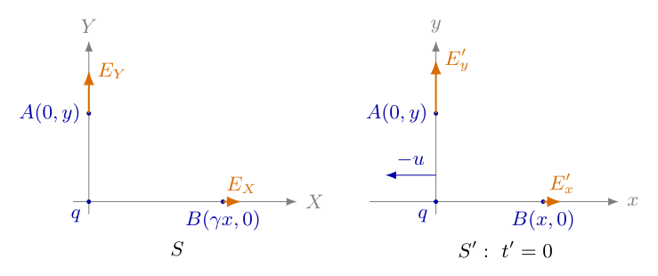{width=70%}

（3）写出静止电荷的库仑场，明确距离的所属坐标系。

在$S$系中电荷静止，令$R=\sqrt{X^2+Y^2+Z^2}$，则

$$
\begin{aligned}
\boldsymbol E(X,Y,Z,t)&=kq\frac{X\boldsymbol e_X+Y\boldsymbol e_Y+Z\boldsymbol e_Z}{(X^2+Y^2+Z^2)^{3/2}},\\
\boldsymbol B(X,Y,Z,t)&=\boldsymbol0.
\end{aligned}
$$

该场不随$t$变化。即使某一测量事件对应$t\ne0$，只要空间位置转换正确，仍可在该时刻使用相同的库仑表达式。分母是$S$系中的$R^3$，不能在变换空间坐标之前就把它换成$S'$的距离。

（4）列出同一事件的电磁场变换，并化成本题所需形式。

沿$X$轴的标准变换在国际单位制中为

$$
\begin{aligned}
E'_x&=E_X, &B'_x&=B_X,\\
E'_y&=\gamma(E_Y-uB_Z), &B'_y&=\gamma\left(B_Y+\frac{uE_Z}{c^2}\right),\\
E'_z&=\gamma(E_Z+uB_Y), &B'_z&=\gamma\left(B_Z-\frac{uE_Y}{c^2}\right).
\end{aligned}
$$

因为原系$\boldsymbol B=\boldsymbol0$，电场式分别简化为$E'_x=E_X$、$E'_y=\gamma E_Y$、$E'_z=\gamma E_Z$。磁场则为$B'_x=0$、$B'_y=\gamma uE_Z/c^2$、$B'_z=-\gamma uE_Y/c^2$。原系磁场为零，不代表变换后的磁场也为零。

这些变换反映电磁场作为整体在不同惯性系中的表示。若暂不使用一般磁场公式，核心两问仍只需三个电场式；磁场式在下面用于检查方向和相对论一致性。

（5）求第一问：先转换$A$事件，再计算横向电场。

$A$的$S'$坐标是$x=0,y\ne0,z=0,t'=0$。把每个坐标代入逆变换，得到

$$
X=\gamma(0+u\times0)=0,\quad Y=y,\quad Z=0,\quad
t=\gamma\left(0+\frac{u\times0}{c^2}\right)=0.
$$

因此$R_A=|y|$，库仑场为$E_X=E_Z=0$、$E_Y=kqy/|y|^3$。这个非零分量垂直于运动方向，应使用$E'_y=\gamma E_Y$，于是

$$
\boxed{\boldsymbol E'_A
=\gamma kq\frac{y}{|y|^3}\boldsymbol e'_y}.
$$

若$y>0$，可写成$\boldsymbol E'_A=\gamma kq\boldsymbol e'_y/y^2$；若$y<0$而$q>0$，场沿负$y$方向。两种写法的大小相同，方向相反。若$q<0$，所有电场方向再反向。场强大小为$|\boldsymbol E'_A|=\gamma k|q|/y^2$，不能把大小公式里的$|q|$与带方向的分量公式混用。

同时由场变换得到

$$
\boldsymbol B'_A=-\frac{u}{c^2}E'_y\boldsymbol e'_z.
$$

对$u>0,q>0,y>0$，电荷沿$-x$运动，$\boldsymbol B'$指向$-z$。这一负号与$\boldsymbol v_q\times\boldsymbol E'/c^2$一致；它不是第一问所求电场的额外因子。

（6）用同时线理解第二问事件的时间与位置。

在$S'$系同时面$t'=0$上，正变换的时间式给出$t=uX/c^2$。图5-2采用纵轴$ct$、横轴$X$，故同时线的斜率为$\beta$。$B$位于$X=\gamma x$处，其纵坐标为$ct_B=\gamma\beta x$。图中$A$的$X=0$投影在原点；它仍具有横向坐标$Y=y$，不是说$A$与电荷重合。

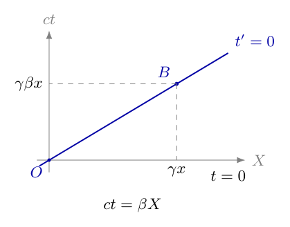{width=52%}

由图中的$X_B=\gamma x$和$ct_B=\beta X_B$恢复

$$
X_B=\gamma x,\qquad t_B=\frac{\beta X_B}{c}
=\gamma\frac{ux}{c^2}.
$$

当$u\ne0,x\ne0$时，$B$事件在$S$中的时间不为零。不能为了让两边都“此时”，再把$t$强行设成零；那样选择的是另一个事件。

（7）求第二问：在正确的纵向距离处计算库仑场。

$B$事件在$S$中有$(X,Y,Z)=(\gamma x,0,0)$，到电荷的距离为$R_B=|\gamma x|=\gamma|x|$，因为$\gamma>0$。所以

$$
\begin{aligned}
E_X(B)&=kq\frac{\gamma x}{(\gamma^2x^2)^{3/2}}\\
&=kq\frac{\gamma x}{\gamma^3|x|^3}
=\frac{kq}{\gamma^2}\frac{x}{|x|^3},\\
E_Y(B)&=E_Z(B)=0.
\end{aligned}
$$

此处是正数的分数次幂运算：$(\gamma^2x^2)^{3/2}=\gamma^3|x|^3$，不能写成$\gamma^3x^3$后无条件消去负号。纵向场变换不另乘$\gamma$，故

$$
\boxed{\boldsymbol E'_B
=\frac{kq}{\gamma^2}\frac{x}{|x|^3}\boldsymbol e'_x
=(1-\beta^2)kq\frac{x}{|x|^3}\boldsymbol e'_x}.
$$

若$x>0$，结果就是$kq\boldsymbol e'_x/(\gamma^2x^2)$。此时各横向分量均为零，磁场变换也给出$\boldsymbol B'_B=\boldsymbol0$。运动电荷会产生磁场并不意味着每个空间点的磁场都非零；在运动轴上，速度与电场平行或反平行，叉积恰为零。

（8）区分“场分量不变”与“相同数值坐标处场强相同”。

第二问先把距离从$x$变成$\gamma|x|$，库仑场因此带来$1/\gamma^2$；随后平行分量的变换系数是$1$。第一问距离始终为$|y|$，但垂直场变换带来$\gamma$。将两个环节分别写出：

$$
\begin{aligned}
A:&\quad |y|\ \longrightarrow\ |y|,
\qquad E_Y\ \longrightarrow\ \gamma E_Y,\\
B:&\quad |x|\ \longrightarrow\ \gamma|x|,
\qquad E_X\ \longrightarrow\ E_X.
\end{aligned}
$$

若只背“纵向不变”，漏掉第一环节就会错误得到$kq/x^2$。若把运动方向误判为电荷的$+u$，则磁场方向错误；电场中的$\gamma$只含$u^2$，不能靠两个电场大小察觉这一方向错误。

（9）求一般位置的场，代回两轴作独立的代数检查。

在$t'=0$时，任意点$(x,y,z)$对应$S$中的$(\gamma x,y,z)$。记$D=\gamma^2x^2+y^2+z^2>0$。先计算库仑分量，再变换：

$$
\begin{aligned}
E_X&=\frac{kq\gamma x}{D^{3/2}},
&E_Y&=\frac{kqy}{D^{3/2}},
&E_Z&=\frac{kqz}{D^{3/2}},\\
E'_x&=\frac{kq\gamma x}{D^{3/2}},
&E'_y&=\frac{kq\gamma y}{D^{3/2}},
&E'_z&=\frac{kq\gamma z}{D^{3/2}}.
\end{aligned}
$$

因此三个分量具有相同前因子，可合并为

$$
\boldsymbol E'(x,y,z,0)=
\frac{kq\gamma(x\boldsymbol e'_x+y\boldsymbol e'_y+z\boldsymbol e'_z)}{(\gamma^2x^2+y^2+z^2)^{3/2}}.
$$

这个式子的纵向分子含$\gamma$来自坐标$X=\gamma x$，不是说$E'_x=\gamma E_X$。令$x=z=0$得到第一问，令$y=z=0$得到第二问，正负方向都自动保留。在这个瞬间，电场与相对于电荷当前位置的位矢平行，但大小随角度变化。

（10）把一般式改成角度形式，检查图5-3与两轴结论。

令$r'=\sqrt{x^2+y^2+z^2}$，取$\cos\theta=x/r'$、$\sin^2\theta=(y^2+z^2)/r'^2$。因为$\gamma^2-1=\gamma^2\beta^2$，分母中的距离因子逐步化为

$$
\begin{aligned}
D&=r'^2(\gamma^2\cos^2\theta+\sin^2\theta)\\
&=\gamma^2r'^2\bigl(\cos^2\theta+(1-\beta^2)\sin^2\theta\bigr)\\
&=\gamma^2r'^2(1-\beta^2\sin^2\theta).
\end{aligned}
$$

所以

$$
\boldsymbol E'=\frac{kq}{r'^2}
\frac{1-\beta^2}{(1-\beta^2\sin^2\theta)^{3/2}}\boldsymbol e'_r.
$$

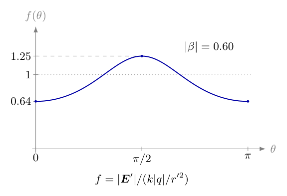{width=47%}

图中纵坐标为$f(\theta)=|\boldsymbol E'|/(k|q|/r'^2)$。在纵轴方向$\theta=0,\pi$，$f=1-\beta^2=1/\gamma^2$；在横向平面$\theta=\pi/2$，

$$
f\left(\frac\pi2\right)
=\frac{1-\beta^2}{(1-\beta^2)^{3/2}}
=\frac1{\sqrt{1-\beta^2}}=\gamma.
$$

于是图的端点与顶点分别对应$B$和$A$。角度依赖不是额外假设，而是同一事件坐标变换和场变换的合成结果。

（11）检查单位、低速极限与磁场不变量。

两轴结果分别为$kq/y^2$与$kq/x^2$乘无量纲系数，单位均正确。$u\to0$时$\gamma\to1$，同时线趋于$t=0$，两个结果都恢复库仑场。对$|\beta|\ll1$，利用二项式展开

$$
\gamma=1+\frac{\beta^2}{2}+O(\beta^4),\qquad
\frac1{\gamma^2}=1-\beta^2.
$$

横向增强从二阶开始，纵向减弱也从二阶开始；电场大小不因$u$反向而改变，但磁场随$u$反向。不能凭经验补入一个与$\beta$成正比的电场修正。

以$A$为例，$B'_z=-uE'_y/c^2$，所以

$$
E_A'^2-c^2B_A'^2
=E_A'^2(1-\beta^2)
=\gamma^2E_Y^2(1-\beta^2)=E_Y^2.
$$

它等于$S$中该事件的$E^2-c^2B^2$。对$B$则$B'=0$、$E'_x=E_X$，不变量也直接相等。这里比较的静止系纵向场仍是在$X=\gamma x$处的场，不是$X=x$处的场。

（12）代入一组数值，复核每一个系数。

取$q=1.0\times10^{-9}\,\mathrm C$、$u=0.60c$，并取$x=y=0.20\,\mathrm m$的两个轴上点。使用$k=8.98755\times10^9\,\mathrm{N\,m^2/C^2}$，先算

$$
\gamma=\frac1{\sqrt{1-0.60^2}}=1.25,\qquad
\frac{kq}{(0.20)^2}=224.689\,\mathrm{V/m}.
$$

第一问直接乘$1.25$，得到$E'_y=280.861\,\mathrm{V/m}$。第二问先算$X_B=1.25\times0.20=0.25\,\mathrm m$，再算$kq/(0.25)^2=143.801\,\mathrm{V/m}$；与$0.64\times224.689$相等。使用$c=2.99792458\times10^8\,\mathrm{m/s}$，第一问的磁场为$B'_z=-5.62111\times10^{-7}\,\mathrm T$，第二问为零。这个算例分别检查距离、分量变换与磁场方向，未用大小检查替代符号检查。

<!-- KEEP_STUDENT_START -->

（13）写出适用范围，避免把当前位矢误解为瞬时传递。

上述结论适用于电荷始终匀速运动、两个惯性系之间的标准洛伦兹变换，且场点不位于电荷本身。在$S'$的一般时刻，电荷位置为$-ut'$，令$d=x+ut'$，则相对于电荷当前位置的位矢为$(d,y,z)$，相同推导给出

$$
\boldsymbol E'(x,y,z,t')=
\frac{kq\gamma(d\boldsymbol e'_x+y\boldsymbol e'_y+z\boldsymbol e'_z)}{(\gamma^2d^2+y^2+z^2)^{3/2}},\qquad d=x+ut'.
$$

它是匀速运动迟滞场化简后的表示，不表示电磁作用可以瞬时传播。电荷若加速，不能把这一式的$u$直接换成时变速度，遗漏加速场。$|u|\to c$也只能作为极限检查，不能把光速运动的参考系当作可建立的惯性系。最后两问的答案均以$t'=0$为取值条件，不额外把$S$中所有空间点设为$t=0$。

<!-- KEEP_STUDENT_END -->

## 六、关键洞察

两问可以用一个固定流程统一：测量事件的$S'$坐标，转换成$S$坐标，计算库仑场，变换同一事件的场，最后报告$S'$分量。空间坐标变换与场分量变换不是两个可以任选其一的解法；它们是同一次计算中必须依次完成的环节。

还可从四维力验证本题的电场变换，而不只把它当作一组记忆公式。在$S'$中放置瞬时静止、足够小而不改变源场的试探电荷$Q$；它在$S$中速度为$u\boldsymbol e_X$。因为$S$中磁场为零，三维力为$\boldsymbol F=Q\boldsymbol E$。四维力定义为动量四矢量对固有时的导数，若三维速度为$\boldsymbol w$，其分量为$K^0=\gamma_w\boldsymbol F\cdot\boldsymbol w/c$、$\boldsymbol K=\gamma_w\boldsymbol F$。本情形$\boldsymbol w=u\boldsymbol e_X$，故

$$
K^0=\gamma\beta F_X,\qquad
K^X=\gamma F_X,\qquad K^Y=\gamma F_Y,\qquad K^Z=\gamma F_Z.
$$

沿$X$轴做洛伦兹变换，逐项得到

$$
\begin{aligned}
K'^x&=\gamma(K^X-\beta K^0)
=\gamma^2(1-\beta^2)F_X=F_X,\\
K'^y&=K^Y=\gamma F_Y,\qquad K'^z=K^Z=\gamma F_Z,\\
K'^0&=\gamma(K^0-\beta K^X)=0.
\end{aligned}
$$

在试探电荷瞬时静止的$S'$中，它的洛伦兹因子为$1$，故$\boldsymbol K'=\boldsymbol F'=Q\boldsymbol E'$。电荷量$Q$不随惯性系改变，两侧约去$Q$，就得到$E'_x=E_X$、$E'_y=\gamma E_Y$、$E'_z=\gamma E_Z$。$K'^0=0$也与瞬时静止时功率为零一致。该推导使用相对论四维力，而非错误地假设三维力在各系中相同；它验证的是本题$\boldsymbol B=0$的特殊情形，不取代一般电磁场变换的全部分量。

横向增强不改变包围电荷的总通量。以$S'$中电荷当前位置为球心，取半径$r'$的球面；按角度表达式，径向电场乘面积元为

$$
\Phi_E=2\pi kq(1-\beta^2)
\int_0^\pi\frac{\sin\theta\,\mathrm d\theta}
{(1-\beta^2\sin^2\theta)^{3/2}}.
$$

令$\mu=\cos\theta$，则$\sin\theta\,\mathrm d\theta=-\mathrm d\mu$，上下限由$1$变为$-1$。记$a=1-\beta^2>0$、$b=\beta^2$，有$a+b=1$。利用求导检查原函数：

$$
\begin{aligned}
\frac{\mathrm d}{\mathrm d\mu}
\left[\frac{\mu}{a\sqrt{a+b\mu^2}}\right]
&=\frac1{a\sqrt{a+b\mu^2}}
-\frac{b\mu^2}{a(a+b\mu^2)^{3/2}}\\
&=\frac{a+b\mu^2-b\mu^2}{a(a+b\mu^2)^{3/2}}
=\frac1{(a+b\mu^2)^{3/2}}.
\end{aligned}
$$

因此

$$
\begin{aligned}
\Phi_E&=2\pi kq\,a
\left[\frac{\mu}{a\sqrt{a+b\mu^2}}\right]_{-1}^{1}\\
&=2\pi kq\,a\frac2a
=4\pi kq=\frac q{\varepsilon_0}.
\end{aligned}
$$

这项积分同时检查角度因子的分子、分母幂次和总归一化。只检查两个轴上特殊值，不能排除一个在中间角度错误、却恰在两轴正确的表达式。

迟滞场提供另一条真正独立的数值路线。在$S'$中，令当前位置到场点的位矢为$\boldsymbol r=(d,y,z)$，源速度为$\boldsymbol v_q=-u\boldsymbol e'_x$。若发射与接收相隔$\tau>0$，迟滞源到场点的向量为$\boldsymbol R_{\mathrm{ret}}=\boldsymbol r+\boldsymbol v_q\tau$，必须满足光锥条件$c\tau=|\boldsymbol R_{\mathrm{ret}}|$。平方并展开后

$$
(c^2-u^2)\tau^2+2ud\tau-(d^2+y^2+z^2)=0.
$$

以正时间根确定发射事件，再令$\boldsymbol n=\boldsymbol R_{\mathrm{ret}}/R_{\mathrm{ret}}$、$\boldsymbol\beta_q=\boldsymbol v_q/c$。匀速电荷的速度场为

$$
\boldsymbol E'_{\mathrm{ret}}=
\frac{kq(1-\beta^2)(\boldsymbol n-\boldsymbol\beta_q)}
{(1-\boldsymbol n\cdot\boldsymbol\beta_q)^3R_{\mathrm{ret}}^2}.
$$

数值程序不是把主解析的闭式代回主解析，而是直接求光锥的正根后计算这个迟滞场。两路线在轴上、非轴上、负电荷、反向速度及非零接收时间的20组情形一致；同时检查$\boldsymbol B'=\boldsymbol n\times\boldsymbol E'/c$与$\boldsymbol v_q\times\boldsymbol E'/c^2$相等。匀速情形可写成当前位矢，不会取消迟滞条件。

## 七、易错点

在全空间同时设$t=t'=0$。由$t'=\gamma(t-uX/c^2)$可见，除$uX=0$的特殊点外这不可能；两个零时刻约定共享的是原点重合事件。应先指定所求$S'$同时面，再转换每个场点事件。

把$X=\gamma x$误写成$X=x/\gamma$。所谓长度收缩比较的是特定同时性条件下两个端点的测量，不能直接取代单个时空事件的坐标变换。对$t'=0$必须使用逆变换并逐项代入。

由$E'_x=E_X$推出第二问与$kq/x^2$相同。平行场分量不变，但右侧的库仑场是在$X=\gamma x$处。遗漏这个距离变化会丢掉整个$1/\gamma^2$。

横向场把两个$\gamma$相乘。本题$A$的横向距离不变，只有场分量变换带来一个$\gamma$；不能再给$y$套一个长度收缩因子。

把运动速度写成$+u$。源在$S'$中沿$-x$运动，电场大小含$u^2$可能暂时看不出错误，磁场方向立即出现反号。应从源的世界线求$x_q=-ut'$，再检查叉积。

用$y^2$或$x^2$写矢量答案却不说明坐标正负。负半轴和负电荷必须通过$qy/|y|^3$、$qx/|x|^3$或明确的单位方向保留；大小与带符号分量不能混用。

把不同单位制的磁场公式混写。本题用国际单位制，$uE/c^2$有磁感应强度单位；若写成$uE/c$而没有改变场量定义，量纲不正确。欧姆、光速、介电常数等符号应各自在正确数学环境中使用。

把匀速场改写成当前距离，就认为电磁作用瞬时传播；或者对加速电荷直接代入瞬时$u$。迟滞场已包含源的历史信息，匀速运动才允许上述化简；加速场还有不能省略的贡献。

## 八、课堂讲解建议

教师先让学生画两个坐标系，只标“谁静止、谁沿哪边运动”。课堂应先从电荷世界线得到$S'$中的$-u$，再引入场变换，避免学生把坐标系速度与源速度混在一起。

板书采用四栏：所求事件的$S'$坐标、对应$S$事件、库仑场、变换后分量。教师先填$A$，再让学生填写$B$；最值得停顿的是$B$的时间不为零，以及距离为$\gamma|x|$。两个中间结果不应被一句“考虑相对论效应”略过。

课堂结合图5-2提问：“哪一个系的同时线经过两个测量事件？”让学生由斜率写出$ct=\beta X$，再回到时间变换。图5-3用于核查最终答案，不作为未经推导的起点。教师可让学生说明图上的横向峰值为什么是$\gamma$、两端为什么是$1/\gamma^2$。

核心两问完成后，课堂再用负半轴、反向速度检验符号，并用给定数值检验距离。四维力与通量积分适合在已有相对论基础后展开；教师仍应保留完整计算，使备课时能追溯系数和单位的来源。

## 九、变式训练

变式一：$q=1.0\,\mathrm{nC}$，$u=0.60c$。在$S'$的$t'=0$时刻，求$P(0.12\,\mathrm m,0.16\,\mathrm m)$处的电场和磁场，并与相同距离的库仑场比较。

$\gamma=1.25$，该事件在$S$中对应$X=1.25\times0.12=0.15\,\mathrm m$、$Y=0.16\,\mathrm m$。所需距离平方为$D=0.15^2+0.16^2=0.0481\,\mathrm{m^2}$，而$S'$距离为$r'=\sqrt{0.12^2+0.16^2}=0.20\,\mathrm m$。依一般式分别计算

$$
\begin{aligned}
E'_x&=\frac{(8.98755)(1.25)(0.12)}{(0.0481)^{3/2}}
\simeq127.795\,\mathrm{V/m},\\
E'_y&=\frac{(8.98755)(1.25)(0.16)}{(0.0481)^{3/2}}
\simeq170.394\,\mathrm{V/m},\\
E'_z&=0.
\end{aligned}
$$

电场与$(0.12,0.16)$平行，因为$E'_y/E'_x=4/3$；大小为$\sqrt{127.795^2+170.394^2}\simeq212.992\,\mathrm{V/m}$。同距离库仑场为$224.689\,\mathrm{V/m}$，所以这个斜向点的场略减弱，不能把“有横向坐标”误解成“必增强”。磁场为$B'_z=-uE'_y/c^2\simeq-3.41024\times10^{-7}\,\mathrm T$，其他分量为零。角度$\sin\theta=0.16/0.20=0.8$，代入图5-3对应的角度表达式，也得到相同大小。

变式二：改取$q=-1.0\,\mathrm{nC}$、$u=-0.60c$，求$A(0,-0.20\,\mathrm m)$与$B(-0.20\,\mathrm m,0)$的带方向电场和磁场。

$\gamma$仍为$1.25$。两个电场分量中的$qy$与$qx$都为正，因此

$$
\boldsymbol E'_A=280.861\boldsymbol e'_y\,\mathrm{V/m},\qquad
\boldsymbol E'_B=143.801\boldsymbol e'_x\,\mathrm{V/m}.
$$

这与负电荷的场指向电荷相符：场点位于负半轴，电荷在原点。此时源在$S'$中的速度为$-u=+0.60c$，故$\boldsymbol B'_A=+5.62111\times10^{-7}\boldsymbol e'_z\,\mathrm T$，$\boldsymbol B'_B=\boldsymbol0$。对$B$事件，$t_B=\gamma ux/c^2>0$，因为$u,x$都为负；时间变换的符号也须单独核对，不能由“负速度”直接判断时间负号。

<!-- KEEP_TOGETHER_START -->

变式三：在电荷经过原点的$S'$时刻，分别测量距原点同为$r'$的正$y$轴点（垂直运动方向）与正$x$轴点（平行运动方向）的场强大小，发现前者与后者的比值为$8$。求速度大小及洛伦兹因子；若$|q|=2.0\,\mathrm{nC}$、$r'=0.10\,\mathrm m$，计算两个场强大小。

因为两个距离相同，电荷量及距离因子相消，比值为

$$
\mathcal R=\frac{\gamma k|q|/r'^2}{k|q|/(\gamma^2r'^2)}=\gamma^3.
$$

由$\mathcal R=8$得$\gamma=\sqrt[3]{8}=2$，继而

$$
|\beta|=\sqrt{1-\gamma^{-2}}=\frac{\sqrt3}{2},\qquad
|u|=\frac{\sqrt3}{2}c.
$$

大小比不能区分$u$的正负，须另测磁场方向或源运动方向。场强计算保留未舍入的中间值，最后统一取小数：

$$
\begin{aligned}
E_0&=\frac{k|q|}{r'^2}
\simeq1797.51036\,\mathrm{V/m},\\
E'_{\perp}&=2E_0\simeq3595.021\,\mathrm{V/m},\\
E'_{\parallel}&=E_0/4\simeq449.378\,\mathrm{V/m}.
\end{aligned}
$$

比值仍为$8$。一般测量比值必须满足$\mathcal R\geq1$；若小于$1$，不能强行开根求一个虚速度，应检查距离是否相同、方向是否正确或模型是否适用。

<!-- KEEP_TOGETHER_END -->

<!-- question-complete -->

\newpage

# 第6题

<!-- question-start -->

测量一大块均匀薄金属板的电导率$\sigma$，但只能接触板角附近的一小部分。板的厚度为$t$，沿相邻两条边依次取接触点$A,B,C,D$，角点记为$O$。其中$OA=OD=l$，$OB=OC=\lambda l$。恒流源从$A$向板内输入电流$I$，从$D$引出同样大小的电流，用电压表测得$B,C$之间的电压差$U$。

（1）计算金属板的电导率。

（2）改用厚度仍为$t$、半径为$r$的均匀薄圆盘，四个接触点$A,B,C,D$依次位于圆周上，且$\angle AOB=\angle BOC=\angle COD=\pi/3$。从$A$输入电流$I$，从$D$引出电流$I$，测得$B,C$间电压差$U$，求圆盘的电导率。

约定$I>0$，电压表正端接$B$、负端接$C$，即$U=V_B-V_C$。接触点按图中次序排列，故$0<\lambda<1$。电压表输入电阻足够大，$B,C$两端不分流；除电流接触处外，板边不向外导电。第（1）问的角部两条边互相垂直，实际内角为$\omega=\pi/2$；角部结果采用远离其他板边的局部大板近似。修订说明：补充两边垂直条件，跨边距离按平面直角几何计算；一般夹角仅作为改变几何条件时的对照。

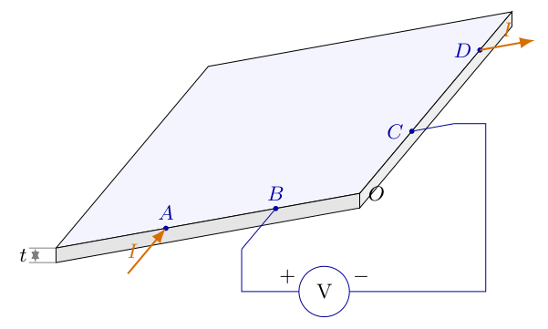{width=74%}

<!-- question-end -->

## 一、题型定位

本题是二维稳恒导电场的四端测量问题。电流端决定板内电势分布，电压端读取两个位置的电势差；两组端子并不是串联的四个电阻。由于电流在板面内扩散，通常不能直接套用一段直导线的$R=\rho L/S$，必须先求扩散电流的场，再把电势差与电导率联系起来。

角部和圆盘的共同核心是无电流穿过绝缘边界。角部可通过同号镜像使法向电流相消；圆盘可构造在整个圆周上满足无流边界的对数电势。计算中最敏感的不是积分本身，而是边缘接触的电流系数、真实几何距离和电压正负端。

第一问还包含模型辨析：平面图的投影夹角不能自动当作物理夹角。直角和直边给出不同几何因子，仅凭相同的四个沿边距离并不能混用两种公式。一般夹角结果能明确指出该差别的来源。

## 二、知识点

均匀各向同性金属满足局部欧姆定律$\boldsymbol J=\sigma\boldsymbol E$，其中$\boldsymbol J$是体电流密度，单位为$\mathrm{A/m^2}$。稳恒电场满足$\boldsymbol E=-\nabla V$。薄板厚度方向近似均匀时，定义面电流密度$\boldsymbol K=t\boldsymbol J$，其单位为$\mathrm{A/m}$，于是$\boldsymbol K=-\sigma t\nabla V$。厚度$t$不能省略，否则最终得到的是面电导而非体电导率。

在没有注入或抽出电流的板内小区域，电荷不积累，故$\nabla\cdot\boldsymbol K=0$。当$\sigma,t$为常量时，它成为二维拉普拉斯方程$\nabla^2V=0$。绝缘板边满足$\boldsymbol K\cdot\boldsymbol n=0$，亦即$\partial V/\partial n=0$；这里$\boldsymbol n$是板面内指向外部的单位法向量。

点接触产生的二维电势随距离的对数变化。全平面电流源$Q$的电场大小为$Q/(2\pi\sigma t\rho)$，其电势可写成$-Q\ln(\rho/\rho_0)/(2\pi\sigma t)$。相应电流汇的符号相反。$\rho_0$只用于让对数自变量无量纲，测量电势差时它消去。

面电阻记为$R_{\square}=1/(\sigma t)$，单位为$\Omega$。测得的四端电阻$R_4=U/I$等于面电阻乘一个无量纲几何因子。几何因子一经正确求出，$\sigma$由$\sigma=1/(tR_{\square})$得到，而不能把$R_4$直接当作$R_{\square}$。

## 三、物理图像

图6-1保留薄板的厚度和两个可接触边缘的空间关系，电流从$A$进入、从$D$离开；蓝色引线只接$B,C$及电压表。板内电流由源端向汇端扩散，并非沿图中的边线流成一根导线。电压引线不参与承载$I$，其接触位置却决定被测的电势差。

在直角模型中，可把板面转到正视平面，选$A,B$在$x$正半轴上，$C,D$在$y$正半轴上，真实金属占第一象限。为使两条边都不漏电，把源和汇按边界反射延拓到全平面。这些镜像是求解工具，不是另加的实际电极；图6-3中的等效电流为$2I$，实际电流端仍只有$I$。

圆盘模型的边界是封闭圆周，但所有板内点都位于同一个平面。其电势可由源点到场点、汇点到场点两条弦长的比值表示。图6-4中的$r$和$\sqrt3r$随后分别进入$V_B,V_C$，而不是只作为图中标签。

## 四、解题入口

先由一个电流端的截流面积推导电势系数，分清全圆与半圆的二倍差别。然后在直角板中写出四个等效源、汇的位置，计算它们到$B,C$的实际距离。沿同一条边的距离可相减；跨两条垂直边的距离必须用勾股定理，不能也写成$(1\pm\lambda)l$。

圆盘不宜把所有边界粗略当成直线后照搬角部镜像。应先检验候选对数电势在圆周上的法向导数为零，再计算四条弦长。最后统一检查$U$的正负、厚度量纲、尺度消去及接触点靠近时的极限。

## 五、解析

（1）从电流守恒建立薄板导电方程。

取板内不含电流接触点的一小块面积，稳恒状态下流入电流等于流出电流。对任意这类区域，散度定理给出$\nabla\cdot\boldsymbol K=0$。再代入$\boldsymbol K=t\sigma\boldsymbol E=-\sigma t\nabla V$，得到

$$
\begin{aligned}
0&=\nabla\cdot(-\sigma t\nabla V),\\
0&=-\sigma t\nabla^2V,\\
\nabla^2V&=0\qquad\text{（非接触区域）}.
\end{aligned}
$$

第一步使用电流守恒，第二步使用均匀厚度与均匀电导率，第三步除以非零的$\sigma t$。若板材不均匀，第二步不能把$\sigma t$移出散度，本题的对数势也不再普遍适用。边缘处除了$A,D$，没有外部导电通道，故另外必须满足

$$
\boldsymbol K\cdot\boldsymbol n=0
\quad\Longleftrightarrow\quad
\frac{\partial V}{\partial n}=0.
$$

电势只确定到一个任意加法常数；这个自由度不会影响电场或$U$。

（2）推导全平面点源的电场与对数电势。

先考虑一张无限薄板，某内点向板内注入电流$Q$。以接触点为圆心取半径为$\rho$的圆，电流径向穿过的面积不是$\pi\rho^2$，而是圆周长度乘厚度，即$2\pi\rho t$。对称性使该圆周上的径向电流密度相同，因此

$$
\begin{aligned}
Q&=J_\rho\,(2\pi\rho t),\\
J_\rho&=\frac{Q}{2\pi\rho t},\\
E_\rho&=\frac{J_\rho}{\sigma}
=\frac{Q}{2\pi\sigma t\rho}.
\end{aligned}
$$

对于源端$Q>0$，电场向外，沿增大的$\rho$电势降低。由$E_\rho=-dV/d\rho$，对径向坐标积分：

$$
\begin{aligned}
V(\rho)-V(\rho_0)
&=-\int_{\rho_0}^{\rho}
\frac{Q}{2\pi\sigma t s}\,ds\\
&=-\frac{Q}{2\pi\sigma t}
\left[\ln s\right]_{\rho_0}^{\rho}\\
&=-\frac{Q}{2\pi\sigma t}
\ln\frac{\rho}{\rho_0}.
\end{aligned}
$$

这里利用$\int ds/s=\ln s$并先保留两个积分端点。电流汇可取$Q<0$，于是电场指向汇端、电势随远离汇端而升高。源、汇电流等大反向时，叠加后可以写成距离之比的对数，任意的$\rho_0$随之消去。

（3）由半圆截流检查边缘接触的二倍系数。

接触点位于一条平直绝缘边缘时，电流只能流入板内的一侧。图6-2左侧的半圆截流面积为$\pi\rho t$，右侧的全圆面积为$2\pi\rho t$。为了在半板内真实输入$I$，左侧接触附近的径向场为$I/(\pi\sigma t\rho)$；把它延拓到全平面，必须使用等效源$2I$。

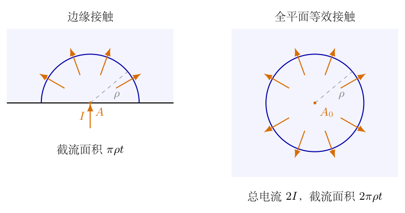{width=86%}

于是图中两种描述具有相同的板内电场：

$$
\frac{I}{\pi\rho t\sigma}
=\frac{2I}{2\pi\rho t\sigma}.
$$

边缘接触的二倍系数来自可流通的角度减半，而不是“镜像电势再额外乘二”。后面既已使用$2I$作为全平面源强，电势系数就必须是$2I/(2\pi\sigma t)=I/(\pi\sigma t)$，不能重复加倍。

（4）在直角板中逐个确定等效源、汇的位置。

在$\omega=\pi/2$情况下，取$O=(0,0)$，板占$x\geq0,y\geq0$。坐标写为

$$
\begin{aligned}
A&=(l,0),&B&=(\lambda l,0),\\
C&=(0,\lambda l),&D&=(0,l).
\end{aligned}
$$

图6-3给出延拓后的全平面构造：$A$及其镜像$A^*=(-l,0)$均为等效源$+2I$，$D$及其镜像$D^*=(0,-l)$均为等效汇$-2I$。其中$A$已在$y=0$边上，关于该边的同号延拓合并成$2I$；再关于$x=0$反射得到$A^*$。对$D$同理。

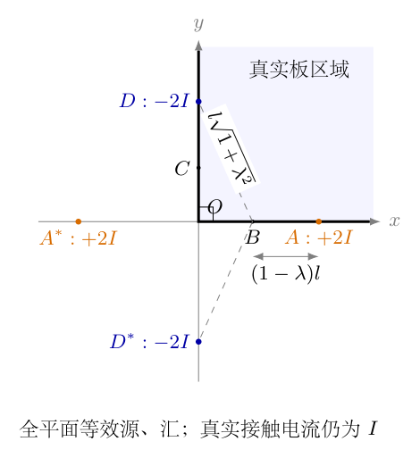{width=60%}

在$y=0$上，来自$D,D^*$的法向场分量等大反向；$A,A^*$的场在这条线上没有法向分量。在$x=0$上，来自$A,A^*$的法向分量相消；$D,D^*$的场没有法向分量。因此两条边除接触点外都满足$\partial V/\partial n=0$。在真实接触点附近，穿过板内半圆的电流仍是$I$，没有把实际电源变成$2I$或$4I$。

（5）写出四个等效源、汇叠加后的电势。

令$r_A,r_{A^*},r_D,r_{D^*}$分别表示场点$P$到四个点的距离。源势取负的对数、汇势取正的对数，故

$$
\begin{aligned}
V(P)
&=-\frac{I}{\pi\sigma t}\ln\frac{r_A}{\rho_0}
-\frac{I}{\pi\sigma t}\ln\frac{r_{A^*}}{\rho_0}\\
&\quad+\frac{I}{\pi\sigma t}\ln\frac{r_D}{\rho_0}
+\frac{I}{\pi\sigma t}\ln\frac{r_{D^*}}{\rho_0}+V_0\\
&=\frac{I}{\pi\sigma t}
\ln\frac{r_Dr_{D^*}}{r_Ar_{A^*}}+V_0.
\end{aligned}
$$

最后一步使用$\ln a+\ln b=\ln(ab)$，四项中的参考长度恰好抵消。分子、分母都是两个长度的乘积，因此比值无量纲。加法常数$V_0$可任意选取，下面计算$V_B-V_C$时直接消去。

（6）在$B$点计算全部距离，不省略跨边的开方过程。

由图6-3，$B,A,A^*$在同一条水平线上，而$D,D^*$在竖直线上。对$0<\lambda<1$，沿同一直线的距离为

$$
\begin{aligned}
r_A(B)&=|l-\lambda l|=(1-\lambda)l,\\
r_{A^*}(B)&=|\lambda l-(-l)|=(1+\lambda)l.
\end{aligned}
$$

跨两条边的距离则由坐标差平方和决定：

$$
\begin{aligned}
r_D(B)&=\sqrt{(\lambda l-0)^2+(0-l)^2}
=l\sqrt{1+\lambda^2},\\
r_{D^*}(B)&=\sqrt{(\lambda l-0)^2+(0+l)^2}
=l\sqrt{1+\lambda^2}.
\end{aligned}
$$

所以两类距离乘积分别为$l^2(1-\lambda^2)$和$l^2(1+\lambda^2)$。代入电势表达式：

$$
\begin{aligned}
V_B-V_0
&=\frac{I}{\pi\sigma t}
\ln\frac{l^2(1+\lambda^2)}
{(1-\lambda)l(1+\lambda)l}\\
&=\frac{I}{\pi\sigma t}
\ln\frac{1+\lambda^2}{1-\lambda^2}.
\end{aligned}
$$

不能把$r_D(B)$也写成$(1\pm\lambda)l$：它既不是$OB+OD$，也不是$OD-OB$，而是一条连接两条垂直边的斜线段。错误距离会改变最终几何因子，不只是影响图中的标注。

（7）独立计算$C$点并完成第一问直角结果。

$C=(0,\lambda l)$到两个源的距离都为$l\sqrt{1+\lambda^2}$，到$D,D^*$的距离分别为$(1-\lambda)l,(1+\lambda)l$。直接代入，而不只凭对称性猜符号：

$$
\begin{aligned}
V_C-V_0
&=\frac{I}{\pi\sigma t}
\ln\frac{(1-\lambda)l(1+\lambda)l}
{l^2(1+\lambda^2)}\\
&=\frac{I}{\pi\sigma t}
\ln\frac{1-\lambda^2}{1+\lambda^2}\\
&=-\frac{I}{\pi\sigma t}
\ln\frac{1+\lambda^2}{1-\lambda^2}.
\end{aligned}
$$

因此

$$
\begin{aligned}
U&=V_B-V_C
=\frac{2I}{\pi\sigma t}
\ln\frac{1+\lambda^2}{1-\lambda^2},\\
\sigma tU&=\frac{2I}{\pi}
\ln\frac{1+\lambda^2}{1-\lambda^2}.
\end{aligned}
$$

解出电导率，得到

$$
\boxed{\sigma=\frac{2I}{\pi tU}
\ln\frac{1+\lambda^2}{1-\lambda^2}}
\qquad(\omega=\pi/2).
$$

因$0<\lambda<1$，对数为正，与$I>0,U>0$相容。尺度$l$完全消去，并非不需要测量接触位置，而是只需要比例$\lambda=OB/OA=OC/OD$。所有距离同时放大同一倍数时，二维稳恒场的电压比不变。

（8）为圆盘构造候选电势，并核查它的源、汇强度。

圆盘内任一点记为$P$，两电流端在圆周上。候选电势为

$$
V(P)=\frac{I}{\pi\sigma t}
\ln\frac{|P-D|}{|P-A|}+V_0.
$$

它在$A,D$之外满足二维拉普拉斯方程，因为二维$\ln|P-P_0|$在$P\ne P_0$处为调和函数。靠近$A$时，$|P-D|$仍为非零有限量，$V$的奇异项为$-I\ln|P-A|/(\pi\sigma t)$，产生向外的径向场$I/(\pi\sigma t\rho)$。圆周在足够小尺度上近似直线，接触处板内截流角度趋于$\pi$，故输入电流为

$$
\lim_{\rho\to0}
\sigma t\frac{I}{\pi\sigma t\rho}\,\pi\rho=I.
$$

靠近$D$时对数奇异项符号相反，抽出同样大小的$I$。这一步检查的是实际端子电流，而不是只因形式好看便采用候选函数。有限曲率不改变上述局部极限，但候选电势仍须在整个圆周上通过下一步边界检验。

（9）证明圆盘候选电势的法向电流处处为零。

以圆心为坐标原点，令$\boldsymbol p$为圆周上一处非接触点的位置向量，$\boldsymbol a$为圆周上任一接触点的位置向量。两者满足$|\boldsymbol p|=|\boldsymbol a|=r$，单位外法向为$\boldsymbol n=\boldsymbol p/r$。先求一个对数项的法向导数：

$$
\begin{aligned}
\frac{\partial}{\partial n}\ln|\boldsymbol p-\boldsymbol a|
&=\frac{(\boldsymbol p-\boldsymbol a)\cdot\boldsymbol n}
{|\boldsymbol p-\boldsymbol a|^2}\\
&=\frac{r^2-\boldsymbol p\cdot\boldsymbol a}
{r\,[2r^2-2\boldsymbol p\cdot\boldsymbol a]}\\
&=\frac{1}{2r}.
\end{aligned}
$$

第二行分别使用$\boldsymbol n=\boldsymbol p/r$和距离平方展开；第三行在非接触点约去非零因子$r^2-\boldsymbol p\cdot\boldsymbol a$。对$A,D$得到的结果相同，候选电势中两项符号相反，所以

$$
\frac{\partial V}{\partial n}
=\frac{I}{\pi\sigma t}
\left(\frac1{2r}-\frac1{2r}\right)=0.
$$

因此候选函数同时满足内部无源方程、圆周绝缘条件以及正确的输入和输出电流。只差任意常数的电势不会改变$U$，由此可用它计算圆盘的测量结果。

（10）把圆心角逐一转成弦长，再求圆盘的电压。

图6-4取$A$在右端、$D$在左端，$B,C$沿上半圆依次排列。三个相邻圆心角都是$\pi/3$，故$A,D$相隔$\pi$，$B,D$及$A,C$相隔$2\pi/3$。弦长公式为$|PQ|=2r\sin(\angle POQ/2)$。

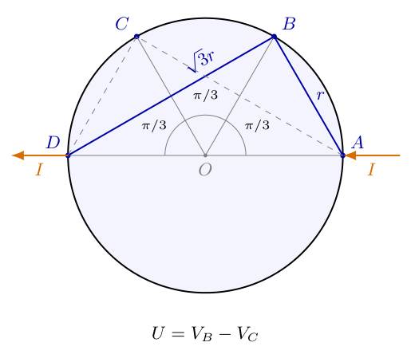{width=62%}

逐项计算：

$$
\begin{aligned}
|BA|=|CD|&=2r\sin\frac\pi6=r,\\
|BD|=|CA|&=2r\sin\frac\pi3=\sqrt3r.
\end{aligned}
$$

代入的必须是场点到电流端的距离，不能把$BC$本身的长度代入源势或汇势。先求两点电势，再相减：

$$
\begin{aligned}
V_B-V_0
&=\frac{I}{\pi\sigma t}\ln\frac{|BD|}{|BA|}
=\frac{I}{\pi\sigma t}\ln\sqrt3,\\
V_C-V_0
&=\frac{I}{\pi\sigma t}\ln\frac{|CD|}{|CA|}
=-\frac{I}{\pi\sigma t}\ln\sqrt3,\\
U&=\frac{2I}{\pi\sigma t}\ln\sqrt3
=\frac{I\ln3}{\pi\sigma t}.
\end{aligned}
$$

这里$2\ln\sqrt3=\ln3$，所以第二问结果也可用两种等价形式写出：

$$
\boxed{\sigma
=\frac{I\ln3}{\pi tU}
=\frac{2I\ln\sqrt3}{\pi tU}}.
$$

半径$r$在弦长比中消去，但板厚$t$仍保留。这是二维几何的尺度性质，不是把圆盘当成零厚度后仍有有限体电导率。

（11）给出一般角部夹角的公式，区分直角与直边。

设金属板局部占极角$0<\varphi<\omega$的楔形，沿$\varphi=0$边取$A$的距离为$l$、$B$为$\lambda l$；沿$\varphi=\omega$边取$D$为$l$、$C$为$\lambda l$。引入复坐标$z=\rho e^{i\varphi}$，令

$$
p=\frac\pi\omega,\qquad
w=\left(\frac zl\right)^p
=\left(\frac\rho l\right)^p e^{ip\varphi}.
$$

该变换把角度区间$(0,\omega)$变成$(0,\pi)$，即把楔形变成上半平面。$z/l$无量纲，避免对有单位的长度直接取任意实数幂。变换在角点之外保持局部夹角；电势沿法线的梯度和沿边界的长度分别按互逆比例变化，故接触处的总电流不变。

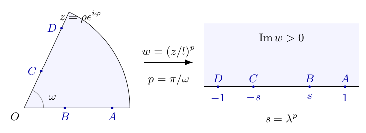{width=88%}

由图6-5中的坐标对应，$A\mapsto1$，$D\mapsto-1$；令$s=\lambda^p$，则$B\mapsto s$、$C\mapsto-s$。上半平面中源、汇在同一直线上，其电势为

$$
V(w)=\frac{I}{\pi\sigma t}
\ln\frac{|w+1|}{|w-1|}+V_0.
$$

因此

$$
\begin{aligned}
V_B-V_0&=\frac{I}{\pi\sigma t}\ln\frac{1+s}{1-s},\\
V_C-V_0&=-\frac{I}{\pi\sigma t}\ln\frac{1+s}{1-s},\\
U&=\frac{2I}{\pi\sigma t}\ln\frac{1+s}{1-s}.
\end{aligned}
$$

把$s=\lambda^{\pi/\omega}$代回并解出电导率：

$$
\boxed{\sigma=\frac{2I}{\pi tU}
\ln\frac{1+\lambda^{\pi/\omega}}
{1-\lambda^{\pi/\omega}}}.
$$

当$\omega=\pi/2$时，$p=2$，恢复第一问直角结果；当$\omega=\pi$时，$p=1$，才得到含$(1+\lambda)/(1-\lambda)$的直边结果。两者的差别来自真实夹角，不是两种等价代数化简。本问已经明确为直角，因此主解取$\omega=\pi/2$；若将实际夹角改变为其他值，就应保留对应的$\omega$，不能沿用直角几何因子。

（12）检查单位、极限与适用条件。

结果中的对数及$\pi$无量纲，而$I/(tU)$的单位为$\mathrm{A/(m\,V)}=\mathrm{S/m}$，正是体电导率。对于固定$\sigma,t,I$，第一问直角电压在$\lambda\to0$时可由对数展开检查：

$$
\begin{aligned}
\ln\frac{1+\lambda^2}{1-\lambda^2}
&=\ln(1+\lambda^2)-\ln(1-\lambda^2)\\
&=\left(\lambda^2-\frac{\lambda^4}{2}
+\frac{\lambda^6}{3}+\cdots\right)
-\left(-\lambda^2-\frac{\lambda^4}{2}
-\frac{\lambda^6}{3}+\cdots\right)\\
&=2\lambda^2+\frac{2\lambda^6}{3}+\cdots,\\
U&=\frac{4I}{\pi\sigma t}\lambda^2
+O(\lambda^6).
\end{aligned}
$$

$B,C$同时靠近角点时电势差趋于零，并且直角情形是二阶小量，不是一阶小量。一般夹角的领先项为$U\sim4I\lambda^{\pi/\omega}/(\pi\sigma t)$。当$\lambda\to1^-$时，测量点分别趋向源、汇接触点，理想点接触电势的对数奇异使$U$增大；真实电极有有限尺寸，不能把发散当成无限可用的实验增益。

电压表应近似开路，金属厚度与接触尺寸应远小于相关接触间距，电导率及厚度在板内近似均匀。角部公式还要求其他板边足够远；若有限边界离接触点不远，则必须重新解其边界问题，不能仍把无限楔形公式当成严格结果。圆盘公式已考虑整个圆周，不需要再作“大圆盘”近似。

（13）用具体数据复核几何因子与数值计算。

取$I=0.010\,\mathrm A$、$t=1.00\times10^{-4}\,\mathrm m$、$U=1.00\times10^{-3}\,\mathrm V$。对直角板取$\lambda=0.500$，则$\lambda^2=0.250$，对数内的比值为$(1.250)/(0.750)=5/3$。保留未舍入中间值：

$$
\begin{aligned}
\sigma_{\rm corner}
&=\frac{0.020}{\pi(1.00\times10^{-4})
(1.00\times10^{-3})}\ln\frac53\\
&\approx6.3661977\times10^4\times0.5108256\\
&\approx3.2520\times10^4\,\mathrm{S/m}.
\end{aligned}
$$

圆盘对应同一组$I,t,U$时，

$$
\begin{aligned}
\sigma_{\rm disk}
&=\frac{0.010\ln3}
{\pi(1.00\times10^{-4})(1.00\times10^{-3})}\\
&\approx3.1830989\times10^4\times1.0986123\\
&\approx3.4970\times10^4\,\mathrm{S/m}.
\end{aligned}
$$

同样的电流与电压并不保证两个不同形状样品有相同电导率，必须带入各自几何因子。反过来，若两种样品都取$\sigma=1.00\times10^6\,\mathrm{S/m}$、厚度及电流不变，则直角板应测得$32.520\,\mu\mathrm V$，圆盘应测得$34.970\,\mu\mathrm V$。这组反算能检查$\sigma$是分母还是分子，以及是否误把$\ln\sqrt3$当成$\ln3$后又多乘一次二。

## 六、关键洞察

四端法把电流引线与测量引线分开，其目的不是消除板内的几何影响，而是尽量避免电压引线接触电阻承载大电流后产生附加压降。即使电压表近似不取电流，$U/I$依然取决于接触位置和板边条件，必须经过几何因子才能换算为$1/(\sigma t)$。

对数势的系数可以仅由接触处的电流通量确定。某点接触在局部可导电角度为$\Theta$时，截流面积为$\Theta\rho t$，因此奇异势的系数为$I/(\Theta\sigma t)$。内点对应$\Theta=2\pi$，光滑边缘点对应$\Theta=\pi$。本题的$A,D$不是角点$O$，即使样品为直角板，它们的局部可导电角度仍为$\pi$，不能错误地用$\pi/2$再加倍。

解的可靠性来自“方程、边界、通量”三项同时满足。以圆盘为例，候选函数内部调和还不够；必须证明圆周法向导数为零，并确认源端输入$I$、汇端抽出$I$。若两个解均满足相同条件，其差$f$在无源区调和且边界法向导数为零。用分部积分可得

$$
\begin{aligned}
\int |\nabla f|^2\,dS
&=\oint f\frac{\partial f}{\partial n}\,ds
-\int f\nabla^2f\,dS\\
&=0.
\end{aligned}
$$

比较时可先剔除接触点附近的小圆弧，并让具有相同奇异强度的差的弧边贡献趋于零。积分非负且总值为零，所以$\nabla f=0$，两解只差常数。这解释了为什么符合全部边界条件的候选对数势已经确定了被测电压。

对于圆盘上任意依次排列的四个接触点，直接由同一候选势相减可得

$$
\begin{aligned}
U
&=\frac{I}{\pi\sigma t}
\left(\ln\frac{|BD|}{|BA|}
-\ln\frac{|CD|}{|CA|}\right)\\
&=\frac{I}{\pi\sigma t}
\ln\frac{|BD|\,|CA|}{|BA|\,|CD|}.
\end{aligned}
$$

因此四端电压由四条弦长的无量纲组合决定，不由圆盘面积或周长单独决定。整块板面在两条互易测量中的积分
$\int\sigma t\nabla V_1\cdot\nabla V_2\,dS$
交换$V_1,V_2$后不变。若第一组从$A$输入$I_1$、从$D$引出，第二组从$B$输入$I_2$、从$C$引出，则边界项分别为
$I_1[V_2(A)-V_2(D)]$和$I_2[V_1(B)-V_1(C)]$。所以

$$
\frac{V_1(B)-V_1(C)}{I_1}
=\frac{V_2(A)-V_2(D)}{I_2}.
$$

这是均匀线性无磁场导电模型的互易检查。它不是交换任意两根线后电压都不变，而是电流端子对与电压端子对成对交换，并保留相同正负次序。

直角结果还可不借助四镜像而通过$w=(z/l)^2$独立得到。在板边上，$B$映到$\lambda^2$、$C$映到$-\lambda^2$，所以直角中的平方幂来自角度加倍。有限网格电阻网络也提供不同于解析公式的数值检查：逐节点解电流平衡，在板边注入和抽出单位电流。固定远边距$16l$、加密网格后，$\lambda=1/2$的$U/(IR_{\square})$趋向$0.325202$；不能把有限网格最后的微小误差称作无限板公式的物理误差。

## 七、易错点

把电流截面写成圆盘面积$\pi\rho^2$，会把二维导电误写成三维点源导电。正确截流面是圆周或半圆弧沿厚度展开的侧面积，$\rho$只出现一次。忽略$t$则得到面电导，不能再把答案单位标为$\mathrm{S/m}$。

边缘点的等效源强已为$2I$，叠加后不再另乘“镜像二倍”。直角图中虽然有四个全平面等效点，但实际第一象限中只接入一个$I$源和一个$I$汇；全平面的扩展电流不是实际电源读数。

跨边距离误用$l\pm\lambda l$是本题实质性几何错误。直角图中$BD$需由勾股定理得$l\sqrt{1+\lambda^2}$；只有同一直线的两点才可直接把到角点的距离相加或相减。另一方面，真实角度为$\pi$时才使用含$\lambda$的直边因子，不能用一张透视图的纸面角度代替实际角度。

对数势的正负号可用靠近源端的极限核查：正电流源附近$V\to+\infty$，汇附近$V\to-\infty$，应有$V\propto\ln(r_D/r_A)$。若写反，正端接$B$时会错误得到负的$U$及负电导率。倒置电压表极性时$U$变号，必须同时调整电压定义，不能把负读数直接代入正读数公式。

圆盘公式中的距离是弦长，而非沿圆周的弧长。$\angle AOB=\pi/3$对应弦长$r$，不是$\pi r/3$。两问尺度消去也不表示任意有限板都可忽略边缘；角部无限模型和完整圆盘模型的成立理由不同。

当$B$无限接近$A$时，点接触势的发散提示接触模型失效，不是可以无代价提高测量灵敏度。真实接触的面积、边缘电流拥挤、样品发热及电压表分流都可能改变结果，应先明确它们可忽略的尺度条件。

## 八、课堂讲解建议

课堂先让学生在一张纸板上指出“沿板面流动”与“穿过厚度方向截流面”的区别。板书画出半圆弧，并沿弧把厚度$t$展开成侧面，要求学生先写$I=J\pi\rho t$，再写$E=J/\sigma$。这一步不急于给出对数积分，以免学生只记住一个二倍系数而不知道从哪里来。

教师随后保留图6-3，只让学生填写$B$到四个点的距离。沿轴的两个距离与跨轴的两个距离应分别列在两行；可以取$l=1,\lambda=1/2$直接比较$1/2,3/2,\sqrt5/2$。板书把错误的“跨边相加”与正确勾股关系并列，错误在求电势之前就能被发现。

圆盘部分可以先让学生猜测$V\propto\ln(|PD|/|PA|)$，再提出“为什么圆周不会漏电”的问题。教师完整展示两个对数项的法向导数都为$1/(2r)$，最后相减为零；这样候选函数有了边界依据，而不是靠图像直觉被默认正确。

一般夹角映射适合在核心直角计算已经掌握后讲解。课堂应明确复坐标只是二维板面的数学记号，不是第三个物理方向。先把角度乘以$p$变成$\pi$，再追踪四个接触点，学生即可看到$\lambda^2$的来源。最后用电流反向和互易测量作为结果自检，不能只核对最后一个小数。

## 九、变式训练

变式一：直角板与圆盘由同一种金属制成，厚度相同，测量电流也相同。直角板取$\lambda=1/2$。求两者电压比；若圆盘测得$70.0\,\mu\mathrm V$，求直角板的电压。

完整解答：两者$\sigma,t,I$相同，公共因子$I/(\pi\sigma t)$约去。直角板电压含$2\ln(5/3)$，圆盘电压含$\ln3$，所以

$$
\begin{aligned}
\frac{U_{\rm corner}}{U_{\rm disk}}
&=\frac{2\ln(5/3)}{\ln3}
\approx0.929947,\\
U_{\rm corner}
&\approx70.0\times0.929947\,\mu\mathrm V
\approx65.1\,\mu\mathrm V.
\end{aligned}
$$

较小电压来自几何因子较小，而不是同一材料的电导率改变。若两块厚度不同，应把厚度因子保留，不能仍直接使用这个比值。

变式二：一般楔形板取$\lambda=1/2$，已知$R_{\square}=1.00\,\Omega$，输入$I=10.0\,\mathrm{mA}$，测得$U=(2I/\pi)\ln(9/7)$。求实际夹角$\omega$，并判断其是否为直角。

完整解答：一般公式给出

$$
\begin{aligned}
\ln\frac{1+s}{1-s}&=\ln\frac97,\qquad s=\lambda^p,\\
\frac{1+s}{1-s}&=\frac97,\\
7+7s&=9-9s,\\
16s&=2,\qquad s=\frac18,\\
\left(\frac12\right)^p&=\frac18
=\left(\frac12\right)^3.
\end{aligned}
$$

因为固定底数$1/2$的实数幂是严格单调函数，$p=3$是唯一解。由$p=\pi/\omega$得$\omega=\pi/3$，为$60^\circ$，不是直角。电压数值为$U\approx1.600\,\mathrm{mV}$。若实际接触比$\lambda$未知，则单次电压不能同时唯一确定$\lambda$和$\omega$。

变式三：圆盘四个接触点等角间隔排列，但相邻圆心角改为$\varphi$，且$0<\varphi<2\pi/3$。$A\to D$通电、$B,C$测压。求几何因子，并计算$\varphi=\pi/2$的结果。

完整解答：四点圆心角可依次取$0,\varphi,2\varphi,3\varphi$。源到$B$、汇到$C$的弦长均为$2r\sin(\varphi/2)$；汇到$B$、源到$C$的弦长均为$2r\sin\varphi$。在所给范围内相关正弦为正，可直接使用弦长比：

$$
\begin{aligned}
U
&=\frac{I}{\pi\sigma t}
\ln\frac{[2r\sin\varphi]^2}
{[2r\sin(\varphi/2)]^2}\\
&=\frac{I}{\pi\sigma t}
\ln\left[\frac{\sin\varphi}{\sin(\varphi/2)}\right]^2\\
&=\frac{I}{\pi\sigma t}
\ln\left[4\cos^2\frac\varphi2\right].
\end{aligned}
$$

第三行使用$\sin\varphi=2\sin(\varphi/2)\cos(\varphi/2)$。当$\varphi=\pi/2$时，$4\cos^2(\pi/4)=2$，因此

$$
U=\frac{I\ln2}{\pi\sigma t},
\qquad
\sigma=\frac{I\ln2}{\pi tU}.
$$

当$\varphi\to2\pi/3$时，$A,D$即将绕圆周重合，几何因子趋于零，此端点不满足四个互不重合电极的条件，不应纳入正式测量构型。原题$\varphi=\pi/3$时则恢复$\ln3$。

变式四：直角板的接触比例存在小误差$\delta\lambda$，$I,t,U$的误差暂忽略。求电导率对$\lambda$的相对灵敏度，并估计$\lambda=1/2$、$\delta\lambda=0.005$造成的相对误差。

完整解答：令$f(\lambda)=\ln[(1+\lambda^2)/(1-\lambda^2)]$，则$\sigma=Cf(\lambda)$，其中$C=2I/(\pi tU)$与$\lambda$无关。先分别求两个对数的导数：

$$
\begin{aligned}
f'(\lambda)
&=\frac{2\lambda}{1+\lambda^2}
+\frac{2\lambda}{1-\lambda^2}\\
&=\frac{2\lambda[(1-\lambda^2)+(1+\lambda^2)]}
{(1+\lambda^2)(1-\lambda^2)}\\
&=\frac{4\lambda}{1-\lambda^4}.
\end{aligned}
$$

在线性误差范围内，

$$
\begin{aligned}
\frac{\delta\sigma}{\sigma}
&\simeq\frac{f'(\lambda)}{f(\lambda)}\,\delta\lambda\\
&=\frac{4\lambda}
{(1-\lambda^4)\ln[(1+\lambda^2)/(1-\lambda^2)]}
\,\delta\lambda.
\end{aligned}
$$

代入$\lambda=1/2$时，$1-\lambda^4=15/16$、$f=\ln(5/3)$，于是

$$
\frac{\delta\sigma}{\sigma}
\simeq\frac{2}{(15/16)\ln(5/3)}\times0.005
\approx0.0209.
$$

即接触比例的绝对误差$0.005$可导致约$2.09\%$的电导率误差，正的$\delta\lambda$使反算电导率偏大。这是固定测量读数下的参数误差传播，不是实际移动电极而仍强行保持$U$不变的物理过程。若还包含独立的$I,t,U$微小系统偏差，一阶关系应补成$\delta\sigma/\sigma\simeq\delta I/I-\delta t/t-\delta U/U+[f'/f]\delta\lambda$。

<!-- question-complete -->

\newpage

# 第7题

<!-- question-start -->

斯特林发动机的简化装置由两个等截面积气缸、两个活塞及中间可开闭的多孔通道组成。左侧气缸接触高温热源，右侧气缸接触低温热源。低温为$T_1$，高温为$T_2$，且$T_2>T_1>0$。中间通道为不储热、对外绝热且无轴功的多孔塞；忽略通道内气体动能、势能及死体积。初始时左侧没有气体，右侧有$n_0$摩尔理想气体，体积为$V_1$，摩尔定容热容为$C_V=5R/2$。取$V_1>V_2>0$。

一个循环按下列顺序进行。

第一阶段：关闭通道，热活塞不动，冷活塞向左移动，把冷腔气体从$V_1$等温压缩到$V_2$，压缩中放出的热量由低温热源吸收。

第二阶段：打开通道，控制两个等面积活塞同向同步移动，使气体由冷腔转入热腔。两腔压力在准静态近似下相同，各自与所接触热源保持热平衡；气体全部转入热腔后关闭通道。

第三阶段：冷活塞不动，热腔气体等温膨胀推动热活塞向左移动，向外做功。高温热源供热，使热腔温度保持$T_2$，直至热腔体积回到$V_1$。

第四阶段：打开通道，两个活塞同向同步向右移动，使气体由热腔全部转回冷腔，再关闭通道，恢复初态。

（1）在$p$—$V$图上画出循环过程。

（2）求热效率。

修订说明：热侧始终为$T_2$、冷侧始终为$T_1$，返程气体由热侧回冷侧；明确多孔塞不储热，两腔气体各自恒温并在准静态共同压力下换气。题中“回热器”名称不表示理想储热功能；本题主解采用上述无储热双腔模型，另行增加回热功能属于改变条件的对照。忽略活塞摩擦。

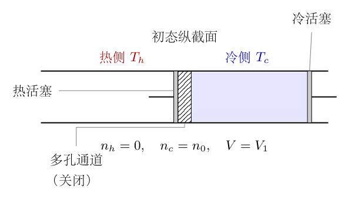{width=80%}

<!-- question-end -->

## 一、题型定位

本题是两条等温支路与两条等总容积换气支路组成的热机循环。第一问侧重由活塞约束确定总容积，以及由端点温度、摩尔数确定压力。第二问侧重把循环净功与高温热源供热分开计算，而不是用总净吸热充当效率分母。

主解严格使用两腔分别恒温、通道不储热的模型。换气时必须追踪热腔、冷腔各自的内能、活塞功和流动焓，再求高温源一个循环的总负担。将全过程替换为单一温度等容过程，或增加真正的回热器，都会改变热交换条件；相同的$p$—$V$轨迹和循环功不能保证效率相同。

## 二、知识点

闭系统热力学第一定律写为$\Delta U=Q-W$，其中$Q>0$表示气体吸热，$W>0$表示气体对外做功。理想气体内能增量为$nC_V\Delta T$；摩尔焓为$h=C_PT$，且$C_P=C_V+R=7R/2$。$C_V$与$C_P$描述的是不同能量量，不能只看是否“总体积不变”就排除流动焓。

对于摩尔数不变、准静态、温度恒定的理想气体，$p=nRT/V$，过程功为$W=\int p\,dV=nRT\ln(V_f/V_i)$。等温过程内能不变，所以$Q=W$。压缩时积分上限小于下限，$W,Q$均为负；膨胀时均为正。

整个发动机内的气体不逸出，构成闭系统；但换气阶段若分别研究热腔或冷腔，摩尔数会变化，各腔都是开系统。流入或流出的每摩尔气体携带焓$h=C_PT$，已经包含其内能与进入、离开腔体所需的压力流动功。开系统能量平衡中的活塞功与流动功不能漏算，也不能重复计算。

把高温源一个循环净给出的热量记为$Q_h$，低温源一个循环净给出的热量记为$Q_c<0$，则$W_{\rm net}=Q_h+Q_c$，效率$\eta=W_{\rm net}/Q_h$。在仅与两个恒温热源交换热且无其他能量来源的热机中，$\eta\leq1-T_c/T_h$；这里$T_c=T_1,T_h=T_2$，温度必须用开尔文。

## 三、物理图像

图7-1中热侧在左、冷侧在右，灰色带表示多孔通道，深灰块为活塞。气缸图是纵截面，不把平面长条误画成第三根连通导管。初态气体全部在冷腔；压缩后体积变小，换气后同样的总容积转移到热腔，再在高温下膨胀。

图7-2列出四个循环端点。两腔等压力时，两个等面积活塞同向移动同一距离，一腔增加的容积等于另一腔减少的容积，换气支路总容积不变。但中间时刻气体可以同时占据两个腔体，并分别处于$T_c,T_h$，不能把“两个腔的总体积不变”误读为“所有气体只有一个统一温度”。

图7-3的闭合路径按$1\to2\to3\to4\to1$顺时针运行。高温膨胀支路位于低温压缩支路上方，夹在两曲线之间的面积是循环净功。图7-5另画换气阶段的热流：在无储热模型中，高温源供热和低温源放热可以同时发生，净吸热是两者的代数和。

## 四、解题入口

第一步给四个端点编号，并统一使用总容积$V=V_h+V_c$。先算端点压力，再根据活塞同步约束确认两条竖直支路；这样先完成$p$—$V$图和循环功，再独立核算每个热源的热量。

求效率时，按修订条件逐腔使用流动焓核算：冷向热时入口焓取$C_PT_c$，热向冷时入口焓取$C_PT_h$。热腔返程虽失去气体，仍须保持$T_h$，不能预先把这一阶段的高温供热设为零。将两个换气阶段的高温热量相加后，再加等温膨胀供热，才得到效率分母。

## 五、解析

（1）统一符号及正负方向，给四个端点编号。

令$T_c=T_1$、$T_h=T_2$，记$\Delta T=T_h-T_c>0$、$\rho=V_1/V_2>1$。用状态$1$表示气体全部在冷腔、体积为$V_1$的初态；状态$2$表示冷腔压缩结束；状态$3$表示气体转入热腔结束；状态$4$表示热腔膨胀结束。最后返回状态$1$。

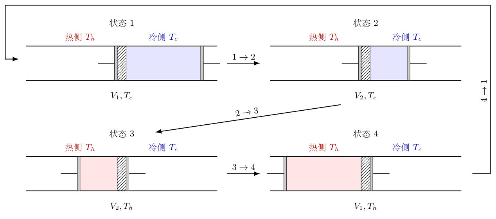{width=96%}

图中只有端点气体全部集中于一个腔体，故每个端点都可直接使用$n_0$摩尔气体的状态方程：

$$
\begin{aligned}
p_1&=\frac{n_0RT_c}{V_1},&
p_2&=\frac{n_0RT_c}{V_2},\\
p_3&=\frac{n_0RT_h}{V_2},&
p_4&=\frac{n_0RT_h}{V_1}.
\end{aligned}
$$

由$V_1>V_2$得$p_2>p_1,p_3>p_4$；由$T_h>T_c$得$p_3>p_2,p_4>p_1$。但$p_2$与$p_4$的高低取决于$\rho$和$T_h/T_c$，不能把某幅示意图上的排序当成额外条件。

（2）由几何约束证明换气过程的总活塞功为零。

设两个气缸的共同截面积为$S$。冷腔到热腔的换气中，两活塞均向左移动$dx>0$，热腔体积增加$Sdx$，冷腔体积减少$Sdx$，所以

$$
\begin{aligned}
dV_h&=Sdx,&dV_c&=-Sdx,\\
dV&=dV_h+dV_c=0,\\
\delta W_h+\delta W_c
&=p\,dV_h+p\,dV_c
=p\,dV=0.
\end{aligned}
$$

最后一步要求两腔压力相同；这是题给准静态约束。它不意味着各活塞都不做功，而是热侧正功与冷侧负功互相抵消。返程同理，总容积保持$V_1$，两活塞总功仍为零。若实际通道有不可忽略压差，或活塞面积、位移不符合约束，上述抵消不能原样使用。

（3）画出$p$—$V$路径，并说明竖线的物理含义。

$1\to2$在$T_c$下等温压缩，方程为$p=n_0RT_c/V$。$2\to3$保持总容积$V_2$，压力由$p_2$升至$p_3$。$3\to4$在$T_h$下等温膨胀，方程为$p=n_0RT_h/V$。$4\to1$保持总容积$V_1$，压力由$p_4$降至$p_1$。

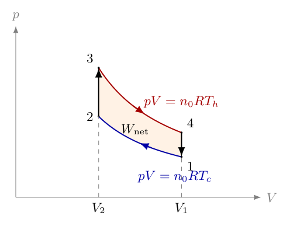{width=75%}

图7-3的横坐标是两腔气体占据的总容积，不是只取热腔容积。两条竖线表示总容积约束，即使其中气体尚分居两腔，仍可用共同压力$p$描述机械路径。此时$pV=n_0RT$若引入一个“等效温度”，它只是一种代数平均，不代表所有气体具有该统一温度。

（4）逐项积分两个等温过程的功和热。

压缩$1\to2$的积分限是$V_1$到较小的$V_2$：

$$
\begin{aligned}
W_{12}
&=\int_{V_1}^{V_2}\frac{n_0RT_c}{V}\,dV\\
&=n_0RT_c[\ln V]_{V_1}^{V_2}\\
&=n_0RT_c\ln\frac{V_2}{V_1}
=-n_0RT_c\ln\rho.
\end{aligned}
$$

等温内能不变，故$Q_{12}=W_{12}<0$，它是气体给低温源的热。其放热大小为$-Q_{12}=n_0RT_c\ln\rho$，不能把这个正的大小重新放进带符号的第一定律。

高温膨胀$3\to4$则为

$$
\begin{aligned}
W_{34}
&=\int_{V_2}^{V_1}\frac{n_0RT_h}{V}\,dV\\
&=n_0RT_h\ln\frac{V_1}{V_2}
=n_0RT_h\ln\rho,\\
Q_{34}&=W_{34}>0.
\end{aligned}
$$

两个换气支路总功为零，所以

$$
\boxed{W_{\rm net}
=n_0R(T_h-T_c)\ln\rho}.
$$

$\Delta T>0$且$\ln\rho>0$，因此净功为正，与顺时针图形一致。还可直接对两等温线的压力差积分：

$$
\int_{V_2}^{V_1}(p_h-p_c)\,dV
=n_0R\Delta T\int_{V_2}^{V_1}\frac{dV}{V}
=n_0R\Delta T\ln\rho.
$$

这一面积计算是对端点积分正负号的独立检验。

（5）求换气支路的净吸热，指出它尚不是供热分母。

整个气体始终为$n_0$摩尔，端点全部在冷侧或热侧。由于换气总功为零，整体第一定律给出

$$
\begin{aligned}
Q_{23}^{\rm net}
&=U_3-U_2
=n_0C_V(T_h-T_c),\\
Q_{41}^{\rm net}
&=U_1-U_4
=-n_0C_V(T_h-T_c).
\end{aligned}
$$

这里“净”表示两个外部热源给整个气体的热量之和；按修订条件，没有回热介质的储热贡献。若热源同时供热、放热，则$Q_{23}^{\rm net}=Q_{h,2}+Q_{c,2}$；不能仅凭$Q_{23}^{\rm net}>0$就断言其中高温热源单独供热等于这个数。

例如高温源供热$10$个能量单位、低温源同时吸收$3$个单位，气体净吸热只有$7$个单位。闭系统第一定律确定的是$7$，热机效率分母需要追踪高温源的净负担。两者只有在附加条件保证该阶段没有另一热源交换热时才相同。

（6）在无储热双腔模型中求换气的中间状态。

现在使用题干明确的两腔各自恒温、多孔塞不储热且无轴功、通道气体动能可忽略条件。冷向热转移时，冷端出口的摩尔焓$C_PT_c$到达热腔入口，随后在热腔热源作用下达到$T_h$。此处多孔塞的绝热含义是它本身不从外界取热，并不代表热腔和冷腔没有换热。

设某时刻热腔中气体占总摩尔数的比例为$f$，则$n_h=n_0f$、$n_c=n_0(1-f)$。在$2\to3$过程中$f$由$0$增加到$1$，且$V_h+V_c=V_2$。由各腔状态方程，

$$
\begin{aligned}
pV_h&=n_0fRT_h,\\
pV_c&=n_0(1-f)RT_c,\\
pV_2&=n_0R[T_c+f(T_h-T_c)].
\end{aligned}
$$

记$D(f)=T_c+f\Delta T$，逐一解出

$$
\begin{aligned}
p(f)&=\frac{n_0R D(f)}{V_2},\\
V_h(f)&=V_2\frac{fT_h}{D(f)},\\
V_c(f)&=V_2\frac{(1-f)T_c}{D(f)}.
\end{aligned}
$$

当$f=0$，$p=p_2,V_h=0$；当$f=1$，$p=p_3,V_c=0$，端点与第一步完全一致。中间的$p$对$f$线性，但$V_h$对$f$并不线性。图7-4示意两腔各占一半摩尔数；热腔体积仍较大，因为同压下摩尔体积正比于温度。

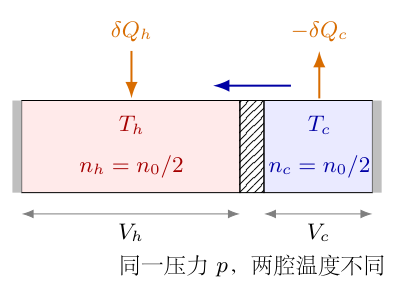{width=78%}

图中的$V_h,V_c$不是任意画出的等长区段，它们满足

$$
\frac{V_h}{V_c}
=\frac{n_hT_h}{n_cT_c};
\qquad f=\frac12\text{ 时， }
\frac{V_h}{V_c}=\frac{T_h}{T_c}.
$$

这条关系进入后面的活塞功积分，不能只用总容积不变略去各腔的体积变化。

（7）推导换气时单个热活塞的功。

用商法则求$V_h$的导数，保留分子各项：

$$
\begin{aligned}
\frac{dV_h}{df}
&=V_2T_h\frac{D(f)-f\Delta T}{D(f)^2}\\
&=V_2T_h\frac{T_c}{D(f)^2}.
\end{aligned}
$$

乘以$p(f)=n_0RD(f)/V_2$，得到

$$
p\frac{dV_h}{df}
=\frac{n_0RT_cT_h}{T_c+f\Delta T}.
$$

因此热活塞的正功为

$$
\begin{aligned}
W_{h,2}
&=\int_0^1 p(f)\frac{dV_h}{df}\,df\\
&=n_0RT_cT_h\int_0^1
\frac{df}{T_c+f\Delta T}\\
&=\frac{n_0RT_cT_h}{\Delta T}
\left[\ln(T_c+f\Delta T)\right]_0^1\\
&=\frac{n_0RT_cT_h}{\Delta T}
\ln\frac{T_h}{T_c}.
\end{aligned}
$$

第三行用线性变量替换$s=T_c+f\Delta T$，$ds=\Delta T\,df$。为避免与热量$Q$混淆，以下把该正功记为

$$
\mathcal B=\frac{n_0RT_cT_h}{\Delta T}
\ln\frac{T_h}{T_c}>0.
$$

冷活塞的功为$W_{c,2}=-\mathcal B$，所以总体功仍为零。返程走同样的组成变化但方向相反，总容积改为$V_1$；相同积分中总容积消去，故$W_{h,4}=-\mathcal B$、$W_{c,4}=+\mathcal B$。

（8）从流动能量建立两腔各自的第一定律。

对某一个腔体，摩尔数的变化记为$dn$，正号表示流入、负号表示流出。跨界气体带入的能量不是只有$C_VT\,dn$，还包含压送该气体穿过边界的压力功$RT\,dn$，二者相加为$C_PT\,dn$。

将腔体活塞对外功单独写为$p\,dV$，忽略动能和势能，则

$$
dU=\delta Q-p\,dV+h_{\rm flow}\,dn.
$$

若为流出，$dn<0$，最后一项自动表示能量减少。移项得到

$$
\delta Q=dU+p\,dV-h_{\rm flow}\,dn.
$$

腔体自身保持温度$T$不变，所以$dU=C_VT\,dn$。但$h_{\rm flow}$使用跨界气流实际温度，不能不加区分地写成该腔温度的$C_PT$。冷向热时气流来自冷腔，入口焓为$C_PT_c$；热向冷时来自热腔，入口焓为$C_PT_h$。

两腔相加后，流动焓项大小相同、符号相反，恰好抵消；于是恢复整个闭系统的第一定律。这是方程没有漏算或重复流动功的关键检查。

（9）分别计算冷向热转移阶段的高温供热与低温换热。

第二阶段热腔从无气体到$n_0$摩尔，$\Delta n_h=+n_0$，故$\Delta U_h=n_0C_VT_h$。热活塞功为$\mathcal B$，从冷端带入的总焓为$n_0C_PT_c$。代入上一项第一定律：

$$
\begin{aligned}
Q_{h,2}
&=n_0C_VT_h+\mathcal B-n_0C_PT_c\\
&=n_0C_V(T_h-T_c)-n_0RT_c+\mathcal B.
\end{aligned}
$$

冷腔失去$n_0$摩尔，$\Delta n_c=-n_0$，内能变化为$-n_0C_VT_c$，活塞功为$-\mathcal B$，流出总焓为$-n_0C_PT_c$。所以

$$
\begin{aligned}
Q_{c,2}
&=-n_0C_VT_c-\mathcal B-(-n_0C_PT_c)\\
&=n_0RT_c-\mathcal B.
\end{aligned}
$$

这里两次负号都必须保留：冷腔摩尔数减少，而第一定律中又需减去$h_{\rm flow}\Delta n_c$。两式相加得到

$$
Q_{h,2}+Q_{c,2}=n_0C_V\Delta T,
$$

恰好恢复整体净吸热。由于$\mathcal B>n_0RT_c$，$Q_{c,2}<0$，冷源在换气升压时仍吸收热；所以高温源供热$Q_{h,2}$大于净吸热。该不等式可由$\ln\theta>1-1/\theta$证明，其中$\theta=T_h/T_c>1$。

（10）计算热向冷返程的热量，不能把高温供热设为零。

第四阶段热腔失去全部气体：$\Delta U_h=-n_0C_VT_h$，活塞功$-\mathcal B$，流出总焓为$-n_0C_PT_h$。因此

$$
\begin{aligned}
Q_{h,4}
&=-n_0C_VT_h-\mathcal B-(-n_0C_PT_h)\\
&=n_0RT_h-\mathcal B.
\end{aligned}
$$

尽管循环这一支路总体降温，热腔在流出气体同时保持$T_h$仍需高温源供热。由$\ln\theta<\theta-1$可证$\mathcal B<n_0RT_h$，所以$Q_{h,4}>0$。

冷腔获得$n_0$摩尔，内能增加$n_0C_VT_c$，冷活塞对外功为$+\mathcal B$，流入总焓为$n_0C_PT_h$，于是

$$
\begin{aligned}
Q_{c,4}
&=n_0C_VT_c+\mathcal B-n_0C_PT_h\\
&=-n_0C_V\Delta T-n_0RT_h+\mathcal B.
\end{aligned}
$$

相加仍得$Q_{h,4}+Q_{c,4}=-n_0C_V\Delta T$。图7-5把两条换气支路的外部热流分别画出，后面的效率使用图中的$Q_{h,2}+Q_{h,4}$，不是把两个净热量代入分母。

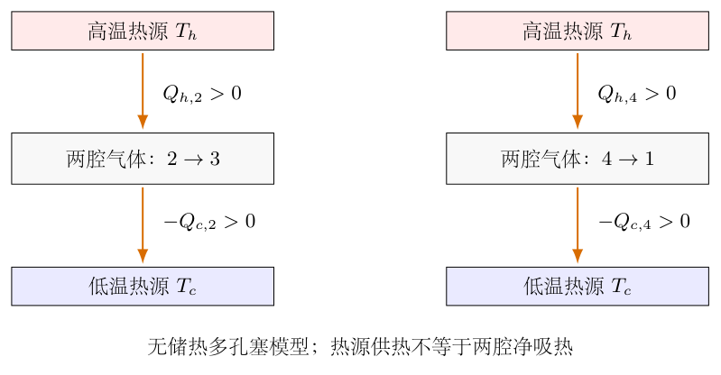{width=88%}

（11）合并高温热源净供热，得到无储热双腔效率。

把两个换气阶段的高温供热相加，$\mathcal B$消去：

$$
\begin{aligned}
Q_{h,2}+Q_{h,4}
&=n_0C_V\Delta T-n_0RT_c+\mathcal B
+n_0RT_h-\mathcal B\\
&=n_0(C_V+R)\Delta T\\
&=n_0C_P\Delta T.
\end{aligned}
$$

再加上高温等温膨胀供热，得

$$
Q_h^{(2)}
=n_0C_P\Delta T+n_0RT_h\ln\rho.
$$

故在无储热多孔塞、两腔分别恒温的模型中，

$$
\begin{aligned}
\eta_2
&=\frac{n_0R\Delta T\ln\rho}
{n_0C_P\Delta T+n_0RT_h\ln\rho}\\
&=\frac{\Delta T\ln\rho}
{(7/2)\Delta T+T_h\ln\rho}.
\end{aligned}
$$

即

$$
\boxed{\eta_2=
\frac{(T_2-T_1)\ln(V_1/V_2)}
{(7/2)(T_2-T_1)+T_2\ln(V_1/V_2)}}.
$$

低温源的循环净供热为$Q_c^{(2)}=-n_0RT_c\ln\rho-n_0C_P\Delta T$，因此

$$
Q_h^{(2)}+Q_c^{(2)}
=n_0R\Delta T\ln\rho=W_{\rm net}.
$$

与集中参数模型相比，多出的$n_0R\Delta T$不是额外的循环功，而是热量在两恒温腔及流动气体之间传递方式不同造成的高温源负担。二者共同的净功不能用来证明其供热量相同。

（12）检验单位、循环守恒、熵和极限。

功与热均由$n_0RT$乘无量纲对数或热容比构成，单位为焦耳；效率分子分母都是温度乘无量纲量，所以无量纲。$n_0$约去只表示理想模型的效率不随气量改变，不表示循环输出功与气量无关。

对于本题无储热双腔模型，高温源、低温源净热分别为
$Q_h=n_0RT_h\ln\rho+n_0C_P\Delta T$、
$Q_c=-n_0RT_c\ln\rho-n_0C_P\Delta T$。
气体循环熵变为零，所以热源总熵增为

$$
\begin{aligned}
\Delta S_{\rm sources}
&=-\frac{Q_h}{T_h}-\frac{Q_c}{T_c}\\
&=n_0C_P\Delta T
\left(\frac1{T_c}-\frac1{T_h}\right)\\
&=\frac{n_0C_P(\Delta T)^2}{T_cT_h}>0.
\end{aligned}
$$

等温热项在第二行消去，额外供热造成正的熵产生，因此本题效率严格小于$1-T_c/T_h$。这条检查针对同一组高、低温热源及题设换气条件，不依赖某一组数值巧合。

当$T_h\to T_c$且体积比保持大于一时，净功趋于零，效率趋于零；当$\rho\to1^+$且温差保持为正时，等温支路的功趋于零，而无储热换气仍有热源负担，效率也趋于零。若温差和体积比同时消失，须从未约分的热量与功判断退化过程，不将形式上的比值当作有输出的热机。

（13）从逐微元热量检查返程供热和不可逆性。

前面的热量是整个换气阶段的积分；现在检查每一小段，避免把正确总量误解成某些阶段“完全不换热”。冷向热时仍以$f=n_h/n_0$为变量，定义$D=T_c+f\Delta T$。将各腔内能、活塞功和入口焓都写成每单位$f$的变化量，得到

$$
\begin{aligned}
\frac{dQ_{h,2}}{df}
&=n_0(C_VT_h-C_PT_c)
+\frac{n_0RT_cT_h}{D},\\
\frac{dQ_{c,2}}{df}
&=n_0RT_c-\frac{n_0RT_cT_h}{D}.
\end{aligned}
$$

由于$T_c\leq D\leq T_h$，乘除的各温度均为正，所以

$$
n_0RT_c\leq\frac{n_0RT_cT_h}{D}\leq n_0RT_h.
$$

代回热腔式，在左端下界处先用$C_P=C_V+R$化简：

$$
\begin{aligned}
\frac{dQ_{h,2}}{df}
&\geq n_0(C_VT_h-C_PT_c+RT_c)
=n_0C_V\Delta T>0,\\
\frac{dQ_{h,2}}{df}
&\leq n_0(C_VT_h-C_PT_c+RT_h)
=n_0C_P\Delta T.
\end{aligned}
$$

同时$-n_0R\Delta T\leq dQ_{c,2}/df\leq0$。所以在冷向热的整个换气过程中，热源供热、冷源吸热；冷源换热仅在末端趋于零。两者相加始终为$n_0C_V\Delta T$，是前面整体内能变化的逐微元版本，而不是另一条不同的假设。

返程以$s$表示已经从热腔转入冷腔的摩尔数比例，$s$从$0$增到$1$，于是$n_h=n_0(1-s)$、$D_r=T_h-s\Delta T$。气体流出热腔的焓为$C_PT_h$，其活塞容积减少，因此

$$
\begin{aligned}
\frac{dQ_{h,4}}{ds}
&=n_0RT_h-\frac{n_0RT_cT_h}{D_r},\\
\frac{dQ_{c,4}}{ds}
&=-n_0C_V\Delta T-n_0RT_h
+\frac{n_0RT_cT_h}{D_r}.
\end{aligned}
$$

同一温度界给出$0\leq dQ_{h,4}/ds\leq n_0R\Delta T$，并有
$-n_0C_P\Delta T\leq dQ_{c,4}/ds\leq-n_0C_V\Delta T$。
热源在返程仍供热，冷源始终吸热；这不是只在某组数值中成立。两式相加为$-n_0C_V\Delta T$，与返程总内能降低完全一致。

还可以逐阶段检查熵产生。理想气体的摩尔熵在两状态间满足
$\Delta\bar S=C_P\ln(T_b/T_a)-R\ln(p_b/p_a)$；
式中对数都是温度比或压力比，不含有量纲的自变量。
冷向热的中间态是两个分别处于恒温的腔体，故应分别相加其熵，而不能给全部气体指定一个统一实际温度。对$f$求导：

$$
\frac{dS_{\rm gas,2}}{df}
=n_0C_P\ln\frac{T_h}{T_c}
-\frac{n_0R\Delta T}{D}.
$$

第一项来自摩尔数从冷侧转到热侧；第二项来自共同压力$p\propto D$改变。用两个恒温源的实际热量计算给气体的熵流：

$$
\frac1{T_h}\frac{dQ_{h,2}}{df}
+\frac1{T_c}\frac{dQ_{c,2}}{df}
=n_0C_P\left(1-\frac{T_c}{T_h}\right)
-\frac{n_0R\Delta T}{D}.
$$

令$\theta=T_h/T_c>1$，两式相减，压力变化项抵消：

$$
\frac{dS_{\rm gen,2}}{df}
=n_0C_P\left(\ln\theta-1+\frac1\theta\right)>0.
$$

正号可直接用积分证明：
$\ln\theta=\int_1^\theta du/u>(\theta-1)/\theta=1-1/\theta$。
返程同理，分别以$s$求气体熵和热源熵流，得到

$$
\begin{aligned}
\frac{dS_{\rm gas,4}}{ds}
&=-n_0C_P\ln\theta+\frac{n_0R\Delta T}{D_r},\\
\frac1{T_h}\frac{dQ_{h,4}}{ds}
+\frac1{T_c}\frac{dQ_{c,4}}{ds}
&=-n_0C_P(\theta-1)+\frac{n_0R\Delta T}{D_r},\\
\frac{dS_{\rm gen,4}}{ds}
&=n_0C_P(\theta-1-\ln\theta)>0.
\end{aligned}
$$

这里$\ln\theta<\theta-1$，因为积分区间上$1/u<1$。
两阶段分别在单位长度的$f,s$区间积分，得到

$$
\begin{aligned}
S_{\rm gen,2}+S_{\rm gen,4}
&=n_0C_P\left(\theta+\frac1\theta-2\right)\\
&=\frac{n_0C_P(T_h-T_c)^2}{T_cT_h}.
\end{aligned}
$$

它与上一项按整个循环热源账求出的熵产生完全相同；理想准静态等温支路不贡献额外熵产生。这同时核验了两次流动焓的温度选择、两个活塞功的符号和效率分母，不能只检验总净热。

（14）用一组数值逐阶段核对本题双腔模型。

取$n_0=1.00\,\mathrm{mol}$、$T_c=300\,\mathrm K$、$T_h=600\,\mathrm K$、$V_1=0.0240\,\mathrm{m^3}$、$V_2=0.0120\,\mathrm{m^3}$，并用$R\approx8.314462618\,\mathrm{J/(mol\,K)}$。此时$\rho=2$、$\ln2\approx0.693147$。两个等温过程为

$$
\begin{aligned}
W_{12}=Q_{12}
&\approx-1728.944\,\mathrm J,\\
W_{34}=Q_{34}
&\approx3457.888\,\mathrm J,\\
W_{\rm net}&\approx1728.944\,\mathrm J.
\end{aligned}
$$

双腔模型中$\mathcal B\approx3457.888\,\mathrm J$。依次代入四个换气热量式：

$$
\begin{aligned}
Q_{h,2}&\approx7199.396\,\mathrm J,&
Q_{c,2}&\approx-963.549\,\mathrm J,\\
Q_{h,4}&\approx1530.790\,\mathrm J,&
Q_{c,4}&\approx-7766.637\,\mathrm J.
\end{aligned}
$$

第二阶段净热$6235.847\,\mathrm J$、第四阶段净热$-6235.847\,\mathrm J$，正好等于$\pm n_0C_V\Delta T$。但高温源换气净供热为$8730.186\,\mathrm J$，等于$n_0C_P\Delta T$。故

$$
\begin{aligned}
Q_h^{(2)}&\approx12188.074\,\mathrm J,\\
Q_c^{(2)}&\approx-10459.130\,\mathrm J,\\
Q_h^{(2)}+Q_c^{(2)}&\approx1728.944\,\mathrm J,\\
\eta_2&\approx\frac{1728.944}{12188.074}
=0.141855.
\end{aligned}
$$

本题效率约为$14.19\%$，小于可逆上限$1-300/600=50.0\%$。三个热量账同时满足换气阶段第一定律、整个循环能量守恒及正熵产生；主解不再在同一道题中并列三个未加区分的最终答案。改变储热功能或改用单一温度容器，是另外的物理模型，下面再作有明确条件的对照。

## 六、关键洞察

模型对照一：集中参数等容替代过程的完整解答。

若将换气阶段替换为“全部气体在同一容器中从$T_c$均匀等容升温至$T_h$，只从高温源吸热；返程只向低温源放热”，则第二阶段供热就是$n_0C_V\Delta T$。这个模型保留四个端点及$p$—$V$轨迹，但不是自动等同于两个始终分别恒温的开腔换气细节。

该模型的循环高温供热为

$$
\begin{aligned}
Q_h^{(V)}
&=Q_{23}+Q_{34}\\
&=n_0C_V\Delta T+n_0RT_h\ln\rho.
\end{aligned}
$$

把完整分子、分母同时除以$n_0R$，并代入$C_V/R=5/2$：

$$
\begin{aligned}
\eta_V
&=\frac{n_0R\Delta T\ln\rho}
{n_0C_V\Delta T+n_0RT_h\ln\rho}\\
&=\frac{\Delta T\ln\rho}
{(5/2)\Delta T+T_h\ln\rho}.
\end{aligned}
$$

因此集中参数无回热模型的答案为

$$
\boxed{\eta_V=
\frac{(T_2-T_1)\ln(V_1/V_2)}
{(5/2)(T_2-T_1)+T_2\ln(V_1/V_2)}}.
$$

这是常用四支路斯特林简化计算的结果。使用它时必须写明第二、四阶段是上述集中参数等容热交换，不能同时声称已严格追踪原装置两腔各自的热量。

模型对照二：加入完全或部分回热器。

真正的理想回热器在热气返回冷侧时暂存能量，再在冷气进入热侧时将它返还，并在循环末恢复原有状态。绝热外壳不禁止内部固体暂存能量；反过来，仅写“绝热多孔塞”也不保证它具有足够的储热与放热能力。

在双腔流动模型中，完全回热使冷向热气流在进入热腔前已具有焓$C_PT_h$，热向冷气流在进入冷腔前降为$C_PT_c$。两次转移中回热器分别交出、收回$n_0C_P\Delta T$。据主解析第（8）步的同一开系统方程，

$$
\begin{aligned}
Q_{h,2}^{\rm reg}
&=Q_{h,2}-n_0C_P\Delta T
=\mathcal B-n_0RT_h,\\
Q_{h,4}^{\rm reg}
&=n_0RT_h-\mathcal B.
\end{aligned}
$$

所以两个换气阶段高温源的净交换为零；各阶段不必分别为零。冷源的两次转移净交换也为零。外部高温净供热只剩$n_0RT_h\ln\rho$，于是

$$
\boxed{\eta_{\rm reg}
=\frac{n_0R(T_h-T_c)\ln\rho}
{n_0RT_h\ln\rho}
=1-\frac{T_c}{T_h}}.
$$

达到这个极限还需传热温差、通道压降及其他不可逆损失可以忽略，不是任意带回热器的实际机器都自动达到。若用$\varepsilon$明确表示双腔流动焓需求中被回热器循环补回的比例，$0\leq\varepsilon\leq1$，且其他过程不变，则

$$
\eta_2(\varepsilon)
=\frac{\Delta T\ln\rho}
{T_h\ln\rho+(1-\varepsilon)(C_P/R)\Delta T}.
$$

同一个$\varepsilon$定义不能未经说明转用于集中参数模型；集中参数模型对应被回收的基准热量为$n_0C_V\Delta T$，而非上述流动焓量。

循环轨迹确定机械功，但不能独立确定热量由哪个热源提供。竖直支路没有总体积功，只能推出整体净热等于内能变化；两腔分别恒温时仍可同时发生高温供热和低温放热。把单一温度状态方程用于中间混合温度状态，会在机械轨迹上似乎正确，却在热流归属上出错。

流动焓的$RT$项来源于压力推送，不是因为本过程“定压”才出现。各腔压力实际上随换气变化，但理想气体的摩尔焓仍为$C_PT$。若把开系统只写成$dU=\delta Q-pdV+C_VT\,dn$，会少掉入口或出口的压力流动功，往返合并后恰好丢失$n_0R\Delta T$。

可以不用摩尔比例$f$，改以热腔容积$v$求共同压力。由$n_0=n_h+n_c$及各腔状态方程，

$$
\begin{aligned}
n_0
&=\frac{pv}{RT_h}
+\frac{p(V_2-v)}{RT_c},\\
p(v)
&=\frac{n_0R}
{v/T_h+(V_2-v)/T_c}.
\end{aligned}
$$

用$p(v)$直接积分$\int_0^{V_2}p(v)\,dv$，令分母为新变量，仍得
$\mathcal B=n_0RT_cT_h\ln(T_h/T_c)/\Delta T$。
这条不同参数路线检验了此前活塞功积分；同时显示共同压力是容积加权倒温度形式，不是按两腔几何长度简单取算术平均。

两条常用对数不等式可独立验证换气热流方向。取$\theta>1$，由
$\ln\theta=\int_1^\theta dx/x$，
被积函数在区间上严格位于$1/\theta$与$1$之间，故

$$
1-\frac1\theta<\ln\theta<\theta-1.
$$

左式给出$\mathcal B>n_0RT_c$，右式给出$\mathcal B<n_0RT_h$。因此冷向热转移时冷源仍吸热，热向冷返程时热源仍供热；两种方向不靠某组数值巧合确定。

回热器的正确作用应以循环能量账验证。它本身周期末内能应回到原值，不能每个循环无偿提供能量。完全回热时两次转移从热源取热和向热源还热可互相抵消，但每一支路未必与热源完全断热。以循环净高温热量为效率分母时，要保持同一热源的代数记账，不把回热器交给气体的内部能量再算作外部供热。

## 七、易错点

温度标记应先统一为$T_h>T_c$。若把热腔温度写成$T_1$、冷腔写成$T_2$而仍要求$T_2>T_1$，循环方向与物理定义冲突。返程气体必须由热侧回冷侧，否则不构成闭合循环。

等温压缩的功为负，放热大小为正；二者不能在同一个带符号公式中不加区分地混用。$\ln(V_2/V_1)=-\ln(V_1/V_2)$，漏掉这个负号会把净功错误写成两个正功相加。

两等面积活塞同步移动只使总容积不变，不使两腔分别容积不变，也不使每个活塞功为零。只有共同压力下两个功的代数和为零。若只记录热侧活塞而不记录冷侧，循环能量会多出$\mathcal B$。

“绝热”可以描述多孔塞对外界不取热，不能据此把两腔壁与热源的热交换也删掉。“回热器”是一种功能名称，还需给出储热是否有效、周期是否恢复，以及气流离开时的温度。无储热塞、部分回热及完全回热对应不同效率，不可混用。

手头若只有$p$—$V$图，能求净功却未必能求效率。用$n_0C_V\Delta T$作分母附项时须明确均匀温度等容模型；用$n_0C_P\Delta T$时须明确两腔开系统、无储热及流动能量条件。两种量纲都正确，量纲检查本身不能发现供热归属错误。

完全回热达到卡诺极限还要求可逆传热和无机械、流动损失；有限温差、摩擦、死体积和有限通道压降通常使效率下降。体积比趋于一时，虽可形式上保留理想回热效率极限，实际输出功同时趋于零，不能把高效率与大输出混为一谈。

## 八、课堂讲解建议

课堂先完成机械循环，不急于讲回热效率。教师让学生逐个指出图7-2的气体在哪个腔、总体积是多少、端点温度是多少，再用四个状态方程给$p$—$V$图定点。板书特别保留“$p_2$和$p_4$不一定谁大”的条件，避免照着示意图背压力排序。

随后让学生把两个活塞位移投影到同一正方向，先算$dV_h+dV_c$，再分别写$p\,dV_h,p\,dV_c$。教师可用两个等量相反的功箭头解释为什么每个活塞都可能做功，但系统总体积功为零。这一步是理解后续分腔热量的前提。

讲热效率时，课堂应先建立一张独立的热源能量账。教师给出“高温供热10、低温吸热3、气体净吸热7”的数值，让学生说明效率分母不能直接取7，再对应图7-5。本题以逐腔能量账作为主线；集中参数模型作为改变条件后的对照，并解释它为何不能代替两腔流动细节。

开系统焓流适合按“内能加入口压力功”逐项建立，教师先画腔体边界，并标出摩尔数流入、流出与活塞位移。板书使用$dn$的带符号形式，对热腔及冷腔各写一次第一定律，再相加恢复闭系统结果。这样学生有可操作的核验方法，不需要凭记忆选择$C_V$或$C_P$。

最后把三种效率并列，并要求学生用熵增与循环守恒说明排序。课堂变式应先说明采用哪种热学模型，否则同一组参数可得到不同的正确条件式。回热讲解强调“往返存取并恢复”，不把绝热外壳当作能够无限供能的热源。

## 九、变式训练

变式一：在无储热双腔模型中，某换气中间态满足$n_h=n_c=n_0/2$，$T_h=600\,\mathrm K$、$T_c=300\,\mathrm K$、$n_0=1\,\mathrm{mol}$、总容积$0.0120\,\mathrm{m^3}$。求两腔体积和共同压力。

完整解答：同压下各腔满足$V_h/V_c=n_hT_h/(n_cT_c)=2$，并且$V_h+V_c=0.0120\,\mathrm{m^3}$。因此

$$
V_h=0.00800\,\mathrm{m^3},\qquad
V_c=0.00400\,\mathrm{m^3}.
$$

共同压力可分别由任何一个腔计算：

$$
\begin{aligned}
p
&=\frac{(0.5)R(600)}{0.00800}
=\frac{(0.5)R(300)}{0.00400}\\
&\approx3.11792\times10^5\,\mathrm{Pa}.
\end{aligned}
$$

用全部气体的代数平均温度$450\,\mathrm K$代入$pV=n_0RT$可得到相同压力，但它不能证明两个腔都处于$450\,\mathrm K$。两侧温度分别仍为$600$与$300\,\mathrm K$，热流归属也须分别计算。

变式二：采用双腔流动模型，主解析数值参数不变。回热器补回流动焓需求的比例为$\varepsilon=1/2$。求效率并与无回热及完全回热比较。

完整解答：循环净功仍为$1728.944\,\mathrm J$。剩余换气供热为$(1-\varepsilon)n_0C_P\Delta T=4365.093\,\mathrm J$，所以

$$
\begin{aligned}
Q_h
&\approx3457.888+4365.093
=7822.981\,\mathrm J,\\
\eta
&\approx\frac{1728.944}{7822.981}
\approx0.221008.
\end{aligned}
$$

故$\eta\approx22.10\%$，介于无回热双腔的$14.19\%$与理想完全回热的$50.0\%$之间。这里补回的是$C_P$对应的流动焓需求，不能再把同一个定义的$\varepsilon$套进含$C_V$的集中参数式。

变式三：仍用上述双腔模型及温度、体积比，要求效率至少$30.0\%$。回热器补回比例$\varepsilon$至少是多少？

完整解答：记$W=1728.943896\,\mathrm J$、$Q_{34}=3457.887793\,\mathrm J$、$H=n_0C_P\Delta T=8730.185749\,\mathrm J$。分母为$Q_{34}+(1-\varepsilon)H$且为正，故不等式变形时方向不变：

$$
\begin{aligned}
\frac{W}{Q_{34}+(1-\varepsilon)H}
&\geq0.300,\\
Q_{34}+(1-\varepsilon)H
&\leq\frac{W}{0.300},\\
1-\varepsilon
&\leq\frac{W/0.300-Q_{34}}{H},\\
\varepsilon
&\geq1-\frac{W/0.300-Q_{34}}{H}
\approx0.735944.
\end{aligned}
$$

所以至少补回约$73.59\%$的相应流动焓需求。该值位于$[0,1]$，目标效率也低于$50\%$的可逆极限，因而在理想化模型中可以实现；真实机器若还有损失，需要更高的回热性能或其他改进。

<!-- KEEP_TOGETHER_START -->

变式四：无回热双腔模型保持$T_c,T_h$固定，$C_P/R=a>0$。证明效率随体积比$\rho$单调增加，并给出其极限，同时说明为什么不能靠$\rho$无限增加实际功率。

完整解答：令$x=\ln\rho>0$，则

$$
\eta(x)=\frac{\Delta T\,x}{T_hx+a\Delta T}.
$$

对$x$使用商法则：

$$
\begin{aligned}
\frac{d\eta}{dx}
&=\frac{\Delta T(T_hx+a\Delta T)
-\Delta T\,xT_h}{(T_hx+a\Delta T)^2}\\
&=\frac{a(\Delta T)^2}
{(T_hx+a\Delta T)^2}>0.
\end{aligned}
$$

又因$dx/d\rho=1/\rho>0$，所以$\eta$随$\rho$单调增加。把分子分母同除以$x$，得到

$$
\lim_{\rho\to\infty}\eta
=\frac{\Delta T}{T_h}
=1-\frac{T_c}{T_h}.
$$

对任意有限$\rho$，分母的$a\Delta T$仍为正，所以效率严格低于此极限。该结果只涉及每循环热量与功的比值；实际功率还取决于循环频率、换热速率、允许压力、摩擦及死体积。准静态假设不提供任意快的循环速度，不能由效率极限推出无限功率。

<!-- KEEP_TOGETHER_END -->

<!-- question-complete -->

\newpage

# 第8题

<!-- question-start -->

在三角形$ABC$的三个顶点分别坐有一人，三人到火锅内一点$O$的伸筷长度之和用$AO+BO+CO$表示。

（1）点$O$可以在三角形区域内自由选择。确定使$AO+BO+CO$最小的点的位置，可以用角度关系描述，并用物理方法说明理由。

（2）在三角形内设置一条线段支架$AD$，其中$D$位于边$BC$的内部，点$O$只能在线段$AD$上移动。求最短总长度所对应的角$\alpha=\angle BOD$、$\beta=\angle COD$需要满足的三角函数条件。

（3）设$ABC$为正三角形，且$\angle BAD=15^\circ$。用计算器求满足第（2）问要求的角度。

三角形非退化。第（1）问先讨论最优点位于内部的情形，再说明大角和边界情形；第（2）问的角度只在$O$不与$A,D$重合时定义，端点必须另外筛选。

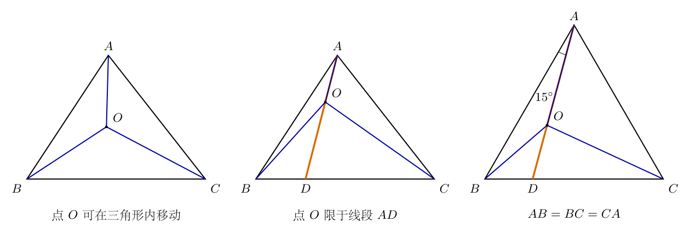{width=100%}

<!-- question-end -->

## 一、题型定位

本题是距离和的极小值问题，同时可以转化为等大绳张力的平衡问题。三条距离不是沿同一直线的三个标量；移动$O$时，它们的变化分别取决于该移动在三条连线方向上的投影。将距离和当作势能，或者直接求距离的方向导数，都会得到同一个平衡条件。

两种选点方式的差别是允许的位移不同。第（1）问允许在平面内沿任意方向移动，两个方向的一阶变化都必须为零；第（2）问只允许沿$AD$移动，因此只要求沿支架方向的一阶变化为零。支架可以承担垂直方向的力，不可把有支架的平衡也写成只有三条等大张力的平衡。

第（3）问除了列方程，还要证明求到的数值确实是线段上的最小值。必须检查角度的几何范围、两端点的一侧导数，以及中间解是否唯一。仅给出$34.1^\circ$而不说明这些筛选，不能排除错误分支或边界解。

## 二、知识点

对固定点$X$，距离$r_X=|\boldsymbol r-\boldsymbol r_X|$的梯度为$(\boldsymbol r-\boldsymbol r_X)/r_X$。梯度方向由$X$指向动点，恰与绳子对动点的拉力方向相反。这个符号必须在使用势能和受力两种方法时保持一致。

设动点沿单位方向$\boldsymbol u$位移$ds$。距离的一阶变化是两点连线在该方向上的投影，写成$dr_X/ds=(\boldsymbol r-\boldsymbol r_X)\cdot\boldsymbol u/r_X$。如果$\theta$是由动点指向$X$的方向与$\boldsymbol u$的夹角，那么$dr_X/ds=-\cos\theta$；向固定点靠近时，距离减少，这正是负号的物理含义。

三条等大、共点、在同一平面内的力平衡时，其方向两两相差$120^\circ$。这个结论来自矢量和为零，不是“有三条线便均分周角”。如果存在第四个支架反力，或者三条力大小不等，角度一般不再是$120^\circ$。

一个函数的导数为零只给出驻点。若在区间内二阶导数严格为正，导数便严格递增，区间内至多有一个驻点；再结合端点的一侧导数，可以判断该点是唯一最小值，或最小值落在端点。距离和的凸性为本题提供了这一判断依据。

正弦定理适用于每一个实际三角形：边长除以其对角的正弦相等。代入前必须先确定哪条边与哪一个角相对。第（3）问中$\angle ADB=105^\circ$、$\angle ADC=75^\circ$，这两个角在直线上互补，不能因为图画得倾斜而交换。

## 三、物理图像

图8-1的三幅题图依次区分自由区域、支架约束和正三角形条件。橙色线段是真实允许位置$AD$，蓝色三条连线表示计入距离和的$AO,BO,CO$；后两幅中的$O$必须位于$AD$上，不能沿其他蓝线移动。

可以把三条距离换成水平板上三条绳段的长度。三根轻绳在动点$O$打结，分别通过固定于$A,B,C$的光滑小孔，再在板下各悬挂质量为$m$的物体。每根绳总长固定，板上绳段越短，对应的板下绳段就越长，悬物位置越低，重力势能越小。

这个模型只用于建立势能和静力平衡的等价关系。理想无阻尼装置从任意初态释放后未必自动停在最低点，因此不能把“最后停在哪里”作为不加条件的证明。应考察稳定平衡位置；若要通过实验寻找该位置，可引入很弱的阻尼，而不改变平衡的几何条件。

图8-2的板下竖直绳段与板上斜绳段在三个小孔处相连。虚线只表示绳段被板遮住，不是板面内多加的一条绳。三个悬物质量相同，因此平衡时三个张力都等于$mg$，不要求三根绳的总长度相同。

受限模型仍有三根绳，却多了一条无摩擦支架。图8-6中的反力$\boldsymbol R$垂直$AD$，沿$AD$没有分量。于是自由点的二维矢量平衡，变成支架方向上的一维投影平衡。

## 四、解题入口

先建立重力势能与$AO+BO+CO$之间的对应，说明为什么最短总长度对应最低势能。接着对自由点列三条张力的矢量平衡，得到$120^\circ$，并补充该条件何时能在三角形内部实现。用一次$60^\circ$旋转把三段长度接成折线，还可以从三角不等式直接证明全局最小。

对受限点，不必求支架反力的大小便能先求位置。选从$A$指向$D$为正方向：向$D$移动时$AO$增加，而$BO,CO$的变化由$\cos\alpha,\cos\beta$决定。写出一阶变化为零的条件，再用几何关系补足角度方程。

最后针对正三角形建立沿$AD$的单一坐标$s=AO$，把三条距离全部写成$s$的函数。这个坐标方法既可直接数值求根，也能检验正弦定理所得两角方程，并清楚处理两端点和唯一性。

## 五、解析

（1）将最短总长度严格转化为最低重力势能。

记三条绳总长度为$L_A,L_B,L_C$，三个固定导向位置的高度相同。忽略小孔内不随$O$变化的绳长，板下悬挂长度分别为

$$
\begin{aligned}
h_A&=L_A-AO,\\
h_B&=L_B-BO,\\
h_C&=L_C-CO.
\end{aligned}
$$

取竖直向上的高度为正，三个悬物高度可写成$z_A=z_0-h_A$、$z_B=z_0-h_B$、$z_C=z_0-h_C$。图8-2展示了这一空间连接，板上每减短一段绳，板下就增加同样的长度。

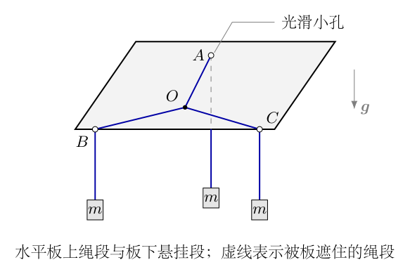{width=65%}

由图中的三个等质量悬物，总重力势能为

$$
\begin{aligned}
U_g
&=mg(z_A+z_B+z_C)\\
&=mg\bigl[3z_0-(h_A+h_B+h_C)\bigr]\\
&=mg\bigl[3z_0-(L_A+L_B+L_C)
 +(AO+BO+CO)\bigr]\\
&=U_0+mg(AO+BO+CO).
\end{aligned}
$$

$U_0$不随$O$改变，$mg>0$，所以两者的最小位置完全相同。这里的正号不是任意指定：距离变长时，悬物上升，势能增加；距离变短时，悬物下降，势能减少。绳长只需足够容许所研究的移动范围，固定绳长的具体数值不进入最优点条件。

（2）对自由内部点列矢量平衡，推出三角度均为$120^\circ$。

令$\boldsymbol e_A,\boldsymbol e_B,\boldsymbol e_C$分别为从$O$指向$A,B,C$的单位矢量。三个悬物静止时，每根绳的张力大小为$G=mg$。板对结点的竖直支持抵消其他竖直作用，板面内只剩三条绳的拉力，如图8-3所示。

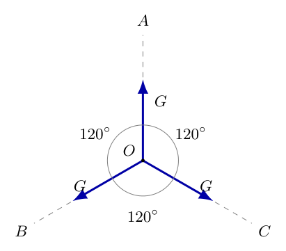{width=50%}

平衡方程除以非零的$G$，得到

$$
\boldsymbol e_A+\boldsymbol e_B+\boldsymbol e_C=0.
$$

将前两项移到一起并取模平方：

$$
\begin{aligned}
\boldsymbol e_A+\boldsymbol e_B&=-\boldsymbol e_C,\\
|\boldsymbol e_A+\boldsymbol e_B|^2&=|\boldsymbol e_C|^2,\\
|\boldsymbol e_A|^2+|\boldsymbol e_B|^2
 +2\boldsymbol e_A\cdot\boldsymbol e_B&=1,\\
2+2\cos\angle AOB&=1,\\
\cos\angle AOB&=-\frac12,\\
\angle AOB&=120^\circ.
\end{aligned}
$$

交换$A,B,C$的地位，同样得到$\angle BOC=\angle COA=120^\circ$。因此内部最优点满足

$$
\boxed{\angle AOB=\angle BOC=\angle COA=120^\circ.}
$$

反过来，三个单位方向彼此相差$120^\circ$时，它们的矢量和为零，故该角度条件也足以保证一阶平衡。接下来仍须证明它不是极大值或鞍点，以及该内部位置是否存在。

（3）由距离的支持不等式证明内部平衡点是全局最小值。

记距离和为$F(P)=PA+PB+PC$。对任意固定顶点$X$，以及不与$X$重合的候选点$O$，把$\boldsymbol v_X=(O-X)/OX$作为由$X$指向$O$的单位矢量。任意矢量的模不小于它在单位方向上的投影，因此

$$
\begin{aligned}
PX=|P-X|
&\geq\boldsymbol v_X\cdot(P-X)\\
&=\boldsymbol v_X\cdot(O-X)
 +\boldsymbol v_X\cdot(P-O)\\
&=OX+\boldsymbol v_X\cdot(P-O).
\end{aligned}
$$

这里使用柯西不等式的投影形式，不是对距离作近似展开。对$X=A,B,C$相加：

$$
F(P)\geq F(O)
 +(\boldsymbol v_A+\boldsymbol v_B+\boldsymbol v_C)
 \cdot(P-O).
$$

由于$\boldsymbol v_X=-\boldsymbol e_X$，平衡条件使括号内的矢量为零，因而$F(P)\geq F(O)$。这对任意$P$成立，所以平衡点给出全局最小，而不只是附近最小。

等号要求对三个顶点分别满足投影等号，即$P-X$都与$O-X$同向。若$P\ne O$，这会要求三个不共线顶点同时位于同一条直线上，非退化三角形不可能满足。因此内部最优点唯一。这个结论也是距离和严格凸性的具体体现。

（4）说明$120^\circ$结论的适用范围与边界情形。

若某一顶角，例如$\angle BAC=\Theta$，达到或超过$120^\circ$，最短点在$A$，不能再要求一个内部点形成三个$120^\circ$。下面不依赖图形猜测，直接证明这一点。

设$\boldsymbol a_B=(B-A)/AB$、$\boldsymbol a_C=(C-A)/AC$，任意$P$相对于$A$的位移为$\boldsymbol d=P-A$。对$PB,PC$分别使用距离的支持不等式，得

$$
\begin{aligned}
PB&\geq AB-\boldsymbol a_B\cdot\boldsymbol d,\\
PC&\geq AC-\boldsymbol a_C\cdot\boldsymbol d,\\
F(P)&\geq AB+AC+|\boldsymbol d|
 -(\boldsymbol a_B+\boldsymbol a_C)\cdot\boldsymbol d\\
&\geq AB+AC+
 \bigl(1-|\boldsymbol a_B+\boldsymbol a_C|\bigr)|\boldsymbol d|.
\end{aligned}
$$

两个单位矢量夹角为$\Theta$，所以

$$
\begin{aligned}
|\boldsymbol a_B+\boldsymbol a_C|^2
&=2+2\cos\Theta
=4\cos^2\frac\Theta2,\\
|\boldsymbol a_B+\boldsymbol a_C|
&=2\cos\frac\Theta2.
\end{aligned}
$$

当$\Theta\geq120^\circ$，有$2\cos(\Theta/2)\leq1$，故$F(P)\geq AB+AC=F(A)$。当$\Theta>120^\circ$时，只要$P\ne A$，下界就严格大于$F(A)$；等于$120^\circ$时，仍由三个顶点不共线及前面的等号条件得到唯一最小点$A$。

若三个顶角均小于$120^\circ$，在每个顶点都能沿相邻两边单位方向的和移动，使距离和减少，因此顶点不可能最优。边的内部点也不可能最优：向三角形内部作一个垂直于该边的微小移动，到该边两个端点的距离只产生二阶增加，而到对面顶点的距离产生一阶减少。闭三角形上的连续距离和必有最小值，排除全部边界后，最小值必在内部，于是满足三个$120^\circ$。

所以第（1）问的完整结论是：最大顶角小于$120^\circ$时，唯一内部费马点满足三个$120^\circ$；最大顶角不小于$120^\circ$时，最小点是该大角顶点。如果“内部”被严格解释为不包含边界，那么后一种情况下不能取到最小值，只能通过趋近该顶点得到下确界$AB+AC$。

（5）补全$60^\circ$旋转几何法，保留其最短折线依据。

将图置于$A$在$BC$上方的方向，绕$B$顺时针旋转$60^\circ$，把$O,C$分别变成$O^*,C^*$。旋转保持长度，且$\triangle BOO^*$是正三角形，所以$OO^*=BO$，同时$O^*C^*=OC$。图8-4以正三角形示意这一连接；旋转等距关系本身对一般三角形也成立。

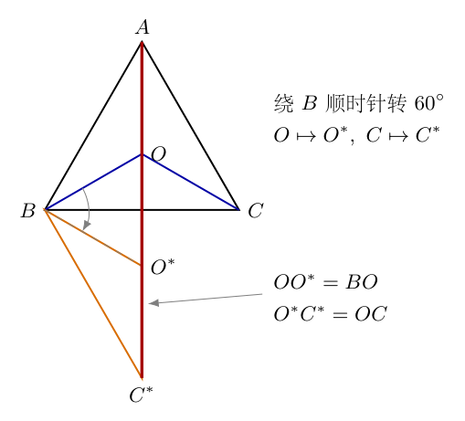{width=67%}

因此原来的距离和成为折线$A\to O\to O^*\to C^*$的长度：

$$
\begin{aligned}
AO+BO+CO
&=AO+OO^*+O^*C^*\\
&\geq AC^*.
\end{aligned}
$$

这里连续使用三角不等式。等号要求$A,O,O^*,C^*$按该次序共线，不能只说“四点在同一直线上”而不检查先后顺序。内部费马点的$120^\circ$条件恰使折线拉直：正三角形$BOO^*$在$O$处提供$60^\circ$，与$\angle AOB=120^\circ$互补；旋转后的$120^\circ$条件又使$O^*C^*$接着沿同一直线延伸。

于是内部可行时达到下界$AC^*$。大角不小于$120^\circ$时，这条直线构造不能在三角形内部给出所需次序，应改用上一段的顶点解，不能把不可行的折线等号继续当作内部答案。

（6）对受限点建立支架方向的长度变化和张力投影。

令$\boldsymbol u$沿$A\to D$，取$s=AO$，因此$O=A+s\boldsymbol u$，且$0<s<AD$。沿支架向$D$移动$ds>0$时，$AO$精确增加$ds$。另外两段的变化不是直接减去$ds$，而是连线投影给出的$-\cos\alpha\,ds$和$-\cos\beta\,ds$。故

$$
\begin{aligned}
\frac{d(AO)}{ds}&=1,\\
\frac{d(BO)}{ds}&=-\cos\alpha,\\
\frac{d(CO)}{ds}&=-\cos\beta,\\
F'(s)&=1-\cos\alpha-\cos\beta.
\end{aligned}
$$

在内部最小点，一阶导数为零，得到第（2）问所需条件

$$
\boxed{\cos\alpha+\cos\beta=1.}
$$

同一条件可从图8-6的受力投影得到。$OA$方向的张力沿$-\boldsymbol u$，贡献$-G$；$OB,OC$方向贡献$G\cos\alpha,G\cos\beta$；支架反力垂直$\boldsymbol u$，贡献为零。因而$-G+G\cos\alpha+G\cos\beta=0$。这里即使某角为钝角，也应保留其余弦的负值，而不擅自用绝对值改成正数。

（7）证明受限距离和严格凸，并筛选线段端点。

对$X=B$或$C$，记$p_X=(X-A)\cdot\boldsymbol u$，记$h_X$为$X$到直线$AD$的垂距。勾股分解给出

$$
r_X(s)=\sqrt{(s-p_X)^2+h_X^2}.
$$

逐次求导并通分，得到

$$
\begin{aligned}
r_X'(s)&=\frac{s-p_X}{r_X(s)},\\
r_X''(s)
&=\frac{r_X(s)-(s-p_X)r_X'(s)}{r_X^2(s)}\\
&=\frac{r_X^2(s)-(s-p_X)^2}{r_X^3(s)}\\
&=\frac{h_X^2}{r_X^3(s)}.
\end{aligned}
$$

$D$位于$BC$内部且三角形非退化，故$B,C$均不在$AD$直线上，$h_B,h_C>0$。$AO=s$的二阶导数为零，于是

$$
F''(s)=\frac{h_B^2}{BO^3}+\frac{h_C^2}{CO^3}>0.
$$

因此$F'(s)$严格递增。令$\phi=\angle BAD$、$\psi=\angle CAD$，从$A$端朝支架内部移动的一侧导数为

$$
F'(0^+)=1-\cos\phi-\cos\psi.
$$

到达$D$的极限中，由$D$指向$B,C$的单位方向互相相反，其在$\boldsymbol u$方向的投影和为零；$AO$项仍贡献$1$，故$F'(AD^-)=1>0$。由单调性得：若$F'(0^+)<0$，线段内部存在且只存在一个导数零点，它就是唯一最小点；若$F'(0^+)\geq0$，最小点在$A$，不能再使用未定义的$\angle BOD,\angle COD$来描述它。

这个判断还说明，在$D$位于$BC$内部的本题条件下，$D$不是最小点。若把$D$改成$B$或$C$，垂距和距离的可微性发生变化，必须重新处理该特殊情形，不能直接沿用以上严格凸证明。

（8）建立正三角形中的真实角度关系。

设正三角形边长为$a$。图8-5中$\angle BAC=60^\circ$、$\angle BAD=15^\circ$，所以$\angle DAC=45^\circ$。在$\triangle ABD$中，$\angle ABD=60^\circ$，由内角和得$\angle ADB=105^\circ$。由于$B,D,C$共线，另一侧角$\angle ADC=180^\circ-105^\circ=75^\circ$。

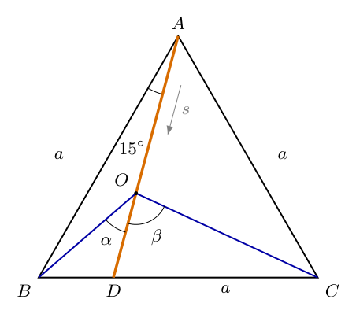{width=62%}

现在令图中$\alpha=\angle BOD$、$\beta=\angle COD$。因为$A,O,D$依次共线，$OA$与$OD$方向相反，所以$\angle AOB=180^\circ-\alpha$、$\angle AOC=180^\circ-\beta$。在$\triangle BOD$和$\triangle COD$内分别计算剩余角：

$$
\begin{aligned}
\angle OBD&=180^\circ-105^\circ-\alpha
=75^\circ-\alpha,\\
\angle OCD&=180^\circ-75^\circ-\beta
=105^\circ-\beta.
\end{aligned}
$$

从$A$端趋近时，$\alpha\to15^\circ$、$\beta\to45^\circ$；沿线段向$D$移动，它们分别增大至$75^\circ$和$105^\circ$。因此内部可行角必须满足

$$
15^\circ<\alpha<75^\circ,\qquad
45^\circ<\beta<105^\circ.
$$

这些范围既保证有关三角形非退化，也限定了反三角函数的正确分支。

（9）逐项使用正弦定理，补足两角方程。

在$\triangle AOB$中，$OB$对角为$15^\circ$，$AB=a$对角为$180^\circ-\alpha$。利用$\sin(180^\circ-\alpha)=\sin\alpha$，得到

$$
\frac{OB}{\sin15^\circ}
=\frac{a}{\sin\alpha}
\quad\Longrightarrow\quad
OB=\frac{a\sin15^\circ}{\sin\alpha}.
$$

在$\triangle AOC$中同理，$OC$对角为$45^\circ$，$AC=a$对角为$180^\circ-\beta$，故

$$
OC=\frac{a\sin45^\circ}{\sin\beta}.
$$

再转到$\triangle BOC$：$OB$对角是$\angle BCO=105^\circ-\beta$，$OC$对角是$\angle CBO=75^\circ-\alpha$。正弦定理给出

$$
\frac{OB}{\sin(105^\circ-\beta)}
=\frac{OC}{\sin(75^\circ-\alpha)}.
$$

代入上面两条边长式并约去非零边长$a$，得

$$
\boxed{
\frac{\sin15^\circ}
{\sin\alpha\sin(105^\circ-\beta)}
=\frac{\sin45^\circ}
{\sin\beta\sin(75^\circ-\alpha)}.}
$$

这是几何相容条件；$\cos\alpha+\cos\beta=1$是最短条件。两式必须同时满足，只有后一式不能决定两个角。所有分母在可行角范围内均为正，故交叉相乘没有遗漏分母为零的内部解。求根过程中若用平方消去根号，则必须回代两条原式和角度范围，排除平方引入的伪根。

（10）用单一坐标重建方程，独立核验角度求根。

取$B=(0,0)$、$C=(a,0)$、$A=(a/2,\sqrt3a/2)$。从$A$沿$AD$的单位方向为

$$
\boldsymbol u=(-\sin15^\circ,-\cos15^\circ).
$$

它的横分量为负，说明支架向左下方倾斜；不能仅画一条任意向下的线段。点$O$的坐标由$O=A+s\boldsymbol u$给出：

$$
x_O=\frac a2-s\sin15^\circ,\qquad
y_O=\frac{\sqrt3a}{2}-s\cos15^\circ.
$$

令$D$的纵坐标为零，得到线段长度和底边分点

$$
\begin{aligned}
AD&=\frac{\sqrt3a}{2\cos15^\circ}
=0.8965754722a,\\
BD&=\frac a2-\frac{\sqrt3a}{2}\tan15^\circ\\
&=\frac a2-\frac{\sqrt3a}{2}(2-\sqrt3)\\
&=(2-\sqrt3)a.
\end{aligned}
$$

这里利用$\tan15^\circ=\tan(45^\circ-30^\circ)=2-\sqrt3$，并展开$\sqrt3(2-\sqrt3)=2\sqrt3-3$。$BD\approx0.267949a$，确在底边内部。

距离平方可以从坐标直接展开，也可从余弦定理得到。保留每条线段与$s$的夹角后，有

$$
\begin{aligned}
AO&=s,\\
BO&=\sqrt{s^2-2as\cos15^\circ+a^2},\\
CO&=\sqrt{s^2-2as\cos45^\circ+a^2},\\
F(s)&=s+\sqrt{s^2-2as\cos15^\circ+a^2}
 +\sqrt{s^2-2as\cos45^\circ+a^2}.
\end{aligned}
$$

逐项求导：根号内导数分别为$2s-2a\cos15^\circ$、$2s-2a\cos45^\circ$，再除以对应的两倍根号，得

$$
\begin{aligned}
F'(s)=1
&+\frac{s-a\cos15^\circ}
 {\sqrt{s^2-2as\cos15^\circ+a^2}}\\
&+\frac{s-a\cos45^\circ}
 {\sqrt{s^2-2as\cos45^\circ+a^2}}.
\end{aligned}
$$

这就是不借助未知角度的单变量求根式。与此同时，从矢量投影读出

$$
\cos\alpha=\frac{a\cos15^\circ-s}{BO},\qquad
\cos\beta=\frac{a\cos45^\circ-s}{CO},
$$

可见它与$1-\cos\alpha-\cos\beta=0$完全一致。式中每个分子、分母都有长度量纲，余弦和$F'(s)$无量纲；若数值求解时令$a=1$，只是选择长度单位，并未改变角度答案。

（11）先判断端点，再给出唯一内部解及数值计算。

在本题$\phi=15^\circ$、$\psi=45^\circ$，所以

$$
\begin{aligned}
F'(0^+)
&=1-\cos15^\circ-\cos45^\circ\\
&=1-\frac{\sqrt6+\sqrt2}{4}
 -\frac{\sqrt2}{2}\\
&=-0.6730326075<0.
\end{aligned}
$$

而$F'(AD^-)=1>0$。结合前面已证明的$F''(s)>0$，可知必有唯一内部零点，且该零点是整条支架上的最小值。用$a$归一化，令$q=s/a$，把上面的导数式写成只含$q$的无量纲函数。计算器逐步缩小区间得到

$$
\begin{aligned}
q=0.58&:\quad F'=-0.00744287,\\
q=0.59&:\quad F'= 0.01294831,\\
q=0.583&:\quad F'=-0.00137431,\\
q=0.584&:\quad F'= 0.00065777,\\
q=0.5836&:\quad F'=-0.00015562,\\
q=0.5837&:\quad F'= 0.00004766.
\end{aligned}
$$

每次取一负一正的两端，再在区间内求根；单调性保证不会错过另一内部解。继续迭代得到

$$
\begin{aligned}
AO&=0.5836765561a,\\
BO&=0.4616295080a,\\
CO&=0.7177987326a.
\end{aligned}
$$

用这些未过早舍入的长度回代余弦式：

$$
\begin{aligned}
\alpha
&=\arccos\frac{0.9659258263-0.5836765561}
 {0.4616295080}\\
&=34.10173000^\circ,\\
\beta
&=\arccos\frac{0.7071067812-0.5836765561}
 {0.7177987326}\\
&=80.09840092^\circ.
\end{aligned}
$$

故按一位小数回答第（3）问为

$$
\boxed{\alpha\approx34.1^\circ,\qquad\beta\approx80.1^\circ.}
$$

求解两条角度方程也得到同一结果，且两角均落在可行范围内。回代应使用未舍入的角度；将仅保留一位小数的角度代入时，出现小的残差属于舍入误差，不能要求机器显示严格等于$1$。

（12）比较最小长度、端点及自由点，检查结果的物理意义。

受限最短总长度为

$$
F_{\min}
=(0.5836765561+0.4616295080+0.7177987326)a
=1.7631047967a.
$$

两端点分别给出$F(A)=AB+AC=2a$，$F(D)=AD+BD+CD=AD+BC=1.8965754722a$。受限内部值比两端都小，与导数筛选一致。正三角形的无约束费马点是中心，三个距离各为$a/\sqrt3$，所以自由最小值为$\sqrt3a\approx1.7320508076a$。增加支架约束后最小值增大，也符合允许位置集合缩小不会降低最小值的基本判断。

本题受限点位于$(x_O,y_O)\approx(0.3489333911a,0.3022371441a)$，并不是正三角形中心。由角度可见$\angle AOB=145.89827^\circ$、$\angle AOC=99.90160^\circ$、$\angle BOC=\alpha+\beta=114.20013^\circ$，三者相加为$360^\circ$，但不相等。

<!-- KEEP_STUDENT_START -->
（13）补算支架反力，解释为何三条张力不必互成$120^\circ$。

在图8-6中选$\boldsymbol n$为垂直$\boldsymbol u$、指向右下方的单位法向量。$OB$方向位于$-\boldsymbol n$一侧，$OC$方向位于$+\boldsymbol n$一侧，所以两条张力在法向上的分量分别为$-G\sin\alpha$和$G\sin\beta$。$OA$张力没有法向分量。

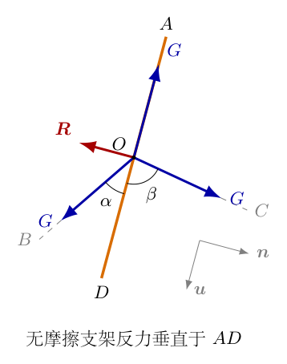{width=35%}

沿图中两个正交方向分别列平衡方程：

$$
\begin{aligned}
\boldsymbol u\text{方向}:&\quad
 -G+G\cos\alpha+G\cos\beta=0,\\
\boldsymbol n\text{方向}:&\quad
 -G\sin\alpha+G\sin\beta+R_n=0.
\end{aligned}
$$

第二式给出$R_n=G(\sin\alpha-\sin\beta)$，故

$$
\boldsymbol R=-G(\sin\beta-\sin\alpha)\boldsymbol n.
$$

本题$\sin\beta>\sin\alpha$，所以反力指向左上方，大小为$0.4244405304G$。图中的红色箭头方向与这个负的法向分量一致。它补偿了三根绳在法向上的不平衡，而没有改变切向最短条件；这正是受限解与自由解角度不同的原因。

<!-- KEEP_STUDENT_END -->

## 六、关键洞察

距离和的极小值并非只能用几何技巧猜点。每一条距离的梯度都是一个单位矢量，因而等权距离和天然对应等大拉力。几何角度、微分条件和最低势能其实描述同一件事：允许位移方向上的一阶变化消失。

“允许方向”比“有几条力”更根本。自由点需要二维梯度为零；直线约束只需要梯度在切向的投影为零，剩余法向由约束承担。极小值条件不能脱离允许位置集合，而$120^\circ$不是加了任何约束后仍然不变的普适答案。

旋转法还能给出内部费马点的最小长度。令$a=BC$、$b=CA$、$c=AB$，三角形面积为$\Delta$，$B$处顶角记为$\Theta_B$。在上述旋转方向中，$\angle ABC^*=\Theta_B+60^\circ$，因此余弦定理给出

$$
\begin{aligned}
F_{\min}^2=AC^{*2}
&=a^2+c^2-2ac\cos(\Theta_B+60^\circ)\\
&=a^2+c^2-ac\cos\Theta_B
 +\sqrt3ac\sin\Theta_B.
\end{aligned}
$$

由$b^2=a^2+c^2-2ac\cos\Theta_B$，可得$ac\cos\Theta_B=(a^2+c^2-b^2)/2$；由面积公式$\Delta=ac\sin\Theta_B/2$，可得$ac\sin\Theta_B=2\Delta$。依次代入并合并同类项：

$$
\begin{aligned}
F_{\min}^2
&=a^2+c^2-\frac{a^2+c^2-b^2}{2}+2\sqrt3\Delta\\
&=\frac{a^2+b^2+c^2+4\sqrt3\Delta}{2},\\
F_{\min}
&=\sqrt{\frac{a^2+b^2+c^2+4\sqrt3\Delta}{2}}.
\end{aligned}
$$

这个式子的成立前提仍是三个顶角均小于$120^\circ$。正三角形代入$\Delta=\sqrt3a^2/4$后，根号内为$3a^2$，故得到$\sqrt3a$；若大角超过阈值，则应改用邻边和，不能无条件使用面积式。

受限情形可以用局部曲率看出稳定性。在任意非顶点处，一条距离的二阶变化沿单位方向$\boldsymbol v$为

$$
\frac{1-(\widehat{OX}\cdot\boldsymbol v)^2}{OX}
=\frac{\sin^2\angle(\widehat{OX},\boldsymbol v)}{OX}\geq0.
$$

沿$AD$时，$B,C$的垂直距离非零，两项中都有严格的正贡献。这不仅说明零点唯一，也说明偏离它时距离和按二阶增加。二阶导数是$1/\text{长度}$量纲；若错误地漏掉分母的三次方，就无法通过这个量纲检查。

## 七、易错点

第一类错误是把三个$120^\circ$写成无条件结论。大角三角形的最优点位于顶点，顶点处有一条距离为零，不能直接对这条距离用普通梯度公式。应采用一侧变化或支持不等式，明确不可微点的判断办法。

第二类错误是只把支架画进图，却仍对$O$列三力平衡。沿支架投影时可以略去反力，完整矢量平衡却不能略去。若三个张力的矢量和不为零，这不说明最短点计算错了；应检查法向分量是否恰由支架反力抵消。

第三类错误是把距离变化写成$ds$而不作投影。只有$AO$与移动方向同线且同向增加，才有$d(AO)/ds=1$。$BO,CO$的变化是$-\cos\alpha$、$-\cos\beta$；使用$\sin$会相当于投影到了错误方向，符号写反则会预言靠近固定点时距离反而增长。

第四类错误是交换$105^\circ$、$75^\circ$，或者在$\triangle BOC$中把$OB$对角误写成$75^\circ-\alpha$。应先在两个含$D$的小三角形中求余角，再写每条边的对角；两个正弦定理必须在各自三角形中保持一致。

第五类错误是求到一个角方程的根便宣布完成。必须同时回代几何相容方程和最短方程，并检查两角范围、$0<s<AD$及导数符号。使用反余弦时需明确角度制；在程序中用弧度计算，再转换为度，不能把数值$15$直接当作弧度代入。

第六类错误是认为相等悬物自动意味着相等绳长，或认为无阻尼释放必定静止在最低点。前者不是势能对应所需条件，后者忽略了持续运动的可能。应区分张力相等、总绳长固定、稳定平衡和运动耗散四个不同命题。

## 八、课堂讲解建议

课堂先让学生尝试把点$O$沿一条短箭头移动，只判断三条距离分别变长还是变短，再引出投影。教师可在板书中并排写出$dr/ds=-\cos\theta$和张力投影$G\cos\theta$，使学生看到同一个几何投影为何在长度变化与拉力中呈相反符号。

展示悬物模型时，先让学生说清板上绳段变短后悬物上升还是下降，再写势能式。教师应当把“理想装置的平衡位置”与“释放后是否会停住”分开，否则学生容易把能量最低与任何运动的最终状态混同。板下绳段的遮挡虚线只用来表达空间位置，不引入额外连接。

接着教师在板书中逐行展开两个单位矢量和的模平方，推得$120^\circ$。可以询问学生：若一根绳张力变为两倍，三个角还会均分吗？这一提问为加权距离和建立联系，随后再用一个$130^\circ$顶角反例限制费马点条件的适用范围。

进入支架问题后，教师让学生先画反力，再选择沿$AD$投影。不要先告诉学生“余弦之和等于一”，而让其从$AO$增加、另外两段的投影减少写出导数。课堂可用正三角形中线的$\alpha=\beta=60^\circ$作即时检查，再转向偏置$15^\circ$支架。

数值计算环节可让学生分别使用角度联立方程和单变量距离函数，核对两种答案。教师需要保留端点导数与严格凸性两行板书，说明“计算器找到了一个根”和“证明只有这个最小值”是不同层次。课堂最后把受限最小长度与自由最小长度比较，让学生解释为什么增加约束不会带来更小的最小值。

## 九、变式训练

（1）正三角形的支架改为中线，求受限最优点和最短总长度。

设边长为$a$、高为$H=\sqrt3a/2$。取$B=(-a/2,0)$、$C=(a/2,0)$、$A=(0,H)$，令$O=(0,z)$，$0\leq z\leq H$。三条距离为$AO=H-z$、$BO=CO=\sqrt{a^2/4+z^2}$，故

$$
F(z)=H-z+2\sqrt{\frac{a^2}{4}+z^2}.
$$

求导并令其为零，逐步消元：

$$
\begin{aligned}
F'(z)&=-1+\frac{2z}{\sqrt{a^2/4+z^2}}=0,\\
2z&=\sqrt{a^2/4+z^2},\\
4z^2&=a^2/4+z^2,\\
3z^2&=a^2/4,\\
z&=\frac{a}{2\sqrt3}.
\end{aligned}
$$

平方前要求$z\geq0$，负根不在几何范围内。于是$AO=H-z=a/\sqrt3$、$BO=CO=a/\sqrt3$，最短总长度为$\sqrt3a$。由$\cos\alpha=\cos\beta=z/BO=1/2$，得到$\alpha=\beta=60^\circ$，其和满足两余弦等于$1$；由于中线经过自由费马点，增加此约束并没有改变最小值。

（2）三角形满足$AB=AC=a$、$\angle BAC=130^\circ$，求自由最短点。

在顶点$A$处，相邻两边的单位方向和的模为$2\cos65^\circ\approx0.8452365<1$。对任意位移$\boldsymbol d=P-A$，支持不等式给出

$$
F(P)\geq2a+
 \bigl(1-2\cos65^\circ\bigr)|\boldsymbol d|.
$$

括号为$0.1547635>0$，所以$P\ne A$时严格有$F(P)>2a$。故唯一最优点是$A$，最小长度为$2a$。若要求严格内部，则没有能取到这个值的点，但任意靠近$A$的内部点可使距离和趋近$2a$；这就是最小值与下确界的区别。

（3）在正三角形中将总长度成本改为$2AO+BO+CO$，求最优点，并解释$120^\circ$为何失效。

权重$2$意味着与$A$连接的绳张力改为$2mg$，另外两条仍为$mg$。在$A$处，$B,C$方向单位矢量和的模是$2\cos30^\circ=\sqrt3$。对任意$P$，支持不等式给出

$$
\begin{aligned}
2PA+PB+PC
&\geq2a+2|\boldsymbol d|
 -(\boldsymbol a_B+\boldsymbol a_C)\cdot\boldsymbol d\\
&\geq2a+(2-\sqrt3)|\boldsymbol d|.
\end{aligned}
$$

由于$2-\sqrt3>0$，唯一最优点为$A$，最小成本为$2a$。一般权重$w_A,w_B,w_C>0$时，只要$w_A\geq|w_B\boldsymbol a_B+w_C\boldsymbol a_C|$，顶点$A$就满足相应的全局下界条件。此时等权力的$120^\circ$结论不能使用，原因是平衡多边形的边长已不相等，不是几何图形画得不对。

<!-- KEEP_TOGETHER_START -->
（4）正三角形中点$O$只能在线段$AB$上，求最短总长度。

此时$AO+BO=AB=a$为常数，问题只剩使$CO$最小。设$x=BO$，$0\leq x\leq a$，$C$在$AB$上的垂足为中点，垂距为$\sqrt3a/2$，所以

$$
\begin{aligned}
CO&=\sqrt{(x-a/2)^2+3a^2/4},\\
F(x)&=a+\sqrt{(x-a/2)^2+3a^2/4},\\
F'(x)&=\frac{x-a/2}{\sqrt{(x-a/2)^2+3a^2/4}}.
\end{aligned}
$$

导数在$x<a/2$时为负、$x>a/2$时为正，故最优点是$AB$中点，最短总长度为$(1+\sqrt3/2)a$。这一情形相当于$D=B$，不能直接套用“$D$在$BC$内部”的端点导数结论；重新利用$AO+BO$恒定，反而得到更简单而完整的解法。
<!-- KEEP_TOGETHER_END -->

<!-- question-complete -->
