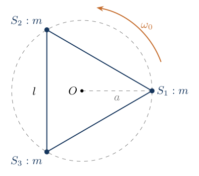
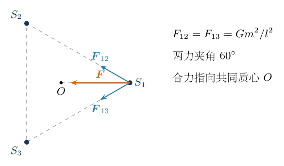
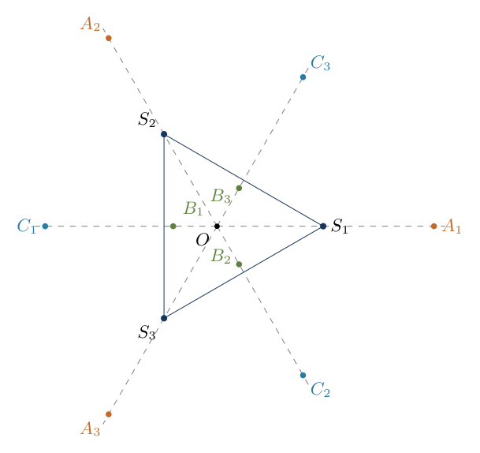
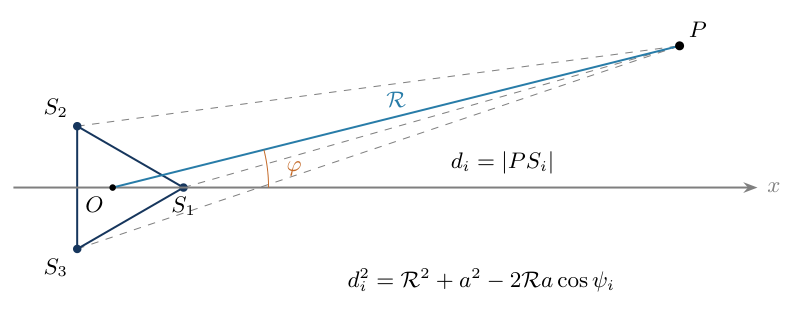
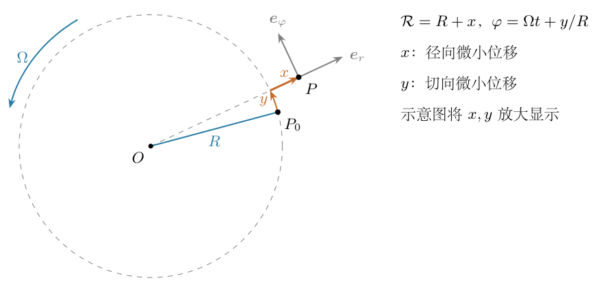
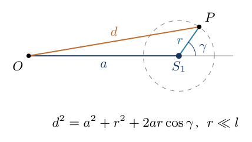

# 第3题

<!-- MODEL_REVISION: 用户已确认第三问仅统计受迫波动；一般自由项保留为模型辨析与带解变式。 -->
<!-- question-start -->
考虑一个三星系统中的行星。三颗恒星的质量均为 $m$，两两间距均为 $l$，绕共同质心以恒定角速度转动。万有引力常量为 $G$。只考虑平面内运动。

（1）求恒星绕共同质心转动的角速度 $\omega_0$。

（2）设一颗质量远小于 $m$ 的行星与恒星以相同角速度 $\omega_0$ 绕质心转动。求在恒星的转动参考系中，行星可能存在的全部平衡位置，不要求讨论稳定性。

（3）设一颗质量远小于 $m$ 的行星在平均距质心 $R\gg l$ 的远处，绕质心缓慢作近似圆周运动。仅考虑三星非轴对称引力场引起的受迫波动，不计自由偏心分量。保留首阶非零小量，计算行星到质心的距离波动范围。

修订说明：第（3）问补充“不计自由偏心分量”，所求波动范围为受迫距离的最大值与最小值之差；平均半径及平均转速的修正吸收到基本圆轨道中。

题目另附非考试情景：设一颗质量远小于 $m$ 的行星，在距某颗恒星 $r\ll l$ 的位置附近，绕该恒星快速作近似圆周运动。在恒星的旋转参考系中，保留首阶非零小量，计算行星到共同质心的距离波动范围。

{width=72%}
<!-- question-end -->

## 一、题型定位

本题把三个层次的引力运动连接起来：等边三星自身的匀速转动；质量可忽略的行星在旋转系中的静止位置；远处行星受旋转非轴对称引力场激励而产生的微小径向波动。附带近星情景则主要考查从恒星局部轨道到共同质心距离的几何转换。

平衡点应在恒星转动参考系中判断，远场展开则宜先在惯性系写出引力势，再分析慢速行星所感受到的周期性扰动。远场的总质量项决定基本圆轨道，角度无关的修正改变平均转速，只有随相对方位改变的项才会直接引起受迫径向波动。

第三问已明确只计算受迫分量。以下仍区分受迫项和自由项：可由三星几何及 $m,l,R$ 唯一确定的是非轴对称引力引起的周期特解；自由偏心则由轨道初值决定。本题不把后者计入所求范围，不能把这一限定误认为所有近圆轨道自动没有偏心。

## 二、知识点

需用到等边三角形的质心几何、万有引力与向心加速度、匀速旋转系的离心力和科里奥利力、极坐标分量，以及小参数展开。恒星到质心的距离为 $a=l/\sqrt3$，不是 $l$，此区别会连续影响转动频率与远场波动系数。

平衡位置的筛选包含方向和半径两步。对称性能够提示候选方向，但仅凭图形对称，不能证明不存在离开对称轴的平衡点。解答将补全这个无遗漏检验，再用带符号的一维方程求半径。

远场采用小参数 $\varepsilon=a/R$。要找距离的波动，不能只按引力势展开的阶次判断：受迫位移还要除以激励频率的平方。三重旋转对称性使第一个角度相关项出现于三阶，而最终的径向相对波动出现于六阶。

## 三、物理图像

如图3-1，三颗恒星分别为 $S_1,S_2,S_3$，位置构成等边三角形；共同质心为 $O$。每颗恒星受到另外两颗恒星的引力，合力沿该顶点到 $O$ 的方向。它们绕 $O$ 转动时，三角形的大小和形状保持不变。

在以 $\omega_0$ 旋转的参考系中，三颗恒星固定。若行星也固定，科里奥利力因相对速度为零而消失，行星的引力合力必须与离心力平衡。行星不可能与恒星重合，因为点质量模型中该处引力奇异。

远处行星主要感受到总质量 $3m$ 的引力，因此转得很慢；三星的方向变化相对它很快。每当三星转过 $2\pi/3$，引力构型对远处行星重复一次，所以激励频率是相对角速度的三倍。近星行星则主要绕一颗恒星运动，它相对该恒星的位移投影到 $OS_1$ 方向，就会改变到共同质心的距离。

## 四、解题入口

先统一记号：$a=l/\sqrt3$；以 $S_1$ 所在方向为旋转系 $+x$，另外两颗恒星的方位角为 $2\pi/3,4\pi/3$。平衡点到 $O$ 的距离记为 $d=as$；第三问平均轨道半径仍用 $R$，附加情景绕单颗恒星的半径仍用 $r$，三者不要混用。

第一问先求一颗恒星的合力。第二问列出矢量平衡式，证明可能的方向，然后分别沿“顶点向外射线”和“顶点的反向射线”求根。第三问把三个距离的倒数展开相加，找出首个周期性势项，再联立径向与切向扰动方程，不能只把引力势当作径向位移。

## 五、解析

（1）确定三星的转动角速度。

如图3-2，只研究 $S_1$。另外两颗恒星的引力大小相同，分别记作 $F_{12},F_{13}$，两力夹角为等边三角形的内角 $60^\circ$。图中合力 $\boldsymbol F$ 指向 $O$，后续向心方程使用这一方向和合力大小。

{width=90%}

两力的垂直于 $S_1O$ 的分量抵消，沿 $S_1O$ 的分量相加，因此

$$
F_{12}=F_{13}=\frac{Gm^2}{l^2},\qquad
F=2\frac{Gm^2}{l^2}\cos30^\circ
=\frac{\sqrt3Gm^2}{l^2}.
$$

等边三角形的高为 $\sqrt3l/2$，质心到顶点的距离为高的 $2/3$，故

$$
a=\frac23\frac{\sqrt3l}{2}=\frac{l}{\sqrt3}.
$$

以 $a$ 为转动半径，牛顿方程为 $m\omega_0^2a=F$。代入并消去 $m$，得到

$$
\begin{aligned}
\omega_0^2
&=\frac{\sqrt3Gm}{l^2}\frac{\sqrt3}{l}
=\frac{3Gm}{l^3}
=\frac{Gm}{\sqrt3a^3},\\
\omega_0&=\sqrt{\frac{3Gm}{l^3}}.
\end{aligned}
$$

第二种写法 $Gm/(\sqrt3a^3)$ 将用于后面的尺度换算，不能误写成 $Gm/a^3$。量纲核验：$Gm/l^3$ 的单位为时间的负二次方，因此其平方根才是角频率。

（2）列出行星在旋转参考系中的平衡方程。

设行星质量为 $m_p\ll m$，位置为 $\boldsymbol p$；三颗恒星的位置为 $\boldsymbol a_i$。忽略行星对恒星的反作用。平衡时相对速度为零，旋转角速度恒定，科里奥利力与欧拉惯性力均为零，只剩引力与离心力：

$$
-Gmm_p\sum_{i=1}^3
\frac{\boldsymbol p-\boldsymbol a_i}{|\boldsymbol p-\boldsymbol a_i|^3}
+m_p\omega_0^2\boldsymbol p=\boldsymbol0.
$$

消去 $m_p$，得到

$$
\boxed{\omega_0^2\boldsymbol p
=Gm\sum_{i=1}^3
\frac{\boldsymbol p-\boldsymbol a_i}{|\boldsymbol p-\boldsymbol a_i|^3}.}
$$

当 $\boldsymbol p=\boldsymbol0$ 时，三个相同大小的引力相隔 $120^\circ$，矢量和为零，离心力也为零。因此 $O$ 是一个平衡位置。其余位置 $d=|\boldsymbol p|>0$，下面分别检查角向与径向条件。

（3）证明非中心平衡位置只能位于六条对称射线上。

将行星方位角记为 $\varphi$，恒星方位角为 $\theta_i=0,2\pi/3,4\pi/3$。行星到恒星的距离平方为

$$
d_i^2=d^2+a^2-2ad\cos(\varphi-\theta_i).
$$

离心力没有切向分量，所以平衡要求引力势对 $\varphi$ 的导数为零。为证明没有漏掉非对称方向，固定 $d>0$，令

$$
D=d^2+a^2,\qquad E=2ad>0,\qquad
x_i=\cos(\varphi-\theta_i),\qquad
f(x)=(D-Ex)^{-1/2}.
$$

三个距离倒数之和是 $\mathcal S=\sum_i f(x_i)$，单位质量引力势为 $-Gm\mathcal S$。由三倍角公式 $4\cos^3\alpha-3\cos\alpha=\cos3\alpha$，注意 $3\theta_i$ 都是 $2\pi$ 的整数倍，可知三个 $x_i$ 都满足

$$
4x_i^3-3x_i=u,\qquad u=\cos3\varphi.
$$

所以 $\mathcal S$ 的角度变化可通过 $u$ 描述。在不是对称轴的方向，三个 $x_i$ 互不相同。把它们按大小排成 $x_1<x_2<x_3$，对三次方程关于 $u$ 求导：

$$
\frac{dx_i}{du}=\frac1{12x_i^2-3}.
$$

因 $4x^3-3x-u=4(x-x_1)(x-x_2)(x-x_3)$，在 $x=x_i$ 处求导，有

$$
12x_i^2-3=4\prod_{j\ne i}(x_i-x_j).
$$

于是链式法则给出

$$
\frac{d\mathcal S}{du}
=\frac14\sum_{i=1}^3
\frac{f'(x_i)}{\prod_{j\ne i}(x_i-x_j)}.
$$

为判断该式的正负，令 $g=f'$。通分可把括号中的三项改写成两个割线斜率的差：

$$
\begin{aligned}
\sum_{i=1}^3\frac{g(x_i)}{\prod_{j\ne i}(x_i-x_j)}
&=\frac1{x_3-x_1}\biggl[
\frac{g(x_3)-g(x_2)}{x_3-x_2}\\
&\qquad-\frac{g(x_2)-g(x_1)}{x_2-x_1}\biggr].
\end{aligned}
$$

这一步使用二阶差商恒等式。将右侧通分，可以逐项核对 $g(x_i)$ 的系数：$g(x_1)$ 的系数为 $1/[(x_3-x_1)(x_2-x_1)]$，$g(x_3)$ 的系数为 $1/[(x_3-x_1)(x_3-x_2)]$，分别与左侧的相应项相同。中间项的系数需要把两个分式相加，计算为

$$
\begin{aligned}
-\frac1{x_3-x_1}
\left(\frac1{x_3-x_2}+\frac1{x_2-x_1}\right)
&=-\frac1{(x_3-x_2)(x_2-x_1)}\\
&=\frac1{(x_2-x_1)(x_2-x_3)}.
\end{aligned}
$$

因此三项确实完全一致，并没有另加假设。又有

$$
g''(x)=f'''(x)=\frac{15E^3}{8(D-Ex)^{7/2}}>0.
$$

因此 $g$ 严格凸，右侧区间的割线斜率严格大于左侧区间的割线斜率，方括号为正，故 $d\mathcal S/du>0$。这里所有距离均非零，分母合法；与恒星重合的位置已排除。

再用 $du/d\varphi=-3\sin3\varphi$，有

$$
\frac{\partial(-Gm\mathcal S)}{\partial\varphi}
=3Gm\frac{d\mathcal S}{du}\sin3\varphi.
$$

离心势与 $\varphi$ 无关，所以非中心平衡必须满足 $\sin3\varphi=0$，即

$$
\boxed{\varphi=\frac{j\pi}{3},\qquad j=0,1,2,3,4,5.}
$$

对称轴本身可直接从成对引力的切向分量抵消来检验。上述证明补足了“对称性提示候选方向”之外的排他条件，确认非轴方向没有其他平衡点。

（4）沿指向顶点的射线求径向平衡。

先取 $\varphi=0$，行星位置为 $\boldsymbol p=(as,0)$，$s>0$。此方向上的恒星 $S_1$ 位于 $(a,0)$，另两颗恒星位于 $(-a/2,\pm\sqrt3a/2)$。分别投影到 $+x$ 轴，并将平衡方程除以 $Gm/a^2$，得到

$$
\frac{s}{\sqrt3}
=\frac{s-1}{|s-1|^3}
+\frac{2s+1}{(s^2+s+1)^{3/2}}.
$$

第一项保留 $s-1$ 的符号：行星在恒星的内侧与外侧，受该恒星引力的径向方向相反。第二项来自另外两颗恒星，横向分量相消，径向投影相加，距离平方均为 $a^2(s^2+s+1)$。

若 $0<s<1$，第一项为 $-1/(1-s)^2$。因为 $s^2+s+1>1$，第二项小于 $2s+1$；而

$$
\frac1{(1-s)^2}>1+2s.
$$

可将后一不等式两边同乘 $(1-s)^2$ 检验，差值为 $s^2(3-2s)>0$。因此方程右边为负，左边为正，没有平衡点。$s=1$ 与恒星重合，不是允许的位置。

若 $s>1$，定义

$$
F_A(s)=\frac1{(s-1)^2}
+\frac{2s+1}{(s^2+s+1)^{3/2}}-\frac{s}{\sqrt3}.
$$

导数为

$$
F_A'(s)=-\frac2{(s-1)^3}
+\frac{1/2-4s^2-4s}{(s^2+s+1)^{5/2}}
-\frac1{\sqrt3}<0.
$$

在 $s\to1^+$ 时 $F_A\to+\infty$，在 $s\to\infty$ 时 $F_A\to-\infty$，所以此射线外侧恰有一个根。利用三重旋转对称性，另外两条顶点射线各有一个同半径的根，共三个位置。

（5）沿顶点的反向射线求径向平衡。

取 $\varphi=\pi$，行星位置为 $(-as,0)$。沿从 $O$ 向行星的方向取径向正方向，$S_1$ 距离为 $a(s+1)$；另外两颗恒星的径向距离投影为 $a(s-1/2)$，横向距离分别为 $\pm\sqrt3a/2$。所以方程为

$$
\frac{s}{\sqrt3}
=\frac1{(s+1)^2}
+\frac{2s-1}{(s^2-s+1)^{3/2}}.
$$

定义右边减左边为 $F_B(s)$。它在 $s=0$ 也为零，对应已经找到的共同质心，不应再计入非中心平衡点。下面证明 $s>0$ 恰有两个根。

在 $0<s<1/2$，直接求导得到

$$
\begin{aligned}
F_B'(s)&=-\frac2{(s+1)^3}
+\frac{1/2-4s^2+4s}{(s^2-s+1)^{5/2}}
-\frac1{\sqrt3},\\
F_B''(s)&=\frac6{(s+1)^4}
+\frac{3(2s-1)(8s^2-8s-7)}{4(s^2-s+1)^{7/2}}>0.
\end{aligned}
$$

后一个分式中两个括号均为负，所以该项为正。又有

$$
F_B(0)=0,\qquad F_B'(0)=-\frac32-\frac1{\sqrt3}<0,
\qquad F_B(1/2)=\frac49-\frac1{2\sqrt3}>0.
$$

严格凸函数先由零下降，之后斜率持续增大，最多再穿过横轴一次；而右端值为正，说明确实穿过一次。因此 $(0,1/2)$ 恰有一个正根。

在 $1/2\leq s\leq1$，有 $s^2-s+1\leq1$、$2s-1\geq0$。另有

$$
\frac1{(1+s)^2}\geq\frac{2-s}{4},
$$

因为通分后的分子差为 $(s-1)^2(s+2)\geq0$。由此给出明确下界

$$
\begin{aligned}
F_B(s)
&\geq\frac{2-s}{4}+(2s-1)-\frac{s}{\sqrt3}\\
&=s\left(\frac74-\frac1{\sqrt3}\right)-\frac12\\
&\geq\frac38-\frac1{2\sqrt3}>0.
\end{aligned}
$$

因此这一区间没有根。最后，当 $s\geq1$，$s^2-s+1\geq1$，导数中第二项不超过 $1/2$，所以

$$
F_B'(s)<\frac12-\frac1{\sqrt3}<0.
$$

又 $F_B(1)=5/4-1/\sqrt3>0$，$F_B(\infty)=-\infty$，故 $(1,\infty)$ 恰有另一个根。三条反向射线各有内外两个根，总共六个位置。

（6）求数值根并给出全部十个平衡位置。

对 $F_A,F_B$ 使用牛顿迭代 $s^{(n+1)}=s^{(n)}-F(s^{(n)})/F'(s^{(n)})$。上面已明确每个根所属区间及唯一性，求根过程不需要猜测还有几个位置。三类根取初值 $2.04,0.414,1.62$，逐项计算如下：

|迭代次数|顶点射线外根|反向射线内根|反向射线外根|
|---|---|---|---|
|$0$|$2.040000000$|$0.414000000$|$1.620000000$|
|$1$|$2.043802027$|$0.413887950$|$1.619789604$|
|$2$|$2.043817190$|$0.413887932$|$1.619789609$|
|$3$|$2.043817190$|$0.413887932$|$1.619789609$|

例如顶点外根的初始残差为 $F_A(2.04)=0.009619071$，第一次更新到 $2.043802027$ 后残差降为 $3.80589\times10^{-5}$，第二次降至约 $6.0\times10^{-10}$。两反向根的初始残差分别为 $0.000186065$ 和 $-0.000274983$，均由各自的导数更新，不应把正负不同的力投影删掉后统一求根。

将 $d=as$ 改写成以 $l$ 为单位的半径，分别得到

$$
\begin{aligned}
d_A&=2.043817190a=1.179998405l,\\
d_B&=0.413887932a=0.238958309l,\\
d_C&=1.619789609a=0.935185967l.
\end{aligned}
$$

图3-3中的橙色 $A_j$ 位于顶点向外射线，绿色 $B_j$ 与蓝色 $C_j$ 分别位于反向射线的内、外侧。三个恒星 $S_j$ 不算作行星平衡点；黑色中心 $O$ 是另一个位置。图中的每组半径正对应上述三个数值根。

{width=90%}

完整位置可用极坐标列成

$$
\boxed{
\begin{aligned}
&O;\\
&A_j:\quad (d,\varphi)=(d_A,\theta_j);\\
&B_j:\quad (d,\varphi)=(d_B,\theta_j+\pi);\\
&C_j:\quad (d,\varphi)=(d_C,\theta_j+\pi),
\quad \theta_j=\frac{2\pi(j-1)}3,\quad j=1,2,3.
\end{aligned}}
$$

角度按模 $2\pi$ 理解。总数为 $1+3+3+3=10$。方向排他证明、各径向区间的根数判断和数值代回三项共同保证了“全部平衡位置”的完整性。本问没有要求稳定性，不能把不稳定位置排除在平衡位置名单之外。三个非中心半径都是无量纲根乘长度 $l$，其尺度与质量大小无关。

（7）建立远场三个距离的几何关系。

现在转回惯性系。设行星瞬时位置的极坐标为 $(\mathcal R,\varphi)$，恒星的方位角为 $\omega_0t+\theta_i$。令 $\psi_i=\varphi-\omega_0t-\theta_i$。图3-4画出行星 $P$、质心 $O$ 和三个恒星 $S_i$ 的相对距离，图示取 $t=0$ 且 $S_1$ 位于 $+x$ 方向。图中 $\mathcal R=|OP|$ 是瞬时距离，$d_i=|PS_i|$；平均轨道半径另记为 $R$。展开时先将 $\mathcal R$ 当作变量，求出力以后再在 $\mathcal R=R$ 处取扰动值。

{width=100%}

由余弦定理，

$$
d_i^2=\mathcal R^2+a^2-2\mathcal Ra\cos\psi_i.
$$

单位质量的引力势为三个恒星引力势之和：

$$
\mathcal U=-Gm\sum_{i=1}^3\frac1{d_i}.
$$

取小参数 $\varepsilon=a/\mathcal R$，则

$$
\frac1{d_i}=\frac1{\mathcal R}
\left(1-2\varepsilon\cos\psi_i+\varepsilon^2\right)^{-1/2}.
$$

（8）把距离倒数展开到首个角度相关项。

数学技巧是二项式展开。对 $z$ 使用

$$
(1+z)^{-1/2}=1-\frac z2+\frac{3z^2}{8}-\frac{5z^3}{16}+O(z^4),
$$

再代入 $z=-2\varepsilon\cos\psi_i+\varepsilon^2$。写 $c_i=\cos\psi_i$，把各项中不高于三阶的小量收集起来：

$$
\begin{aligned}
-z/2&=\varepsilon c_i-\varepsilon^2/2,\\
3z^2/8&=\frac32\varepsilon^2c_i^2
-\frac32\varepsilon^3c_i+O(\varepsilon^4),\\
-5z^3/16&=\frac52\varepsilon^3c_i^3+O(\varepsilon^4).
\end{aligned}
$$

所以

$$
\frac1{d_i}=\frac1{\mathcal R}
\left[1+\varepsilon c_i
+\varepsilon^2\left(\frac32c_i^2-\frac12\right)
+\varepsilon^3\left(\frac52c_i^3-\frac32c_i\right)
+O(\varepsilon^4)\right].
$$

令 $\psi=\varphi-\omega_0t$。三个角度相差 $120^\circ$，利用三角函数恒等式，有

$$
\sum_i c_i=0,\qquad
\sum_i c_i^2=\frac32,\qquad
\sum_i c_i^3=\frac34\cos3\psi.
$$

第二式由 $\cos^2\alpha=(1+\cos2\alpha)/2$ 得到，三项的二倍角余弦和为零。第三式由 $\cos^3\alpha=(3\cos\alpha+\cos3\alpha)/4$ 得到：三项一次余弦和为零，而三个三倍角余弦都等于 $\cos3\psi$，它们相加为 $3\cos3\psi$，不能只保留一项。

逐阶相加：零阶为 $3$，一阶为零，二阶为 $(3/2)(3/2)-3/2=3/4$，三阶为 $(5/2)(3/4)\cos3\psi=15\cos3\psi/8$。因此

$$
\begin{aligned}
\mathcal U(\mathcal R,\varphi,t)
&=-\frac{3Gm}{\mathcal R}
-\frac{3Gma^2}{4\mathcal R^3}\\
&\quad-\frac{15Gma^3}{8\mathcal R^4}
\cos3(\varphi-\omega_0t)+O\left(\frac{Gma^4}{\mathcal R^5}\right).
\end{aligned}
$$

一阶偶极项消失，是因为共同质心处三个质量加权位矢之和为零。二阶项虽非零，但不含角度，只改变基本圆轨道的频率，不会让一个基本圆轨道周期性地忽远忽近。第三阶才是首个旋转的非轴对称项。

（9）确定平均轨道频率和激励频率。

令角度无关的部分为 $\mathcal U_0$。基本圆轨道的半径为 $R$，平均角速度记为 $\Omega$。向心条件是 $R\Omega^2=\mathcal U_0'(R)$，故

$$
\Omega^2=\frac{3Gm}{R^3}+\frac{9Gma^2}{4R^5}+\cdots.
$$

只保留主阶，有 $\Omega^2\simeq3Gm/R^3$。与第一问的角速度比较：

$$
\frac{\Omega^2}{\omega_0^2}\simeq\frac{l^3}{R^3},
\qquad \frac{|\Omega|}{\omega_0}\simeq\left(\frac lR\right)^{3/2}\ll1.
$$

先取行星与三星同向转动，即 $\Omega>0$；若反向转动，可将 $\Omega$ 取为负值，以下首阶波动幅度不变。沿基本轨道 $\varphi=\Omega t$，非轴对称项的相位为 $-3(\omega_0-\Omega)t$，所以激励角频率为

$$
\nu=3(\omega_0-\Omega)\simeq3\omega_0.
$$

选择相对方位对齐的时刻为时间原点，仅改变波动相位，不改变幅度。

（10）由势求径向和切向扰动加速度。

定义三阶势项 $\mathcal U_3=-15Gma^3\cos3(\varphi-\omega_0t)/(8\mathcal R^4)$。径向加速度为 $-\partial\mathcal U_3/\partial\mathcal R$，切向加速度为 $-(1/\mathcal R)\partial\mathcal U_3/\partial\varphi$。在基本轨道处取值，分别得到

$$
\begin{aligned}
f_r(t)&=-\frac{15Gma^3}{2R^5}\cos\nu t=-F\cos\nu t,\\
f_\varphi(t)&=+\frac{45Gma^3}{8R^5}\sin\nu t=H\sin\nu t,\\
F&=\frac{15Gma^3}{2R^5},\qquad H=\frac34F.
\end{aligned}
$$

径向求导时，$\partial\mathcal R^{-4}/\partial\mathcal R=-4\mathcal R^{-5}$，与势项前面的负号相乘后导数为正，再取负梯度，所以 $f_r$ 前面的符号为负。切向求导产生三倍角因子 $3$；代入 $\varphi-\omega_0t=-(\omega_0-\Omega)t$ 后，正弦再次变号，最终得到上式的正号。两处符号都影响后续受迫位移的相位。

（11）从极坐标运动方程建立线性扰动方程。

如图3-5，以基本圆轨道上的 $P_0$ 为参照，令实际半径为 $\mathcal R=R+x$，实际方位角为 $\varphi=\Omega t+y/R$。$x$ 是径向微位移，$y$ 是切向微位移；图中切向弧长正是 $R\,\delta\varphi=y$。图示将小位移放大，以便区分两种方向，后续方程分别使用 $x,y$，不把它们当成同一位移。

{width=95%}

为求首阶受迫波动，恢复项采用单极引力 $-3Gm/\mathcal R^2$；角度无关的二阶修正只改变这些系数的更高阶部分。周期性的三阶扰动 $f_r,f_\varphi$ 则必须保留。极坐标牛顿方程为

$$
\ddot{\mathcal R}-\mathcal R\dot\varphi^2
=-\frac{3Gm}{\mathcal R^2}+f_r,
\qquad
\mathcal R\ddot\varphi+2\dot{\mathcal R}\dot\varphi=f_\varphi.
$$

代入 $\dot\varphi=\Omega+\dot y/R$，只保留关于 $x,y$ 的一次量：

$$
\begin{aligned}
\mathcal R\dot\varphi^2
&=(R+x)\left(\Omega+\frac{\dot y}{R}\right)^2\\
&\simeq R\Omega^2+\Omega^2x+2\Omega\dot y,\\
-\frac{3Gm}{(R+x)^2}
&\simeq-\frac{3Gm}{R^2}+\frac{6Gm}{R^3}x\\
&=-R\Omega^2+2\Omega^2x.
\end{aligned}
$$

其中使用 $(1+x/R)^{-2}\simeq1-2x/R$ 和基本圆轨道条件 $\Omega^2=3Gm/R^3$。两个零阶项 $-R\Omega^2$ 相消，径向方程化为

$$
\ddot x-2\Omega\dot y-3\Omega^2x=-F\cos\nu t.
$$

切向方程中，$\mathcal R\ddot\varphi\simeq\ddot y$、$2\dot{\mathcal R}\dot\varphi\simeq2\Omega\dot x$，故

$$
\ddot y+2\Omega\dot x=H\sin\nu t.
$$

这里丢弃的是 $x\dot y$、$\dot x\dot y$ 等小量乘积，不是把科里奥利型耦合项 $2\Omega\dot y,2\Omega\dot x$ 随意删掉。

（12）消去切向位移，求受迫径向振动。

把切向方程对时间积分一次：

$$
\dot y+2\Omega x=-\frac H\nu\cos\nu t+C_0.
$$

$R$ 与 $\Omega$ 已作为平均半径与平均转速，因此周期性扰动取平均时有 $\langle x\rangle=\langle\dot y\rangle=0$，相应的平均轨道修正吸收到 $R,\Omega$ 中，故 $C_0=0$。代回径向方程，逐项整理：

$$
\begin{aligned}
\ddot x-2\Omega\left(-2\Omega x-\frac H\nu\cos\nu t\right)
-3\Omega^2x&=-F\cos\nu t,\\
\ddot x+\Omega^2x
&=-\left(F+\frac{2\Omega H}{\nu}\right)\cos\nu t.
\end{aligned}
$$

这是一条简谐恢复项加周期性驱动的方程。尝试受迫特解 $x_f=A\cos\nu t$，其二阶导数为 $-\nu^2A\cos\nu t$。代回并消去共同余弦因子，得到

$$
\begin{aligned}
(\Omega^2-\nu^2)A
&=-\left(F+\frac{2\Omega H}{\nu}\right),\\
A&=\frac{F+2\Omega H/\nu}{\nu^2-\Omega^2}.
\end{aligned}
$$

由于 $|\Omega|\ll\omega_0$，$\nu\simeq3\omega_0$，分母为正且远离共振。为取首阶非零位移，分子保留 $F$ 的主阶、分母保留 $9\omega_0^2$，所以

$$
A\simeq\frac{F}{9\omega_0^2}
=\frac{5Gma^3}{6\omega_0^2R^5}.
$$

这说明引力势的一阶扰动并不直接等于位移，必须先求加速度，再除以快速激励频率的平方。径向扰动力为负余弦，而特解位移为正余弦，是快速驱动下的惯性相位关系，不是符号错误。

（13）换算波动幅度并明确自由项的影响。

代入 $\omega_0^2=3Gm/l^3$、$a^3=l^3/(3\sqrt3)$，每一步换算为

$$
\begin{aligned}
A
&\simeq\frac{5Gma^3}{6R^5}\frac{l^3}{3Gm}
=\frac{5a^3l^3}{18R^5}\\
&=\frac{5l^6}{54\sqrt3R^5}
=\frac{5\sqrt3a^6}{6R^5}.
\end{aligned}
$$

受迫距离在 $R-A$ 与 $R+A$ 之间变化，所以“波动范围”按最大值减最小值理解，为峰峰值 $2A$，而不是单侧振幅 $A$：

$$
\boxed{\Delta R_f
\simeq\frac{5l^6}{27\sqrt3R^5}
=\frac{5}{27\sqrt3}\,l\left(\frac lR\right)^5
=\frac5{\sqrt3}\,a\left(\frac aR\right)^5.}
$$

相对波动为 $\Delta R_f/R\propto(l/R)^6$。结果中 $m$ 消去，因为驱动力与 $m$ 成正比，三星转动频率平方也与 $m$ 成正比；两者在快速受迫位移中相除。$l^6/R^5$ 的量纲是长度，符合所求距离范围。半径 $R$ 增大时波动迅速减小，符合远处三星越来越接近一个中心质量的极限。

上述线性方程的一般解还包括自由偏心项：

$$
x(t)=A\cos\nu t+C\cos\Omega t+D\sin\Omega t.
$$

$C,D$ 由初始径向位置、径向速度等条件决定。修订后的本问只保留受迫分量，相应地取 $C=D=0$；这是题目已经明确的模型限定，而不是由“近似圆周”推出来的结论。因而方框中的结果是三星引力引起的受迫波动范围，不是任意近圆轨道都具有的总峰峰值。若另求包含自由项的总范围，还需给定完整初值；后面的带解变式专门计算这一情形。

（14）求附带近星情景的首阶距离波动。

令行星绕 $S_1$ 的局部基本轨道半径为 $r\ll l$。$S_1$ 到共同质心的距离为 $a=l/\sqrt3$。行星受到 $S_1$ 的主引力加速度为 $Gm/r^2$，故局部惯性角速度的主阶为

$$
\omega_p^2\simeq\frac{Gm}{r^3},\qquad
\frac{\omega_p^2}{\omega_0^2}\simeq\frac{l^3}{3r^3}\gg1.
$$

另外两颗恒星在 $S_1$ 附近的共同平移加速度与 $S_1$ 本身的加速度一起抵消，剩余的差分引力是潮汐量，大小约为 $Gmr/l^3$。它与主引力之比约为 $(r/l)^3$，不改变本问首阶的基本局部圆轨道。旋转参考系改变看到的相对角速度，同向时为 $\omega_p-\omega_0$，但不改变同一时刻的几何距离。

如图3-6，$\gamma$ 为局部位移 $\overrightarrow{S_1P}$ 与从 $O$ 向外的 $\overrightarrow{OS_1}$ 方向的夹角。行星到共同质心的距离记为 $d$，图中三条边的矢量关系为 $\overrightarrow{OP}=\overrightarrow{OS_1}+\overrightarrow{S_1P}$。

{width=72%}

将矢量和取模平方，得到

$$
d^2=a^2+r^2+2ar\cos\gamma.
$$

用 $r/a\ll1$ 展开平方根，逐项保留至二阶，便于检查首阶结果：

$$
\begin{aligned}
d
&=a\sqrt{1+2\frac ra\cos\gamma+\frac{r^2}{a^2}}\\
&=a+r\cos\gamma+\frac{r^2}{2a}\sin^2\gamma
+O\left(\frac{r^3}{a^2}\right).
\end{aligned}
$$

首阶距离变化是局部半径在 $OS_1$ 方向的投影 $r\cos\gamma$。也可不展开，直接对精确几何式求导：$dd/d\gamma=-ar\sin\gamma/d$，极值发生于 $\gamma=0,\pi$。因 $r<a$，局部基本圆轨道对应

$$
d_{\max}=a+r,\qquad d_{\min}=a-r,
\qquad \boxed{\Delta d=2r\quad\text{（首阶）}}.
$$

对于严格的局部圆轨道，这个几何峰峰值恰好为 $2r$；真实三星潮汐导致的局部轨道形状修正属更高阶，需要另行求解。量纲上 $2r$ 是长度；当 $r/l\to0$ 时，局部位移消失，行星到共同质心的距离趋于常数 $a$。该情景不应套用第三问的远场展开，因为此时到某颗恒星的距离很小，并不满足所有恒星都远离行星的条件。近星与远场的物理中心不同，不能只凭都含“近似圆周运动”就使用同一公式。

## 六、关键洞察

平衡位置的“对称性”和“完整性”是两个不同问题。对称性保证找到一个平衡位置后可旋转得到另外两个，但不自动排除不在对称轴上的位置。角向证明通过三倍角把几何约束转成一个三次方程，再利用严格凸函数的割线斜率增大，确认角向力只能在六条对称射线上为零。径向证明又把每条射线的候选数限定为一个或两个，二者结合才得到完整的十个位置。

远场首个非轴对称项的三倍角反映的是三星构型的三重旋转对称性，而不是三颗星的转速变为 $3\omega_0$。它们各自仍以 $\omega_0$ 转动；对于某个远处方向，势的时间依赖每转 $120^\circ$ 重复一次。行星也在转动时，必须先求相对角速度，再乘三，得到 $\nu=3(\omega_0-\Omega)$。

位移的首阶还可以用快速驱动近似独立获得。因 $\nu\gg|\Omega|$，在受迫分量中 $\ddot x\sim\nu^2x$，恢复项 $\Omega^2x$ 相对它很小；切向耦合带来的驱动力修正为 $2\Omega H/\nu$，相对 $F$ 也很小。因此主阶方程为 $\ddot x=-F\cos\nu t$，其周期特解是

$$
x_f=\frac F{\nu^2}\cos\nu t
\simeq\frac F{9\omega_0^2}\cos\nu t.
$$

对它二次求导直接恢复 $-F\cos\nu t$，无需再用消元所得的幅值公式。这条路线只能求快速受迫分量，不适合据此把完整轨迹的自由运动改写成匀速漂移。

还可估计被忽略的相对转速修正。令 $\delta=\Omega/\omega_0$，用 $H=3F/4$、$\nu=3\omega_0(1-\delta)$，将保留单极恢复项的线性幅值除以主阶幅值 $A_0=F/(9\omega_0^2)$：

$$
\frac A{A_0}
=\frac{1-\delta/2}{(1-\delta)\left(1-2\delta+8\delta^2/9\right)}
=1+\frac52\delta+O(\delta^2).
$$

最后一步使用分母倒数的一阶展开。该修正说明同向轨道和反向轨道的有限 $R$ 幅值可以略有不同，但它们的首阶非零结果相同。更高精度还应同步计入轴对称势的高阶修正，而不是只修改激励频率就宣称得到了精确轨道。

## 七、易错点

第一类错误是把三星边长 $l$ 与恒星转动半径 $a$ 混用。$\omega_0^2=3Gm/l^3=Gm/(\sqrt3a^3)$，转换到 $a$ 时若漏掉 $\sqrt3$，后续位移系数会改变。第一问的质心几何不是可有可无的准备步骤。

第二类错误是沿径向轴列式时把所有引力都视为指向共同质心。位于某颗恒星内侧的行星受到该恒星的引力可能向外；反向射线的两个旁侧恒星，其径向投影也会在 $s=1/2$ 变号。需要保留 $s-1$、$2s-1$ 的代数符号，而不是把这些分子全部取绝对值。

第三类错误是把最低非零势项直接当作波动项。二阶修正是轴对称的，决定平均圆轨道关系；三阶旋转项产生周期激励。计算三阶系数时，三个 $\cos3\psi_i$ 相同，它们的和是 $3\cos3\psi$，若少加一个因子三，后面的力、位移都会出错。

求力时还要区分径向偏导和角向偏导。径向偏导将 $\mathcal R^{-4}$ 变为 $-4\mathcal R^{-5}$，角向偏导将余弦变为带因子三的正弦，切向力再除以半径。单靠量纲检查不能识别这些数字系数及相位的符号错误，须分别微分、代入相位后再比较。

最后要区分振幅与峰峰值、受迫波动与总波动。$A$ 是单侧振幅，受迫范围是 $2A$；自由偏心项未确定时，总范围不一定是 $2A$。原题附带的近星情景，其基本几何范围 $2r$ 虽然形式也有系数二，但来自局部位移投影，并非远场的受迫方程。

## 八、课堂讲解建议

讲解宜分成“同一个引力系统、三种研究尺度”。先让学生只看图3-2的一颗恒星，辨认两力夹角以及转动半径。板书先写 $a=l/\sqrt3$，再写 $m\omega_0^2a=2(Gm^2/l^2)\cos30^\circ$；若把质心几何和力分解分开完成，学生更容易辨认系数三究竟来自哪里。

平衡点部分先请学生判断 $O$ 是否平衡，再观察图3-3中六条射线，但不立即宣布“由对称性可知全部平衡点”。可以提出：“图形对称能够帮我们生成另两个解，它能排除离轴解吗？”随后解释角向力必须为零，先展示 $\sin3\varphi=0$ 的结论和几何意义，再根据学生的数学基础逐段讲清三倍角方程、二阶差商及凸性论证。二阶差商不是额外的物理定律，而是用于证明解的完整性的数学工具。

径向方程要在图3-3上分别指出三类点的位置。教师可选 $0<s<1$ 的顶点射线作为符号辨析例子：来自 $S_1$ 的引力向外，另外两颗恒星的合力向内，因而不能把三个力的大小直接相加。列式后先按区间检查正负与根数，再计算数值根；这样求根只是定位已经证明存在的点，而不是凭扫描曲线猜答案。

远场部分让学生对照图3-4，逐次完成“距离平方—距离倒数—三个势相加—负梯度”。板书把 $\mathcal R$ 与 $R$ 分成两行：前者是求导变量，后者是代入的基本轨道半径。先写 $\sum c_i=0$，再写 $\sum c_i^2=3/2$，最后从 $\cos^3\alpha$ 恒等式推出 $\sum c_i^3=3\cos3\psi/4$。在这三步之间停顿核对，能够同时检查一次项为何消失、二次项为何不振荡、三次项为何带三倍相位。

推导位移前再次使用图3-5，让学生分别指出 $x$ 和 $y$ 的方向。教师不宜直接写出 $A=F/(9\omega_0^2)$，而应先展开极坐标方程，解释零阶圆轨道项如何抵消，再积分切向方程并消元。此时可问：“距离不变的平均圆轨道已经平衡，为什么微小径向偏移仍要和切向速度变化联立？”答案是角动量随周期性切向力改变，径向加速度还含角速度变化造成的向心项。

最后使用两条检验收束：位移应具有长度单位；当 $R/l$ 增大时，非轴对称波动应迅速减小。将一般解中的 $C,D$ 留在板书上，说明不计自由偏心项是受迫波动结论的条件，而非所有近圆轨道天然满足的事实。近星附加情景可紧接图3-6讲解，通过精确几何式的两个极值说明它主要是位置投影问题，不需要重复远场多极展开。

## 九、变式训练

（1）相似三星系统的尺度变化。

将三颗恒星的质量都改为 $m'=4m$，边长改为 $l'=2l$，远场行星的平均轨道半径改为 $R'=2R$。仍只统计受迫波动。求三星转速、平衡位置、远场波动幅度及相应周期相对于原系统的变化。

先由相似几何关系得 $a'=l'/\sqrt3=2a$。再用向心条件逐项计算：

$$
\begin{aligned}
\omega_0'^2
&=\frac{3Gm'}{l'^3}
=\frac{3G(4m)}{(2l)^3}
=\frac12\omega_0^2,\\
\omega_0'&=\frac{\omega_0}{\sqrt2},\qquad
T_0'=\frac{2\pi}{\omega_0'}=\sqrt2\,T_0.
\end{aligned}
$$

平衡方程除以 $Gm/a^2$ 后只包含 $s=d/a$，不含质量和长度的绝对大小。所以三类无量纲根 $s_A,s_B,s_C$ 不变，中心仍是中心，全部非中心平衡半径满足 $d_j'=a's_j=2d_j$。不是质量变为四倍就让平衡半径也变成四倍；恒星的转速也随质量同步改变，二者在无量纲方程中抵消。

远场行星的基本角速度主阶为

$$
\Omega'^2=\frac{3Gm'}{R'^3}
=\frac12\Omega^2,\qquad
\Omega'=\frac{\Omega}{\sqrt2}.
$$

取相同转动方向时，$\nu'=3(\omega_0'-\Omega')=\nu/\sqrt2$。因此受迫波动周期 $T_f=2\pi/\nu$ 也变成 $\sqrt2\,T_f$。再用已求出的峰峰值，

$$
\begin{aligned}
\Delta R_f'
&\simeq\frac{5(2l)^6}{27\sqrt3(2R)^5}
=2\,\frac{5l^6}{27\sqrt3R^5}
=2\Delta R_f,\\
\frac{\Delta R_f'}{R'}
&=\frac{2\Delta R_f}{2R}
=\frac{\Delta R_f}{R}.
\end{aligned}
$$

这与两个系统有相同 $l/R$ 一致。还可直接从驱动力检查：$F'\propto m'a'^3/R'^5=(4\times8/32)ma^3/R^5=ma^3/R^5$，故 $F'=F$；而 $\nu'^2=\nu^2/2$，所以 $A'=F'/\nu'^2=2A$。两条独立尺度路线给出同一结论。

（2）受迫项与自由项共同存在的初值问题。

在主解析的线性模型中，给定 $x(0)=0$、$\dot x(0)=0$、$y(0)=0$，并取 $\dot y(0)=-H/\nu$，以保证切向积分常数 $C_0=0$。求 $x(t),y(t)$，并解释为什么“初始径向位移和速度均为零”并不等于“没有自由偏心项”。

记 $K=F+2\Omega H/\nu$，$A=K/(\nu^2-\Omega^2)$，其中 $\nu^2>\Omega^2$。径向方程与一般解为

$$
\ddot x+\Omega^2x=-K\cos\nu t,
\qquad
x=A\cos\nu t+C\cos\Omega t+D\sin\Omega t.
$$

先代入位置初值：$0=A+C$，故 $C=-A$。再逐项求导，

$$
\dot x=-A\nu\sin\nu t-C\Omega\sin\Omega t
+D\Omega\cos\Omega t.
$$

因 $\Omega\ne0$，速度初值给出 $0=D\Omega$，即 $D=0$。所以

$$
\boxed{x(t)=A\bigl(\cos\nu t-\cos\Omega t\bigr).}
$$

此时自由项为 $-A\cos\Omega t$，并没有消失。它在 $t=0$ 恰好抵消受迫特解的初始位移 $A$。要只留下受迫特解，所需径向初值应是 $x(0)=A$、$\dot x(0)=0$，还须满足与该特解一致的切向初值。

<!-- KEEP_TOGETHER_START -->

继续从切向积分式求 $y$，而不是另猜一个相位：

$$
\begin{aligned}
\dot y
&=-2\Omega x-\frac H\nu\cos\nu t\\
&=-\left(2\Omega A+\frac H\nu\right)\cos\nu t
+2\Omega A\cos\Omega t,\\
y(t)
&=-\left(\frac{2\Omega A}{\nu}+\frac H{\nu^2}\right)\sin\nu t
+2A\sin\Omega t.
\end{aligned}
$$

积分常数由 $y(0)=0$ 确定为零；其中 $\int\cos\nu t\,dt=\sin\nu t/\nu$，第二项的积分分母 $\Omega$ 与系数 $2\Omega A$ 抵消，才得到 $2A\sin\Omega t$。代入 $t=0$ 可复核 $\dot y(0)=-(2\Omega A+H/\nu)+2\Omega A=-H/\nu$。

再核验径向加速度初值，

$$
\ddot x(0)=A(-\nu^2+\Omega^2)=-K,
$$

与原微分方程在 $x(0)=0$ 时的右端一致。距离变化含两个不同频率，不能把 $2A$ 自动当作总峰峰值。由 $|\cos\nu t-\cos\Omega t|\leq2$ 只能得到 $|x|\leq2A$；是否在给定观察时间内同时达到两个端点，还取决于频率比及相位。完整的初值解比直接声称总范围为 $4A$ 更准确。

<!-- KEEP_TOGETHER_END -->
