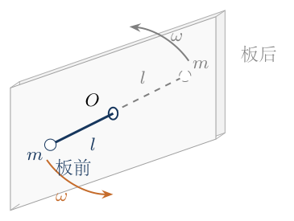
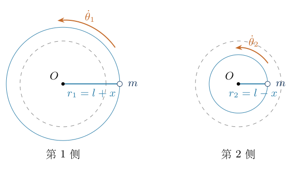
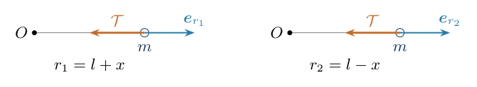
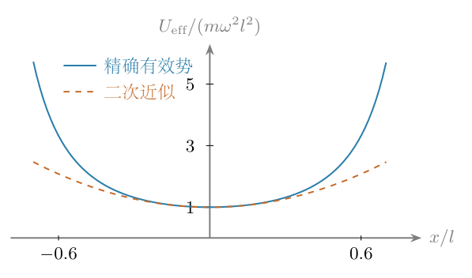

# 第4题

<!-- question-start -->
如图，在一块固定钢板的中间开一个小孔，将一根长度为 $2l$ 的轻柔细绳穿过小孔，两端各系一个质量为 $m$ 的小球。忽略重力，初始时孔两侧的绳长均为 $l$，两个小球均以角速度 $\omega$ 绕小孔转动。求小幅径向扰动后小球径向振动的角频率 $\omega'$，并给出振动周期 $T_r$。

{width=60%}
<!-- question-end -->

## 一、题型定位

这是不可伸长绳约束与角动量守恒共同决定的小振动问题。绳的一侧变长，另一侧必然等量变短；两球转动半径改变后，各自的角速度也会改变。需要先找出扰动后的角速度与半径的关系，再消去两侧共同的张力，建立一个径向位移的运动方程。

采用理想小孔模型：绳轻、不可伸长，孔光滑，忽略孔厚度和转弯部分的绳长，两侧张力大小相同。径向扰动不施加切向冲量。若孔存在摩擦、绳发生伸长或扰动伴随切向冲量，所用守恒量或约束关系会改变，不能直接套用本题结果。

角频率的单位是时间的负一次方，周期的单位是时间。因此将 $\omega'$ 用作径向角频率，周期另记为 $T_r=2\pi/\omega'$，不把两个物理量混称。

## 二、知识点

第一项是长度约束。忽略孔厚度后，两侧的有效绳长就是两球到孔的转动半径，记为 $r_1,r_2$，有 $r_1+r_2=2l$。对时间求一次、两次导数，得到 $\dot r_1+\dot r_2=0$、$\ddot r_1+\ddot r_2=0$。

第二项是中心力作用下的角动量守恒。在各球的转动平面内，张力沿指向孔的径向，没有切向分量，所以每颗球关于孔的角动量 $J_i=mr_i^2\dot\theta_i$ 分别守恒。半径变大时角速度变小，而不是保持初始 $\omega$ 不变。

第三项是极坐标径向加速度。沿从孔向小球的方向取正，径向加速度为 $\ddot r-r\dot\theta^2$。其中 $\ddot r$ 是半径的二阶导数，$-r\dot\theta^2$ 是基矢转动产生的向心项；二者不能遗漏或合并成同一个量。

最后使用小量展开，将精确径向方程的一次项写成 $\ddot x+\omega'^2x=0$。二次项因两球交换对称性抵消，首个非线性修正从三次项开始。小振动频率是振幅趋零时的结果，不是任意大扰动都具有相同周期。

## 三、物理图像

图4-1用板面的空间投影区分两侧小球；被钢板挡住的绳段及小球用虚线表示。两段绳均接到同一个小孔，板的示意厚度不计入有效绳长。下面的解答图将两侧的运动分别展开，以便读清径向正方向及张力作用点。

如果第一侧半径略大于 $l$，该球因角动量不变而转得较慢；第二侧半径小于 $l$，转得较快。决定径向方程的量不是角速度本身，而是 $r_i\dot\theta_i^2$。把守恒关系代入后，它与 $r_i^{-3}$ 成正比，所以较短的一侧具有较大的这一项。

两个径向方程同时包含张力，长度约束又让半径加速度大小相同、方向相反。消去张力后，第一侧的半径加速度为负，促使较长的一侧缩短；另一侧相应变长。这说明等长转动状态在径向上是稳定平衡，存在回复性小振动。

## 四、解题入口

令 $x=r_1-l$，则 $r_1=l+x$、$r_2=l-x$。$x>0$ 表示第一侧变长；两侧各自的径向轴都从孔指向该侧小球，因此 $\ddot r_1=\ddot x$、$\ddot r_2=-\ddot x$。不要因为两球都连着绳，就给它们写相同的半径加速度。

先写 $mr_i^2\dot\theta_i=ml^2\omega$，再分别列 $m(\ddot r_i-r_i\dot\theta_i^2)=-\mathcal T$。这里 $\mathcal T$ 表示绳张力，$T_r$ 表示振动周期，避免同一个字母同时承担两种意义。最后消去 $\mathcal T$，展开到一次项，并用系统总动能给出独立核验。

## 五、解析

（1）用一个坐标表达两球的径向变化。

轻绳不可伸长，故 $r_1+r_2=2l$。以初始等长状态为 $x=0$，有

$$
\begin{aligned}
r_1&=l+x,&r_2&=l-x,\\
\dot r_1&=\dot x,&\dot r_2&=-\dot x,\\
\ddot r_1&=\ddot x,&\ddot r_2&=-\ddot x.
\end{aligned}
$$

图4-2分别显示两个转动平面中的半径变化。虚线圆标出初始半径 $l$，实线圆标出扰动后的半径：第一侧为 $l+x$，第二侧为 $l-x$；两图的径向正方向都向外。后续方程使用这两个半径及其相反的时间导数，而不是把板前、板后的投影方向直接当作一个统一的直线坐标。

{width=88%}

必须有 $-l<x<l$，以保证两个半径都为正；小振动进一步要求 $|x|/l\ll1$。在此范围内不出现球到达小孔或绳段长度归零的奇异情况。

（2）分别确定两球的角动量守恒关系。

对第一颗球，张力的作用线经过孔 $O$，因此它关于 $O$ 的切向力矩为零。角动量方程为

$$
\frac{d}{dt}\bigl(mr_1^2\dot\theta_1\bigr)=0.
$$

初始半径为 $l$，初始角速度为 $\omega$；径向扰动无切向冲量，所以守恒常数是 $ml^2\omega$。第二颗球也独立满足相同关系：

$$
mr_1^2\dot\theta_1=ml^2\omega,
\qquad
mr_2^2\dot\theta_2=ml^2\omega.
$$

消去 $m$ 并代入两个半径，得到

$$
\boxed{
\dot\theta_1=\frac{l^2\omega}{(l+x)^2},
\qquad
\dot\theta_2=\frac{l^2\omega}{(l-x)^2}.}
$$

若两球的转动方向相反，可将各自的守恒角动量取相反符号；径向方程只含角速度平方，因此径向频率不变。重要的是两球各自的角动量守恒，不能只用“两个角动量的总和守恒”代替它们分别成立的条件。

（3）在同一时刻列出两侧的径向牛顿方程。

图4-3把每颗球单独取出。蓝色箭头 $\boldsymbol e_{r_i}$ 是径向正方向；橙色张力箭头从小球作用点指向孔，故其径向分量为 $-\mathcal T$。图中的箭头不是额外的向心力，向心项属于左侧的加速度表达式。

{width=88%}

对第一颗球，

$$
m\left[\ddot x-(l+x)\dot\theta_1^2\right]
=-\mathcal T,
$$

也就是 $m\ddot x=m(l+x)\dot\theta_1^2-\mathcal T$。对第二颗球，半径加速度为 $-\ddot x$，所以

$$
m\left[-\ddot x-(l-x)\dot\theta_2^2\right]
=-\mathcal T,
$$

也就是 $-m\ddot x=m(l-x)\dot\theta_2^2-\mathcal T$。孔光滑、绳质量可忽略使两侧张力大小相同；张力方向不同已经由各自的径向正方向处理。

（4）消去张力，得到精确的径向方程。

将第一式减去第二式，右侧的两个 $-\mathcal T$ 相消，左侧为 $2m\ddot x$：

$$
\begin{aligned}
2m\ddot x
&=m(l+x)\dot\theta_1^2
-m(l-x)\dot\theta_2^2,\\
\ddot x
&=\frac12\left[(l+x)\dot\theta_1^2
-(l-x)\dot\theta_2^2\right].
\end{aligned}
$$

把角动量关系代入，先逐项化简，而不直接略去半径因子：

$$
\begin{aligned}
(l+x)\dot\theta_1^2
&=(l+x)\frac{l^4\omega^2}{(l+x)^4}
=\frac{l^4\omega^2}{(l+x)^3},\\
(l-x)\dot\theta_2^2
&=(l-x)\frac{l^4\omega^2}{(l-x)^4}
=\frac{l^4\omega^2}{(l-x)^3}.
\end{aligned}
$$

所以精确方程为

$$
\boxed{\ddot x=\frac{\omega^2l^4}{2}
\left[\frac1{(l+x)^3}-\frac1{(l-x)^3}\right].}
$$

当 $x>0$ 时，$l+x>l-x$，方括号为负，故 $\ddot x<0$；当 $x<0$ 时，方括号为正，故 $\ddot x>0$。两个方向均指向 $x=0$。这是无需展开就能完成的回复方向检验，可用于发现径向符号写反的错误。

（5）按小量阶次展开精确方程。

令 $\varepsilon=x/l$。提取分母中的 $l^3$，得到

$$
\ddot x=\frac{\omega^2l}{2}
\left[(1+\varepsilon)^{-3}-(1-\varepsilon)^{-3}\right].
$$

数学技巧是二项式展开。一般式 $(1+z)^{-3}$ 的前三次项系数分别为 $-3$、$(-3)(-4)/2=6$、$(-3)(-4)(-5)/6=-10$。因此

$$
\begin{aligned}
(1+\varepsilon)^{-3}
&=1-3\varepsilon+6\varepsilon^2-10\varepsilon^3+O(\varepsilon^4),\\
(1-\varepsilon)^{-3}
&=1+3\varepsilon+6\varepsilon^2+10\varepsilon^3+O(\varepsilon^4).
\end{aligned}
$$

相减后，常数项和二次项都抵消，一次项为 $-6\varepsilon$，三次项为 $-20\varepsilon^3$。精确函数关于 $x$ 是奇函数，所有偶次项都抵消，所以余项可写到下一奇次：

$$
\begin{aligned}
\ddot x
&=\frac{\omega^2l}{2}
\left[-6\frac xl-20\frac{x^3}{l^3}
+O\!\left(\frac{x^5}{l^5}\right)\right]\\
&=-3\omega^2x-10\omega^2\frac{x^3}{l^2}
+O\!\left(\omega^2\frac{x^5}{l^4}\right).
\end{aligned}
$$

小振动只保留一次项，便得到

$$
\boxed{\ddot x+3\omega^2x=0.}
$$

三次修正与一次项的大小比约为 $10x^2/(3l^2)$，随振幅的平方减小。不能把三次项小解释成两球的角速度不变；角速度的一次变化正是回复项的重要来源。

（6）从标准简谐方程确定角频率、周期和两球相位。

标准形式是 $\ddot x+\omega'^2x=0$，所以

$$
\boxed{\omega'=\sqrt3\,\omega},
\qquad
\boxed{T_r=\frac{2\pi}{\sqrt3\,\omega}}.
$$

这里默认初始转动角速度大小 $\omega>0$；若以有符号角速度表示，则频率大小为 $\sqrt3|\omega|$。与转动周期 $T_0=2\pi/\omega$ 比较，有 $T_r=T_0/\sqrt3$。径向振动比基本转动的周期短，但它不是同一种运动，两个频率相同并无物理依据。

设径向振幅为 $A\ll l$，相位为 $\phi$，则

$$
\begin{aligned}
x(t)&=A\cos(\sqrt3\,\omega t+\phi),\\
r_1(t)&=l+A\cos(\sqrt3\,\omega t+\phi),\\
r_2(t)&=l-A\cos(\sqrt3\,\omega t+\phi).
\end{aligned}
$$

第二侧的半径相对于第一侧反相；两个球的径向振动周期相同。它们不必在转动角度上也相差 $\pi$，因为绳长约束只联系半径，没有规定两个转动平面的角相位。

（7）检查绳张力及线性近似的自洽性。

将两个径向牛顿方程相加，半径加速度项相消：

$$
2\mathcal T=m\left[(l+x)\dot\theta_1^2
+(l-x)\dot\theta_2^2\right].
$$

再次代入守恒关系，得到

$$
\mathcal T=\frac{m\omega^2l^4}{2}
\left[\frac1{(l+x)^3}+\frac1{(l-x)^3}\right]>0.
$$

因此只要两个半径均为正、角动量非零，绳不会因这个径向振动而需要提供“负张力”。在 $x=0$ 时，$\mathcal T_0=m\omega^2l$；小量展开给出

$$
\mathcal T=m\omega^2l
\left[1+6\frac{x^2}{l^2}+O\!\left(\frac{x^4}{l^4}\right)\right].
$$

张力的首个变化是二次项，所以在一次近似中可以写 $\mathcal T\simeq\mathcal T_0$。但径向方程中 $r_i\dot\theta_i^2$ 有一次变化，这与“张力一次不变”并不矛盾。精确运动中的张力仍随 $x$ 改变，不能把线性近似误用成恒定张力的精确结论。

（8）用总能量独立核验径向回复系数。

两球总径向动能为

$$
\frac12m\dot r_1^2+\frac12m\dot r_2^2
=m\dot x^2=\frac12(2m)\dot x^2.
$$

所以径向坐标的等效质量是 $2m$，不是 $m$。令两球各自的守恒角动量为 $J=ml^2\omega$，转动动能分别为 $J^2/(2mr_i^2)$。系统的总机械能写成

$$
E=m\dot x^2+U_{\mathrm{eff}}(x),
\qquad
U_{\mathrm{eff}}(x)=\frac{J^2}{2m}
\left[\frac1{(l+x)^2}+\frac1{(l-x)^2}\right].
$$

这里 $U_{\mathrm{eff}}$ 是固定角动量后转动动能对径向坐标的有效势，并非绳具有弹性势能。理想孔固定不做功；两球受到张力的瞬时功率之和为 $-\mathcal T(\dot r_1+\dot r_2)=0$，所以总机械能守恒。

用 $(1\pm\varepsilon)^{-2}=1\mp2\varepsilon+3\varepsilon^2+\cdots$，相加得到

$$
\begin{aligned}
U_{\mathrm{eff}}(x)
&=\frac{m\omega^2l^2}{2}
\left[(1+\varepsilon)^{-2}+(1-\varepsilon)^{-2}\right]\\
&=m\omega^2l^2+3m\omega^2x^2
+O\!\left(m\omega^2\frac{x^4}{l^2}\right).
\end{aligned}
$$

图4-4的有效势在 $x=0$ 处最低。蓝色精确曲线与橙色二次近似在小位移处贴合；曲线使用无量纲 $x/l$ 和 $U_{\mathrm{eff}}/(m\omega^2l^2)$，对应上式的常数项与二次项。

{width=74%}

对能量式求时间导数，得到 $2m\dot x\ddot x+U_{\mathrm{eff}}'(x)\dot x=0$。在 $\dot x\ne0$ 的时刻除以 $\dot x$，并由连续性延拓到转向点，有

$$
2m\ddot x=-U_{\mathrm{eff}}'(x)
\simeq-6m\omega^2x.
$$

因此 $\ddot x=-3\omega^2x$，与消去张力的结果一致。按弹性振子形式核验也可以：$k_{\mathrm{eff}}=6m\omega^2$，$m_{\mathrm{eff}}=2m$，故 $\omega'^2=k_{\mathrm{eff}}/m_{\mathrm{eff}}=3\omega^2$。

两个推导均表明 $m,l$ 在小振动频率中消去。量纲上 $\omega'$ 与 $\omega$ 同为时间的负一次方，而 $T_r$ 为时间；增大质量只同时增加惯性与回复项，不改变频率。若 $\omega\to0$，回复项消失，径向运动不再是有限频率振动，$T_r$ 的发散也符合这一极限。

## 六、关键洞察

本题的回复机制来自固定角动量下的转动动能变化。把一侧的半径增加同样的量、另一侧减少同样的量时，两个转动动能的一次变化相互抵消，二次变化相加为正，因此等长状态是有效势最低点。没有弹簧仍能出现简谐振动，原因不是绳的伸缩，而是转动自由度与径向自由度通过守恒量耦合。

“半径减小而转得更快”的直觉还不够得到系数三。径向方程需要的是 $r\dot\theta^2$，角动量守恒使 $\dot\theta\propto r^{-2}$，因此 $r\dot\theta^2\propto r^{-3}$。一次展开中的系数三来自这个反三次方依赖；因两侧同时参与，分子中的两侧差和分母中的两倍质量一起抵消，最终仍留下三。

还可保留下一阶，分析有限振幅为何使频率稍增大。主解析已得到

$$
\ddot x+3\omega^2x+\frac{10\omega^2}{l^2}x^3=0
\quad\text{（保留至三次）}.
$$

令主要谐波为 $x\simeq A\cos\omega_A t$。数学技巧是谐波平衡，使用 $\cos^3\alpha=(3\cos\alpha+\cos3\alpha)/4$。将三次项代入后，基本谐波系数为

$$
(-\omega_A^2+3\omega^2)A
+\frac{10\omega^2}{l^2}\frac{3A^3}{4}=0.
$$

由此得到

$$
\begin{aligned}
\omega_A^2&\simeq3\omega^2+\frac{15\omega^2A^2}{2l^2},\\
\omega_A&\simeq\sqrt3\,\omega
\left[1+\frac54\left(\frac Al\right)^2\right],\\
T(A)&\simeq\frac{2\pi}{\sqrt3\,\omega}
\left[1-\frac54\left(\frac Al\right)^2\right].
\end{aligned}
$$

第二行使用平方根的一次展开，第三行使用倒数的一次展开；所保留的修正都为振幅的二次量。被略去的三倍频项使轨迹不再是严格余弦，但不会改变这里的首个频率修正。这个结果只能在 $A/l\ll1$ 时使用，不能把它外推到一侧绳长接近零的情况。

更完整的有限振幅周期可从能量直接积分，不依赖猜测余弦波形。若转向位移为 $A$，则 $E=U_{\mathrm{eff}}(A)$，因此

$$
\dot x^2=\frac{U_{\mathrm{eff}}(A)-U_{\mathrm{eff}}(x)}m,
\qquad
T(A)=4\sqrt m\int_0^A
\frac{dx}{\sqrt{U_{\mathrm{eff}}(A)-U_{\mathrm{eff}}(x)}}.
$$

因有效势关于 $x$ 对称，四分之一周期是从中心到正转向点的时间。小振幅时用 $U_{\mathrm{eff}}(A)-U_{\mathrm{eff}}(x)\simeq3m\omega^2(A^2-x^2)$，积分为

$$
T(A)\simeq\frac4{\sqrt3\,\omega}
\int_0^A\frac{dx}{\sqrt{A^2-x^2}}
=\frac4{\sqrt3\,\omega}\frac\pi2
=\frac{2\pi}{\sqrt3\,\omega}.
$$

其中令 $x=A\sin\eta$ 后，$dx=A\cos\eta\,d\eta$，分母为 $A\cos\eta$，积分上下限变为 $0,\pi/2$。这样可独立复核振幅趋零的周期，并明确有限振幅时周期由有效势的完整形状决定。

## 七、易错点

最常见的错误是把扰动后的角速度仍取为 $\omega$。若这样处理，$r_1\omega^2-r_2\omega^2=2\omega^2x$ 会给出错误的向外加速度，甚至把稳定状态判成不稳定。真正应保留的是 $r_i^2\dot\theta_i=l^2\omega$，不是 $\dot\theta_i=\omega$。

第二个错误是把半径的二阶导数等同于总径向加速度。极坐标中的向心项必须写进 $\ddot r-r\dot\theta^2$；另加一项“向心力”又会重复计入同一物理作用。图4-3只应有张力这一个径向真实力。

第三个错误是让两侧都取 $\ddot r_i=\ddot x$。约束要求 $r_2=l-x$，所以第二侧必为 $-\ddot x$。消元时出现的因子二来自两个物体同时加速，不应因为最后质量消去就把它省略。

能量法中也容易漏掉第二颗球的径向动能，把等效质量误取成 $m$，进而得到 $\sqrt6\omega$。等效势的二次项是 $3m\omega^2x^2$，对应的回复系数为 $6m\omega^2$；必须与 $2m$ 的等效质量配套使用。

最后要区分转动角速度、径向角频率与周期。$\omega'=\sqrt3\omega$ 不是周期，$T_r=2\pi/(\sqrt3\omega)$ 才是周期；两球的径向位移反相也不等于它们的转动角坐标必须相差半周。

## 八、课堂讲解建议

教师可先让学生在图4-1上指出绳的两端都连接同一个小孔，再转到图4-2比较两侧半径。板书只引入一个坐标 $x$，要求学生自行写出另一个半径 $l-x$，并连续求出两侧速度与加速度。这样能在列动力学方程之前检查约束的正负号。

接着问：“半径变短时，保持不变的是角速度、线速度还是角动量？”让学生对照张力作用线经过孔这一事实，给出力矩为零的依据，再将守恒常数代入初始条件。不要从答案 $\sqrt3\omega$ 倒推需要什么关系。

在图4-3旁逐个写出径向方程。教师可让学生分别标出真实力的负号、半径二阶导数的符号与向心项的符号；三种负号来源不同，不能用一句“另一侧方向相反”全部概括。消去张力后，先代入 $x>0$ 判断回复方向，再作二项式展开。

得出线性方程后，要求学生同时写角频率和周期，完成单位检查。能量法可用作第二轮讲解：让学生先算两球的径向动能，从 $m\dot x^2$ 识别等效质量 $2m$，然后对照图4-4的曲率讨论稳定性。有限振幅修正与周期积分适合作为已有微积分基础后的延伸，不应替代主解析中完整的牛顿方程。

## 九、变式训练

（1）给定小扰动初值，求径向与角向变化。

取 $x(0)=\delta$、$\dot x(0)=u$，其中 $\sqrt{\delta^2+u^2/(3\omega^2)}\ll l$，扰动无切向冲量。求一次近似下的 $x(t)$，以及两球角坐标相对于初始匀速转动的偏离。

记 $\kappa=\sqrt3\omega$。简谐方程的一般解为 $x=C\cos\kappa t+D\sin\kappa t$。位置初值给出 $C=\delta$，速度初值给出 $\kappa D=u$，因此

$$
\boxed{x(t)=\delta\cos\kappa t+\frac u\kappa\sin\kappa t.}
$$

两个正交谐波合成后的振幅为 $A=\sqrt{\delta^2+u^2/\kappa^2}$，题给小量条件正是 $A/l\ll1$。由角动量关系展开到一次量：

$$
\dot\theta_1\simeq\omega\left(1-\frac{2x}{l}\right),
\qquad
\dot\theta_2\simeq\omega\left(1+\frac{2x}{l}\right).
$$

将 $x(t)$ 从 $0$ 积分至 $t$，不能省略正弦积分的下限常数：

$$
\int_0^t x(s)\,ds
=\frac\delta\kappa\sin\kappa t
+\frac u{\kappa^2}(1-\cos\kappa t).
$$

若初始角坐标分别为 $\theta_{10},\theta_{20}$，则

$$
\begin{aligned}
\theta_1(t)-\theta_{10}-\omega t
&=-\frac{2\omega\delta}{l\kappa}\sin\kappa t
-\frac{2\omega u}{l\kappa^2}(1-\cos\kappa t),\\
\theta_2(t)-\theta_{20}-\omega t
&=+\frac{2\omega\delta}{l\kappa}\sin\kappa t
+\frac{2\omega u}{l\kappa^2}(1-\cos\kappa t).
\end{aligned}
$$

两侧角向偏离在一次近似中也互为相反数。令 $t=0$ 可检查偏离均为零；对上式求导可返回角动量的一次展开。若 $u=0$，第一侧初始较长时角速度较小，其短时间角向偏离为负，与直觉一致。

（2）不同质量但仍保持等长圆周转动。

将两球质量改为 $m_1=m$、$m_2=2m$，初始半径仍均为 $l$。第一球初始角速度为 $\omega$。求使初始等长转动成为平衡运动所需的第二球角速度大小，再求径向小振动角频率。

初始圆周运动时两侧张力相同，必须有

$$
\mathcal T_0=m_1l\omega_1^2=m_2l\omega_2^2.
$$

代入 $m_1=m,m_2=2m,\omega_1=\omega$，得到 $\omega_2^2=\omega^2/2$，故 $|\omega_2|=\omega/\sqrt2$。两球若质量不同却强行保持相同角速度，就不能同时满足等长圆周运动条件。

各自的角动量常数是 $J_i=m_i l^2\omega_i$。扰动后的径向方程分别为

$$
m_1\ddot x=\frac{J_1^2}{m_1(l+x)^3}-\mathcal T,
\qquad
-m_2\ddot x=\frac{J_2^2}{m_2(l-x)^3}-\mathcal T.
$$

相减消去张力，得到 $(m_1+m_2)\ddot x$。再使用平衡关系 $J_i^2/(m_i l^3)=\mathcal T_0$，展开为

$$
\begin{aligned}
(m_1+m_2)\ddot x
&=\mathcal T_0\left[
\left(1+\frac xl\right)^{-3}
-\left(1-\frac xl\right)^{-3}\right]\\
&\simeq-\frac{6\mathcal T_0}{l}x.
\end{aligned}
$$

所以一般的等长平衡小振动频率为

$$
\kappa^2=\frac{6\mathcal T_0}{(m_1+m_2)l}.
$$

本变式中 $\mathcal T_0=ml\omega^2$，$m_1+m_2=3m$，故

$$
\boxed{\kappa=\sqrt2\,\omega},
\qquad T_r=\frac{2\pi}{\sqrt2\,\omega}.
$$

若改回 $m_1=m_2=m$，同一通式给出 $\kappa^2=6ml\omega^2/(2ml)=3\omega^2$，回到主问题。这既检查了两倍质量因子的来源，也表明不等质量问题首先要重新满足初始圆周运动的张力条件。
