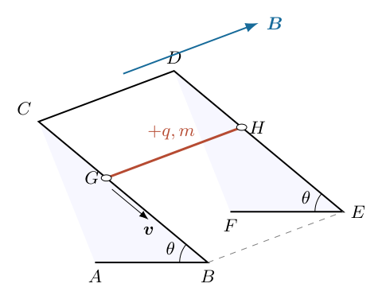
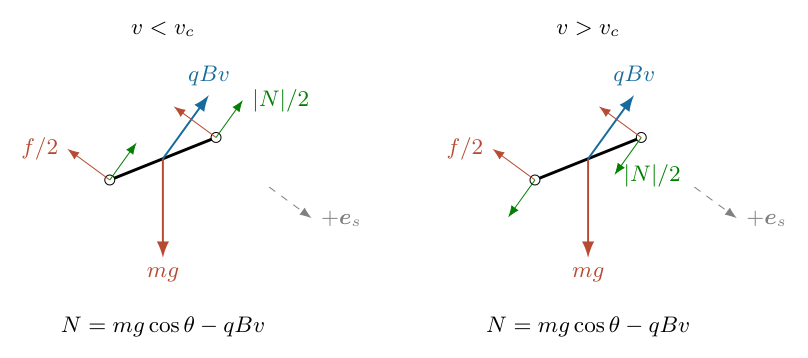
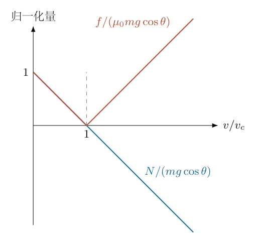
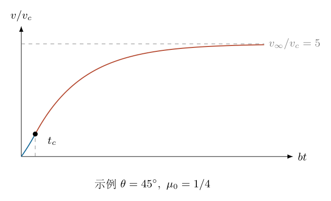

# 第 5 题

<!-- question-start -->
绝缘线 $ABCDEF$ 弯成图示形状，其中 $ABC$ 与 $DEF$ 所在平面互相平行。质量为 $m$、表面均匀带正电荷 $q$ 的绝缘直杆 $GH$，两端各弯成小圆环，分别套在 $CB$、$DE$ 上。圆环与导轨的间隙很小，滑动摩擦因数为 $\mu_0$。两条斜导轨与水平线的夹角均为 $\theta$。

系统置于均匀磁场中，磁感应强度 $\boldsymbol B$ 垂直于两个平行平面，由 $ABC$ 面指向 $DEF$ 面。直杆从靠近顶端 $CD$ 的位置由静止开始下滑，斜导轨足够长。

（a）画出刚下滑不久时直杆的受力图。（b）写出这段运动的方程。（c）速度较大时，作用于直杆的力是否有方向改变？若有，说明哪些力改变及原因。（d）写出较大速度时的运动方程。（e）求最大下滑速度。积分提示中的上下限应按 $\int_a^b{\rm d}x/x=\ln(b/a)$ 使用。

<!-- question-end -->

## 一、题型定位

这是带电绝缘杆在磁场中的约束滑动问题。磁场不是通过闭合电路的感应电流产生阻力，而是直接对杆上随杆移动的电荷施加洛伦兹力。杆和导轨均绝缘，不能套用导体棒切割磁感线的 $B^2l^2v/R$ 阻力公式。

套环能够承受法向约束力的两个方向。速度增大后，磁力超过重力的法向分量，接触从套环一侧移到另一侧，导轨对杆的法向合力反向；摩擦力仍与下滑方向相反。必须把法向反力写成有符号的量，再用其绝对值计算摩擦大小。

## 二、知识点

均匀移动的总电荷 $q$ 受磁力 $\boldsymbol F_B=q\boldsymbol v\times\boldsymbol B$。因为 $\boldsymbol F_B$ 垂直于速度，磁力的瞬时功率为零，不能直接给杆增加机械能。

滑动摩擦大小为 $\mu_0|N|$，其中 $N$ 是导轨法向合力的有符号分量。小套环的接触侧改变不使摩擦方向自动反号；摩擦方向由相对滑动方向决定。

一阶方程 $\dot v=a+bv$ 用分离变量法可解为指数增长，$\dot v=b(v_\infty-v)$ 解为指数逼近。终端速度是净切向力为零的平衡值，通常在无限时间极限达到，不是有限时刻突然获得的峰值。

## 三、物理图像

取 $\boldsymbol e_s$ 沿斜轨向下，$\boldsymbol e_w$ 沿 $G$ 到 $H$，$\boldsymbol e_n$ 垂直斜面朝外。磁场沿 $\boldsymbol e_w$，故磁力沿 $\boldsymbol e_n$，把杆从原接触侧抬起，但套环仍扣住导轨。

低速时磁力减小所需的正向法向反力，也减小摩擦，下滑加速度随速度增大。磁力等于重力法向分量时，法向反力和摩擦暂时为零。再增速，套环另一侧接触，反向约束力的大小增加，摩擦也增加，最终抵消重力切向分量。

## 四、解题入口

先建立真正的三维叉乘方向，再将重力分解为沿斜轨和法向分量。法向加速度为零给出 $N=mg\cos\theta-qBv$；切向方程始终为

$$
m\dot v=mg\sin\theta-\mu_0|mg\cos\theta-qBv|.
$$

根据括号的正负分两段求解，并在切换时刻保持 $v$ 连续。启动还涉及静摩擦，题目只给滑动摩擦因数，因此下面在杆已开始向下滑动、且通常取 $\tan\theta>\mu_0$ 的条件下求自发加速分支。

## 五、解析

（1）建立局部正交基与磁力方向。

可取空间直角坐标使

$$
\begin{aligned}
\boldsymbol e_s&=(\cos\theta,0,-\sin\theta),\\
\boldsymbol e_w&=(0,1,0),\\
\boldsymbol e_n&=(\sin\theta,0,\cos\theta).
\end{aligned}
$$

它们均为单位向量，且 $\boldsymbol e_s\times\boldsymbol e_w=\boldsymbol e_n$。杆的速度为 $v\boldsymbol e_s$，磁场为 $B\boldsymbol e_w$，所以

$$
\boldsymbol F_B=qvB\boldsymbol e_n.
$$

均匀分布的电荷各微元有相同平动速度，积分给出总电荷 $q$；不能把 $q$ 再乘杆长。重力分解为

$$
m\boldsymbol g=mg\sin\theta\,\boldsymbol e_s-mg\cos\theta\,\boldsymbol e_n.
$$

两端对称接触时每端承担法向、摩擦合力的一半，不产生使杆绕中点翻转的净力矩。这里使用直杆始终横跨两平行轨、作平动的模型。

（2）求法向约束力并画低速受力图。

将两端法向反力之和写成 $N\boldsymbol e_n$，$N$ 允许正负。杆不离开由两轨确定的运动面，法向加速度为零，故

$$
N+qBv-mg\cos\theta=0,\qquad\boxed{N=mg\cos\theta-qBv}.
$$

定义接触侧切换速度

$$
\boxed{v_c=\frac{mg\cos\theta}{qB}}.
$$

当 $0\leq v<v_c$，$N>0$，法向反力沿外法向，摩擦为 $-\mu_0N\boldsymbol e_s$。图5-2左图中重力、磁力、反力均标在实际作用方向；重力的分解只是计算工具，不再额外添加为新的力。

图中摩擦在两阶段都朝上坡。磁力沿同一方向随 $v$ 增大，改变方向的是 $N\boldsymbol e_n$，不是磁力或重力。

（3）建立低速切向方程。

沿 $\boldsymbol e_s$ 为正，重力切向分量向下，摩擦向上，磁力没有切向分量。因此

$$
\begin{aligned}
m\dot v&=mg\sin\theta-\mu_0(mg\cos\theta-qBv)\\
&=mg(\sin\theta-\mu_0\cos\theta)+\mu_0qBv.
\end{aligned}
$$

定义 $a=g(\sin\theta-\mu_0\cos\theta)$、$b=\mu_0qB/m$。于是 $\dot v=a+bv$，其中 $a$ 的单位是加速度，$b$ 的单位是时间倒数。若 $a>0$，从 $v(0)=0$ 开始滑动，分离变量得

$$
\int_0^{v(t)}\frac{{\rm d}v'}{a+bv'}=\int_0^t{\rm d}t'.
$$

积分前先换元 $w=a+bv'$，$\mathrm{d}w=b\,{\rm d}v'$，于是

$$
\begin{aligned}
\frac1b[\ln(a+bv') ]_0^{v(t)}&=t,\\
\ln\frac{a+bv(t)}a&=bt,\\
a+bv(t)&=ae^{bt}.
\end{aligned}
$$

所以

$$
\boxed{v(t)=\frac ab(e^{bt}-1)},\qquad0\leq t\leq t_c.
$$

积分上下限给出的是 $\ln[(a+bv)/a]$，不是它的反号。代回 $\dot v=a e^{bt}$，与 $a+bv$ 一致。

（4）求接触侧切换时刻及连续性。

令低速解达到 $v_c$，则 $e^{bt_c}=1+bv_c/a$。注意 $bv_c=\mu_0g\cos\theta$，因此

$$
\begin{aligned}
1+\frac{bv_c}{a}
&=\frac{\sin\theta}{\sin\theta-\mu_0\cos\theta}
=\frac{\tan\theta}{\tan\theta-\mu_0},\\
\boxed{t_c}&=\boxed{\frac1b\ln\frac{\tan\theta}{\tan\theta-\mu_0}}.
\end{aligned}
$$

在 $v=v_c$ 时 $N=0$、摩擦为零，故两侧都给出 $\dot v=g\sin\theta$。速度和加速度连续，但加速度对速度的导数在该点改变符号。这不是某个速度冲量，而是接触反力连续穿过零。

图5-3以横轴 $v$ 展示有符号反力 $N$ 和非负摩擦大小 $\mu_0|N|$，后者呈折线最低点。

（5）速度较大时的受力与方程。

当 $v>v_c$，$N<0$，反力方向为 $-\boldsymbol e_n$，大小 $qBv-mg\cos\theta$。套环的几何约束允许这一反力；若只有普通单面支持而没有套环，物体将失去接触，不能沿用本段模型。

摩擦仍与向下滑动相反，故

$$
\begin{aligned}
m\dot v&=mg\sin\theta-\mu_0(qBv-mg\cos\theta)\\
&=mg(\sin\theta+\mu_0\cos\theta)-\mu_0qBv.
\end{aligned}
$$

定义

$$
\boxed{v_\infty=\frac{mg(\sin\theta+\mu_0\cos\theta)}{\mu_0qB}}.
$$

方程为 $\dot v=b(v_\infty-v)$。由于 $v_\infty-v_c=mg\sin\theta/(\mu_0qB)>0$，切换后继续加速，但加速度逐渐减小。以 $\tau=t-t_c$ 为新时间，初速度为 $v_c$，分离变量时

$$
\int_{v_c}^{v(t)}\frac{{\rm d}v'}{v_\infty-v'}=b(t-t_c).
$$

分母导数为负，所以积分为

$$
-\ln\frac{v_\infty-v(t)}{v_\infty-v_c}=b(t-t_c).
$$

取指数并解出 $v$：

$$
\boxed{v(t)=v_\infty+(v_c-v_\infty)e^{-b(t-t_c)}},\qquad t\geq t_c.
$$

图5-4显示先指数加速、后指数趋于终端值的两段曲线。终端值大于 $v_c$，不能把法向反力为零的速度当成最大下滑速度。

（6）解释“最大速度”和终端状态。

任意有限 $t>t_c$，指数项仍为正且 $v_c-v_\infty<0$，因此 $v(t)<v_\infty$。最大下滑速度在理想无限长导轨上应理解为上确界或渐近终端速度：

$$
\boxed{\sup v=v_\infty
=\frac{mg(\sin\theta+\mu_0\cos\theta)}{\mu_0qB}}.
$$

终端时摩擦与重力切向分量平衡，而不是法向反力消失。回代法向方程，

$$
N_\infty=mg\cos\theta-qBv_\infty
=-\frac{mg\sin\theta}{\mu_0}.
$$

所以 $\mu_0|N_\infty|=mg\sin\theta$，与切向平衡相符。各端在完全对称条件下承担 $N_\infty/2$；负号表示其接触侧反向，不表示摩擦大小为负。

（7）计算位移，检查两个阶段的时间解是否衔接。

由 $\dot s=v$，取初始位移 $s(0)=0$，低速阶段积分得

$$
s(t)=\frac a{b^2}(e^{bt}-1-bt).
$$

所以切换位置为 $s_c=v_c/b-at_c/b$。高速阶段从 $s_c$ 出发：

$$
s(t)=s_c+v_\infty\tau
+\frac{v_c-v_\infty}{b}(1-e^{-b\tau}),\qquad\tau=t-t_c.
$$

在 $\tau=0$ 时位移为 $s_c$，一阶导数为 $v_c$，二阶导数为 $b(v_\infty-v_c)=g\sin\theta$。导轨若有限，应根据总长求终点时间，再代速度；没有足够长的导轨，不能声称真实杆已经达到终端值。

<!-- KEEP_STUDENT_START -->

（8）功率与能量检查。

磁力与速度正交，所以 $\boldsymbol F_B\cdot\boldsymbol v=0$。约束反力也与速度正交。机械能变化只来自重力做功和摩擦耗散：

$$
\frac{{\rm d}}{{\rm d}t}\left(\frac12mv^2\right)
=mg\sin\theta\,v-\mu_0|mg\cos\theta-qBv|v.
$$

这正是切向运动方程乘以 $v$，与分段解一致。磁力虽然不做功，却通过改变接触压力和摩擦间接影响加速度。将其称为“磁场给杆持续供能”会违反功率关系。

数值核验直接积分含绝对值的完整方程，不预先输入切换公式，并独立积分功率。所得速度与两段解析解一致，功率积分与动能增量一致。量纲上 $mg/(qB)$ 是速度，$m/(\mu_0qB)$ 是时间，符合 $v_c,v_\infty,t_c$ 的结构。

（9）启动条件与退化情况。

滑动后正向加速要求 $a>0$，即 $\tan\theta>\mu_0$。题干只给滑动摩擦因数，真正从静止自发启动还需静摩擦因数 $\mu_{\rm s}$ 满足 $\tan\theta>\mu_{\rm s}$；若默认静、滑摩擦相同，可使用前一条件。不能把未给出的静摩擦数据当成已知。

若 $\tan\theta=\mu_0$，在理想滑动方程且 $v(0)=0$ 下仍保持静止；微小正速度会在低速段增长，但启动时间依赖扰动。若 $\tan\theta<\mu_0$，直接代指数式会得到负速度，这已违反“向下滑动”的摩擦方向假设，应转入静止或重新确定运动方向的模型。

若 $\mu_0=0$，磁力不产生切向阻力，$\dot v=g\sin\theta$，没有有限终端速度。若 $qB=0$，普通摩擦下的加速度为 $g(\sin\theta-\mu_0\cos\theta)$，也没有由磁作用产生的终端速度。终端式中的发散反映这些模型退化，而不是一个能够取到的无限速度。

<!-- KEEP_STUDENT_END -->

## 六、关键洞察

套环的双向约束是本题与带电物体在普通斜面上滑动的根本差别。普通斜面要求 $N\geq0$，达到 $N=0$ 后可能离面；套环允许 $N$ 变号，因此后半程仍沿轨运动。

摩擦方向跟随相对滑动方向，接触反力方向跟随法向平衡，两者不是同一个判据。法向反力变号后摩擦大小先减至零再增加，但摩擦方向始终朝上坡。

可以用速度相图独立判断终端稳定性。高速区 $\dot v=b(v_\infty-v)$：低于 $v_\infty$ 时加速，高于它时减速，所以这是稳定速度。低速区 $\partial\dot v/\partial v=b>0$ 有正反馈，但速度到 $v_c$ 后进入负反馈区，不会无限指数增长。

## 七、易错点

用导体棒感应电流模型，会引入不存在的电路电阻和杆长；正确磁力是总电荷 $q$ 的洛伦兹力。叉乘应在空间坐标中建立，不能把纸面斜线与屏幕外方向随意组合。

法向反力不能永远写为正的支持力。摩擦大小必须用 $\mu_0|N|$，但方向不能由 $N$ 的正负决定。把高速段摩擦改成下坡，会错误地得到永远加速。

积分提示的上下限反号会使指数衰减、增长互换。对 $\int{\rm d}v/(v_\infty-v)$ 尤其要保留负号。切换时刻不要重设为原始 $t=0$ 而丢掉位移和速度的连续性。

最大速度是无限长、无限时间极限下的终端值，不是 $N=0$ 的 $v_c$，也不是有限导轨末端的实际速度。

## 八、课堂讲解建议

课堂首先画三维轨道，再单独画局部正交基，让学生用右手规则确认磁力向外法向。教师把两端接触力合并，但说明对称性和套环的双向能力，避免二维草图掩盖接触侧切换。

板书始终先写总方程 $m\dot v=mg\sin\theta-\mu_0|mg\cos\theta-qBv|$，然后分段。让学生比较 $v_c$ 和 $v_\infty$，再用相图判断两段变化，最后积分。这样积分只是落实已建立的物理趋势，不会成为符号操作的猜谜。

课堂可以追问磁力不做功为何能改变终端速度，答案应落在接触压力改变摩擦上。这个问题能关联已学的约束力和非保守力，而不是把磁场误当能量源。

## 九、变式训练

变式一：取 $\theta=45^\circ$、$\mu_0=1/4$，令 $V_*=mg/(qB)$，求切换速度、终端速度和切换时间。

因为 $\sin\theta=\cos\theta=1/\sqrt2$，

$$
v_c=\frac{V_*}{\sqrt2},\qquad
v_\infty=\frac{5V_*}{\sqrt2},\qquad
t_c=\frac{4m}{qB}\ln\frac43.
$$

终端反力为 $N_\infty=-2\sqrt2mg$，摩擦大小为 $mg/\sqrt2$，恰等于重力切向分量。

变式二：在切换以后，要使速度达到 $v_\infty$ 与 $v_c$ 间差值的 $90\%$，还需多长时间？

速度差的衰减规律是

$$
\frac{v_\infty-v(t)}{v_\infty-v_c}=e^{-b\tau}.
$$

达到差值的 $90\%$，剩余差值为 $10\%$，故 $e^{-b\tau}=0.1$，得到

$$
\boxed{\tau=\frac{\ln10}{b}=\frac{m\ln10}{\mu_0qB}}.
$$

取目标比例 $1-\varepsilon$ 时一般为 $\tau=b^{-1}\ln(1/\varepsilon)$；当 $\varepsilon\to0$ 时间发散，说明精确终端值不在有限时间达到。

变式三：将电荷改为 $-q$，其余不变且仍向下滑动，求终端速度。

磁力变成内法向，约束反力始终为正：$N=mg\cos\theta+qBv$。切向方程为

$$
\dot v=g(\sin\theta-\mu_0\cos\theta)-bv=a-bv.
$$

若 $a>0$，从静止开始有 $v=(a/b)(1-e^{-bt})$，终端速度

$$
\boxed{v_\infty^-=\frac{mg(\sin\theta-\mu_0\cos\theta)}{\mu_0qB}}.
$$

没有接触侧切换。正、负电荷的差别不是磁力是否做功，而是磁力使法向接触压力减小还是增大。
