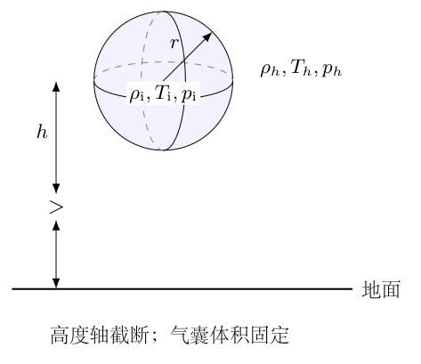
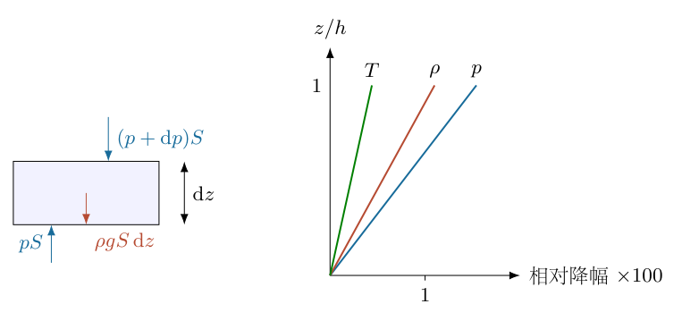
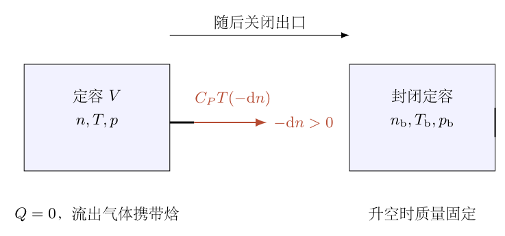
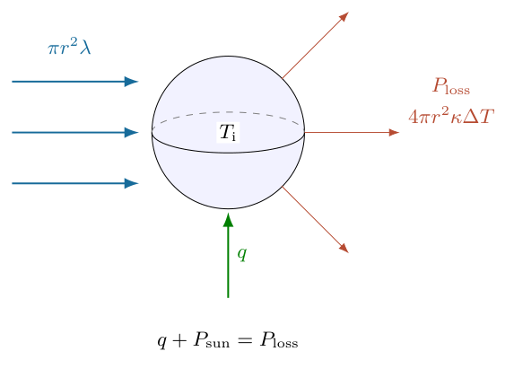
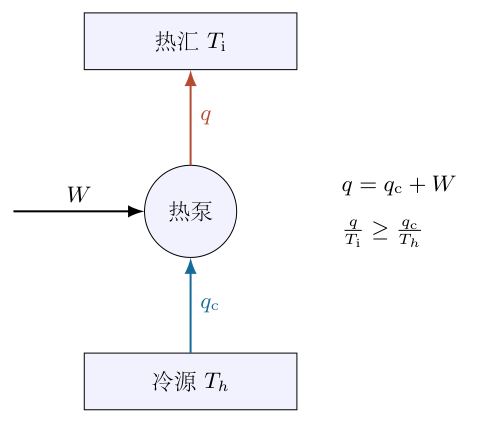

# 第 6 题

<!-- question-start -->
某行星上有稠密大气，生活着一种气球状生物。它们的半径和质量基本稳定，通过调节气囊内气体温度、改变密度来调整飞行高度。气球质量为 $m_0$，半径为 $r$；地面大气温度、压强、密度分别为 $T_0,p_0,\rho_0$，重力加速度为 $g$，气体摩尔质量为 $\mu$。

大气采用 $p\rho^{-\gamma}=\text{常量}$ 的绝热分层模型，$\gamma=7/5$，定体积摩尔热容 $C_V=2.5R$。在高度变化不大的范围内，大气温度、密度、压强按高度作线性近似。参数为

$$
\begin{aligned}
m_0&=202\,{\rm kg},&T_0&=300\,{\rm K},\\
\rho_0&=1.174\,{\rm kg\,m^{-3}},&r&=10\,{\rm m},\\
g&=10.6\,{\rm m\,s^{-2}},&p_0&=1.01\times10^5\,{\rm Pa},\\
\mu&=0.029\,{\rm kg\,mol^{-1}},&h&=125\,{\rm m}.
\end{aligned}
$$

（1）休息时内部气体与大气自由交换。气球在很短时间内向外排气，使内压降为 $p_0-\Delta p$，排气过程来不及交换热量，随后起飞并能稳定在高度 $h$。求 $\Delta p$。

（2）飞行一段时间后，日照和气球自身的热量输运使内压上升至与周围大气相等。求此时内部温度。

（3）皮膜内外温差为 $\Delta T$ 时，单位面积的散热系数为 $\kappa=\Delta Q/(\Delta S\,\Delta T\,\Delta t)$；阳光正入射时的单位面积热流为 $\lambda=\Delta Q/(\Delta S\,\Delta t)$。求维持上述状态时需要向内部气体输送的净热功率 $q=\Delta Q/\Delta t$。

（4）根据热力学第二定律，求搬运上述热量每单位时间至少需要的功 $W$。

<!-- question-end -->

## 一、题型定位

这是静力大气、阿基米德浮力、开口系统绝热排气以及可逆热泵的综合题。四问按状态衔接：先确定高度 $h$ 的外界状态，再由浮力求囊内质量，由排气模型求地面压降，最后求温度与持续热功率。

题干有两处必要的模型澄清。若 $m_0$ 表示包含全部气体的总质量，半径也固定，则平均密度已经固定，不能靠改变温度再改变整体密度。下面将 $m_0$ 解释为气球本体质量，内部气体质量另计；这是得到通常浮力解的条件，而非题干已无歧义地给出的事实。

“很快、绝热排气”也不唯一决定排气后的温度与压强。下文采用刚性定容气囊、内部气体始终近似均匀、气体从出口带走当地焓、没有额外轴功的开口罐排气模型，并在排气后关闭出口。不采用此模型或不给其他排气信息，第（1）问的压降不能唯一计算。

## 二、知识点

静止大气满足 $\mathrm{d}p/{\rm d}z=-\rho g$。绝热分层的 $p\rho^{-\gamma}$ 为常量，用微分形式可将压强梯度转成密度梯度。理想气体 $p=\rho RT/\mu$，可用对数微分得到温度梯度。

浮力等于排开大气的重量，囊内气体本身也有重量；平衡方程为 $\rho_{\rm a}Vg=(m_0+M_{\rm i})g$，而不是 $\rho_{\rm a}Vg=m_0g$。

开口系统中流出气体带走摩尔焓 $C_PT$。即使气囊体积不变、边界没有体积功，排出物质也会使内部温度变化。排气后若封闭且定容、绝热，内部温度才保持不变。

球体对平行阳光的截获面积是投影面积 $\pi r^2$，与散热所用全部表面积 $4\pi r^2$ 不同。理想热泵的最小功由热源、热汇的熵变化限制，温度必须用开尔文。

## 三、物理图像

外界压强、密度、温度随高度降低。要悬浮在 $h$，囊内气体密度必须比同高度外界密度低一个 $m_0/V$，差值用于承担气球本体重量。

地面排气降低囊内气体量，并使气体冷却；封闭升空后这些气体的质量固定。后续吸热或热泵输热，在固定体积内提高温度与压强，直至内外压强相等。保持固定半径的皮膜必须能承受排气后到压差消失前的压强差。

持续热平衡中阳光提供部分热量，皮膜散热带走热量。缺口才由主动输热补足；若阳光已经过量，需要的是排热，而不是将热泵公式算出负的耗功。

## 四、解题入口

按外界状态、浮力质量、排气状态、加热状态的顺序列式。排气过程用摩尔数 $n$ 作变量，并记 $\mathrm{d}n<0$；这样流出焓在能量方程中的符号自然正确。

本题给出的 $p_0,\rho_0,T_0,\mu$ 与常用气体常量仅有小的舍入不一致。主要数值用给定地面状态之间的比值计算，避免不同小问混用不同的初始密度；再单独说明误差大小。

## 五、解析

（1）由静力平衡求高度 $h$ 的外压。

图6-2中的大气薄层底、顶压力分别为 $p(z)$、$p(z+{\rm d}z)$，重力向下。对面积 $S$、厚度 $\mathrm{d}z$ 的薄层列竖直平衡：

$$
p(z)S-p(z+{\rm d}z)S-\rho gS\,{\rm d}z=0.
$$

除以 $S{\rm d}z$ 并取极限，得 $\mathrm{d}p/{\rm d}z=-\rho g$。

一阶近似在地面取 $\rho=\rho_0$，积分到 $h$：

$$
\boxed{p_h=p_0-\rho_0gh}.
$$

代入 $\rho_0gh=1.174\times10.6\times125=1555.55\,{\rm Pa}$，所以

$$
\boxed{p_h=99444.45\,{\rm Pa}}.
$$

这里 $\rho$ 随高度变化对压强积分造成二阶修正；本题明确要求一阶线性近似，不能一问用线性、另一问又偷偷用精确值。

（2）求外界密度和温度的一阶梯度。

由 $p\rho^{-\gamma}$ 为常量，取对数微分：

$$
\frac{{\rm d}p}{p}-\gamma\frac{{\rm d}\rho}{\rho}=0.
$$

在地面代入压强梯度，得

$$
\left.\frac{{\rm d}\rho}{{\rm d}z}\right|_0
=\frac{\rho_0}{\gamma p_0}
\left.\frac{{\rm d}p}{{\rm d}z}\right|_0
=-\frac{\rho_0^2g}{\gamma p_0}.
$$

因此

$$
\boxed{\rho_h=\rho_0
\left(1-\frac{\rho_0gh}{\gamma p_0}\right)}
=\boxed{1.1610847546\,{\rm kg\,m^{-3}}}.
$$

理想气体的对数微分为

$$
\frac{{\rm d}T}{T}
=\frac{{\rm d}p}{p}-\frac{{\rm d}\rho}{\rho}
=\frac{\gamma-1}{\gamma}\frac{{\rm d}p}{p}.
$$

在地面取梯度并积分：

$$
\boxed{T_h=T_0\left(1-\frac{\gamma-1}{\gamma}
\frac{\rho_0gh}{p_0}\right)}
=\boxed{298.67987270\,{\rm K}}.
$$

供以后使用，记无量纲压强降 $\varepsilon=\rho_0gh/p_0\approx0.01540149$。于是
$p_h/p_0=1-\varepsilon$、
$\rho_h/\rho_0=1-\varepsilon/\gamma$、
$T_h/T_0=1-(\gamma-1)\varepsilon/\gamma$，三者一阶展开与状态方程一致。

（3）用浮力确定囊内气体质量。

气球体积为

$$
V=\frac43\pi r^3=4188.79020479\,{\rm m^3}.
$$

将本体质量记为 $m_0$，内部气体质量为 $M_{\rm i}=\rho_{\rm i}V$。悬浮条件为

$$
\begin{aligned}
\rho_hVg&=(m_0+\rho_{\rm i}V)g,\\
\rho_{\rm i}&=\rho_h-\frac{m_0}{V}.
\end{aligned}
$$

本体折算密度为 $m_0/V=202/4188.79020479=0.04822394776\,{\rm kg\,m^{-3}}$，故

$$
\boxed{\rho_{\rm i}=1.11286080684\,{\rm kg\,m^{-3}}},
\qquad\boxed{M_{\rm i}=4661.54044698\,{\rm kg}}.
$$

悬浮总质量是 $m_0+M_{\rm i}=4863.54044698\,{\rm kg}$，绝不是 $202\,{\rm kg}$。地面交换平衡时囊内气体质量为
$M_{{\rm i},0}=\rho_0V=4917.63970042\,{\rm kg}$，排气量为
$256.09925344\,{\rm kg}$。这组质量数值说明为什么必须区分本体与全部气体。

必要可行条件是 $\rho_h>m_0/V$，否则无法用正质量内部气体达到平衡。在本体、气体总质量固定且体积固定时，若略升高，外界密度降低，浮力变小，产生向下合力；略降低则相反，故高度平衡具有恢复趋势。

（4）建立定容开口罐的绝热排气能量方程。

图6-3左侧是正在排气的开口系统，右侧是随后关闭的定容系统。气体初始摩尔数 $n_0=\rho_0V/\mu$，排气后为 $n_{\rm b}=\rho_{\rm i}V/\mu$。

设排气时内部温度为 $T$、摩尔数为 $n$。内部总内能为 $U=nC_VT$。排出少量气体 $-{\rm d}n>0$，带走能量 $C_PT(-{\rm d}n)$。无热输入、无额外轴功，故内部能量变化为

$$
{\rm d}(nC_VT)=C_PT\,{\rm d}n.
$$

右端因 $\mathrm{d}n<0$ 为负，表示能量流失。展开左端：

$$
C_Vn\,{\rm d}T+C_VT\,{\rm d}n=C_PT\,{\rm d}n.
$$

利用 $C_P-C_V=R$，得到

$$
C_Vn\,{\rm d}T=RT\,{\rm d}n,\qquad
\frac{{\rm d}T}{T}=\frac R{C_V}\frac{{\rm d}n}{n}
=(\gamma-1)\frac{{\rm d}n}{n}.
$$

两侧按初末状态积分：

$$
\begin{aligned}
\ln\frac{T_{\rm b}}{T_0}
&=(\gamma-1)\ln\frac{n_{\rm b}}{n_0},\\
\boxed{\frac{T_{\rm b}}{T_0}}
&=\boxed{\left(\frac{n_{\rm b}}{n_0}\right)^{\gamma-1}}.
\end{aligned}
$$

气囊体积不变，$p=nRT/V$，所以

$$
\frac{p_{\rm b}}{p_0}
=\frac{n_{\rm b}}{n_0}\frac{T_{\rm b}}{T_0}
=\left(\frac{n_{\rm b}}{n_0}\right)^\gamma.
$$

这与某些封闭绝热式的幂指数相似，但来源不同：这里变化的是物质的量，体积并不膨胀。快速不交换热量本身不能保证上述出口焓与均匀温度假设，需要明确排气模型。

（5）求压降并检查后续状态。

由于体积和摩尔质量相同，$\chi=n_{\rm b}/n_0=\rho_{\rm i}/\rho_0$。于是

$$
\boxed{\Delta p=p_0(1-\chi^\gamma)}
=\boxed{7286.26986827\,{\rm Pa}}.
$$

排气后的压强和温度为

$$
p_{\rm b}=93713.73013173\,{\rm Pa},\qquad
T_{\rm b}=293.65023651\,{\rm K}.
$$

$\Delta p$ 大于外界到高度 $h$ 的压强降 $1555.55\,{\rm Pa}$，不矛盾：排气后内部处于更低压力，皮膜须暂时承担压差。关闭出口、定容、无热交换的上升阶段，内部物质的量、体积及内能都不变，所以温度和压强保持 $T_{\rm b},p_{\rm b}$；不能继续套封闭膨胀绝热关系让其自行降温。

（6）内外等压后求内部温度。

到达 $h$ 后的加热阶段保持内部气体量与体积不变，直到 $p_{\rm i}=p_h$。用地面状态方程作比值：

$$
\frac{p_h}{p_0}
=\frac{\rho_{\rm i}}{\rho_0}\frac{T_{\rm i}}{T_0}.
$$

所以

$$
\boxed{T_{\rm i}=T_0\frac{p_h}{p_0}\frac{\rho_0}{\rho_{\rm i}}}
=\boxed{311.60734101\,{\rm K}}.
$$

也可从排气后状态计算 $T_{\rm i}=T_{\rm b}p_h/p_{\rm b}$，得到同一结果。内部温度比周围高

$$
\boxed{\Delta T=T_{\rm i}-T_h=12.92746831\,{\rm K}}.
$$

从排气后加热到此状态，温升为 $T_{\rm i}-T_{\rm b}\approx17.9571\,{\rm K}$，不是 $\Delta T$；两个温差分别用于瞬态内能变化和最终持续散热。

给定地面参数对应 $R_{\rm given}=p_0\mu/(\rho_0T_0)=8.31629756\,{\rm J\,mol^{-1}K^{-1}}$，与常用 $R\approx8.31446$ 的相对差约 $2.21\times10^{-4}$。这是输入舍入误差；采用给定初态比值保持四问一致。若选常用 $R$，应同时重算地面密度，而不是只在最终温度中混入另一套初态。

（7）求持续散热与阳光输入。

图6-4中平行太阳光照向球体。表面微元受到的辐射输入为 $\lambda\cos\alpha\,{\rm d}S$，只在受光半球积分。取入射方向为球极轴，面积元为 $\mathrm{d}S=r^2\sin\alpha\,{\rm d}\alpha\,{\rm d}\phi$，得

$$
\begin{aligned}
P_{\rm sun}
&=\int_0^{2\pi}\int_0^{\pi/2}
\lambda\cos\alpha\,r^2\sin\alpha\,{\rm d}\alpha\,{\rm d}\phi\\
&=2\pi\lambda r^2
\left[\frac12\sin^2\alpha\right]_0^{\pi/2}=\pi r^2\lambda.
\end{aligned}
$$

这等于投影面积乘正入射热流，不是表面积或半球面积乘同一个 $\lambda$。按均匀皮膜温度、给定线性传热系数，散热功率为 $P_{\rm loss}=4\pi r^2\kappa(T_{\rm i}-T_h)$。稳态时主动输热、日照输入与散热平衡，故

$$
\boxed{q=\pi r^2(4\kappa\Delta T-\lambda)}.
$$

代入面积和温差，可写为

$$
q=(16245.13578\,{\rm m^2K})\kappa-(314.15927\,{\rm m^2})\lambda.
$$

$\kappa$ 的单位为 $\mathrm{W\,m^{-2}K^{-1}}$、$\lambda$ 的单位为 $\mathrm{W\,m^{-2}}$，故 $q$ 单位为瓦。若 $q>0$，需主动向内部补热；若 $q=0$，日照已补偿散热；若 $q<0$，需排出多余热量，不能把负 $q$ 当成正向热泵输热任务。

（8）由第二定律求热泵最小耗功。

以下针对 $q>0$，取周围大气温度 $T_h$ 为冷源，气囊温度 $T_{\rm i}$ 为热汇。图6-5中每单位时间从冷源吸热 $q_{\rm c}$、向热汇送热 $q$，输入功为 $W$。

循环装置不积累内能，第一定律给出 $q=q_{\rm c}+W$。冷热源每单位时间的总熵变为

$$
\dot S_{\rm total}=\frac q{T_{\rm i}}-\frac{q_{\rm c}}{T_h}\geq0.
$$

整理为 $q_{\rm c}\leq qT_h/T_{\rm i}$，代回第一定律：

$$
\begin{aligned}
W&=q-q_{\rm c}\geq q\left(1-\frac{T_h}{T_{\rm i}}\right),\\
\boxed{W_{\min}}
&=\boxed{\pi r^2(4\kappa\Delta T-\lambda)\frac{\Delta T}{T_{\rm i}}}.
\end{aligned}
$$

等号仅在可逆热泵极限达到。温度因子为
$1-T_h/T_{\rm i}=\Delta T/T_{\rm i}\approx0.04148640$，
所以 $W_{\min}\approx0.04148640q$。这小于送入热汇的热量，因为其余热量从外界大气吸取，不违反能量守恒。实际装置有不可逆损耗，耗功更大。

当 $q<0$ 时，正向补热任务不存在；可讨论向外散热或其他冷却设计，但不能将上式负值解释为装置必然输出功。热机与热泵边界条件不同。

（9）核验线性近似与物理可行性。

不使用线性展开，联立静力方程与 $p/\rho^\gamma$ 常量，可积分得到

$$
\begin{aligned}
T(z)&=T_0\left[1-\frac{\gamma-1}{\gamma}\frac{\rho_0gz}{p_0}\right],\\
p(z)&=p_0\left[1-\frac{\gamma-1}{\gamma}\frac{\rho_0gz}{p_0}\right]^{\gamma/(\gamma-1)},\\
\rho(z)&=\rho_0\left[1-\frac{\gamma-1}{\gamma}\frac{\rho_0gz}{p_0}\right]^{1/(\gamma-1)}.
\end{aligned}
$$

用 $(1-x)^\nu=1-\nu x+O(x^2)$ 分别恢复一阶式。独立积分静力微分方程，在 $h$ 处得到
$p_h^{\rm exact}=99452.98753\,{\rm Pa}$、
$\rho_h^{\rm exact}=1.16112735\,{\rm kg\,m^{-3}}$，
与线性值的相对差均小于 $10^{-4}$，近似在给定高度适用。

独立积分开口能量方程 $\mathrm{d}T/{\rm d}n=(\gamma-1)T/n$，也与幂函数排气温度一致。质量、浮力、初末气体比值、热泵能量及熵条件分别检查，避免用同一最终公式重复代入自证。

## 六、关键洞察

本题包含三个不同的绝热：大气空间分层、开口排气、排气后封闭定容升空。它们不共享未经条件检查的 $pV^\gamma$ 公式。只看到“绝热”就套式，会使后续温度失去依据。

浮力决定的是总质量，不是气囊压强。内压是否等于外压由温度和膜的承压能力决定；压强差消失是后续加热状态，不是排气立即满足的条件。

若内外等压并用同一气体，状态方程给出 $T_{\rm i}/T_h=\rho_h/\rho_{\rm i}$，在一致的一阶口径下成立。结合浮力，

$$
\frac{T_{\rm i}-T_h}{T_{\rm i}}=\frac{m_0}{\rho_hV}.
$$

无量纲温差比例是本体质量占排开大气质量的比例，也近似等于理想热泵最小功与热汇供热量之比。分别使用线性近似和精确比值时有二阶差，不能将小差异解释为新的物理效应。

## 七、易错点

内部气体质量达到数千千克，不能忽略。若把 $202\,{\rm kg}$ 当成全部质量，却仍用 $\rho_{\rm i}=\rho_h-m_0/V$，是重复计算或混淆质量定义。

排出气体携带焓，不只是 $C_VT$ 的内能；漏掉出口流动功会得到错误的不降温结论。排气后封闭定容阶段则不能继续假装存在体积膨胀。

散热使用 $4\pi r^2$，太阳输入使用 $\pi r^2$；温差用于传热，绝对温度用于熵。$\Delta T=T_{\rm i}-T_h$ 不等于加热过程的 $T_{\rm i}-T_{\rm b}$。

热泵送热 $q$ 是热端热量，不是冷端吸热。最小功因子为 $1-T_h/T_{\rm i}$，不能误写反号或把热机效率用于错误的热量端口。

## 八、课堂讲解建议

课堂先画地面交换、排气后、封闭升空、加热等压四格状态图。教师在每格旁写清 $n,V,T,p$ 哪些不变，哪些变化，再进入推导。让学生把 $m_0$ 和 $M_{\rm i}$ 分开，避免漏掉气体重量。

板书开口能量方程时先写 $\mathrm{d}n<0$，用排出的正摩尔数 $-{\rm d}n$ 检查符号，再展开内能。课堂不应仅展示最终幂律，否则学生难以理解为什么定容也会冷却。

热泵部分让学生分别计算冷热源熵变，并比较向内部送热和从外界吸热的两个热量。根据 $q$ 的正负先确定物理方向再使用公式。

## 九、变式训练

变式一：忽略日照，即 $\lambda=0$，取 $\kappa=1\,{\rm W\,m^{-2}K^{-1}}$，求维持高度的热功率与理想最小功。

直接代入稳态式：

$$
q=4\pi(10\,{\rm m})^2
(1\,{\rm W\,m^{-2}K^{-1}})(12.92746831\,{\rm K})
\approx16245.14\,{\rm W}.
$$

理想最小功为 $W_{\min}=0.04148640q\approx673.95\,{\rm W}$。
冷端吸热为 $q_{\rm c}=q-W_{\min}\approx15571.18\,{\rm W}$，满足能量平衡。实际热泵不能以理想下限作为必然耗功。

变式二：不主动输热时，维持同样温差需要的太阳正入射热流是多少？

令 $q=0$，得 $\lambda_{\rm balance}=4\kappa\Delta T$。
若 $\kappa=1\,{\rm W\,m^{-2}K^{-1}}$，则

$$
\lambda_{\rm balance}=51.70987322\,{\rm W\,m^{-2}}.
$$

较低日照需补热，较高日照需排热。面积因子 $4$ 来自球面与投影面积之比，不是热容比。

变式三：相同排气后摩尔比 $\chi$，若排气过程保持等温，求压降并比较。

等温时 $T_{\rm b}=T_0$，定容状态方程给出 $p_{\rm b}/p_0=\chi$，所以
$\Delta p_{\rm iso}=p_0(1-\chi)$。
因为 $\chi<1$、$\gamma>1$，有 $\chi^\gamma<\chi$，故

$$
\Delta p_{\rm ad}=p_0(1-\chi^\gamma)>\Delta p_{\rm iso}.
$$

同样排出质量，绝热排气还伴随冷却，压降更大。这说明只给排气质量不足以决定压强，还要给能量交换条件。
