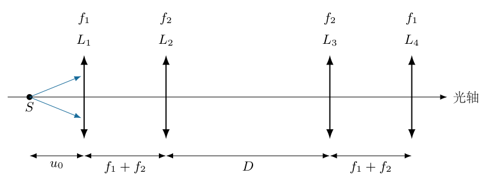
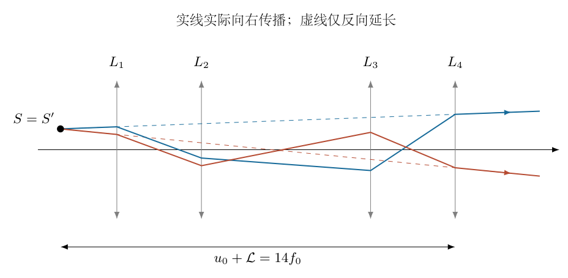
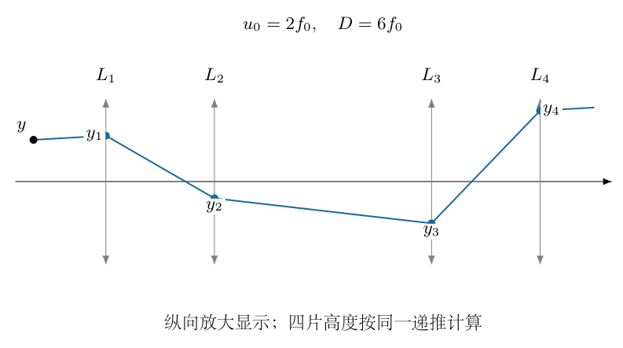
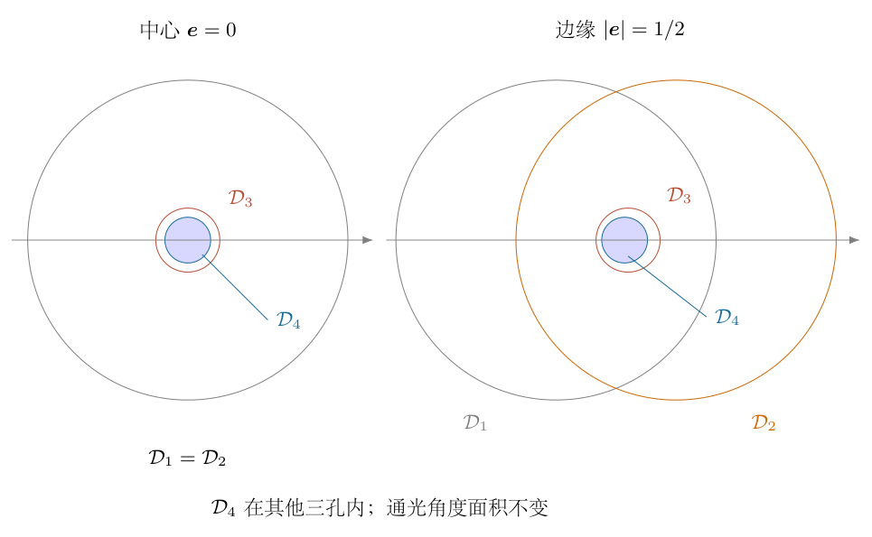

# 第 7 题

<!-- question-start -->
四个理想凸透镜 $L_1,L_2,L_3,L_4$ 同轴排列，焦距依次为 $f_1,f_2,f_2,f_1$，其中 $f_1>f_2>0$。$L_1L_2$、$L_3L_4$ 的间距均为 $f_1+f_2$，$L_2L_3$ 的间距为 $D$。点光源 $S$ 位于 $L_1$ 左侧，距离为 $u_0$。各问均采用傍轴近似。

（1）对一般 $u_0,D$，求经过四片透镜所成像的横向放大率 $M$。

（2）要求无论 $u_0$ 为多少，经过四片透镜所成像均与 $S$ 重合，求 $D$。

（3）采用第（2）问的间距，令 $u_0=f_1=2f_2=2f_0$，每片透镜半径均为 $h$。在 $S$ 处垂直于主光轴放置半径为 $h/2$ 的发光圆盘，求成像时圆盘中心与圆盘边缘处的光强之比。

<!-- question-end -->

## 一、题型定位

这是多透镜傍轴成像、无焦系统及孔径限制问题。逐片套透镜公式容易在中间虚物、虚像的符号上出错，光线传递矩阵可以保留全部光线高度和斜率，并直接判断成像位置及放大率。

“像与光源重合”不意味着光线绕回光源，也不意味着输出光束在原物面实际汇聚。四片透镜后的光线仍向右传播，这个重合像是向左反向延长得到的虚像。第（3）问应明确比较同等光源条件下的成像通量或亮度，不能把虚像处当作可直接放屏幕测量的实像面。

## 二、知识点

用列向量 $(y,\alpha)^{\mathsf T}$ 表示某平面上的光线高度和小倾角，沿主轴向右为传播正方向。自由传播距离 $d$ 和薄凸透镜分别给出

$$
P(d)=\begin{pmatrix}1&d\\0&1\end{pmatrix},
\qquad
L(f)=\begin{pmatrix}1&0\\-1/f&1\end{pmatrix}.
$$

两者来源于 $y'=y+d\alpha$、$\alpha'=\alpha-y/f$。矩阵乘法中右侧先作用，不能按光线行进顺序从左向右随意写积。

从物面到像面的矩阵若为 $(A,B;C,E)$，像点高度不能依赖同一物点发出的不同初始角度，故成像条件是 $B=0$，横向放大率为 $A$。像距取右侧为正，左侧虚像为负。

透镜的焦距控制光线折射，孔径控制光线能否通过。求光强还需给定光源的方向分布和观察方式；理想无损透镜本身不产生额外光能。

## 三、物理图像

前两片是一个无焦望远镜组合，后两片为反向组合。它们的角放大和横向缩放相互抵消，整套系统输出方向与输入方向相同，但输出高度一般产生一个与斜率有关的偏移。

当这个偏移等于透镜列的真实长度乘斜率时，外部光线的延长几何与没有透镜时一致。此时从右侧观察，会看到原位置、原大小、正立的虚像。但有限孔径仍可能削掉部分光束，因此几何重合不自动保证各视场点同亮。

## 四、解题入口

先合成两组无焦透镜矩阵，再乘中间传播矩阵。保留合成矩阵的上右元 $b$，它与真实列长 $\mathcal L$ 不一定相同。成像距由 $u_0+b+v=0$ 决定，位置重合条件则是 $b=\mathcal L$。

第（3）问逐片计算同一物点发出的任意小角光线在四片透镜上的高度，将每个圆孔变成二维角度空间中的圆盘限制。比较这些限制谁最严格，而不是只比较主光线高度或一条子午面射线。

## 五、解析

（1）证明第一组透镜无焦。

记 $s=f_1+f_2$。光线从 $L_1$ 前传播到 $L_2$ 后，矩阵为
$T_{12}=L(f_2)P(s)L(f_1)$。先乘右侧两因子：

$$
P(s)L(f_1)
=\begin{pmatrix}
1-s/f_1&s\\-1/f_1&1
\end{pmatrix}
=\begin{pmatrix}
-f_2/f_1&s\\-1/f_1&1
\end{pmatrix}.
$$

再乘 $L(f_2)$：

$$
\begin{aligned}
T_{12}
&=\begin{pmatrix}
-f_2/f_1&s\\
(f_2/f_1)/f_2-1/f_1&1-s/f_2
\end{pmatrix}\\
&=\begin{pmatrix}
-f_2/f_1&s\\0&-f_1/f_2
\end{pmatrix}.
\end{aligned}
$$

下左元为零，表示平行入射束仍平行出射，这就是无焦组合。两片间隔必须为焦距之和才有这个性质。

对反向组合 $L_3,L_4$，交换焦距角色：

$$
T_{34}=\begin{pmatrix}
-f_1/f_2&s\\0&-f_2/f_1
\end{pmatrix}.
$$

（2）合成四片透镜矩阵。

令 $k=f_1/f_2>1$，两个组合分别为

$$
T_{12}=\begin{pmatrix}-1/k&s\\0&-k\end{pmatrix},
\qquad
T_{34}=\begin{pmatrix}-k&s\\0&-1/k\end{pmatrix}.
$$

四片透镜之间还有传播 $D$，故总矩阵

$$
T=T_{34}P(D)T_{12}.
$$

逐步相乘：

$$
\begin{aligned}
P(D)T_{12}
&=\begin{pmatrix}-1/k&s-kD\\0&-k\end{pmatrix},\\
T&=\begin{pmatrix}
1&-k(s-kD)-ks\\0&1
\end{pmatrix}\\
&=\begin{pmatrix}1&b\\0&1\end{pmatrix},
\end{aligned}
$$

其中

$$
\boxed{b=k^2D-2k(f_1+f_2)
=\frac{f_1^2D-2f_1f_2(f_1+f_2)}{f_2^2}}.
$$

$b$ 的单位为长度，但它不是透镜之间的实际间距，甚至可以为负。两个对角元为 $1$，说明角度与平移倍率恢复为正立单位值；上右元仍携带光线高度偏移。

（3）加入物距、像距，求一般放大率。

设最后一片右侧的带符号像距为 $v$。从物面到像面总矩阵为

$$
\begin{aligned}
T_{\rm image}
&=P(v)TP(u_0)\\
&=\begin{pmatrix}1&u_0+b+v\\0&1\end{pmatrix}.
\end{aligned}
$$

同一物点 $y_0$ 发出的光线初始角度可不同，在待求像面高度为
$y_{\rm image}=y_0+(u_0+b+v)\alpha_0$。为了所有角度都指向同一像点，必须

$$
u_0+b+v=0.
$$

所以

$$
\boxed{v=-u_0-b},\qquad
\boxed{M=\frac{y_{\rm image}}{y_0}=1}.
$$

第（1）问的放大率恒为 $+1$，与 $D,u_0$ 无关；像的位置仍依赖两者。$v>0$ 为实际右侧像，$v<0$ 为向左回延的虚像，$v=0$ 是像面恰在末透镜平面的退化情形。

（4）用绝对位置建立重合条件。

以 $L_1$ 为轴向原点，光源位置为 $x_S=-u_0$。四片透镜列的真实长度为

$$
\mathcal L=2(f_1+f_2)+D=2s+D.
$$

像的轴向位置为
$x_{\rm image}=\mathcal L+v=\mathcal L-u_0-b$。
要求对任意 $u_0$ 都有 $x_{\rm image}=-u_0$，因而

$$
b=\mathcal L.
$$

代入 $b=k^2D-2ks$：

$$
\begin{aligned}
k^2D-2ks&=D+2s,\\
(k^2-1)D&=2s(k+1),\\
D&=\frac{2s}{k-1}.
\end{aligned}
$$

最后约去 $k+1>0$，得

$$
\boxed{D=\frac{2f_2(f_1+f_2)}{f_1-f_2}}.
$$

该间距为正，依赖 $f_1>f_2$。若误要求 $b=0$，会得到另一种位置不偏移的矩阵，却不会使像回到原物面，因为实际透镜列仍有正长度。

图7-2的实线表示向右的实际传播，虚线是末透镜后的光线向左反向延长。它们在 $S$ 交会，但光线没有实际返回那里。

在重合条件下 $v=-(u_0+\mathcal L)<0$，所以此处只能是虚像。把输出光线“画回”光源而仍加向右传播箭头，会误导读者认为存在反射器或实际返程。

（5）代入第（3）问参数并逐片追迹。

令 $f_2=f_0$、$f_1=2f_0$，则 $s=3f_0$、
$D=6f_0$、$\mathcal L=12f_0$，且 $u_0=2f_0$。末透镜到重合虚像的距离为 $14f_0$。

先在一个横向方向上追迹，物点坐标为 $y$，初始角度为 $\alpha$。到 $L_1$ 的高度是 $y_1=y+2f_0\alpha$，折射后

$$
\alpha_1=\alpha-\frac{y_1}{2f_0}=-\frac{y}{2f_0}.
$$

到 $L_2$：

$$
\begin{aligned}
y_2&=y_1+3f_0\alpha_1
=-\frac y2+2f_0\alpha,\\
\alpha_2&=\alpha_1-\frac{y_2}{f_0}=-2\alpha.
\end{aligned}
$$

到 $L_3$：

$$
\begin{aligned}
y_3&=y_2+6f_0\alpha_2
=-\frac y2-10f_0\alpha,\\
\alpha_3&=\alpha_2-\frac{y_3}{f_0}
=\frac{y}{2f_0}+8\alpha.
\end{aligned}
$$

到 $L_4$：

$$
\begin{aligned}
y_4&=y_3+3f_0\alpha_3=y+14f_0\alpha,\\
\alpha_4&=\alpha_3-\frac{y_4}{2f_0}=\alpha.
\end{aligned}
$$

图7-3按照这些高度画真实折线光路。最后的高度和角度满足
$y_4-14f_0\alpha_4=y$，再次证明回延虚像重合。

另一横向方向具有同样关系。因此以下用二维向量处理圆孔，不把圆形透镜误当成一维狭缝。

（6）把四个孔径限制转换为角度平面的圆盘。

定义无量纲物点向量 $\boldsymbol e=\boldsymbol y/h$，无量纲初始角度
$\boldsymbol u=f_0\boldsymbol\alpha/h$。发光圆盘半径为 $h/2$，所以 $|\boldsymbol e|\leq1/2$。每片透镜通过条件为高度向量模不大于 $h$：

$$
\begin{aligned}
|\boldsymbol e+2\boldsymbol u|&\leq1,\\
|-\boldsymbol e/2+2\boldsymbol u|&\leq1,\\
|-\boldsymbol e/2-10\boldsymbol u|&\leq1,\\
|\boldsymbol e+14\boldsymbol u|&\leq1.
\end{aligned}
$$

分别除去角度向量前的系数，得到角度平面内四个允许圆盘：

$$
\begin{aligned}
\mathcal D_1 &: \quad|\boldsymbol u+\boldsymbol e/2|\leq1/2,\\
\mathcal D_2 &: \quad|\boldsymbol u-\boldsymbol e/4|\leq1/2,\\
\mathcal D_3 &: \quad|\boldsymbol u+\boldsymbol e/20|\leq1/10,\\
\mathcal D_4 &: \quad|\boldsymbol u+\boldsymbol e/14|\leq1/14.
\end{aligned}
$$

全部可通行光线是四个圆盘的交集。不能只找最小圆盘半径而忽略圆心偏移；边缘物点的圆心相互错开，可能产生渐晕，必须检查包含关系。

（7）证明末透镜是中心和边缘共同的限制孔径。

两圆盘满足“小圆心到大圆心距离加小半径不大于大半径”时，小圆盘全部在大圆盘内。对 $\mathcal D_4$ 与另外三个圆盘，有

$$
\begin{aligned}
|\boldsymbol c_4-\boldsymbol c_1|+\frac1{14}
&=\frac37|\boldsymbol e|+\frac1{14}
\leq\frac27<\frac12,\\
|\boldsymbol c_4-\boldsymbol c_2|+\frac1{14}
&=\frac9{28}|\boldsymbol e|+\frac1{14}
\leq\frac{13}{56}<\frac12,\\
|\boldsymbol c_4-\boldsymbol c_3|+\frac1{14}
&=\frac3{140}|\boldsymbol e|+\frac1{14}
\leq\frac{23}{280}<\frac1{10}.
\end{aligned}
$$

最右边数值使用最不利边缘 $|\boldsymbol e|=1/2$，中心物点限制更宽松。因此

$$
\mathcal D_1\cap\mathcal D_2\cap\mathcal D_3\cap\mathcal D_4
=\mathcal D_4
$$

对整个物盘都成立。图7-4左右分别画中心和边缘的角度圆盘，最小圆盘没有被其他孔截去。圆心会移动，面积不会改变。

角度空间允许半径为 $h/(14f_0)$，傍轴立体角面积为

$$
\Omega_{\rm pass}=\pi\left(\frac{h}{14f_0}\right)^2.
$$

它与物点位置无关。这是没有渐晕的结论，不是透镜能把光强无限增大的结论。

（8）说明光源与观察模型，给出光强比。

若圆盘各位置具有相同单位面积的发光能力，并在这一小角范围内方向分布相同且可视为均匀，理想透镜无损，观察或收集装置接纳全部通行出射光束，则每个等面积物元的成像通量正比于 $\Omega_{\rm pass}$。横向放大率为 $1$，相应像元面积也相同，所以

$$
\boxed{I_{\rm centre}:I_{\rm edge}=1:1}.
$$

这里是连续物点趋近边缘的局部强度比较，不是“中心一个数学点”的总功率与“整圈边缘”的总功率比较。两者面积不同，必须取等面积元或局部辐射强度定义。

若未给圆盘发光均匀性、方向分布或观察孔径，“光强比”严格说不能唯一确定。例如有限眼瞳可能只截取某部分移位圆盘，或边缘物点本来更亮，都会改变观察强度。题目通常预期的 $1:1$ 是上述标准均匀、全孔收集模型下的答案。虚像面处没有真实出射光汇聚，不能在与光源重合的位置放屏幕来定义这个比。

（9）边界与独立验证。

当 $f_1\to f_2^+$，重合条件中的 $D$ 发散，说明等焦距四片透镜不能在有限中间间距下实现这类原位重合。若直接令 $f_1=f_2=f$，有 $b=D-4f$、$\mathcal L=D+4f$，两者差 $8f$ 不可能为零，与极限判定一致。

逐片数值追迹不使用总矩阵，随机取物点和角度，末端回延位置与初始物点一致，输出角度也与初始角度一致。另在二维末孔允许圆盘内采样，对中心、边缘分别检查四片高度均在半径 $h$ 内，独立检验包含关系。

所有光线仍须满足傍轴条件，特别是 $h/f_0\ll1$。若画图为了可见性放大纵向尺度，应说明横纵比例未统一，不能由图上大倾角推翻用于计算的傍轴模型。

## 六、关键洞察

两组望远镜的倍率互为倒数，只保证对角元恢复为 $1$，不自动保证物像重合。还需让 $b$ 恰等于整列的实际长度，这个长度条件是容易漏掉的最后一步。

虚像重合可用出射光线表达：最后一片位置为 $x=\mathcal L$，光线在那里满足 $y_4=y+\alpha(u_0+\mathcal L)$。向右继续传播，光线沿与物点在无透镜空间发出的同一直线前进，因此右侧看到的物体位置不变。中间光路却不同，可以绕过某些中间区域；这种光线几何与有限孔径均需检查，不能据此声称对任意角度、任意大物体都完全隐身。

二维通光圆盘的平移不会改变面积，却可能改变某固定观察孔的重叠面积。因此“全孔接收的通量均匀”和“任意固定眼瞳观测均匀”是不同命题。图7-4直接揭示这个区别。

## 七、易错点

矩阵乘序写反，会把物距和透镜作用错误拼接。先明确“右侧先作用”，再逐项保留高度、角度可避免这个问题。像距必须带符号，重合像的 $v<0$ 不是无物理解。

将 $b=0$ 当成重合条件，忽略了实际透镜列长度；将放大率 $1$ 当成光强自动相等，忽略孔径；将所有圆盘同心处理，忽略边缘圆心移动，都是不同层次的漏项。

发光盘半径是 $h/2$，不是 $2h$。把它增大四倍会改变第三孔是否截光，从而改变第（3）问答案。图稿只需标出 $h$ 和 $h/2$ 等必需尺寸，不应添加与推导无关的大量标签。

## 八、课堂讲解建议

课堂先让学生用两条基本光线推导薄透镜矩阵，再将两个无焦组合单独相乘。教师把等效参数 $b$ 与真实长度 $\mathcal L$ 分别写在板书左右，先回答放大率，再讨论像的位置，避免只得到单位倍率就停止。

第（3）问先让学生追踪一条中心光线和一条边缘光线，再解释单条光线不能代表全部通光量。随后画角度平面的圆盘，使用圆包含条件建立全孔结论，不要求先掌握复杂积分。

课堂最后明确虚像观察的定义，不把回延虚线画成真实返程。教师可询问小眼瞳是否还一定看到中心、边缘同亮，让学生区分题目标准模型与观察条件的扩展。

## 九、变式训练

变式一：保持 $f_1=2f_0,f_2=f_0$，把中间间距改为 $D=3f_0$，令 $u_0=2f_0$，求像的位置和性质。

此时 $b=4D-12f_0=0$，总长 $\mathcal L=9f_0$。像距 $v=-u_0=-2f_0$，像的绝对坐标为 $7f_0$，不是光源的 $-2f_0$。放大率仍为 $1$，像为虚像。这个数例直接区分 $b=0$ 与像原位重合。

<!-- KEEP_TOGETHER_START -->

变式二：采用重合参数，物盘半径扩大，求末孔仍完全受第三孔包含的最大无量纲视场半径 $E$。

末孔对第三孔的包含条件为

$$
\frac{3E}{140}+\frac1{14}\leq\frac1{10}.
$$

通分乘 $140$：$3E+10\leq14$，得到 $E\leq4/3$。再检查第一孔：
$3E/7+1/14\leq1/2$，得 $E\leq1$；
第二孔：
$9E/28+1/14\leq1/2$，得 $E\leq4/3$。
因此同时满足所有包含条件的最大视场半径为

$$
\boxed{E_{\max}=1,\qquad y_{\max}=h}.
$$

原题的 $E=1/2$ 位于这个范围内。超过 $h$ 后首先出现第一孔削切，而非第三孔；不能只检查最接近末孔大小的第三孔。

变式三：原参数下中心物点只有一个小观察孔，接受无量纲角度圆盘半径 $a_{\rm obs}=1/28$，其中心固定在 $\boldsymbol u=0$，比较中心与边缘全孔包含情况。

中心物点的通光圆盘半径 $1/14$、中心为零，观察孔在它内部。边缘 $|\boldsymbol e|=1/2$ 时，通光圆盘中心移至 $-\boldsymbol e/14$，偏移为 $1/28$。观察孔中心距离加半径为 $1/28+1/28=1/14$，仍恰被通光圆盘包含，所以两者观察通量相同。

若观察孔中心改为沿边缘方向的 $\boldsymbol u=\boldsymbol e/14$，它到边缘通光中心的距离为 $1/14$，再加半径 $1/28$ 超出 $1/14$，只截到部分通光圆盘；中心物点则还可能完整覆盖。这说明观察方向或眼瞳位置改变时，不能无条件沿用全孔通量的 $1:1$。

<!-- KEEP_TOGETHER_END -->
