# 第 1 题

<!-- question-start -->
半径为 $R$ 的轻质圆盘竖直放在水平地面上。在距圆心 $r$ 处嵌入一个质量为 $m$ 的质点，圆盘其余部分的质量忽略不计。圆盘与地面保持纯滚动且不脱离地面。初始时质点位于圆心正上方，系统静止，受到微小扰动后开始滚动。设重力加速度为 $g$，$0<r<R$。

（1）求质点到达最低位置时地面所受的力。（2）定性画出质点的运动轨迹。（3）以质点轨迹的切线、法线建立自然坐标系，求运动过程中法向加速度为零的非初始位置处，圆心到质点的连线与竖直向上方向的夹角 $\theta$。（4）求维持全过程纯滚动所需的最小静摩擦因数 $\mu$。（5）求圆盘全过程不脱离地面对 $r/R$ 的限制。

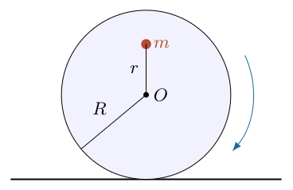
<!-- question-end -->

## 一、题型定位

这是偏心刚体纯滚动、摆线类轨迹及接触约束的综合题。所有质量集中于一个偏置质点，不能套用均匀圆盘的转动惯量；也不能把质点绕圆心的速度当作相对地面的速度。必须把圆心的平移与质点的转动合在一起计算。

本题有两个不同的约束检验。纯滚动要求所需静摩擦力不超过 $\mu N$，不脱离要求支持力 $N\geq0$。先假设这两个约束成立而求出运动，再检查它们能否实现；不能因为题干说“保持纯滚动”就免去后两问的核验。

初始最高位置是不稳定的静止状态。完全精确的静止解不会自行运动；下文取无限小扰动触发滚动、额外扰动能量趋于零的极限。由此能量常量取最高位置的势能。

## 二、知识点

无滑动时圆心位移与转角满足 $x_O=R\theta$。刚体任一点的速度是质心平动与相对转动速度之和，也可用瞬时接触点的转动关系求得。静摩擦虽然能改变动量和角动量，但接触材料点的瞬时速度为零，故不做功。

质点的动能只能写成其对地速度平方乘以 $m/2$。对于质量忽略的盘壳，外力矩平衡仍须成立；盘壳可以传递约束力，却不能凭空提供惯性力矩。

平面参数曲线 $\boldsymbol r(\theta)$ 的曲率大小为

$$
\kappa=\frac{|x'y''-y'x''|}{(x'^2+y'^2)^{3/2}},
$$

其中撇号表示对 $\theta$ 求导。自然坐标中的法向加速度大小为 $a_n=v^2\kappa$。它是轨迹弯曲引起的加速度，不等于某一个固定坐标分量。

## 三、物理图像

取向右滚动的分支，$\theta$ 自竖直向上方向顺时针增加。圆心始终高 $R$，质点相对圆心向右、向下运动；接触点沿地面向右更换。质点轨迹是短幅摆线的一种相位写法，没有尖点，也没有回环。

到达最低位置时质点的速度水平，而加速度有竖直向上的分量。因此地面受力大于静态重量。全程支持力的最小值不一定发生在最高或最低位置；寻找脱离条件必须扫描中间位置。

## 四、解题入口

先用滚动条件消去圆心的独立位移，得到质点坐标。利用势能下降确定角速度，再对速度求导得到角加速度及笛卡尔加速度。支持力和摩擦力由牛顿第二定律给出。最后将反力写成共同因子乘几何因子，这样摩擦比值和接触条件可以分开求极值。

为避免 $r$ 与位置坐标混淆，引入

$$
k=\frac rR,\qquad c=\cos\theta,\qquad
d=1+k^2+2kc.
$$

这里 $d$ 是无量纲几何量，并非距离；由于 $0<k<1$，有 $d\geq(1-k)^2>0$。

## 五、解析

（1）建立滚动几何与对地坐标。

图1-2中，$O$ 是圆心，$P$ 是质点，$Q$ 是瞬时接触点。坐标原点选在初始接触点，$x$ 向右、$y$ 向上。质点的相对坐标是 $(r\sin\theta,r\cos\theta)$，圆心坐标为 $(R\theta,R)$，所以

$$
\begin{aligned}
x_P&=R\theta+r\sin\theta,\\
y_P&=R+r\cos\theta.
\end{aligned}
$$

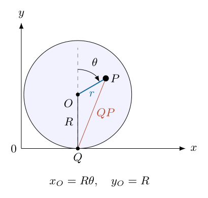

图中的 $OP=r$ 和 $OQ=R$ 同时进入上述坐标式；$\theta$ 不能从最低位置重新起算而仍使用同一余弦符号。

对时间求导，逐项使用复合函数求导法则：

$$
\begin{aligned}
v_x&=(R+r\cos\theta)\dot\theta,\\
v_y&=-r\sin\theta\,\dot\theta,\\
v^2&=\left[(R+r\cos\theta)^2+r^2\sin^2\theta\right]\dot\theta^2\\
&=(R^2+r^2+2Rr\cos\theta)\dot\theta^2.
\end{aligned}
$$

记 $A=R^2+r^2+2Rr\cos\theta=R^2d$。直接由三角形 $QOP$ 也得到 $QP^2=A$，因此 $v=QP\,|\dot\theta|$，与接触点瞬时静止的解释一致。

（2）建立机械能守恒，求角速度。

初始质点高度为 $R+r$，运动到 $\theta$ 时高度为 $R+r\cos\theta$。势能下降为 $mgr(1-\cos\theta)$。支持力与静摩擦不做功，故

$$
\frac12mA\dot\theta^2=mgr(1-\cos\theta).
$$

先约去 $m$，再乘以 $2/A$，得到

$$
\boxed{\dot\theta^2=\frac{2gr(1-\cos\theta)}
{R^2+r^2+2Rr\cos\theta}}.
$$

不能写成 $\frac12mr^2\dot\theta^2=mgr(1-\cos\theta)$：左式漏掉圆心平移。圆盘“轻质”只使盘壳的动能忽略，不使质点的平移动能消失。

（3）由能量式求角加速度。

在 $\dot\theta\neq0$ 的运动区间对 $\frac12A\dot\theta^2=gr(1-\cos\theta)$ 求导：

$$
\frac12 A'\dot\theta^3+A\dot\theta\ddot\theta
=gr\sin\theta\,\dot\theta.
$$

除以 $\dot\theta$，并代入 $A'=-2Rr\sin\theta$：

$$
A\ddot\theta-Rr\sin\theta\,\dot\theta^2
=gr\sin\theta.
$$

于是

$$
\ddot\theta=\frac{r\sin\theta\,(g+R\dot\theta^2)}{A}.
$$

把上一步角速度代入括号。通分时

$$
\begin{aligned}
g+R\dot\theta^2
&=g\left[1+\frac{2Rr(1-\cos\theta)}A\right]\\
&=g\,\frac{R^2+r^2+2Rr\cos\theta+2Rr-2Rr\cos\theta}{A}\\
&=g\,\frac{(R+r)^2}{A}.
\end{aligned}
$$

因此

$$
\boxed{\ddot\theta
=\frac{gr(R+r)^2\sin\theta}{A^2}}.
$$

最高位置的除法需要用运动分支的极限解释；该式在 $\theta\to0$ 时连续趋于零，不意味着精确静止状态能够自行离开。

（4）求质点到达最低位置时的反力。

最低位置对应 $\theta=\pi$。此时 $A=(R-r)^2$、$\sin\theta=0$，因而

$$
\dot\theta_{\rm b}^{\,2}=\frac{4gr}{(R-r)^2},
\qquad \ddot\theta_{\rm b}=0.
$$

再对速度分量求导：

$$
\begin{aligned}
a_x&=(R+r\cos\theta)\ddot\theta-r\sin\theta\,\dot\theta^2,\\
a_y&=-r\sin\theta\,\ddot\theta-r\cos\theta\,\dot\theta^2.
\end{aligned}
$$

代入最低位置，得 $a_x=0$、$a_y=r\dot\theta_{\rm b}^{\,2}$。竖直方程为 $N_{\rm b}-mg=ma_y$，所以

$$
\boxed{N_{\rm b}
=mg\left[1+\frac{4r^2}{(R-r)^2}\right]}.
$$

图1-3中最低位置的水平反力为零。盘对地面的作用力与地面对盘的支持力大小相等、方向相反，故第（1）问答案是大小为 $N_{\rm b}$、竖直向下的力，而不是向上的支持力。

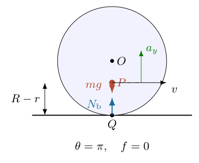

这里总质量就是 $m$，重量作用于偏置质点。不要给质量忽略的圆心再添一个 $mg$。

（5）由参数方程判断轨迹，而非凭外观画圆。

有

$$
\frac{dx_P}{d\theta}=R+r\cos\theta\geq R-r>0.
$$

因此 $\theta$ 增加时 $x_P$ 严格增加，轨迹不向后折返。高度范围为

$$
R-r\leq y_P\leq R+r.
$$

一周后满足

$$
x_P(\theta+2\pi)=x_P(\theta)+2\pi R,
\qquad y_P(\theta+2\pi)=y_P(\theta).
$$

图1-4用同一 $R,r$ 的参数式绘制一个几何周期，其水平长度为 $2\pi R$。它是短幅摆线，而非半径为 $r$ 的圆；圆只描述相对圆心的位置。这里的周期指几何参数式的重复，并不表示零扰动能量极限下能够有限时间连续越过每个最高点。

在 $\theta=2\pi-\varepsilon$、$0<\varepsilon\ll1$ 时，$1-\cos\theta\approx\varepsilon^2/2$，且 $A\approx(R+r)^2$，因而 $\dot\theta\approx\sqrt{gr}\,\varepsilon/(R+r)$。由 $\dot\varepsilon=-\dot\theta$，得到 $\varepsilon$ 随时间指数衰减：下一个最高点只能渐近接近。若给予有限的初始动能，则须在能量式中保留该初值，才能描述有限时间跨越最高点的运动。

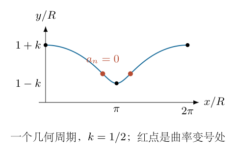

由于 $r<R$，最低点仍有非零横向切线分量 $R-r$。当 $r=R$ 时产生尖点，但该情形不属于后文可保持接触的参数范围。

（6）建立自然坐标，求非平凡的 $a_n=0$ 位置。

对坐标再求一次 $\theta$ 导数：

$$
x'=R+r\cos\theta,\quad y'=-r\sin\theta,\quad
x''=-r\sin\theta,\quad y''=-r\cos\theta.
$$

计算曲率分子：

$$
\begin{aligned}
x'y''-y'x''
&=(R+r\cos\theta)(-r\cos\theta)
-(-r\sin\theta)(-r\sin\theta)\\
&=-Rr\cos\theta-r^2(\cos^2\theta+\sin^2\theta)\\
&=-r(R\cos\theta+r).
\end{aligned}
$$

分母 $A^{3/2}>0$，而从最高到最低的内点速度非零，故 $a_n=0$ 等价于曲率为零。于是

$$
R\cos\theta+r=0,\qquad
\boxed{\theta=\arccos(-r/R)}.
$$

该解位于 $(\pi/2,\pi)$。另一半周还有对称位置 $2\pi-\arccos(-r/R)$。初始速度为零时 $v^2\kappa=0$ 只是静止的平凡情况，不能代替题目所要的运动内点。

法向单位矢量在拐点两侧的曲率方向会改变；在曲率恰为零时，不必强行赋予唯一曲率中心。切线方向仍由 $(x',y')$ 明确定义。

（7）求一般位置的摩擦力与支持力。

整体系只有重力、接触支持力 $N$ 和水平静摩擦力 $f$。约定 $f>0$ 向右，则

$$
f=ma_x,\qquad N=mg+ma_y.
$$

将角速度、角加速度换成无量纲形式：

$$
\frac{R\dot\theta^2}{g}=\frac{2k(1-c)}d,
\qquad
\frac{R\ddot\theta}{g}=\frac{k(1+k)^2\sin\theta}{d^2}.
$$

代入加速度，得到未因式分解的表达式：

$$
\begin{aligned}
\frac f{mg}
&=\frac{k\sin\theta}{d^2}
\left[(1+kc)(1+k)^2-2k(1-c)d\right],\\
\frac N{mg}
&=\frac{d^2-k^2(1-c^2)(1+k)^2
-2k^2c(1-c)d}{d^2}.
\end{aligned}
$$

这一阶段的正负号有物理意义：$a_y$ 不必为正，支持力不一定大于重量；静摩擦的方向也不是预先固定为“阻碍向右滚动”。

（8）展开共同多项式，得到可用于极值分析的形式。

定义

$$
P_k(c)=4k^2c^2+k(3k^2-2k+3)c+1+k^2-2k^3.
$$

第一行括号逐项展开为

$$
\begin{aligned}
&(1+kc)(1+2k+k^2)
-2k(1-c)(1+k^2+2kc)\\
&=1+2k+k^2+kc+2k^2c+k^3c\\
&\quad-2k-2k^3-4k^2c
+2kc+2k^3c+4k^2c^2\\
&=1+k^2-2k^3+(3k-2k^2+3k^3)c+4k^2c^2\\
&=P_k(c).
\end{aligned}
$$

第二行分子整理后恰为 $(1+kc)P_k(c)$。因此

$$
\boxed{
f=mg\,\frac{k\sin\theta\,P_k(c)}{d^2},
\qquad
N=mg\,\frac{(1+kc)P_k(c)}{d^2}
}.
$$

共同因子的出现不是巧合。盘壳质量忽略，对质点 $P$ 取外力矩，重力力矩为零，接触力矩平衡给出

$$
(R+r\cos\theta)f-r\sin\theta\,N=0.
$$

这个独立力矩关系也直接给出 $f/N=r\sin\theta/(R+r\cos\theta)$，可用来检查上面的因式分解。

（9）求全过程所需的最小静摩擦因数。

在有接触反力的区间，

$$
\frac{|f|}{N}=\frac{k|\sin\theta|}{1+k\cos\theta}.
$$

分母始终正。令 $c=\cos\theta$，最大化其平方，避免绝对值与平方根求导：

$$
F(c)=\frac{k^2(1-c^2)}{(1+kc)^2},\qquad -1\leq c\leq1.
$$

用商数求导并提取公因子：

$$
\begin{aligned}
F'(c)
&=k^2\frac{-2c(1+kc)^2-2k(1-c^2)(1+kc)}
{(1+kc)^4}\\
&=-\frac{2k^2[c(1+kc)+k(1-c^2)]}{(1+kc)^3}\\
&=-\frac{2k^2(c+k)}{(1+kc)^3}.
\end{aligned}
$$

所以 $c=-k$ 是唯一内点极大值，端点 $F(\pm1)=0$。代回：

$$
F(-k)=\frac{k^2(1-k^2)}{(1-k^2)^2}
=\frac{k^2}{1-k^2}.
$$

得到

$$
\boxed{\mu_{\min}=\frac{k}{\sqrt{1-k^2}}
=\frac r{\sqrt{R^2-r^2}}}.
$$

摩擦比值最大的位置与第（3）问轨迹拐点重合。由切线斜率 $dy/dx=-k\sin\theta/(1+kc)$ 可见，$\mu_{\min}$ 也等于轨迹最大切线倾斜的正切值。

该答案须与接触条件共同使用。如果某个参数已使 $N<0$，真实运动不能维持题设滚动，增加摩擦因数也不能让地面产生向下“拉力”。

（10）检查 $N\geq0$，不能只看最低位置。

因为 $1+kc\geq1-k>0$、$d^2>0$，支持力的符号由 $P_k(c)$ 决定。这是开口向上的二次多项式，其顶点为

$$
c_*=-\frac{3k^2-2k+3}{8k}.
$$

若 $0<k<1/3$，则 $c_*<-1$，最小值发生在区间左端 $c=-1$。计算

$$
P_k(-1)=(1-k)(5k^2-2k+1)>0,
$$

因为 $1-k>0$，且 $5k^2-2k+1=5(k-1/5)^2+4/5>0$。

若 $1/3\leq k<1$，顶点进入 $[-1,1]$，应在顶点取最小值。利用二次式配方，

$$
\begin{aligned}
P_{k,\min}
&=1+k^2-2k^3-\frac{(3k^2-2k+3)^2}{16}\\
&=\frac{(1+k)^3(7-9k)}{16}.
\end{aligned}
$$

因 $(1+k)^3>0$，条件 $P_{k,\min}\geq0$ 等价于 $k\leq7/9$。综合两个区间：

$$
\boxed{0<\frac rR\leq\frac79}.
$$

临界比值 $7/9$ 时，某内点 $N=f=0$，只瞬时触及零反力，不出现负反力；若要求全过程严格压紧地面，应取 $r/R<7/9$。临界处 $|f|/N$ 是 $0/0$，不能直接相除，但两侧连续极限和原来的不等式 $|f|\leq\mu N$ 均成立。

（11）根的筛选、量纲与退化情况检查。

$\mu_{\min}$ 和 $r/R$ 均无量纲；$N_{\rm b}$ 有力的量纲。$r/R\to0$ 时所需摩擦趋于零，最低反力趋于 $mg$，但驱动势能也趋于零；$r=0$ 本身没有偏心重力驱动，不应声称它会自动滚动。

$r/R\to1$ 的反力与摩擦表达式发散，然而脱离条件早已在 $7/9$ 被破坏，该极限不是本题可实现的接触运动。最高位置 $N=mg,f=0$，最低位置与第（4）步一致，两个端点不能揭示内点的脱离危险。

角速度公式中的正平方根选向右滚动，负平方根对应镜像的向左分支；反力大小和所需摩擦下限不受这一选择影响。每周拐点成对出现，不必为对称分支再建立不同动力学。

\newpage

# 第 2 题

<!-- question-start -->
天花板距水平地面的高度为 $\lambda h$，小球从天花板处自由下落。下方有一固定光滑斜面，其水平宽度和高度均为 $h$。小球与斜面发生完全弹性碰撞，忽略空气阻力和小球大小。

（1）要使任意小球均不与斜面发生两次或两次以上碰撞，求天花板的最低高度。

（2）取上一问中的“最大高度”，考察所有与斜面碰撞一次的小球，在它们第一次落到地面的位置中，求距离斜面最近的落点与斜面之间的距离 $\Delta$。

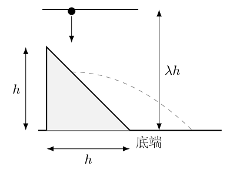
<!-- question-end -->

## 一、题型定位

这是完全弹性碰撞与抛体运动的衔接问题。斜面宽、高相等，所以倾角为 $45^\circ$。碰前的竖直速度经斜面反射后变为水平速度；反射方向须由切、法向分解证明，不能只根据示意图猜测。

“任意小球”意味着对所有可能的碰撞点检查二次相交。“最近落点”则要求求距离函数的最小值，不能把落地最远的小球作为答案。若释放位置是连续变化的，端点是否允许释放会影响最小值能否取到。

第（2）问中的“最大高度”与第（1）问求“最低高度”矛盾：满足第（1）问的高度没有上限。下文先给出一般允许高度的落点函数，再在明确采用第（1）问临界最低高度的条件下讨论最近落点，不暗中更换题意。

## 二、知识点

光滑固定斜面上的弹性碰撞保持切向速度，反转法向速度。取单位外法向量 $\boldsymbol n$，碰撞前后速度满足

$$
\boldsymbol v_+=\boldsymbol v_--2(\boldsymbol v_-\cdot\boldsymbol n)\boldsymbol n.
$$

“完全弹性”给出碰撞能量不损失，“光滑”给出切向冲量为零，两者一起确定反射规律。不能只凭能量守恒确定二维速度方向。

碰后抛体运动的水平速度不变，竖直加速度为 $-g$。轨迹与斜面所在无限直线相交，不一定与有限斜面相碰；必须同时检查交点位置。求最近距离时应先写出距离函数和定义域，再检查边界及极限，不能只解导数为零的方程。

## 三、物理图像

令斜面上端为 $(0,h)$，底端为 $(h,0)$，斜面向右下倾斜。小球碰后水平向右运动，其抛物线初始切线比斜面平缓，所以先离开斜面，随后才有可能再次相交。释放高度越大，水平速度越大，第二交点越向右移，越容易越过斜面底端。

非常靠近底端的碰撞点，离地高度很小，碰后飞行时间趋于零，落点可无限接近底端。因此“连续所有释放位置”的最近距离和“有限个指定位置的小球”的最近距离不是同一个问题。后者需要给出释放点，前者可以用极限或端点求解。

## 四、解题入口

取碰撞点高度 $y$ 为自变量，$0\leq y\leq h$。先求碰前速度 $u$，再将碰后轨迹与 $y=h-x$ 联立，得到第二交点。全体小球不发生第二次碰撞，要求该交点始终不落在实际斜面内部。

落地点到斜面底端的距离等于碰后水平位移减去碰撞点到斜面底端的水平距离。写出函数后，最小距离可以用不等式、边界值和连续性判断，不必绕道求最大射程。

## 五、解析

（1）建立碰撞点与下落速度的关系。

地面取 $y=0$，竖直向上为正。斜面所在直线为

$$
y_{\rm slope}=h-x,\qquad0\leq x\leq h.
$$

小球碰撞点的高度记为 $y$，则横坐标为 $x_0=h-y$。天花板高度 $H=\lambda h$，为了覆盖斜面顶部，首先有 $\lambda\geq1$。从静止下落的高度为 $H-y$，由能量守恒得

$$
\begin{aligned}
\frac12mu^2&=mg(H-y),\\
u^2&=2g(H-y)=2g(\lambda h-y).
\end{aligned}
$$

碰前速度为 $\boldsymbol v_-=(0,-u)$。这里的 $y$ 是碰撞点高度，不是小球下落的距离，两者相差 $H-y$。

（2）用速度分解证明碰后水平向右。

图2-2中沿斜面向右下的单位切向量和向右上的单位法向量分别是

$$
\boldsymbol t=\frac1{\sqrt2}(1,-1),\qquad
\boldsymbol n=\frac1{\sqrt2}(1,1).
$$

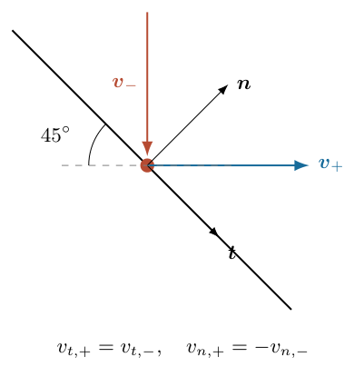

碰前分量为

$$
\begin{aligned}
v_{t,-}&=(0,-u)\cdot\boldsymbol t=\frac u{\sqrt2},\\
v_{n,-}&=(0,-u)\cdot\boldsymbol n=-\frac u{\sqrt2}.
\end{aligned}
$$

光滑碰撞保持切向分量，完全弹性碰撞使法向分量反号，所以

$$
\begin{aligned}
\boldsymbol v_+
&=\frac u{\sqrt2}\boldsymbol t+\frac u{\sqrt2}\boldsymbol n\\
&=\frac u2(1,-1)+\frac u2(1,1)\\
&=(u,0).
\end{aligned}
$$

故碰后是水平速度 $u$，竖直速度为零。这个结论依赖于斜面倾角为 $45^\circ$。

（3）求再次到达斜面所在直线的时刻。

碰后计时 $t=0$，小球轨迹为

$$
\begin{aligned}
x(t)&=h-y+ut,\\
y_{\rm ball}(t)&=y-\frac12gt^2.
\end{aligned}
$$

同一横坐标处的斜面直线高度为

$$
y_{\rm slope}(x(t))=h-(h-y+ut)=y-ut.
$$

小球相对这条直线的高度差为

$$
\delta y(t)=ut-\frac12gt^2
=t\left(u-\frac12gt\right).
$$

通过因式分解可见：$0<t<2u/g$ 时 $\delta y>0$，小球在斜面上方；除初次碰撞的 $t=0$ 以外，第二次交点对应

$$
t_2=\frac{2u}{g}.
$$

其横坐标为

$$
\begin{aligned}
x_2&=h-y+u\frac{2u}{g}\\
&=h-y+\frac{2}{g}\,2g(\lambda h-y)\\
&=(1+4\lambda)h-5y.
\end{aligned}
$$

图2-3中的实线是有限斜面，虚线是延长线。方程给出的交点如果位于虚线上，不构成实际二次碰撞。

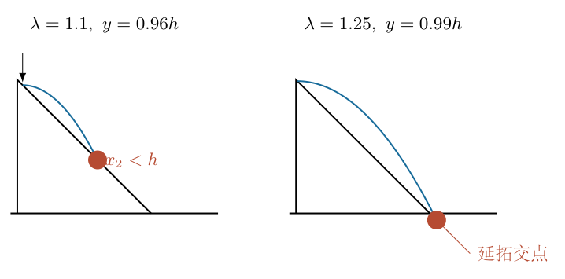

（4）求对所有碰撞点成立的高度条件。

再次碰撞斜面内部要求 $x_2<h$，逐步整理得

$$
\begin{aligned}
(1+4\lambda)h-5y&<h,\\
4\lambda h&<5y,\\
y&>\frac{4\lambda h}{5}.
\end{aligned}
$$

由于实际碰撞点满足 $y\leq h$，要使上述条件对所有点都不成立，应有 $4\lambda h/5\geq h$。因此

$$
\boxed{\lambda\geq\frac54,\qquad H_{\rm crit}=\frac54h}.
$$

这表示不发生第二次内部碰撞的临界最低高度，不是最大高度。

端点需要单独检查：$\lambda=5/4$、$y=h$ 时，$x_2=h$，小球恰在地面与斜面底角交会处返回斜面直线。如果将这种尖角接触也算第二次碰撞，且允许顶部释放，则需要 $\lambda>5/4$，最低高度只有下确界 $5h/4$，不能取到。若按通常的理想平面临界擦过约定，允许等号。两种表述的物理差异只在边界，不影响内部碰撞的阈值。

提高 $\lambda$ 会增大 $x_2$，不会重新产生内部二次碰撞，所以允许的高度没有上界。第（2）问如坚持“最大高度”，不存在指定高度。以下采用“取临界最低高度”的条件讨论；一般高度的落点函数也同时保留。

（5）求第一次落地的位置和距离。

落地要求 $y-gt_g^2/2=0$。取正时间根，有

$$
t_g=\sqrt{\frac{2y}{g}}.
$$

落地横坐标为

$$
\begin{aligned}
x_g&=h-y+u\sqrt{\frac{2y}{g}}\\
&=h-y+\sqrt{2g(\lambda h-y)}\sqrt{\frac{2y}{g}}\\
&=h-y+2\sqrt{y(\lambda h-y)}.
\end{aligned}
$$

距斜面底端的向右距离为

$$
\boxed{\Delta(y)=x_g-h=-y+2\sqrt{y(\lambda h-y)}}.
$$

这不是单纯的水平射程 $ut_g$，因为碰撞点位于底端左侧 $y$ 的距离处。图2-4中的两个落点展示了端点附近的轨迹如何趋近底角。

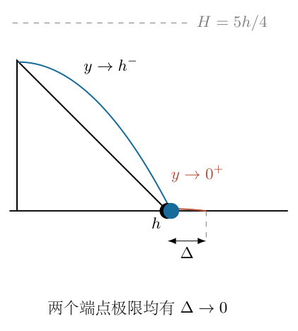

在 $\lambda\geq5/4$、$0\leq y\leq h$ 的允许范围内，

$$
4(\lambda h-y)\geq y.
$$

乘以非负的 $y$ 再开平方，得到

$$
2\sqrt{y(\lambda h-y)}\geq y,
$$

所以 $\Delta(y)\geq0$。最近地面点就是斜面底端；此处无需把负距离改取绝对值，也无需比较其他斜面点的空间距离。

（6）回答最近距离，并区分最小值和下确界。

当 $\lambda=5/4$ 时，距离函数是

$$
\frac{\Delta}h=-z+2\sqrt{z\left(\frac54-z\right)},
\qquad z=\frac yh,\quad0\leq z\leq1.
$$

分别代入两个端点：

$$
\begin{aligned}
z=0&:\quad\Delta=0,\\
z=1&:\quad\Delta=h\left[-1+2\sqrt{\frac14}\right]=0.
\end{aligned}
$$

对任何内部点 $0<z<1$，

$$
4\left(\frac54-z\right)>z,
$$

故 $\Delta>0$。因此连续区间若包含相应端点，最近距离为

$$
\boxed{\Delta_{\min}=0}.
$$

但是 $z=0$ 对应在地面底角处的退化碰撞，$z=1$ 对应顶部反射后在底角临界接触。若“恰碰撞一次”严格排除这两种端点，则允许区间是 $0<z<1$，每一个落点都满足 $\Delta>0$，不存在实际取到的最近落点。不过

$$
\lim_{z\to0^+}\Delta(z)=0,\qquad
\lim_{z\to1^-}\Delta(z)=0,
$$

所以距离的下确界仍为零。不能在排除了端点的同时，又声称某一个内部点达到零距离。

如果实际只有有限个小球，其释放位置为 $y_1,\ldots,y_N$，且均在内部，则

$$
\Delta_{\rm nearest}
=\min_{1\leq i\leq N}\left[-y_i+2\sqrt{y_i(\lambda h-y_i)}\right]>0.
$$

没有这些位置，不能给出该有限集合的具体最近距离。题目的连续释放理想化是得到零下确界的条件。

（7）用端点展开检查轨迹与答案。

靠近底端，$z\ll1$。把根式提出 $5z/4$，得到

$$
\begin{aligned}
\frac\Delta h
&=-z+\sqrt{5z}\sqrt{1-\frac45z}\\
&=\sqrt{5z}-z-\frac25\sqrt5\,z^{3/2}
+O(z^{5/2}).
\end{aligned}
$$

这里利用 $\sqrt{1-\varepsilon}=1-\varepsilon/2+O(\varepsilon^2)$。主导项为 $\sqrt{5z}>0$，并趋于零，与极限结论相符。对应飞行时间 $t_g\propto\sqrt y$，水平初速趋于有限值 $\sqrt{5gh/2}$，故水平距离也趋于零，而不是维持一个有限间隙。

靠近顶部，令 $z=1-\varepsilon$，$0<\varepsilon\ll1$。则

$$
z\left(\frac54-z\right)=\frac14+\frac34\varepsilon-\varepsilon^2.
$$

将根号展开到一阶：

$$
2\sqrt{\frac14+\frac34\varepsilon-\varepsilon^2}
=1+\frac32\varepsilon+O(\varepsilon^2),
$$

因此

$$
\frac\Delta h
=-(1-\varepsilon)+1+\frac32\varepsilon+O(\varepsilon^2)
=\frac52\varepsilon+O(\varepsilon^2)>0.
$$

顶部附近的落点也趋近底角。量纲检查中 $\Delta$ 只由 $h$ 乘无量纲函数构成；$m$ 消失是质点重力运动不依赖质量，$g$ 消失是下落速度与碰后飞行时间的比例相消。

\newpage

# 第 3 题

<!-- question-start -->
（1）将质量为 $m_0$、边长为 $l$、密度均匀的实心正方体分成 $27$ 个等大的小正方体，去掉六个面中心的小正方体及中心的小正方体，剩下 $20$ 个。对每一个保留的小正方体重复上述操作，无限次进行，形成 Menger 海绵。求最终形状的质量 $m$。

（2）求上述极限形状绕通过一对相对面中心的轴转动时的转动惯量 $I$。

（3）电阻问题：

a）正方体的 $12$ 条棱均为阻值 $1\,\Omega$ 的电阻。图中的 $A$ 与 $B,C,D$ 分别为相邻顶点，已知 $R_{AB}=7/12\,\Omega$、$R_{BC}=3/4\,\Omega$。将这四个端点等效为四面体形状的四端网络，求等效网络六条边各自的电阻。

b）一个正四面体的六条棱均由钢丝构成，每条棱初始电阻为 $1\,\Omega$。将每条棱三等分，在四个顶点处按图构造边长为原来 $1/3$ 的小正四面体，保留连接它们的六段中间钢丝。对各小正四面体继续作相同操作，无限次后求两顶点间的电阻 $R_{AB}$。

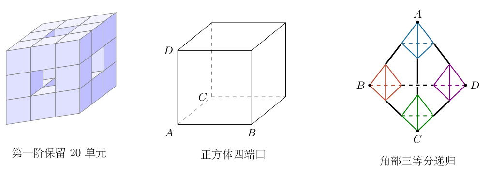
<!-- question-end -->

## 一、题型定位

本题把质量分布的递归与电阻网络的递归放在同一道题中，但两者不能直接套用同一个“分形维数”公式。挖去材料后质量按体积比例减少；电阻则取决于钢丝连接关系、各支路长度以及四端口之间的电流分配。

第（2）问需先判断总质量是否趋于零，再考虑转动惯量。第（3）问a中的等效必须对四个端口的任意接线都成立，不只是凑出两个已知的两端电阻。第（3）问b中的六段中间钢丝是重要的连接支路，不能误删，也不能把投影线条交叉处都当成焊接节点。

## 二、知识点

均匀材料移除后剩余质量等于原密度乘剩余体积。质量为 $m$、边长为 $a$ 的立方体绕通过中心且平行于一条棱的轴，其转动惯量为 $ma^2/6$；偏移轴用平行轴定理 $I=I_{\rm c}+md^2$。

电阻网络内部节点没有外部注入电流，满足基尔霍夫电流定律。消去内部节点电势后，端口电流与端口电势之间的关系保持不变，这才是完整的多端口等效。

对任意两端间的电阻，要让其余外端口悬空，而不是接地。几何等价的端点在指定接线下可能等电势，但未指定接线时不能预先把它们短接。四面体对称网络可利用星形—三角形变换的多端推广；推广式应由电势和电流关系证明，不能把三端公式未经检查直接用于四端。

## 三、物理图像

挖空正方体的每个小单元都缩小为边长 $l/3$，但有 $20$ 个单元保留，总体积比例为 $20/27<1$。质量不断减少，虽然几何图案越来越复杂，却不会增加惯性质量。

正方体电阻网络的 $A$ 点及其三个邻点 $B,C,D$ 组成四端口。其余四点仍在内部传导电流，消去后会在 $B,C,D$ 之间产生等效边。钢丝四面体则由四个小四面体和六段桥接钢丝组成；桥接钢丝连接不同小四面体上的两个不同顶点，而不是把它们视为同一点。

## 四、解题入口

质量直接建立 $m_n$ 的递推。转动惯量先给出物理极限，再用有限阶递推验证，防止将“归一化形状惯量”与真实惯量混为一谈。

四端网络用对称性设两类边阻，再独立消去正方体内部节点，验证整个端口关系。钢丝递归中，把每个小四面体替换为与四个端口等效的星形，连接结构就化成四个星心组成的新完整四面体；外端两条星臂与内部等效电阻串联，得到一阶线性递推。

钢丝计算按相同材料、相同截面积处理，即电阻与长度成正比。若新加钢丝的截面积不同，仅给出边长三等分不能唯一确定电阻；下文将这一必要的材料模型明确写出。

## 五、解析

（1）计算第 $n$ 次挖空后的质量。

初始密度为 $\rho=m_0/l^3$。每次在每个保留单元中留下 $20$ 个、去掉 $7$ 个，总体积乘 $20/27$。取尚未挖空为 $n=0$，有

$$
\begin{aligned}
m_{n+1}&=\frac{20}{27}m_n,\\
m_n&=m_0\left(\frac{20}{27}\right)^n.
\end{aligned}
$$

因为 $0<20/27<1$，等比数列趋于零，所以

$$
\boxed{m=\lim_{n\to\infty}m_n=0}.
$$

这里始终保持材料密度 $\rho$ 不变；没有在每次挖空后增大密度以补回质量。极限集合仍有几何点和复杂结构，不等于它具有非零体积或非零质量。

（2）先用界限证明极限转动惯量为零。

将转轴取为通过正方体中心的 $z$ 轴。任一点到轴的垂直距离满足

$$
s^2=x^2+y^2\leq\frac{l^2}{2}.
$$

因此第 $n$ 阶转动惯量满足

$$
0\leq I_n=\int s^2\,{\rm d}m
\leq\frac{l^2}{2}m_n.
$$

右端随 $n\to\infty$ 趋于零，由夹逼定理得到

$$
\boxed{I=0}.
$$

这个证明只用物体一直位于有限正方体内和总质量趋于零，不需要对无限复杂图形逐点积分。若先计算一个非零的无量纲形状系数，再直接乘初始质量 $m_0$，就会违反真实的质量减少条件。

（3）计算有限阶惯量，检查挖空单元与平行轴项。

图3-2将第一层保留小正方体的中心按空间位置列出。其中心坐标为 $(i l/3,j l/3,k l/3)$，其中 $i,j,k\in\{-1,0,1\}$，且至多有一个坐标为零。三个坐标都非零的角部单元有 $8$ 个，恰有一个为零的棱部单元有 $12$ 个，共 $20$ 个。

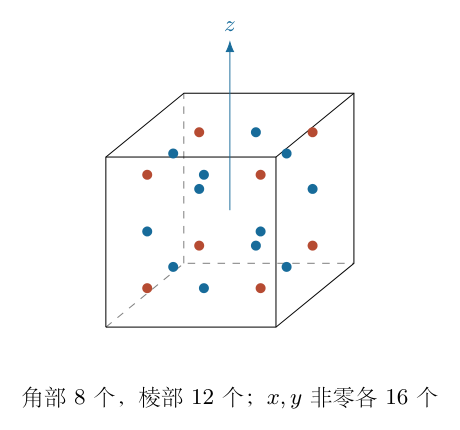

考虑下一阶整体由 $20$ 个缩小的上一阶形状构成。每个小单元质量为 $m_{n+1}/20=m_n/27$，长度缩小为 $1/3$。故绕其自身中心轴的惯量，是上一阶惯量 $I_n$ 的质量比例 $1/27$ 再乘长度平方比例 $1/9$，即 $I_n/243$。

全部小单元自身惯量之和为 $20I_n/243$。再加轴平移项。对 $x$ 坐标而言，$20$ 个中心中有 $16$ 个满足 $|x|=l/3$，其余 $4$ 个为零；对 $y$ 也一样。因此

$$
\begin{aligned}
\frac1{20}\sum_{\rm kept}(x_j^2+y_j^2)
&=\frac1{20}\left(16\frac{l^2}{9}+16\frac{l^2}{9}\right)\\
&=\frac{8l^2}{45}.
\end{aligned}
$$

平行轴项的总和为 $m_{n+1}\,8l^2/45$，得到

$$
I_{n+1}=\frac{20}{243}I_n+\frac{8l^2}{45}m_{n+1}.
$$

用 $m_{n+1}=(20/27)m_n$ 除两边，定义 $J_n=I_n/m_n$，便有

$$
J_{n+1}=\frac19J_n+\frac{8l^2}{45}.
$$

常值特解 $J_*$ 满足

$$
J_*=\frac19J_*+\frac{8l^2}{45},
$$

故 $J_*=l^2/5$。两边减去这个特解：

$$
J_{n+1}-\frac{l^2}{5}
=\frac19\left(J_n-\frac{l^2}{5}\right).
$$

初始实心立方体 $J_0=l^2/6$，从而

$$
\begin{aligned}
J_n-\frac{l^2}{5}
&=\frac1{9^n}\left(\frac{l^2}{6}-\frac{l^2}{5}\right)
=-\frac{l^2}{30\cdot9^n},\\
\boxed{I_n}
&=\boxed{m_0\left(\frac{20}{27}\right)^n
l^2\left(\frac15-\frac1{30\cdot9^n}\right)}.
\end{aligned}
$$

回代 $n=0$ 得 $I_0=m_0l^2/6$。当 $n=1$，$I_1=(106/729)m_0l^2$，与直接对 $20$ 个小立方体逐项求和一致。虽然 $J_n$ 从 $l^2/6$ 增大并趋于 $l^2/5$，真实惯量 $I_n=m_nJ_n$ 仍趋于零。相对保留质量而言，中心附近材料被挖掉更多；但绝对质量在减少，两种变化不能混同。

（4）确定等效四面体的两类边电阻。

对正方体，以 $A$ 为共同邻点，$B,C,D$ 三点可由绕体对角线的对称操作互换。于是等效网络可以设

$$
R_{AB}^{\rm edge}=R_{AC}^{\rm edge}=R_{AD}^{\rm edge}=a,
$$

$$
R_{BC}^{\rm edge}=R_{BD}^{\rm edge}=R_{CD}^{\rm edge}=b.
$$

“边电阻”与“整个网络两端电阻”不是同一量；例如网络的 $R_{AB}=7/12\,\Omega$ 不代表等效边 $a$ 就是 $7/12\,\Omega$。

先在 $A,B$ 两端施加电压 $V$，其余端口悬空。对称性使 $C,D$ 等电势，连接它们的电阻 $b$ 没有电流。$A$ 到 $B$ 有直接支路 $a$，以及经 $C$、经 $D$ 的两条支路，每条为 $a+b$，所以

$$
\begin{aligned}
\frac1{R_{AB}}&=\frac1a+\frac2{a+b},\\
R_{AB}&=\frac{a(a+b)}{3a+b}.
\end{aligned}
$$

再在 $B,C$ 两端施加电压，$A,D$ 悬空。以 $B=V,C=0$，对称性得到 $V_A=V_D=V/2$。$A,D$ 之间的边没有电流；$B,C$ 间有直接 $b$、经 $A$ 的 $2a$、经 $D$ 的 $2b$ 三支路，因此

$$
\begin{aligned}
\frac1{R_{BC}}
&=\frac1b+\frac1{2a}+\frac1{2b}
=\frac{3a+b}{2ab},\\
R_{BC}&=\frac{2ab}{3a+b}.
\end{aligned}
$$

用两个已知阻值的比值消元：

$$
\begin{aligned}
\frac{R_{BC}}{R_{AB}}
&=\frac{2b}{a+b}
=\frac{3/4}{7/12}=\frac97,\\
14b&=9a+9b,\\
b&=\frac95a.
\end{aligned}
$$

代回 $R_{AB}=7/12\,\Omega$：

$$
R_{AB}
=\frac{a(14a/5)}{24a/5}
=\frac7{12}a.
$$

于是

$$
\boxed{a=1\,\Omega,\qquad b=\frac95\,\Omega}.
$$

这利用了两类边的几何对称性。下面继续验证任意四端电势，以免只匹配两个测量值而未证明四端等效。

（5）消去正方体内部节点，验证完整端口关系。

图3-3给出真正的空间立方体。取 $A=(0,0,0)$，$B=(1,0,0)$、$C=(0,1,0)$、$D=(0,0,1)$，内部节点为 $E=(1,1,0)$、$F=(1,0,1)$、$G=(0,1,1)$、$H=(1,1,1)$。此处坐标只表示邻接关系，不是电阻长度的新单位。

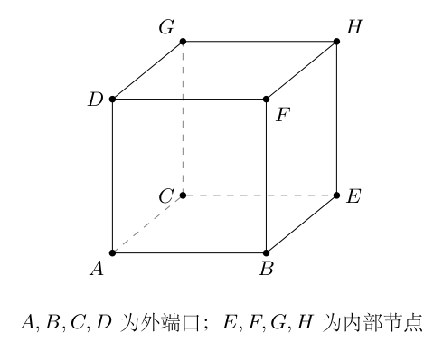

为简化式子，本步电阻数值以 $1\,\Omega$ 为单位，电势仍以伏特计。内部节点没有外部电流，故

$$
\begin{aligned}
3V_E&=V_B+V_C+V_H,\\
3V_F&=V_B+V_D+V_H,\\
3V_G&=V_C+V_D+V_H,\\
3V_H&=V_E+V_F+V_G.
\end{aligned}
$$

令 $S=V_E+V_F+V_G$、$T=V_B+V_C+V_D$。前三式相加得到 $3S=2T+3V_H$，再由末式 $3V_H=S$，得 $3S=2T+S$，所以

$$
S=T,\qquad V_H=\frac T3.
$$

逐个回代：

$$
\begin{aligned}
V_E&=\frac{V_B+V_C}{3}+\frac T9,\\
V_F&=\frac{V_B+V_D}{3}+\frac T9,\\
V_G&=\frac{V_C+V_D}{3}+\frac T9.
\end{aligned}
$$

端口 $A$ 的流入电流是 $I_A=3V_A-V_B-V_C-V_D$。端口 $B$ 与 $A,E,F$ 相连，所以

$$
\begin{aligned}
I_B&=3V_B-V_A-V_E-V_F\\
&=3V_B-V_A-\frac{2V_B+V_C+V_D}{3}-\frac{2T}{9}\\
&=\frac{19}{9}V_B-V_A-\frac59V_C-\frac59V_D.
\end{aligned}
$$

同理交换 $B,C,D$ 即得到其他两行：

$$
\begin{pmatrix}I_A\\I_B\\I_C\\I_D\end{pmatrix}
=
\begin{pmatrix}
3&-1&-1&-1\\
-1&19/9&-5/9&-5/9\\
-1&-5/9&19/9&-5/9\\
-1&-5/9&-5/9&19/9
\end{pmatrix}
\begin{pmatrix}V_A\\V_B\\V_C\\V_D\end{pmatrix}.
$$

矩阵系数单位是西门子。每行和为零，保证整体电势平移不改变电流；每列和也为零，保证四端总流入电流为零。非对角元的负值给出对应边的电导，故 $A$ 到其他端口的电导为 $1\,{\rm S}$，$B,C,D$ 相互间电导为 $5/9\,{\rm S}$。这再次得到 $a=1\,\Omega,b=9/5\,\Omega$，而且已对任意四端电势成立。

（6）证明对称四端网络的星形等效。

钢丝递归用到四端完全对称网络。若四面体六条边的等效电阻均为 $b$，端口 $i$ 的电流为

$$
I_i=\sum_{j\ne i}\frac{V_i-V_j}{b}
=\frac{4V_i-\sum_{j=1}^4V_j}{b}.
$$

图3-4的星形网络有四条相等星臂，电阻记为 $s$，星心不注入电流，所以

$$
\sum_{i=1}^4\frac{V_i-V_{\rm c}}s=0,
\qquad V_{\rm c}=\frac14\sum_{i=1}^4V_i.
$$

每个端口的电流是

$$
I_i=\frac{V_i-V_{\rm c}}s
=\frac{4V_i-\sum_jV_j}{4s}.
$$

要让两个关系相等，应有

$$
\boxed{s=\frac b4}.
$$

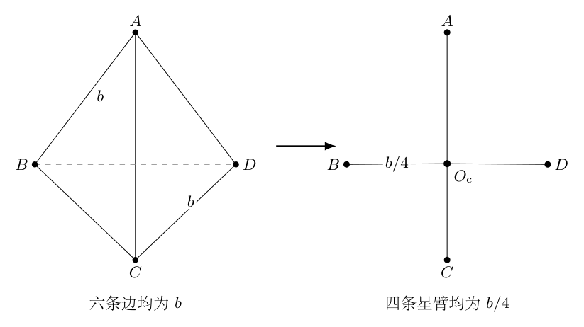

任意两外端口之间的电阻为 $2s=b/2$，因为其余两外端口悬空、星臂无电流。若两端电阻记为 $R$，则 $b=2R$，星臂为 $R/2$。这是本题递归的核心换算，不能把 $b$、$R$、$s$ 三者混写。

（7）识别钢丝结构每次缩小后的电阻。

设第 $n$ 阶钢丝结构任意两原顶点间电阻为 $R_n$，初始六条边均为 $1\,\Omega$，因此

$$
R_0=\frac12\,\Omega.
$$

这个值可独立由三支路计算：指定 $A,B$ 两端，其余两顶点等电势，其相连边无电流；直接支路为 $1\,\Omega$，另两支路各为 $2\,\Omega$，三支路并联给出 $1/2\,\Omega$。

新一级的每个角部小结构是上一阶结构缩小为 $1/3$。若所有钢丝的电阻率和截面积相同，$R=\rho_{\rm e}L/S$，所以缩小后两端电阻为 $R_n/3$。把这个小结构转成星形，每条星臂为

$$
s_{\rm small}=\frac12\frac{R_n}{3}=\frac{R_n}{6}.
$$

图3-5用不同颜色区分四个角部小四面体，用较深的六段线表示始终保留的中间桥段。投影相交但没有圆点的地方，不构成电连接。

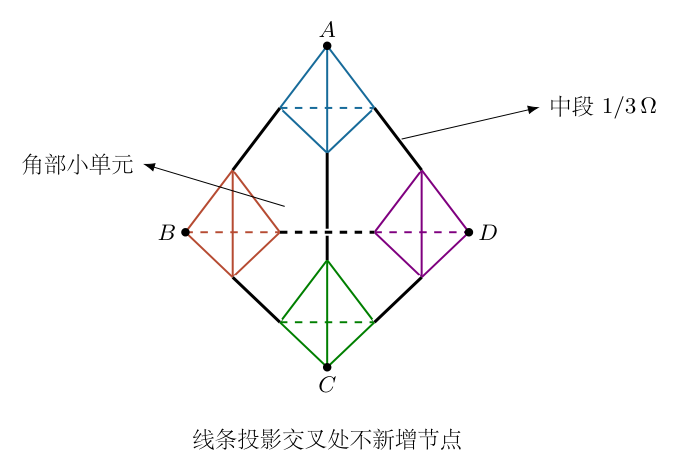

每条原始棱的中段长度为原来 $1/3$，电阻为 $1/3\,\Omega$。相邻两个小结构的星心之间，串联着一个星臂、中间桥段和另一个星臂，所以中心间每条等效边为

$$
b_{\rm centres}
=\frac{R_n}{6}+\frac13\,\Omega+\frac{R_n}{6}
=\frac{R_n}{3}+\frac13\,\Omega.
$$

四个星心通过六条相等的边连接，仍是完整对称四面体，其任意两星心间电阻为 $b_{\rm centres}/2$。

（8）连接外部端口，得到递推与极限。

图3-6中两个测量端口到所属星心，各有一条 $R_n/6$ 的外星臂。其余两个原顶点悬空，所以相应外星臂无电流；它们不改变内部四面体的两端电阻。由串联关系，

$$
\begin{aligned}
R_{n+1}
&=\frac{R_n}{6}+\frac12\left(\frac{R_n}{3}+\frac13\,\Omega\right)
+\frac{R_n}{6}\\
&=\frac12R_n+\frac16\,\Omega.
\end{aligned}
$$

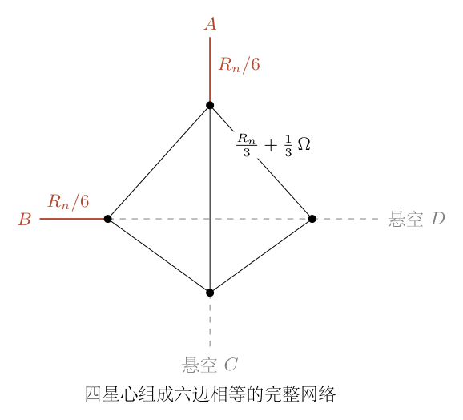

常值不动点满足 $R_* =R_*/2+1/6\,\Omega$，故 $R_*=1/3\,\Omega$。相减得到

$$
R_{n+1}-\frac13\,\Omega
=\frac12\left(R_n-\frac13\,\Omega\right).
$$

利用 $R_0=1/2\,\Omega$，有

$$
\boxed{R_n=\left(\frac13+\frac1{6\cdot2^n}\right)\Omega},
\qquad
\boxed{R_{AB,\infty}=\frac13\,\Omega}.
$$

逐级数值为 $R_0=0.5\,\Omega$，$R_1=5/12\,\Omega$，$R_2=3/8\,\Omega$，$R_3=17/48\,\Omega$。它们单调递减，并始终大于 $1/3\,\Omega$。每次新加内部连接提供额外导电路径，电阻减小符合无源电阻网络的单调性；但保留桥段使电阻不降为零。

独立节点计算不使用这条递推：直接按几何生成第 $0$ 至 $4$ 阶网络，分别有 $4$、$16$、$64$、$256$、$1024$ 个节点。按真实钢丝长度赋电阻，求解基尔霍夫方程，依次得到 $0.5\,\Omega$、$0.41666667\,\Omega$、$0.375\,\Omega$、$0.35416667\,\Omega$、$0.34375\,\Omega$，与解析逐项一致。这也检查了桥段是否遗漏、缩放比例是否误用以及投影交点是否误连。

\newpage

# 第 4 题

<!-- question-start -->
电偶极矩为 $p$ 的理想电偶极子置于原点，偶极矩沿 $z$ 轴正方向。一个质量为 $m$、电荷为 $-q$（$q>0$）的自由粒子，在偶极子正侧、垂直于 $z$ 轴的平面内，受电场力作用做速率为 $v$ 的匀速圆周运动。

（1）求圆轨道的圆心到偶极子中心的距离及轨道半径。

（2）将粒子置于第（1）问轨道上的一点，初态静止，并约束在一根沿 $z$ 方向延伸的绝缘光滑杆上。给粒子沿杆方向的微小扰动，判断平衡是否稳定；若稳定，求小振动周期。

（3）将粒子约束在第（1）问圆轨道所在平面内，初态按第（1）问做圆周运动。给粒子径向微小扰动，判断径向运动是否稳定；若稳定，求径向小振动周期。忽略辐射和粒子对偶极子的反作用。

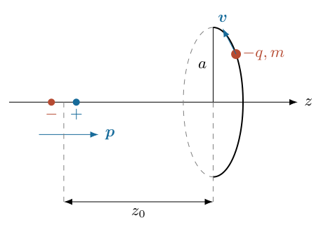
<!-- question-end -->

## 一、题型定位

这是非球对称静电场中的圆轨道及受约束小振动问题。电偶极场不是中心力场，圆轨道不必以偶极子中心为圆心。圆周运动要求轴向合力为零，同时径向电场力提供向心力，这两个条件共同确定轨道的位置与尺寸。

后两问的约束和初态不同。第（2）问粒子静止且只能沿杆运动；第（3）问粒子持续绕轴转动，径向扰动时角动量守恒，速率不再保持原来的 $v$。若把两问都写成“电场力的某个导数”，会漏掉第三问中转动惯性的变化。

## 二、知识点

理想偶极子的电势为

$$
\varphi=\frac{p\cos\vartheta}{4\pi\varepsilon_0r^2}.
$$

用柱坐标 $s$ 表示到 $z$ 轴的垂直距离，有 $r^2=s^2+z^2$、$\cos\vartheta=z/r$。粒子的势能为电荷乘电势，故负电荷的势能与电势反号。

力由势能梯度给出：$F_s=-\partial U/\partial s$、$F_z=-\partial U/\partial z$。沿一维约束坐标 $\xi$ 的平衡点满足 $U'(\xi_0)=0$；若 $U''(\xi_0)>0$，在小位移下恢复力为 $-U''(\xi_0)\delta\xi$，角频率平方为 $U''(\xi_0)/m$。

轴对称场及理想约束不提供绕 $z$ 轴的力矩，故轴向角动量 $\ell=ms^2\dot\phi$ 守恒。径向运动用有效势能

$$
U_{\rm eff}(s)=U(s,z_0)+\frac{\ell^2}{2ms^2}.
$$

它的第二项来自转动动能，不是额外加入的一种相互作用。

## 三、物理图像

负粒子位于偶极矩正侧，受到向轴线的径向吸引。在正确的圆轨道平面，轴向力恰为零；这个位置位于以偶极矩方向为轴的特定圆锥面上。

沿杆微扰时，离轴距离固定，粒子只探测电势沿 $z$ 的弯曲。平面内径向微扰时，轨道高度固定，但角速度随半径改变。半径增大后，离心项按 $s^{-3}$ 变化，电场径向力按另一规律变化；两者的差决定恢复力，而不是电场力本身的符号。

## 四、解题入口

先把势能写成 $s,z$ 的函数，并明确负电荷的符号。对 $z$ 求导得到圆轨道轴向条件，再对 $s$ 求导求向心力。以圆轨道角频率 $\Omega=v/a$ 为基准，可以把后两问周期写成圆周周期的简单倍数，便于交叉检查。

小振动展开只保留扰动的一阶力或二阶势能。计算第（3）问时保持 $\ell$ 不变，而不是保持速度 $v$ 不变；$v$ 只用于确定初始角动量 $\ell=mav$。

## 五、解析

（1）建立势能与两个力分量。

为简化符号，定义正量

$$
C=\frac{pq}{4\pi\varepsilon_0}>0,\qquad
D=s^2+z^2.
$$

负粒子的势能为

$$
U(s,z)=-\frac{Cz}{D^{3/2}}.
$$

图4-2中 $s$ 是到轴的距离，$z$ 是轨道高度；两者不是球坐标的径向距离 $r$。

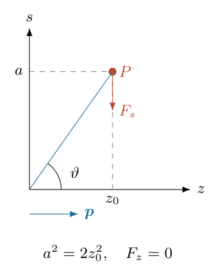

对 $s$ 求偏导，保持 $z$ 不变：

$$
\begin{aligned}
\frac{\partial U}{\partial s}
&=-Cz\left(-\frac32\right)D^{-5/2}(2s)
=\frac{3Czs}{D^{5/2}},\\
F_s&=-\frac{3Czs}{D^{5/2}}.
\end{aligned}
$$

对 $z$ 求偏导需要同时处理分子与分母：

$$
\begin{aligned}
\frac{\partial U}{\partial z}
&=-C D^{-3/2}+3Cz^2D^{-5/2}\\
&=\frac{C[-(s^2+z^2)+3z^2]}{D^{5/2}}
=\frac{C(2z^2-s^2)}{D^{5/2}},\\
F_z&=\frac{C(s^2-2z^2)}{D^{5/2}}.
\end{aligned}
$$

因此圆周运动不只需要 $F_s<0$，还需要 $F_z=0$。若把电荷误写成 $+q$，两个力都会反向，允许的轨道侧也会改变。

（2）由轴向条件确定轨道几何。

圆轨道半径记为 $a$，圆心高度为 $z_0$。轨道平面垂直于 $z$ 轴，运动中 $s=a$、$z=z_0$ 均为常量。轴向加速度为零，故

$$
F_z(a,z_0)=0
\quad\Longrightarrow\quad a^2=2z_0^2.
$$

径向向心力必须指向轴线，即 $F_s<0$。由于 $C,a>0$，这个条件要求 $z_0>0$，因此不是任意选择平方后的正负根，而是

$$
\boxed{z_0=\frac a{\sqrt2}}.
$$

用球坐标表示，$\tan\vartheta=a/z_0=\sqrt2$，所以 $\cos\vartheta=1/\sqrt3$。轨道点在固定角度的圆锥面上，但轨道本身是一条水平圆，不是沿圆锥母线运动。

（3）用向心力求轨道半径及圆心距离。

径向方程为

$$
-\frac{mv^2}{a}=F_s(a,z_0)
=-\frac{3Cz_0a}{(a^2+z_0^2)^{5/2}}.
$$

代入 $z_0=a/\sqrt2$，有 $a^2+z_0^2=3a^2/2$。注意分母的 $5/2$ 次幂包含 $a^5$：

$$
\begin{aligned}
\frac{mv^2}{a}
&=\frac{3C(a/\sqrt2)a}{(3a^2/2)^{5/2}}\\
&=\frac{3C}{\sqrt2(3/2)^{5/2}a^3}\\
&=\frac{4C}{3\sqrt3\,a^3}.
\end{aligned}
$$

两边乘 $a^3$，得到 $mv^2a^2=4C/(3\sqrt3)$，于是

$$
\boxed{a=\sqrt{\frac{4C}{3\sqrt3\,mv^2}}},
\qquad
\boxed{z_0=\sqrt{\frac{2C}{3\sqrt3\,mv^2}}}.
$$

其中 $z_0$ 就是圆心到偶极子中心的距离；粒子到偶极子中心的距离则为 $\sqrt{a^2+z_0^2}=\sqrt{3/2}\,a$，两者不能混用。

圆周角频率与周期为

$$
\Omega=\frac va,\qquad T_{\rm orb}=\frac{2\pi}{\Omega}=\frac{2\pi a}{v}.
$$

由向心力关系还可保留一个后面反复使用的等式：

$$
m\Omega^2=\frac{3Cz_0}{(a^2+z_0^2)^{5/2}}.
$$

（4）沿绝缘杆方向的小振动。

第（2）问中的杆保持 $s=a$，粒子没有初始圆周运动。令 $z=z_0+\eta$，$|\eta|\ll a$。由于 $F_z(a,z_0)=0$，恢复力的一阶系数由偏导数给出。

直接从 $F_z=C(a^2-2z^2)(a^2+z^2)^{-5/2}$ 求导：

$$
\frac{\partial F_z}{\partial z}
=-4Cz(a^2+z^2)^{-5/2}
-5Cz(a^2-2z^2)(a^2+z^2)^{-7/2}.
$$

在平衡点，第二项因 $a^2-2z_0^2=0$ 消失，所以

$$
\left.\frac{\partial F_z}{\partial z}\right|_0
=-\frac{4Cz_0}{(a^2+z_0^2)^{5/2}}<0.
$$

图4-3中杆的约束反力承担横向力，不参与轴向方程；只有沿杆的电场分量决定恢复运动。

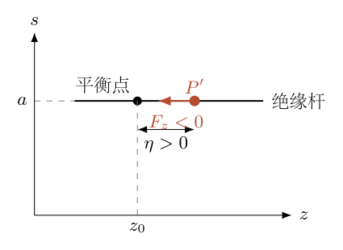

利用一阶泰勒展开，

$$
F_z(a,z_0+\eta)
=-\frac{4Cz_0}{(a^2+z_0^2)^{5/2}}\eta+O(\eta^2).
$$

牛顿第二定律变为

$$
m\ddot\eta
=-\frac{4Cz_0}{(a^2+z_0^2)^{5/2}}\eta.
$$

于是平衡稳定，且

$$
\begin{aligned}
\omega_z^2
&=\frac{4Cz_0}{m(a^2+z_0^2)^{5/2}}
=\frac43\Omega^2,\\
\boxed{T_z}
&=\boxed{\frac{\sqrt3}{2}T_{\rm orb}
=\frac{\pi\sqrt3\,a}{v}}.
\end{aligned}
$$

若初始位移 $\eta(0)=\eta_0$、初始轴向速度为零，则
$\eta(t)=\eta_0\cos\omega_zt$。$\eta_0>0$ 时初始力向负 $z$，$\eta_0<0$ 时初始力向正 $z$，与稳定性判定一致。

（5）平面内微扰时先确定守恒量。

第（3）问保持 $z=z_0$，平面反力沿 $z$，电场力在平面内沿径向，两者都不提供绕 $z$ 轴的力矩。因此

$$
\ell=ms^2\dot\phi=mav=ma^2\Omega
$$

为常量。半径变化后，

$$
\dot\phi=\frac{\ell}{ms^2},\qquad
v_\phi=s\dot\phi=\frac{\ell}{ms}.
$$

所以 $v_\phi$ 与 $s$ 成反比，而不是始终等于原来的 $v$。

平面极坐标的径向方程为

$$
m(\ddot s-s\dot\phi^2)=F_s(s,z_0).
$$

代入角动量，得到

$$
m\ddot s
=\frac{\ell^2}{ms^3}-\frac{3Cz_0s}{(s^2+z_0^2)^{5/2}}
=-\frac{{\rm d}U_{\rm eff}}{{\rm d}s}.
$$

其中

$$
U_{\rm eff}
=\frac{\ell^2}{2ms^2}
-\frac{Cz_0}{(s^2+z_0^2)^{3/2}}.
$$

（6）求有效势能曲率，判断径向稳定性。

对有效势能求一阶导数：

$$
U_{\rm eff}'(s)
=-\frac{\ell^2}{ms^3}
+\frac{3Cz_0s}{(s^2+z_0^2)^{5/2}}.
$$

在 $s=a$，利用 $\ell=mav$ 与圆周向心力关系，可验证 $U_{\rm eff}'(a)=0$。再求二阶导数：

$$
\begin{aligned}
U_{\rm eff}''(s)
&=\frac{3\ell^2}{ms^4}
+3Cz_0\left[(s^2+z_0^2)^{-5/2}
-5s^2(s^2+z_0^2)^{-7/2}\right]\\
&=\frac{3\ell^2}{ms^4}
+\frac{3Cz_0(z_0^2-4s^2)}{(s^2+z_0^2)^{7/2}}.
\end{aligned}
$$

在圆轨道，第一项除以 $m$ 等于 $3\Omega^2$。第二项用
$3Cz_0/[m(a^2+z_0^2)^{5/2}]=\Omega^2$ 化简：

$$
\begin{aligned}
\frac{U_{\rm eff}''(a)}m
&=3\Omega^2+\Omega^2
\frac{z_0^2-4a^2}{a^2+z_0^2}\\
&=3\Omega^2+\Omega^2\frac{a^2/2-4a^2}{3a^2/2}\\
&=\left(3-\frac73\right)\Omega^2
=\frac23\Omega^2>0.
\end{aligned}
$$

图4-4中的最低点是固定角动量下的有效势最低点，不是把电场势能单独画成的最低点。

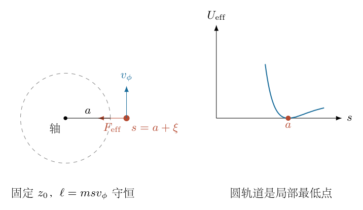

令 $s=a+\xi$，忽略 $O(\xi^2)$ 力项，则

$$
\ddot\xi+\frac23\Omega^2\xi=0.
$$

所以径向稳定，周期为

$$
\boxed{T_s=\sqrt{\frac32}\,T_{\rm orb}
=\frac{2\pi a}{v}\sqrt{\frac32}}.
$$

它不同于沿杆周期，因为一个有转动惯性项，一个没有。径向周期也不是粒子转一周所用时间。

<!-- KEEP_STUDENT_START -->

（7）用直接加速度展开交叉检查径向结果。

不使用有效势能，直接展开径向方程的右端。令 $\xi=s-a$：

$$
\frac{\ell^2}{m^2s^3}
=\frac{\ell^2}{m^2a^3}
\left(1-\frac{3\xi}{a}\right)+O(\xi^2).
$$

第一项的常量为 $a\Omega^2$，一阶系数为 $-3\Omega^2$。电场加速度
$f(s)=-3Cz_0s/[m(s^2+z_0^2)^{5/2}]$ 的导数是

$$
f'(a)
=-\Omega^2\left[1-\frac{5a^2}{a^2+z_0^2}\right]
=\frac73\Omega^2.
$$

常量电场加速度 $f(a)=-a\Omega^2$ 与转动项抵消；一阶项相加为

$$
-3\Omega^2\xi+\frac73\Omega^2\xi
=-\frac23\Omega^2\xi.
$$

再次得到 $\omega_s^2=2\Omega^2/3$。这个检查还揭示：电场径向力单独的斜率为正，但结合角动量约束后总径向恢复系数为负，不能凭单一力项下结论。

（8）量纲、比例和近似范围检查。

$C$ 的量纲为能量乘长度平方，故 $C/(mv^2)$ 是长度平方；轨道半径的公式维数正确。两个小振动周期均是 $a/v$ 乘无量纲系数，且
$T_z:T_{\rm orb}:T_s=\sqrt3/2:1:\sqrt{3/2}$。

推导基于理想点偶极场，实际偶极子的两电荷间距须远小于 $a,z_0$；微扰振幅还需远小于 $a$，否则高阶非线性项不能忽略。静电计算忽略加速电荷辐射，适用于该近似下的短时轨道模型。

独立数值积分直接使用未线性化的轴向力与径向方程，取相对振幅 $10^{-4}$，从相邻极大值测周期，分别与上述两周期相符，相对偏差低于 $10^{-6}$。这不是把最终频率代入简谐方程自证，而是检查完整非线性模型的小振幅极限。

<!-- KEEP_STUDENT_END -->

\newpage

# 第 5 题

<!-- question-start -->
绝缘线 $ABCDEF$ 弯成图示形状，其中 $ABC$ 与 $DEF$ 所在平面互相平行。质量为 $m$、表面均匀带正电荷 $q$ 的绝缘直杆 $GH$，两端各弯成小圆环，分别套在 $CB$、$DE$ 上。圆环与导轨的间隙很小，滑动摩擦因数为 $\mu_0$。两条斜导轨与水平线的夹角均为 $\theta$。

系统置于均匀磁场中，磁感应强度 $\boldsymbol B$ 垂直于两个平行平面，由 $ABC$ 面指向 $DEF$ 面。直杆从靠近顶端 $CD$ 的位置由静止开始下滑，斜导轨足够长。

（a）画出刚下滑不久时直杆的受力图。（b）写出这段运动的方程。（c）速度较大时，作用于直杆的力是否有方向改变？若有，说明哪些力改变及原因。（d）写出较大速度时的运动方程。（e）求最大下滑速度。积分提示中的上下限应按 $\int_a^b{\rm d}x/x=\ln(b/a)$ 使用。

<!-- question-end -->

## 一、题型定位

这是带电绝缘杆在磁场中的约束滑动问题。磁场不是通过闭合电路的感应电流产生阻力，而是直接对杆上随杆移动的电荷施加洛伦兹力。杆和导轨均绝缘，不能套用导体棒切割磁感线的 $B^2l^2v/R$ 阻力公式。

套环能够承受法向约束力的两个方向。速度增大后，磁力超过重力的法向分量，接触从套环一侧移到另一侧，导轨对杆的法向合力反向；摩擦力仍与下滑方向相反。必须把法向反力写成有符号的量，再用其绝对值计算摩擦大小。

## 二、知识点

均匀移动的总电荷 $q$ 受磁力 $\boldsymbol F_B=q\boldsymbol v\times\boldsymbol B$。因为 $\boldsymbol F_B$ 垂直于速度，磁力的瞬时功率为零，不能直接给杆增加机械能。

滑动摩擦大小为 $\mu_0|N|$，其中 $N$ 是导轨法向合力的有符号分量。小套环的接触侧改变不使摩擦方向自动反号；摩擦方向由相对滑动方向决定。

一阶方程 $\dot v=a+bv$ 用分离变量法可解为指数增长，$\dot v=b(v_\infty-v)$ 解为指数逼近。终端速度是净切向力为零的平衡值，通常在无限时间极限达到，不是有限时刻突然获得的峰值。

## 三、物理图像

取 $\boldsymbol e_s$ 沿斜轨向下，$\boldsymbol e_w$ 沿 $G$ 到 $H$，$\boldsymbol e_n$ 垂直斜面朝外。磁场沿 $\boldsymbol e_w$，故磁力沿 $\boldsymbol e_n$，把杆从原接触侧抬起，但套环仍扣住导轨。

低速时磁力减小所需的正向法向反力，也减小摩擦，下滑加速度随速度增大。磁力等于重力法向分量时，法向反力和摩擦暂时为零。再增速，套环另一侧接触，反向约束力的大小增加，摩擦也增加，最终抵消重力切向分量。

## 四、解题入口

先建立真正的三维叉乘方向，再将重力分解为沿斜轨和法向分量。法向加速度为零给出 $N=mg\cos\theta-qBv$；切向方程始终为

$$
m\dot v=mg\sin\theta-\mu_0|mg\cos\theta-qBv|.
$$

根据括号的正负分两段求解，并在切换时刻保持 $v$ 连续。启动还涉及静摩擦，题目只给滑动摩擦因数，因此下面在杆已开始向下滑动、且通常取 $\tan\theta>\mu_0$ 的条件下求自发加速分支。

## 五、解析

（1）建立局部正交基与磁力方向。

可取空间直角坐标使

$$
\begin{aligned}
\boldsymbol e_s&=(\cos\theta,0,-\sin\theta),\\
\boldsymbol e_w&=(0,1,0),\\
\boldsymbol e_n&=(\sin\theta,0,\cos\theta).
\end{aligned}
$$

它们均为单位向量，且 $\boldsymbol e_s\times\boldsymbol e_w=\boldsymbol e_n$。杆的速度为 $v\boldsymbol e_s$，磁场为 $B\boldsymbol e_w$，所以

$$
\boldsymbol F_B=qvB\boldsymbol e_n.
$$

均匀分布的电荷各微元有相同平动速度，积分给出总电荷 $q$；不能把 $q$ 再乘杆长。重力分解为

$$
m\boldsymbol g=mg\sin\theta\,\boldsymbol e_s-mg\cos\theta\,\boldsymbol e_n.
$$

两端对称接触时每端承担法向、摩擦合力的一半，不产生使杆绕中点翻转的净力矩。这里使用直杆始终横跨两平行轨、作平动的模型。

（2）求法向约束力并画低速受力图。

将两端法向反力之和写成 $N\boldsymbol e_n$，$N$ 允许正负。杆不离开由两轨确定的运动面，法向加速度为零，故

$$
N+qBv-mg\cos\theta=0,\qquad\boxed{N=mg\cos\theta-qBv}.
$$

定义接触侧切换速度

$$
\boxed{v_c=\frac{mg\cos\theta}{qB}}.
$$

当 $0\leq v<v_c$，$N>0$，法向反力沿外法向，摩擦为 $-\mu_0N\boldsymbol e_s$。图5-2左图中重力、磁力、反力均标在实际作用方向；重力的分解只是计算工具，不再额外添加为新的力。

图中摩擦在两阶段都朝上坡。磁力沿同一方向随 $v$ 增大，改变方向的是 $N\boldsymbol e_n$，不是磁力或重力。

（3）建立低速切向方程。

沿 $\boldsymbol e_s$ 为正，重力切向分量向下，摩擦向上，磁力没有切向分量。因此

$$
\begin{aligned}
m\dot v&=mg\sin\theta-\mu_0(mg\cos\theta-qBv)\\
&=mg(\sin\theta-\mu_0\cos\theta)+\mu_0qBv.
\end{aligned}
$$

定义 $a=g(\sin\theta-\mu_0\cos\theta)$、$b=\mu_0qB/m$。于是 $\dot v=a+bv$，其中 $a$ 的单位是加速度，$b$ 的单位是时间倒数。若 $a>0$，从 $v(0)=0$ 开始滑动，分离变量得

$$
\int_0^{v(t)}\frac{{\rm d}v'}{a+bv'}=\int_0^t{\rm d}t'.
$$

积分前先换元 $w=a+bv'$，$\mathrm{d}w=b\,{\rm d}v'$，于是

$$
\begin{aligned}
\frac1b[\ln(a+bv') ]_0^{v(t)}&=t,\\
\ln\frac{a+bv(t)}a&=bt,\\
a+bv(t)&=ae^{bt}.
\end{aligned}
$$

所以

$$
\boxed{v(t)=\frac ab(e^{bt}-1)},\qquad0\leq t\leq t_c.
$$

积分上下限给出的是 $\ln[(a+bv)/a]$，不是它的反号。代回 $\dot v=a e^{bt}$，与 $a+bv$ 一致。

（4）求接触侧切换时刻及连续性。

令低速解达到 $v_c$，则 $e^{bt_c}=1+bv_c/a$。注意 $bv_c=\mu_0g\cos\theta$，因此

$$
\begin{aligned}
1+\frac{bv_c}{a}
&=\frac{\sin\theta}{\sin\theta-\mu_0\cos\theta}
=\frac{\tan\theta}{\tan\theta-\mu_0},\\
\boxed{t_c}&=\boxed{\frac1b\ln\frac{\tan\theta}{\tan\theta-\mu_0}}.
\end{aligned}
$$

在 $v=v_c$ 时 $N=0$、摩擦为零，故两侧都给出 $\dot v=g\sin\theta$。速度和加速度连续，但加速度对速度的导数在该点改变符号。这不是某个速度冲量，而是接触反力连续穿过零。

图5-3以横轴 $v$ 展示有符号反力 $N$ 和非负摩擦大小 $\mu_0|N|$，后者呈折线最低点。

（5）速度较大时的受力与方程。

当 $v>v_c$，$N<0$，反力方向为 $-\boldsymbol e_n$，大小 $qBv-mg\cos\theta$。套环的几何约束允许这一反力；若只有普通单面支持而没有套环，物体将失去接触，不能沿用本段模型。

摩擦仍与向下滑动相反，故

$$
\begin{aligned}
m\dot v&=mg\sin\theta-\mu_0(qBv-mg\cos\theta)\\
&=mg(\sin\theta+\mu_0\cos\theta)-\mu_0qBv.
\end{aligned}
$$

定义

$$
\boxed{v_\infty=\frac{mg(\sin\theta+\mu_0\cos\theta)}{\mu_0qB}}.
$$

方程为 $\dot v=b(v_\infty-v)$。由于 $v_\infty-v_c=mg\sin\theta/(\mu_0qB)>0$，切换后继续加速，但加速度逐渐减小。以 $\tau=t-t_c$ 为新时间，初速度为 $v_c$，分离变量时

$$
\int_{v_c}^{v(t)}\frac{{\rm d}v'}{v_\infty-v'}=b(t-t_c).
$$

分母导数为负，所以积分为

$$
-\ln\frac{v_\infty-v(t)}{v_\infty-v_c}=b(t-t_c).
$$

取指数并解出 $v$：

$$
\boxed{v(t)=v_\infty+(v_c-v_\infty)e^{-b(t-t_c)}},\qquad t\geq t_c.
$$

图5-4显示先指数加速、后指数趋于终端值的两段曲线。终端值大于 $v_c$，不能把法向反力为零的速度当成最大下滑速度。

（6）解释“最大速度”和终端状态。

任意有限 $t>t_c$，指数项仍为正且 $v_c-v_\infty<0$，因此 $v(t)<v_\infty$。最大下滑速度在理想无限长导轨上应理解为上确界或渐近终端速度：

$$
\boxed{\sup v=v_\infty
=\frac{mg(\sin\theta+\mu_0\cos\theta)}{\mu_0qB}}.
$$

终端时摩擦与重力切向分量平衡，而不是法向反力消失。回代法向方程，

$$
N_\infty=mg\cos\theta-qBv_\infty
=-\frac{mg\sin\theta}{\mu_0}.
$$

所以 $\mu_0|N_\infty|=mg\sin\theta$，与切向平衡相符。各端在完全对称条件下承担 $N_\infty/2$；负号表示其接触侧反向，不表示摩擦大小为负。

（7）计算位移，检查两个阶段的时间解是否衔接。

由 $\dot s=v$，取初始位移 $s(0)=0$，低速阶段积分得

$$
s(t)=\frac a{b^2}(e^{bt}-1-bt).
$$

所以切换位置为 $s_c=v_c/b-at_c/b$。高速阶段从 $s_c$ 出发：

$$
s(t)=s_c+v_\infty\tau
+\frac{v_c-v_\infty}{b}(1-e^{-b\tau}),\qquad\tau=t-t_c.
$$

在 $\tau=0$ 时位移为 $s_c$，一阶导数为 $v_c$，二阶导数为 $b(v_\infty-v_c)=g\sin\theta$。导轨若有限，应根据总长求终点时间，再代速度；没有足够长的导轨，不能声称真实杆已经达到终端值。

<!-- KEEP_STUDENT_START -->

（8）功率与能量检查。

磁力与速度正交，所以 $\boldsymbol F_B\cdot\boldsymbol v=0$。约束反力也与速度正交。机械能变化只来自重力做功和摩擦耗散：

$$
\frac{{\rm d}}{{\rm d}t}\left(\frac12mv^2\right)
=mg\sin\theta\,v-\mu_0|mg\cos\theta-qBv|v.
$$

这正是切向运动方程乘以 $v$，与分段解一致。磁力虽然不做功，却通过改变接触压力和摩擦间接影响加速度。将其称为“磁场给杆持续供能”会违反功率关系。

数值核验直接积分含绝对值的完整方程，不预先输入切换公式，并独立积分功率。所得速度与两段解析解一致，功率积分与动能增量一致。量纲上 $mg/(qB)$ 是速度，$m/(\mu_0qB)$ 是时间，符合 $v_c,v_\infty,t_c$ 的结构。

（9）启动条件与退化情况。

滑动后正向加速要求 $a>0$，即 $\tan\theta>\mu_0$。题干只给滑动摩擦因数，真正从静止自发启动还需静摩擦因数 $\mu_{\rm s}$ 满足 $\tan\theta>\mu_{\rm s}$；若默认静、滑摩擦相同，可使用前一条件。不能把未给出的静摩擦数据当成已知。

若 $\tan\theta=\mu_0$，在理想滑动方程且 $v(0)=0$ 下仍保持静止；微小正速度会在低速段增长，但启动时间依赖扰动。若 $\tan\theta<\mu_0$，直接代指数式会得到负速度，这已违反“向下滑动”的摩擦方向假设，应转入静止或重新确定运动方向的模型。

若 $\mu_0=0$，磁力不产生切向阻力，$\dot v=g\sin\theta$，没有有限终端速度。若 $qB=0$，普通摩擦下的加速度为 $g(\sin\theta-\mu_0\cos\theta)$，也没有由磁作用产生的终端速度。终端式中的发散反映这些模型退化，而不是一个能够取到的无限速度。

<!-- KEEP_STUDENT_END -->

\newpage

# 第 6 题

<!-- question-start -->
某行星上有稠密大气，生活着一种气球状生物。它们的半径和质量基本稳定，通过调节气囊内气体温度、改变密度来调整飞行高度。气球质量为 $m_0$，半径为 $r$；地面大气温度、压强、密度分别为 $T_0,p_0,\rho_0$，重力加速度为 $g$，气体摩尔质量为 $\mu$。

大气采用 $p\rho^{-\gamma}=\text{常量}$ 的绝热分层模型，$\gamma=7/5$，定体积摩尔热容 $C_V=2.5R$。在高度变化不大的范围内，大气温度、密度、压强按高度作线性近似。参数为

$$
\begin{aligned}
m_0&=202\,{\rm kg},&T_0&=300\,{\rm K},\\
\rho_0&=1.174\,{\rm kg\,m^{-3}},&r&=10\,{\rm m},\\
g&=10.6\,{\rm m\,s^{-2}},&p_0&=1.01\times10^5\,{\rm Pa},\\
\mu&=0.029\,{\rm kg\,mol^{-1}},&h&=125\,{\rm m}.
\end{aligned}
$$

（1）休息时内部气体与大气自由交换。气球在很短时间内向外排气，使内压降为 $p_0-\Delta p$，排气过程来不及交换热量，随后起飞并能稳定在高度 $h$。求 $\Delta p$。

（2）飞行一段时间后，日照和气球自身的热量输运使内压上升至与周围大气相等。求此时内部温度。

（3）皮膜内外温差为 $\Delta T$ 时，单位面积的散热系数为 $\kappa=\Delta Q/(\Delta S\,\Delta T\,\Delta t)$；阳光正入射时的单位面积热流为 $\lambda=\Delta Q/(\Delta S\,\Delta t)$。求维持上述状态时需要向内部气体输送的净热功率 $q=\Delta Q/\Delta t$。

（4）根据热力学第二定律，求搬运上述热量每单位时间至少需要的功 $W$。

<!-- question-end -->

## 一、题型定位

这是静力大气、阿基米德浮力、开口系统绝热排气以及可逆热泵的综合题。四问按状态衔接：先确定高度 $h$ 的外界状态，再由浮力求囊内质量，由排气模型求地面压降，最后求温度与持续热功率。

题干有两处必要的模型澄清。若 $m_0$ 表示包含全部气体的总质量，半径也固定，则平均密度已经固定，不能靠改变温度再改变整体密度。下面将 $m_0$ 解释为气球本体质量，内部气体质量另计；这是得到通常浮力解的条件，而非题干已无歧义地给出的事实。

“很快、绝热排气”也不唯一决定排气后的温度与压强。下文采用刚性定容气囊、内部气体始终近似均匀、气体从出口带走当地焓、没有额外轴功的开口罐排气模型，并在排气后关闭出口。不采用此模型或不给其他排气信息，第（1）问的压降不能唯一计算。

## 二、知识点

静止大气满足 $\mathrm{d}p/{\rm d}z=-\rho g$。绝热分层的 $p\rho^{-\gamma}$ 为常量，用微分形式可将压强梯度转成密度梯度。理想气体 $p=\rho RT/\mu$，可用对数微分得到温度梯度。

浮力等于排开大气的重量，囊内气体本身也有重量；平衡方程为 $\rho_{\rm a}Vg=(m_0+M_{\rm i})g$，而不是 $\rho_{\rm a}Vg=m_0g$。

开口系统中流出气体带走摩尔焓 $C_PT$。即使气囊体积不变、边界没有体积功，排出物质也会使内部温度变化。排气后若封闭且定容、绝热，内部温度才保持不变。

球体对平行阳光的截获面积是投影面积 $\pi r^2$，与散热所用全部表面积 $4\pi r^2$ 不同。理想热泵的最小功由热源、热汇的熵变化限制，温度必须用开尔文。

## 三、物理图像

外界压强、密度、温度随高度降低。要悬浮在 $h$，囊内气体密度必须比同高度外界密度低一个 $m_0/V$，差值用于承担气球本体重量。

地面排气降低囊内气体量，并使气体冷却；封闭升空后这些气体的质量固定。后续吸热或热泵输热，在固定体积内提高温度与压强，直至内外压强相等。保持固定半径的皮膜必须能承受排气后到压差消失前的压强差。

持续热平衡中阳光提供部分热量，皮膜散热带走热量。缺口才由主动输热补足；若阳光已经过量，需要的是排热，而不是将热泵公式算出负的耗功。

## 四、解题入口

按外界状态、浮力质量、排气状态、加热状态的顺序列式。排气过程用摩尔数 $n$ 作变量，并记 $\mathrm{d}n<0$；这样流出焓在能量方程中的符号自然正确。

本题给出的 $p_0,\rho_0,T_0,\mu$ 与常用气体常量仅有小的舍入不一致。主要数值用给定地面状态之间的比值计算，避免不同小问混用不同的初始密度；再单独说明误差大小。

## 五、解析

（1）由静力平衡求高度 $h$ 的外压。

图6-2中的大气薄层底、顶压力分别为 $p(z)$、$p(z+{\rm d}z)$，重力向下。对面积 $S$、厚度 $\mathrm{d}z$ 的薄层列竖直平衡：

$$
p(z)S-p(z+{\rm d}z)S-\rho gS\,{\rm d}z=0.
$$

除以 $S{\rm d}z$ 并取极限，得 $\mathrm{d}p/{\rm d}z=-\rho g$。

一阶近似在地面取 $\rho=\rho_0$，积分到 $h$：

$$
\boxed{p_h=p_0-\rho_0gh}.
$$

代入 $\rho_0gh=1.174\times10.6\times125=1555.55\,{\rm Pa}$，所以

$$
\boxed{p_h=99444.45\,{\rm Pa}}.
$$

这里 $\rho$ 随高度变化对压强积分造成二阶修正；本题明确要求一阶线性近似，不能一问用线性、另一问又偷偷用精确值。

（2）求外界密度和温度的一阶梯度。

由 $p\rho^{-\gamma}$ 为常量，取对数微分：

$$
\frac{{\rm d}p}{p}-\gamma\frac{{\rm d}\rho}{\rho}=0.
$$

在地面代入压强梯度，得

$$
\left.\frac{{\rm d}\rho}{{\rm d}z}\right|_0
=\frac{\rho_0}{\gamma p_0}
\left.\frac{{\rm d}p}{{\rm d}z}\right|_0
=-\frac{\rho_0^2g}{\gamma p_0}.
$$

因此

$$
\boxed{\rho_h=\rho_0
\left(1-\frac{\rho_0gh}{\gamma p_0}\right)}
=\boxed{1.1610847546\,{\rm kg\,m^{-3}}}.
$$

理想气体的对数微分为

$$
\frac{{\rm d}T}{T}
=\frac{{\rm d}p}{p}-\frac{{\rm d}\rho}{\rho}
=\frac{\gamma-1}{\gamma}\frac{{\rm d}p}{p}.
$$

在地面取梯度并积分：

$$
\boxed{T_h=T_0\left(1-\frac{\gamma-1}{\gamma}
\frac{\rho_0gh}{p_0}\right)}
=\boxed{298.67987270\,{\rm K}}.
$$

供以后使用，记无量纲压强降 $\varepsilon=\rho_0gh/p_0\approx0.01540149$。于是
$p_h/p_0=1-\varepsilon$、
$\rho_h/\rho_0=1-\varepsilon/\gamma$、
$T_h/T_0=1-(\gamma-1)\varepsilon/\gamma$，三者一阶展开与状态方程一致。

（3）用浮力确定囊内气体质量。

气球体积为

$$
V=\frac43\pi r^3=4188.79020479\,{\rm m^3}.
$$

将本体质量记为 $m_0$，内部气体质量为 $M_{\rm i}=\rho_{\rm i}V$。悬浮条件为

$$
\begin{aligned}
\rho_hVg&=(m_0+\rho_{\rm i}V)g,\\
\rho_{\rm i}&=\rho_h-\frac{m_0}{V}.
\end{aligned}
$$

本体折算密度为 $m_0/V=202/4188.79020479=0.04822394776\,{\rm kg\,m^{-3}}$，故

$$
\boxed{\rho_{\rm i}=1.11286080684\,{\rm kg\,m^{-3}}},
\qquad\boxed{M_{\rm i}=4661.54044698\,{\rm kg}}.
$$

悬浮总质量是 $m_0+M_{\rm i}=4863.54044698\,{\rm kg}$，绝不是 $202\,{\rm kg}$。地面交换平衡时囊内气体质量为
$M_{{\rm i},0}=\rho_0V=4917.63970042\,{\rm kg}$，排气量为
$256.09925344\,{\rm kg}$。这组质量数值说明为什么必须区分本体与全部气体。

必要可行条件是 $\rho_h>m_0/V$，否则无法用正质量内部气体达到平衡。在本体、气体总质量固定且体积固定时，若略升高，外界密度降低，浮力变小，产生向下合力；略降低则相反，故高度平衡具有恢复趋势。

（4）建立定容开口罐的绝热排气能量方程。

图6-3左侧是正在排气的开口系统，右侧是随后关闭的定容系统。气体初始摩尔数 $n_0=\rho_0V/\mu$，排气后为 $n_{\rm b}=\rho_{\rm i}V/\mu$。

设排气时内部温度为 $T$、摩尔数为 $n$。内部总内能为 $U=nC_VT$。排出少量气体 $-{\rm d}n>0$，带走能量 $C_PT(-{\rm d}n)$。无热输入、无额外轴功，故内部能量变化为

$$
{\rm d}(nC_VT)=C_PT\,{\rm d}n.
$$

右端因 $\mathrm{d}n<0$ 为负，表示能量流失。展开左端：

$$
C_Vn\,{\rm d}T+C_VT\,{\rm d}n=C_PT\,{\rm d}n.
$$

利用 $C_P-C_V=R$，得到

$$
C_Vn\,{\rm d}T=RT\,{\rm d}n,\qquad
\frac{{\rm d}T}{T}=\frac R{C_V}\frac{{\rm d}n}{n}
=(\gamma-1)\frac{{\rm d}n}{n}.
$$

两侧按初末状态积分：

$$
\begin{aligned}
\ln\frac{T_{\rm b}}{T_0}
&=(\gamma-1)\ln\frac{n_{\rm b}}{n_0},\\
\boxed{\frac{T_{\rm b}}{T_0}}
&=\boxed{\left(\frac{n_{\rm b}}{n_0}\right)^{\gamma-1}}.
\end{aligned}
$$

气囊体积不变，$p=nRT/V$，所以

$$
\frac{p_{\rm b}}{p_0}
=\frac{n_{\rm b}}{n_0}\frac{T_{\rm b}}{T_0}
=\left(\frac{n_{\rm b}}{n_0}\right)^\gamma.
$$

这与某些封闭绝热式的幂指数相似，但来源不同：这里变化的是物质的量，体积并不膨胀。快速不交换热量本身不能保证上述出口焓与均匀温度假设，需要明确排气模型。

（5）求压降并检查后续状态。

由于体积和摩尔质量相同，$\chi=n_{\rm b}/n_0=\rho_{\rm i}/\rho_0$。于是

$$
\boxed{\Delta p=p_0(1-\chi^\gamma)}
=\boxed{7286.26986827\,{\rm Pa}}.
$$

排气后的压强和温度为

$$
p_{\rm b}=93713.73013173\,{\rm Pa},\qquad
T_{\rm b}=293.65023651\,{\rm K}.
$$

$\Delta p$ 大于外界到高度 $h$ 的压强降 $1555.55\,{\rm Pa}$，不矛盾：排气后内部处于更低压力，皮膜须暂时承担压差。关闭出口、定容、无热交换的上升阶段，内部物质的量、体积及内能都不变，所以温度和压强保持 $T_{\rm b},p_{\rm b}$；不能继续套封闭膨胀绝热关系让其自行降温。

（6）内外等压后求内部温度。

到达 $h$ 后的加热阶段保持内部气体量与体积不变，直到 $p_{\rm i}=p_h$。用地面状态方程作比值：

$$
\frac{p_h}{p_0}
=\frac{\rho_{\rm i}}{\rho_0}\frac{T_{\rm i}}{T_0}.
$$

所以

$$
\boxed{T_{\rm i}=T_0\frac{p_h}{p_0}\frac{\rho_0}{\rho_{\rm i}}}
=\boxed{311.60734101\,{\rm K}}.
$$

也可从排气后状态计算 $T_{\rm i}=T_{\rm b}p_h/p_{\rm b}$，得到同一结果。内部温度比周围高

$$
\boxed{\Delta T=T_{\rm i}-T_h=12.92746831\,{\rm K}}.
$$

从排气后加热到此状态，温升为 $T_{\rm i}-T_{\rm b}\approx17.9571\,{\rm K}$，不是 $\Delta T$；两个温差分别用于瞬态内能变化和最终持续散热。

给定地面参数对应 $R_{\rm given}=p_0\mu/(\rho_0T_0)=8.31629756\,{\rm J\,mol^{-1}K^{-1}}$，与常用 $R\approx8.31446$ 的相对差约 $2.21\times10^{-4}$。这是输入舍入误差；采用给定初态比值保持四问一致。若选常用 $R$，应同时重算地面密度，而不是只在最终温度中混入另一套初态。

（7）求持续散热与阳光输入。

图6-4中平行太阳光照向球体。表面微元受到的辐射输入为 $\lambda\cos\alpha\,{\rm d}S$，只在受光半球积分。取入射方向为球极轴，面积元为 $\mathrm{d}S=r^2\sin\alpha\,{\rm d}\alpha\,{\rm d}\phi$，得

$$
\begin{aligned}
P_{\rm sun}
&=\int_0^{2\pi}\int_0^{\pi/2}
\lambda\cos\alpha\,r^2\sin\alpha\,{\rm d}\alpha\,{\rm d}\phi\\
&=2\pi\lambda r^2
\left[\frac12\sin^2\alpha\right]_0^{\pi/2}=\pi r^2\lambda.
\end{aligned}
$$

这等于投影面积乘正入射热流，不是表面积或半球面积乘同一个 $\lambda$。按均匀皮膜温度、给定线性传热系数，散热功率为 $P_{\rm loss}=4\pi r^2\kappa(T_{\rm i}-T_h)$。稳态时主动输热、日照输入与散热平衡，故

$$
\boxed{q=\pi r^2(4\kappa\Delta T-\lambda)}.
$$

代入面积和温差，可写为

$$
q=(16245.13578\,{\rm m^2K})\kappa-(314.15927\,{\rm m^2})\lambda.
$$

$\kappa$ 的单位为 $\mathrm{W\,m^{-2}K^{-1}}$、$\lambda$ 的单位为 $\mathrm{W\,m^{-2}}$，故 $q$ 单位为瓦。若 $q>0$，需主动向内部补热；若 $q=0$，日照已补偿散热；若 $q<0$，需排出多余热量，不能把负 $q$ 当成正向热泵输热任务。

（8）由第二定律求热泵最小耗功。

以下针对 $q>0$，取周围大气温度 $T_h$ 为冷源，气囊温度 $T_{\rm i}$ 为热汇。图6-5中每单位时间从冷源吸热 $q_{\rm c}$、向热汇送热 $q$，输入功为 $W$。

循环装置不积累内能，第一定律给出 $q=q_{\rm c}+W$。冷热源每单位时间的总熵变为

$$
\dot S_{\rm total}=\frac q{T_{\rm i}}-\frac{q_{\rm c}}{T_h}\geq0.
$$

整理为 $q_{\rm c}\leq qT_h/T_{\rm i}$，代回第一定律：

$$
\begin{aligned}
W&=q-q_{\rm c}\geq q\left(1-\frac{T_h}{T_{\rm i}}\right),\\
\boxed{W_{\min}}
&=\boxed{\pi r^2(4\kappa\Delta T-\lambda)\frac{\Delta T}{T_{\rm i}}}.
\end{aligned}
$$

等号仅在可逆热泵极限达到。温度因子为
$1-T_h/T_{\rm i}=\Delta T/T_{\rm i}\approx0.04148640$，
所以 $W_{\min}\approx0.04148640q$。这小于送入热汇的热量，因为其余热量从外界大气吸取，不违反能量守恒。实际装置有不可逆损耗，耗功更大。

当 $q<0$ 时，正向补热任务不存在；可讨论向外散热或其他冷却设计，但不能将上式负值解释为装置必然输出功。热机与热泵边界条件不同。

（9）核验线性近似与物理可行性。

不使用线性展开，联立静力方程与 $p/\rho^\gamma$ 常量，可积分得到

$$
\begin{aligned}
T(z)&=T_0\left[1-\frac{\gamma-1}{\gamma}\frac{\rho_0gz}{p_0}\right],\\
p(z)&=p_0\left[1-\frac{\gamma-1}{\gamma}\frac{\rho_0gz}{p_0}\right]^{\gamma/(\gamma-1)},\\
\rho(z)&=\rho_0\left[1-\frac{\gamma-1}{\gamma}\frac{\rho_0gz}{p_0}\right]^{1/(\gamma-1)}.
\end{aligned}
$$

用 $(1-x)^\nu=1-\nu x+O(x^2)$ 分别恢复一阶式。独立积分静力微分方程，在 $h$ 处得到
$p_h^{\rm exact}=99452.98753\,{\rm Pa}$、
$\rho_h^{\rm exact}=1.16112735\,{\rm kg\,m^{-3}}$，
与线性值的相对差均小于 $10^{-4}$，近似在给定高度适用。

独立积分开口能量方程 $\mathrm{d}T/{\rm d}n=(\gamma-1)T/n$，也与幂函数排气温度一致。质量、浮力、初末气体比值、热泵能量及熵条件分别检查，避免用同一最终公式重复代入自证。

\newpage

# 第 7 题

<!-- question-start -->
四个理想凸透镜 $L_1,L_2,L_3,L_4$ 同轴排列，焦距依次为 $f_1,f_2,f_2,f_1$，其中 $f_1>f_2>0$。$L_1L_2$、$L_3L_4$ 的间距均为 $f_1+f_2$，$L_2L_3$ 的间距为 $D$。点光源 $S$ 位于 $L_1$ 左侧，距离为 $u_0$。各问均采用傍轴近似。

（1）对一般 $u_0,D$，求经过四片透镜所成像的横向放大率 $M$。

（2）要求无论 $u_0$ 为多少，经过四片透镜所成像均与 $S$ 重合，求 $D$。

（3）采用第（2）问的间距，令 $u_0=f_1=2f_2=2f_0$，每片透镜半径均为 $h$。在 $S$ 处垂直于主光轴放置半径为 $h/2$ 的发光圆盘，求成像时圆盘中心与圆盘边缘处的光强之比。

<!-- question-end -->

## 一、题型定位

这是多透镜傍轴成像、无焦系统及孔径限制问题。逐片套透镜公式容易在中间虚物、虚像的符号上出错，光线传递矩阵可以保留全部光线高度和斜率，并直接判断成像位置及放大率。

“像与光源重合”不意味着光线绕回光源，也不意味着输出光束在原物面实际汇聚。四片透镜后的光线仍向右传播，这个重合像是向左反向延长得到的虚像。第（3）问应明确比较同等光源条件下的成像通量或亮度，不能把虚像处当作可直接放屏幕测量的实像面。

## 二、知识点

用列向量 $(y,\alpha)^{\mathsf T}$ 表示某平面上的光线高度和小倾角，沿主轴向右为传播正方向。自由传播距离 $d$ 和薄凸透镜分别给出

$$
P(d)=\begin{pmatrix}1&d\\0&1\end{pmatrix},
\qquad
L(f)=\begin{pmatrix}1&0\\-1/f&1\end{pmatrix}.
$$

两者来源于 $y'=y+d\alpha$、$\alpha'=\alpha-y/f$。矩阵乘法中右侧先作用，不能按光线行进顺序从左向右随意写积。

从物面到像面的矩阵若为 $(A,B;C,E)$，像点高度不能依赖同一物点发出的不同初始角度，故成像条件是 $B=0$，横向放大率为 $A$。像距取右侧为正，左侧虚像为负。

透镜的焦距控制光线折射，孔径控制光线能否通过。求光强还需给定光源的方向分布和观察方式；理想无损透镜本身不产生额外光能。

## 三、物理图像

前两片是一个无焦望远镜组合，后两片为反向组合。它们的角放大和横向缩放相互抵消，整套系统输出方向与输入方向相同，但输出高度一般产生一个与斜率有关的偏移。

当这个偏移等于透镜列的真实长度乘斜率时，外部光线的延长几何与没有透镜时一致。此时从右侧观察，会看到原位置、原大小、正立的虚像。但有限孔径仍可能削掉部分光束，因此几何重合不自动保证各视场点同亮。

## 四、解题入口

先合成两组无焦透镜矩阵，再乘中间传播矩阵。保留合成矩阵的上右元 $b$，它与真实列长 $\mathcal L$ 不一定相同。成像距由 $u_0+b+v=0$ 决定，位置重合条件则是 $b=\mathcal L$。

第（3）问逐片计算同一物点发出的任意小角光线在四片透镜上的高度，将每个圆孔变成二维角度空间中的圆盘限制。比较这些限制谁最严格，而不是只比较主光线高度或一条子午面射线。

## 五、解析

（1）证明第一组透镜无焦。

记 $s=f_1+f_2$。光线从 $L_1$ 前传播到 $L_2$ 后，矩阵为
$T_{12}=L(f_2)P(s)L(f_1)$。先乘右侧两因子：

$$
P(s)L(f_1)
=\begin{pmatrix}
1-s/f_1&s\\-1/f_1&1
\end{pmatrix}
=\begin{pmatrix}
-f_2/f_1&s\\-1/f_1&1
\end{pmatrix}.
$$

再乘 $L(f_2)$：

$$
\begin{aligned}
T_{12}
&=\begin{pmatrix}
-f_2/f_1&s\\
(f_2/f_1)/f_2-1/f_1&1-s/f_2
\end{pmatrix}\\
&=\begin{pmatrix}
-f_2/f_1&s\\0&-f_1/f_2
\end{pmatrix}.
\end{aligned}
$$

下左元为零，表示平行入射束仍平行出射，这就是无焦组合。两片间隔必须为焦距之和才有这个性质。

对反向组合 $L_3,L_4$，交换焦距角色：

$$
T_{34}=\begin{pmatrix}
-f_1/f_2&s\\0&-f_2/f_1
\end{pmatrix}.
$$

（2）合成四片透镜矩阵。

令 $k=f_1/f_2>1$，两个组合分别为

$$
T_{12}=\begin{pmatrix}-1/k&s\\0&-k\end{pmatrix},
\qquad
T_{34}=\begin{pmatrix}-k&s\\0&-1/k\end{pmatrix}.
$$

四片透镜之间还有传播 $D$，故总矩阵

$$
T=T_{34}P(D)T_{12}.
$$

逐步相乘：

$$
\begin{aligned}
P(D)T_{12}
&=\begin{pmatrix}-1/k&s-kD\\0&-k\end{pmatrix},\\
T&=\begin{pmatrix}
1&-k(s-kD)-ks\\0&1
\end{pmatrix}\\
&=\begin{pmatrix}1&b\\0&1\end{pmatrix},
\end{aligned}
$$

其中

$$
\boxed{b=k^2D-2k(f_1+f_2)
=\frac{f_1^2D-2f_1f_2(f_1+f_2)}{f_2^2}}.
$$

$b$ 的单位为长度，但它不是透镜之间的实际间距，甚至可以为负。两个对角元为 $1$，说明角度与平移倍率恢复为正立单位值；上右元仍携带光线高度偏移。

（3）加入物距、像距，求一般放大率。

设最后一片右侧的带符号像距为 $v$。从物面到像面总矩阵为

$$
\begin{aligned}
T_{\rm image}
&=P(v)TP(u_0)\\
&=\begin{pmatrix}1&u_0+b+v\\0&1\end{pmatrix}.
\end{aligned}
$$

同一物点 $y_0$ 发出的光线初始角度可不同，在待求像面高度为
$y_{\rm image}=y_0+(u_0+b+v)\alpha_0$。为了所有角度都指向同一像点，必须

$$
u_0+b+v=0.
$$

所以

$$
\boxed{v=-u_0-b},\qquad
\boxed{M=\frac{y_{\rm image}}{y_0}=1}.
$$

第（1）问的放大率恒为 $+1$，与 $D,u_0$ 无关；像的位置仍依赖两者。$v>0$ 为实际右侧像，$v<0$ 为向左回延的虚像，$v=0$ 是像面恰在末透镜平面的退化情形。

（4）用绝对位置建立重合条件。

以 $L_1$ 为轴向原点，光源位置为 $x_S=-u_0$。四片透镜列的真实长度为

$$
\mathcal L=2(f_1+f_2)+D=2s+D.
$$

像的轴向位置为
$x_{\rm image}=\mathcal L+v=\mathcal L-u_0-b$。
要求对任意 $u_0$ 都有 $x_{\rm image}=-u_0$，因而

$$
b=\mathcal L.
$$

代入 $b=k^2D-2ks$：

$$
\begin{aligned}
k^2D-2ks&=D+2s,\\
(k^2-1)D&=2s(k+1),\\
D&=\frac{2s}{k-1}.
\end{aligned}
$$

最后约去 $k+1>0$，得

$$
\boxed{D=\frac{2f_2(f_1+f_2)}{f_1-f_2}}.
$$

该间距为正，依赖 $f_1>f_2$。若误要求 $b=0$，会得到另一种位置不偏移的矩阵，却不会使像回到原物面，因为实际透镜列仍有正长度。

图7-2的实线表示向右的实际传播，虚线是末透镜后的光线向左反向延长。它们在 $S$ 交会，但光线没有实际返回那里。

在重合条件下 $v=-(u_0+\mathcal L)<0$，所以此处只能是虚像。把输出光线“画回”光源而仍加向右传播箭头，会误导读者认为存在反射器或实际返程。

（5）代入第（3）问参数并逐片追迹。

令 $f_2=f_0$、$f_1=2f_0$，则 $s=3f_0$、
$D=6f_0$、$\mathcal L=12f_0$，且 $u_0=2f_0$。末透镜到重合虚像的距离为 $14f_0$。

先在一个横向方向上追迹，物点坐标为 $y$，初始角度为 $\alpha$。到 $L_1$ 的高度是 $y_1=y+2f_0\alpha$，折射后

$$
\alpha_1=\alpha-\frac{y_1}{2f_0}=-\frac{y}{2f_0}.
$$

到 $L_2$：

$$
\begin{aligned}
y_2&=y_1+3f_0\alpha_1
=-\frac y2+2f_0\alpha,\\
\alpha_2&=\alpha_1-\frac{y_2}{f_0}=-2\alpha.
\end{aligned}
$$

到 $L_3$：

$$
\begin{aligned}
y_3&=y_2+6f_0\alpha_2
=-\frac y2-10f_0\alpha,\\
\alpha_3&=\alpha_2-\frac{y_3}{f_0}
=\frac{y}{2f_0}+8\alpha.
\end{aligned}
$$

到 $L_4$：

$$
\begin{aligned}
y_4&=y_3+3f_0\alpha_3=y+14f_0\alpha,\\
\alpha_4&=\alpha_3-\frac{y_4}{2f_0}=\alpha.
\end{aligned}
$$

图7-3按照这些高度画真实折线光路。最后的高度和角度满足
$y_4-14f_0\alpha_4=y$，再次证明回延虚像重合。

另一横向方向具有同样关系。因此以下用二维向量处理圆孔，不把圆形透镜误当成一维狭缝。

（6）把四个孔径限制转换为角度平面的圆盘。

定义无量纲物点向量 $\boldsymbol e=\boldsymbol y/h$，无量纲初始角度
$\boldsymbol u=f_0\boldsymbol\alpha/h$。发光圆盘半径为 $h/2$，所以 $|\boldsymbol e|\leq1/2$。每片透镜通过条件为高度向量模不大于 $h$：

$$
\begin{aligned}
|\boldsymbol e+2\boldsymbol u|&\leq1,\\
|-\boldsymbol e/2+2\boldsymbol u|&\leq1,\\
|-\boldsymbol e/2-10\boldsymbol u|&\leq1,\\
|\boldsymbol e+14\boldsymbol u|&\leq1.
\end{aligned}
$$

分别除去角度向量前的系数，得到角度平面内四个允许圆盘：

$$
\begin{aligned}
\mathcal D_1 &: \quad|\boldsymbol u+\boldsymbol e/2|\leq1/2,\\
\mathcal D_2 &: \quad|\boldsymbol u-\boldsymbol e/4|\leq1/2,\\
\mathcal D_3 &: \quad|\boldsymbol u+\boldsymbol e/20|\leq1/10,\\
\mathcal D_4 &: \quad|\boldsymbol u+\boldsymbol e/14|\leq1/14.
\end{aligned}
$$

全部可通行光线是四个圆盘的交集。不能只找最小圆盘半径而忽略圆心偏移；边缘物点的圆心相互错开，可能产生渐晕，必须检查包含关系。

（7）证明末透镜是中心和边缘共同的限制孔径。

两圆盘满足“小圆心到大圆心距离加小半径不大于大半径”时，小圆盘全部在大圆盘内。对 $\mathcal D_4$ 与另外三个圆盘，有

$$
\begin{aligned}
|\boldsymbol c_4-\boldsymbol c_1|+\frac1{14}
&=\frac37|\boldsymbol e|+\frac1{14}
\leq\frac27<\frac12,\\
|\boldsymbol c_4-\boldsymbol c_2|+\frac1{14}
&=\frac9{28}|\boldsymbol e|+\frac1{14}
\leq\frac{13}{56}<\frac12,\\
|\boldsymbol c_4-\boldsymbol c_3|+\frac1{14}
&=\frac3{140}|\boldsymbol e|+\frac1{14}
\leq\frac{23}{280}<\frac1{10}.
\end{aligned}
$$

最右边数值使用最不利边缘 $|\boldsymbol e|=1/2$，中心物点限制更宽松。因此

$$
\mathcal D_1\cap\mathcal D_2\cap\mathcal D_3\cap\mathcal D_4
=\mathcal D_4
$$

对整个物盘都成立。图7-4左右分别画中心和边缘的角度圆盘，最小圆盘没有被其他孔截去。圆心会移动，面积不会改变。

角度空间允许半径为 $h/(14f_0)$，傍轴立体角面积为

$$
\Omega_{\rm pass}=\pi\left(\frac{h}{14f_0}\right)^2.
$$

它与物点位置无关。这是没有渐晕的结论，不是透镜能把光强无限增大的结论。

（8）说明光源与观察模型，给出光强比。

若圆盘各位置具有相同单位面积的发光能力，并在这一小角范围内方向分布相同且可视为均匀，理想透镜无损，观察或收集装置接纳全部通行出射光束，则每个等面积物元的成像通量正比于 $\Omega_{\rm pass}$。横向放大率为 $1$，相应像元面积也相同，所以

$$
\boxed{I_{\rm centre}:I_{\rm edge}=1:1}.
$$

这里是连续物点趋近边缘的局部强度比较，不是“中心一个数学点”的总功率与“整圈边缘”的总功率比较。两者面积不同，必须取等面积元或局部辐射强度定义。

若未给圆盘发光均匀性、方向分布或观察孔径，“光强比”严格说不能唯一确定。例如有限眼瞳可能只截取某部分移位圆盘，或边缘物点本来更亮，都会改变观察强度。题目通常预期的 $1:1$ 是上述标准均匀、全孔收集模型下的答案。虚像面处没有真实出射光汇聚，不能在与光源重合的位置放屏幕来定义这个比。

（9）边界与独立验证。

当 $f_1\to f_2^+$，重合条件中的 $D$ 发散，说明等焦距四片透镜不能在有限中间间距下实现这类原位重合。若直接令 $f_1=f_2=f$，有 $b=D-4f$、$\mathcal L=D+4f$，两者差 $8f$ 不可能为零，与极限判定一致。

逐片数值追迹不使用总矩阵，随机取物点和角度，末端回延位置与初始物点一致，输出角度也与初始角度一致。另在二维末孔允许圆盘内采样，对中心、边缘分别检查四片高度均在半径 $h$ 内，独立检验包含关系。

所有光线仍须满足傍轴条件，特别是 $h/f_0\ll1$。若画图为了可见性放大纵向尺度，应说明横纵比例未统一，不能由图上大倾角推翻用于计算的傍轴模型。

\newpage

# 第 8 题

<!-- question-start -->
一种核聚变模型要求两氘核高速相撞，使其在“基本本征系”中相对距离小于 $r_0$。氘核静质量为 $m_0$，电荷为 $e$。

（1）两氘核沿一直线以相同速率 $v_0$ 对撞，求能引发反应的最小速率。

（2）两氘核的速度大小均为 $v_1$，两速度夹角为 $\theta$，求能引发反应的最小速率。

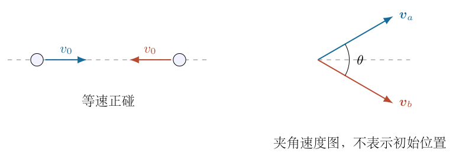
<!-- question-end -->

## 一、题型定位

这是两体库仑势垒与质心系能量的综合题。两粒子整体运动的能量不能用来缩短相对距离，只有质心系中的相对运动能量能转成相互作用势能。第二问夹角越小，越多能量属于整体平动，给定实验室速率下的有效碰撞能量越少。

题干的“基本本征系”不是完整的惯性系定义，下文明确取两粒子的质心系。单有两速度夹角还不能确定是否正碰，还需初始位置或碰撞参数；最小速率按可以安排质心系正碰、即零碰撞参数的条件求解。

“距离小于 $r_0$”在此使用经典势垒模型：入射远处相互作用势能取零，到 $r_0$ 的势能是 $e^2/(4\pi\varepsilon_0r_0)$，忽略辐射损耗，在此之前不计核力。这是可计算的近接阈值，不是实际聚变概率达到某一值的完整模型。严格小于 $r_0$ 对应速率严格大于临界值，通常所谓“最小速率”指这个阈值或下确界。

## 二、知识点

两个同号点电荷的相互作用势能为 $U(r)=e^2/(4\pi\varepsilon_0r)$。它是整个两体系统的一份势能，不能给每个粒子各算一份而加倍。

非相对论质心速度为两等质量粒子速度的平均值，实验室总动能可分解为质心平动动能与相对运动动能。两等质量粒子的约化质量为 $m_0/2$，相对速度为两速度之差。

相对论中单粒子总能量为 $\gamma m_0c^2$、动量为 $\gamma m_0\boldsymbol v$。系统质心能量由

$$
E_{\rm cm}^2=E_{\rm tot}^2-c^2|\boldsymbol P_{\rm tot}|^2
$$

给出，不能直接用实验室总动能。静质量保留在总能量中，只有超出 $2m_0c^2$ 的部分能转成库仑势能。

## 三、物理图像

正碰时两核动量大小相等、方向相反，实验室就是质心系。它们接近时动能下降、势能上升，在临界最近距离处两核同时瞬时静止。

夹角入射时，沿两速度角平分线的分量是共同平动；垂直角平分线的分量互相反向，才使粒子靠近。非相对论下相对速率随 $\sin(\theta/2)$ 缩小；相对论下这种速度分解必须通过洛伦兹变换或总四动量实现，不能让非相对论公式算出超光速。

## 四、解题入口

先定义势垒能量

$$
C_{\rm e}=\frac{e^2}{4\pi\varepsilon_0},\qquad
U_0=\frac{C_{\rm e}}{r_0},\qquad
\delta=\frac{U_0}{m_0c^2}.
$$

给出低速结果并检查其条件，再保留相对论动能得到一般阈值。两种结果在 $\delta\ll1$ 且所求速度远小于 $c$ 时必须一致。第二问即使 $\delta$ 很小，若 $\theta$ 很小，也不能自动使用低速近似。

## 五、解析

（1）建立正碰的能量转化关系。

两核从远处以 $v_0$ 对撞，质心静止。取相互距离为 $r$，初始势能趋于零。非相对论总动能为

$$
K_0=2\left(\frac12m_0v_0^2\right)=m_0v_0^2.
$$

接近过程中，两核速率仍相等，记为 $v(r)$，能量守恒给出

$$
m_0v_0^2=m_0v(r)^2+\frac{C_{\rm e}}r.
$$

最近距离 $r_{\min}$ 处径向相对速度为零，正碰又没有切向速度，故 $v(r_{\min})=0$。因此

$$
r_{\min}=\frac{C_{\rm e}}{m_0v_0^2}.
$$

临界条件 $r_{\min}=r_0$ 给出

$$
\boxed{v_{0,\rm crit}^{\rm NR}
=\sqrt{\frac{e^2}{4\pi\varepsilon_0m_0r_0}}}.
$$

要严格进入 $r<r_0$，必须 $v_0>v_{0,\rm crit}^{\rm NR}$。等号只有到达 $r_0$ 后折返的临界轨迹，不能把严格不等式改为等号而不说明阈值含义。

图8-2中库仑势能随着相互距离减小而上升，水平线表示质心系总可用动能。其交点给出最近距离，不是单核离质心的距离；后者为 $r_{\min}/2$。

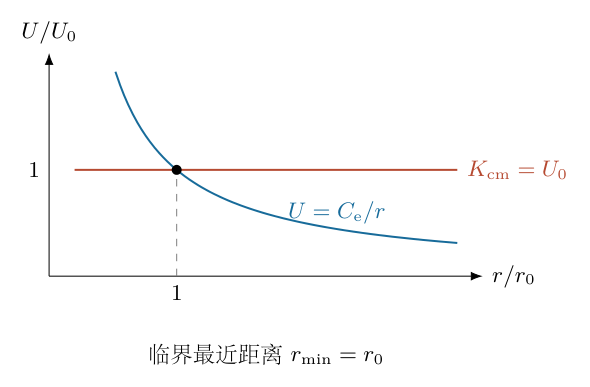

（2）在低速夹角入射中去掉共同平动能。

以角平分线为 $x$ 轴、两速度差方向为 $y$ 轴，将入射速度写成

$$
\begin{aligned}
\boldsymbol v_a&=v_1(\cos(\theta/2),\sin(\theta/2)),\\
\boldsymbol v_b&=v_1(\cos(\theta/2),-\sin(\theta/2)).
\end{aligned}
$$

质心速度为

$$
\boldsymbol V_{\rm cm}
=\frac{\boldsymbol v_a+\boldsymbol v_b}{2}
=(v_1\cos(\theta/2),0).
$$

减去质心速度，两核在质心系的速度分别为
$(0,\pm v_1\sin(\theta/2))$。图8-3表示共同分量与反向分量的区别，不能用总实验室速率作为每核质心速率。

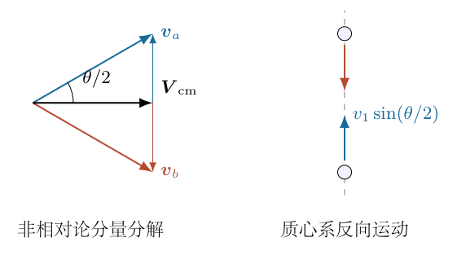

质心系可用动能为

$$
K_{\rm rel}=m_0v_1^2\sin^2\frac\theta2.
$$

也可由实验室总动能减去质心平动能直接核验：

$$
\begin{aligned}
K_{\rm lab}&=m_0v_1^2,\\
K_{\rm cm\,translation}
&=\frac12(2m_0)V_{\rm cm}^2
=m_0v_1^2\cos^2\frac\theta2,\\
K_{\rm rel}&=K_{\rm lab}-K_{\rm cm\,translation}.
\end{aligned}
$$

若安排质心系零碰撞参数，临界 $K_{\rm rel}=U_0$，于是

$$
\boxed{v_{1,\rm crit}^{\rm NR}
=\frac1{\sin(\theta/2)}
\sqrt{\frac{e^2}{4\pi\varepsilon_0m_0r_0}}},
\qquad0<\theta\leq\pi.
$$

$\theta=\pi$ 时恢复正碰；$\theta\to0$ 时低速公式发散，说明同向等速粒子没有相对运动，并且近零夹角时必须重查低速假设。

（3）保留相对论动能，求正碰阈值。

正碰的实验室仍是质心系。临界时，两核的动能全部转成 $U_0$：

$$
2(\gamma_0-1)m_0c^2=U_0.
$$

定义

$$
\Gamma=1+\frac{U_0}{2m_0c^2}=1+\frac\delta2.
$$

于是 $\gamma_{0,\rm crit}=\Gamma$。由 $\gamma=1/\sqrt{1-v^2/c^2}$，逐步解速度：

$$
\begin{aligned}
1-\frac{v_0^2}{c^2}&=\Gamma^{-2},\\
\boxed{v_{0,\rm crit}}
&=\boxed{c\sqrt{1-\Gamma^{-2}}}.
\end{aligned}
$$

这里仍采用质心系经典库仑势垒，但保留入射粒子的相对论运动学。它不是完整的高能电磁散射计算；真正高能近接还可能需要电磁场能量、辐射、核相互作用等模型。

（4）由总四动量求夹角入射的质心能量。

两核的实验室洛伦兹因子相同，记为 $\gamma_1$。总能量及总动量大小为

$$
E_{\rm tot}=2\gamma_1m_0c^2,\qquad
|\boldsymbol P_{\rm tot}|=2\gamma_1m_0v_1\cos\frac\theta2.
$$

代入质心能量不变量：

$$
\begin{aligned}
E_{\rm cm}^2
&=4\gamma_1^2m_0^2c^4
\left(1-\frac{v_1^2}{c^2}\cos^2\frac\theta2\right).
\end{aligned}
$$

令 $\beta_1=v_1/c$，利用 $\gamma_1^2\beta_1^2=\gamma_1^2-1$：

$$
\begin{aligned}
\gamma_1^2(1-\beta_1^2\cos^2(\theta/2))
&=\gamma_1^2-\left(\gamma_1^2-1\right)\cos^2\frac\theta2\\
&=1+\left(\gamma_1^2-1\right)\sin^2\frac\theta2.
\end{aligned}
$$

因此

$$
\boxed{E_{\rm cm}
=2m_0c^2\sqrt{1+(\gamma_1^2-1)\sin^2(\theta/2)}}.
$$

质心系可用动能为 $E_{\rm cm}-2m_0c^2$，不是 $E_{\rm cm}$ 全部。临界令它等于 $U_0$，得

$$
\sqrt{1+(\gamma_1^2-1)\sin^2(\theta/2)}=\Gamma.
$$

当 $\sin(\theta/2)>0$，解得

$$
\gamma_{1,\rm crit}^2
=1+\frac{\Gamma^2-1}{\sin^2(\theta/2)}.
$$

再利用 $\beta_1^2=1-1/\gamma_1^2$ 通分：

$$
\boxed{v_{1,\rm crit}
=c\sqrt{\frac{\Gamma^2-1}
{\sin^2(\theta/2)+\Gamma^2-1}}}.
$$

分母大于分子，任何非零夹角的阈值都小于 $c$，不会出现非相对论公式的超光速结果。$\theta=0$ 时质心能量始终为 $2m_0c^2$，有限速率的两个同向等速氘核没有可用相对动能，因此不存在阈值。不能把 $\theta\to0^+$ 的极限 $c$ 当成 $\theta=0$ 可取的物理速度。

（5）用速度变换独立验证相对论结果。

质心系相对实验室沿角平分线运动，速度为
$V=v_1\cos(\theta/2)$。其洛伦兹因子记为 $\gamma_V$。两粒子的 $x$ 分量恰等于 $V$，变换后 $x$ 分量为零；垂直分量为

$$
v_y'=\frac{v_1\sin(\theta/2)}
{\gamma_V[1-v_1V\cos(\theta/2)/c^2]}
=\gamma_Vv_1\sin\frac\theta2.
$$

分母中的括号为 $1-V^2/c^2=\gamma_V^{-2}$，因此产生 $\gamma_V$ 而不是 $1/\gamma_V$。质心系速度平方为

$$
\frac{v'^2}{c^2}
=\frac{\beta_1^2\sin^2(\theta/2)}
{1-\beta_1^2\cos^2(\theta/2)}.
$$

临界时 $v'^2/c^2=1-\Gamma^{-2}$，交叉相乘并整理，得到

$$
\beta_1^2=
\frac{\Gamma^2-1}{\Gamma^2-\cos^2(\theta/2)}
=\frac{\Gamma^2-1}{\Gamma^2-1+\sin^2(\theta/2)},
$$

与总四动量路线一致。角度分解的非相对论图仍可表示方向关系，但相对论的数值分量需用本步公式，不能直接做伽利略相减。

（6）检查低速极限与小夹角的适用范围。

$\delta\ll1$ 时，
$\Gamma^2-1=\delta+\delta^2/4\approx\delta$。正碰式中

$$
1-\left(1+\frac\delta2\right)^{-2}
=\delta-\frac34\delta^2+O(\delta^3),
$$

所以 $v_0^2\approx c^2\delta=U_0/m_0$，恢复低速答案。

夹角入射要进一步要求

$$
\frac{\delta}{\sin^2(\theta/2)}\ll1.
$$

在此条件下，分母中的 $\Gamma^2-1$ 可相对忽略，得到
$v_1^2\approx c^2\delta/\sin^2(\theta/2)$。只检验 $U_0\ll m_0c^2$ 不够，小夹角仍可能使实验室入射速度接近光速。

图8-4比较固定势垒下相对论阈值和低速近似。前者始终小于 $c$，后者只能在低速区域使用。

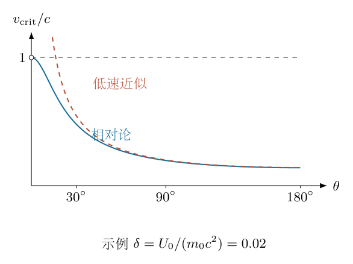

（7）明确正碰条件，避免以角度替代位置关系。

两速度夹角只确定相对运动能量，不确定初始轨迹是否通过同一相对中心。若非零碰撞参数 $b_{\rm imp}$，还保有相对角动量，最近点切向速度不为零，不能把全部动能都转为库仑势能。

在非相对论质心系，每核入射速率为 $v_{\rm cm}$，相对速度 $u=2v_{\rm cm}$，约化质量 $\mu_{\rm red}=m_0/2$。相对能量、角动量分别为

$$
E_{\rm rel}=\frac12\mu_{\rm red}u^2=m_0v_{\rm cm}^2,\qquad
\ell_{\rm rel}=\mu_{\rm red}u b_{\rm imp}
=m_0v_{\rm cm}b_{\rm imp}.
$$

相对径向运动的有效势能为

$$
U_{\rm eff}(r)=\frac{C_{\rm e}}r+
\frac{\ell_{\rm rel}^2}{2\mu_{\rm red}r^2}.
$$

当最近距离恰为 $r_0$，径向动能为零，故

$$
m_0v_{\rm cm}^2
=U_0+m_0v_{\rm cm}^2\frac{b_{\rm imp}^2}{r_0^2}.
$$

整理得

$$
v_{\rm cm,crit}^2
=\frac{U_0}{m_0[1-b_{\rm imp}^2/r_0^2]},
\qquad b_{\rm imp}<r_0.
$$

最小阈值出现在 $b_{\rm imp}=0$，即正碰。$b_{\rm imp}\geq r_0$ 时，纯排斥轨迹不能进入 $r_0$，单独提高速度也无法突破几何下限；题干若不指定正碰或允许优化入射位置，就没有唯一的某条轨迹阈值。

（8）检验单位、能量与模型边界。

$C_{\rm e}/r_0$ 单位是能量，除以 $m_0$ 后为速度平方，$\Gamma,\delta$ 无量纲。$\theta=\pi$ 的一般相对论结果化为
$c\sqrt{(\Gamma^2-1)/\Gamma^2}$，正好等于正碰式。

独立数值检查分两部分：在给定夹角下直接构造两核四动量，计算其总不变量；另在质心系直接积分单核动量和两核距离，检查最近点。取无量纲 $m_0=c=r_0=1$、$C_{\rm e}=0.6$，临界 $\Gamma=1.3$，积分最近距离为 $1$，能量残差低于 $10^{-8}$。这不是用已求临界式重复代入同一守恒等式，而是验证动力学轨迹。

实际核聚变还涉及量子隧穿、核反应截面与入射状态，不具有本题经典模型这种普遍硬阈值。到达 $r_0$ 也不能直接证明必然发生反应；本文的速度答案只回答明示的近接势垒模型。
