# 第 1 题

一个轴对称“子弹头”的接触外表面为旋转抛物面，轻质壳内的全部质量 $m$ 集中在中轴线上、距顶点 $h$ 处，绕质心的转动惯量为零。重力加速度 $g$ 竖直向下，接触摩擦足够大。母线的极坐标方程为
$$
\rho=\frac{p}{1+\cos\theta},\qquad p>0.
$$
（1）求子弹头能稳定立在水平桌面上的最小高度 $h_{\min}$，用 $p$ 表示。
（2）取 $h=p/2$，求小扰动下的振动周期 $T$，用 $g,p$ 表示。

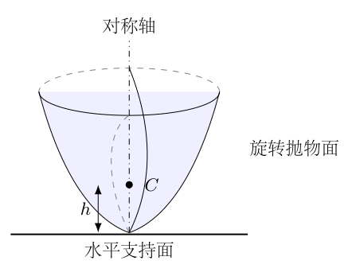

## 一、题型定位

这是曲面刚体在水平面上纯滚动的小振动问题。稳定性来自质心高度随倾角的变化，不是单看“质心越低越稳”，更不是把接触点固定成一个永远不动的铰链。接触位置会沿抛物面移动，瞬时转动中心也随之改变。

题目把壳质量和质心转动惯量都取为零，因此全部动能是嵌入质点的平动动能。纯滚动约束仍然存在，不能因此断言物体没有惯性。第（1）问使用“最小高度”，但按照图示顶点朝下、质心位于顶点上方的几何，稳定性给出的是 $h$ 的上限；下面保留题设问法并明确说明实际稳定范围。

## 二、知识点

极坐标到直角坐标的转换使用 $\rho^2=X^2+Y^2$。平面纯滚动时，接触点相对于桌面的瞬时速度为零，任意刚体点的速度可由该瞬时中心计算。稳定平衡要求势能在平衡位置有局部极小；二次项为零时必须继续检查高阶项。

若小振动的动能和势能分别为
$$
K=\frac12 M_{\rm eff}\dot\alpha^2,\qquad
U=U_0+\frac12 k_{\rm eff}\alpha^2,
$$
则运动方程为 $M_{\rm eff}\ddot\alpha+k_{\rm eff}\alpha=0$，周期为 $2\pi\sqrt{M_{\rm eff}/k_{\rm eff}}$。这里的广义坐标是角度，$M_{\rm eff}$ 的量纲为转动惯量，不是质量本身。

## 三、物理图像

把空间中的滚动方向选定后，轴对称性允许在包含该方向和对称轴的竖直截面中分析。桌面接触母线的一点 $Q$，不是任意穿过曲面的点。倾斜后，母线在 $Q$ 的切线水平，法线竖直。质心 $C$ 的高度既受到轴线倾斜影响，也受到顶点被抬起的影响，两部分必须同时保留。

重力产生回复作用的条件可表述为：微小倾斜后质心升高。若质心下降，重力会继续增大倾角。曲率中心只在二阶判断中提供简便直觉；要求周期时仍须计算动能。

## 四、解题入口

先从极坐标母线求出顶点附近曲线的准确表达式，再用“接触处切线水平”确定接触坐标。由接触坐标计算质心高度，展开得到稳定性和势能系数。最后利用纯滚动的瞬时中心求质心速度，从而得到小振动的惯性系数。

本题的参数 $p$ 同时决定顶点曲率半径，但这不是可以直接猜出的定义。必须通过母线方程验证，避免将焦距 $p/2$ 与曲率半径 $p$ 混淆。

## 五、解析

（1）把极坐标方程转成母线直角坐标。

在原极坐标轴方向记坐标为 $X$，垂直方向为 $Y$。由于 $\rho\cos\theta=X$，
$$
\rho+X=p.
$$
移项后平方：
$$
\begin{aligned}
\rho&=p-X,\\
X^2+Y^2&=(p-X)^2
=p^2-2pX+X^2,\\
Y^2&=p^2-2pX.
\end{aligned}
$$
平方前要求 $p-X\ge0$；所得抛物线满足 $X\le p/2$，所以没有引入不合条件的支路。顶点位于 $(p/2,0)$。

以顶点为原点，把沿物体轴线朝壳内部的坐标记为 $z=p/2-X$，横向坐标记为 $s=Y$，则
$$
\boxed{z=\frac{s^2}{2p}.}
$$
质心的体坐标为 $(s_C,z_C)=(0,h)$。曲线的一阶和二阶导数是
$$
z'(s)=\frac{s}{p},\qquad z''(s)=\frac1p.
$$
顶点处的曲率半径为
$$
{\cal R}_0=\frac{[1+z'(0)^2]^{3/2}}{|z''(0)|}=p.
$$
焦点距顶点为 $p/2$，两种长度不可混用。

（2）规定倾角及接触位置。

设体坐标的 $z$ 轴相对竖直向上方向倾斜，采用如下旋转约定：
$$
x=s\cos\alpha-z\sin\alpha,\qquad
y=s\sin\alpha+z\cos\alpha.
$$
这里先忽略平移；平移只改变所有点的共同位置，不改变切线斜率。由母线参数 $s$ 求世界坐标的竖直导数：
$$
\frac{dy}{ds}
=\sin\alpha+\frac{s}{p}\cos\alpha.
$$
在接触点 $Q$，切线水平，故 $dy/ds=0$。在顶点附近 $|\alpha|<\pi/2$，有
$$
\boxed{s_Q=-p\tan\alpha,\qquad
z_Q=\frac p2\tan^2\alpha.}
$$
图1-2中的负号来自本节的旋转约定：正倾角时接触点移到体坐标 $s<0$ 一侧。改变倾角正方向会同时改变 $s_Q$ 的号，但不能只改其中一处。

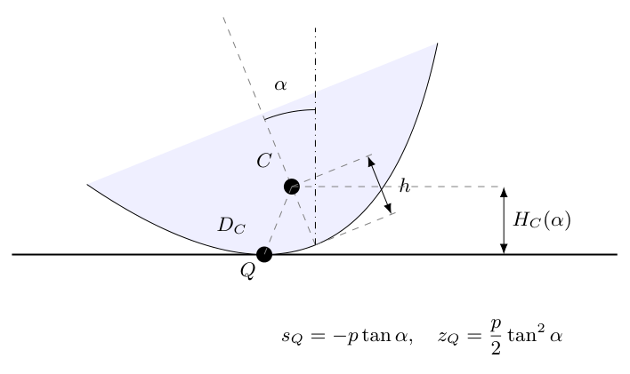

（3）由接触点高度归零计算质心高度。

旋转但未平移时，接触点高度为
$$
y_Q=s_Q\sin\alpha+z_Q\cos\alpha.
$$
把整个物体平移使 $Q$ 位于桌面 $y=0$，质心实际高度为
$$
H_C=h\cos\alpha-y_Q.
$$
代入上一步：
$$
\begin{aligned}
H_C
&=h\cos\alpha
+p\tan\alpha\sin\alpha
-\frac p2\tan^2\alpha\cos\alpha\\
&=h\cos\alpha+\frac p2\frac{\sin^2\alpha}{\cos\alpha}\\
&=\left(h-\frac p2\right)\cos\alpha
+\frac p{2\cos\alpha}.
\end{aligned}
$$
第二行把两项共同写为 $\sin^2\alpha/\cos\alpha$；第三行使用 $\sin^2\alpha=1-\cos^2\alpha$。因此
$$
\boxed{H_C(\alpha)=
\left(h-\frac p2\right)\cos\alpha+\frac p2\sec\alpha.}
$$
当 $\alpha=0$ 时恢复 $H_C=h$，几何初态正确。这个高度公式与接触点在桌面上的水平平移无关，纯滚动与否不改变瞬时几何高度。

（4）展开势能，判断通常的小振动稳定性。

使用以弧度计量的泰勒展开：
$$
\cos\alpha=1-\frac{\alpha^2}{2}+\frac{\alpha^4}{24}+O(\alpha^6),
$$
$$
\sec\alpha=1+\frac{\alpha^2}{2}
+\frac{5\alpha^4}{24}+O(\alpha^6).
$$
逐项整理：
$$
\begin{aligned}
H_C-h
&=\left[-\frac12\left(h-\frac p2\right)+\frac p4\right]\alpha^2\\
&\quad+\left[\frac1{24}\left(h-\frac p2\right)+\frac{5p}{48}\right]\alpha^4
+O(\alpha^6)\\
&=\frac{p-h}{2}\alpha^2+\frac{h+2p}{24}\alpha^4+O(\alpha^6).
\end{aligned}
$$
势能为 $U=mgH_C$，所以在 $0<h<p$ 时二次项正，顶点朝下是稳定的小振动平衡；在 $h>p$ 时二次项负，是不稳定平衡。图1-3比较的是质心高度变化，不是不同物体的绝对势能零点。

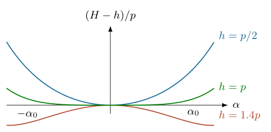

（5）单独检查 $h=p$，不能在二次项为零时直接称“不稳定”。

取 $h=p$，有
$$
H_C=\frac p2(\cos\alpha+\sec\alpha).
$$
对于 $|\alpha|<\pi/2$，令 $c_\alpha=\cos\alpha>0$：
$$
\begin{aligned}
H_C-p
&=\frac p2\left(c_\alpha+\frac1{c_\alpha}-2\right)\\
&=\frac p{2c_\alpha}(1-c_\alpha)^2\ge0.
\end{aligned}
$$
除了 $\alpha=0$，邻近角度的势能仍然升高。因此 $h=p$ 也是局部稳定的，但没有线性回复刚度，不能称为通常的简谐小振动。首个非零项为
$$
H_C-p=\frac p8\alpha^4+O(\alpha^6).
$$
稳定范围可写为 $0<h\le p$；若要求非零线性回复系数和有限的振幅无关周期，则为 $0<h<p$。

因此第（1）问实际给出的是稳定上限 $h_{\max}=p$，不是一个正的稳定下限。$h$ 可以任意接近零；其下确界为零，$h=0$ 时嵌入质点就在接触顶点，角向动能退化，不能继续使用下面的普通小振动公式。

（6）用瞬时转动中心建立动能。

无滑动接触使接触材料点的瞬时速度为零。刚体角速度为 $\dot\alpha$，所以
$$
|\boldsymbol v_C|^2
=\dot\alpha^2\,|\boldsymbol{QC}|^2.
$$
体坐标下
$$
\boldsymbol{QC}=(-s_Q,h-z_Q),
$$
长度在旋转前后不变：
$$
D_C^2=s_Q^2+(h-z_Q)^2.
$$
图1-4中的 $\boldsymbol{QC}$ 正是动能中的几何长度，并不是一条固定摆长。

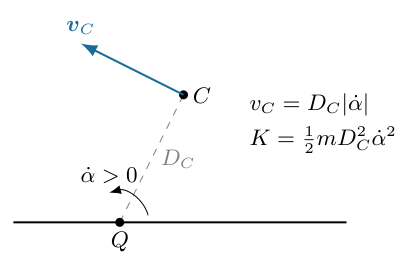

全部质量集中于 $C$，绕质心的惯量为零，故
$$
\boxed{K=\frac12 mD_C^2(\alpha)\dot\alpha^2.}
$$
如果壳有不可忽略的绕质心惯量 $I_C$，应额外加 $\tfrac12 I_C\dot\alpha^2$；本题明确不加这一项。摩擦力和支持力作用于瞬时静止接触点，纯滚动时不做功，机械能可守恒。

（7）说明为何小振动只保留 $D_C^2(0)$。

接触坐标展开为
$$
s_Q=-p\alpha+O(\alpha^3),\qquad
z_Q=\frac p2\alpha^2+O(\alpha^4).
$$
所以
$$
\begin{aligned}
D_C^2
&=p^2\alpha^2+
\left(h-\frac p2\alpha^2\right)^2+O(\alpha^4)\\
&=h^2+(p^2-ph)\alpha^2+O(\alpha^4).
\end{aligned}
$$
把角幅和角速度都视为一阶小量，$\alpha^2\dot\alpha^2$ 是四阶，不能进入线性方程。因此二阶动能为
$$
K^{(2)}=\frac12 mh^2\dot\alpha^2.
$$
这不是把接触点长期固定；只是用瞬时中心正确求得的系数在平衡位置取值。与之配对的二阶势能为
$$
U^{(2)}=mgh+\frac12 mg(p-h)\alpha^2.
$$

（8）逐项写出线性运动方程。

由拉格朗日方程
$$
\frac d{dt}\frac{\partial K}{\partial\dot\alpha}
-\frac{\partial K}{\partial\alpha}
+\frac{\partial U}{\partial\alpha}=0
$$
得到
$$
mh^2\ddot\alpha+mg(p-h)\alpha=0.
$$
约去 $m$，再除以 $h^2>0$：
$$
\ddot\alpha+\frac{g(p-h)}{h^2}\alpha=0.
$$
当 $0<h<p$，
$$
\omega^2=\frac{g(p-h)}{h^2},\qquad
\boxed{T=\frac{2\pi h}{\sqrt{g(p-h)}}.}
$$
$h\to p^-$ 时回复二次项趋零，线性周期趋于无穷，与临界状态一致；$h>p$ 时 $\omega^2<0$，不是实周期，而是指数增长或衰减的线性解。

（9）代入 $h=p/2$，保留计算步骤。

此时
$$
h^2=\frac{p^2}{4},\qquad p-h=\frac p2.
$$
于是
$$
\begin{aligned}
\omega^2
&=\frac{g(p/2)}{p^2/4}=\frac{2g}{p},\\
\omega&=\sqrt{\frac{2g}{p}},\\
T&=\boxed{2\pi\sqrt{\frac{p}{2g}}.}
\end{aligned}
$$
直接检查能量也得到
$$
K^{(2)}=\frac{mp^2}{8}\dot\alpha^2,\qquad
U-mgh=\frac{mgp}{4}\alpha^2,
$$
因此 $\omega^2=(mgp/2)/(mp^2/4)=2g/p$。周期量纲为 $\sqrt{\text{长度}/\text{加速度}}$，即时间；质量消去符合重力回复与惯性都正比于 $m$ 的模型。

（10）检查滚动、离地与小振幅条件。

上面的结果只描述顶点附近的纯滚动接触。小振幅下质心加速度连续且趋于零，支持力趋于 $mg>0$，所以不会自动离地；所需摩擦力随幅度趋零，可由题设“足够大摩擦”保证。但有限振幅时仍须另验支持力非负、摩擦力不超过最大静摩擦力，以及接触点是否仍位于实际壳面。

题目没有给出壳的截断边缘，因此不能把无限母线的计算外推到任意倾角。周期仅取 $\alpha\to0$ 的稳定小振动极限；临界 $h=p$、退化 $h=0$ 均须单独处理，不能强行代入为普通有限周期。

\newpage

# 第 2 题

高斯炮由水平导轨、强磁铁和钢球组成。磁铁与钢球质量均为 $m$，钢球直径和磁铁沿导轨宽度均为 $2r$。磁铁与钢球间的吸引力近似为
$$
F=\frac K{x^3},\qquad K>0,
$$
其中 $x$ 表示两者间距离。忽略钢球磁化产生的磁场。各级磁铁之间距离很大，每级磁铁右侧紧贴三个钢球。磁铁由绳子固定，除碰撞瞬间外不移动。入射球从远处以速度 $v_0$ 向右运动，各物体之间按次序逐个碰撞。

（1）在光滑导轨和完全弹性碰撞条件下，经过三级后飞出钢球的最大速度 $v_3$ 为多少？
（2）相邻磁铁距离为 $l$，$l\gg r$。导轨摩擦系数为 $\mu$，碰撞恢复系数为 $e=1-\delta$，$0<\delta\ll1$。磁铁级数足够多时，最大可加速到什么速度？这里把题中表示恢复系数损失的小量改记为 $\delta$，避免与距离 $x$ 重名。

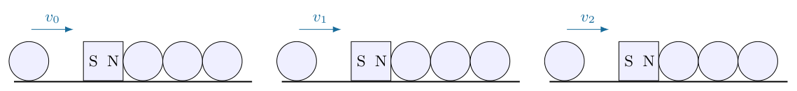

## 一、题型定位

这是磁势能转换、等质量碰撞链及损耗递推相结合的问题。磁铁不永久移动，但在碰撞瞬间被当作可传递冲量的等质量物体；必须区分碰撞前的吸引加速、瞬时碰撞传速、碰撞后的脱离减速三个阶段。

力中的“距离”必须有定义。若把 $x$ 解释为两表面间隙，接触时 $x=0$，$K/x^3$ 的做功积分发散，题目不可能给出有限速度。以下有限结果以 $x$ 为沿导轨中心距为条件；钢球碰到磁铁时中心距为 $2r$。如果采用其他有效距离，须相应更改两个积分下限，不能暗自沿用 $2r$。

## 二、知识点

保守力做功可写为势能差。沿中心距增大的正方向，吸引力分量为 $-K/x^3$，由 $F_x=-dU/dx$ 确定势能，而不是直接用力的大小积分后任意添号。

两等质量物体的一维碰撞需联立动量守恒和恢复系数关系。理想弹性、后者静止时，前者停止、后者获得全部速度；非弹性时传递因子为 $(1+e)/2$，每一个接触都要计入。远距离滑动摩擦主要给出 $\mu mgl$ 的每级损失，近磁铁区域的摩擦是 $O(r/l)$ 的相对修正。

## 三、物理图像

每级开始时，磁铁右边三个球的中心距依次为 $2r,4r,6r$。入射球被吸到左边 $2r$ 处，四次逐个碰撞把速度依次传给磁铁、第一球、第二球、第三球。第三球成为下一段的炮弹。入射球最终留在左边近处，最右球从较远的 $6r$ 处脱离。

这种近入远出的不对称改变了束缚势能。碰撞本身没有创造能量，磁能来自每级排列的变化。其他静止球在理想模型中对同一磁铁的势能不变，计算单级净增益时只比较入射球与飞出球。

## 四、解题入口

先求一次完整磁加速的净能量增益，再叠加三级。第二问不宜直接把“每级损失”加在第一问最终式上，因为碰撞损失与进入碰撞链的速度平方有关。应先写单次速度传递，再对四次碰撞相乘，最后建立速度平方递推并判断起动与极限条件。

为防止混淆，记到达磁铁前的碰撞速度为 $u$，刚完成碰撞链的飞出球速度为 $w$，离开本级磁场后的速度为 $v_+$；这些速度一般不相同。

## 五、解析

（1）确定磁势能的符号和接触距离。

取磁铁中心为原点，中心距 $x>0$。吸引力沿距离减小方向：
$$
F_x=-\frac K{x^3}.
$$
令无限远势能为零，则
$$
\begin{aligned}
\frac{dU}{dx}&=\frac K{x^3},\\
U(x)-U(\infty)&=\int_\infty^x\frac K{\xi^3}\,d\xi\\
&=\left[-\frac K{2\xi^2}\right]_\infty^x
=-\frac K{2x^2}.
\end{aligned}
$$
所以
$$
\boxed{U(x)=-\frac K{2x^2}.}
$$
在图2-2中，入射球的中心在 $x=-2r$，但用于势能的是正的中心距离 $|x|=2r$；右侧最外球距磁铁为 $6r$。不能把坐标的负号放进物理距离而得出排斥力。

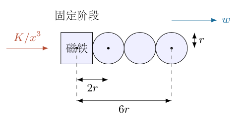

（2）从远处到碰撞前的加速。

入射远处动能为 $\tfrac12 mv^2$，势能近似零。到达接触中心距 $2r$ 时，动能为 $\tfrac12 mu^2$，势能为 $-K/(8r^2)$。机械能守恒给出
$$
\frac12 mu^2-\frac K{8r^2}=\frac12 mv^2.
$$
移项并乘以 $2/m$：
$$
\boxed{u^2=v^2+\frac K{4mr^2}.}
$$
碰撞前动能增加 $K/(8r^2)$，不是 $K/(4r^2)$；后一个系数出现在速度平方公式中，来自乘以 $2/m$。

（3）推导理想等质量碰撞的速度交换。

设碰撞前两个物体速度为 $u,0$，碰撞后为 $u_a,u_b$。光滑短时碰撞中忽略磁力和绳子的有限力冲量，联立
$$
u=u_a+u_b,\qquad
u^2=u_a^2+u_b^2.
$$
把第一式平方并与第二式比较：
$$
2u_au_b=0.
$$
非平凡碰撞取后者向前运动，故 $u_a=0,u_b=u$。另一个分支 $u_a=u,u_b=0$ 是未发生相互作用，不能作为碰撞结果。

图2-3的四个接触分别为入射球—磁铁、磁铁—球1、球1—球2、球2—球3。每次传递相同速度，所以理想碰撞链结束后 $w=u$。

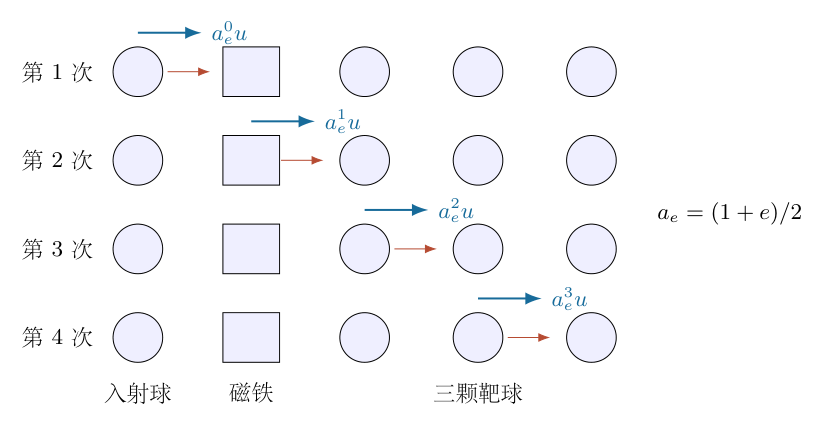

若磁铁在碰撞期间仍被不可动的刚性夹具锁定，第一步会成为球撞固定壁，不能得到这条传递链。本题“碰撞瞬间除外”的规定正用于排除该情况。绳子把残余运动再次制止时可能吸收能量；其外力不提供额外正的推进功。

（4）计算最外球从 $6r$ 脱离时的损失。

飞出球刚开始运动时势能为
$$
U_{\rm out}=-\frac K{2(6r)^2}=-\frac K{72r^2}.
$$
离开到远处势能升为零，故
$$
\frac12 mw^2-\frac K{72r^2}=\frac12 mv_+^2.
$$
因此
$$
v_+^2=w^2-\frac K{36mr^2}.
$$
代入 $w^2=u^2$：
$$
\begin{aligned}
v_+^2
&=v^2+\frac K{4mr^2}-\frac K{36mr^2}\\
&=v^2+\frac{9K-K}{36mr^2}\\
&=\boxed{v^2+\frac{2K}{9mr^2}.}
\end{aligned}
$$
净动能增加
$$
\Delta K_{\rm stage}
=\frac12 m(v_+^2-v^2)=\frac K{9r^2}.
$$
直接计算势能改变也得到 $K/(8r^2)-K/(72r^2)=K/(9r^2)$，与动能法一致。

（5）三级相加，并解释“最大”的含义。

记第 $k$ 级后的远场速度为 $v_k$。在本模型的无损、远距离极限中
$$
v_{k+1}^2=v_k^2+C,\qquad C=\frac{2K}{9mr^2}.
$$
逐级写出：
$$
v_1^2=v_0^2+C,\qquad
v_2^2=v_0^2+2C,\qquad
v_3^2=v_0^2+3C.
$$
从而
$$
\boxed{v_3=\sqrt{v_0^2+\frac{2K}{3mr^2}}.}
$$
这里选择向右飞出的正根。“最大”指理想传速、忽略跨级磁场和轨道损失的可达上限，不允许通过碰撞凭空增加能量。若球未能脱离本级，远场炮弹速度就没有定义。

（6）推广至每级右侧 $n$ 个球，检验图中球数的重要性。

右侧最外球距离为 $2nr$。仍以中心距模型计算：
$$
\begin{aligned}
\Delta K_n
&=\frac K{8r^2}-\frac K{8n^2r^2}\\
&=\frac K{8r^2}\left(1-\frac1{n^2}\right),\\
v_+^2-v^2
&=\frac K{4mr^2}\left(1-\frac1{n^2}\right).
\end{aligned}
$$
$n=1$ 时净增益为零；近入与近出一样，没有释放排列势能。$n=3$ 时恢复 $2K/(9mr^2)$。因此不能把三个球误画成两个，或使用另一种高斯炮排列的系数。

（7）推导非弹性单次碰撞的速度传递。

恢复系数定义为碰撞后分离相对速度与碰撞前接近相对速度之比：
$$
u_b-u_a=e(u-0).
$$
与 $u_a+u_b=u$ 联立：
$$
2u_b=(1+e)u,\qquad
2u_a=(1-e)u.
$$
所以
$$
u_b=a_eu,\qquad u_a=(1-a_e)u,\qquad
a_e=\frac{1+e}{2}=1-\frac\delta2.
$$
后者的动能不是简单乘 $e^2$，因为 $e$ 限制相对速度。单次总动能损失为
$$
\begin{aligned}
\Delta K_{\rm coll}
&=\frac12 mu^2-\frac12 m
\left[\left(\frac{1-e}{2}u\right)^2+
\left(\frac{1+e}{2}u\right)^2\right]\\
&=\frac14 m(1-e^2)u^2.
\end{aligned}
$$
这条式子是总碰撞损失；与最终炮弹损失不同，前者还计入残留在前方物体中的动能。

（8）四次传递相乘，不把一次损耗当整级损耗。

在题设逐个碰撞理想化内：
$$
u\longrightarrow a_eu\longrightarrow a_e^2u
\longrightarrow a_e^3u\longrightarrow a_e^4u.
$$
因此 $w=a_e^4u$，平方为
$$
w^2=q_eu^2,\qquad q_e=a_e^8.
$$
加速前后再加远段摩擦，令 $y_k=v_k^2$，得到领先阶递推
$$
\boxed{y_{k+1}=q_ey_k+D,}
$$
$$
\boxed{D=q_e\frac K{4mr^2}
-\frac K{36mr^2}-2\mu gl.}
$$
摩擦功为 $-\mu mgl$，转成速度平方变化是 $-2\mu gl$。实际飞出与再次接触的直线距离与 $l$ 相差 $O(r)$，在 $l\gg r$ 时相对修正为 $O(r/l)$。近处磁场与残余碰撞的细节被题设逐个短时碰撞近似排除，不能声称这个递推是任意真实装置的精确运动。

（9）求有限级数解与极限。

对于 $0<e<1$，有 $0<q_e<1$。迭代：
$$
\begin{aligned}
y_1&=q_ey_0+D,\\
y_2&=q_e^2y_0+(1+q_e)D,\\
y_N&=q_e^Ny_0+D\sum_{j=0}^{N-1}q_e^j.
\end{aligned}
$$
几何级数求和为
$$
\boxed{y_N=q_e^Nv_0^2
+\frac{D(1-q_e^N)}{1-q_e}.}
$$
若 $D>0$，递推固定点为
$$
\boxed{v_*^2=
\frac{q_eK/(4mr^2)-K/(36mr^2)-2\mu gl}{1-q_e}.}
$$
图2-4以 $y_*$ 为水平固定点：从 $y_0<y_*$ 开始会逐级上升，从 $y_0>y_*$ 开始会逐级下降。固定点不是所有给定入射速度的“最大速度”；若入射本来更快，就没有加速超过它。

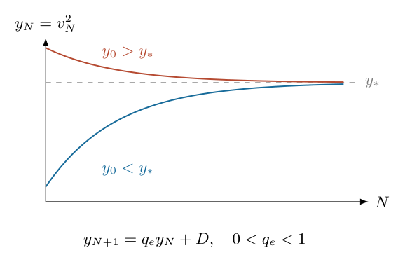

由
$$
y_{k+1}-y_* =q_e(y_k-y_*)
$$
可知方向不改变。在无穷级数意义下，上限为 $\max(v_0,v_*)$；若关注可由低速入射逐级加速获得的饱和速度，答案是 $v_*$，有限级数通常只趋近而不等于该值。

（10）展开 $\delta\ll1$，给出常用近似的成立条件。

二项式展开：
$$
q_e=\left(1-\frac\delta2\right)^8
=1-4\delta+7\delta^2+O(\delta^3).
$$
因此
$$
D=\frac{2K}{9mr^2}-2\mu gl
-\frac{K}{mr^2}\delta+O(\delta^2).
$$
若领先项 $2K/(9mr^2)-2\mu gl$ 为正且不与零同阶抵消，则
$$
\begin{aligned}
v_*^2
&\simeq\frac{2K/(9mr^2)-2\mu gl}{4\delta}\\
&=\frac1\delta\left(\frac K{18mr^2}-\frac{\mu gl}{2}\right).
\end{aligned}
$$
即
$$
\boxed{v_*\simeq
\sqrt{\frac{K/(18mr^2)-\mu gl/2}{\delta}}.}
$$
若分子接近零，不能忽略 $D$ 中的一阶损失，须用未展开的 $q_e$ 公式。恢复系数越接近1，饱和速度越高，但真实磁力、碰撞时间和材料强度终会限制这条理想化外推。

<!-- KEEP_STUDENT_START -->

（11）检查不能起动或最终停止的分支。

如果 $D\le0$，低速入射不获得正的远场增益；当某次预测 $y_{k+1}<0$ 时，不是“负速度平方”，而是飞出球不能完成该段脱离与滑行，递推必须停止。即使 $D>0$，还应保证本级刚脱离磁场时的速度平方非负；剩余球因非弹性获得的残速可能造成再碰撞，这些由题设逐个碰撞理想化忽略。

$e=1$ 时 $q_e=1$，固定点分母为零，不能套无穷级数式。此时
$$
y_N=v_0^2+N\left(\frac{2K}{9mr^2}-2\mu gl\right).
$$
若括号正，理想模型无有限饱和速度；若为零，保持不变；若为负，有限级数后停止。摩擦和碰撞损失扮演不同作用，不能只看到 $\delta\to0$ 就断言所有情况下速度都发散。

（12）量纲与能量核验。

由 $F=K/x^3$，有 $[K]=\text{力}\times\text{长度}^3$，所以 $K/(mr^2)$ 的量纲为速度平方；$\mu gl$ 也为速度平方。$D$ 可与 $y$ 相加，$q_e$ 无量纲。三级理想净动能增量为 $3K/(9r^2)$，正好等于三个排列的势能下降总和。

上述有限速度结果以中心距、三球排列、四次等质量传递、碰撞瞬间无固定夹具冲量、跨级距离足够大为成立条件。力模型在接触距离之外的真实磁性不必严格遵循反立方律；不得把该模型当作普适钢球吸力定律。

<!-- KEEP_STUDENT_END -->

\newpage

# 第 3 题

两个质量相同的粒子，初速度在同一直线上，发生非相对论弹性碰撞。判断下列说法的正误并证明：

A．若两个初速度同向，则出射两个粒子的速度方向夹角一定小于 $90^\circ$。
B．若两个初速度反向，则出射两个粒子的速度方向夹角一定大于 $90^\circ$。
C．若两个初速度同向，则出射两个粒子中速度较大的一个偏转角一定更大。
D．若两个初速度反向，则出射两个粒子中速度较大的一个，速度与质心速度方向的夹角一定更大。

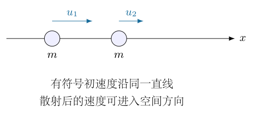

## 一、题型定位

这是等质量弹性碰撞的速度几何问题，重点是守恒条件允许的方向关系，而不是某一种接触力的具体散射角。碰撞可以在平面或空间中发生；两个出射速度与质心速度仍位于由散射相对速度确定的同一平面，可以用二维速度图表示，不把物理运动强行限制成一维。

“方向夹角”要求对应速度非零，“较大的一个”要求两个速率确实不等，“质心速度方向”要求质心速度非零。对这些退化情况先说明定义，再判断通常的非退化碰撞。不能用没有定义的角度证明某个严格不等式。

## 二、知识点

等质量体系的质心速度为初始速度的平均值。弹性碰撞保持总动量和总动能，因此质心速度不变，相对质心的两个速度始终大小相等、方向相反。矢量点积确定夹角的锐钝，横向动量守恒联系两个出射角。

角度比较时必须先确定范围。$\sin\beta$ 在 $[0,\pi/2]$ 上单调，在 $[0,\pi]$ 上不是全程单调；因此同向和反向入射不能直接套同一条正弦比较。反向入射的某个出射角可能大于 $90^\circ$，应改用余弦或完整速度圆。

## 三、物理图像

在实验室速度图中，所有可能的出射速度端点位于以质心速度 $\boldsymbol V$ 为圆心、以质心系速率 $w$ 为半径的圆上。两个粒子的速度端点是这个圆上相对的两点。

同向入射对应 $V>w$，圆不包围原点，两条出射矢量都在质心前方。反向入射对应 $V<w$，圆包围原点，两个速度方向可以分布于更大的角域。圆心的位置决定锐角或钝角，圆上两点的具体位置决定谁快谁慢。

## 四、解题入口

第一步用总动量和总动能把出射速度写为 $\boldsymbol V\pm\boldsymbol w$。A、B直接计算两出射速度的点积，不必解散射角。C用同向情况下的横向动量和锐角范围比较。D用速率与对质心方向夹角的余弦公式，或给出满足守恒的明确反例。

题目没有给散射力或碰撞参数，不能任意选定一个唯一出射方向；但不妨碍证明对所有允许散射成立的点积关系，也不妨碍用一个允许反例推翻“一定”。

## 五、解析

（1）选轴并给出符号约定。

令初始速度为
$$
\boldsymbol u_1=u_1\boldsymbol e_x,\qquad
\boldsymbol u_2=u_2\boldsymbol e_x,
$$
其中 $u_1,u_2$ 是有符号分量。同向条件为 $u_1u_2>0$，反向条件为 $u_1u_2<0$。将坐标轴翻转不改变物理结论；若质心速度非零，以下统一选其方向为 $+x$，令
$$
V=\left|\frac{u_1+u_2}{2}\right|>0,\qquad
w=\frac{|u_1-u_2|}{2}.
$$
同向且确有相对运动时 $V>w>0$；反向时 $w>V\ge0$。等速同向的两个自由粒子没有追近运动，不属于一般二体接近碰撞，不能把这个退化初态硬套散射图。

（2）联立守恒式，证明质心系速度长度不变。

碰撞后速度记为 $\boldsymbol v_1,\boldsymbol v_2$。总动量守恒：
$$
m\boldsymbol v_1+m\boldsymbol v_2
=m\boldsymbol u_1+m\boldsymbol u_2.
$$
所以
$$
\boldsymbol v_1+\boldsymbol v_2=2\boldsymbol V,
\qquad \boldsymbol V=V\boldsymbol e_x.
$$
定义
$$
\boldsymbol w'=\frac{\boldsymbol v_1-\boldsymbol v_2}{2}.
$$
由和与差解出
$$
\boldsymbol v_1=\boldsymbol V+\boldsymbol w',\qquad
\boldsymbol v_2=\boldsymbol V-\boldsymbol w'.
$$
展开总动能：
$$
\begin{aligned}
K_f
&=\frac m2|\boldsymbol V+\boldsymbol w'|^2
+\frac m2|\boldsymbol V-\boldsymbol w'|^2\\
&=mV^2+m|\boldsymbol w'|^2.
\end{aligned}
$$
初态同理为 $K_i=mV^2+mw^2$。弹性碰撞使 $K_f=K_i$，故
$$
\boxed{|\boldsymbol w'|=w.}
$$
质心系相对速度可转向，但长度不能变。图3-2中的圆正由这个守恒结果建立。

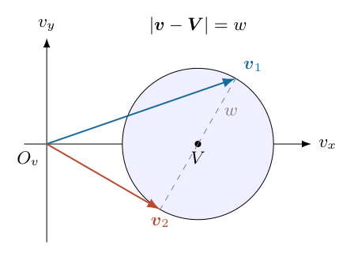

（3）计算两出射速度的点积。

使用 $\boldsymbol v_1=\boldsymbol V+\boldsymbol w'$ 和 $\boldsymbol v_2=\boldsymbol V-\boldsymbol w'$：
$$
\begin{aligned}
\boldsymbol v_1\cdot\boldsymbol v_2
&=(\boldsymbol V+\boldsymbol w')\cdot
(\boldsymbol V-\boldsymbol w')\\
&=V^2-|\boldsymbol w'|^2\\
&=V^2-w^2\\
&=\frac{(u_1+u_2)^2-(u_1-u_2)^2}{4}\\
&=u_1u_2.
\end{aligned}
$$
最后一步展开两平方，交叉项分别为 $+2u_1u_2$ 和 $-2u_1u_2$。这条式子不含散射角，是两个判定的共同核心。

设两个出射方向夹角为 $\gamma$，两速率非零时
$$
\cos\gamma=\frac{u_1u_2}{|\boldsymbol v_1||\boldsymbol v_2|}.
$$
因此同向入射时 $\cos\gamma>0$，$0\le\gamma<\pi/2$，A正确；反向入射时 $\cos\gamma<0$，$\pi/2<\gamma\le\pi$，B正确。夹角可以为零或 $\pi$，但不会在这两种严格初态中恰为 $\pi/2$。

（4）检验直角和零速度的特殊情况。

如果一个入射粒子静止，即 $u_1u_2=0$，且两个出射速度都非零，则
$$
\boldsymbol v_1\cdot\boldsymbol v_2=0,
$$
出射夹角为 $90^\circ$。这不是A或B的严格“两个初速度同向/反向”条件，而是它们的边界。

若等质量弹性正碰把全部速度交换后一个粒子静止，该粒子的出射方向没有定义。通常所谓“等质量弹性碰撞后互相垂直”，正是一个靶粒子初态静止、两个出射速度非零的特殊结论，不能替代本题的一般点积式。

（5）写出散射角参数与两个速率。

在出射平面中，令 $\boldsymbol w'$ 与 $\boldsymbol V$ 的夹角为 $\chi$：
$$
\boldsymbol w'=w(\cos\chi,\sin\chi).
$$
因此
$$
\boldsymbol v_1=(V+w\cos\chi,w\sin\chi),
$$
$$
\boldsymbol v_2=(V-w\cos\chi,-w\sin\chi).
$$
速率平方分别为
$$
s_1^2=V^2+w^2+2Vw\cos\chi,
$$
$$
s_2^2=V^2+w^2-2Vw\cos\chi.
$$
相减：
$$
s_1^2-s_2^2=4Vw\cos\chi.
$$
若 $V>0$，不妨通过交换粒子编号使 $\cos\chi>0$，从而 $s_1>s_2$。若 $\cos\chi=0$，两个速率相等，题目“较大的一个”没有对象，但A、B仍有定义。

（6）同向入射时证明快粒子偏转反而更小。

因为 $V>w$，
$$
V+w\cos\chi\ge V-w>0,\qquad
V-w\cos\chi\ge V-w>0.
$$
两个出射矢量的 $x$ 分量都正。由于两个初速度本来同向，并已取 $+x$ 为该方向，偏转角就是各出射矢量对 $+x$ 的非负夹角 $\beta_1,\beta_2$，都属于 $[0,\pi/2)$。

横向总动量为零，故
$$
s_1\sin\beta_1=s_2\sin\beta_2=w|\sin\chi|.
$$
当散射非共线且 $s_1>s_2$，
$$
\sin\beta_1<\sin\beta_2.
$$
在已确认的锐角范围上，正弦严格单调，所以
$$
\boxed{\beta_1<\beta_2.}
$$
快的粒子偏转较小，C错误。若 $\sin\chi=0$，两角均为零，也不满足“快的一个一定更大”。图3-3明确画出横向速度等大而纵向速度不同的情况。

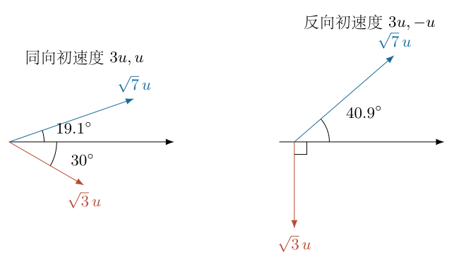

（7）给出C的数值反例并核对守恒。

取初始有符号速度 $u_1=3u_*,u_2=u_*$，其中 $u_*>0$ 为速度单位。于是 $V=2u_*,w=u_*$。选择允许的散射方向 $\chi=\pi/3$：
$$
\boldsymbol v_1=u_*\left(\frac52,\frac{\sqrt3}{2}\right),
\qquad
\boldsymbol v_2=u_*\left(\frac32,-\frac{\sqrt3}{2}\right).
$$
其速率为
$$
s_1=\sqrt7\,u_*,\qquad s_2=\sqrt3\,u_*.
$$
总速度矢量为 $(4u_*,0)$，与初态相同；平方和为 $7u_*^2+3u_*^2=10u_*^2$，与 $3^2u_*^2+u_*^2$ 相同。两角满足
$$
\tan\beta_1=\frac{\sqrt3}{5},\qquad
\tan\beta_2=\frac{\sqrt3}{3}.
$$
因此 $\beta_1\simeq19.1^\circ<\beta_2=30^\circ$，且快粒子为1，严格反驳C。反例必须同时满足动量与能量，不能任意画两个箭头。

（8）反向入射时不能继续用锐角正弦比较。

此时 $w>V$，某个出射 $x$ 分量可能负，角度可能钝。设某个粒子的速率为 $s>0$，与 $\boldsymbol V$ 的夹角为 $\beta\in[0,\pi]$。由速度圆关系
$$
|\boldsymbol v-\boldsymbol V|^2=w^2
$$
展开：
$$
s^2+V^2-2Vs\cos\beta=w^2.
$$
当 $V>0$，
$$
\boxed{\cos\beta=
\frac{s^2+V^2-w^2}{2Vs}.}
$$
把右边看成 $s$ 的函数：
$$
C(s)=\frac1{2V}\left(s+\frac{V^2-w^2}{s}\right).
$$
求导：
$$
C'(s)=\frac1{2V}\left(1-\frac{V^2-w^2}{s^2}\right).
$$
由于反向入射 $V^2-w^2<0$，
$$
C'(s)=\frac1{2V}\left(1+\frac{w^2-V^2}{s^2}\right)>0.
$$
因此速率越大，$\cos\beta$ 越大；余弦在 $[0,\pi]$ 上严格递减，所以角度越小。快粒子与质心方向的夹角更小，D错误。

（9）给出D的反例并检查夹角。

取 $u_1=3u_*,u_2=-u_*$，则 $V=u_*,w=2u_*$。选择 $\chi=\pi/3$：
$$
\boldsymbol v_1=u_*(2,\sqrt3),\qquad
\boldsymbol v_2=u_*(0,-\sqrt3).
$$
速率为 $\sqrt7u_*$ 和 $\sqrt3u_*$，质心向 $+x$ 运动。快粒子的角度为
$$
\beta_1=\arctan\frac{\sqrt3}{2}\simeq40.9^\circ,
$$
慢粒子对 $+x$ 的角度为 $\beta_2=90^\circ$，因此快粒子的角度明显更小。

总速度为 $(2u_*,0)$，动能对应平方和为 $7+3=10$，均与初态 $3,-1$ 相符。两出射速度点积为 $-3u_*^2$，所以它们相互夹角为钝角，与B一致。D错误与B正确并不矛盾，两个说法比较的是不同角度。

（10）反向等速的质心静止分支。

若 $u_1=-u_2$，则 $\boldsymbol V=0$。出射速度为
$$
\boldsymbol v_1=\boldsymbol w',\qquad
\boldsymbol v_2=-\boldsymbol w'.
$$
速率相等，方向相反，相互夹角为 $\pi$，B仍正确。但此时质心速度没有方向，“与质心速度方向夹角”以及“速度大的那一个”都无定义。D若声称包括全部反向初态，本身还包含这个定义缺口；无需借此缺口，上一节非退化反例已经足以推翻它。

同样，某些散射方向造成等速出射，也须从C、D的严格大小比较中剔除，而不能任意指定快粒子。

<!-- KEEP_STUDENT_START -->

（11）检查二维推导对三维散射的适用性。

对于任意三维相对速度 $\boldsymbol w'$，仍有 $\boldsymbol v_{1,2}=\boldsymbol V\pm\boldsymbol w'$。两个出射速度都属于 $\boldsymbol V,\boldsymbol w'$ 张成的平面，所以在该平面内画速度圆完全合法。

横向速度的矢量相反，故横向模仍相等。A、B的点积与D的余弦式本来就是三维矢量恒等式，并不依赖“画在纸上”这一表现方式。若引入非弹性碰撞或质量不相等，圆半径、两端对称关系和不变量均须重新推导。

（12）归纳判定与适用条件。

在初速度同向或反向均严格非零、出射速度可定义方向的通常情形下：
$$
\boxed{\text{A正确，B正确，C错误，D错误。}}
$$
A、B来自同一不变量 $\boldsymbol v_1\cdot\boldsymbol v_2=u_1u_2$；C来自同向速度圆不包围原点与横向动量；D来自反向速度圆包围原点时余弦随速率单调增加。

速度量纲在点积和平方和中都是速度平方，质量因两者相等而消去。交换粒子编号不改变任何判定。初态静止粒子、质心静止、等速出射以及共线散射均已单独检查，结论不依赖遗漏这些边界。

<!-- KEEP_STUDENT_END -->

\newpage

# 第 4 题

均匀磁环的磁导率为 $\mu$，圆形截面半径为 $a$，中心线半径为 $R$，$a\ll R$。磁环有长度为 $L$ 的小缺口，$L\ll2\pi R$；缺口中放置半径为 $a$、厚度为 $T$、电导率为 $\sigma$ 的圆盘，其介电常数和磁导率分别为 $\varepsilon_0,\mu_0$。$N$ 匝线圈在 $t=0$ 通电，此后电流维持为 $i$。忽略边缘磁场，题设把磁环中的磁通密度视为均匀。

给定安培环路关系
$$
\oint_C\frac B\mu\,ds=\sum i,
$$
右侧电流符号由右手环绕规则确定。

（a）求稳定磁通密度 $B_\infty$。
（b）设磁场变化率为 $dB/dt$，求圆盘中感应电场大小与方向。
（c）求穿过以磁环中心线为边界的圆面的总电流。
（d）在题设近似下证明
$$
\frac{dB}{dt}+\frac B\tau=\frac{B_\infty}{\tau},
$$
并求 $\tau$。
（e）求 $t>0$ 时的 $B(t)$。

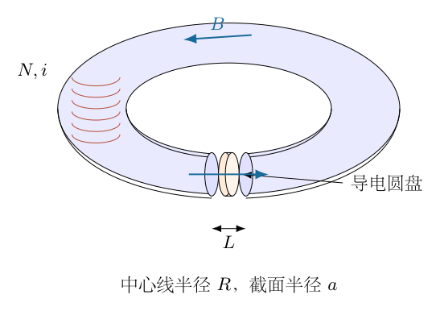

## 一、题型定位

这是环形磁路、导电盘涡流和一阶暂态的耦合问题。磁通变化在圆盘横截面内产生环向电场和涡流，涡流反向贡献磁动势，使磁通建立受阻。关键不在求圆盘整体“环流总和”，而在求穿过所选大环路跨面的一侧涡流。

题目的一阶关系采用磁准静态集总近似：忽略位移电流及截面内磁场扩散的空间结构。圆盘给出的 $\varepsilon_0$ 不进入该近似的时间常数，并不意味着任何频率下都能忽略它。下面先完整推导题目指定模型，再说明它与完整麦克斯韦场问题的边界，不能将简化指数响应宣称为所有时刻的严格真实解。

## 二、知识点

磁路串联时，各段磁通相同，磁动势降落为 $H$ 沿长度的积分。缺口总长度 $L$ 中，导电盘和剩余空气的磁导率都为 $\mu_0$，所以稳定磁阻由 $L$ 而非只由 $T$ 决定。

法拉第定律需要给定积分回路方向。欧姆定律 $\boldsymbol J=\sigma\boldsymbol E$ 给出体电流密度；穿过跨面的电流应积分 $\boldsymbol J\cdot d\boldsymbol A$，面积元不是圆盘的整圆面积。线性一阶常微分方程可用分离变量或积分因子求解，初态和时间常数的符号必须一起检查。

## 三、物理图像

磁环中心线绕一整圈，依次经过长度 $2\pi R-L$ 的磁材和长度 $L$ 的非磁性缺口。圆盘横截面与当地磁场垂直，局部半径记为 $s$，区别于磁环中心线半径 $R$。

磁场增长时，感应电场绕当地磁场轴旋转，涡流产生反向磁场。以大中心线圆为边界的跨面，从圆盘中心向内侧边缘穿过一条半径方向的条带；它只截获每个局部涡流回路的一侧。把内外两侧电流绝对值都相加，会把同一个涡流对环路的贡献数成两次。

## 四、解题入口

先定义磁路长度组合
$$
D_m=\frac{2\pi R-L}{\mu}+\frac L{\mu_0},
$$
它不是无量纲量。稳定时涡流消失，得到 $D_mB_\infty=Ni$。随后在圆盘中对半径 $s$ 的小圆使用法拉第定律，积分被大环路跨面截获的涡流，再代入磁路方程。由得到的一阶式识别 $\tau$，最后使用 $B(0)=0$。

不应把圆盘电阻随意写为 $\rho T/(\pi a^2)$：电流是绕轴流动，不是沿磁场方向穿过圆盘。正确跨面电流积分会自动给出 $Ta^2/4$ 的系数。

## 五、解析

（1）规定磁场和环路正方向。

选线圈 $Ni$ 建立的磁环中心线方向为正，记 $B(t)$ 为该方向的有符号磁通密度。当地圆盘法向同该方向，局部环向单位矢量 $\boldsymbol e_\phi$ 按右手规则与之配对。磁场增大时 $\dot B>0$，感应电场的 $\phi$ 分量应为负。

缺口盘厚需满足 $0<T\le L$。如果 $T=L$，缺口全部填盘；若 $T<L$，其余为长度 $L-T$ 的空气。两者的磁导率相同，稳定磁路非磁段长度始终为 $L$。

（2）逐段写出稳定磁路方程。

截面面积为 $A=\pi a^2$，忽略漏磁使各段磁通为 $\Phi=BA$。铁材和缺口的磁场强度分别为
$$
H_{\rm core}=\frac B\mu,\qquad
H_{\rm gap}=\frac B{\mu_0}.
$$
沿中心线积分：
$$
\begin{aligned}
\oint H\,ds
&=H_{\rm core}(2\pi R-L)+H_{\rm gap}L\\
&=B\left(\frac{2\pi R-L}{\mu}+\frac L{\mu_0}\right)
=D_mB.
\end{aligned}
$$
稳定时 $\dot B=0$，圆盘感应电场与涡流均为零，故
$$
\boxed{B_\infty=\frac{Ni}{D_m}.}
$$
若利用 $L\ll2\pi R$ 近似铁材长度，可把 $2\pi R-L$ 换为 $2\pi R$，但应说明这是近似；缺口项 $L/\mu_0$ 即使很短也不能因长度小就忽略。

（3）由小圆回路推导局部电场。

图4-2中取盘内半径 $s$ 的同心圆，$0\le s\le a$。题设均匀磁场下，该小圆磁通为 $\pi s^2B$。由轴对称性，$E_\phi$ 在圆周上相同，法拉第定律为
$$
\begin{aligned}
\oint\boldsymbol E\cdot d\boldsymbol l
&=2\pi sE_\phi(s,t)\\
&=-\frac d{dt}(\pi s^2B)\\
&=-\pi s^2\dot B.
\end{aligned}
$$
对于 $s>0$，除以 $2\pi s$：
$$
\boxed{E_\phi(s,t)=-\frac s2\dot B.}
$$
在 $s=0$ 处由连续性 $E_\phi=0$。电场大小为 $s|\dot B|/2$，磁场增长时环绕方向使涡流反对增长；磁场减小时方向反转。

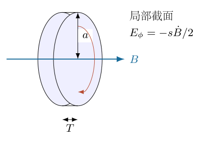

（4）使用体电流密度，不把它当总电流。

均匀电导率下
$$
J_\phi(s,t)=\sigma E_\phi(s,t)
=-\frac{\sigma s}{2}\dot B.
$$
其单位为 $\mathrm{A\,m^{-2}}$。$J_\phi$ 随 $s$ 线性增加，并不是一根导线中处处相同的电流。每个局部半径位置都有环状涡流，要求它对磁环大回路的贡献，须在大回路跨面上积分。

图4-3用颜色标出从盘中心到内侧边缘的截获条带。半径宽度为 $ds$、厚度为 $T$，故面积元为 $T\,ds$，与盘内 $\phi$ 方向电流垂直。

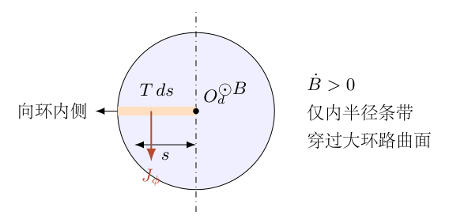

（5）积分涡流对中心线环路的贡献。

按与线圈磁动势相同的正方向计，磁场增长时被截获的涡流为负：
$$
\begin{aligned}
I_{\rm eddy}
&=\int_0^a J_\phi(s,t)\,T\,ds\\
&=-\frac{\sigma T}{2}\dot B\int_0^a s\,ds\\
&=-\frac{\sigma T}{2}\dot B\left[\frac{s^2}{2}\right]_0^a\\
&=\boxed{-\frac{\sigma Ta^2}{4}\dot B.}
\end{aligned}
$$
所以穿过中心线大圆面的总传导电流为
$$
\boxed{I_{\rm total}=Ni-\frac{\sigma Ta^2}{4}\dot B.}
$$
$Ni$ 表示 $N$ 匝线圈各自穿过一次跨面的有符号电流之和，不是线圈导线中单根电流大小。若把整盘直径两侧都积分，外侧条带实际上在大圆面之外，不能计入同一个跨面。

（6）代回安培关系，整理一阶方程。

磁路左侧为 $D_mB$，右侧为上一步总传导电流：
$$
D_mB=Ni-\frac{\sigma Ta^2}{4}\dot B.
$$
把导数项移到左边：
$$
\frac{\sigma Ta^2}{4}\dot B+D_mB=Ni.
$$
若 $\sigma>0,T>0,a>0$，除以 $\sigma Ta^2/4$：
$$
\dot B+\frac{4D_m}{\sigma Ta^2}B
=\frac{4Ni}{\sigma Ta^2}.
$$
利用 $B_\infty=Ni/D_m$，定义
$$
\boxed{\tau=\frac{\sigma Ta^2}{4D_m}
=\frac{\sigma Ta^2}
{4[(2\pi R-L)/\mu+L/\mu_0]}.}
$$
则
$$
\boxed{\dot B+\frac B\tau=\frac{B_\infty}{\tau}.}
$$
所有长度、磁导率和电导率均为正，因此 $\tau>0$，场建立过程不会在这条近似式中自发指数增长。

（7）以偏离稳态的变量求解。

令 $b(t)=B(t)-B_\infty$，由于 $B_\infty$ 恒定，
$$
\dot b+\frac b\tau=0.
$$
在 $b\ne0$ 的区间分离变量：
$$
\frac{db}{b}=-\frac{dt}{\tau}.
$$
从初态积分：
$$
\ln\left|\frac{b(t)}{b(0)}\right|=-\frac t\tau.
$$
即
$$
b(t)=b(0)e^{-t/\tau}.
$$
若 $B(0)=0$，则 $b(0)=-B_\infty$，因此
$$
\boxed{B(t)=B_\infty(1-e^{-t/\tau}),\quad t>0.}
$$
这里采用的是一阶集总方程的初态，不能把已经存在的任意残磁也设为零；一般初值 $B_0$ 对应
$$
B(t)=B_\infty+(B_0-B_\infty)e^{-t/\tau}.
$$

（8）计算变化率、电场和涡流的时间关系。

对解求导：
$$
\dot B(t)=\frac{B_\infty}{\tau}e^{-t/\tau}.
$$
于是
$$
E_\phi(s,t)
=-\frac{sB_\infty}{2\tau}e^{-t/\tau},
$$
$$
I_{\rm eddy}(t)
=-\frac{\sigma Ta^2B_\infty}{4\tau}e^{-t/\tau}.
$$
使用 $\sigma Ta^2/(4\tau)=D_m$ 及 $D_mB_\infty=Ni$：
$$
\boxed{I_{\rm eddy}(t)=-Ni\,e^{-t/\tau}.}
$$
因此总传导电流为
$$
I_{\rm total}=Ni(1-e^{-t/\tau})=D_mB(t).
$$
$t=0^+$ 时，在此集总近似中涡流磁动势恰抵消线圈磁动势；$t\to\infty$ 时涡流消失。图4-4分别画磁通建立和反向涡流衰减，不能把涡流当稳态常量。

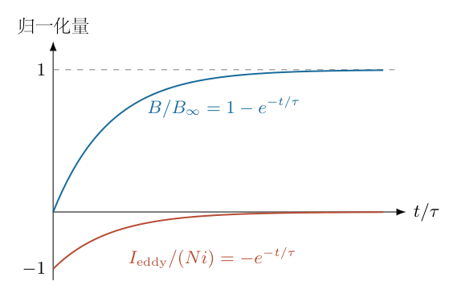

（9）用积分因子独立核验初态解。

把一阶式乘以 $e^{t/\tau}$：
$$
e^{t/\tau}\dot B+\frac1\tau e^{t/\tau}B
=\frac{B_\infty}{\tau}e^{t/\tau}.
$$
左侧是乘积导数，故
$$
\frac d{dt}(Be^{t/\tau})
=\frac{B_\infty}{\tau}e^{t/\tau}.
$$
积分 $0$ 到 $t$：
$$
B(t)e^{t/\tau}-B(0)
=B_\infty(e^{t/\tau}-1).
$$
取 $B(0)=0$ 后再次得到 $B_\infty(1-e^{-t/\tau})$。两条求解路线的积分常数一致，排除了误写为 $e^{+t/\tau}$ 或漏掉初态减项的可能。

（10）量纲、极限与能量消散的检查。

$D_mB$ 的单位为安培；$\sigma Ta^2\dot B$ 也是安培。因此 $\sigma Ta^2/D_m$ 的量纲为秒，时间常数正确。$a$ 增大时同样的磁通变化驱动更强涡流，$T$ 或 $\sigma$ 增大时导电能力增强，因此集总模型中场建立更慢。

圆盘焦耳热功率由体积分给出：
$$
\begin{aligned}
P_J
&=\int_{\rm disk}\frac{J_\phi^2}{\sigma}\,dV\\
&=\int_0^a\frac{\sigma s^2}{4}\dot B^2(2\pi sT)\,ds\\
&=\frac{\pi\sigma T}{2}\dot B^2\int_0^a s^3\,ds\\
&=\boxed{\frac{\pi\sigma Ta^4}{8}\dot B^2\ge0.}
\end{aligned}
$$
非负功率说明涡流是耗散而非主动供能。不能直接把这个盘内耗散与线圈磁能的单一均匀模式完全等同，完整能量分布也受被忽略的场结构影响。

$\sigma\to0$ 时一阶导数项消失，方程退化为代数关系 $B=B_\infty$，并非可以继续保留有限响应时间。理想电流阶跃的最早阶段需要传播、位移电流和绕组电感等信息，不能从退化代数式推断瞬时物理建立。

（11）明确位移电流的忽略条件。

完整安培—麦克斯韦关系还包含
$$
\boldsymbol J_D=\varepsilon_0\frac{\partial\boldsymbol E}{\partial t}.
$$
若暂时仍用上述均匀场的形式积分半盘条带，就得到
$$
I_D=-\frac{\varepsilon_0Ta^2}{4}\ddot B.
$$
因此对应的形式方程是
$$
\frac{\varepsilon_0Ta^2}{4}\ddot B+
\frac{\sigma Ta^2}{4}\dot B+D_mB=Ni.
$$
它不是题目要求的一阶式。一阶近似要求特征变化时间远大于电荷弛豫尺度 $\varepsilon_0/\sigma$，即
$$
\frac{\varepsilon_0}{\sigma\tau}\ll1.
$$
即使这个条件满足，突然通电的数学阶跃在无限高频部分也不满足，最早的瞬态不能用它严格描述。给出 $\varepsilon_0$ 却没有加入该项，只能解释为已经采用磁准静态近似。

<!-- KEEP_STUDENT_START -->

（12）均匀磁场假设的空间边界。

真实导电盘中涡流会使磁场随截面半径变化。若局部磁场为 $B(s,t)$，法拉第定律应写成
$$
E_\phi(s,t)
=-\frac1s\int_0^s \xi\frac{\partial B(\xi,t)}{\partial t}\,d\xi,
$$
只有 $B$ 在截面上不依赖 $s$ 时才退化成 $-s\dot B/2$。盘内的局部安培关系又把 $\partial B/\partial s$ 与 $J_\phi$ 连接，因此非零涡流与严格空间均匀的瞬变磁场通常不能同时作为完整场方程的精确解。

在忽略位移电流、轴向扩散并适用局部材料关系时，其磁扩散形式为
$$
\frac{\partial B}{\partial t}
=\frac1{\mu_0\sigma}
\left(\frac{\partial^2B}{\partial s^2}
+\frac1s\frac{\partial B}{\partial s}\right).
$$
径向扩散尺度为 $\mu_0\sigma a^2$。对于 $T\le L$，
$$
\tau=\frac{\mu_0\sigma Ta^2}
{4[L+\mu_0(2\pi R-L)/\mu]}
\le\frac{\mu_0\sigma a^2}{4}.
$$
所以不能仅凭 $a\ll R$ 或“导电性很强”就保证建立期间盘内无空间差异。题目的指数式是题设集总约束下的形式答案；要给出真实盘内暂态，需要更完整的边界条件和空间场求解。这个限制不影响稳态 $B_\infty$ 的磁路结果，却影响对暂态精度的解释。

<!-- KEEP_STUDENT_END -->

\newpage

# 第 5 题

中空薄壁圆柱长 $l$、半径 $r$、壁厚 $d$，满足 $l\gg r\gg d$，材料电阻率为 $\rho$。电流沿圆周切向流动，并沿柱长均匀分布；把穿过一条轴向截面的总环向电流记为 $I$。圆柱被固定，忽略外部磁场。
（1）求圆柱内部磁感应强度。
（2）给出沿圆周的感应电动势 $\varepsilon$ 与 $dI/dt$ 的关系。
（3）给出 $\varepsilon$ 与 $I,\rho$ 和圆柱尺寸的关系。
（4）在 $t=0$ 时 $I=I_0$，求以后无外加电源维持时的 $I(t)$。

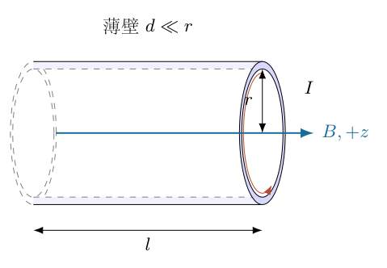

## 一、题型定位

这是长圆柱环向电流的自感衰减问题。电流不是沿柱轴流过空心管，而是绕柱轴转一圈。整个柱面相当于沿轴向并联的许多细环，其内部磁场与长螺线管的电流面密度模型相同。
题目第（4）问要求自由衰减，必须取无外加电源的条件。若存在给定时变外电源电动势，单凭初始电流不足以确定以后电流。下面明确采用自感电场驱动导电环向电流、外源已经移除的模型。

## 二、知识点

表面电流密度 $K_\phi$ 的单位是安培每米，均匀分布时 $K_\phi=I/l$。安培环路给出内部轴向磁场。法拉第定律提供环向非静电场，欧姆定律将电场与材料内部电流密度连接。
有效电阻的导电横截面为 $ld$，导电路径长为 $2\pi r$；不能使用空心截面 $\pi r^2$。自感系数与电阻的比值决定衰减时间常数。固定圆柱不产生运动电动势；表面约束可能受力，却不改变固定模型的能量守恒核算。

## 三、物理图像

从柱轴正端观察，选逆时针环向电流为正，它通过右手规则产生沿 $+z$ 的磁场。圆柱很长，内部场近似均匀、外部场近似零，端部长度约为 $r$ 的区域被忽略。
当正向电流自由衰减时，$dI/dt<0$，磁通减小，感应电场仍沿正电流方向，试图维持原电流。导电损耗最终使电流下降，不是感应电场直接反向阻止原电流。这需与建立电流时感应场反向分开。

## 四、解题入口

先取轴向窄带，把总电流 $I$ 分解为面电流和体电流密度。用安培定律得到 $B$，用一个圆周回路得到感应电动势，再用欧姆定律写同一圆周上的电压降，两者相等得到一阶衰减方程。
之后分别用磁场能量和焦耳热独立验证自感与时间常数。长柱控制端效应，薄壁控制穿壁均匀性，缓变允许忽略位移电流及高频趋肤过程，三个条件不可互相替代。

## 五、解析

（1）定义总电流及微带电流。

取沿轴向长度为 $dz$ 的窄带。由于沿长度均匀，窄带环流为
$$
dI=\frac I l\,dz.
$$
面电流密度为
$$
\boxed{K_\phi=\frac Il.}
$$
穿过总电流截面的面积是 $ld$，所以体电流密度为
$$
\boxed{J_\phi=\frac I{ld}.}
$$
检验积分：
$$
\int_0^l J_\phi d\,dz=\int_0^l\frac Il\,dz=I.
$$
这里的 $I$ 是所有并联细环沿某一轴向截面的合计，不是每个细环各自流过同样的总电流 $I$。

（2）建立长柱安培矩形环路。

图5-2的矩形长边沿柱轴，一边在柱内，另一边在柱外，长为 $\Delta z$。选正方向使跨面环向电流为正。忽略端效应，短边不贡献轴向场，故
$$
B_{\rm in}\Delta z-B_{\rm out}\Delta z
=\mu_0K_\phi\Delta z.
$$
外部场取为零后
$$
\boxed{B_{\rm in}=\mu_0K_\phi=\frac{\mu_0I}{l}.}
$$
方向由右手规则确定。结果不含 $r$ 和 $d$，并非遗漏：无限长电流面模型的内部场由每单位长度的环流决定。

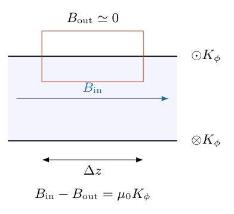

如果材料磁导率不是 $\mu_0$ 或存在磁芯，需另给本构关系；本题未给磁性参数，采用非磁性导电薄壁模型。不能把第4题铁磁环的 $\mu$ 搬到这里。

（3）明确圆周回路的定向与磁通。

取接近内壁半径 $r$ 的圆周回路，正方向与正电流相同，法向沿 $+z$。薄壁近似下包围面积为 $\pi r^2$，磁通为
$$
\Phi(t)=\pi r^2B(t)=\frac{\mu_0\pi r^2}{l}I(t).
$$
忽略 $O(d/r)$ 的壁内场能和半径差；选内、外或中间半径只改变高阶修正。
法拉第定律给出有符号感应电动势
$$
\begin{aligned}
\varepsilon_{\rm ind}
&=\oint\boldsymbol E\cdot d\boldsymbol l=-\frac{d\Phi}{dt}\\
&=\boxed{-\frac{\mu_0\pi r^2}{l}\frac{dI}{dt}.}
\end{aligned}
$$
电动势不是静电势差；闭环电场非保守，不能以回到同一点电势差为零否定它。

（4）将环向电场与电动势联系。

轴对称使圆周上的 $E_\phi$ 均匀：
$$
\varepsilon_{\rm ind}=2\pi rE_\phi,\qquad
\boxed{E_\phi=-\frac{\mu_0r}{2l}\dot I.}
$$
图5-3中，电流衰减时 $\dot I<0$，$E_\phi>0$，感应场沿原电流正向。若外源主动增加电流，则感应场沿反向。

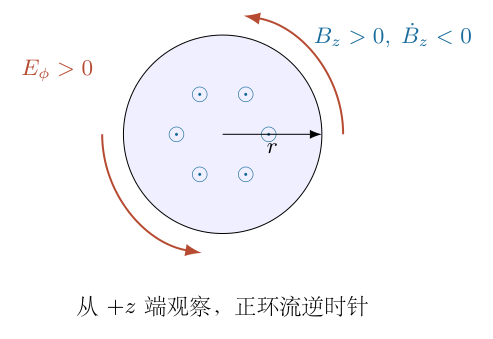

（5）用局部欧姆定律求材料电压降。

局部欧姆关系为
$$
E_\phi=\rho J_\phi=\frac{\rho I}{ld}.
$$
因此沿正电流方向的闭环电场积分为
$$
\begin{aligned}
\varepsilon_{\rm ohm}
&=2\pi rE_\phi\\
&=\boxed{\frac{2\pi\rho r}{ld}I.}
\end{aligned}
$$
定义有效电阻
$$
\boxed{\mathcal R=\frac{2\pi\rho r}{ld}.}
$$
路径长是 $2\pi r$，导电截面是 $ld$。$\rho l/(\pi r^2)$ 描述沿轴导电的另一个问题，连尺寸依赖都相反。

（6）用并联细环独立验证电阻。

宽为 $dz$ 的细环，导电截面为 $d\,dz$，其电阻为
$$
\mathcal R_{dz}=\frac{2\pi\rho r}{d\,dz}.
$$
各细环受相同的感应电动势，电导应相加：
$$
\begin{aligned}
\frac1{\mathcal R}
&=\int_0^l\frac{d\,dz}{2\pi\rho r}\\
&=\frac{ld}{2\pi\rho r}.
\end{aligned}
$$
取倒数恢复 $\mathcal R=2\pi\rho r/(ld)$。微带电阻随 $dz$ 变小而变大，符合并联细分；不能将它按串联电阻积分。

（7）联立法拉第关系与欧姆关系。

无外加电源时，闭环电场来自变化的自磁通：
$$
-\frac{\mu_0\pi r^2}{l}\dot I
=\frac{2\pi\rho r}{ld}I.
$$
先约去 $\pi/l$，再整理：
$$
-\mu_0r^2\dot I=\frac{2\rho r}{d}I,
$$
$$
\boxed{\dot I+\frac{2\rho}{\mu_0rd}I=0.}
$$
定义
$$
\boxed{\tau_c=\frac{\mu_0rd}{2\rho},}
$$
得 $\dot I+I/\tau_c=0$。$\tau_c>0$，电流衰减；若误加负号会变成无源增长，违背耗散性。

（8）完整求解初值问题。

对 $I_0\ne0$ 分离变量：
$$
\frac{dI}{I}=-\frac{dt}{\tau_c}.
$$
积分：
$$
\ln\left|\frac{I(t)}{I_0}\right|=-\frac t{\tau_c}.
$$
初值正负决定方向，指数不改变符号：
$$
\boxed{I(t)=I_0e^{-t/\tau_c}
=I_0\exp\!\left(-\frac{2\rho t}{\mu_0rd}\right).}
$$
$I_0=0$ 的无源解为零，不需对零取对数。磁场为
$$
B(t)=\frac{\mu_0I_0}{l}e^{-t/\tau_c}.
$$
$t\to\infty$ 时电流与场趋零；有限时间且 $I_0\ne0$ 时不突然变零。

（9）从磁场能推导有效自感。

内部场能密度 $B^2/(2\mu_0)$、体积 $\pi r^2l$，所以
$$
\begin{aligned}
W_B&=\frac{B^2}{2\mu_0}\pi r^2l\\
&=\frac1{2\mu_0}\left(\frac{\mu_0I}{l}\right)^2\pi r^2l\\
&=\frac12\frac{\mu_0\pi r^2}{l}I^2.
\end{aligned}
$$
与 $W_B=\tfrac12\mathcal LI^2$ 比较：
$$
\boxed{\mathcal L=\frac{\mu_0\pi r^2}{l}.}
$$
因此
$$
\frac{\mathcal L}{\mathcal R}
=\frac{\mu_0\pi r^2/l}{2\pi\rho r/(ld)}
=\frac{\mu_0rd}{2\rho}=\tau_c.
$$
自感与电阻都反比于 $l$，时间常数消去柱长；不是柱长不影响任何物理量。

（10）计算焦耳热及初始磁能去向。

导电体积近似 $2\pi rld$，功率为
$$
\begin{aligned}
P_J&=\rho J_\phi^2(2\pi rld)\\
&=\rho\left(\frac I{ld}\right)^2(2\pi rld)\\
&=\frac{2\pi\rho r}{ld}I^2=\mathcal RI^2.
\end{aligned}
$$
能量导数为
$$
\frac{dW_B}{dt}=\mathcal LI\dot I
=-\frac{\mathcal L}{\tau_c}I^2=-\mathcal RI^2.
$$
场能下降等于焦耳热，不需要圆柱运动。积分：
$$
\begin{aligned}
Q_{\rm total}
&=\int_0^\infty\mathcal RI_0^2e^{-2t/\tau_c}\,dt\\
&=\mathcal RI_0^2\frac{\tau_c}{2}\\
&=\frac12\mathcal LI_0^2=W_B(0).
\end{aligned}
$$
图5-4的能量指数为 $2t/\tau_c$，电流指数为 $t/\tau_c$，两者半衰时间不同。

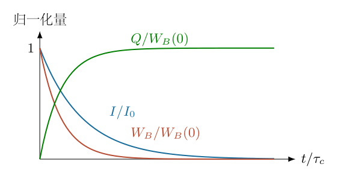

（11）区分电流与能量半衰时间。

电流降到一半时
$$
e^{-t_I/\tau_c}=\frac12,\qquad t_I=\tau_c\ln2.
$$
磁能降到一半时
$$
e^{-2t_W/\tau_c}=\frac12,\qquad t_W=\frac{\tau_c}{2}\ln2.
$$
累计热占比为
$$
\frac{Q(0,t)}{W_B(0)}=1-e^{-2t/\tau_c}.
$$
区别来自能量正比电流平方，不是两种不同的材料衰减机制。

（12）检验薄壁缓变近似。

取特征频率量级 $1/\tau_c$，趋肤长度为
$$
\delta_{\rm skin}\sim\sqrt{\frac{2\rho\tau_c}{\mu_0}}=\sqrt{rd}.
$$
$d\ll r$ 时
$$
\frac{\delta_{\rm skin}}d\sim\sqrt{\frac rd}\gg1,
$$
故主衰减时间尺度上电流穿壁均匀有自洽依据。最早的快速关断仍可能含高频分量，不能保证所有瞬间都无趋肤。
端效应由 $r/l\ll1$ 控制，半径和场能修正由 $d/r\ll1$ 控制。传播及位移电流也需可忽略。圆柱固定排除了运动电动势；若允许变形，磁压力可能改变半径、自感随时间变，常系数指数不再适用。

（13）用能流方向独立解释磁能怎样进入导体。

仅写出 $-dW_B/dt=P_J$ 能检验总量，还可以检查能量传递方向。内壁附近，衰减电流产生正向 $E_\phi$ 和正向 $B_z$，坡印廷矢量为
$$
\boldsymbol S=\frac{\boldsymbol E\times\boldsymbol B}{\mu_0},\qquad
S_r=\frac{E_\phi B_z}{\mu_0}>0.
$$
因为 $\boldsymbol e_\phi\times\boldsymbol e_z=\boldsymbol e_r$，能量从空腔磁场区沿径向向外进入薄壁。空腔侧面积近似 $2\pi rl$，流出空腔的功率
$$
\begin{aligned}
P_{\rm out}
&=2\pi rl\frac{E_\phi B_z}{\mu_0}\\
&=2\pi rl E_\phi\frac I l\\
&=(2\pi rE_\phi)I=\mathcal RI^2.
\end{aligned}
$$
该结果独立恢复焦耳热功率。感应电场和电流同向并不产生无源能量；它们使原先储存在磁场中的能量进入电阻材料。若把感应电场方向误画为反向，能流方向也随之错误。

（14）检验特征尺度，并计算任意时段的热量。

若 $r=0.10\,\mathrm m$、$d=1.0\,\mathrm{mm}$、$l=2.0\,\mathrm m$、$\rho=1.7\times10^{-8}\,\Omega\,\mathrm m$，则
$$
\begin{aligned}
\mathcal R&=\frac{2\pi(1.7\times10^{-8})(0.10)}{2.0(10^{-3})}
=5.34071\times10^{-6}\,\Omega,\\
\mathcal L&=\frac{(4\pi\times10^{-7})\pi(0.10)^2}{2.0}
=1.97392\times10^{-8}\,\mathrm H,\\
\tau_c&=\mathcal L/\mathcal R=3.69599\times10^{-3}\,\mathrm s.
\end{aligned}
$$
这组数值只用于核验公式，并非原题另给条件。趋肤长度为 $\sqrt{rd}=10\,\mathrm{mm}$，是壁厚的十倍；传播时间 $l/c$ 约为 $6.7\,\mathrm{ns}$，远小于毫秒衰减尺度。若改为极低电阻率，时间常数增加；若改为极薄壁，衰减加快，需重新核对传播和初始高频瞬态。

任意 $0\le t_1<t_2$ 的焦耳热为
$$
\begin{aligned}
Q(t_1,t_2)
&=\mathcal RI_0^2\int_{t_1}^{t_2}e^{-2t/\tau_c}\,dt\\
&=\frac12\mathcal LI_0^2
\left(e^{-2t_1/\tau_c}-e^{-2t_2/\tau_c}\right)\\
&=W_B(t_1)-W_B(t_2).
\end{aligned}
$$
这样不仅检查全部初能去向，还可检查任意子时段的守恒关系。

（15）最终答案与量纲。

在非磁性长柱薄壁、均匀环流及无外源缓变模型下：
$$
\boxed{
\begin{aligned}
B&=\frac{\mu_0I}{l},\\
\varepsilon_{\rm ind}&=-\frac{\mu_0\pi r^2}{l}\dot I,\\
\varepsilon_{\rm ohm}&=\frac{2\pi\rho r}{ld}I,\\
I(t)&=I_0e^{-2\rho t/(\mu_0rd)}.
\end{aligned}}
$$
$\mu_0rd/\rho$ 为秒，$\mathcal L$ 为亨利，$\mathcal R$ 为欧姆；$\mathcal L\dot I$ 与 $\mathcal RI$ 都为伏特。电阻率越大衰减越快，壁越厚电阻越小、衰减越慢，符合能量图像。

\newpage

# 第 6 题

距离地球 $l=1520$ 光年的恒星CZ存在一颗行星，恒星内部结构不能直接分辨，通过光强和谱线频率进行推断。采用以下数据：

太阳表面温度 $T_S=5.5\times10^3\,\mathrm K$，辐射峰值波长 $\lambda_S=550\,\mathrm{nm}$；CZ峰值波长 $\lambda_C=400\,\mathrm{nm}$，地球处能流密度 $S_C=5.17\times10^{-13}\,\mathrm{W\,m^{-2}}$；斯特藩常数 $\sigma=5.67\times10^{-8}\,\mathrm{W\,m^{-2}K^{-4}}$。
凌日光强减弱 $0.01\%$，持续时间 $T_L=10$ 小时，周期 $T_P=568$ 天。谱线最高、最低频率之差相对平均频率为 $\Delta\nu/\nu=6.9\times10^{-10}$。恒星质量 $M_C=2.6\times10^{30}\,\mathrm{kg}$，行星密度 $\rho_P=5.0\times10^3\,\mathrm{kg\,m^{-3}}$，$G=6.67\times10^{-11}\,\mathrm{N\,m^2kg^{-2}}$。

（1）估算恒星表面温度 $T_C$。
（2）估算恒星半径 $r_C$。
（3）求行星与恒星半径比 $r_P/r_C$。
（4）求行星运动速度 $v_P$。
（5）求轨道半径 $R_P$。
（6）求行星表面重力加速度 $g_P$。
（7）行星反照率为 $A_B=0.1$，红外辐射可用黑体公式近似，估算表面温度 $T_0$。
（8）求轨道平面与观测视线的夹角 $\theta$，用弧度表示。
（9）假定文明在空间方向上均匀分布，能看到行星凌日的比例 $\eta$ 为多少？

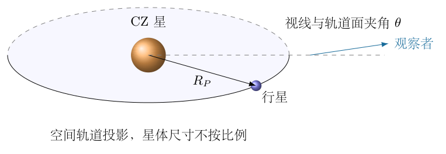

## 一、题型定位

这是黑体辐射、凌日测光、双星质心运动与轨道动力学构成的逆问题。每种观测约束一个不同的物理量，必须建立输入到结果的因果顺序，不能把恒星半径、行星半径和轨道半径混用。

数值是“估算”数据，圆轨道、恒星盘面均匀、行星遮挡完整、质量比很小等假设需明确。径向速度与开普勒周期可以给出两条轨道估算；两条结果的偏差应报告而不能通过混用中间量掩盖。行星表面温度还需热再分配模型，反照率本身不足以确定所有位置的真实温度。

## 二、知识点

维恩位移关系给出 $\lambda_{\max}T$ 为常数；斯特藩定律给出单位表面面积辐射功率 $\sigma T^4$。恒星辐射经球面扩散后在远处形成能流，不能直接把远处能流当恒星表面能流。

凌日深度对应遮挡面积比，低速多普勒效应对应视线速度，双星动量对应质量比。圆轨道周期给出 $R_P=v_PT_P/(2\pi)$，开普勒关系则可独立检查 $v_P^3T_P/(2\pi)=GM_C$。观测到凌日的方向是围绕轨道平面的球面带，而不是一个围绕轨道法线的圆锥。

## 三、物理图像

行星远小于恒星，在均匀盘面且全遮挡时，凌日减弱等于投影面积比。恒星和行星都绕质心运动，但恒星很慢；谱线记录恒星的径向运动，不是直接记录行星速度。

观测视线与轨道平面夹角 $\theta$ 很小，轨道运动投影给出跨越恒星盘面的弦。凌日时间短于穿过直径的时间，说明视线并非严格在轨道平面内。光照能量由行星投影圆面接收，若全表面均匀散热，则由球面面积发出，两种面积相差4。

## 四、解题入口

按 $T_C\to r_C\to r_P\to M_P$ 顺序建立物理量。再用谱线峰峰差得到恒星径向半振幅，利用质心关系估算行星速度和轨道半径；同时用恒星质量和周期作开普勒独立核对。之后计算重力、辐射平衡、凌日弦长、倾角和几何概率。

为统一口径，主数值路线采用题给太阳标定、凌日深度、密度和多普勒数据；开普勒路线单独列出，不把它的半径偷偷替换到主路线后两问。光速取 $c\simeq3.00\times10^8\,\mathrm{m\,s^{-1}}$，一光年取 $9.4607\times10^{15}\,\mathrm m$。

## 五、解析

（1）从太阳标定求CZ温度。

两者均按同一黑体谱峰定义，维恩关系为
$$
\lambda_ST_S=\lambda_CT_C.
$$
因此
$$
\begin{aligned}
T_C&=T_S\frac{\lambda_S}{\lambda_C}\\
&=(5.5\times10^3)\frac{550}{400}\,\mathrm K\\
&=7562.5\,\mathrm K
\simeq7.6\times10^3\,\mathrm K.
\end{aligned}
$$
两个波长同为纳米，比例无需另换单位。太阳温度与峰值都是粗略标定，若使用独立的精确维恩常数会得到另一估值；这里按题给标定计算，不能同时混用两种温标。

（2）把光年换成距离单位。

一光年是光在一年内传播的长度，不是时间。使用上述换算：
$$
l=1520(9.4607\times10^{15})\,\mathrm m
\simeq1.43803\times10^{19}\,\mathrm m.
$$
后续数值用保留更多位的一光年长度，最终只按题给精度报告。距离进入恒星半径公式为一次比例，不能漏掉1520或把光年当作公里。

（3）由恒星总功率和远处能流求半径。

恒星表面面积为 $4\pi r_C^2$，总辐射功率为
$$
{\cal P}_C=4\pi r_C^2\sigma T_C^4.
$$
假设各方向均匀辐射、无星际吸收，在距离 $l$ 的球面上能流密度为
$$
S_C=\frac{{\cal P}_C}{4\pi l^2}
=\sigma T_C^4\left(\frac{r_C}{l}\right)^2.
$$
解出
$$
\boxed{r_C=l\sqrt{\frac{S_C}{\sigma T_C^4}}.}
$$
代入：
$$
r_C=(1.43803\times10^{19})
\sqrt{\frac{5.17\times10^{-13}}
{(5.67\times10^{-8})(7562.5)^4}}\,\mathrm m.
$$
得到
$$
\boxed{r_C\simeq7.5926\times10^8\,\mathrm m.}
$$
图6-2把表面发射与远距离扩散分开；两个球面上的 $4\pi$ 正好约去，而不是漏了一个辐射面积。

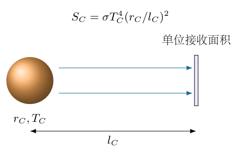

（4）由凌日深度求行星半径。

先换算百分数：
$$
0.01\%=\frac{0.01}{100}=10^{-4}.
$$
若行星圆盘完全位于恒星盘内、恒星表面亮度均匀、行星可见光自发光可忽略，
$$
\delta_{\rm tr}=\frac{\pi r_P^2}{\pi r_C^2}
=\left(\frac{r_P}{r_C}\right)^2.
$$
取正半径：
$$
\boxed{\frac{r_P}{r_C}=\sqrt{10^{-4}}=0.01,}
$$
$$
\boxed{r_P\simeq7.5926\times10^6\,\mathrm m.}
$$
半径比是1%，不是0.01%。掠过恒星边缘的部分遮挡或临边昏暗会改变面积推断，不能把该简单关系用于所有凌日光变形状。

（5）由半径与密度估算行星质量。

采用均匀平均密度：
$$
M_P=\rho_P\frac{4\pi r_P^3}{3}.
$$
代入：
$$
\begin{aligned}
M_P
&=\frac{4\pi}{3}(5.0\times10^3)
(7.5926\times10^6)^3\,\mathrm{kg}\\
&\simeq9.1671\times10^{24}\,\mathrm{kg}.
\end{aligned}
$$
质量比为
$$
q=\frac{M_P}{M_C}\simeq3.526\times10^{-6}\ll1.
$$
这个数量级支持“恒星运动很慢，行星近似绕恒星圆周运动”。行星半径受恒星温度标定影响，质量又正比半径立方，因此几个百分比的温度或光度估计误差可能放大到明显质量误差。

（6）从谱线峰峰差求恒星径向速度半振幅。

低速多普勒近似为
$$
\frac{\nu_{\rm obs}-\nu_0}{\nu_0}\simeq-\frac{v_{\rm rec}}c.
$$
设恒星径向速度在 $-K_C$ 到 $+K_C$ 之间变化，最高与最低频率的差是两倍半振幅：
$$
\frac{\Delta\nu}{\nu}\simeq\frac{2K_C}{c}.
$$
所以
$$
\boxed{K_C=\frac c2\frac{\Delta\nu}{\nu}
=\frac{3.00\times10^8}{2}(6.9\times10^{-10})
=0.1035\,\mathrm{m\,s^{-1}}.}
$$
如果把给定峰峰差误认成单边振幅，就会把恒星速度、行星速度和轨道半径全部放大两倍。图6-3中的上下极值分别对应接近和远离，峰峰差不是从均值到一个极值的差。

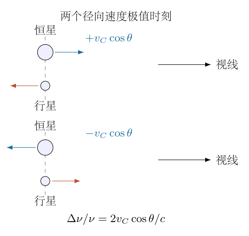

（7）用质心动量与投影求行星速度。

在质心系中，瞬时总动量为零：
$$
M_C\boldsymbol v_C+M_P\boldsymbol v_P=0.
$$
对于圆轨道，速度大小满足
$$
M_Cv_C=M_Pv_P.
$$
定义 $\theta$ 为视线与轨道平面的夹角，恒星速度在视线上的最大投影为
$$
K_C=v_C\cos\theta.
$$
于是
$$
v_P=\frac{M_CK_C}{M_P\cos\theta}.
$$
已观测到凌日，$\theta$ 必须很小；首先取 $\cos\theta\simeq1$：
$$
\begin{aligned}
v_P
&\simeq\frac{(2.6\times10^{30})(0.1035)}
{9.1671\times10^{24}}\,\mathrm{m\,s^{-1}}\\
&=\boxed{2.9355\times10^4\,\mathrm{m\,s^{-1}}.}
\end{aligned}
$$
最终求得 $\theta$ 为约 $2.4\times10^{-3}$ 弧度，投影修正 $1/\cos\theta-1\simeq\theta^2/2$ 仅约 $3\times10^{-6}$，所以这一步迭代近似自洽。质量比导致恒星与质心距离的修正也只有几百万分之一。

（8）由周期求主路线轨道半径。

时间换成秒：
$$
T_P=568(24)(3600)=4.90752\times10^7\,\mathrm s.
$$
圆周长度等于一周期走过距离：
$$
2\pi R_P=v_PT_P.
$$
因此
$$
\boxed{R_P=\frac{v_PT_P}{2\pi}
\simeq2.2928\times10^{11}\,\mathrm m.}
$$
这里将行星质心轨道半径与相对恒星轨道半径视为相同，误差为 $O(q)$；严格两体相对半径为 $(1+q)$ 倍，远小于给定估算数据的不确定性。

（9）用开普勒关系独立核对轨道，不混用结果。

相对圆轨道满足
$$
\frac{v_{\rm rel}^2}{R_{\rm rel}}
=\frac{G(M_C+M_P)}{R_{\rm rel}^2},
\qquad
T_P=\frac{2\pi R_{\rm rel}}{v_{\rm rel}}.
$$
在 $q\ll1$ 近似内消元：
$$
\boxed{v_{P,K}=\left(\frac{2\pi GM_C}{T_P}\right)^{1/3},}
$$
$$
\boxed{R_{P,K}=\left(\frac{GM_CT_P^2}{4\pi^2}\right)^{1/3}.}
$$
代入同一 $M_C,T_P$：
$$
v_{P,K}\simeq2.8106\times10^4\,\mathrm{m\,s^{-1}},\qquad
R_{P,K}\simeq2.1953\times10^{11}\,\mathrm m.
$$
与主路线相比速度约低4.25%，半径也约低4.25%。主路线轨道若完全精确满足开普勒关系，会要求
$$
M_{\rm dyn}=\frac{v_P^3T_P}{2\pi G}
\simeq2.9621\times10^{30}\,\mathrm{kg},
$$
比给定质量约高14%。视线投影修正只有百万分之几，不能解释这个差异。

因此这些估算数据不是一个完全精确且自洽的圆轨道数据集。主路线按题给密度和多普勒数据报告，另列开普勒交叉结果；若把数据当精确条件，就不能声称有一套同时满足所有观测的唯一解。允许几个百分比的半径/温度估计误差时，这种差异可以处于估算范围，但题目没有给误差条，不能擅自做精确拟合。

（10）计算行星表面重力。

球对称行星表面：
$$
g_P=\frac{GM_P}{r_P^2}.
$$
代入质量表达式也可化为
$$
g_P=\frac{4\pi}{3}G\rho_Pr_P.
$$
逐项代入：
$$
\begin{aligned}
g_P&=\frac{4\pi}{3}(6.67\times10^{-11})
(5.0\times10^3)(7.5926\times10^6)\\
&=\boxed{10.6066\,\mathrm{m\,s^{-2}}\simeq10.6\,\mathrm{m\,s^{-2}}.}
\end{aligned}
$$
这是忽略行星自转、恒星潮汐和形状差异的表面引力加速度，不是轨道向心加速度。两种形式用不同中间量计算同一结果，可查质量或半径的平方、立方错误。

（11）建立全球平均辐射平衡。

恒星在轨道处的能流密度为
$$
S_{\rm orb}=\sigma T_C^4\left(\frac{r_C}{R_P}\right)^2.
$$
行星截获的面积是 $\pi r_P^2$，反照率 $A_B$ 是反射掉的能量比例，吸收功率为
$$
P_{\rm abs}=(1-A_B)S_{\rm orb}\pi r_P^2.
$$
若温度在整个表面均匀、红外发射率为1、无内部热源，发射功率为
$$
P_{\rm emit}=4\pi r_P^2\sigma T_0^4.
$$
稳态平衡 $P_{\rm abs}=P_{\rm emit}$，约去 $\pi r_P^2\sigma$：
$$
4T_0^4=(1-A_B)T_C^4\left(\frac{r_C}{R_P}\right)^2.
$$
所以
$$
\boxed{T_0=T_C\left(\frac{1-A_B}{4}\right)^{1/4}
\sqrt{\frac{r_C}{R_P}}.}
$$
图6-4分别标投影截获面积和全球发射面积，系数4来自几何，而不是斯特藩常数中的一个额外因子。

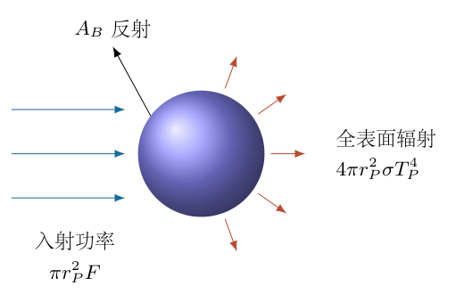

（12）计算温度并说明不唯一的热模型。

使用主路线 $R_P$：
$$
T_0=7562.5\left(\frac{0.9}{4}\right)^{1/4}
\sqrt{\frac{7.5926\times10^8}{2.2928\times10^{11}}}
\simeq\boxed{299.7\,\mathrm K}.
$$
若一致采用开普勒半径，结果约为 $306.3\,\mathrm K$；两条路线不能只替换一个中间量后声称精确同解。

若只有昼面平均散热、且昼面均匀，发射面积为 $2\pi r_P^2$，温度比全球值高 $2^{1/4}$。无再分配且当地辐射平衡时，正对恒星点满足
$$
T_{\rm sub}=T_C(1-A_B)^{1/4}\sqrt{\frac{r_C}{R_P}}
=\sqrt2\,T_0\simeq423.9\,\mathrm K.
$$
实际表面温度分布取决于大气、热惯性、发射率和内部热源，题给条件不足以唯一确定。第（7）问常用约300K结果是全球均匀辐射平衡估计，不是每个点的真实温度。

（13）由凌日持续时间建立弦长几何。

设行星中心在合位置时的投影偏移为 $b$，短时近似中心以速度 $v_P$ 沿一条直线穿过恒星盘。开始/结束遮挡的中心距是 $r_C+r_P$。图6-5中半弦长为 $v_PT_L/2$，所以
$$
b^2+\left(\frac{v_PT_L}{2}\right)^2=(r_C+r_P)^2.
$$
取 $b\ge0$：
$$
\boxed{b\simeq\sqrt{(r_C+r_P)^2-(v_PT_L/2)^2}.}
$$
$T_L=36000\,\mathrm s$。中心凌日最长时间约为 $2(r_C+r_P)/v_P\simeq14.51$ 小时，大于观测10小时，平方根有实数意义，说明是非中心凌日。

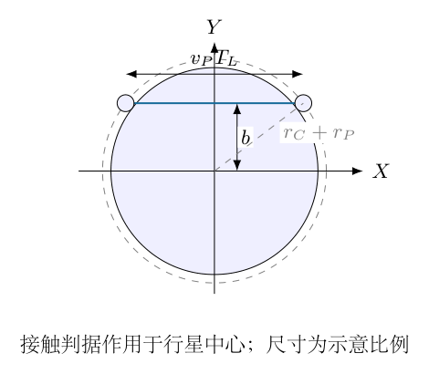

（14）写出有限轨道角的几何修正。

令合位置两侧的轨道相位为 $\pm\psi$，
$$
\psi=\frac{\pi T_L}{T_P}.
$$
选择天空平面中的坐标，使行星中心投影为
$$
X=R_P\sin\psi,\qquad
Y=R_P\sin\theta\cos\psi.
$$
第一接触处中心距满足
$$
X^2+Y^2=(r_C+r_P)^2.
$$
于是
$$
\sin^2\psi+\sin^2\theta\cos^2\psi
=\left(\frac{r_C+r_P}{R_P}\right)^2.
$$
解得
$$
\boxed{\sin\theta=
\frac{\sqrt{[(r_C+r_P)/R_P]^2-\sin^2\psi}}{\cos\psi}.}
$$
这里 $\psi$ 很小、$\cos\psi>0$，选 $\theta\ge0$ 表示夹角大小。小角度下 $R_P\sin\psi\simeq R_P\psi=v_PT_L/2$，恢复上一节直线弦长。投影与圆轨道几何给出了独立核验，而不是重复代入同一近似式。

（15）代入求倾角并检验完整遮挡。

主路线中
$$
\psi=\frac{\pi(36000)}{4.90752\times10^7}
\simeq2.3046\times10^{-3},
$$
$$
\frac{r_C+r_P}{R_P}\simeq3.3446\times10^{-3}.
$$
代入精确投影式：
$$
\boxed{\theta\simeq2.4240\times10^{-3}\,\mathrm{rad}.}
$$
合位置偏移为
$$
b=R_P\sin\theta\simeq5.5576\times10^8\,\mathrm m.
$$
检查 $b<r_C-r_P\simeq7.5167\times10^8\,\mathrm m$，所以行星在凌日中段能全部位于恒星盘内，前述深度面积比的几何条件成立。

$\theta$ 是视线与轨道平面的夹角；天文学常用视线与轨道法线的角 $i$，满足 $i=\pi/2-\theta$。不能把这里的毫弧度答案称为轨道法线与视线的夹角。

（16）用球面带面积求可见凌日概率。

当合位置投影偏移小于 $r_C+r_P$ 时，至少出现部分遮挡：
$$
R_P|\sin\theta|\le r_C+r_P.
$$
定义
$$
\theta_{\max}=\arcsin\frac{r_C+r_P}{R_P}.
$$
所有可见方向构成轨道平面两侧纬度 $-\theta_{\max}$ 到 $+\theta_{\max}$ 的球面带。图6-6标出的不是法线附近圆锥，而是赤道附近的带。

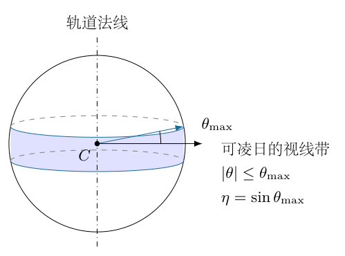

单位球面面积元为 $\cos\theta\,d\theta\,d\phi$。积分：
$$
\begin{aligned}
\Omega_{\rm tr}
&=\int_0^{2\pi}d\phi
\int_{-\theta_{\max}}^{\theta_{\max}}\cos\theta\,d\theta\\
&=4\pi\sin\theta_{\max}.
\end{aligned}
$$
除以全部 $4\pi$：
$$
\boxed{\eta=\sin\theta_{\max}
=\frac{r_C+r_P}{R_P}
\simeq3.3446\times10^{-3}.}
$$
约为 $0.334\%$。忽略 $r_P/r_C=0.01$ 时，$\eta\simeq r_C/R_P$，相对少约1%。如果只统计完全进入恒星盘的非掠食凌日，应把 $r_C+r_P$ 换成 $r_C-r_P$，两种判据不能混用。

（17）汇总主估算与独立检查。

主路线结果为
$$
\begin{aligned}
T_C&\simeq7.56\times10^3\,\mathrm K,&
r_C&\simeq7.59\times10^8\,\mathrm m,\\
r_P/r_C&=0.01,&v_P&\simeq2.94\times10^4\,\mathrm{m\,s^{-1}},\\
R_P&\simeq2.29\times10^{11}\,\mathrm m,&
g_P&\simeq10.6\,\mathrm{m\,s^{-2}},\\
T_0&\simeq3.00\times10^2\,\mathrm K,&
\theta&\simeq2.42\times10^{-3}\,\mathrm{rad},\\
\eta&\simeq3.34\times10^{-3}.&&
\end{aligned}
$$
温度是全球均匀辐射平衡条件值；轨道数值按给定估算数据的主路线，另有开普勒交叉偏差。光度、质量、重力、轨道、弦长和球面概率的单位与极限分别检查：恒星更远而保持相同观测能流时推断半径更大；遮挡越深行星越大；轨道越远温度越低且凌日概率越小；持续时间达到最大值时 $\theta\to0$，均符合物理图像。

\newpage

# 第 7 题

半径为 $R$ 的球形鱼缸中有一条鱼，鱼缸左半球镀银形成反射镜。观察者从右侧观察，可凭明暗区分鱼眼睛直接经右侧折射所成的像 $S_1$，以及先经左侧反射、再经右侧折射所成的像 $S_2$。取球心 $O$ 为原点，向右为 $x$ 轴正向，向上为 $y$ 轴正向。已知 $S_1$ 位于 $(R/2,h_1)$，$h_1$ 足够小，可使用近轴成像；水的折射率为 $n$，空气折射率取 $1$，忽略玻璃壁厚度。
（1）求鱼眼睛 $S_0$ 的实际坐标 $(x_0,y_0)$。
（2）求仅经左侧镜面反射所成像 $S_2'$ 的坐标 $(x_2',y_2')$。
（3）求反射后再折射的像 $S_2$ 的坐标 $(x_2,y_2)$。
（4）鱼眼睛以速度 $v_1$ 沿 $y$ 轴运动，求 $S_2$ 的速度 $v_2$，沿 $+y$ 为正。需写出各问的计算过程。

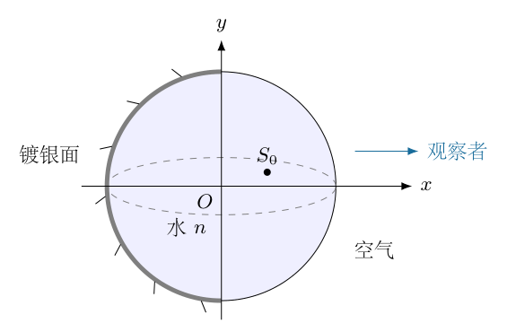

## 一、题型定位

本题是球面折射与球面镜反射的串联成像。必须区分实际物点、第一次反射像和观察者最终看到的像。水中的镜面像尚未经过水—空气界面，不是最终观察像。
计算采用通过球心的子午平面。球体并非平面镜，右侧也不是薄透镜；近轴近似只是把光线斜率和角度线性化，并没有把曲面的曲率变成零。

## 二、知识点

近轴球面折射可以从斯涅尔定律和法线斜率建立，不必记忆存在多种符号约定的球面折射公式。成像点是同束出射光线或其反向延长线的交点，虚像允许位于出射面另一侧。
球面镜在同一介质中的近轴焦距为 $R/2$，横向放大率为负的像距与物距之比。复合系统的横向放大率相乘，但轴向位置必须先更新，不能让两次成像一直使用最初物距。
像的横向速度来自成像坐标对时间求导。题目给实际鱼眼睛的速度时，与给直接观察像 $S_1$ 的速度时，答案系数不同。

## 三、物理图像

光路分成两支：第一支从 $S_0$ 向右到水—空气界面，折射后形成虚像 $S_1$；第二支先向左到镀银球面，再反射向右，经过同一个右界面后形成 $S_2$。
左侧镜面中心位于 $x=-R$，向右看是凹面镜。右侧折射面顶点位于 $x=R$，其曲率中心在顶点左侧。沿 $+x$ 传播时右界面的有符号曲率半径为 $-R$，这个负号是推导中不能省略的几何事实。

## 四、解题入口

先在右侧折射面取高度为 $y$ 的任意近轴入射点。写入射斜率、法线斜率和出射斜率，用给定像点 $(R/2,h_1)$ 对比 $y$ 的系数与常数项，反求实际鱼眼睛。
再将此物点代入左侧凹面镜，算出中间像的位置。最后把中间像作为右界面的物点，重复第一次折射的关系。所有像高都保留符号，最后再解释倒立和运动方向。

## 五、解析

（1）建立右界面的局部几何。

图7-2画的是球体的子午截面。右球面满足
$$
x^2+y^2=R^2,\qquad
x=\sqrt{R^2-y^2}.
$$
近轴时 $|y|\ll R$，利用二阶展开：
$$
x=R-\frac{y^2}{2R}+O\!\left(\frac{y^4}{R^3}\right).
$$
在一阶成像中可将出射点的横坐标取为 $R$，但是法线方向的一阶变化必须保留。法线是连接球心和出射点的半径，其斜率角为
$$
\beta=\arctan(y/x)=\frac yR+O\!\left(\frac{y^3}{R^3}\right).
$$
用 $\vartheta_{\rm in}$、$\vartheta_{\rm out}$ 表示相对 $+x$ 的有符号光线角。相对法线的入射角和折射角分别为 $\vartheta_{\rm in}-\beta$ 与 $\vartheta_{\rm out}-\beta$。

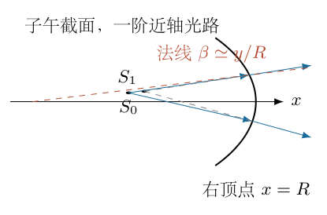

斯涅尔定律的有符号形式及一阶近似为
$$
\begin{aligned}
n\sin(\vartheta_{\rm in}-\beta)
&=\sin(\vartheta_{\rm out}-\beta),\\
n(\vartheta_{\rm in}-\beta)
&=\vartheta_{\rm out}-\beta.
\end{aligned}
$$
所以
$$
\boxed{\vartheta_{\rm out}
=n\vartheta_{\rm in}-(n-1)\frac yR.}
$$
这里第二项为负：正高度处的法线向上倾斜，曲面改变出射斜率；不能只写平面界面的 $\vartheta_{\rm out}=n\vartheta_{\rm in}$。

（2）写物点和给定直接像的光线斜率。

实际物点 $S_0=(x_0,y_0)$ 到右界面点 $(R,y)$ 的入射斜率为
$$
\vartheta_{\rm in}=\frac{y-y_0}{R-x_0}.
$$
给定虚像 $S_1=(R/2,h_1)$ 位于界面左侧。光线出射后向右传播，反向延长线经过虚像，故同一出射光线的斜率仍为
$$
\vartheta_{\rm out}
=\frac{y-h_1}{R-R/2}
=\frac{2(y-h_1)}R.
$$
这不是将光线传播方向反过来，而是用同一直线的两个点确定斜率。

将两式代入折射关系：
$$
\frac{2(y-h_1)}R
=n\frac{y-y_0}{R-x_0}-(n-1)\frac yR.
$$
成像要求对任意近轴光线高度 $y$ 都成立，因此分别比较 $y$ 项和常数项。

（3）比较系数，反求实际鱼眼睛的位置。

先比较 $y$ 项：
$$
\begin{aligned}
\frac2R&=\frac n{R-x_0}-\frac{n-1}R,\\
\frac n{R-x_0}&=\frac{n+1}R,\\
R-x_0&=\frac{nR}{n+1}.
\end{aligned}
$$
因此
$$
\boxed{x_0=\frac{R}{n+1}.}
$$
再比较常数项：
$$
-\frac{2h_1}R=-\frac{ny_0}{R-x_0}.
$$
利用上一式中的 $n/(R-x_0)=(n+1)/R$：
$$
\frac{2h_1}R=\frac{(n+1)y_0}R,
\qquad
\boxed{y_0=\frac{2h_1}{n+1}.}
$$
当 $n>1$ 时，$0<x_0<R/2$，实际物点比直接像更靠近球心；$y_0$ 与 $h_1$ 同号。直接折射的横向放大率为
$$
\boxed{M_1=\frac{h_1}{y_0}=\frac{n+1}{2}.}
$$
它不是单纯的 $n$，因为界面为球面，且本题物距固定在特定位置。

（4）为左侧镜面另行定义正的物距和像距。

左镜顶点为 $V_L=(-R,0)$，镜面凹向右侧。实际物点在镜前，物距
$$
u=x_0-(-R)=R+x_0=\frac{(n+2)R}{n+1}>0.
$$
取实像距 $v>0$ 表示镜前即顶点右侧，凹面镜焦距
$$
f_m=\frac R2.
$$
图7-3中的反射近轴光线向右会聚。此处使用的是镜面前方的距离约定，不沿用前一步界面的有符号曲率半径。

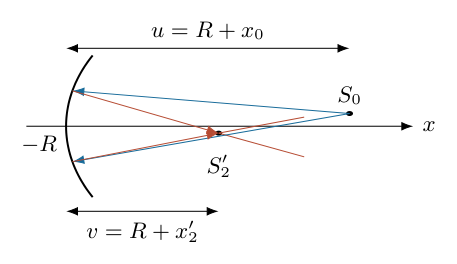

镜公式为
$$
\frac1u+\frac1v=\frac2R.
$$
求解时先通分：
$$
\begin{aligned}
\frac1v&=\frac2R-\frac1u=\frac{2u-R}{Ru},\\
v&=\frac{Ru}{2u-R}.
\end{aligned}
$$
代入 $u=(n+2)R/(n+1)$：
$$
\begin{aligned}
2u-R
&=R\frac{2(n+2)-(n+1)}{n+1}\\
&=R\frac{n+3}{n+1},\\
v&=\frac{(n+2)R}{n+3}.
\end{aligned}
$$
换回全局横坐标：
$$
\boxed{x_2'=-R+v=-\frac R{n+3}.}
$$
$x_2'<0$ 不意味着镜像是虚像。它处于镜面顶点 $-R$ 的右侧，仍为镜前实像。判断实虚必须参照该次成像的出射光线，不以全局坐标正负判断。

（5）完整计算反射中间像高。

镜面横向放大率
$$
M_m=-\frac vu
=-\frac{n+1}{n+3}.
$$
负号来自实物经凹面镜成倒立实像。因而
$$
\begin{aligned}
y_2'
&=M_my_0\\
&=-\frac{n+1}{n+3}\frac{2h_1}{n+1}\\
&=\boxed{-\frac{2h_1}{n+3}.}
\end{aligned}
$$
中间像比实际鱼眼睛稍小且倒立；它不等于右侧观察者看到的最终像，因为从该点发出的光线还将折射。

（6）把中间像作为右折射面的新物点。

反射光线已在 $S_2'$ 附近会聚，此后向右传播，所以右界面看到的新物点为 $(x_2',y_2')$。到右顶点的距离
$$
u_2=R-x_2'=R+\frac R{n+3}
=\frac{(n+4)R}{n+3}.
$$
图7-4把三次定位列在同一坐标系：$S_0$、$S_2'$ 是水中的实际物点与中间像，$S_1$、$S_2$ 是右侧出射光线反向延长所得像点。

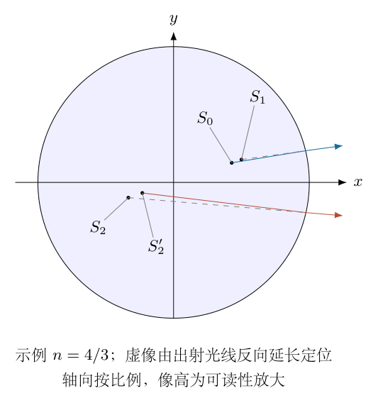

右侧折射关系对这个新物点仍为
$$
\vartheta_{\rm out}
=n\frac{y-y_2'}{u_2}-(n-1)\frac yR.
$$
将 $y$ 的系数记为 $D_2$：
$$
\begin{aligned}
D_2
&=\frac n{u_2}-\frac{n-1}R\\
&=\frac1R\left[\frac{n(n+3)}{n+4}-(n-1)\right]\\
&=\frac{n(n+3)-(n-1)(n+4)}{R(n+4)}.
\end{aligned}
$$
展开分子时
$$
(n-1)(n+4)=n^2+3n-4,
$$
所以
$$
\boxed{D_2=\frac4{R(n+4)}.}
$$
这一处的常数 $4$ 来自两个二次式消去，不能直接跳到最终像坐标。

（7）从任意出射光线确定最终像。

设最终像为 $(x_2,y_2)$。光线直线式
$$
\vartheta_{\rm out}=\frac{y-y_2}{R-x_2}.
$$
与上一步比较：
$$
\frac1{R-x_2}=D_2,\qquad
\frac{y_2}{R-x_2}=\frac{ny_2'}{u_2}.
$$
第一式给
$$
\begin{aligned}
R-x_2&=\frac{R(n+4)}4,\\
x_2&=R-\frac{R(n+4)}4
=\boxed{-\frac{nR}4}.
\end{aligned}
$$
第二式给
$$
\begin{aligned}
y_2
&=\frac{n(R-x_2)}{u_2}\,y_2'\\
&=\frac{n[R(n+4)/4]}{R(n+4)/(n+3)}
\left(-\frac{2h_1}{n+3}\right)\\
&=\boxed{-\frac n2h_1}.
\end{aligned}
$$
右折射面的横向放大率为
$$
M_{r,2}=\frac{y_2}{y_2'}=\frac{n(n+3)}4>0.
$$
最终倒立来自前面的镜面反射，最后一次折射不再倒像。以实际鱼眼睛为基准的总横向放大率
$$
\boxed{M_{\rm tot}=M_mM_{r,2}=-\frac{n(n+1)}4.}
$$
用 $y_2/y_0$ 直接检验，结果一致。

（8）区分实际鱼眼睛速度与直接像速度。

题干第（4）问把 $v_1$ 写作“鱼眼睛”的运动速度。按实际物点理解：
$$
v_1=\dot y_0.
$$
横向小位移不改变一阶轴向物距，$n$ 和 $R$ 恒定，因此
$$
\begin{aligned}
y_2&=-\frac{n(n+1)}4\,y_0,\\
v_2&=\boxed{-\frac{n(n+1)}4\,v_1.}
\end{aligned}
$$
负号表示向上运动的实际鱼眼睛对应向下运动的最终倒像。

如果“发现鱼眼睛以 $v_1$ 运动”实际上指观察者直接测得的 $S_1$ 像速度，则另有
$$
v_{S_1}=\dot h_1=\frac{n+1}{2}\dot y_0.
$$
此时
$$
\boxed{v_2=-\frac n2\,v_{S_1}.}
$$
两式并不矛盾，只是输入速度属于不同点。不能把 $v_1$ 一会儿作为鱼的速度，一会儿作为直接像的速度。本文主答案按题面明写的实际鱼眼睛速度解释，同时保留测量像速度的换算关系。

（9）用一般物点成像公式独立核验。

对于任意右侧界面物点 $(x_a,y_a)$，设 $u_a=R-x_a$。由光线斜率比较：
$$
\begin{aligned}
D_a&=\frac n{u_a}-\frac{n-1}R,\\
x_b&=R-\frac1{D_a},\\
y_b&=\frac{n}{u_aD_a}\,y_a.
\end{aligned}
$$
将分母统一为
$$
D_a=\frac{nR-(n-1)(R-x_a)}{R(R-x_a)}
=\frac{R+(n-1)x_a}{R(R-x_a)}.
$$
所以
$$
\boxed{
\begin{aligned}
x_b&=\frac{nRx_a}{R+(n-1)x_a},\\
y_b&=\frac{nR}{R+(n-1)x_a}\,y_a.
\end{aligned}}
$$
代入 $x_a=R/(n+1)$：
$$
R+(n-1)x_a=\frac{2nR}{n+1},
$$
恢复 $x_b=R/2$、$y_b=(n+1)y_a/2$。
代入 $x_a=-R/(n+3)$：
$$
R+(n-1)x_a=\frac{4R}{n+3},
$$
恢复 $x_b=-nR/4$、$y_b=n(n+3)y_a/4$。两次结果与分步求解一致。

（10）极限、尺度和可见性检查。

所有横坐标均与 $R$ 成正比，所有纵坐标与 $h_1$ 成正比，速度放大率无量纲。若同时放大鱼缸和鱼的位置，角度不变，成像比例应不变。
当 $n=1$ 时界面不折射，$S_0=S_1=(R/2,h_1)$。凹面镜物距为 $3R/2$，像距为 $3R/4$，故 $S_2'=S_2=(-R/4,-h_1/2)$，总速度为 $-v_1/2$，与公式一致。
当 $h_1=0$ 时所有像点在轴上，但仍存在两支光路。令 $h_1$ 改为负值，所有纵坐标同时反号，横坐标不变，符合关于光轴的对称性。
对于水的典型 $n=4/3$，
$$
\begin{aligned}
(x_0,y_0)&=(3R/7,6h_1/7),\\
(x_2',y_2')&=(-3R/13,-6h_1/13),\\
(x_2,y_2)&=(-R/3,-2h_1/3),\\
v_2&=-7v_1/9.
\end{aligned}
$$
这里最后一式仍以实际鱼眼睛速度为输入。近轴光线的入射角很小，不发生全反射；远离光轴的光线则可能出现球差或全反射，不能用近轴像点代表整条鱼的无畸变图像。

\newpage

# 第 8 题

质量为 $m$ 的弹性篮球可视为质点，在硬地面上发生完全弹性碰撞，总机械能为 $E$，重力加速度为 $g$，不考虑相对论效应，最大上升高度为 $H$。
（1）若假定 $H=\lambda/2$，其中 $\lambda=h/p_{\max}$，$p_{\max}$ 为最大动量，$h$ 为普朗克常数，求能量 $E$。
（2）题给量子化关系
$$
2\int_0^H p\,dx=\left(n+\frac14\right)h,\qquad n=0,1,2,\ldots
$$
其中 $p$ 为动量。求：a）能级 $E_n$；b）基态能量 $E_0$；c）若粒子是中子，$m_n=1.675\times10^{-27}\,\mathrm{kg}$、$g=10\,\mathrm{m\,s^{-2}}$，求由该关系得到的基态对应高度 $H_0$。
（3）用基态能量 $E_0$ 与经典往返运动的频率 $f$ 相比，求 $E_0/f$，并讨论数量级。取 $h=6.62607015\times10^{-34}\,\mathrm{J\,s}$。
题给量子化关系在下述解析中按题设计算，同时与通常无限高硬壁的边界条件进行区分。

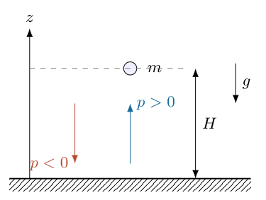

## 一、题型定位

这是从经典反弹轨道建立作用量、再研究重力势中的半经典量子化问题。它包含一个启发式波长猜测、一条指定量子化公式和一个频率尺度比较。三部分的逻辑地位不同：猜测不是严格边界条件，给定公式也不自动等于真实硬壁的正确量子化。
对于通常无限高势垒形成的硬地面，波函数在地面为零，半经典偏移应为 $3/4$，而不是题给的 $1/4$。下面先完整计算题设结果，再独立推导硬壁结果及精确的线性势能解，不混用两套基态数值。

## 二、知识点

经典运动满足 $E=p^2/(2m)+mgz$。顶点 $p=0$、高度 $H=E/(mg)$；地面 $z=0$ 时动量最大。德布罗意关系 $\lambda=h/p$ 随高度改变，不能把地面波长当作整个重力区的恒定波长。
一个完整反弹周期的作用量为相空间闭合轨道面积 $\oint p\,dz$。上升和下降的动量符号相反，但积分方向也相反，因此两段贡献同号。半经典相位偏移来自转向点连接和地面边界。
量子定态能量与经典轨道频率可作尺度比较，但定态不是沿一条经典轨道反复碰撞的小球。相邻量子能级的跃迁频率另由能量差除以 $h$ 定义。

## 三、物理图像

把地面设为 $z=0$，取上方重力势为 $mgz$。经典质点在 $0\le z\le H$ 之间运动，地面瞬时反向，顶点平滑转向。相空间轨道具有上升支 $p>0$、下降支 $p<0$ 和地面瞬时反射的竖直连接。
量子硬壁模型在 $z<0$ 取无限大势，在 $z>0$ 取线性势。顶点以上是经典禁阻区，波函数衰减而非立即消失。所谓 $H_0$ 应理解为基态能量对应的经典转向高度，不是量子位置分布的严格最大值。

## 四、解题入口

所有积分前先写 $p(z)=\sqrt{2m(E-mgz)}$ 和 $H=E/(mg)$，不要把 $p$ 当作常数。用代换 $u=E-mgz$ 完整计算作用量，再统一求解 $E^{3/2}$。
求经典频率时先求上升时间再乘二。最后把指定偏移 $1/4$ 和硬壁偏移 $3/4$ 分开，并以薛定谔方程的艾里函数零点核验物理边界。

## 五、解析

（1）经典能量关系与最大动量。

地面为零势能位置，任意高度
$$
E=\frac{p(z)^2}{2m}+mgz.
$$
顶点 $p(H)=0$，所以
$$
\boxed{H=\frac E{mg}.}
$$
地面处势能最小，动量大小最大：
$$
\boxed{p_{\max}=\sqrt{2mE}.}
$$
上升时 $p$ 为正，下降时为负；$p_{\max}$ 在波长关系中表示大小，不包含方向。

（2）按第（1）问的波长猜测求能量。

题给 $H=\lambda/2$，且 $\lambda=h/p_{\max}$，故
$$
\frac E{mg}=\frac h{2\sqrt{2mE}}.
$$
两边乘以 $2mg\sqrt{2mE}$：
$$
2E\sqrt{2mE}=mgh.
$$
整理平方根：
$$
2\sqrt{2m}\,E^{3/2}=mgh.
$$
两边均为正，只取正能量根：
$$
\begin{aligned}
E^{3/2}&=\frac{mgh}{2\sqrt{2m}},\\
E^3&=\frac{m^2g^2h^2}{8m}
=\frac{mg^2h^2}{8},\\
E_{\rm guess}&=\boxed{\left(\frac{mg^2h^2}{8}\right)^{1/3}.}
\end{aligned}
$$
这里的立方根不是数学上的所有复根，而是机械能的正实根。能量随 $m^{1/3}$ 而非 $m$ 变化，体现此处施加了含 $h$ 的非经典尺度关系。
此猜测只用地面波长，而在顶点 $p\to0$、局部波长趋大；它未满足实际波函数的边界条件，不应称为精确基态能量。

（3）画出势能与动量随高度的关系。

图8-2中的水平能量线与 $mgz$ 相交于 $H$。线性势不意味着动量线性：
$$
p(z)=\sqrt{2m(E-mgz)}
=\sqrt{2mE}\sqrt{1-\frac zH}.
$$
因此靠近顶点时 $p$ 按平方根趋零。

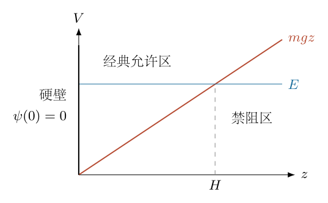

用 $p_{\max}H$ 粗代积分会漏掉动量下降的面积比例。作用量积分必须沿整个高度计算。

（4）为什么完整周期的作用量有系数二。

上升支从 $0$ 到 $H$，动量 $p_+(z)=+\sqrt{2m(E-mgz)}$。下降支从 $H$ 到 $0$，动量 $p_-(z)=-p_+(z)$。因此
$$
\begin{aligned}
J(E)&=\oint p\,dz\\
&=\int_0^Hp_+(z)\,dz+\int_H^0p_-(z)\,dz\\
&=\int_0^Hp_+(z)\,dz+\int_0^Hp_+(z)\,dz\\
&=2\int_0^H\sqrt{2m(E-mgz)}\,dz.
\end{aligned}
$$
地面瞬时反射在相图中为竖直线，沿它 $dz=0$，故不另加作用量。图8-3的闭合面积由两条平方根支路包围，并不是矩形面积 $2p_{\max}H$。

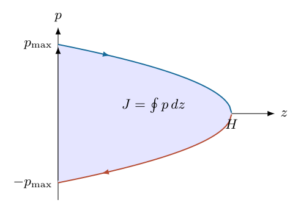

（5）逐步完成作用量积分。

设
$$
u=E-mgz,\qquad dz=-\frac{du}{mg}.
$$
当 $z=0$ 时 $u=E$；当 $z=H=E/(mg)$ 时 $u=0$。因此
$$
\begin{aligned}
J(E)
&=2\sqrt{2m}\int_0^{E/(mg)}(E-mgz)^{1/2}\,dz\\
&=-\frac{2\sqrt{2m}}{mg}\int_E^0u^{1/2}\,du\\
&=\frac{2\sqrt{2m}}{mg}\int_0^Eu^{1/2}\,du\\
&=\frac{2\sqrt{2m}}{mg}\left[\frac23u^{3/2}\right]_0^E\\
&=\boxed{\frac{4\sqrt{2m}}{3mg}E^{3/2}.}
\end{aligned}
$$
代换中的负号由反转上下限消去，最终作用量为正。另用 $s=z/H$ 可独立核验：
$$
J=2p_{\max}H\int_0^1\sqrt{1-s}\,ds
=\frac43p_{\max}H.
$$
因 $\int_0^1\sqrt{1-s}\,ds=2/3$，闭合面积确为对应矩形的 $2/3$。

（6）按题给偏移 $1/4$ 求全能级。

先用统一记号 $\delta$ 表示偏移：
$$
J(E_n)=(n+\delta)h.
$$
联立积分结果：
$$
\begin{aligned}
\frac{4\sqrt{2m}}{3mg}E_n^{3/2}&=(n+\delta)h,\\
E_n^{3/2}&=\frac{3mgh}{4\sqrt{2m}}(n+\delta).
\end{aligned}
$$
平方后
$$
E_n^3=\frac{9m^2g^2h^2}{32m}(n+\delta)^2.
$$
所以
$$
\boxed{E_n(\delta)=
\left[\frac{9mg^2h^2}{32}(n+\delta)^2\right]^{1/3}.}
$$
严格按题给关系取 $\delta=1/4$：
$$
\boxed{E_n^{\rm given}=
\left[\frac{9mg^2h^2}{32}\left(n+\frac14\right)^2\right]^{1/3}.}
$$
$n=0$ 时
$$
\boxed{E_0^{\rm given}=
\left(\frac{9mg^2h^2}{512}\right)^{1/3}.}
$$
它与第一问猜测的比值为
$$
\frac{E_0^{\rm given}}{E_{\rm guess}}
=\left(\frac{9}{64}\right)^{1/3},
$$
两者不相等。不能因为都是量子尺度估算就强行统一系数。

（7）题给关系的中子基态数值。

先写常数：
$$
m_n=1.675\times10^{-27}\,\mathrm{kg},\quad
g=10\,\mathrm{m\,s^{-2}},\quad
h=6.62607015\times10^{-34}\,\mathrm{J\,s}.
$$
计算 $h^2$：
$$
h^2=4.39048056\times10^{-67}\,\mathrm{J^2s^2}.
$$
立方根内量为
$$
\begin{aligned}
\frac9{512}m_ng^2h^2
&=\frac9{512}(1.675\times10^{-27})
(10^2)(4.39048056\times10^{-67})\\
&\simeq1.292\times10^{-93}\,\mathrm{J^3}.
\end{aligned}
$$
开立方后
$$
\boxed{E_0^{\rm given}=1.08935\times10^{-31}\,\mathrm J.}
$$
高度不是再开一次平方根，而是由势能直接除：
$$
\begin{aligned}
H_0^{\rm given}
&=\frac{E_0^{\rm given}}{m_ng}\\
&=\frac{1.08935\times10^{-31}}{1.675\times10^{-26}}\\
&=\boxed{6.50357\times10^{-6}\,\mathrm m
=6.50357\,\mathrm{\mu m}.}
\end{aligned}
$$
这里用的是 $g=10$ 和题给 $1/4$。后面物理硬壁的高度不能再用这个数值代入而改变标签。

（8）完整推导经典往返频率。

对于能量 $E$，地面向上初速度为
$$
v_0=\frac{p_{\max}}m=\sqrt{\frac{2E}{m}}.
$$
上升过程 $v=v_0-gt$，到顶点 $v=0$，所以
$$
t_{\uparrow}=\frac{v_0}g.
$$
下降时间由时反演对称性相同，地面理想瞬时反射时间取零。完整周期与频率：
$$
\begin{aligned}
T_{\rm cl}
&=\frac{2v_0}g
=\frac2g\sqrt{\frac{2E}m}
=2\sqrt{\frac{2H}g},\\
f_{\rm cl}(E)
&=\boxed{\frac g2\sqrt{\frac m{2E}}.}
\end{aligned}
$$
若只用上升时间倒数，会多出一倍频率。本题“单位时间跳跃次数”按地面到地面的一次完整周期计数。

（9）计算 $E/f$，明确频率的意义。

先不使用量子化：
$$
\begin{aligned}
\frac E{f_{\rm cl}(E)}
&=ET_{\rm cl}\\
&=\frac{2\sqrt2}{g\sqrt m}E^{3/2}.
\end{aligned}
$$
再由统一量子化关系代入
$$
E_n^{3/2}
=\frac{3mgh}{4\sqrt{2m}}(n+\delta),
$$
得到
$$
\begin{aligned}
\frac{E_n}{f_{\rm cl}(E_n)}
&=\frac{2\sqrt2}{g\sqrt m}
\frac{3mgh}{4\sqrt{2m}}(n+\delta)\\
&=\boxed{\frac32(n+\delta)h.}
\end{aligned}
$$
严格按题给基态：
$$
\boxed{\frac{E_0^{\rm given}}{f_{\rm cl}(E_0^{\rm given})}
=\frac38h=2.48478\times10^{-34}\,\mathrm{J\,s}.}
$$
对应经典频率约 $438.41\,\mathrm{Hz}$。比值与 $h$ 同数量级且独立于 $m,g$，反映作用量量子尺度；它不是严格的 $E=hf$，因为这里 $f$ 是能量为 $E$ 的经典轨道频率，而非某个量子跃迁频率。

（10）由硬壁边界推导正确的半经典相位。

通常“硬地面”的量子模型是 $z<0$ 势能无限大，故
$$
\psi(0)=0.
$$
在上方平滑转向点 $H$，可衰减的禁阻区解连接到允许区，半经典波函数形式为
$$
\psi(z)\propto\frac1{\sqrt{p(z)}}
\sin\left[\frac1{\hbar}\int_z^Hp(s)\,ds+\frac\pi4\right],
\qquad \hbar=\frac h{2\pi}.
$$
$\pi/4$ 来自一个平滑转向点的连接相位。地面边界要求
$$
\sin\left[\frac1{\hbar}\int_0^Hp(s)\,ds+\frac\pi4\right]=0.
$$
最小允许正作用量对应正整数 $k=1$：
$$
\frac1{\hbar}\int_0^Hp(s)\,ds+\frac\pi4=k\pi.
$$
令 $n=k-1=0,1,\ldots$：
$$
\begin{aligned}
\int_0^Hp(s)\,ds
&=\left(n+\frac34\right)\pi\hbar,\\
J(E_n)&=\boxed{\left(n+\frac34\right)h.}
\end{aligned}
$$
因此题给的 $1/4$ 不能直接代表通常无限高硬壁的狄利克雷边界。反射完全弹性只描述经典速度反向；要把它转成量子问题，还必须明确反射相位或波函数边界。

（11）正确硬壁的半经典结果及数值。

取 $\delta=3/4$：
$$
\boxed{E_n^{\rm WKB}=
\left[\frac{9mg^2h^2}{32}\left(n+\frac34\right)^2\right]^{1/3}.}
$$
基态比题给值增加
$$
\frac{E_0^{\rm WKB}}{E_0^{\rm given}}
=\left(\frac{3/4}{1/4}\right)^{2/3}
=3^{2/3}.
$$
中子对应
$$
\boxed{H_0^{\rm WKB}=13.5280\,\mathrm{\mu m},\qquad
E_0^{\rm WKB}\simeq2.26593\times10^{-31}\,\mathrm J.}
$$
在同一半经典模型内
$$
\boxed{\frac{E_0^{\rm WKB}}{f_{\rm cl}(E_0^{\rm WKB})}
=\frac98h.}
$$
硬壁地面不是第二个平滑转向点，不能套用两个平滑转向点的 $n+1/2$。半经典近似在低能级不精确，基态还需与精确方程比较。

（12）从薛定谔方程独立求线性势的精确解。

在 $z>0$，
$$
-\frac{\hbar^2}{2m}\frac{d^2\psi}{dz^2}+mgz\psi=E\psi.
$$
引入特征长度
$$
\boxed{\ell_g=\left(\frac{\hbar^2}{2m^2g}\right)^{1/3}},
\qquad
u=\frac z{\ell_g}-\frac E{mg\ell_g}.
$$
因为 $d/dz=(1/\ell_g)d/du$，方程成为
$$
-\frac{\hbar^2}{2m\ell_g^2}\frac{d^2\psi}{du^2}
+mg\ell_gu\psi=0.
$$
由 $\ell_g^3=\hbar^2/(2m^2g)$ 得
$$
\frac{\hbar^2}{2m\ell_g^2}=mg\ell_g.
$$
约去系数：
$$
\boxed{\frac{d^2\psi}{du^2}-u\psi=0.}
$$
这是艾里方程。两个独立解中 $\operatorname{Ai}(u)$ 在 $u\to+\infty$ 衰减，$\operatorname{Bi}(u)$ 增长；可归一化要求舍去后者：
$$
\psi(z)=C\operatorname{Ai}\left(\frac z{\ell_g}-\frac E{mg\ell_g}\right).
$$
硬壁边界 $\psi(0)=0$ 给
$$
\operatorname{Ai}\left(-\frac E{mg\ell_g}\right)=0.
$$
令 $a_k>0$ 为 $\operatorname{Ai}(-a_k)=0$ 的第 $k$ 个正参数，则
$$
\boxed{E_n^{\rm exact}=mg\ell_g a_{n+1},\qquad
H_n^{\rm exact}=\ell_g a_{n+1}.}
$$

（13）精确中子基态与半经典误差。

取
$$
a_1=2.3381074105,\qquad
\ell_g=5.83038949\,\mathrm{\mu m},
$$
因此
$$
\boxed{
H_0^{\rm exact}=13.6321\,\mathrm{\mu m},\qquad
E_0^{\rm exact}=2.28337\times10^{-31}\,\mathrm J.}
$$
半经典高度的相对误差
$$
\frac{H_0^{\rm WKB}-H_0^{\rm exact}}{H_0^{\rm exact}}
\simeq-0.764\%.
$$
图8-4的波函数在地面为零，并在各自转向点外衰减。顶点外仍存在位置概率，因此不能把 $H_0^{\rm exact}$ 称为不可越过的高度上界。

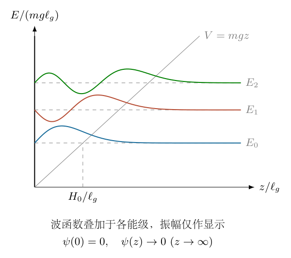

对于精确基态，再用经典频率作尺度比较时，$E_0/f_{\rm cl}(E_0)$ 略大于半经典的 $9h/8$；不能在精确能量里仍强制代入半经典相位公式。

（14）题给 $1/4$ 对应什么边界，以及应怎样使用答案。

若地面采用另一种理想反射边界 $\psi'(0)=0$，半经典地面条件近似为
$$
\cos\left[\frac1\hbar\int_0^Hp\,dz+\frac\pi4\right]=0,
$$
从而给 $J\simeq(n+1/4)h$。精确条件则是 $\operatorname{Ai}'(-a)=0$。这种诺伊曼反射边界不等于无限高势垒的通常硬壁。
因此原题给定关系可以作为一道指定半经典模型的计算题，但若解释为通常硬地面，应把偏移修正为 $3/4$，且基态只能称半经典近似。正文保留两种结果，是为了明确模型条件，而不是把不同答案并列而不判断。

（15）经典作用量与周期的交叉检验。

对完整作用量求导：
$$
\begin{aligned}
\frac{dJ}{dE}
&=\frac{4\sqrt{2m}}{3mg}\frac32E^{1/2}\\
&=\frac{2\sqrt{2mE}}{mg}\\
&=\frac2g\sqrt{\frac{2E}m}=T_{\rm cl}.
\end{aligned}
$$
这独立恢复了上升加下降的周期。对高量子数，邻近能级差由微分近似：
$$
\Delta E\simeq\frac h{dJ/dE}=hf_{\rm cl}.
$$
所以高能级间的跃迁频率逐渐趋于经典轨道频率，这才是半经典对应关系。基态的 $E_0/h$ 和跃迁频率不必相同。

（16）量纲、非相对论及尺度检查。

$mg^2h^2$ 的量纲为
$$
\mathrm{kg}\,(\mathrm{m\,s^{-2}})^2
(\mathrm{kg\,m^2\,s^{-1}})^2
=\mathrm{kg^3m^6s^{-6}}=\mathrm{J^3}.
$$
开立方确为能量；$E/f$ 的量纲为作用量，与 $h$ 相同。中子微米高度对应地面速度约厘米每秒，远小于光速，非相对论假设自洽。
当 $h\to0$，固定低量子数的能量与高度趋零；当 $n\to\infty$，$E_n\propto n^{2/3}$，相邻间距逐渐减小，而不是等间距。$m$ 增大时能量 $\propto m^{1/3}$、高度 $\propto m^{-2/3}$，宏观篮球的最低量子高度极小，经典可见跳跃含极大量子数。
