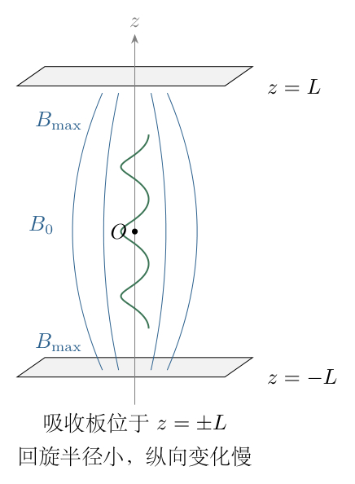
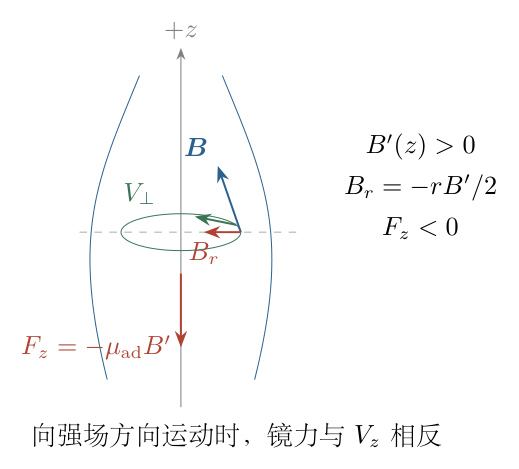
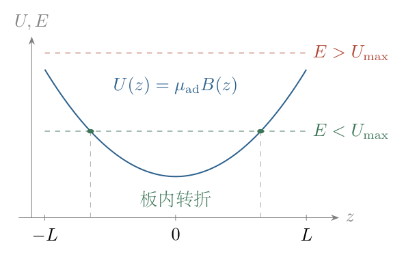
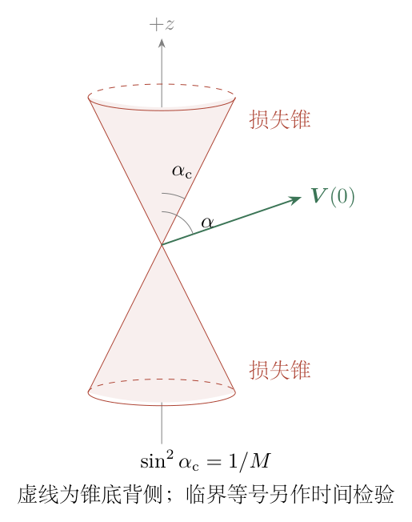

# 第 2 题

<!-- question-start -->
两块相同永磁铁相对放置，形成关于 $z=0$ 对称的磁场。轴向磁感应强度 $B_z(z)$ 在 $z=0$ 处最小，在磁铁平面 $z=\pm L$ 处最大。粒子沿 $z$ 方向的变化远慢于横向回旋运动。粒子质量为 $m$，电荷为 $q$，在原点释放，初始速度的平行、垂直分量分别为 $V_z(0)$、$V_\perp(0)$。

（1）证明 $V_\perp^2$ 与 $B_z(z)$ 成正比。

（2）定义
$$
U(z)=\frac{mV_\perp^2(0)B_z(z)}{2B_z(0)},
$$
证明 $\frac12mV_z^2+U(z)$ 守恒。

（3）在 $z=\pm L$ 放置吸收板，粒子碰板即被吸收。令镜比
$$
M=\frac{B_z(\pm L)}{B_z(0)},
$$
求粒子在两板间运动而不被吸收的初速度条件。

（4）求从原点发出的粒子会被吸收时，初速度方向应满足的条件。

模型说明：按近轴、慢变场的回旋平均近似讨论，要求 $B_z(0)>0$，无电场，回旋半径相对磁场变化尺度很小。仅含 $B_z(z)$ 而没有横向分量的非均匀磁场不满足磁场散度为零。临界粒子是否在有限时间碰板，需检查端点附近的场形。

<!-- question-end -->

## 一、题型定位

本题是磁镜中的绝热不变量和回旋平均动力学。磁场不对粒子做功，但能把平行运动的动能转化为垂直运动的动能，从而使粒子在强场端反射。核心是先由真实磁场的横向分量求平均纵向力，再建立磁矩不变量，最后用一维有效势判断可达位置。

“证明成正比”应理解为在题设慢变近似的精度内成立，而非任意空间磁场中都存在严格恒等式。需要同时说明回旋运动和纵向运动的两个时间尺度，以及结果失效时不能继续套用的原因。

## 二、知识点

Lorentz力为 $\boldsymbol F=q\boldsymbol v\times\boldsymbol B$，因其始终垂直速度，总动能严格守恒。局部回旋角频率和半径为
$$
\Omega_{\rm c}=\frac{|q|B}{m},\qquad
r_{\rm g}=\frac{mV_\perp}{|q|B}.
$$
磁场必须满足 $\nabla\cdot\boldsymbol B=0$。近轴且轴对称时，轴向场梯度伴随横向场，不能把梯度保留而横向场全部删去。

回旋平均磁矩为
$$
\mu_{\rm ad}=\frac{mV_\perp^2}{2B},
$$
它是绝热不变量，不是材料磁导率。俯仰角 $\alpha$ 定义为初速度与 $+z$ 轴夹角，范围为 $0\leq\alpha\leq\pi$；对应 $V_\perp(0)=V(0)\sin\alpha$、$V_z(0)=V(0)\cos\alpha$。

## 三、物理图像

粒子接近强场端时，场线会收拢，局部回旋半径减小，垂直动能增大，纵向速度下降。若纵向动能在到板之前降至零，粒子会反向运动。反射不是磁力改变总速率，而是速度方向不断改变、两种动能互相转移。

俯仰角很小的粒子，最初的垂直动能小，进入强場后仍不足以消耗全部平行动能，因此容易到达板。接近横向发射的粒子，平行动能少，通常在中间低场区附近反射。两个方向上的吸收角域组成关于 $+z$、$-z$ 对称的两个损失锥。

## 四、解题入口

取 $B_0=B_z(0)$、$B(z)=B_z(z)>0$。首先由轴对称散度条件获得 $B_r\simeq-rB'(z)/2$，对一周回旋运动求纵向Lorentz力平均。然后将其与动能守恒联立，积分得到 $V_\perp^2/B$ 不变。

最后用
$$
V_z^2(z)=V_z^2(0)-V_\perp^2(0)
\left[\frac{B(z)}{B_0}-1\right]
$$
判断板是否可达。把右端在 $z=\pm L$ 的值与零比较，先处理严格正、严格负两种情况，再单独讨论临界等号。

## 五、解析

（1）说明近轴场为何必须具有横向分量。

用圆柱坐标 $(r,\varphi,z)$。轴对称场没有 $\varphi$ 依赖，在近轴最低阶中，
$$
\frac1r\frac{\partial(rB_r)}{\partial r}
+\frac{\partial B_z}{\partial z}=0.
$$
将 $\partial B_z/\partial z$ 近似为轴上 $B'(z)$，沿 $r$ 积分：
$$
\frac{\partial(rB_r)}{\partial r}=-rB'(z),
\qquad
rB_r=-\frac12r^2B'(z).
$$
轴上磁场有限，积分常数必须为零，因此
$$
\boxed{B_r=-\frac r2B'(z)}.
$$
若强行取 $\boldsymbol B=B(z)\boldsymbol e_z$，则散度就是 $B'(z)$，并且纵向Lorentz力恒为零，根本不会产生磁镜反射。横向分量虽小，却决定累计的纵向动力学。

（2）对回旋运动求平均纵向力。

在笛卡尔坐标近轴表示中，
$$
B_x=-\frac x2B'(z),\quad
B_y=-\frac y2B'(z),\quad B_z=B(z).
$$
所以
$$
F_z=q(v_xB_y-v_yB_x)
=\frac{qB'(z)}2(xv_y-yv_x).
$$
把位置分成缓慢变化的回旋中心和快速回旋半径。对一周平均时，回旋中心与周期速度的叉积平均为零；快速回旋部分满足
$$
\left\langle xv_y-yv_x\right\rangle_{\rm g}
=-\frac{mV_\perp^2}{qB}.
$$
负号可直接由 $B>0$、$q>0$ 时粒子顺时针回旋确认；若 $q$ 变号，回旋方向也变号，最终平均纵向力仍不变。

于是
$$
\boxed{
m\frac{dV_z}{dt}
=-\frac{mV_\perp^2}{2B}B'(z).
}
$$
图 2-2 保留了场线收拢所需的 $B_r$。图中的回旋磁矩方向与外磁场反向，而上式的 $\mu_{\rm ad}$ 是正的标量系数。

（3）从动能守恒推导第一绝热不变量。

总磁力不做功，因此
$$
\frac d{dt}\left(\frac12mV_z^2+\frac12mV_\perp^2\right)=0.
$$
对第一项求导并代入镜力：
$$
\begin{aligned}
\frac d{dt}\left(\frac12mV_\perp^2\right)
&=-mV_z\frac{dV_z}{dt}\\
&=\frac{mV_\perp^2}{2B}B'(z)V_z\\
&=\frac{mV_\perp^2}{2B}\frac{dB}{dt}.
\end{aligned}
$$
在 $V_\perp\neq0$ 时，约去公共因子 $m/2$ 并分离变量：
$$
\frac{d(V_\perp^2)}{V_\perp^2}=\frac{dB}{B}.
$$
从初态积分到当前位置：
$$
\ln\frac{V_\perp^2(z)}{V_\perp^2(0)}
=\ln\frac{B(z)}{B_0}.
$$
两边取指数，得到
$$
\boxed{
V_\perp^2(z)=V_\perp^2(0)\frac{B(z)}{B_0}.
}
$$
即 $\mu_{\rm ad}=mV_\perp^2(0)/(2B_0)$ 保持不变。这一路线没有先假定磁矩不变，再把它当作所求命题的证明。

（4）说明近似成立的条件。

一周回旋时间约为 $2\pi/\Omega_{\rm c}$。若沿轨迹磁场在这段时间内相对变化很小，且回旋半径相对横向不均匀尺度很小，才能把局部回旋看作近似圆周运动。可写为
$$
\frac{|V_z B'|}{\Omega_{\rm c}B}\ll1,\qquad
\frac{r_{\rm g}}{L_B}\ll1.
$$
其中 $L_B$ 为适当的磁场空间变化尺度。题设“纵向运动慢”对应第一类要求，但还须保证局部空间近似。

粒子释放在原点，不意味着回旋中心严格在原点；有初始横向速度时，回旋中心通常偏离一个回旋半径。只要这一偏移也小于场的横向尺度，仍可在所用近似中以轴上 $B_z(z)$ 描述。磁矩变化和近轴修正属于更高阶效应，不能声称被严格消除了。

（5）建立纵向有效势和守恒量。

由第（3）步，
$$
\frac12mV_\perp^2(z)
=\frac{mV_\perp^2(0)}{2B_0}B(z)
=U(z).
$$
所以总动能守恒在回旋平均近似中变成
$$
\boxed{
\frac12mV_z^2(z)+U(z)
=\frac12mV_z^2(0)+U(0).
}
$$
$U$ 的量纲为能量。它是把垂直动能改写为位置函数后的有效势，不是静电势能，也不是磁场对粒子做功后储存的额外能量。不能把 $U$ 再重复加入完整三维动能。

对上式求时间导数，得到
$$
mV_z\dot V_z+U'(z)V_z=0.
$$
在 $V_z\neq0$ 时约去 $V_z$，得到 $m\dot V_z=-U'(z)$；在转折点则由连续性延续同一运动方程，不应误以为约分后转折点不受镜力。

（6）求任意位置的纵向速度平方。

把初态和当前位置的守恒量相减：
$$
\begin{aligned}
\frac12mV_z^2(z)
&=\frac12mV_z^2(0)+\frac12mV_\perp^2(0)
-\frac12mV_\perp^2(0)\frac{B(z)}{B_0},\\
V_z^2(z)
&=V_z^2(0)-V_\perp^2(0)
\left[\frac{B(z)}{B_0}-1\right].
\end{aligned}
$$
右端必须非负，才是该初态可以到达的位置。如果算出负值，含义是粒子已在更早的位置反射，而不是粒子出现虚数速度。

若 $V_\perp(0)\neq0$，令 $V_z(z_{\rm turn})=0$，得到反射所需场强
$$
\boxed{
\frac{B_{\rm turn}}{B_0}
=1+\frac{V_z^2(0)}{V_\perp^2(0)}.
}
$$

（7）确定严格不被吸收的初速度条件。

板处最大场强为 $MB_0$。如果反射所需场强严格小于板处场强，连续场中会在板内出现转折点：
$$
1+\frac{V_z^2(0)}{V_\perp^2(0)}<M.
$$
因此充分且明确的严格束缚条件为
$$
\boxed{
V_z^2(0)<(M-1)V_\perp^2(0).
}
$$
其能量形式是
$$
\frac12m[V_z^2(0)+V_\perp^2(0)]<\mu_{\rm ad}MB_0.
$$
图 2-3 中下方水平能量线与势曲线的交点位于两板之间；上方能量线高于两端势垒，粒子沿初始纵向方向到达吸收板。

这一条件主要限定初速度的比例，而非总速率。但总速率过大可能使回旋半径变大，破坏慢变近似，所以不能由比例条件推出任意大的初速度都适用本模型。

（8）求严格会被吸收的初速度条件。

若
$$
V_z^2(0)>(M-1)V_\perp^2(0),
$$
则到达初始运动方向那侧的板时，纵向速度平方为正：
$$
V_{z,\rm plate}^{\,2}
=V_z^2(0)-(M-1)V_\perp^2(0)>0.
$$
由于板内任何位置的场强不超过 $MB_0$，沿途没有把纵向速度降至零的镜点。粒子将撞上板而被吸收。

若 $V_\perp(0)=0$、$V_z(0)\neq0$，磁矩为零，近轴模型中没有镜力，粒子直接运动到板；不能为了使用比值公式而除以零。若两个速度分量都为零，粒子保持静止，不属于损失锥的有速粒子。

（9）用俯仰角表示束缚与损失锥。

对非零初速，
$$
\frac{V_z^2(0)}{V_\perp^2(0)}
=\cot^2\alpha.
$$
严格束缚条件化为
$$
\begin{aligned}
\cos^2\alpha&<(M-1)\sin^2\alpha,\\
1&<M\sin^2\alpha,\\
\boxed{\sin^2\alpha>\frac1M}.
\end{aligned}
$$
当 $M>1$，定义
$$
\alpha_{\rm c}=\arcsin\frac1{\sqrt M}.
$$
于是严格束缚角域为
$$
\boxed{\alpha_{\rm c}<\alpha<\pi-\alpha_{\rm c}}.
$$
严格吸收角域为
$$
\boxed{0\leq\alpha<\alpha_{\rm c}
\quad\text{或}\quad
\pi-\alpha_{\rm c}<\alpha\leq\pi.}
$$
图 2-4 中两个锥以 $\pm z$ 轴为轴，锥半角是 $\alpha_{\rm c}$；不是以横向平面为零角度。

（10）单独处理临界等号。

当 $\sin^2\alpha=1/M$ 时，能量恰等于板处有效势：
$$
V_z^2(z)
=V_\perp^2(0)\frac{B_{\max}-B(z)}{B_0}.
$$
到板时间由积分决定：
$$
t_L
=\frac{\sqrt{B_0}}{V_\perp(0)}
\int_0^L\frac{dz}{\sqrt{B_{\max}-B(z)}}.
$$
如果端点附近 $B_{\max}-B(z)\sim C(L-z)$，积分像 $\int d\xi/\sqrt{\xi}$，有限；粒子确实到板，按题设被吸收。

如果板恰在光滑场强极大值处，且 $B_{\max}-B(z)\sim C(L-z)^2$，积分像 $\int d\xi/\xi$，对数发散。理想模型中的临界粒子渐近接近板，却不在有限时间撞板。更平坦的极大值也可能使积分发散。因此，未给端点场形时，不能把临界等号不加说明地一律列为有限时间吸收。严格束缚和严格损失锥两种开域结论不受此端点细节影响。

（11）镜比的极限和特殊情况。

当 $M$ 很大，$\alpha_{\rm c}\simeq M^{-1/2}$，损失锥变窄，反射角域扩大。当 $M\to1^+$ 时，严格束缚角域收缩到横向方向附近。若场从头到尾为常量，$M=1$，所有 $V_z(0)\neq0$ 的粒子都会到板；$V_z(0)=0$ 的粒子在横向回旋，不沿 $z$ 移动。

题设有严格中间最小值时，横向发射的回旋平均中心停留于 $z=0$；若受到微小纵向扰动，则附近可出现振荡，其频率由 $B''(0)$ 决定，而非仅由镜比决定。镜比只比较端点与中点，不能单独给出完整轨迹或周期。

（12）最终结果及守恒检验。

在近轴回旋平均近似中，
$$
\boxed{
\frac{V_\perp^2(z)}{B_z(z)}
=\frac{V_\perp^2(0)}{B_z(0)},\qquad
\frac12mV_z^2+U(z)=\text{常量}.
}
$$
严格不被吸收时满足 $V_z^2(0)<(M-1)V_\perp^2(0)$；严格损失锥满足相反的不等式。临界等号需要端点时间积分。

把速度表达式相加，可直接恢复 $V_z^2(z)+V_\perp^2(z)=V_z^2(0)+V_\perp^2(0)$。粒子电荷符号只改变回旋方向，不改变镜力和损失锥条件；质量和电荷仍控制回旋半径及近似能否成立，不能解释为它们对实际运动完全无影响。

## 六、关键洞察

磁镜作用的来源是满足散度条件的横向场。若只保留 $B_z(z)$ 的数值变化、删掉所有横向场分量，就会得到一个同时违背 Maxwell 条件和纵向动力学的模型。

对各向同性发射方向分布，两个损失锥总立体角为 $4\pi(1-\cos\alpha_{\rm c})$，所以严格损失方向所占比例为
$$
f_{\Omega}=1-\sqrt{1-\frac1M}.
$$
这是按方向均匀统计的比例，不是到板通量的比例。若统计穿过一个平面的入射通量，角度权重还含 $\cos\alpha$；在半空间各向同性分布的情形，损失锥通量比例是
$$
\frac{\int_0^{\alpha_{\rm c}}\cos\alpha\sin\alpha\,d\alpha}
{\int_0^{\pi/2}\cos\alpha\sin\alpha\,d\alpha}
=\sin^2\alpha_{\rm c}=\frac1M.
$$
不同统计对象的权重不同，不能混用。

## 七、易错点

把总速率增加当作镜力的结果；用严格动能守恒掩盖绝热磁矩仅近似不变；把材料磁导率和回旋磁矩写成同一个物理量；把俯仰角从横向平面而非磁场轴起算；只画一个损失锥；在 $V_\perp(0)=0$ 时仍使用比值。

临界问题中常见的跳步是“板处速度为零，所以必定碰板”。空间可达性与有限时间可达性不是同一个判断，必须检验速度在端点附近消失的阶数。总能量达到势垒顶时可能属于分离轨道。

## 八、课堂讲解建议

先让学生在速度圆上观察 $V_z$ 与 $V_\perp$ 的能量转换，再画纵向有效势。板书先保留 $B_r$ 的来源，避免学生误以为沿轴梯度可以直接放进一个纯轴向磁場。

推导不变量时从平均纵向力与能量守恒出发，强调分离变量的每个因子。角度条件先用速度平方得到，再换成正弦平方；最后才画损失锥。

临界等号用线性靠近和二次靠近两种势垒作比较，让学生实际积分 $\xi^{-1/2}$ 和 $\xi^{-1}$，建立有限时间与渐近接近的区别。

## 九、变式训练

（1）镜比 $M=4$，粒子以与 $+z$ 轴成 $45^\circ$ 的方向发射，初速为 $v_0$。求转折场强和板处是否可达。

解：两分量均为 $v_0/\sqrt2$，故 $B_{\rm turn}/B_0=1+1=2<4$。粒子在板内反射，不会到板。若发射角改为 $30^\circ$，则 $B_{\rm turn}=4B_0$，是临界情形；有限时间吸收仍须由端点场形决定，不能仅凭角度判定。

（2）在两板之间取 $B(z)=B_0(1+\beta z^2)$，$\beta>0$，仍采用绝热模型。求纵向运动及严格束缚条件。

解：有效势为 $U(z)=mV_\perp^2(0)(1+\beta z^2)/2$，故
$$
\ddot z+\beta V_\perp^2(0)z=0.
$$
初始 $z(0)=0$，得到
$$
z(t)=\frac{V_z(0)}{\omega_z}\sin(\omega_z t),\qquad
\omega_z=V_\perp(0)\sqrt\beta.
$$
振幅小于 $L$ 才严格不碰板，即 $V_z^2(0)<\beta L^2V_\perp^2(0)$。由于 $M=1+\beta L^2$，它与一般镜比条件一致。若振幅恰为 $L$，本场形在板处并非光滑极大值，而是在有限定义域的端点达到最大，粒子会在四分之一周期到板，按题设吸收。

（3）改取平滑端点场形 $B(z)=B_0[1+(M-1)\sin^2(\pi z/(2L))]$，以正向临界速度 $V_z(0)=V_\perp(0)\sqrt{M-1}$ 发射，求是否在有限时间碰到 $+L$ 板。

解：将该场形代入纵向能量，得到在 $0\leq z<L$ 内
$$
\dot z^2=V_z^2(0)\cos^2\frac{\pi z}{2L}.
$$
取向上运动的正根，分离变量：
$$
t=\frac{2L}{\pi V_z(0)}
\int_0^{\pi z/(2L)}\frac{d\zeta}{\cos\zeta}
=\frac{2L}{\pi V_z(0)}
\ln\left(\sec\frac{\pi z}{2L}+\tan\frac{\pi z}{2L}\right).
$$
利用 $\ln(\sec\zeta+\tan\zeta)=\operatorname{artanh}(\sin\zeta)$，反解为
$$
z(t)=\frac{2L}{\pi}
\arcsin\left[\tanh\frac{\pi V_z(0)t}{2L}\right].
$$
任意有限 $t$ 下双曲正切小于一，所以 $z(t)<L$；只有 $t\to\infty$ 才趋于板。此处板处场形为光滑极大，临界粒子不会有限时间被吸收。它与上一变式具有相同镜比，却有不同临界到达时间，说明镜比不能单独判定等号情形。
