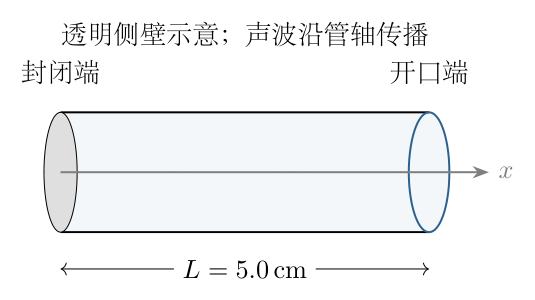
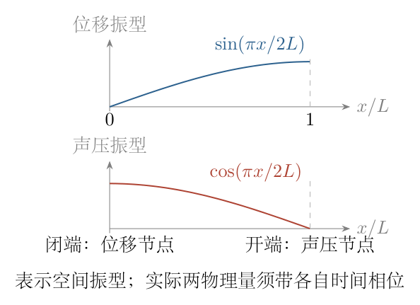
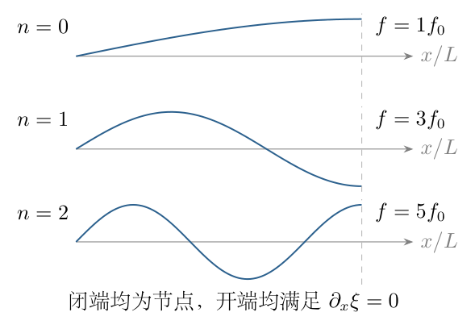

# 第 7 题

<!-- question-start -->
圆柱形笔帽一端封闭、一端开口，长度为 $L=5.0\,\mathrm{cm}$。向笔帽开口吹气时，空气柱发出声音。取声速 $c_s=330\,\mathrm{m\,s^{-1}}$，求声音频率。

<!-- question-end -->

## 一、题型定位

一维空气柱驻波与边界条件。封闭端约束空气的纵向速度，开口端约束声压扰动，这两种边界对应不同物理量的节点，不能只记忆“有一个节点和一个腹点”而不说明是哪种振动量。

在细长管、低振幅、忽略开口修正的模型下，最低共振频率为四分之一波长模式。题目未指定吹奏选择哪阶模态，也未给笔帽口径，因此可确定理想基频与允许的高阶频率，不能保证任意吹法都只发基频。

## 二、知识点

空气纵波可以用位移 $\xi(x,t)$、纵向流速 $u(x,t)=\partial_t\xi$ 和相对于环境气压的声压 $p'(x,t)$ 描述。在均匀平衡空气中，一维小振幅绝热声波满足
$$
\partial_t^2\xi=c_s^2\partial_x^2\xi,\qquad
p'=-\rho_0c_s^2\partial_x\xi.
$$
传播关系为 $\omega=c_sk$、$\lambda=2\pi/k$、$f=\omega/(2\pi)$。固壁端位移为零；理想开口端声压扰动为零，而不是空气位移为零。

## 三、物理图像

笔帽封闭端没有空气穿透，因而为流速与位移节点，同时为声压腹点。开口处可以与外界交换少量空气，其声压近似被环境压强钳制，是声压节点、位移和流速腹点。

基频中，从封闭端到开口端恰有一段从位移节点到相邻腹点的空间距离，即 $\lambda/4$。声压与位移的空间包络错开四分之一波长；二者达到时间最大值也不同步，不能把同一时刻的压力曲线与位移曲线都画成各自同时最大。

## 四、解题入口

取封闭端 $x=0$，开口端 $x=L$。先用固壁条件选空间函数 $\sin kx$，再用开口声压为零要求 $\cos kL=0$，由此得到所有允许 $k$。最后取最小正 $k$ 求基频，并说明开口端修正和模态选择的限定。

## 五、解析

（1）从空气微元的质量守恒建立扰动关系。

平衡时空气密度为 $\rho_0$。一小段空气初始位于 $[x,x+dx]$，其两端位移之差为
$$
\xi(x+dx,t)-\xi(x,t)\simeq(\partial_x\xi)\,dx.
$$
所以小段长度从 $dx$ 变为 $dx(1+\partial_x\xi)$。截面相同，质量守恒给出
$$
(\rho_0+\rho')\,dx(1+\partial_x\xi)=\rho_0\,dx.
$$
只保留扰动一阶项，忽略 $\rho'\partial_x\xi$，得到
$$
\rho'=-\rho_0\partial_x\xi.
$$
位移随位置增加意味着微元膨胀，密度减少，负号与物理图像一致。

（2）利用状态关系和受力导出波动方程。

声波快速微小压缩近似绝热，定义
$$
c_s^2=\left(\frac{\partial p}{\partial\rho}\right)_{\!s},
\qquad p'=c_s^2\rho'.
$$
代入质量关系：
$$
p'=-\rho_0c_s^2\partial_x\xi.
$$
微元两端压力差产生合力
$$
[p'(x)-p'(x+dx)]S\simeq-S(\partial_xp')\,dx.
$$
其质量近似 $\rho_0Sdx$，由牛顿第二定律，
$$
\rho_0\partial_t^2\xi=-\partial_xp'
=\rho_0c_s^2\partial_x^2\xi.
$$
约去密度即为
$$
\boxed{\partial_t^2\xi=c_s^2\partial_x^2\xi.}
$$
管截面积在理想一维模型中约去，所以主结果只需长度与声速；但截面尺度会影响开口修正和高频下的一维适用性。

（3）写出谐振动的一般空间形式。

设
$$
\xi(x,t)=X(x)\cos\omega t.
$$
代入波动方程：
$$
-\omega^2X=c_s^2X'',\qquad
X''+k^2X=0,\qquad k=\omega/c_s.
$$
因此
$$
X(x)=A\sin kx+B\cos kx.
$$
这一步是常系数二阶微分方程的通解，两个常数由两端边界确定，不预先假设波长等于管长的两倍。

（4）施加封闭端边界。

封闭端固定、不能有空气穿壁，所以 $\xi(0,t)=0$。代入上式：
$$
X(0)=B=0.
$$
非平凡振动为
$$
\xi(x,t)=A\sin kx\cos\omega t,\qquad A\ne0.
$$
相应声压与流速为
$$
\begin{aligned}
p'(x,t)&=-\rho_0c_s^2Ak\cos kx\cos\omega t,\\
u(x,t)&=-A\omega\sin kx\sin\omega t.
\end{aligned}
$$
在 $x=0$，位移、流速均恒为零，声压振幅最大。这个条件不意味着绝对气压为零，而是声压可随时间变化。

（5）施加理想开口端边界。

开口处与大气相通，在忽略辐射惯性和端口修正的理想近似下，相对于环境的声压扰动为零：
$$
p'(L,t)=0.
$$
由于 $A\ne0$、$k>0$，须有
$$
\cos kL=0,\qquad
kL=\frac{(2n+1)\pi}{2},\quad n=0,1,2,\ldots.
$$
于是
$$
\boxed{
k_n=\frac{(2n+1)\pi}{2L},\quad
\lambda_n=\frac{4L}{2n+1},\quad
f_n=\frac{(2n+1)c_s}{4L}.
}
$$
$k=0$ 只给满足封闭位移条件的平凡解，不能列成“零频声学模式”。只保留正频率，并用 $n=0$ 标记最低共振。

图 7-2 分别画位移和声压的空间振幅形状，下面的四分之一波长关系由它们各自的端点条件得到。曲线表示归一化振幅包络，不声称两种物理量在同一时刻都处于极值。

（6）单位换算并计算基频。

笔帽长度换成米：
$$
L=5.0\,\mathrm{cm}=5.0\times10^{-2}\,\mathrm m.
$$
基频波长为
$$
\lambda_0=4L=0.200\,\mathrm m.
$$
由 $f=c_s/\lambda$，
$$
\boxed{
f_0=\frac{330}{4(0.050)}
=1650\,\mathrm{Hz}\simeq1.7\,\mathrm{kHz}.
}
$$
保留计算值时可以写 $1.65\,\mathrm{kHz}$；按长度与声速有效数字统一后约为 $1.7\,\mathrm{kHz}$。若直接用厘米计算而不换声速单位，会差一百倍。

（7）区分允许共振频率和实际吹出的单一声音。

图 7-3 的前三种模式分别满足 $kL=\pi/2,3\pi/2,5\pi/2$。因此理想模型允许
$$
f_0=1650\,\mathrm{Hz},\quad
f_1=4950\,\mathrm{Hz},\quad
f_2=8250\,\mathrm{Hz},\ldots.
$$
相邻允许频率相差 $3300\,\mathrm{Hz}$，但不包含 $3300\,\mathrm{Hz}$ 这个偶次倍频。每种模式仍满足闭端位移零、开端位移斜率零。

一般较弱吹气常以最低空气柱共振作为题目预期答案，但流速、吹气角度、口部耦合和激励方式可改变被激发的模态。仅凭“吹一下出现声音”不能严格排除高阶共振或边缘音。本题的确定结论是理想基频及模态序列，不把经验上的基频主导写成数学上的唯一性。

（8）开口修正与极限检验。

实际开口处附近的外部空气也参与运动，位移腹点等效位于管口外侧。用正的端部修正 $\delta$ 表示，
$$
L_{\rm eff}=L+\delta,\qquad
f_0^{\rm actual}\simeq\frac{c_s}{4(L+\delta)}.
$$
因此在同一声速和同一基频模型下，$\delta>0$ 会使频率低于理想的 $1650\,\mathrm{Hz}$。题未给开口半径或端口形状，不能虚构 $\delta$ 的数值。若 $\delta/L\ll1$，
$$
\frac{f_0^{\rm actual}}{f_0^{\rm ideal}}
=\frac1{1+\delta/L}
\simeq1-\frac{\delta}{L}.
$$
频率量纲为 $(\mathrm{m\,s^{-1}})/\mathrm m=\mathrm{s^{-1}}$。长度加倍，所有理想共振频率减半；声速加倍，频率加倍。封闭端和开口端不变时，模式的奇数倍关系不因长度缩放而改变。

## 六、关键洞察

四分之一波长来自不同边界，而不是来自“笔帽”这个物品名称。任何一端刚性封闭、一端理想开放的细空气柱都有同一边值结构。

还可用行波反射检验。设位移行波为 $F(x-c_st)+G(x+c_st)$。闭端总位移为零，要求反射位移变号；开端 $\partial_x\xi=0$，要求位移反射同号。一个来回包含一次变号，空间传播相位需再贡献一个奇数倍 $\pi$，故
$$
2kL=(2n+1)\pi.
$$
这与边值微分方程一致。若改用压力行波，闭端、开端的反射符号互换，但往返相位结论相同。

声压与位移的空间函数分别为 $\cos kx$ 与 $\sin kx$；流速与位移空间函数相同，但时间上分别为 $\sin\omega t$ 与 $\cos\omega t$。区分空间错位和时间相位，能避免画出违反连续性方程的驻波示意。

## 七、易错点

把开口端当位移节点，得到两端封闭的半波长公式；把声压节点误解为绝对压强为零；把位移腹点与声压腹点画在同一端；列入偶次谐波；厘米与米混用。

理想基频与实测声音并不完全等价。未给口径时不能精确修正开口效应，未给激励条件时不能断言实际只发基频。把驻波振幅图当作两物理量同时最大时的瞬时图，也会造成相位混淆。

## 八、课堂讲解建议

先让学生说明空气在封闭端能否穿过固壁，再说明开口端何种量受外界约束。板书分别列 $\xi(0)=0$ 与 $p'(L)=0$，不要只写含义不明的“节点、腹点”。

结合图 7-2 读出两种包络，再由 $\cos kL=0$ 求全部模态。最后改变一端边界，比较新旧频率，使学生把长度公式与边界来源联系起来。

## 九、变式训练

（1）长度增加为 $10.0\,\mathrm{cm}$，其他理想条件不变，求基频与下一允许频率。

解：$L_2=0.100\,\mathrm m$，所以
$$
f_0=\frac{330}{4(0.100)}=825\,\mathrm{Hz},\qquad
f_1=3f_0=2475\,\mathrm{Hz}.
$$
两个频率均为原长度情形的一半；下一模态不是 $2f_0$。

（2）原长度保持 $5.0\,\mathrm{cm}$，改成两端理想开口，求基频和允许频率。

解：压力在两端为零。声压空间通解可取 $p'(x)\propto\sin kx$，另一端要求 $\sin kL=0$，故 $kL=n\pi$，$n=1,2,\ldots$。因此
$$
f_n=\frac{nc_s}{2L}=3300n\,\mathrm{Hz}.
$$
基频为 $3300\,\mathrm{Hz}$，是原一闭一开基频的两倍，且允许全部正整数倍频。原因是边界改变，不是声速或管长改变。
