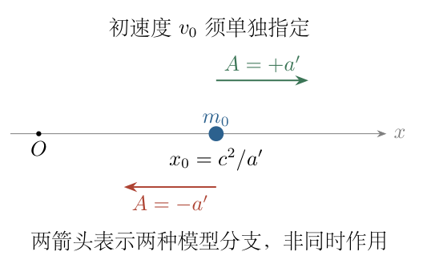
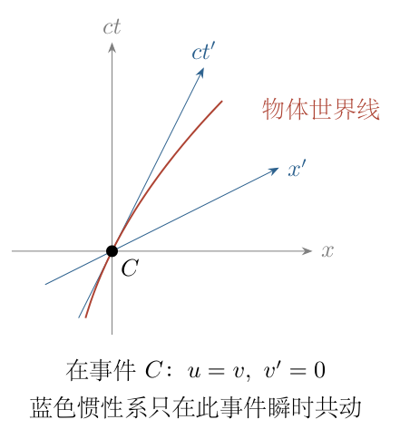
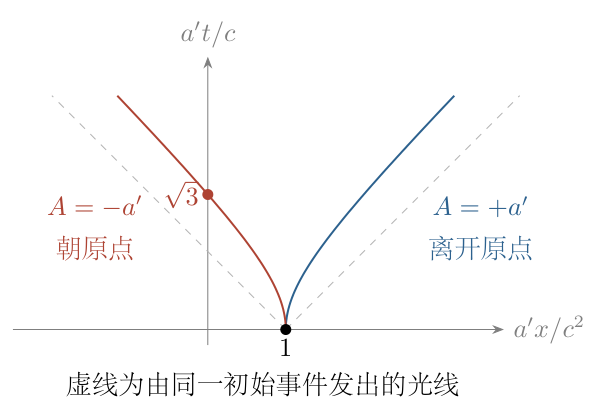
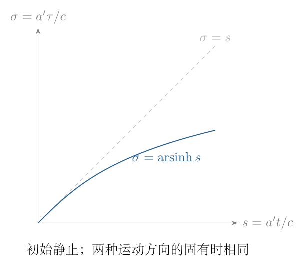

# 第 8 题

<!-- question-start -->
设惯性系 $S'$ 相对惯性系 $S$ 沿 $+x$ 方向以恒定速度 $u$ 运动，光速为 $c$。

（1）由位置和时间的洛伦兹变换证明纵向速度变换
$$
v_x=\frac{v'_x+u}{1+uv'_x/c^2}.
$$
（2）质量参数为常数 $m_0$ 的质点，初始 $t=t'=0$，位于 $x_0=c^2/a'$。此后沿 $x$ 轴作题目所称的“自由下落”；任意时刻，在与质点瞬时共动的惯性系中，测得其加速度为常数 $a'$。求 $a_x$ 与 $a'_x$ 的关系，用 $a'_x,v_x,c$ 表示 $a_x$。

（3）证明在 $S$ 中质点所受纵向净力 $F_x$ 为常量。

（4）用 $t,a',c$ 表示速度 $v$。

（5）用 $t,a',c$ 表示时间 $t'$。可用双曲函数及 $\cosh^2z-\sinh^2z=1$。

<!-- question-end -->

## 一、题型定位

模型说明：$m_0$ 按不变质量解释。非零的瞬时共动加速度属于恒定固有加速度模型，不是平直时空中无受力粒子的自由运动。原条件未明确初速度和加速度正方向，也未定义加速物体的连续时钟；解析先给通解，再给“初始静止、沿 $+x$ 恒定固有加速”的条件解，并把物体钟读数记为固有时 $\tau$。若 $t'$ 指该钟读数，则 $t'=\tau$；若指某一固定惯性系的坐标时间，须另行指定该系。

纵向洛伦兹运动学、恒定固有加速度与相对论动力学。先在两固定惯性系之间推导速度与加速度变换，再只在某一事件令 $S'$ 为瞬时共动系。随后用 $F_x=dp_x/dt$ 与固有时微分关系求运动。

恒定固有加速度不等于恒定坐标加速度。前者是物体瞬时静止系中测得的加速度；后者是固定惯性系中 $dv/dt$。二者随洛伦兹因子不同，必须区分。

## 二、知识点

逆向洛伦兹变换为
$$
x=\gamma_u(x'+ut'),\qquad
t=\gamma_u(t'+ux'/c^2),\qquad
\gamma_u=(1-u^2/c^2)^{-1/2}.
$$
不变质量 $m_0$ 的纵向动量为 $p_x=m_0\gamma_vv$，其中 $\gamma_v=(1-v^2/c^2)^{-1/2}$。固有时沿物体世界线满足
$$
d\tau=dt\sqrt{1-v^2/c^2}=\frac{dt}{\gamma_v}.
$$
速度可用快度 $\eta$ 表示：$v=c\tanh\eta$、$\gamma_v=\cosh\eta$、$\gamma_vv/c=\sinh\eta$。

## 三、物理图像

每一事件处都能选一个与物体瞬时同速的惯性系，但随着物体加速，这些系的相对速度不同，不能把它们拼成仍然满足单一恒定 $u$ 洛伦兹变换的惯性系。

若沿 $+x$ 恒定固有加速且初始静止，实验室中的速度逐渐接近 $c$，坐标加速度逐渐下降，世界线为双曲线的一支。若加速度朝 $-x$，速度及位移相反，但钟的固有时仍正向增长。初始位置 $x_0$ 只改变轨迹的空间平移，不自行提供引力场或加速度方向。

## 四、解题入口

第（1）问和一般加速度变换中的 $u$ 都先保持常数。导数完成后，才在所考察事件令 $v'_x=0$、$u=v_x$。随后设有符号的恒定固有加速度为 $A$；若 $a'>0$ 代表其大小，则 $A=\pm a'$。

保留 $v(0)=v_0$、$\gamma_0=(1-v_0^2/c^2)^{-1/2}$，从恒力推出 $\gamma_vv=\gamma_0v_0+At$。最后对 $v_0=0$ 进行明确代入，不能只因 $t=0$ 就把初速度默认为零。

## 五、解析

（1）沿同一物体轨迹对洛伦兹变换取微分。

两固定惯性系相对速度 $u$ 为常数，所以 $\gamma_u$ 也是常数。沿质点世界线，
$$
dx=\gamma_u(dx'+u\,dt'),\qquad
dt=\gamma_u(dt'+u\,dx'/c^2).
$$
设 $v'_x=dx'/dt'$，则
$$
dx=\gamma_u(v'_x+u)\,dt',\qquad
dt=\gamma_u(1+uv'_x/c^2)\,dt'.
$$
对亚光速运动，$|u|<c$、$|v'_x|<c$，有 $1+uv'_x/c^2>0$，时间增量不会变号。两式相除得
$$
\boxed{v_x=\frac{v'_x+u}{1+uv'_x/c^2}.}
$$
这里 $dt$ 和 $dt'$ 不是同一个数，因此不能仅由 $x=\gamma_u(x'+ut')$ 得到 $v_x=\gamma_u(v'_x+u)$ 而漏掉时间分母。

（2）检验速度变换的低速与光速极限。

当 $uv'_x/c^2$ 很小，速度变换近似为 $v_x\simeq v'_x+u$，恢复伽利略速度叠加。若取光的纵向速度 $v'_x=c$，则
$$
v_x=\frac{c+u}{1+u/c}=c.
$$
若 $v'_x=-c$，相应得 $v_x=-c$。另外
$$
1-\frac{v_x^2}{c^2}
=\frac{(1-u^2/c^2)(1-v_x'^2/c^2)}
{(1+uv'_x/c^2)^2}>0,
$$
所以两个亚光速速度经过变换仍亚光速。该恒等式也能独立检查分母与正负号。

（3）对速度分式求导，保留分母的全部因子。

先把 $v_x$ 视为 $v'_x$ 的函数。商法则给出
$$
\begin{aligned}
\frac{dv_x}{dv'_x}
&=\frac{(1+uv'_x/c^2)-(v'_x+u)u/c^2}
{(1+uv'_x/c^2)^2}\\
&=\frac{1-u^2/c^2}{(1+uv'_x/c^2)^2}
=\frac1{\gamma_u^2(1+uv'_x/c^2)^2}.
\end{aligned}
$$
再由时间微分式，
$$
\frac{dt}{dt'}=\gamma_u(1+uv'_x/c^2).
$$
因此一般的纵向加速度变换为
$$
\begin{aligned}
a_x=\frac{dv_x}{dt}
&=\frac{dv_x}{dv'_x}\frac{dv'_x}{dt'}\frac{dt'}{dt}\\
&=\frac{a'_x}{\gamma_u^3(1+uv'_x/c^2)^3}.
\end{aligned}
$$
这一步使用链式求导。三次幂由速度分式的二次幂与时间转换的一次幂相乘而来，漏掉时间转换会错成二次幂。

（4）只在一个事件令 $S'$ 为瞬时共动惯性系。

在该事件，物体在 $S'$ 中瞬时静止，即 $v'_x=0$，而 $u=v_x$。于是
$$
\boxed{
a_x=\frac{a'_x}{\gamma_v^3}
=a'_x\left(1-\frac{v_x^2}{c^2}\right)^{3/2}.
}
$$
图 8-2 的 $S'$ 只与图示事件处的速度相匹配。下一事件需要另一瞬时共动系；在前面求导过程中没有把 $u$ 偷换成随时间变化的函数。

若题给固有加速度为恒定的有符号数 $A$，则
$$
\frac{dv}{dt}=A(1-v^2/c^2)^{3/2}.
$$
当 $A>0$ 时速度单调增加，$A<0$ 时单调减小。固有加速度的大小恒定，并不要求实验室中加速度大小恒定。

（5）由动量定义求净力，逐项展开导数。

相对论纵向力定义为 $F_x=dp_x/dt$，而不是直接用 $m_0\,dv/dt$。由
$$
p_x=m_0\gamma_vv,\qquad
\frac{d\gamma_v}{dv}
=\frac{v}{c^2}(1-v^2/c^2)^{-3/2}
=\frac{v}{c^2}\gamma_v^3,
$$
有
$$
\begin{aligned}
\frac{d(\gamma_vv)}{dv}
&=\gamma_v+\frac{v^2}{c^2}\gamma_v^3\\
&=\gamma_v^3[(1-v^2/c^2)+v^2/c^2]
=\gamma_v^3.
\end{aligned}
$$
所以
$$
F_x=m_0\gamma_v^3\frac{dv}{dt}
=m_0\gamma_v^3\frac A{\gamma_v^3}.
$$
得到
$$
\boxed{F_x=m_0A=\text{常量}.}
$$
若向原点“下落”取 $A=-a'$，力为 $-m_0a'$。力恒定的结论在本一维、不变质量恒定模型中成立；没有把时间依赖的“相对论质量”放进牛顿式。

（6）保留任意初速度积分动量。

由于力恒定，
$$
p_x(t)-p_x(0)=m_0At.
$$
除以 $m_0$，定义 $w_0=\gamma_0v_0$，则
$$
\boxed{\gamma_vv=w_0+At.}
$$
也可直接分离变量积分加速度式：
$$
\int_{v_0}^{v(t)}\frac{d\tilde v}{(1-\tilde v^2/c^2)^{3/2}}
=\int_0^tA\,dt.
$$
被积函数的原函数正是 $\tilde v/\sqrt{1-\tilde v^2/c^2}$，因此给出相同结果。这里明确使用初始 $v_0$ 决定积分常数。

（7）从动量关系解出速度，不能丢失符号。

令 $w=w_0+At$，由 $v/\sqrt{1-v^2/c^2}=w$，
$$
v^2=w^2(1-v^2/c^2).
$$
整理：
$$
v^2(1+w^2/c^2)=w^2,\qquad
|v|=\frac{|w|}{\sqrt{1+w^2/c^2}}.
$$
原未平方方程要求 $v$ 与 $w$ 同号，因此
$$
\boxed{
v(t)=\frac{w_0+At}{\sqrt{1+(w_0+At)^2/c^2}}
=\frac{c(w_0+At)}{\sqrt{c^2+(w_0+At)^2}}.
}
$$
这给出原条件未明确初速度时的通解。初速度为零、加速度沿 $+x$ 的条件解才是
$$
\boxed{v(t)=\frac{a't}{\sqrt{1+(a't/c)^2}}.}
$$
如果初始静止但向 $-x$ 加速，则速度是上式的负值。初始位置 $x_0$ 不进入速度方程，不能用 $x_0=c^2/a'$ 来代替缺失的初速度。

（8）从时空间隔建立固有时，而不是连续套一个洛伦兹时间坐标。

沿物体轨迹，$dx=v\,dt$。固有时定义为
$$
c^2d\tau^2=c^2dt^2-dx^2,
$$
取未来向时钟增量 $d\tau>0$：
$$
d\tau=\sqrt{1-v^2/c^2}\,dt=\frac{dt}{\gamma_v}.
$$
由 $w=\gamma_vv$，可验证
$$
\gamma_v^2=1+\frac{w^2}{c^2}.
$$
所以
$$
\tau(t)=\int_0^t\frac{ds}{\sqrt{1+(w_0+As)^2/c^2}}.
$$
$s$ 是积分变量。$\tau(0)=0$ 对应物体钟的初始归零，不把每个瞬时共动系各自任意的时间原点当作累计时间。

（9）显式完成时间积分。

对 $A\ne0$，令 $z=(w_0+As)/c$，则 $ds=(c/A)\,dz$。于是
$$
\tau(t)=\frac cA
\int_{w_0/c}^{(w_0+At)/c}\frac{dz}{\sqrt{1+z^2}}.
$$
令 $z=\sinh\eta$，$dz=\cosh\eta\,d\eta$，且 $\sqrt{1+z^2}=\cosh\eta>0$，积分化为 $\int d\eta$。因此
$$
\boxed{
\tau(t)=\frac cA
\left[
\operatorname{arsinh}\frac{w_0+At}{c}
-\operatorname{arsinh}\frac{w_0}{c}
\right].
}
$$
由于反双曲正弦单调，$A<0$ 时方括号也为负，二者相除仍给出 $t>0$ 时 $\tau>0$。这项符号检查防止把向负方向运动误写成时钟倒走。

若 $v_0=0$、$A=a'>0$，
$$
\boxed{
t'=\tau=\frac c{a'}\operatorname{arsinh}\frac{a't}{c}
=\frac c{a'}\ln\left[
\frac{a't}{c}+\sqrt{1+\left(\frac{a't}{c}\right)^2}\right].
}
$$
对初始静止、$A=-a'$ 的分支，$\tau$ 仍为这个正值。若 $A=0$，不使用含 $1/A$ 的式子，直接得 $v=v_0$、$\tau=t/\gamma_0$。

（10）积分位置，检验题给初始位置的作用。

由通解速度，令 $w=w_0+At$，$dw=A\,dt$，则
$$
\begin{aligned}
x(t)-x_0
&=\int_0^t\frac{w_0+As}{\sqrt{1+(w_0+As)^2/c^2}}\,ds\\
&=\frac{c^2}{A}
\left[
\sqrt{1+\frac{(w_0+At)^2}{c^2}}
-\sqrt{1+\frac{w_0^2}{c^2}}
\right].
\end{aligned}
$$
第二个根号为 $\gamma_0$，它保证 $x(0)=x_0$。初始静止时简化为
$$
x=x_0+\frac{c^2}{A}
\left[\sqrt{1+(At/c)^2}-1\right].
$$
如果取 $A=a'>0$ 且 $x_0=c^2/a'$，则
$$
x=\frac{c^2}{a'}\sqrt{1+(a't/c)^2},\qquad
\boxed{x^2-c^2t^2=\left(\frac{c^2}{a'}\right)^2.}
$$
图 8-3 的蓝色双曲线对应这个正向分支。它向更大的 $x$ 运动，不是向原点落下，不能把图与“下落”方向混用。

若要求从 $x_0>0$ 向原点运动，取 $A=-a'$，则
$$
x=\frac{c^2}{a'}\left[2-\sqrt{1+(a't/c)^2}\right],
\qquad v=-\frac{a't}{\sqrt{1+(a't/c)^2}}.
$$
这个分支的双曲线中心发生空间平移，不满足前一个以原点为中心的 $x^2-c^2t^2=x_0^2$。图中红色分支采用这一公式，方向与位置关系一致。

（11）用快度将速度和钟读数联系。

定义 $\eta=\operatorname{arsinh}(w/c)$，初始 $\eta_0=\operatorname{arsinh}(w_0/c)$。由固有时积分，
$$
\eta-\eta_0=\frac{A\tau}{c}.
$$
于是
$$
\boxed{
v=c\tanh\left(\eta_0+\frac{A\tau}{c}\right).
}
$$
在初始静止分支，
$$
t=\frac c{a'}\sinh\frac{a'\tau}{c},\qquad
|v|=c\tanh\frac{a'\tau}{c}.
$$
图 8-4 以无量纲变量 $s=a't/c$、$\sigma=a'\tau/c$ 比较两时钟。后续极限检验使用图中的 $\sigma=\operatorname{arsinh}s$，不是把 $t'=\gamma t$ 当作全过程关系。

（12）低速展开，检验牛顿极限。

对初始静止分支，令 $s=a't/c\ll1$。使用
$$
(1+s^2)^{-1/2}=1-\frac{s^2}2+O(s^4),\quad
\operatorname{arsinh}s=s-\frac{s^3}6+O(s^5).
$$
因此
$$
\begin{aligned}
v&=At-\frac{A^3t^3}{2c^2}+O(t^5),\\
\tau&=t-\frac{a'^2t^3}{6c^2}+O(t^5),\\
x-x_0&=\frac12At^2-\frac{A^3t^4}{8c^2}+O(t^6).
\end{aligned}
$$
低速主项恢复 $v=At$、位移 $\tfrac12At^2$，两钟时间差只从高阶出现。位置展开采用 $\sqrt{1+s^2}=1+s^2/2-s^4/8+\cdots$，正负方向均保持 $A$ 的符号。

<!-- KEEP_STUDENT_START -->
（13）高速度、能量与量纲检查。

对正向初始静止分支，$t\to\infty$ 时 $v\to c$ 但任意有限 $t$ 下 $v<c$。坐标加速度
$$
a_x=\frac{a'}{[1+(a't/c)^2]^{3/2}}\to0.
$$
固有时在大 $s$ 时为 $\tau\simeq(c/a')\ln(2s)$，比实验室时间增长慢，但始终增长。

能量 $E=m_0c^2\gamma_v$，由
$$
\frac{dE}{dt}=m_0c^2\frac{d\gamma_v}{dv}\frac{dv}{dt}
=m_0\gamma_v^3v\,a_x=F_xv
$$
验证相对论功率关系。力恒定不意味着能量增长率恒定，因为速度仍变化。

$a't/c$ 无量纲，$c/a'$ 为时间，$c^2/a'$ 为长度，$m_0a'$ 为力。初态 $v(0)=v_0$、$x(0)=x_0$、$\tau(0)=0$ 在通解中均满足。

<!-- KEEP_STUDENT_END -->

（14）整理结论及缺失条件的影响。

速度变换、瞬时共动加速度关系和恒力结论无需假定初始静止；任意初速度均有第（7）、（9）、（10）步的通解。

若明确采用 $v_0=0$、正向固有加速度 $a'$，则第（4）问为
$$
v=\frac{a't}{\sqrt{1+(a't/c)^2}},
$$
第（5）问在 $t'$ 表示物体钟读数时为
$$
t'=\frac c{a'}\operatorname{arsinh}\frac{a't}{c}.
$$
若加速度朝原点，则速度变负，固有时不变。若 $t'$ 是某一固定惯性系坐标时间，则应使用该系的恒定 $u$ 洛伦兹时间变换，而不能用固有时答案代替。

因此不能在未补充初态与时钟定义的情况下声称原条件唯一决定仅含 $t,a',c$ 的速度和时间表达式。上述条件解与通解均把这些差异明确保留下来。

## 六、关键洞察

固有加速度恒定使快度对固有时线性增长，而实验室动量对实验室时间线性增长：
$$
\eta=\eta_0+A\tau/c,\qquad p_x=p_{x0}+m_0At.
$$
这是相对论中“匀加速”的两种简单线性结构。速度本身不再线性，因为 $v=c\tanh\eta$ 有光速上界。

可用四维运动独立检验。初始静止的恒定有符号固有加速度 $A$ 对应
$$
U^\mu=(c\cosh(A\tau/c),\,c\sinh(A\tau/c)).
$$
取时空间隔符号为 $(+,-)$，有 $U^\mu U_\mu=c^2$；再求导，
$$
\mathcal A^\mu=(A\sinh(A\tau/c),\,A\cosh(A\tau/c)),
\quad \mathcal A^\mu\mathcal A_\mu=-A^2.
$$
因此物体加速度的固有大小确为 $|A|$，与坐标加速度随时间变小不矛盾。

真正广义相对论的自由落体沿测地线，其固有加速度为零。某坐标系中的“重力加速度”可以非零，但不等于物体加速度计读数。因此本题有非零 $a'$ 的数学部分应按受力恒固有加速度模型解读，不凭开头的等价原理叙述把它升级为完整引力时空模型。

## 七、易错点

速度变换求导时漏掉时间变换；将一般纵向加速度变换分母的三次幂错为二次幂；把相对惯性系的恒定速度 $u$ 在推导中直接当作可变瞬时速度求导。

使用 $F=m_0a_x$ 代替 $dp_x/dt$；平方解速度时丢失方向；初始时刻为零就擅自设初速度为零；把所有瞬时共动系的坐标时间拼成一个全局惯性时间；把正向双曲线画成朝原点下落。

题给 $x_0=c^2/a'$ 只是特定长度尺度，并不确定初速度、不定义引力场，也不保证非零固有加速度就是自由落体。模型含义和积分常数都要单独核对。

## 八、课堂讲解建议

先固定两惯性系推导，再在图 8-2 所示一个事件代入共动条件，板书上清楚划开这两步。让学生指出三次幂分别来自速度分式和时间转换的哪一部分。

积分先保留 $v_0$，之后再代入静止初态。用图 8-3 比较正向和朝原点运动，要求速度符号、初始位置、世界线走向三者一致。最后用图 8-4 和固有时积分解释物体钟，不把连续瞬时系误称为一个惯性系。

## 九、变式训练

（1）初始静止、正向固有加速度 $a'$，速度首次达到 $0.8c$ 时，求 $t,\tau$ 及位移。

解：$\gamma=1/\sqrt{1-0.8^2}=5/3$，所以 $\gamma v/c=4/3$。由 $\gamma v=a't$，
$$
t=\frac{4c}{3a'}.
$$
快度满足
$$
\eta=\operatorname{arsinh}(4/3)
=\ln(4/3+5/3)=\ln3.
$$
因此
$$
\tau=\frac c{a'}\ln3,\qquad
x-x_0=\frac{c^2}{a'}(\gamma-1)=\frac{2c^2}{3a'}.
$$
比值 $\tau/t=3\ln3/4<1$，与沿途运动时钟累计时间较少一致。

（2）从 $x_0=c^2/a'$ 静止出发，恒定固有加速度朝原点，求到达原点的实验室时间、物体钟读数及速度。

解：用负向位置分支 $x=(c^2/a')[2-\sqrt{1+(a't/c)^2}]$，令 $x=0$：
$$
\sqrt{1+(a't/c)^2}=2,\qquad t=\frac{\sqrt3c}{a'}.
$$
于是
$$
\tau=\frac c{a'}\operatorname{arsinh}\sqrt3
=\frac c{a'}\ln(2+\sqrt3),\qquad
v=-\frac{\sqrt3}{2}c.
$$
实验室中达到原点所需时间有限，速度仍小于光速。正向加速分支则永远不会从正初始位置到达原点，两者不能交换。

（3）初速度 $v_0=-0.6c$，固有加速度沿 $+x$，大小为 $a'$。求反向运动停止时的实验室时间、固有时和位置，并判断此前外力做功正负。

解：初始洛伦兹因子为 $\gamma_0=1.25$，所以 $w_0=\gamma_0v_0=-0.75c$。速度为零当且仅当动量为零，由 $w=w_0+a't$，
$$
t_{\rm stop}=\frac{0.75c}{a'}.
$$
到这一事件的固有时为
$$
\tau_{\rm stop}
=\frac c{a'}[0-\operatorname{arsinh}(-0.75)]
=\frac c{a'}\ln(0.75+1.25)
=\frac c{a'}\ln2.
$$
位置通解给出
$$
x_{\min}-x_0=\frac{c^2}{a'}(1-\gamma_0)
=-\frac{c^2}{4a'}.
$$
此前 $F_x=m_0a'>0$、$v<0$，故功率 $F_xv<0$，外力做负功，动能下降。外力功为 $F_x(x_{\min}-x_0)=-m_0c^2/4$，恰等于初始动能 $(\gamma_0-1)m_0c^2$ 的负值。之后速度变正，外力做正功。恒力方向不变不等于全过程功率符号不变。
