# 第 1 题

<!-- question-start -->
平面内有两座灯塔 $A$、$B$，相距 $l>0$。两座灯塔各发出一束可转动的探照光，交点为 $C$。一个人始终位于交点 $C$，且其速度和加速度大小均有限。令 $\theta=\omega t$，其中 $\omega>0$。灯塔 $A$ 的光束与 $AB$ 正方向的夹角为 $\theta$，灯塔 $B$ 的转角为 $2\theta$。

（1）初态两束光同向。取 $AB$ 向右，随后两束光均逆时针转动，方向角分别为 $\theta$、$2\theta$。求 $t=0$ 与 $t=\pi/(4\omega)$ 时交点到 $B$ 的距离 $r_0,r_1$、速度大小 $v_0,v_1$、加速度大小 $a_0,a_1$。

（2）初态两束光反向。随后 $A$ 光束逆时针转动，$B$ 光束顺时针转动，方向角分别为 $\theta$、$\pi-2\theta$。求同样两个时刻的距离 $r'_0,r'_1$、速度大小 $v'_0,v'_1$、加速度大小 $a'_0,a'_1$。

方向说明：以上转动方向对应两束射线在 $t>0$ 时相交的图示分支。$t=0$ 时两束光共线，交点不由当时的光线单独确定，应由连续运动的极限确定，不任意指定起点。

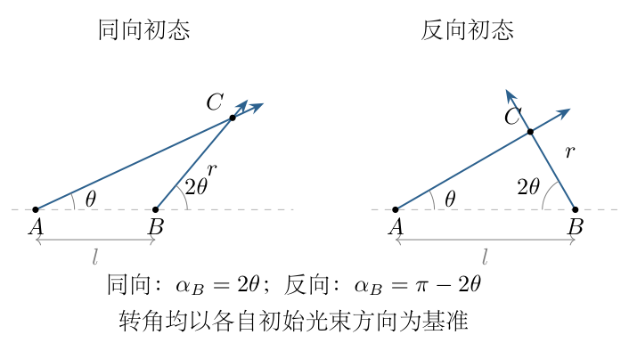
<!-- question-end -->

## 一、题型定位

由两条旋转射线确定交点的平面运动。已知的是灯塔光束的转动角，而不是人的轨迹、径向速度或加速度；先通过几何求交点位置，才能进行运动学计算。

两种初态在同一个时刻有相同的空间交点，却一般具有不同速度和加速度。判断运动不能仅凭一张位置图，也不能把光束角速度直接当作交点绕某个灯塔匀速转动的充分条件。

## 二、知识点

三角形正弦定理；有向光束与射线参数；极坐标速度及加速度；径向和横向分量的正交合成；复合函数求导；三角恒等式；退化几何的连续极限；Taylor展开；Cartesian坐标交叉检验。

极坐标中的径向坐标会随时间变化，通常有
$$v^2=\dot r^{\,2}+r^2\dot\alpha^{\,2}.$$
即使光束方向角 $\alpha$ 匀速变化，也不意味着 $\dot r=0$，更不意味着加速度只有向心分量。第二种初态恰好需要同时保留径向运动和横向运动。

## 三、物理图像

同向初态下，两束光的交点随后在 $B$ 外侧。$A$ 光束转动较慢，$B$ 光束转动较快，二者与 $AB$ 构成一个外角可直接化成相等内角的三角形。由此交点到 $B$ 的距离保持不变，实际轨迹是一段圆弧。

反向初态下，交点开始在 $A$、$B$ 之间，随后移向上方。交点到 $B$ 的距离不断变化：既有沿光束方向的径向运动，也有垂直于光束方向的运动。极坐标基底本身在顺时针转动，求导时必须计入这一变化。

初始共线时的“交点”看似可在整条直线上任取，但连续运动并不允许任取。后续两个方向角的比例会选出特定极限位置；若把另一个点硬接到轨迹上，会使位移不连续，无法满足有限速度要求。

## 四、解题入口

令 $A=(0,0)$、$B=(l,0)$，取水平向右为 $x$ 正方向、向上为 $y$ 正方向。以 $B$ 为极点，写
$$\boldsymbol r_C=l\boldsymbol e_x+r\boldsymbol e_r(\alpha).$$
先分情况求 $r(\theta)$ 和 $\alpha(\theta)$：
$$
\begin{aligned}
\text{同向初态：}&\quad \alpha=2\theta,\\
\text{反向初态：}&\quad \alpha=\pi-2\theta.
\end{aligned}
$$
随后用 $\dot\theta=\omega$ 将对 $\theta$ 的导数转换为时间导数，求出完整速度、加速度分量，再代入两个时刻。不能先把某个分量的绝对值当成总大小。

## 五、解析

（1）从两条射线的方程确定几何分支。

设交点到 $A$ 的距离为 $s$。沿 $A$ 光束有
$$x=s\cos\theta,\qquad y=s\sin\theta,\qquad s\ge0.$$
同向初态的 $B$ 光束给出
$$x=l+r\cos2\theta,\qquad y=r\sin2\theta,\qquad r\ge0.$$
反向初态则给出
$$x=l-r\cos2\theta,\qquad y=r\sin2\theta,\qquad r\ge0.$$
这里第二组的负号来自 $\cos(\pi-2\theta)=-\cos2\theta$，不是把距离 $r$ 取成负值。

在所求区间 $0<\theta\le\pi/4$，两种情形的射线参数均非负，因此确实是光束的交点，不只是两条无限直线的交点。以后进行极限时，始终使用这两个连续分支。

（2）同向初态的三角形关系。

同向情形中 $\angle A=\theta$，在 $B$ 处三角形内部夹角为 $\pi-2\theta$，故
$$
\angle C=\pi-\theta-(\pi-2\theta)=\theta.
$$
边 $BC=r$ 与边 $AB=l$ 所对内角都为 $\theta$。由正弦定理，
$$
\frac{r}{\sin\theta}=\frac{l}{\sin\theta}.
$$
对 $0<\theta\le\pi/4$，$\sin\theta\ne0$，约去后得到
$$\boxed{r=l.}$$
这一步先在非退化三角形中完成，再取 $\theta\to0$，不能在 $t=0$ 直接写 $0/0=1$。

以 $B$ 为圆心，交点位置为
$$
\boxed{\boldsymbol r_C=l\boldsymbol e_x+l\boldsymbol e_r(2\theta).}
$$
因而
$$x=l+l\cos2\theta,\qquad y=l\sin2\theta.$$
这两式可以直接看出圆方程
$$
(x-l)^2+y^2=l^2.
$$
图 1-2 同时表示反向初态；只有第一种情形的 $r$ 恒定，不能把第二种曲线也按圆周运动处理。

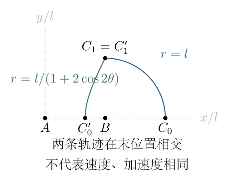

（3）推导极坐标的速度和加速度公式。

在固定Cartesian基底中，
$$
\boldsymbol e_r=\cos\alpha\,\boldsymbol e_x+\sin\alpha\,\boldsymbol e_y,
\qquad
\boldsymbol e_\alpha=-\sin\alpha\,\boldsymbol e_x+\cos\alpha\,\boldsymbol e_y.
$$
对时间求导，得到
$$
\dot{\boldsymbol e}_r=\dot\alpha\,\boldsymbol e_\alpha,
\qquad
\dot{\boldsymbol e}_\alpha=-\dot\alpha\,\boldsymbol e_r.
$$
速度不能只对 $r$ 求导。利用乘积求导法则，
$$
\begin{aligned}
\boldsymbol v
&=\frac{d}{dt}\bigl(r\boldsymbol e_r\bigr)\\
&=\dot r\,\boldsymbol e_r+r\dot\alpha\,\boldsymbol e_\alpha.
\end{aligned}
$$
再对两个分量分别求导：
$$
\begin{aligned}
\boldsymbol a
&=\ddot r\,\boldsymbol e_r+\dot r\dot\alpha\,\boldsymbol e_\alpha
+\dot r\dot\alpha\,\boldsymbol e_\alpha
+r\ddot\alpha\,\boldsymbol e_\alpha
-r\dot\alpha^2\,\boldsymbol e_r\\
&=(\ddot r-r\dot\alpha^2)\boldsymbol e_r
+(2\dot r\dot\alpha+r\ddot\alpha)\boldsymbol e_\alpha.
\end{aligned}
$$
两个相同的 $\dot r\dot\alpha$ 分别来自径向分量的基底转动和横向分量的大小变化。漏掉其中一项会使横向加速度少一半。

由于 $\boldsymbol e_r,\boldsymbol e_\alpha$ 正交且为单位矢量，
$$
\begin{aligned}
v&=\sqrt{\dot r^{\,2}+r^2\dot\alpha^2},\\
a&=\sqrt{(\ddot r-r\dot\alpha^2)^2+
(2\dot r\dot\alpha+r\ddot\alpha)^2}.
\end{aligned}
$$

（4）计算同向情形的两个时刻。

由 $r=l$、$\alpha=2\omega t$，
$$
\dot r=0,\quad\ddot r=0,\quad\dot\alpha=2\omega,\quad\ddot\alpha=0.
$$
于是
$$
\boldsymbol v=2l\omega\,\boldsymbol e_\alpha,
\qquad
\boldsymbol a=-4l\omega^2\,\boldsymbol e_r.
$$
大小均为常量：
$$\boxed{v=2l\omega,\qquad a=4l\omega^2.}$$

$t=0$ 时从连续轨迹取极限，$\alpha\to0$，所以
$$
C_0=(2l,0),\quad
\boldsymbol v_0=(0,2l\omega),\quad
\boldsymbol a_0=(-4l\omega^2,0).
$$
$t=\pi/(4\omega)$ 时 $\alpha=\pi/2$，所以
$$
C_1=(l,l),\quad
\boldsymbol v_1=(-2l\omega,0),\quad
\boldsymbol a_1=(0,-4l\omega^2).
$$
因此第一问答案为
$$
\boxed{
r_0=r_1=l,\quad
v_0=v_1=2l\omega,\quad
a_0=a_1=4l\omega^2.
}
$$
加速度方向随时间变化，只有其大小不变。

（5）反向初态的正弦定理与三倍角化简。

反向情形的三角形内角为
$$
\angle A=\theta,\qquad
\angle B=2\theta,\qquad
\angle C=\pi-3\theta.
$$
因此
$$
\frac r{\sin\theta}=\frac l{\sin(\pi-3\theta)}
=\frac l{\sin3\theta},
$$
得到
$$r=l\frac{\sin\theta}{\sin3\theta}.$$
使用三倍角公式，而不是在 $\theta=0$ 直接相除：
$$
\begin{aligned}
\sin3\theta
&=3\sin\theta-4\sin^3\theta\\
&=\sin\theta(3-4\sin^2\theta)\\
&=\sin\theta(1+2\cos2\theta).
\end{aligned}
$$
故在所求区间内，
$$\boxed{r(\theta)=\frac l{1+2\cos2\theta}.}$$
分母在 $0\le\theta\le\pi/4$ 由 $3$ 降到 $1$，始终非零，距离、速度和加速度均有限。更远处 $\theta\to\pi/3$ 会出现交点趋向无穷远，不能把该公式无条件延伸为全时间有限运动。

（6）对变半径作两次求导。

记
$$D(\theta)=1+2\cos2\theta.$$
因 $\dot\theta=\omega$，
$$
\dot D=-4\omega\sin2\theta,\qquad
\ddot D=-8\omega^2\cos2\theta.
$$
第一次求导：
$$
\begin{aligned}
\dot r
&=-lD^{-2}\dot D\\
&=\frac{4l\omega\sin2\theta}{D^2}.
\end{aligned}
$$
第二次求导既要对正弦求导，也要对 $D^{-2}$ 求导：
$$
\begin{aligned}
\ddot r
&=4l\omega\left[
\frac{2\omega\cos2\theta}{D^2}
-\frac{2\sin2\theta\,\dot D}{D^3}\right]\\
&=\frac{8l\omega^2\cos2\theta}{D^2}
+\frac{32l\omega^2\sin^22\theta}{D^3}.
\end{aligned}
$$
反向光束方向为 $\alpha=\pi-2\theta$，故
$$\dot\alpha=-2\omega,\qquad\ddot\alpha=0.$$
负号表示基底顺时针转动。图 1-3 所示的径向与横向分量与以上约定一致；后续速度和加速度的合成正是这两个正交方向的平方和。

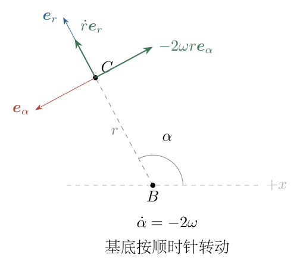

于是
$$
\boxed{
\begin{aligned}
\boldsymbol v&=\dot r\,\boldsymbol e_r-2\omega r\,\boldsymbol e_\alpha,\\
\boldsymbol a&=(\ddot r-4\omega^2r)\boldsymbol e_r
-4\omega\dot r\,\boldsymbol e_\alpha.
\end{aligned}}
$$
后一个横向分量的负号必须保留。虽然求大小时它会被平方，方向分析与Cartesian检验仍需要这个符号。

（7）计算反向情形的初始极限。

$\theta\to0$ 时，
$$D\to3,\qquad\sin2\theta\to0,\qquad\cos2\theta\to1.$$
逐项代入：
$$
r'_0=\frac l3,\qquad
\dot r(0)=0,\qquad
\ddot r(0)=\frac{8l\omega^2}{9}.
$$
速度的径向分量为零，横向分量为 $-2\omega l/3$，因此
$$\boxed{v'_0=\frac{2l\omega}{3}.}$$
加速度的径向分量不能只取 $\ddot r$：
$$
\begin{aligned}
a_r(0)
&=\frac{8l\omega^2}{9}-4\omega^2\frac l3\\
&=-\frac{4l\omega^2}{9},
\qquad a_\alpha(0)=0.
\end{aligned}
$$
故
$$\boxed{a'_0=\frac{4l\omega^2}{9}.}$$
此时 $\boldsymbol e_r=-\boldsymbol e_x$、$\boldsymbol e_\alpha=-\boldsymbol e_y$，所以实际位置和矢量为
$$
C'_0=(2l/3,0),\quad
\boldsymbol v'_0=(0,2l\omega/3),\quad
\boldsymbol a'_0=(4l\omega^2/9,0).
$$
负的径向加速度在此指向右方，不能直接说“加速度向左”。

（8）计算反向情形的第二个时刻。

$t=\pi/(4\omega)$ 时 $\theta=\pi/4$，
$$
D=1,\quad\sin2\theta=1,\quad\cos2\theta=0.
$$
逐项得到
$$
r'_1=l,\qquad\dot r=4l\omega,\qquad\ddot r=32l\omega^2.
$$
于是
$$
v'_1
=\sqrt{(4l\omega)^2+(2l\omega)^2}
=\boxed{2\sqrt5\,l\omega}.
$$
加速度分量为
$$
\begin{aligned}
a_r&=32l\omega^2-4l\omega^2=28l\omega^2,\\
a_\alpha&=-4\omega(4l\omega)=-16l\omega^2.
\end{aligned}
$$
平方和化简：
$$
\begin{aligned}
a'_1
&=l\omega^2\sqrt{28^2+16^2}\\
&=l\omega^2\sqrt{784+256}\\
&=l\omega^2\sqrt{1040}\\
&=\boxed{4\sqrt{65}\,l\omega^2}.
\end{aligned}
$$
此时 $\alpha=\pi/2$，所以
$$
C'_1=(l,l),\quad
\boldsymbol v'_1=(2l\omega,4l\omega),\quad
\boldsymbol a'_1=(16l\omega^2,28l\omega^2).
$$
位置虽然与第一问相同，速度和加速度却不同。

（9）用Cartesian坐标独立核对反向情形。

代入 $r=l/D$，位置为
$$
x=l-\frac{l\cos2\theta}{D},
\qquad
y=\frac{l\sin2\theta}{D}.
$$
第一式写成
$$x=l\frac{1+\cos2\theta}{1+2\cos2\theta}.$$
直接用商法则求导：
$$
\begin{aligned}
\dot x
&=l\frac{(-2\omega\sin2\theta)D
-(1+\cos2\theta)(-4\omega\sin2\theta)}{D^2}\\
&=\frac{2l\omega\sin2\theta}{D^2},\\
\dot y
&=l\frac{2\omega\cos2\theta\,D
+4\omega\sin^22\theta}{D^2}\\
&=\frac{2l\omega(\cos2\theta+2)}{D^2}.
\end{aligned}
$$
最后一步使用 $\cos^22\theta+\sin^22\theta=1$。再求导：
$$
\begin{aligned}
\ddot x
&=\frac{4l\omega^2\cos2\theta}{D^2}
+\frac{16l\omega^2\sin^22\theta}{D^3},\\
\ddot y
&=-\frac{4l\omega^2\sin2\theta}{D^2}
+\frac{16l\omega^2(\cos2\theta+2)\sin2\theta}{D^3}.
\end{aligned}
$$
$t=0$ 时分别为 $(4l\omega^2/9,0)$；$\theta=\pi/4$ 时分别为 $(16l\omega^2,28l\omega^2)$，与极坐标计算一致。

（10）用小时间展开解释唯一连续起点。

反向情形中，
$$
\cos2\theta=1-2\theta^2+O(\theta^4),
\quad
\sin2\theta=2\theta+O(\theta^3).
$$
由
$$
D=3-4\theta^2+O(\theta^4),
\qquad
\frac1D=\frac13+\frac49\theta^2+O(\theta^4),
$$
得
$$
\begin{aligned}
x&=\frac{2l}{3}+\frac{2l}{9}\theta^2+O(\theta^4),\\
y&=\frac{2l}{3}\theta+O(\theta^3).
\end{aligned}
$$
将 $\theta=\omega t$ 代入，与
$$\boldsymbol r(t)=\boldsymbol r(0)+\boldsymbol v(0)t+
\frac12\boldsymbol a(0)t^2+\cdots$$
逐项比较，正好恢复 $C'_0,\boldsymbol v'_0,\boldsymbol a'_0$。这是从初始退化图形到有限运动的具体桥梁，不是任意补一个起点。

同向情形类似：
$$
x=2l-2l\omega^2t^2+O(t^4),
\qquad
y=2l\omega t+O(t^3).
$$
也恢复第一问的初始速度、加速度。图 1-4 将两个初始位置与共同的末位置并置，强调同一末位置不意味着同一运动状态。

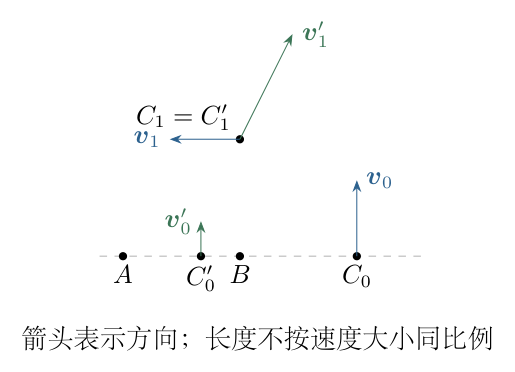

（11）汇总结果与量纲检查。

$$
\boxed{
\begin{aligned}
&r_0=r_1=l,\quad v_0=v_1=2l\omega,\quad a_0=a_1=4l\omega^2;\\
&r'_0=l/3,\quad r'_1=l,\\
&v'_0=2l\omega/3,\quad v'_1=2\sqrt5\,l\omega,\\
&a'_0=4l\omega^2/9,\quad a'_1=4\sqrt{65}\,l\omega^2.
\end{aligned}}
$$
$l\omega$ 的量纲是速度，$l\omega^2$ 的量纲是加速度。$\omega\to0$ 时两者分别趋于零；$l$ 加倍而角度变化不变时，全部距离、速度和加速度都加倍。反向情形初始径向速度为零，但径向二阶导数不为零，所以不能凭初始 $\dot r=0$ 判断其以后为定半径运动。

\newpage

# 第 2 题

<!-- question-start -->
一根均匀橡皮筋的原长为 $l_0$，横截面积为 $S$，在小伸长范围内的劲度系数为 $k=F/x$，其中 $F$ 为拉力，$x$ 为伸长量。同种材料的杨氏模量记为 $E$。

（1）将两根这样的橡皮筋并联，求等效劲度系数 $k_1$。再将这组并联橡皮筋与第三根同样的橡皮筋通过不可伸长轻绳连接，轻绳绕过光滑、质量可忽略的动滑轮；两侧弹性元件的另一端固定，沿滑轮轴施加拉力 $F$。求以滑轮轴位移为伸长量的系统劲度系数 $k_2$。

（2）用 $l_0,S,x,F$ 写出表征材料本身性质的杨氏模量 $E$。

（3）将六根原长为 $l_0/3$、截面积为 $S$ 的同种橡皮筋，分别三根并联成 $A$ 段、两根并联成 $B$ 段、一根成 $C$ 段，再把三段串联。求拉力 $F$ 下的 $\Delta l_A$、总伸长量 $\Delta l_1$ 及等效劲度系数 $k_3$。

（4）另制一根原长为 $l_0$ 的同种橡皮筋，截面积从一端的 $S_1$ 线性变化至另一端的 $S_2$，其中 $S_2>S_1>0$。求其等效劲度系数 $k_4$，用 $k,S,S_1,S_2$ 表示。可使用 $\int_a^b dx/x=\ln(b/a)$。

（5）该材料密度为 $\rho$。将（4）中的变截面橡皮筋以 $S_1$ 端悬挂，$S_2$ 端自由，在自重下达到静力平衡。若总伸长不大，求伸长量 $\Delta l$。重力加速度为 $g$。

校订说明：第（5）问所指变截面橡皮筋为第（4）问；伸长量还依赖 $\rho,g$，不能因参数列表漏列而将它们省去。各问均采用小应变、线性弹性、未伸长截面及未伸长长度计算，忽略轻绳伸长和滑轮质量。$k_2$ 对应滑轮轴的力—位移关系，不是只求两弹性段串联的劲度系数。

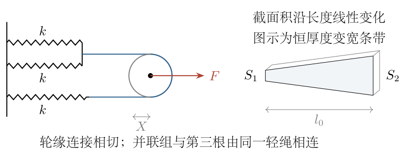
<!-- question-end -->

## 一、题型定位

线性弹性中的几何缩放、离散串并联与连续变截面杆。前面用等效劲度系数处理有限个弹性元件；后面把每个长度微元视为串联弹性元件，累加其柔度而非劲度。

动滑轮题同时存在受力与位移变换：轴上拉力是两股绳张力的合力，轴位移又要由两段弹性伸长之和决定。自重问题中拉力随位置变化，不能把整根橡皮筋的重量当作每一个微元的拉力。

## 二、知识点

Hooke定律；并联同位移与串联同拉力；动滑轮力平衡和不可伸长绳长约束；应力与应变；杨氏模量；刚度与柔度；变截面微元积分；重力载荷积分；小变形近似；对数积分；同截面极限及量纲检查。

材料模量 $E$ 的单位为压强，劲度系数的单位为力除以长度。两根同种材料的橡皮筋，若几何尺寸不同，通常有不同的 $k$；不能把材料模量与构件刚度混为同一物理量。

## 三、物理图像

并联元件的两端共同移动，因此各自伸长相同，弹力相加。串联元件的中间连接不承受额外外力，因此每段承受同样的拉力，伸长相加。绕动滑轮后，输入端在轴上，输出的两股绳既分担力，又共同提供轴的位移，等效刚度会比纯串联结果大。

变截面杆没有一段可代表全杆。较细处应力大、单位长度伸长大；粗细各段承受相同外拉力时，较细段对柔度贡献更大。在自重下，还需同时考虑“此处有多细”和“此处下面有多重”：上端细且承担全部重量，通常是小应变条件最容易失效的位置。

## 四、解题入口

先建立统一关系
$$E=\frac{F/S}{x/l_0},\qquad k=\frac{ES}{l_0}.$$
随后用此式确定每个短段的刚度。对动滑轮，另设绳张力 $T$、轴位移 $X$，分别写 $F=2T$ 与 $\delta_A+\delta_C=2X$。

对变截面橡皮筋，从 $S_1$ 端取未伸长长度坐标 $s$：
$$S(s)=S_1+\frac{S_2-S_1}{l_0}s,\qquad 0\le s\le l_0.$$
外拉力问题写 $d(\Delta l)=F\,ds/[ES(s)]$；自重问题先由下段重量求内部拉力 $N(s)$，再把 $F$ 换成 $N(s)$ 进行积分。

## 五、解析

（1）两根完整橡皮筋并联。

设并联系统两端相对位移为 $x$。每根伸长都是 $x$，各自弹力为 $kx$，总弹力为
$$F_{\parallel}=kx+kx=2kx.$$
按输入力与共同位移定义劲度系数，
$$\boxed{k_1=\frac{F_{\parallel}}x=2k.}$$
这里没有把伸长相加，因为两根同时跨接在同一对端点上；几何上它们不是首尾连接。

（2）动滑轮的受力平衡。

用 $T$ 表示不可伸长轻绳中的张力。轻绳、动滑轮质量可忽略且接触光滑，准静态时两股绳的张力相同。两股绳平行，都向固定端拉动滑轮。轴上的外拉力与其平衡：
$$F-T-T=0.$$
因此
$$\boxed{T=F/2.}$$
并联组所承受的总拉力为 $T$，第三根所承受的拉力也为 $T$。并联组内部的两根才进一步各分担 $T/2$，不能误把每根并联橡皮筋都看成承受 $F/2$。

图 2-2 的绳线与轮缘相切，张力作用于两股绳的切向连接；$F$ 作用于滑轮轴。后续轴的力平衡使用的是这两个平行张力的合力。

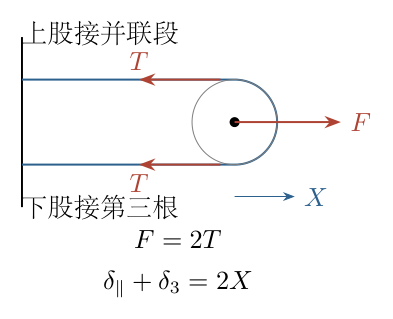

（3）动滑轮的位移约束和系统刚度。

设并联组伸长为 $\delta_{\parallel}$，第三根伸长为 $\delta_3$，滑轮轴向右移动 $X$。弹性元件的固定端不动；每一股从弹性元件右端到轮缘的绳段，长度变化分别为
$$X-\delta_{\parallel},\qquad X-\delta_3.$$
绕轮的半圆弧长度不变。轻绳总长度不变，故
$$
(X-\delta_{\parallel})+(X-\delta_3)=0,
$$
即
$$\boxed{\delta_{\parallel}+\delta_3=2X.}$$
由各自力—位移关系，
$$
\delta_{\parallel}=\frac{T}{2k},\qquad
\delta_3=\frac Tk.
$$
代入 $T=F/2$，
$$
\begin{aligned}
2X
&=\frac{F}{4k}+\frac{F}{2k}\\
&=\frac{3F}{4k},\\
X&=\frac{3F}{8k}.
\end{aligned}
$$
所以
$$\boxed{k_2=\frac FX=\frac{8k}{3}.}$$
若只把两弹性段按纯串联处理，会得到 $2k/3$；那是以两段总伸长为位移、以绳张力为力定义的另一个端口，不是本问轴上的 $F/X$。

还可用虚功检查倍数：一小段过程中 $F\,dX=T\,d\delta_{\parallel}+T\,d\delta_3$，由伸长和为 $2dX$ 得到 $F=2T$，与受力分析一致。

（4）从应力和应变定义杨氏模量。

拉伸应力与纵向应变分别为
$$\sigma=\frac FS,\qquad\varepsilon=\frac x{l_0}.$$
在线性小应变范围内，$\sigma=E\varepsilon$，因而
$$
\boxed{E=\frac{\sigma}{\varepsilon}
=\frac{Fl_0}{Sx}=\frac{kl_0}{S}.}
$$
这不是把 $E$ 定义为 $F/x$。应力通过除以截面积消除横向尺寸影响，应变通过除以原长消除纵向尺寸影响，二者之比才是材料参数。

由该式反解均匀杆刚度：
$$\boxed{k_{\rm rod}=\frac{E S_{\rm rod}}{L_{\rm rod}}.}$$
同截面积下长度缩为原来的三分之一，劲度系数增加至三倍；同长度下截面积增加至三倍，劲度系数也增加至三倍。

（5）第（3）问每根短橡皮筋的刚度。

每根原长 $l_0/3$，截面积仍为 $S$：
$$
k_{\rm short}=\frac{ES}{l_0/3}
=3\frac{ES}{l_0}=3k.
$$
三个并联组的刚度因此是
$$
k_A=3(3k)=9k,\qquad
k_B=2(3k)=6k,\qquad
k_C=3k.
$$
注意先把每根“缩短”的影响计入，再处理并联数量。只数三、二、一根而写 $3k,2k,k$，会把全部伸长算大三倍。

图 2-3 中三段串联，中间连接处没有其他外力，故三段总拉力都是 $F$；段内每根分担的力不同，但段伸长由该段总刚度确定。

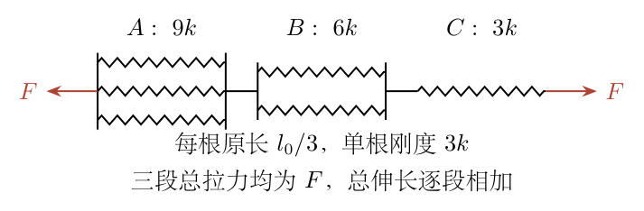

（6）逐段求伸长并相加。

串联各段拉力相同：
$$
\boxed{\Delta l_A=\frac F{9k}},\qquad
\Delta l_B=\frac F{6k},\qquad
\Delta l_C=\frac F{3k}.
$$
总伸长为
$$
\begin{aligned}
\Delta l_1
&=\frac F{9k}+\frac F{6k}+\frac F{3k}\\
&=\frac F{18k}(2+3+6)\\
&=\boxed{\frac{11F}{18k}}.
\end{aligned}
$$
因此
$$\boxed{k_3=\frac F{\Delta l_1}=\frac{18k}{11}.}$$
$C$ 段虽然只有一根，却比 $A$ 段贡献更大的伸长；最软段控制串联系统的柔度。这也解释为什么不能把 $9k+6k+3k$ 当作串联刚度。

（7）变截面杆的微元伸长。

令
$$a=S_1,\qquad b=S_2,\qquad d_S=b-a>0.$$
这里 $a,b$ 只是积分中便于书写的面积记号，不是长度。未伸长截面积为
$$S(s)=a+\frac{d_S}{l_0}s.$$
对 $[s,s+ds]$ 的微小均匀段，它的局部刚度为
$$k_{\rm elem}=\frac{E S(s)}{ds}.$$
外部拉力 $F$ 沿串联系统传递不变，微元伸长为
$$d(\Delta l)=\frac F{k_{\rm elem}}=\frac{F}{E}\frac{ds}{S(s)}.$$
图 2-4 表示截面积线性变化的杆与串联微元。微元较细处在同一个 $F$ 下产生更大的伸长，积分中应出现 $1/S(s)$ 而不是 $S(s)$。

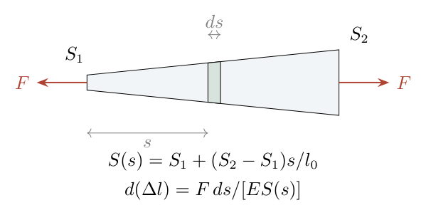

（8）完成柔度积分并求 $k_4$。

总伸长为
$$
\Delta l_F=\frac FE\int_0^{l_0}
\frac{ds}{a+d_Ss/l_0}.
$$
换元 $u=a+d_Ss/l_0$，有
$$ds=\frac{l_0}{d_S}du.$$
上下限 $s=0,l_0$ 分别对应 $u=a,b$，所以
$$
\begin{aligned}
\Delta l_F
&=\frac{Fl_0}{E d_S}\int_a^b\frac{du}{u}\\
&=\frac{Fl_0}{E(b-a)}\ln\frac ba.
\end{aligned}
$$
用 $E=kl_0/S$ 消去材料模量：
$$
\Delta l_F=\frac{FS}{k(S_2-S_1)}
\ln\frac{S_2}{S_1}.
$$
故
$$
\boxed{
k_4=\frac{k(S_2-S_1)}{S\ln(S_2/S_1)}.
}
$$
对数中的比值必须无量纲。$\ln S_2-\ln S_1$ 只能作为 $\ln(S_2/S_1)$ 的代数简写，不能把有量纲面积直接作为最终对数自变量。

由 $a\le S(s)\le b$，
$$
\frac{l_0}{b}\le\int_0^{l_0}\frac{ds}{S(s)}\le\frac{l_0}{a}.
$$
取倒数并乘以 $E$，可得
$$
\frac{Ea}{l_0}\le k_4\le\frac{Eb}{l_0}.
$$
变截面杆的刚度位于两根同长度、分别使用最细与最粗截面积的均匀杆刚度之间。

（9）自重情况下先求内部拉力。

从上端 $S_1$ 向下取坐标 $s$，$s=l_0$ 是自由下端。考虑截面 $s$ 以下的整段杆：上方杆对它施加向上的拉力 $N(s)$，其余竖直外力是下段重量，故
$$
N(s)=\rho g\int_s^{l_0}S(\xi)\,d\xi.
$$
逐项积分：
$$
\begin{aligned}
N(s)
&=\rho g\int_s^{l_0}
\left(a+\frac{d_S}{l_0}\xi\right)d\xi\\
&=\rho g\left[
a(l_0-s)+\frac{d_S}{2l_0}(l_0^2-s^2)
\right].
\end{aligned}
$$
特别地，
$$
N(l_0)=0,\qquad
N(0)=\rho g l_0\frac{a+b}{2}.
$$
上端拉力恰为全杆重量，自由端拉力为零；这是积分边界的直接物理检验。

图 2-5 的截面处拉力由下方阴影段的重量确定。后续微元伸长用 $N(s)$，不能用固定的 $N(0)$ 代替每一个截面的拉力。

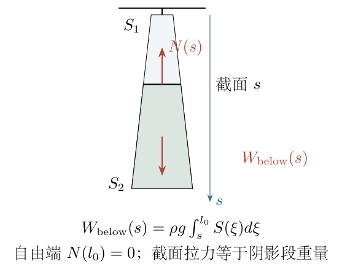

（10）把自重拉力改写为截面积变量。

沿用
$$u=a+\frac{d_S}{l_0}s,\qquad ds=\frac{l_0}{d_S}du.$$
在坐标 $\xi$ 上的面积记为 $v$，则 $d\xi=(l_0/d_S)dv$，下段重量更方便写成
$$
\begin{aligned}
N(u)
&=\frac{\rho g l_0}{d_S}\int_u^b v\,dv\\
&=\boxed{\frac{\rho g l_0}{2d_S}(b^2-u^2)}.
\end{aligned}
$$
把 $u=a$ 代入，得到
$$
N(a)=\frac{\rho g l_0(b^2-a^2)}{2(b-a)}
=\rho g l_0\frac{a+b}{2},
$$
与前面的全杆重量相同。换元不会改变力，只是避免把两个含 $s$ 的多项式相除。

（11）完成自重伸长积分。

局部应变为 $N(s)/[ES(s)]$，所以
$$
\Delta l=\int_0^{l_0}\frac{N(s)}{E S(s)}\,ds.
$$
换元并代入：
$$
\begin{aligned}
\Delta l
&=\int_a^b
\frac{\rho g l_0(b^2-u^2)}{2E d_S\,u}
\frac{l_0}{d_S}\,du\\
&=\frac{\rho g l_0^2}{2E d_S^2}
\int_a^b\left(\frac{b^2}{u}-u\right)du\\
&=\frac{\rho g l_0^2}{2E(b-a)^2}
\left[b^2\ln\frac ba-\frac{b^2-a^2}{2}\right].
\end{aligned}
$$
最后消去 $E$：
$$
\boxed{
\Delta l=
\frac{\rho g l_0 S}{2k(S_2-S_1)^2}
\left[
S_2^2\ln\frac{S_2}{S_1}
-\frac{S_2^2-S_1^2}{2}
\right].
}
$$
这里必须保留 $\rho g$；否则不仅会失去自重来源，量纲也不可能是长度。密度越大、重力越强时伸长越大，符合物理预期。

括号为正可由积分直接看出：在 $a\le u\le b$，
$$\frac{b^2}{u}-u=\frac{b^2-u^2}{u}\ge0.$$
所以 $\Delta l\ge0$，不必靠模糊的“对数比较”猜符号。

（12）检验同截面极限，避免形式上的 $0/0$。

令 $b=a+\delta$，$\eta=\delta/a$，取 $\eta\to0^+$。第（4）问用
$$\ln(1+\eta)=\eta-\frac{\eta^2}{2}+O(\eta^3)$$
得到
$$
k_4=\frac{k a}{S}\frac{\eta}{\ln(1+\eta)}
\longrightarrow\frac{ka}{S}
=\frac{Ea}{l_0}.
$$
这是同长度、截面积为 $a$ 的均匀杆刚度。

自重公式的括号需要展开到二阶，不能只留对数的一阶项：
$$
\begin{aligned}
b^2\ln(b/a)
&=a^2(1+2\eta+\eta^2)
\left(\eta-\frac{\eta^2}{2}+O(\eta^3)\right)\\
&=a^2\left(\eta+\frac32\eta^2+O(\eta^3)\right),\\
\frac{b^2-a^2}{2}
&=a^2\left(\eta+\frac12\eta^2\right).
\end{aligned}
$$
相减后，
$$
b^2\ln(b/a)-\frac{b^2-a^2}{2}
=a^2\eta^2+O(\eta^3)=\delta^2+O(\delta^3/a).
$$
因此
$$
\boxed{\Delta l\longrightarrow\frac{\rho g l_0^2}{2E}
=\frac{\rho g l_0 S}{2k}.}
$$
同截面均匀悬杆的单位长度重量与截面积同时增大，应力保持 $\rho g(l_0-s)$，所以这个自重伸长与实际截面积 $a$ 无关；这里的 $S/k=l_0/E$ 只是材料模量的替代表达。

<!-- KEEP_STUDENT_START -->
（13）用均匀杆直接积分核对一半系数。

均匀杆截面积为 $a$ 时，
$$N(s)=\rho g a(l_0-s).$$
微元伸长为
$$d(\Delta l)=\frac{\rho g(l_0-s)}E\,ds.$$
因此
$$
\Delta l=\frac{\rho g}{E}\int_0^{l_0}(l_0-s)\,ds
=\frac{\rho g l_0^2}{2E}.
$$
若把全杆重量 $W=\rho g a l_0$ 作为固定端拉力，得到 $Wl_0/(Ea)=\rho g l_0^2/E$，恰好大一倍。原因是实际内部拉力从上端的 $W$ 线性减到下端的零，并非处处等于 $W$。

（14）量纲和小应变条件。

$E$ 的单位为 $\mathrm{N/m^2}$，$\rho g l_0^2/E$ 的单位为长度。第（4）问 $(S_2-S_1)/[S\ln(S_2/S_1)]$ 无量纲，所以 $k_4$ 与 $k$ 具有相同单位。

自重下局部应变
$$\varepsilon(s)=\frac{N(s)}{E S(s)}.$$
上端拉力最大、面积最小，故其最大值在 $s=0$：
$$
\varepsilon_{\max}
=\frac{\rho g l_0(S_1+S_2)}{2E S_1}\ll1.
$$
除了总伸长较小，还应检查这个局部条件。若最细上端已进入非线性大应变区，前面的线性积分不能继续无条件适用。所有结果以小变形模型为前提，不把真实橡胶的非线性变形隐藏在常量 $E$ 中。
<!-- KEEP_STUDENT_END -->

\newpage

# 第 3 题

<!-- question-start -->
一个蓄电池的电动势为 $V_0$，内阻为 $r>0$。现用它给若干个相同的灯泡供电，每个灯泡的电阻均为 $R>0$，且视为与温度无关。灯泡采用并联连接。

（1）接入 $N$ 个灯泡时，求全部灯泡消耗的总功率。

（2）实验发现，接入 $5$ 个灯泡时，全部灯泡的总功率最大。确定电池内阻 $r$ 的范围，并说明允许并列最大值与要求唯一最大值时，范围端点如何取舍。

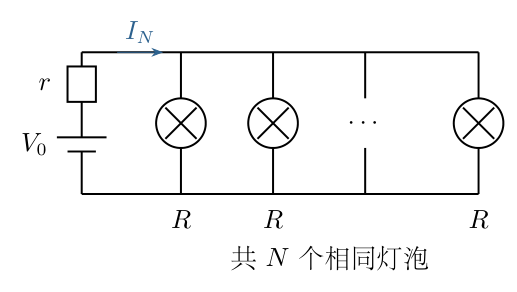
<!-- question-end -->

## 一、题型定位

电源内阻不可忽略的最大输出功率问题。负载不是一个任意可调的连续电阻，而是由正整数个相同灯泡组成。第（1）问需区分电源总电流与单个灯泡电流；第（2）问需比较整数负载，不能直接把连续函数的驻点当成实验结论。

## 二、知识点

并联电阻；含内阻电源的闭合电路欧姆定律；负载功率与内阻损耗；离散函数的相邻项比较；正数不等式的等价变形；最大功率匹配；端点处的简并最大值。

电池用恒定电动势与串联内阻的模型表示。这里不计灯丝温度引起的电阻变化，也不讨论电池电动势随放电时间的变化；否则 $R$、$V_0$ 不再是比较各次实验时相同的参数。

## 三、物理图像

增加灯泡数会降低并联负载电阻，使电池总电流增加。但内阻上的电压降也随之增大，所有灯泡得到的端电压同时下降。总功率是“灯泡数增加”与“每个灯泡功率下降”两种作用的结果，既不会始终增加，也不能仅从某一个灯泡的亮度判断。

少量灯泡对应大负载电阻，电池电流小；大量灯泡对应小负载电阻，电池大部分电动势降落在内阻上。两端的总输出功率均小，中间有一个峰值。

## 四、解题入口

先将 $N$ 个灯泡合成为 $R/N$，求出电源总电流 $I_N$ 和端电压 $U_N$，再求负载总功率 $P_N$。在第二问中比较 $P_5$ 与 $P_4,P_6$，随后证明这两个比较足以排除其余所有正整数，而不只是一个局部经验判断。

## 五、解析

（1）并联负载的等效电阻。

各灯泡两端的电压相同，记为 $U_N$。每一支路的电流为 $U_N/R$，总电流为
$$I_N=N\frac{U_N}{R}.$$
因此负载的等效电阻满足
$$R_{\mathrm L}=\frac{U_N}{I_N}=\frac RN.$$
这个电阻只包括灯泡，不包括电池内阻。将内阻与负载一起考虑，闭合回路给出
$$V_0=I_Nr+U_N=I_N\left(r+\frac RN\right).$$
解出总电流：
$$\boxed{I_N=\frac{V_0}{r+R/N}=\frac{NV_0}{R+Nr}.}$$
再求端电压，而不是把电动势直接当成灯泡电压：
$$\begin{aligned}
U_N&=I_N\frac RN\\
&=\frac{NV_0}{R+Nr}\frac RN\\
&=\boxed{\frac{V_0R}{R+Nr}}.
\end{aligned}$$
在图 3-2 中，$I_N$ 流过内阻与整个负载；各灯泡电流是 $I_N/N$。图中的 $U_N$ 正是下式计算功率时使用的电压。

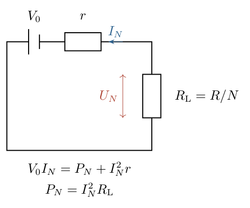

（2）全部灯泡的总功率。

每个灯泡的功率为
$$p_N=\frac{U_N^2}{R}=\frac{V_0^2R}{(R+Nr)^2}.$$
全部 $N$ 个灯泡的总功率是其 $N$ 倍：
$$\boxed{P_N=Np_N=\frac{NV_0^2R}{(R+Nr)^2}.}$$
也可从等效电阻计算，检查是否多乘或少乘一个 $N$：
$$\begin{aligned}
I_N^2R_{\mathrm L}
&=\frac{N^2V_0^2}{(R+Nr)^2}\frac RN\\
&=\frac{NV_0^2R}{(R+Nr)^2}.
\end{aligned}$$
两种计算给出同一个总功率。题目所比较的是 $P_N$，不是单个灯泡的 $p_N$。后者随 $N$ 增大单调下降，因为分母不断增大。

（3）明确电源总功率、输出功率与损耗的区别。

电源将其他形式能量转化为电能的速率为
$$P_{\mathrm{source}}=V_0I_N=\frac{NV_0^2}{R+Nr}.$$
内阻上转化为热的功率为
$$P_{\mathrm{loss}}=I_N^2r=\frac{N^2V_0^2r}{(R+Nr)^2}.$$
相加可直接检查能量分配：
$$\begin{aligned}
P_N+P_{\mathrm{loss}}
&=\frac{NV_0^2R+N^2V_0^2r}{(R+Nr)^2}\\
&=\frac{NV_0^2(R+Nr)}{(R+Nr)^2}\\
&=P_{\mathrm{source}}.
\end{aligned}$$
所以最大灯泡功率不等于最大电源总功率。理想化模型中，$P_{\mathrm{source}}$ 随 $N$ 增大趋近 $V_0^2/r$，但输出给灯泡的功率反而趋于零。

（4）先看连续模型的峰值，再说明其局限。

暂把 $N$ 视为连续正数，对总功率求导。利用乘积及复合函数求导，
$$\begin{aligned}
\frac{dP}{dN}
&=V_0^2R\frac{d}{dN}\left[N(R+Nr)^{-2}\right]\\
&=V_0^2R\left[(R+Nr)^{-2}-2Nr(R+Nr)^{-3}\right]\\
&=\frac{V_0^2R(R-Nr)}{(R+Nr)^3}.
\end{aligned}$$
分母为正，故在 $N<R/r$ 时递增，在 $N>R/r$ 时递减；连续峰值为
$$N_{\mathrm c}=\frac Rr,\qquad R_{\mathrm L}=r.$$
峰值高度是
$$P_{\mathrm c}=\frac{(R/r)V_0^2R}{(2R)^2}=\frac{V_0^2}{4r}.$$
但是灯泡数必须是正整数。实验说 $N=5$ 最大，并不等于 $N_{\mathrm c}=5$；可能连续峰值位于 $5$ 的左侧或右侧，取整后的最大值仍在 $5$。还不能简单用四舍五入确定整数最优值，因为峰值两侧不是关于 $N_{\mathrm c}$ 对称的曲线。

（5）将实验结论转换为第一个相邻比较。

允许与其他灯泡数并列最大时，必须有
$$P_5\ge P_4.$$
代入功率表达式，消去正因子 $V_0^2R$：
$$\frac5{(R+5r)^2}\ge\frac4{(R+4r)^2}.$$
两分母都为正，可以交叉相乘而不改变不等号方向：
$$5(R+4r)^2\ge4(R+5r)^2.$$
逐项展开，以免遗漏交叉项：
$$\begin{aligned}
5(R^2+8Rr+16r^2)&\ge4(R^2+10Rr+25r^2),\\
5R^2+40Rr+80r^2&\ge4R^2+40Rr+100r^2,\\
R^2&\ge20r^2.
\end{aligned}$$
由于 $R,r$ 均正，开平方得到
$$r\le\frac R{\sqrt{20}}.$$
交叉项的消去并非略去内阻与负载的耦合，而是相邻整数比较的精确代数结果。

（6）第二个相邻比较。

同理必须有 $P_5\ge P_6$，于是
$$\frac5{(R+5r)^2}\ge\frac6{(R+6r)^2}.$$
交叉相乘并展开：
$$\begin{aligned}
5(R+6r)^2&\ge6(R+5r)^2,\\
5R^2+60Rr+180r^2&\ge6R^2+60Rr+150r^2,\\
30r^2&\ge R^2.
\end{aligned}$$
因此
$$r\ge\frac R{\sqrt{30}}.$$
合并这两个必要条件：
$$\boxed{\frac R{\sqrt{30}}\le r\le\frac R{\sqrt{20}}.}$$
现在仍需证明：在此区间内，$N=1,2,3,7,8,\ldots$ 不可能给出更大的功率。

（7）证明相邻项比较对全部整数有效。

对任意正整数 $N$，计算相邻项的差：
$$\begin{aligned}
P_{N+1}-P_N
&=V_0^2R\left[\frac{N+1}{(R+(N+1)r)^2}-\frac N{(R+Nr)^2}\right]\\
&=V_0^2R\frac{(N+1)(R+Nr)^2-N(R+(N+1)r)^2}
{(R+Nr)^2(R+(N+1)r)^2}.
\end{aligned}$$
将分子独立展开：
$$\begin{aligned}
&(N+1)[R^2+2NRr+N^2r^2]\\
&\quad-N[R^2+2(N+1)Rr+(N+1)^2r^2]\\
&=R^2+0\cdot Rr+\big[N^2(N+1)-N(N+1)^2\big]r^2\\
&=R^2-N(N+1)r^2.
\end{aligned}$$
所有未写入最后一行的因子均严格为正，因此
$$\operatorname{sgn}(P_{N+1}-P_N)=\operatorname{sgn}\big[R^2-N(N+1)r^2\big].$$
当 $1\le N\le4$ 时，$N(N+1)\le20$，而所得范围保证 $R^2\ge20r^2$，所以这些相邻差均非负。于是
$$P_1\le P_2\le P_3\le P_4\le P_5.$$
当 $N\ge5$ 时，$N(N+1)\ge30$，范围又保证 $R^2\le30r^2$，所以
$$P_5\ge P_6\ge P_7\ge\cdots.$$
这就证明了上述范围也是充分条件。图 3-3 的离散点应按此差值判定，而不是按到连续峰值的水平距离判定。

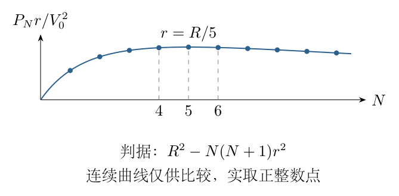

（8）端点取舍与唯一性。

在上端点 $r=R/\sqrt{20}$，第（5）步不等式取等，故
$$P_4=P_5>P_N\quad(N\ne4,5).$$
在下端点 $r=R/\sqrt{30}$，第（6）步取等，故
$$P_5=P_6>P_N\quad(N\ne5,6).$$
因此，“接 $5$ 个时能达到最大值”允许这两个端点；“只有接 $5$ 个时才达到最大值”要求严格不等式：
$$\boxed{\frac R{\sqrt{30}}<r<\frac R{\sqrt{20}}\quad\text{（唯一最大）}.}$$
相应的连续峰值位置满足
$$\sqrt{20}\le\frac Rr\le\sqrt{30},$$
即约为 $4.4721$ 至 $5.4772$，并不是 $4.5$ 至 $5.5$。端点非对称正是整数取值时不能机械四舍五入的证据。

<!-- KEEP_STUDENT_START -->
（9）量纲、极限与能量核验。

$V_0^2R/(R+Nr)^2$ 的量纲为电压平方除以电阻，确为功率；内阻范围两端均为 $R$ 乘无量纲常数。固定 $r>0$，当 $N\to\infty$ 时，
$$P_N\sim\frac{V_0^2R}{Nr^2}\to0,\qquad U_N\sim\frac{V_0R}{Nr}\to0.$$
当 $r\to0$ 而 $N$ 固定时，$U_N\to V_0$，$P_N\to NV_0^2/R$，理想电源不再有有限的最优灯泡数。因此 $r>0$ 是第二问存在有限峰值的必要条件。

负载效率为
$$\eta_N=\frac{P_N}{V_0I_N}=\frac{R}{R+Nr}.$$
在连续匹配点为 $1/2$；整数最优点通常不恰好为 $1/2$。这也说明“最大输出功率”与“最高效率”是不同目标。两问的最终结果分别是 $P_N=NV_0^2R/(R+Nr)^2$ 与上述闭区间；唯一性要求开区间。
<!-- KEEP_STUDENT_END -->

\newpage

# 第 4 题

<!-- question-start -->
质量均为 $m$、电荷量均为 $q>0$ 的三个质点，由总长 $3l$ 的不可伸长轻绳相连，相邻质点沿绳相距 $l$。轻绳及质点置于边长为 $l$ 的光滑等边三角形槽中。三角形中心固定一个电荷 $-Q$，其中 $Q>0$。三个质点最初位于三条边的中点。令 $k_e=1/(4\pi\varepsilon_0)$。

（1）无磁场时，要求三个质点在边中点稳定平衡，求中心电荷的稳定阈值 $Q_0$，并区分严格稳定与中性平衡。

（2）随后施加垂直于三角形平面向外的均匀磁场 $B=bt$，其中 $b>0$。磁场所在圆柱区域以三角形中心为轴，覆盖三角形；取其圆对称感应电场。三个质点沿槽顺时针共同移动，在距各边中点 $x_0$ 处形成新平衡，$0<x_0<l/2$。求对应的 $Q$。

（3）若新平衡稳定，求 $x_0$ 应满足的条件。

（4）在稳定的新平衡附近沿槽作微小振动，求周期，并说明小振动的适用范围。

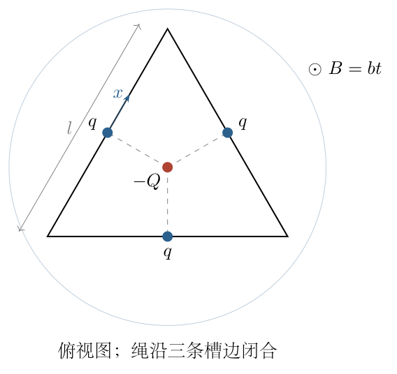
<!-- question-end -->

## 一、题型定位

带约束的对称多质点系统，叠加Coulomb相互作用与变化磁场产生的感应电场。系统虽有三个质点，但不可伸长绳和三重旋转对称使共同运动只需一个沿边坐标。求平衡后，还必须根据切向合力的斜率判断稳定性，再线性化求周期。

## 二、知识点

等边三角形的内切半径；矢量叠加；切向投影；Faraday电磁感应定律；Lorentz力；广义坐标；平衡稳定性；Taylor一阶线性化；简谐振动；临界点与小振幅条件。

槽及绳均理想化为不耗散，绳质量忽略。每个质点在同一条边内运动，振幅须小到不越过顶点；磁场圆柱的轴位置与圆对称条件决定感应场，不能仅由“均匀变化的磁场”在任意几何下擅自指定局部电场。

## 三、物理图像

当三个质点相对于各边中点移动同一有向距离时，它们始终组成一个以槽中心为中心的等边三角形。这个三角形会旋转和改变尺度，但质点到中心距离仍相同。三个质点间的排斥力合力沿中心向外，中心负电荷的吸引力沿中心向内。

磁场增大时，感应电场绕中心顺时针。其在每条直槽方向上的分量为常数，因此把原来的中心平衡位置推向顺时针一侧。中心吸引产生的切向恢复力先随位移增大，随后减小；不是任意新平衡都稳定。

## 四、解题入口

定义内切半径 $a=l/(2\sqrt3)$。对任一边设向外的单位法向量为 $\boldsymbol n$，顺时针沿边的单位切向量为 $\boldsymbol t$。质点位置写为
$$\boldsymbol r=a\boldsymbol n+x\boldsymbol t,\qquad r=\sqrt{a^2+x^2}.$$
先合成径向静电力，再乘 $x/r$ 投影到槽方向；感应电场则由环路定律求出后投影。全程保持 $x$ 的正方向一致，最后对切向合力求导，而不是对径向力大小直接求导。

## 五、解析

（1）约束与几何关系。

轻绳总长等于槽周长，忽略绳的弹性和松弛。三个相邻质点沿槽的间距固定为 $l$，所以在质点未越过顶点的区间内，它们相对于各边中点的位移相同。把另外两个质点的位置分别绕中心旋转 $120^\circ$、$240^\circ$，就得到同一构形。

每个质点离中心为 $r$，相邻两个质点所对圆心角为 $120^\circ$，弦长为
$$d=2r\sin60^\circ=\sqrt3\,r.$$
注意 $d$ 是两质点的直线距离，而 $l$ 是沿绳绕槽的距离。计算Coulomb力使用 $d$，不能因为绳段长度不变就把电荷间直线距离当成恒定 $l$。

（2）合成两个同号电荷的排斥力。

任意一个其他质点对所研究质点的力大小为
$$F_1=\frac{k_eq^2}{d^2}=\frac{k_eq^2}{3r^2}.$$
两个力关于径向对称，每个与向外径向夹角为 $30^\circ$，切向于质点构成的圆的分量抵消。因此径向合力为
$$\begin{aligned}
F_{\mathrm{rep}}
&=2F_1\cos30^\circ\\
&=2\frac{k_eq^2}{3r^2}\frac{\sqrt3}{2}\\
&=\frac{k_eq^2}{\sqrt3\,r^2}.
\end{aligned}$$
中心电荷吸引力大小为 $k_eqQ/r^2$，方向相反。定义
$$K=k_eq\left(Q-\frac q{\sqrt3}\right).$$
合成静电力的矢量表达式为
$$\boldsymbol F_{\mathrm C}=-\frac{K}{r^3}\boldsymbol r.$$
此式对 $K$ 正负都适用。图 4-2 中用 $\boldsymbol r\cdot\boldsymbol t=x$，立即得到沿槽分量
$$\boxed{F_{\mathrm C,t}(x)=-\frac{Kx}{(a^2+x^2)^{3/2}}.}$$

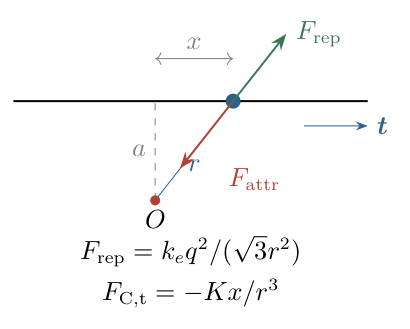

（3）为什么不能把绳张力另加成一个恢复力。

共同位移 $dx$ 时，各段轻绳长度不变，其约束力对整个系统的总虚功为零。槽支持力垂直质点允许的沿边位移，同样不作功。用共同坐标 $x$ 写动力学时，只需计入三个质点的切向外力，总惯性为 $3m$。

由于三重对称，各质点的切向非约束力相同；系统方程的两边都有因子 $3$，约去后等于一个质点的方程。若直接逐点列受力，也应同时处理相邻张力的约束关系，不能只在一个质点上任意添加某股张力。

（4）无磁场时的稳定性。

$x=0$ 时切向静电力为零，始终是平衡位置。对小位移展开，
$$\begin{aligned}
F_{\mathrm C,t}
&=-\frac{Kx}{a^3}\left(1+\frac{x^2}{a^2}\right)^{-3/2}\\
&=-\frac K{a^3}x+O(x^3).
\end{aligned}$$
这里利用二项式展开，恢复力的一阶项决定局部稳定性。若 $K>0$，正位移产生负向力，负位移产生正向力；若 $K<0$，力使位移继续增大。

因此稳定阈值为 $Q_0=q/\sqrt3$，严格稳定要求
$$\boxed{Q>\frac q{\sqrt3}.}$$
当 $Q=q/\sqrt3$，在共同构形中径向排斥与吸引精确抵消，切向力处处为零，是中性平衡而非具有恢复力的稳定平衡。所以 $q/\sqrt3$ 是严格稳定允许值的下确界，不是能取到的最小值。若将中性平衡也列入非失稳范围，才可写非严格不等式。

（5）由Faraday定律求感应电场。

以中心为圆心、半径为 $r$ 的圆处于均匀磁场覆盖区域。取逆时针环路方向，其法向为向外 $\boldsymbol e_z$。圆对称使感应场的环向分量在环路上恒定，故
$$\begin{aligned}
\oint\boldsymbol E\cdot d\boldsymbol l
&=-\frac{d}{dt}\big(\pi r^2B\big),\\
2\pi r E_{\mathrm{ccw}}&=-\pi r^2b,\\
E_{\mathrm{ccw}}&=-\frac{br}{2}.
\end{aligned}$$
负号表示顺时针。矢量形式为
$$\boldsymbol E=-\frac b2\boldsymbol e_z\times\boldsymbol r.$$
定义 $\boldsymbol t=-\boldsymbol e_z\times\boldsymbol n$，将 $\boldsymbol r=a\boldsymbol n+x\boldsymbol t$ 代入，
$$\begin{aligned}
\boldsymbol E
&=-\frac b2\left[a(\boldsymbol e_z\times\boldsymbol n)+x(\boldsymbol e_z\times\boldsymbol t)\right]\\
&=\frac{ba}{2}\boldsymbol t-\frac{bx}{2}\boldsymbol n.
\end{aligned}$$
所以沿槽电场与 $x$ 无关：
$$E_t=\frac{ba}{2},\qquad F_E=qE_t=\frac{qba}{2}.$$
图 4-3 中，$a$ 是中心到边的垂距，不是质点离中心的距离 $r$；后续方程正是利用这个固定垂距得到恒定驱动力。

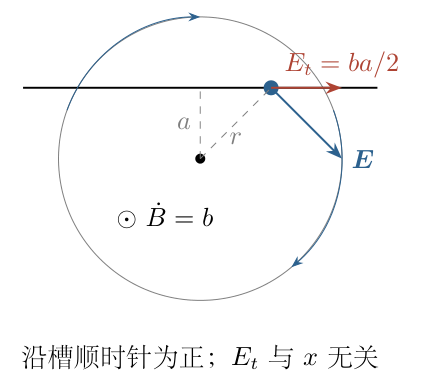

（6）磁力为什么不进入沿槽运动方程。

质点速度 $\boldsymbol v=\dot x\boldsymbol t$，磁场 $\boldsymbol B=bt\boldsymbol e_z$，故磁力 $q\boldsymbol v\times\boldsymbol B$ 垂直 $\boldsymbol t$。其切向分量为零，对速度所作功也为零。磁力虽随时间变化，会改变槽的法向支持力，却不直接改变理想直槽中的切向运动。

三个质点共同运动的方程为
$$3m\ddot x=3F_E-3\frac{Kx}{(a^2+x^2)^{3/2}}.$$
约去 $3$，得到
$$\boxed{m\ddot x=F_E-\frac{Kx}{(a^2+x^2)^{3/2}}.}$$
这不是漏算另外两个质点，而是同时约去三个相同驱动力和三个相同惯性项。

（7）求新平衡所需的中心电荷。

在 $x=x_0$ 时，$\ddot x=0$，故
$$\frac{qba}{2}=\frac{Kx_0}{(a^2+x_0^2)^{3/2}}.$$
先解出 $K$，再还原 $Q$：
$$\begin{aligned}
K&=\frac{qba}{2}\frac{(a^2+x_0^2)^{3/2}}{x_0},\\
k_eq\left(Q-\frac q{\sqrt3}\right)
&=\frac{qba}{2}\frac{(a^2+x_0^2)^{3/2}}{x_0},\\
Q&=\boxed{\frac q{\sqrt3}+\frac{ba}{2k_e}\frac{(a^2+x_0^2)^{3/2}}{x_0}}.
\end{aligned}$$
第二行两边有共同因子 $q>0$，约去后新增电荷项不再含额外的 $q$。这一消元尤其需要核对。

（8）判断新平衡是否稳定。

令总切向力为 $F(x)=F_E-Kx(a^2+x^2)^{-3/2}$。逐项求导：
$$\begin{aligned}
F'(x)
&=-K\left[(a^2+x^2)^{-3/2}-3x^2(a^2+x^2)^{-5/2}\right]\\
&=-K\frac{a^2-2x^2}{(a^2+x^2)^{5/2}}.
\end{aligned}$$
平衡处 $K>0$，因此稳定要求 $F'(x_0)<0$，即
$$\boxed{0<x_0<\frac a{\sqrt2}=\frac l{2\sqrt6}.}$$
仅满足题设的 $0<x_0<l/2$ 还不足够。图 4-4 中，吸引力的切向大小先增后减：较小位移处外移会增加反向静电力，较大位移处却会减小它，后者产生正反馈。

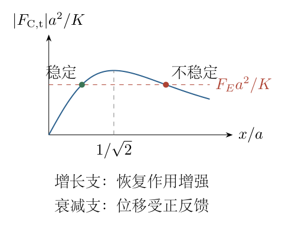

（9）从线性化方程求周期。

令 $x=x_0+\xi$，其中 $|\xi|$ 很小。Taylor展开给出
$$F(x_0+\xi)=F(x_0)+F'(x_0)\xi+O(\xi^2).$$
平衡条件使常数项 $F(x_0)=0$。忽略二阶及以上项，
$$m\ddot\xi=-\frac{K(a^2-2x_0^2)}{(a^2+x_0^2)^{5/2}}\xi.$$
图 4-5 的恢复力系数正是该式的系数，并非用 $F(x_0)/x_0$ 代替。

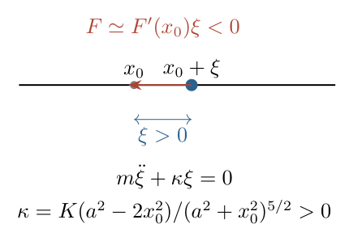

与 $\ddot\xi+\Omega^2\xi=0$ 比较，
$$\Omega^2=\frac Km\frac{a^2-2x_0^2}{(a^2+x_0^2)^{5/2}}.$$
于是
$$\boxed{T=2\pi\sqrt{\frac{m(a^2+x_0^2)^{5/2}}{K(a^2-2x_0^2)}}.}$$
利用第（7）步平衡关系消去 $K$，每个因子依次约分：
$$\begin{aligned}
\Omega^2
&=\frac{qba}{2mx_0}(a^2+x_0^2)^{3/2}
\frac{a^2-2x_0^2}{(a^2+x_0^2)^{5/2}}\\
&=\frac{qba(a^2-2x_0^2)}{2mx_0(a^2+x_0^2)},\\
T&=\boxed{2\pi\sqrt{\frac{2mx_0(a^2+x_0^2)}{qba(a^2-2x_0^2)}}}.
\end{aligned}$$
两个周期表达式等价，后一式只含几何位置和感应场参数。振幅不仅须远小于几何尺度，还须远小于到不稳定分支及顶点的距离，确保线性化和同边约束有效。

<!-- KEEP_STUDENT_START -->
（10）临界条件及检验。

当 $x_0\to a/\sqrt2$ 的稳定侧，$\Omega\to0$、$T\to\infty$；临界点一阶恢复力消失，不能给它指定有限简谐周期。代入 $Q(x_0)$ 的最小值，
$$\begin{aligned}
\min\frac{(a^2+x_0^2)^{3/2}}{x_0}
&=\frac{(3a^2/2)^{3/2}}{a/\sqrt2}=\frac{3\sqrt3}{2}a^2,\\
Q_{\mathrm{crit}}
&=\frac q{\sqrt3}+\frac{3\sqrt3,ba^3}{4k_e}
=\frac q{\sqrt3}+\frac{bl^3}{32k_e}.
\end{aligned}$$
严格稳定的新平衡要求 $Q>Q_{\mathrm{crit}}$，并选择小位移分支。

$K$ 的量纲为力乘长度平方，$K(a^2-2x_0^2)/(m r_0^5)$ 的量纲为时间的负二次方。若 $b\to0$、$Q$ 固定且大于 $q/\sqrt3$，则 $x_0\simeq F_Ea^3/K\to0$，周期回到
$$T_0=2\pi\sqrt{\frac{ma^3}{K}}.$$
不能保持 $x_0$ 不变而令 $b\to0$ 后仍声称在固定 $Q$ 下取极限，因为平衡关系同时要求 $Q$ 改变。

<!-- KEEP_STUDENT_END -->

\newpage

# 第 5 题

<!-- question-start -->
半径为 $R$ 的导体球以坐标原点为球心，处于静电平衡。令 $k_e=1/(4\pi\varepsilon_0)$，电势零点取无穷远。

（1）在 $A=(5R/2,0,0)$ 和 $B=(0,0,3R/2)$ 各放置一个电荷量为 $Q$ 的点电荷。求导体球感应电荷在 $P=(R/2,R/2,R/2)$ 处产生的电场，并求其电势的大小。球的净电荷或接地状态未另行指定；电势数值应说明所采用的状态条件。

（2）另考虑球被理想电源保持在相对于无穷远的电势 $V$，在 $(0,0,d)$ 放一个点电荷 $Q$，其中 $d>R$。求：a）导体球的总电荷量；b）点电荷所受力；c）该力为零时 $d$ 应满足的条件。

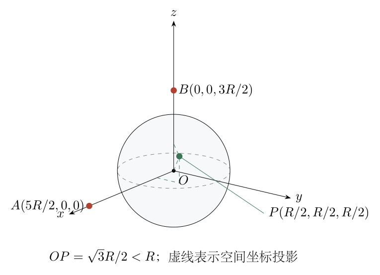
<!-- question-end -->

## 一、题型定位

导体静电平衡与球形边界的镜像法。第一问观察点在导体内部，必须用总电场为零求感应场；第二问观察点在球外，可用满足边界条件的镜像电荷计算。两问的计算区域不同，不能混用同一个点电荷表达式。

## 二、知识点

Coulomb场的矢量形式；电场与电势的叠加；导体内部零电场及等势条件；接地与孤立中性的区别；球的镜像电荷；外部Dirichlet边值问题的唯一性；电源维持电势时的电荷交换；力平衡与稳定性。

镜像电荷是构造边界解的数学工具，不是球内实际存在的点电荷。解的有效范围必须随边界问题一起指定。

## 三、物理图像

$OP=\sqrt3R/2<R$，故 $P$ 位于导体材料内部。外部两个点电荷分别在球外，虽然它们在 $P$ 处产生非零电场，球面电荷会重新分布，使该处总电场精确抵消。

总电势在导体内为常数，但常数值取决于球的净电荷和接地状态；“电场为零”只能推出电势空间上不变，不能推出电势为零。固定电势 $V$ 时，外部电荷位置变化会导致电源向球输送或从球取走电荷，球的总电荷不再固定。

## 四、解题入口

先算 $P-A$、$P-B$ 及其长度，用 $\boldsymbol E_{\mathrm{ind}}=-\boldsymbol E_{\mathrm{ext}}$ 得到感应场。求感应电势时写 $\Phi_{\mathrm{ind}}=\Phi_{\mathrm{sphere}}-\Phi_{\mathrm{ext}}$，补上决定球电势的条件。

第二问先构造接地球的偏轴镜像，再在球心加入电荷使球面电势升至 $V$。从镜像总电荷得到球的实际总电荷，从镜像在外部点产生的场求力，最后讨论零力条件是否有解。

## 五、解析

（1）判断观察点位置。

由直角坐标的距离公式，
$$OP^2=\left(\frac R2\right)^2+\left(\frac R2\right)^2+\left(\frac R2\right)^2=\frac{3R^2}{4}.$$
所以 $P$ 在导体内，而不是球外。静电平衡时，
$$\boldsymbol E_{\mathrm{tot}}(P)=\boldsymbol E_A(P)+\boldsymbol E_B(P)+\boldsymbol E_{\mathrm{ind}}(P)=0.$$
这里 $A,B$ 的场是外加场；感应场是球面电荷的场，两者都可以单独不为零。图 5-2 展示相互抵消关系，后面直接使用此矢量等式，不用镜像表达式去评价球内点。

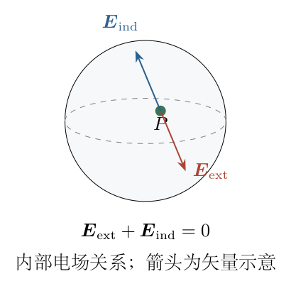

（2）计算电荷 $A$ 在 $P$ 处的场。

从源电荷指向观察点的位移为
$$\boldsymbol s_A=P-A=R(-2,\tfrac12,\tfrac12).$$
距离及三次方为
$$s_A=\sqrt{4R^2+\frac{R^2}4+\frac{R^2}4}=\frac{3R}{\sqrt2},\qquad
s_A^3=\frac{27R^3}{2\sqrt2}.$$
用矢量Coulomb定律而非只写大小：
$$\begin{aligned}
\boldsymbol E_A(P)&=k_eQ\frac{\boldsymbol s_A}{s_A^3}\\
&=\frac{k_eQ}{R^2}\frac{2\sqrt2}{27}(-2,\tfrac12,\tfrac12)\\
&=\frac{k_eQ}{R^2}\frac{\sqrt2}{27}(-4,1,1).
\end{aligned}$$
$x$ 分量为负，是因为 $P$ 位于 $A$ 的左侧；并不是因为 $Q$ 被当成负电荷。

（3）计算电荷 $B$ 在 $P$ 处的场。

位移与距离为
$$\boldsymbol s_B=P-B=R(\tfrac12,\tfrac12,-1),\qquad s_B=\frac{\sqrt6R}{2}.$$
于是
$$\begin{aligned}
s_B^3&=\frac{3\sqrt6R^3}{4},\\
\boldsymbol E_B(P)&=\frac{k_eQ}{R^2}\frac4{3\sqrt6}(\tfrac12,\tfrac12,-1)\\
&=\frac{k_eQ}{R^2}\frac{\sqrt6}{9}(1,1,-2).
\end{aligned}$$
最后一行使用有理化 $2/(3\sqrt6)=\sqrt6/9$。两个电荷距 $P$ 不同，不能因电荷量相同就给它们同样的场强系数。

（4）感应电场的三个分量。

将两场相加再整体取负：
$$\boxed{
\boldsymbol E_{\mathrm{ind}}(P)=\frac{k_eQ}{R^2}
\left(
\frac{4\sqrt2}{27}-\frac{\sqrt6}{9},
-\frac{\sqrt2}{27}-\frac{\sqrt6}{9},
-\frac{\sqrt2}{27}+\frac{2\sqrt6}{9}
\right).
}$$
该式可与原来的 $\boldsymbol E_A+\boldsymbol E_B$ 逐分量相加，全部为零。若要求场强大小，可将三分量平方相加：
$$\begin{aligned}
\left|\frac{R^2\boldsymbol E_{\mathrm{ind}}}{k_eQ}\right|^2
&=18\left(\frac{\sqrt2}{27}\right)^2
+6\left(\frac{\sqrt6}{9}\right)^2
-10\frac{\sqrt2}{27}\frac{\sqrt6}{9}\\
&=\frac4{81}+\frac49-\frac{20\sqrt3}{243}
=\frac{120-20\sqrt3}{243}.
\end{aligned}$$
因此
$$|\boldsymbol E_{\mathrm{ind}}|=\frac{k_e|Q|}{R^2}
\sqrt{\frac{120-20\sqrt3}{243}}.$$
净电荷或接地条件改变时，球内总电场仍为零，所以这里的感应电场抵消关系不变。

（5）求外部电荷在 $P$ 处的电势。

电势是标量，不带位移方向的分量。由两个距离，
$$\begin{aligned}
\Phi_{\mathrm{ext}}(P)
&=k_eQ\left(\frac1{s_A}+\frac1{s_B}\right)\\
&=\frac{k_eQ}{R}\left(\frac{\sqrt2}{3}+\frac2{\sqrt6}\right)\\
&=\frac{k_eQ}{R}\frac{\sqrt2+\sqrt6}{3}.
\end{aligned}$$
设球的恒定电势为 $\Phi_s$，则一般关系为
$$\boxed{\Phi_{\mathrm{ind}}(P)=\Phi_s-\frac{k_eQ}{R}\frac{\sqrt2+\sqrt6}{3}.}$$
到这一步尚不能给出唯一数值，因为 $\Phi_s$ 未由题设确定。以下分别说明最常用的孤立中性状态及接地状态，不把缺失条件隐藏在计算中。

（6）推导一个球外电荷的接地镜像。

外部电荷 $Q$ 位于 $\boldsymbol a$，$|\boldsymbol a|=d>R$。取球内镜像位置
$$\boldsymbol a'=\frac{R^2}{d^2}\boldsymbol a,\qquad q'=-Q\frac Rd.$$
对任意球面点 $\boldsymbol s$，$|\boldsymbol s|=R$，比较两个距离平方：
$$\begin{aligned}
|\boldsymbol s-\boldsymbol a'|^2
&=R^2+\frac{R^4}{d^2}-2\frac{R^2}{d^2}\boldsymbol s\cdot\boldsymbol a\\
&=\frac{R^2}{d^2}\left(d^2+R^2-2\boldsymbol s\cdot\boldsymbol a\right)\\
&=\frac{R^2}{d^2}|\boldsymbol s-\boldsymbol a|^2.
\end{aligned}$$
故 $|\boldsymbol s-\boldsymbol a'|=(R/d)|\boldsymbol s-\boldsymbol a|$，球面电势为
$$k_e\left[\frac Q{|\boldsymbol s-\boldsymbol a|}
+\frac{-QR/d}{(R/d)|\boldsymbol s-\boldsymbol a|}\right]=0.$$
这一构造满足接地边界，且球外区域除真实电荷外无新增奇点，由唯一性定理可用于球外场。镜像处的奇点在导体内，因此绝不能把它解释为实际球内场。

（7）孤立初始中性球的恒定电势。

对 $A,B$ 分别用上述构造，接地镜像为
$$q_A'=-\frac{2Q}{5},\quad \boldsymbol a_A'=(2R/5,0,0),$$
$$q_B'=-\frac{2Q}{3},\quad \boldsymbol a_B'=(0,0,2R/3).$$
两镜像的总量为 $-16Q/15$。为使孤立球净电荷为零，另在球心加入
$$q_c=\frac{16Q}{15}.$$
球心镜像在整个球面产生相同的电势 $k_eq_c/R$，不会破坏等势边界，所以
$$\Phi_s=\frac{16k_eQ}{15R}.$$
从球外远场的 $1/r$ 项或Gauss定律可知，镜像总量等于球的实际总电荷；这里两偏轴镜像与球心镜像之和确为零。图 5-3 的镜像仅用于球外构造和确定 $\Phi_s$。

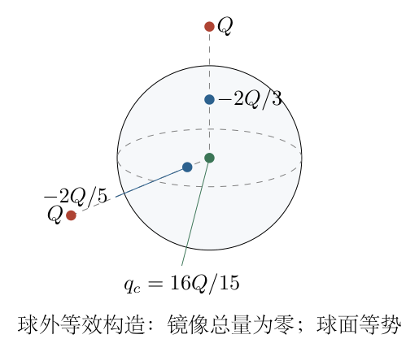

代回第（5）步，
$$\boxed{\Phi_{\mathrm{ind}}(P)=\frac{k_eQ}{R}
\left[\frac{16}{15}-\frac{\sqrt2+\sqrt6}{3}\right].}$$
方括号为负，约为 $-0.2212344$。因此电势的大小为
$$\boxed{|\Phi_{\mathrm{ind}}(P)|=\frac{k_e|Q|}{R}
\left[\frac{\sqrt2+\sqrt6}{3}-\frac{16}{15}\right].}$$
若球接地，则 $\Phi_s=0$，感应电势变为 $-\Phi_{\mathrm{ext}}(P)$。若球有给定净电荷 $Q_s$，球心补偿电荷为 $Q_s+16Q/15$，相应的球电势为 $k_e(Q_s+16Q/15)/R$。这里将球面全部电荷产生的电势计作球面场；若另区分预存电荷与纯诱导重分布，须在定义中注明。

（8）固定电势球的总电荷。

第二问是另一个情景，外部只有一个电荷。其接地镜像为
$$q'=-\frac{QR}{d},\qquad z'=\frac{R^2}{d}.$$
再在球心放置 $q_0$，使球面电势为 $V$：
$$\frac{k_eq_0}{R}=V,\qquad q_0=\frac{RV}{k_e}.$$
两镜像共同给出球外解。因此球的总电荷为
$$\boxed{q_{\mathrm{sphere}}=\frac{RV}{k_e}-\frac{QR}{d}
=4\pi\varepsilon_0RV-\frac{QR}{d}.}$$
其中第二项随 $d$ 变化，是电源维持电势时交换电荷的结果。不能把它固定为 $4\pi\varepsilon_0RV$。

（9）外部点电荷的受力。

取 $+z$ 为由球心指向外部电荷的方向。球心镜像贡献
$$F_0=\frac{k_eQq_0}{d^2}=\frac{QRV}{d^2}.$$
偏轴镜像距真实电荷
$$d-z'=d-\frac{R^2}{d}=\frac{d^2-R^2}{d}>0.$$
其力为
$$\begin{aligned}
F'&=\frac{k_eQq'}{(d-z')^2}\\
&=-\frac{k_eQ^2R}{d}\frac{d^2}{(d^2-R^2)^2}\\
&=-\frac{k_eQ^2Rd}{(d^2-R^2)^2}.
\end{aligned}$$
图 5-4 中 $F'$ 指向球心，恒为吸引；$F_0$ 的方向取决于 $QV$ 的符号。合力为

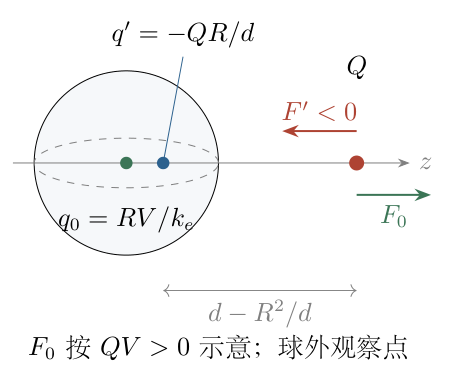

$$\boxed{\boldsymbol F=\left[\frac{QRV}{d^2}
-\frac{k_eQ^2Rd}{(d^2-R^2)^2}\right]\boldsymbol e_z.}$$
电荷本身的自场不计入力，只有球面电荷产生的场；镜像正是这个球外场的等效表达。

（10）零力条件与解的存在性。

对 $Q\ne0$，令括号为零，乘以 $d^2/(QR)$ 得
$$\boxed{V=\frac{k_eQd^3}{(d^2-R^2)^2},\qquad d>R.}$$
右侧因子 $d^3/(d^2-R^2)^2$ 为正，故必须有 $V/Q>0$；若 $V=0$ 或 $V/Q<0$，吸引项不可能被抵消。$Q=0$ 则无力，是应单独列出的平凡情况。

设 $H(d)=d^3/(d^2-R^2)^2$，求导：
$$\begin{aligned}
H'(d)&=\frac{3d^2}{(d^2-R^2)^2}
-\frac{4d^4}{(d^2-R^2)^3}\\
&=-\frac{d^2(d^2+3R^2)}{(d^2-R^2)^3}<0.
\end{aligned}$$
又 $H(R^+)=+\infty$，$H(\infty)=0$。所以对任意给定 $V/Q>0$，恰有一个 $d>R$ 满足零力条件。图 5-5 中的水平线与曲线只有一个交点，正对应这一唯一性。

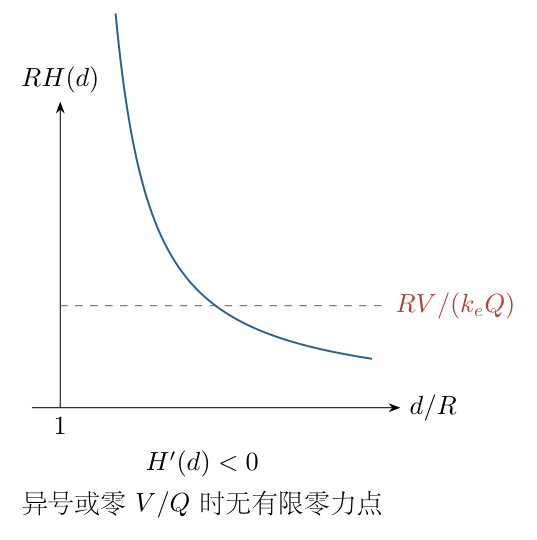

<!-- KEEP_STUDENT_START -->
（11）量纲与极限检查。

感应场量纲为 $k_eQ/R^2$，电势量纲为 $k_eQ/R$；总电荷式中的 $RV/k_e$ 与 $QR/d$ 均为电荷。检查远场时，先将吸引项整理成无量纲小参数：
$$\frac{d}{(d^2-R^2)^2}=\frac1{d^3}
\left(1-\frac{R^2}{d^2}\right)^{-2}.$$
令 $u=R^2/d^2\ll1$，利用二项式展开
$$(1-u)^{-2}=1+2u+3u^2+O(u^3).$$
代回原力式，
$$F=\frac{QRV}{d^2}-\frac{k_eQ^2R}{d^3}
-\frac{2k_eQ^2R^3}{d^5}
+O\left(\frac{k_eQ^2R^5}{d^7}\right).$$
固定非零 $V$ 时最远处由球的基准净电荷项主导；接地 $V=0$ 时始终吸引并按 $d^{-3}$ 衰减。该接地远场规律不同于固定净电荷为零的孤立球，原因是接地球可从外界取得净电荷。

近球面令 $d=R+\eta$，$0<\eta\ll R$。由于
$$d^2-R^2=(d-R)(d+R)\simeq2R\eta,\qquad Rd\simeq R^2,$$
吸引项的首阶为
$$F'\simeq-\frac{k_eQ^2R^2}{(2R\eta)^2}
=-\frac{k_eQ^2}{4\eta^2}.$$
它相当于电荷与距离 $2\eta$ 的反号平面镜像之间的力，验证曲率在很小间隙的首项中消失。固定 $V$ 产生的中心项仍有限，不能抵消这个近表面发散项。

<!-- KEEP_STUDENT_END -->

\newpage

# 第 6 题

<!-- question-start -->
单原子理想气体满足状态方程 $PV=n\mathcal RT$，其摩尔定容热容为 $C_{V,\mathrm m}=3\mathcal R/2$。其中 $\mathcal R=N_Ak_B$ 为摩尔气体常量。

（1）证明热平衡时，每个原子的平均平动动能为 $\overline E=3k_BT/2$。

（2）考虑 $^{20}\mathrm{Ne}$ 原子束通过周期 $d=0.5\,\mathrm{nm}$ 的光栅。按题设的衍射尺度条件 $d=\lambda$，用第（1）问对应的热运动特征动量估算温度 $T$。说明所采用的特征动量及该估算与完整光栅衍射条件的区别。

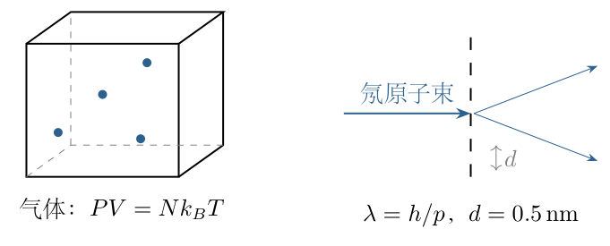
<!-- question-end -->

## 一、题型定位

从宏观理想气体定律连接到微观平均动能，再将热运动与de Broglie波长联系。核心是“平均动能”与“代表动量”的对应，不是把每个原子的速度视为相同。

## 二、知识点

弹性碰撞传递动量；气体压强的微观来源；各向同性平均；Avogadro常量；定容热容与内能；能量零点；均方根速度；de Broglie关系；光栅相邻缝的程差；单位换算与有效数字。

气体采用经典、非相互作用的单原子模型，只计三维平动。真实束流若有定向漂移、非热平衡选速或不同能量分布，温度与束流动量还需额外信息。第二问采用由平均平动能定义的均方根动量，给出明确的条件估算。

## 三、物理图像

压强来自原子不断撞击容器壁所传递的动量。某一面墙只响应垂直于它的速度分量；平衡气体三个方向统计等价，使压强表达式中的 $1/3$ 自然出现。

原子通过光栅时表现为波，动量越小，波长越长。对氖这样远重于电子的原子，$0.5\,\mathrm{nm}$ 的波长意味着低的热运动速度和温度。温度给定仍存在速度分布，不对应严格单色物质波。

## 四、解题入口

用一次碰撞的动量变化和连续两次撞同一面墙的时间求单原子平均力；叠加 $N$ 个原子，与状态方程比较。再由 $\overline E=p_{\mathrm{rms}}^2/(2m)$ 选定特征动量，用 $\lambda=h/p_{\mathrm{rms}}$ 消去动量，以SI单位计算温度。

## 五、解析

（1）单个原子碰壁传递的动量。

取边长 $L$ 的立方体容器，$V=L^3$。原子质量为 $m$，速度分量为 $(v_x,v_y,v_z)$。与垂直 $x$ 方向的刚性壁作弹性碰撞时，切向分量不变，法向分量由 $v_x$ 变为 $-v_x$。

原子向右撞墙时，自身动量变化为 $-2mv_x$，传给墙的动量为 $+2mv_x$。任一面墙收到的法向动量大小均为 $2m|v_x|$。两次撞同一面墙要经过从右到左再返回的路程，因此
$$\Delta t=\frac{2L}{|v_x|}.$$
该原子给这面墙的时间平均力为
$$\overline F_x=\frac{2m|v_x|}{2L/|v_x|}=\frac{mv_x^2}{L}.$$
$v_x=0$ 的原子不撞这面墙，贡献为零，与平方形式连续一致。图 6-2 中的 $2L$ 是重复撞同一面墙的往返距离，不能只取两壁间距 $L$。

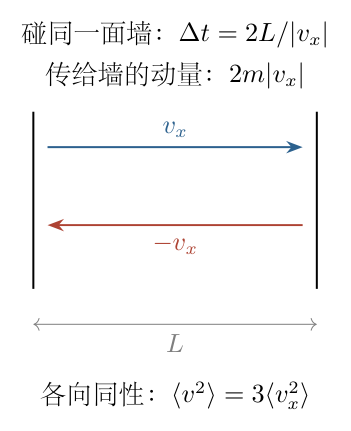

（2）由大量原子的平均力得到压强。

设总原子数为 $N$，墙面积为 $L^2$。时间及粒子平均后，
$$\begin{aligned}
F_x&=\sum_{i=1}^N\frac{mv_{x,i}^2}{L}
=\frac{Nm}{L}\langle v_x^2\rangle,\\
P&=\frac{F_x}{L^2}=\frac{Nm}{V}\langle v_x^2\rangle.
\end{aligned}$$
平衡且无宏观定向流动时，各方向的速度统计相同：
$$\langle v_x^2\rangle=\langle v_y^2\rangle=\langle v_z^2\rangle.$$
由 $v^2=v_x^2+v_y^2+v_z^2$，有
$$\langle v^2\rangle=3\langle v_x^2\rangle.$$
代回得到
$$\boxed{PV=\frac13Nm\langle v^2\rangle=\frac23N\overline E},\qquad
\overline E=\frac12m\langle v^2\rangle.$$
平均的是速度平方，而不是先平均速度再平方。平衡气体 $\langle\boldsymbol v\rangle=0$，但平均动能与压强并不为零。

（3）与宏观状态方程比较。

总原子数与物质的量的关系是 $N=nN_A$，又 $\mathcal R=N_Ak_B$，所以
$$PV=n\mathcal RT=nN_Ak_BT=Nk_BT.$$
与微观表达式比较，约去正的 $N$：
$$\frac23\overline E=k_BT,\qquad \boxed{\overline E=\frac32k_BT.}$$
因子 $3$ 来自三个平动方向。单原子模型没有需要加入的分子转动、振动自由度。

（4）用定容热容交叉说明内能。

摩尔定容热容定义为
$$C_{V,\mathrm m}=\frac1n\left(\frac{\partial U}{\partial T}\right)_V.$$
题设给出 $dU=(3/2)n\mathcal R\,dT$。从 $T_1$ 积分到 $T_2$，
$$U(T_2)-U(T_1)=\frac32n\mathcal R(T_2-T_1).$$
一般形式为
$$U(T)=\frac32n\mathcal RT+U_{\mathrm{ref}}.$$
热容只确定能量差，不确定积分常数。以静止原子的平动能为零，且只计平动内能，才取 $U_{\mathrm{tr}}=3n\mathcal RT/2$。除以 $N=nN_A$，再次得到平均平动能。

这一路线需要说明内能组成和零点，不能省略积分常数后声称绝对内能由热容本身确定。若将原子基态内部能量也计入，总内能会另有与温度无关的一项，而热运动的平均动能结论不变。

（5）定义热运动特征动量。

均方根速度及动量定义为
$$v_{\mathrm{rms}}=\sqrt{\langle v^2\rangle},\qquad
p_{\mathrm{rms}}=\sqrt{\langle p^2\rangle}=mv_{\mathrm{rms}}.$$
所以
$$\frac{p_{\mathrm{rms}}^2}{2m}=\frac32k_BT,\qquad
\boxed{p_{\mathrm{rms}}=\sqrt{3mk_BT}}.$$
对应 $v_{\mathrm{rms}}=\sqrt{3k_BT/m}$。这没有断言每个原子动量都相同，而是用代表值匹配平均动能。

（6）物质波关系与温度。

de Broglie关系为 $\lambda=h/p$。按题设取特征波长 $h/p_{\mathrm{rms}}=d$：
$$d=\frac h{\sqrt{3mk_BT}}.$$
两边平方并逐步移项，
$$\begin{aligned}
d^2&=\frac{h^2}{3mk_BT},\\
3mk_BT d^2&=h^2,\\
T&=\boxed{\frac{h^2}{3mk_Bd^2}}.
\end{aligned}$$
温度与质量成反比，与周期平方成反比。若采用另一种速度平均，需相应改变这一系数，不能只改名称而保留同一推导。

（7）逐项代入SI数值。

按质量数近似 $m=20u$，采用
$$\begin{aligned}
u&=1.66053906892\times10^{-27}\,\mathrm{kg},\\
m&=3.32107813784\times10^{-26}\,\mathrm{kg},\\
d&=0.5\times10^{-9}\,\mathrm m=5.0\times10^{-10}\,\mathrm m,\\
h&=6.62607015\times10^{-34}\,\mathrm{J\,s},\\
k_B&=1.380649\times10^{-23}\,\mathrm{J\,K^{-1}}.
\end{aligned}$$
先平方：
$$h^2=4.39048056327\times10^{-67}\,\mathrm{J^2s^2},\qquad
d^2=2.5\times10^{-19}\,\mathrm{m^2}.$$
再计算分母：
$$3mk_Bd^2=3(3.32107813784)(1.380649)(2.5)\times10^{-68}
\simeq3.438932\times10^{-67}.$$
约去公共指数后，
$$\boxed{T\simeq1.2767\,\mathrm K\approx1.28\,\mathrm K.}$$
中间位数用于核验，按给定周期有效数字也可报告约 $1.3\,\mathrm K$。精确同位素质量不是严格 $20u$，采用精确质量只产生小的相对修正，不改变数量级。

（8）以速度和动能反算。

先由波长求动量：
$$p=h/d=1.32521403\times10^{-24}\,\mathrm{kg\,m\,s^{-1}}.$$
除以质量得到
$$v=p/m\simeq39.9031\,\mathrm{m\,s^{-1}}.$$
计算动能，
$$\overline E=p^2/(2m)\simeq2.64401\times10^{-23}\,\mathrm J.$$
再以 $T=2\overline E/(3k_B)$ 回算，得到相同的 $1.2767\,\mathrm K$。这一核验可检查动量、速度、能量间是否漏掉质量或系数。

（9）与完整光栅条件的区别。

图 6-3 中入射束垂直光栅，相邻缝距 $d$。向与入射法线夹角 $\beta$ 的方向传播，相邻路径差为 $d\sin\beta$，相长干涉条件为
$$d\sin\beta=j\lambda,\qquad j\in\mathbb Z.$$
该条件涉及出射角和级次。题设 $d=\lambda$ 只指定尺度；若取一级 $j=1$，则 $\sin\beta=1$，为 $\beta=90^\circ$ 的掠射极限，不是所有衍射必须具有这一个波长。

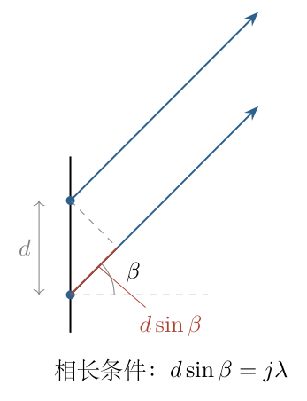

故 $1.28\,\mathrm K$ 是题设尺度与均方根动量约定下的条件估算，不能由“看见任意衍射”唯一确定。若给定角度及级次，先由 $\lambda=d\sin\beta/j$ 求波长，再求温度。

（10）量纲及不同平均的辨析。

$[h]=\mathrm{kg\,m^2s^{-1}}$，$[k_B]=\mathrm{kg\,m^2s^{-2}K^{-1}}$，因此 $[h^2/(mk_Bd^2)]=\mathrm K$。同波长下重原子动量相同，动能更小，温度更低；周期减半使动量增倍、温度变四倍，与公式一致。

经典Maxwell分布的三种速率不同：
$$v_{\mathrm{mp}}=\sqrt{\frac{2k_BT}{m}},\quad
\overline v=\sqrt{\frac{8k_BT}{\pi m}},\quad
v_{\mathrm{rms}}=\sqrt{\frac{3k_BT}{m}}.$$
若改用最概然动量匹配波长，分母系数为 $2$ 而非 $3$。另外，$\langle h/p\rangle$ 不等于 $h/\sqrt{\langle p^2\rangle}$，所以本解的“特征波长”也不称为平均波长。真实定向束流还须扣除宏观漂移动能，才可讨论热温度。

\newpage

# 第 7 题

<!-- question-start -->
钠灯发出自然光，经理想窄缝 $S_0$ 后，照射对称的两条理想窄缝 $S_1,S_2$，两缝间距为 $d$。屏到双缝的距离为 $D\gg d$，屏上以对称点为原点取坐标 $z$，观测区域满足 $|z|\ll D$。忽略不同路径长度导致的振幅衰减，波长记为 $\lambda$。

（1）不加偏振片时，零级亮纹中心光强为 $I_0$，求 $I_1(z)$。

（2）在 $S_1,S_2$ 后分别放理想偏振片 $p_1,p_2$，屏前放覆盖两束光的偏振片 $p_3$。在垂直传播方向的偏振平面内，三片透光轴与 $x$ 轴的角度依次为 $0,\theta,2\theta$。以未加偏振片的 $I_0$ 为基准，求 $\theta=0$ 时的 $I_2(z)$ 和对比度 $M_2$。

（3）求 $\theta=\pi/4$ 时的 $I_3(z)$、$M_3$。

（4）求 $0<\theta<\pi/4$ 时的 $I_4(z)$、$M_4$。对比度定义为 $M=(I_{\max}-I_{\min})/(I_{\max}+I_{\min})$。

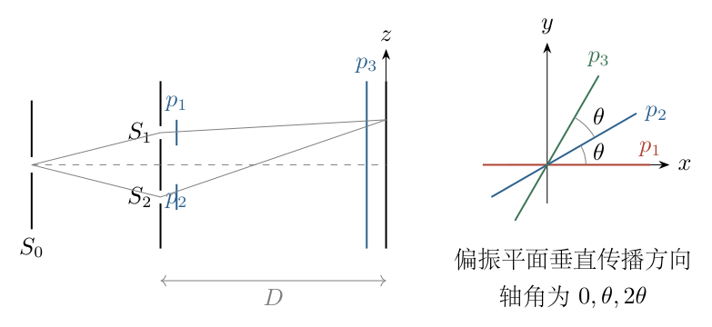
<!-- question-end -->

## 一、题型定位

带偏振统计的双缝干涉。双缝出射光来自同一个入射场，具有相同偏振分量间的相关性；“自然光”不意味着两条路径彼此完全不相干。经过不同方向的偏振片后，必须同时计算各束强度与交叉相关，不能仅用Malus定律计算两束强度再假定对比度为一。

## 二、知识点

远场程差；相位差；自然光的正交偏振统计；偏振片的矢量投影；Malus定律；电场叠加与强度时间平均；干涉交叉项；对比度；Cauchy不等式；相位与亮纹位置。

采用理想单色相干路径模型，两个正交分量的平均强度相等且互不相关。偏振片仅投影，不引入额外相位或吸收以外的效应。

## 三、物理图像

不加偏振片时，两个光路的同一偏振分量能够干涉，两组正交偏振的干涉图相同，因此自然光仍产生条纹。加上 $p_1,p_2$ 后，两束光各取共同入射场的不同投影，既改变振幅又改变统计相关。

末片 $p_3$ 使透射光方向相同，却不能把原来不相关的随机分量变成相同随机振幅。特别在 $\theta=\pi/4$ 时，$p_3$ 与 $p_1$ 正交，第一条路完全被阻断，只剩第二条路，因而没有干涉条纹。

## 四、解题入口

先以无偏振片的零级强度 $I_0$ 标定单缝强度 $I_s$。把双缝共同入射场分为 $E_x,E_y$ 两个正交随机分量，依次作两次投影。最后展开两束振幅和的模平方，在平均后得到常数项与 $\cos\delta$ 项，再分别取最大、最小值。

## 五、解析

（1）程差与相位差。

取 $S_1$ 位于 $z=d/2$，$S_2$ 位于 $z=-d/2$，屏上点位于 $z$。两路径为
$$r_1=\sqrt{D^2+(z-d/2)^2},\qquad r_2=\sqrt{D^2+(z+d/2)^2}.$$
在 $|z|,d\ll D$ 下用 $\sqrt{1+\epsilon}\simeq1+\epsilon/2$，
$$\begin{aligned}
r_2-r_1&\simeq\frac{(z+d/2)^2-(z-d/2)^2}{2D}\\
&=\frac{2zd}{2D}=\frac{dz}{D}.
\end{aligned}$$
所以
$$\delta=\frac{2\pi}{\lambda}(r_2-r_1)\simeq\frac{2\pi dz}{\lambda D}.$$
交换两缝命名只会使 $\delta$ 反号，后面的 $\cos\delta$ 不变。条纹周期为 $\Delta z=\lambda D/d$。

（2）用 $I_0$ 确定单路强度。

无偏振片时，两束等强且相干，在 $\delta=0$ 处振幅相加、强度是单束的四倍，故
$$I_s=\frac{I_0}{4}.$$
任意相位下两束叠加给出
$$\begin{aligned}
I_1(z)&=I_s+I_s+2I_s\cos\delta\\
&=\frac{I_0}{2}(1+\cos\delta)\\
&=\boxed{I_0\cos^2\left(\frac{\pi dz}{\lambda D}\right)}.
\end{aligned}$$
因此 $I_{\max}=I_0$、$I_{\min}=0$。如果误取 $I_s=I_0/2$，后面所有带偏振片的光强都会多一倍。

（3）建立自然光的共同随机振幅。

用复振幅 $E_x,E_y$ 表示同一束入射自然光的两个正交分量。将光强比例常数吸收进振幅定义后，
$$\langle|E_x|^2\rangle=\langle|E_y|^2\rangle=\frac{I_s}{2},\qquad
\langle E_xE_y^*\rangle=0.$$
尖括号表示时间或统计平均，星号表示复共轭。两条光路使用同一组 $E_x,E_y$，另乘路径相位；不能给第二条路重新引入完全独立的一组随机量，否则无偏振片时也不会干涉。

（4）第一条路的两次投影。

三个透光轴的单位矢量为
$$\boldsymbol u_1=(1,0),\quad
\boldsymbol u_2=(\cos\theta,\sin\theta),\quad
\boldsymbol u_3=(\cos2\theta,\sin2\theta).$$
过 $p_1$ 后电场为 $E_x\boldsymbol u_1$。再过 $p_3$，只留下在 $\boldsymbol u_3$ 上的投影，标量振幅为
$$a=E_x(\boldsymbol u_1\cdot\boldsymbol u_3)=E_x\cos2\theta.$$
图 7-2 中第一条路径的投影系数是 $\cos2\theta$，不是 $\cos\theta$。

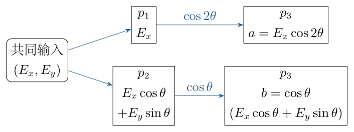

（5）第二条路的两次投影。

过 $p_2$ 后的标量为
$$\boldsymbol E\cdot\boldsymbol u_2=E_x\cos\theta+E_y\sin\theta.$$
过 $p_3$ 再乘两轴点积
$$\boldsymbol u_2\cdot\boldsymbol u_3=\cos(2\theta-\theta)=\cos\theta.$$
故第二路最终标量振幅为
$$b=\cos\theta(E_x\cos\theta+E_y\sin\theta).$$
两路透射后的矢量方向都为 $\boldsymbol u_3$，但标量 $a,b$ 一般不是同一个随机量的常数倍。

（6）分别计算两路平均强度。

第一路为
$$A=\langle|a|^2\rangle=\frac{I_s}{2}\cos^22\theta.$$
第二路展开后，
$$\begin{aligned}
B&=\cos^2\theta\left[
\cos^2\theta\langle|E_x|^2\rangle
+\sin^2\theta\langle|E_y|^2\rangle
+2\sin\theta\cos\theta\,\operatorname{Re}\langle E_xE_y^*\rangle\right]\\
&=\frac{I_s}{2}\cos^2\theta(\cos^2\theta+\sin^2\theta)\\
&=\frac{I_s}{2}\cos^2\theta.
\end{aligned}$$
这与逐片Malus定律一致：自然光过首片强度减半，再乘相应的余弦平方。

（7）计算两路的交叉相关。

光强叠加还需要
$$\begin{aligned}
\Gamma&=\langle ab^*\rangle\\
&=\cos2\theta\cos\theta\left[
\cos\theta\langle|E_x|^2\rangle+\sin\theta\langle E_xE_y^*\rangle\right]\\
&=\boxed{\frac{I_s}{2}\cos2\theta\cos^2\theta}.
\end{aligned}$$
它为实数。在所求角度区间内为非负。图 7-3 中只有共同的 $E_x$ 分量参与交叉项；第二路的 $E_y$ 贡献仍增加背景强度，却不与第一路相干。

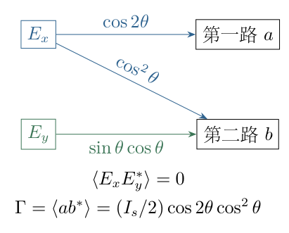

若直接把 $\Gamma$ 写成 $\sqrt{AB}$，会漏掉相关系数 $\cos\theta$。方向相同只是干涉的必要因素，不保证随机振幅完全相关。

（8）得到任意 $\theta$ 的强度。

将路径相位附在第二束，最终标量为 $a+be^{i\delta}$。展开模平方并平均：
$$\begin{aligned}
I_\theta(z)
&=\langle(a+be^{i\delta})(a^*+b^*e^{-i\delta})\rangle\\
&=A+B+\Gamma e^{-i\delta}+\Gamma^*e^{i\delta}\\
&=A+B+2\Gamma\cos\delta.
\end{aligned}$$
代入三项并用 $I_s=I_0/4$，
$$\boxed{
I_\theta(z)=\frac{I_0}{8}
\left[\cos^22\theta+\cos^2\theta
+2\cos2\theta\cos^2\theta\cos\left(\frac{2\pi dz}{\lambda D}\right)\right].
}$$
这同一公式给出第（2）至（4）问，基准始终为不加偏振片时的 $I_0$。

（9）$\theta=0$ 的结果。

三片透光轴均平行，$\cos2\theta=\cos\theta=1$，所以
$$\begin{aligned}
I_2(z)&=\frac{I_0}{8}(2+2\cos\delta)\\
&=\boxed{\frac{I_0}{2}\cos^2\left(\frac{\pi dz}{\lambda D}\right)}.
\end{aligned}$$
亮纹峰值为 $I_0/2$，暗纹仍为零。因此
$$\boxed{M_2=1.}$$
光强减半来自自然光在首片后的损失；后续平行片不再损失所允许的分量。

（10）$\theta=\pi/4$ 的结果。

此时 $\cos2\theta=0$，第一条路在 $p_3$ 完全被挡住；$\cos^2\theta=1/2$，故
$$\boxed{I_3(z)=\frac{I_0}{16},\qquad M_3=0.}$$
该强度不随 $z$ 变化。第二路首片将强度由 $I_0/4$ 减为 $I_0/8$，再过与它相差 $45^\circ$ 的分析片减为 $I_0/16$，与上式一致。

（11）一般区间内的最大、最小及对比度。

令 $H=\cos^22\theta+\cos^2\theta$，$C=2\cos2\theta\cos^2\theta$。对 $0<\theta<\pi/4$，$C>0$，故
$$I_{\max}=\frac{I_0}{8}(H+C),\qquad I_{\min}=\frac{I_0}{8}(H-C).$$
代入定义时公共强度系数消去：
$$\begin{aligned}
M_4&=\frac{(H+C)-(H-C)}{(H+C)+(H-C)}\\
&=\boxed{\frac{2\cos2\theta\cos^2\theta}{\cos^22\theta+\cos^2\theta}}.
\end{aligned}$$
亮纹仍位于 $\delta=2j\pi$，间距不变；偏振片改变背景与调制深度，不改变这里的几何程差。

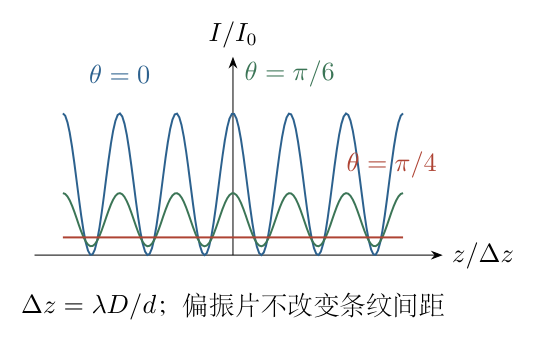

（12）非负性与极限检验。

由 $|\Gamma|\le\sqrt{AB}$，有
$$A+B-2|\Gamma|\ge A+B-2\sqrt{AB}=(\sqrt A-\sqrt B)^2\ge0.$$
所以暗纹强度不会为负，并有 $0\le M\le1$。在所求区间中还可直接写
$$H-C=(\cos2\theta-\cos^2\theta)^2+\cos^2\theta\sin^2\theta\ge0.$$
将 $\theta\to0$、$\theta\to\pi/4$ 代入一般式，分别恢复 $M=1,0$，以及前两问的光强。各项均为 $I_0$ 乘无量纲三角函数，量纲正确。

\newpage

# 第 8 题

<!-- question-start -->
考虑边长为 $L$ 的立方盒内电磁辐射的简化模型，一个顶点在原点，其三条棱沿坐标轴。给定标量场的空间分布
$$E(x,y,z)=E_0\sin(k_xx)\sin(k_yy)\sin(k_zz).$$
令 $h$ 为Planck常量，$k_B$ 为Boltzmann常量，$c$ 为光速，盒子体积为 $V=L^3$。

（1）要求盒子所有棱边上电场处处为零，求对 $k_x,k_y,k_z$ 的约束。允许负值和零值；分量为零时整个给定场可能恒为零。

（2）模型拟把每组允许的 $(k_x,k_y,k_z)$ 计作一个量子态，在三维波矢空间表示。若波矢空间一块区域的体积为 $s$，且可忽略离散性，求其中的态数。

（3）设光子满足 $\omega=2\pi f=c|\boldsymbol k|$、$\varepsilon=hf$。温度为 $T$，并简化假定光子能量不超过 $k_BT$，求被占据区域的形状。

（4）每个占据态恰含一个光子，求总能量，以 $h,k_B,c,T,V$ 表示。温度足够高，可用积分近似求和。

关系说明：$\omega=2\pi f$ 为角频率定义。上述棱边条件是否足以产生离散三维态空间，须先在解析中检验；后续离散计数需要的附加条件将明确列出，不默认其已由第（1）问推出。

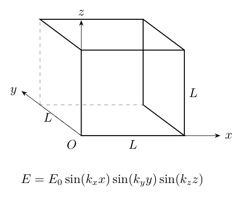
<!-- question-end -->

## 一、题型定位

边界条件、波矢量子化和态密度积分相连接的简化辐射模型。首先检验边界是否足够强，然后才进行几何计数。正确的温度四次方趋势不能反过来证明模型的边界或计数正确。

## 二、知识点

分离变量的乘积场；零函数与非零模态；棱边和面的区别；一维Dirichlet边界；波矢格点；倒空间体积及态密度；角频率与普通频率；球壳积分；连续近似；独立模态与标签冗余。

此处“相空间”实际只有三个波矢坐标，不是包含位置与动量的完整六维相空间。模型也没有自动满足电磁场的横向条件和导体壁的切向边界；下文将其作为指定的标量计数模型，不将它等同于完整电磁模态问题。

## 三、物理图像

乘积场只要某一个因子为零，整个场就为零。沿经过原点的棱，至少两个坐标为零，所以不论波矢如何取值都已满足零场。在远侧棱上，固定的两个坐标为 $L$，于是需要的是两个端点正弦因子的乘积为零，而不是三个因子各自都为零。

若额外要求每个一维因子两端均为零，就形成间距为 $\pi/L$ 的波矢格点。能量上限限制 $|\boldsymbol k|$，所以允许格点落在一个球内；积分时每一层球壳的态数乘以该层光子能量。

## 四、解题入口

先把十二条棱按平行 $x,y,z$ 分成三组，逐条代入场表达式，找出原条件的充分必要限制。然后说明离散计数为何需要补充边界，分别给出字面条件结论和附加模型下的条件解。

在离散模型中，先算单格点占据的波矢体积，再将能量上限换成半径 $k_{\max}$。总能量不是所有态数乘上限能量，因为各态能量不同，必须使用球壳加权积分。

## 五、解析

（1）逐组检查棱边条件。

先假定 $E_0\ne0$ 且 $k_x,k_y,k_z$ 都非零。以平行 $x$ 的四条棱为例，固定的 $(y,z)$ 可取 $(0,0),(L,0),(0,L),(L,L)$。

前三条棱有 $\sin(k_y0)=0$ 或 $\sin(k_z0)=0$，场恒零，不限制 $k_x$。第四条远侧棱的场为
$$E(x,L,L)=E_0\sin(k_xx)\sin(k_yL)\sin(k_zL).$$
由于 $k_x\ne0$，$\sin(k_xx)$ 在整个区间不是恒零函数。要使该棱处处为零，必须有
$$\sin(k_yL)\sin(k_zL)=0.$$
同样检查平行 $y,z$ 的远侧棱，得到
$$\boxed{
\sin(k_xL)\sin(k_yL)=0,\quad
\sin(k_xL)\sin(k_zL)=0,\quad
\sin(k_yL)\sin(k_zL)=0.
}$$
其余九条含零坐标的棱自动满足条件。图 8-2 将棱边与面分开表示，不能由一条棱上的零值擅自推断整个面都为零。

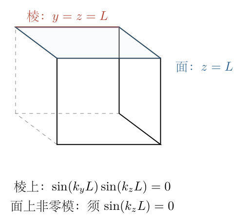

（2）解释三个乘积条件的确切含义。

记 $a_x=\sin(k_xL)$、$a_y=\sin(k_yL)$、$a_z=\sin(k_zL)$。若其中两个非零，例如 $a_xa_y\ne0$，立即违反一个条件。因此至少两个 $a_i$ 必须为零；反过来，至少两个为零时，三个两两乘积一定全为零。这是充分必要条件。

于是至少两个波矢分量满足 $k_i=n_i\pi/L$，第三个可以连续。例如
$$\boldsymbol k=\left(\frac{\pi}{L},\frac{2\pi}{L},\frac{\sqrt5}{L}\right)$$
的前两个端点因子为零，第三个不是；它依然满足全部十二条棱的零场条件。由于三个分量均非零，盒内场不是恒零，此反例不依赖零场退化。

若某个 $k_i=0$，则对应 $\sin(k_i x_i)$ 在整个盒内恒零，整个乘积场恒为零，其余两个分量可任意取值。$E_0=0$ 更使任何波矢给出同一零场。零场不能被当成无限多个不同的实际辐射模态。

（3）字面条件下，第二问没有离散三维态数。

允许集合包含沿第三个分量连续变化的直线族。若按“每一组允许波矢都是一个态”的字面规则计数，含有这类连续段的有限区域已有无穷多标签，不能用有限的三维格点密度计算。

所以仅根据棱边零场条件，不能推出 $k_x,k_y,k_z$ 都是 $\pi/L$ 的整数倍，也不能推出所拟离散模型的第（2）、（4）问数值。这是条件不足，不是积分技巧问题。下面明确补充边界后，给出模型意图对应的完整条件解。

（4）补充逐因子边界，获得三维格点。

条件解采用：每个一维因子在 $0,L$ 两端分别为零，即
$$\sin(k_xL)=\sin(k_yL)=\sin(k_zL)=0.$$
于是
$$\boxed{k_x=\frac{\pi n_x}{L},\quad k_y=\frac{\pi n_y}{L},\quad
k_z=\frac{\pi n_z}{L},\qquad n_x,n_y,n_z\in\mathbb Z.}$$
对于非零乘积场，要求六个面均零也能得到这个更强限制；但包含零场时应直接声明逐因子边界，否则零场仍使任意其他分量逃脱限制。

下文遵照简化模型把全体整数标签各算一态，包括正负及坐标为零的形式标签。它是一项明确的计数约定，并不表示这些标签全对应不同的非零物理场。独立模态的计数在后面另行比较。

（5）单格点体积和态密度。

每个轴方向的相邻标签间隔为 $\Delta k=\pi/L$。图 8-3 中每一格的体积为
$$\Delta v_k=(\Delta k)^3=\frac{\pi^3}{L^3}=\frac{\pi^3}{V}.$$
因此波矢空间体积为 $s$ 的区域，在包含足够多格点、边缘误差可忽略时，
$$\boxed{N_s\simeq\frac{s}{\Delta v_k}=\frac{Vs}{\pi^3}.}$$
态密度为 $g_k=V/\pi^3$。这里 $s$ 的量纲是长度的负三次方，不是盒内的普通空间体积；$Vs$ 为无量纲，态数才正确。

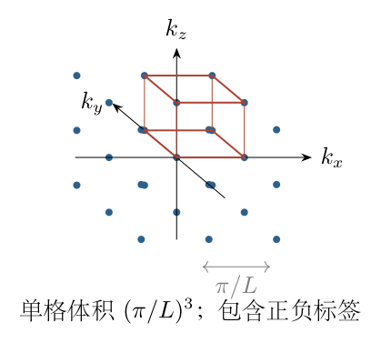

（6）从频率关系得到光子能量。

普通频率 $f$ 的量纲为每秒周数，角频率 $\omega$ 每周期增加 $2\pi$，所以
$$\omega=2\pi f,\qquad f=\frac{\omega}{2\pi}.$$
自由光子的色散关系为 $\omega=c k$，其中
$$k=|\boldsymbol k|=\sqrt{k_x^2+k_y^2+k_z^2}.$$
故
$$\varepsilon=hf=\frac{hc}{2\pi}k=\hbar ck,\qquad\hbar=\frac h{2\pi}.$$
若颠倒角频率与频率关系，会把积分上限和总能量的系数都算错；$h$ 与 $\hbar$ 也不可混用。

（7）能量上限对应波矢球。

条件 $\varepsilon\le k_BT$ 给出
$$\hbar ck\le k_BT,\qquad
\boxed{k\le k_{\max}=\frac{k_BT}{\hbar c}=\frac{2\pi k_BT}{hc}.}$$
故被占据标签位于原点为球心、半径 $k_{\max}$ 的球内，包括负波矢八个卦限。若只画正卦限就遗漏了本模型明确计入的负整数标签。球面边界的包含与否对连续近似的首项不产生影响。

（8）先算总占据态数。

球体积为 $4\pi k_{\max}^3/3$，乘态密度：
$$\begin{aligned}
N_{\mathrm{occ}}
&\simeq\frac V{\pi^3}\frac{4\pi}{3}k_{\max}^3\\
&=\frac{4V}{3\pi^2}\left(\frac{2\pi k_BT}{hc}\right)^3\\
&=\boxed{\frac{32\pi V(k_BT)^3}{3h^3c^3}}.
\end{aligned}$$
每态一个光子时，这也等于模型光子数。态数随 $T^3$ 增长，因为半径随 $T$ 增长而体积为三次方。

（9）建立球壳能量积分。

图 8-4 中半径 $k$、厚度 $dk$ 的球壳体积为 $4\pi k^2dk$，所含标签为
$$dN=\frac V{\pi^3}4\pi k^2dk.$$
每个标签能量为 $\hbar ck$，故该球壳的能量为
$$dU=\hbar ck\,dN=\frac{4V\hbar c}{\pi^2}k^3dk.$$
三次方中的两个因子来自球壳面积，一个来自光子能量；不是任意套用 $T^4$ 的经验规律。

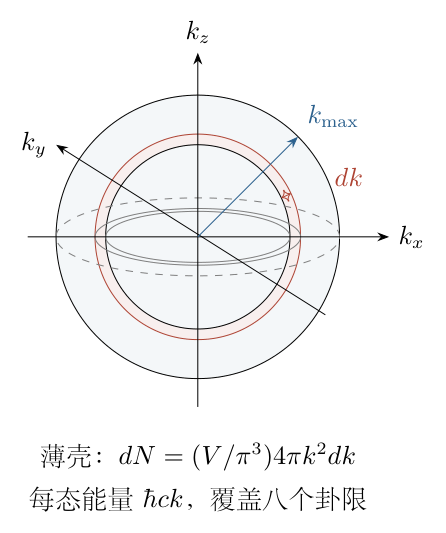

由零到上限积分，
$$\begin{aligned}
U&=\frac{4V\hbar c}{\pi^2}\int_0^{k_{\max}}k^3dk\\
&=\frac{4V\hbar c}{\pi^2}\left[\frac{k^4}{4}\right]_0^{k_{\max}}\\
&=\frac{V\hbar c}{\pi^2}k_{\max}^4\\
&=\frac{V(k_BT)^4}{\pi^2\hbar^3c^3}\\
&=\boxed{\frac{8\pi V(k_BT)^4}{h^3c^3}}.
\end{aligned}$$
最后一步用 $\hbar^3=h^3/(8\pi^3)$，使 $\pi^{-2}$ 变为 $8\pi/h^3$。该答案属于附加逐因子边界与全整数标签模型，不能说已由原来的棱边条件独立推出。

<!-- KEEP_STUDENT_START -->
（10）平均能量与数量级核验。

将总能量除以光子数，
$$\frac U{N_{\mathrm{occ}}}
=\frac{8\pi}{32\pi/3}k_BT=\frac34k_BT.$$
它小于上限 $k_BT$，合理。若直接用 $N_{\mathrm{occ}}k_BT$ 估计总能量，会大 $4/3$，因为把每个球壳都当成上限能量。

量纲方面，
$$\left[\frac{V(k_BT)^4}{h^3c^3}\right]
=\frac{\mathrm{m^3\,J^4}}{\mathrm{J^3s^3\,m^3s^{-3}}}=\mathrm J.$$
加倍 $V$ 使态数及能量加倍；加倍 $T$ 使半径加倍、光子数增八倍、平均能量增两倍，总能量增十六倍。连续近似需满足
$$\frac{k_{\max}}{\pi/L}=\frac{2Lk_BT}{hc}\gg1.$$
趋低温时不能继续用积分近似；特别是零场标签不能提供实际光子，真实非零模态有最低波矢尺度。

<!-- KEEP_STUDENT_END -->
