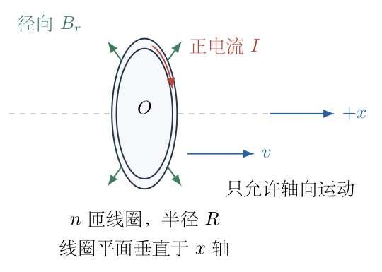
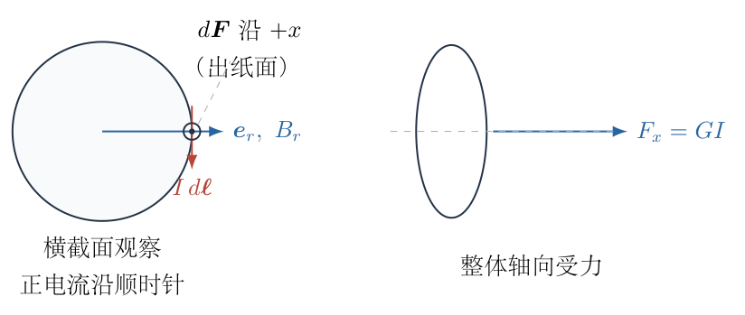
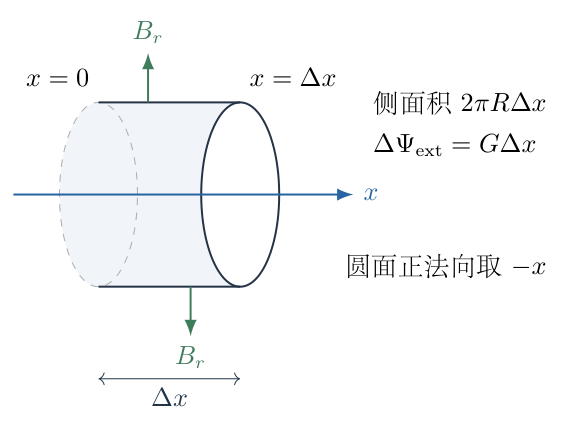
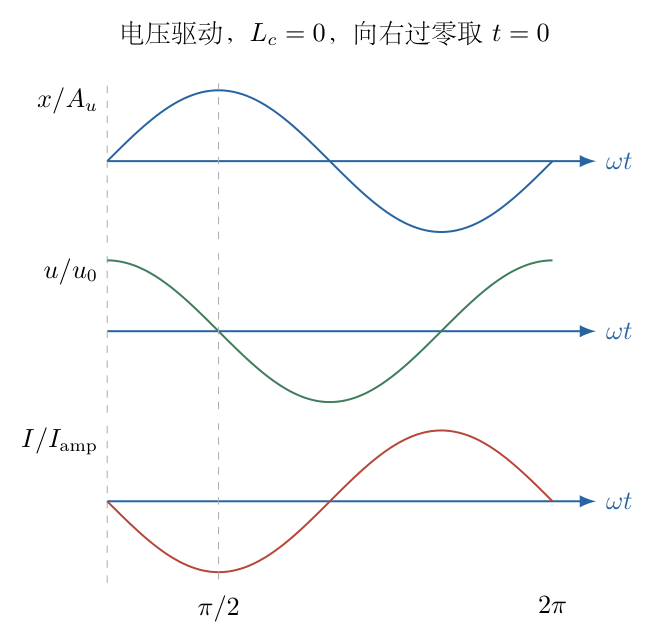
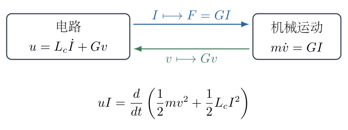

# 第 1 题

<!-- question-start -->
动圈耳机的振膜与线圈相连。用下列模型描述其电磁驱动：质量为 $m$、半径为 $R$、匝数为 $n$的圆形线圈，其平面垂直于 $x$轴，只能沿 $x$轴运动；以 $x=0$为位置基准。线圈所在处磁场具有沿半径向外的分量 $B_r$，在所研究的小位移范围内可视为常量。

（1）线圈电流为 $I=I_0\cos(\omega t+\phi)$，忽略阻力，求振膜“稳定后”的位置随时间的关系。选取时间原点，使 $t=0$时 $x=0$且向 $x$正方向运动。

（2）线圈从 $x=0$移动到 $x=\Delta x$，求总磁通匝链的变化量。

（3）忽略线圈电阻，在线圈两端施加 $u=u_0\cos(\omega t+\phi)$，求振膜“稳定后”的位置随时间的关系；时间原点同（1）。

（4）求（3）中的线圈电流。

条件说明：题目未给回复力、自感和耗散机制。因此“不计阻力”的系统不会自行达到唯一的稳定振动。解析分别给出一般运动、选定的周期特解，以及电压驱动时保留或忽略自感的结果，不把电阻可忽略等同于自感可忽略。

<!-- question-end -->

## 一、题型定位

径向磁场中的动圈电磁耦合。电流产生轴向安培力，线圈的轴向运动又产生反电动势；两种作用使用同一个耦合系数。关键是区分电流驱动与电压驱动，并识别题目未给出的机械、电学初始条件。

## 二、知识点

安培力的矢量叉乘；磁通匝链；运动电动势；法拉第定律；牛顿第二定律；周期特解与齐次解；电感电压；机械能和磁场能；相位约定；初始条件与无耗散系统的非唯一性。

本题只给径向磁场 $B_r$，不能把它乘以线圈平面的面积当作穿过线圈的磁通。线圈平面的法向是轴向，而径向场在这个平面内；磁通变化应由线圈移动时扫过的侧面积求出。

## 三、物理图像

线圈不同位置的径向磁场方向各不相同，但沿圆周流动的电流与当地径向场叉乘后，安培力均指向同一轴向。各微元的力因此可以直接叠加，而不是互相抵消。

如果电流由理想电流源规定，线圈加速度直接跟随电流，位置需要对时间积分两次。若电压由理想电压源规定，电压则要在自感电压与反电动势之间分配；只有忽略自感后，电压才直接规定速度。

## 四、解题入口

先规定正电流的绕向，使正电流产生 $+x$方向的力，定义

$$G=2\pi nRB_r>0.$$

先推 $F_x=GI$，再独立求磁通变化与反电动势，核对两者是否均含 $G$。随后分开处理 $m\ddot x=GI$与 $u=L_c\dot I+G\dot x$。这里 $L_c$是如需保留的线圈自感，题目没有提供其数值。

## 五、解析

（1）建立空间基底与电流符号。

以 $x$轴为圆形线圈的轴线。沿横截面定义外向径向单位矢量 $\boldsymbol e_r$以及绕 $+x$轴的右手圆周方向 $\boldsymbol e_\varphi$，满足

$$\boldsymbol e_r\times\boldsymbol e_\varphi=\boldsymbol e_x.$$

正电流取沿 $-\boldsymbol e_\varphi$流动。因此一段长度为 $R\,d\varphi$的导线，其沿电流方向的矢量线元为

$$d\boldsymbol \ell=-R\,d\varphi\,\boldsymbol e_\varphi.$$

径向磁场为 $\boldsymbol B_r=B_r\boldsymbol e_r$。安培力为

$$\begin{aligned}
d\boldsymbol F
&=I\,d\boldsymbol\ell\times\boldsymbol B_r\\
&=-IRB_r\,d\varphi\,
  (\boldsymbol e_\varphi\times\boldsymbol e_r)\\
&=IRB_r\,d\varphi\,\boldsymbol e_x.
\end{aligned}$$

这里用的是 $\boldsymbol e_\varphi\times\boldsymbol e_r=-\boldsymbol e_x$；第一个负号来自电流绕向，第二个负号来自叉乘顺序。

图 1-2 把每个微元的轴向力与整体线圈的合力分开。后面沿 $x$方向写动力学方程，使用的是这些微元力的总和。

单匝积分、再乘匝数：

$$\begin{aligned}
F_x
&=n\int_0^{2\pi}IRB_r\,d\varphi\\
&=2\pi nRB_r I\\
&=GI.
\end{aligned}$$

线圈所受的支撑约束只限制横向运动；本模型没有给出轴向弹簧力，因此轴向方程是

$$m\ddot x=GI,$$

而不是未经说明的 $m\ddot x+kx=GI$。若把真实耳机悬边的回复力加入，必须另给刚度；不能只凭“平衡”二字猜出其数值。

（2）电流驱动时先写一般积分结果。

代入规定电流：

$$\ddot x=\frac{GI_0}{m}\cos(\omega t+\phi).$$

先积分一次，注意 $\int\cos(\omega t+\phi)\,dt=\sin(\omega t+\phi)/\omega$：

$$\dot x=V+\frac{GI_0}{m\omega}\sin(\omega t+\phi).$$

再积分一次，使用 $\int\sin(\omega t+\phi)\,dt=-\cos(\omega t+\phi)/\omega$：

$$\boxed{x=C+Vt-\frac{GI_0}{m\omega^2}
\cos(\omega t+\phi).}$$

$C$是位置偏置，$V$是匀速漂移。它们并不会随时间自动衰减，因为题目没有阻力。这就是“稳定后”的说法需要限定的原因。

若从明确初态 $x(0)=0,\ \dot x(0)=v_i$出发，则

$$\begin{aligned}
C&=\frac{GI_0}{m\omega^2}\cos\phi,\\
V&=v_i-\frac{GI_0}{m\omega}\sin\phi.
\end{aligned}$$

代回后得到不依赖含糊“稳定”表述的一般初值解：

$$\begin{aligned}
x(t)
={}&\left(v_i-\frac{GI_0}{m\omega}\sin\phi\right)t\\
&+\frac{GI_0}{m\omega^2}
\left[\cos\phi-\cos(\omega t+\phi)\right].
\end{aligned}$$

“$v_i>0$”只是一个不等式，并不能确定其数值，因此仅有过零且向右运动还不足以指定全部初态。

（3）在周期、零平均位移的约定下选相位。

为了提取题目期望的周期部分，明确选择 $V=0$且 $C=0$，即无漂移并以周期平均位置为 $x=0$。记

$$A_I=\frac{GI_0}{m\omega^2}>0.$$

此时 $x=-A_I\cos(\omega t+\phi)$。要求 $x(0)=0$，得到 $\cos\phi=0$。与此同时

$$\dot x(0)=A_I\omega\sin\phi>0,$$

所以选 $\phi=\pi/2$，而不是 $3\pi/2$。于是

$$\boxed{x(t)=\frac{2\pi nRB_rI_0}{m\omega^2}\sin\omega t,}
\qquad I(t)=-I_0\sin\omega t.$$

验证加速度：

$$\ddot x=-A_I\omega^2\sin\omega t
=-\frac{GI_0}{m}\sin\omega t=\frac Gm I(t).$$

这是已选定初态的周期特解，不是任意初态经过等待后的统一结果。如果信号源的相位已经固定，不可以另行任意修改；这里只是将时间原点移到选定的向右过零时刻。

（4）由扫过侧面积求外磁场的磁通匝链变化。

设 $\Psi_{\rm ext}$为与正电流绕向配套的外磁通匝链。正电流沿 $-\boldsymbol e_\varphi$，所以线圈所围面的正法向取 $-\boldsymbol e_x$。线圈从 $0$向正 $x$移动 $\Delta x$，两个圆面之间形成一个短圆柱。其侧面积为

$$\Delta S_{\rm side}=2\pi R\,\Delta x.$$

图 1-3 的圆柱侧面外法向是 $\boldsymbol e_r$，侧面磁通等于 $B_r\Delta S_{\rm side}$。利用磁场无源性，再把圆面法向转换为本题的绕向，就得到匝链的增量。

以 $+x$为法向的单匝圆面磁通记为 $\Phi_+(x)$。闭合柱面的磁通总和为零：

$$\Phi_+(\Delta x)-\Phi_+(0)+2\pi RB_r\Delta x=0.$$

因此 $\Delta\Phi_+=-2\pi RB_r\Delta x$。本题正绕向的磁通是 $-\Phi_+$，于是

$$\boxed{\Delta\Psi_{\rm ext}
=2\pi nRB_r\Delta x=G\Delta x.}$$

若反过来规定正电流，磁通匝链符号和安培力符号都相应反向；可测物理运动不因记号改变。

此推导不需要知道轴向磁场的具体分布。轴向通量随位置的变化由侧面径向通量确定，不能从 $B_r$本身误写成 $\pi R^2B_r$。

（5）反电动势与电压方程。

将位移增量除以时间，在 $B_r$近似恒定的范围内有

$$\frac{d\Psi_{\rm ext}}{dt}=G\dot x.$$

沿正电流绕向的运动电动势为

$$\mathcal E_{\rm mot}
=-\frac{d\Psi_{\rm ext}}{dt}=-G\dot x.$$

这是线圈运动对驱动电源的反作用。若外电源电压 $u$按使正电流流入的方向取正，线圈电阻为零而自感为 $L_c$，则

$$u+\mathcal E_{\rm mot}=L_c\dot I,$$

即

$$\boxed{u=L_c\dot I+G\dot x.}$$

电源需要克服反电动势，因而 $G\dot x$在端电压式中是正号；不能因法拉第式中有负号就再将其写为负号。

（6）忽略自感时的电压驱动特解。

只有进一步采用 $L_c=0$的近似时，才有 $u=G\dot x$。代入 $u=u_0\cos(\omega t+\phi)$：

$$\dot x=\frac{u_0}{G}\cos(\omega t+\phi).$$

积分为

$$x=C+\frac{u_0}{G\omega}\sin(\omega t+\phi).$$

零平均位移取 $C=0$。$x(0)=0$给 $\sin\phi=0$；向右运动给 $\cos\phi>0$，所以选 $\phi=0$。得到

$$\boxed{x(t)=\frac{u_0}{2\pi nRB_r\omega}\sin\omega t.}$$

电流不是 $u$除以趋近零的电阻，因为线圈运动产生了反电动势。应由机械方程求电流：

$$\begin{aligned}
I(t)
&=\frac mG\ddot x\\
&=\frac mG\left[-\omega^2\frac{u_0}{G\omega}
                 \sin\omega t\right]\\
&=-\frac{m\omega u_0}{G^2}\sin\omega t.
\end{aligned}$$

故在这一额外近似下，

$$\boxed{I(t)=-\frac{m\omega u_0}{(2\pi nRB_r)^2}\sin\omega t.}$$

图 1-4 以已选过零时刻显示 $x$、$u$、$I$的相位。该图的电流曲线对应本段的电压驱动；不要将它与（1）中已规定的电流幅值混用。

在 $t=0$，位移为零、速度最大、电流为零。此时所需加速度为零，因此电流为零并不意味着线圈不动。在 $t=\pi/(2\omega)$，位移最大、速度为零、电流负向最大，正是改变速度方向所需的负加速度。

（7）保留自感时不能沿用上式。

由 $I=m\ddot x/G$，对时间求导得 $\dot I=m\dddot x/G$。代回端电压方程：

$$\frac{mL_c}{G}\dddot x+G\dot x=u.$$

设非共振周期特解为 $x=A_u\sin(\omega t+\phi)$。其导数为

$$\dot x=A_u\omega\cos(\omega t+\phi),\qquad
\dddot x=-A_u\omega^3\cos(\omega t+\phi).$$

将两项系数合并：

$$\begin{aligned}
u
&=\left(G\omega-\frac{mL_c\omega^3}{G}\right)
 A_u\cos(\omega t+\phi),\\
A_u
&=\frac{Gu_0}{\omega(G^2-mL_c\omega^2)}.
\end{aligned}$$

因此一般的非共振周期特解是

$$\boxed{\begin{aligned}
x_p&=\frac{Gu_0}{\omega(G^2-mL_c\omega^2)}
       \sin(\omega t+\phi),\\
I_p&=-\frac{m\omega u_0}{G^2-mL_c\omega^2}
       \sin(\omega t+\phi).
\end{aligned}}$$

若分母为正，向右过零取 $\phi=0$；若分母为负，则取 $\phi=\pi$。用正的振幅统一写为

$$A_u=\frac{G u_0}{\omega|G^2-mL_c\omega^2|}.$$

自感的省略条件是 $mL_c\omega^2/G^2\ll1$，不是电阻小。两种参数衡量的是不同的电压项。

（8）齐次运动与共振边界。

令 $\omega_e=G/\sqrt{mL_c}$。无外电压时，速度 $v=\dot x$满足

$$\ddot v+\omega_e^2v=0.$$

所以保留自感时，还可以在周期特解上叠加一个位置常量和频率 $\omega_e$的自由振动。系统没有耗散，这些初始振动不会自动消失。

如果驱动频率恰等于 $\omega_e$，周期特解分母为零。这不表示线圈位移真的取“无穷大常量”，而表示假设的同频有界特解不存在。速度满足

$$\ddot v+\omega_e^2v=\frac{G u_0}{mL_c}\cos\omega_e t.$$

共振特解为

$$v_p=\frac{G u_0}{2mL_c\omega_e}\,t\sin\omega_e t.$$

直接求两次导数可得左侧等于 $G u_0\cos\omega_e t/(mL_c)$；其包络随 $t$增长。实际系统的阻尼、回复力和有限磁隙会限制振幅，但题目没有给出这些参数，不能由当前模型计算稳定振幅。

（9）用功率检查耦合符号。

机械方程乘速度：

$$GI\dot x
=m\ddot x\dot x
=\frac{d}{dt}\left(\frac12m\dot x^2\right).$$

端电压方程乘电流：

$$\begin{aligned}
uI
&=L_cI\dot I+GI\dot x\\
&=\frac{d}{dt}\left(\frac12L_cI^2\right)
 +\frac{d}{dt}\left(\frac12m\dot x^2\right).
\end{aligned}$$

图 1-5 中 $GI$与 $Gv$共享系数，式中机械功率正是 $GIv$。能量式要求两处符号配套，也解释了周期运动中电源可以在一部分时间吸收返回的能量。

在忽略自感的周期特解中，$u\propto\cos\omega t$、$I\propto-\sin\omega t$，其周期平均乘积为零。电源并非不做瞬时功，而是在一个周期中将机械能送出又收回。若有电阻，则平均电功还需承担焦耳热；那是本模型以外的耗散项。

（10）量纲、小位移与结果适用范围。

$G$既可写作 $\mathrm{N/A}$，也可写作 $\mathrm{V\,s/m}$。因而 $GI$是力，$Gv$是电压，$G\Delta x$是磁通匝链。

电流驱动的振幅 $GI_0/(m\omega^2)$具有长度量纲；忽略自感的电压驱动振幅 $u_0/(G\omega)$同样具有长度量纲。两式对频率的依赖不同，分别是 $\omega^{-2}$与 $\omega^{-1}$，源于一个规定加速度、一个规定速度。

低频时振幅增大，可能超出 $B_r$近似恒定的磁隙范围；因此不能把公式外推到任意小频率。$\omega=0$应另解恒定电流或恒定电压问题，不能把含 $1/\omega$的谐振表达式直接代入零频。

本题能够确定的结论是 $F=GI$、$\Delta\Psi_{\rm ext}=G\Delta x$及电磁耦合方程。只在明确选择无漂移周期特解、并在电压题中额外忽略自感后，才得到前述简洁正弦位移和电流。

## 六、关键洞察

安培力系数与反电动势系数相同，是能量一致性的要求。若误将二者分别写成 $2\pi nRB_r$与 $\pi nR^2B_r$，不仅长度次数不符，也无法令电功等于机械功。

“稳定后”暗示过渡运动消失，但这里没有能量耗散。因此解题不能只给一个正弦式就声称所有初态均会趋向它。周期特解是一个可以选定的运动，不是一个吸引其他初态的稳定极限。

实际悬边的回复力若为 $-kx$，电流驱动的周期位移可由 $(k-m\omega^2)x$的幅值关系求出。自由模型对应 $k=0$，不应把真实器件的回复力悄悄纳入而又省略参数。

## 七、易错点

正电流绕向未定义就报安培力正负号；把径向场当成穿过圆面的轴向场；两次积分漏掉常量或相位负号；只给 $x(0)=0$就丢弃自由运动；把电阻趋零理解为电流无限；忽略自感但不说明条件；把共振处分母为零当成稳定解；不检查振幅是否仍在小位移范围。

电压驱动中的 $\phi=0$与电流驱动中的 $\phi=\pi/2$并不冲突，它们对应两种不同源约束。不能要求同一个规定电流与规定电压同时具有同相正余弦形式，却仍套用这两组结果。

## 八、课堂讲解建议

先让学生在横截面上确定一小段电流和径向磁场，再用右手法则得到轴向力。板书中固定同一电流正方向，并要求学生说明为什么圆周各段力不是相互抵消。

由电流源规定加速度开始，完整积分两次，暂不删除两个积分常量。随后讨论为何“等待足够久”不能消除无阻尼系统的自由运动。电压驱动时先画出自感与反电动势两个电压项，最后才讨论什么时候允许舍去自感。

讲解磁通变化时用短圆柱闭合面，而不是给圆面涂上径向磁场箭头。让学生用 $uI$与 $GIv$的等式反查整套符号，并对比两个驱动方式的频率响应。

## 九、变式训练

变式一：线圈增加轴向弹簧，刚度为 $k>0$，忽略阻尼；仍用 $I=I_0\cos\omega t$驱动。求非共振周期位移，并给出共振时的一个特解。

完整解答：方程为 $m\ddot x+kx=GI_0\cos\omega t$。取 $x=A\cos\omega t$，代入后有

$$(-m\omega^2+k)A=GI_0,$$

所以

$$x_p=\frac{GI_0}{k-m\omega^2}\cos\omega t.$$

当 $\omega<\sqrt{k/m}$时位移与电流同相；大于这一频率时反相。另有频率 $\sqrt{k/m}$的自由振动，除非指定初态，否则不能删去。

在 $\omega=\omega_0=\sqrt{k/m}$处，试取 $x_p=Ct\sin\omega_0t$。其二阶导数为 $C(2\omega_0\cos\omega_0t-\omega_0^2t\sin\omega_0t)$。弹簧项与含 $t\sin$的惯性项抵消，剩下

$$2mC\omega_0\cos\omega_0t=GI_0\cos\omega_0t.$$

故 $C=GI_0/(2m\omega_0)$，共振特解为 $x_p=GI_0t\sin\omega_0t/(2m\omega_0)$。包络增长，再次说明无阻尼时没有有限稳定振幅。

<!-- KEEP_TOGETHER_START -->
变式二：没有弹簧，电源短接，电阻为 $\mathcal R>0$，忽略自感。线圈初速度为 $v_i>0$、初位置为零，求运动与耗散热量。

完整解答：端电压为零，$\mathcal R I+Gv=0$给 $I=-Gv/\mathcal R$。代入 $m\dot v=GI$：

$$\dot v=-\frac{G^2}{m\mathcal R}v.$$

分离变量并用初态确定常量，得

$$v=v_i e^{-t/\tau},\quad
x=v_i\tau(1-e^{-t/\tau}),\quad
\tau=\frac{m\mathcal R}{G^2}.$$

焦耳热为

$$\begin{aligned}
Q
&=\int_0^\infty \mathcal R I^2dt\\
&=\frac{G^2v_i^2}{\mathcal R}
  \int_0^\infty e^{-2t/\tau}dt\\
&=\frac{G^2v_i^2\tau}{2\mathcal R}
=\frac12mv_i^2.
\end{aligned}$$

初动能全部转化为热，线圈最终静止。这里的指数衰减确实能消除初始运动，原因是加入了明确定义的耗散机制，而不是换一种说法称它“稳定”。
<!-- KEEP_TOGETHER_END -->
