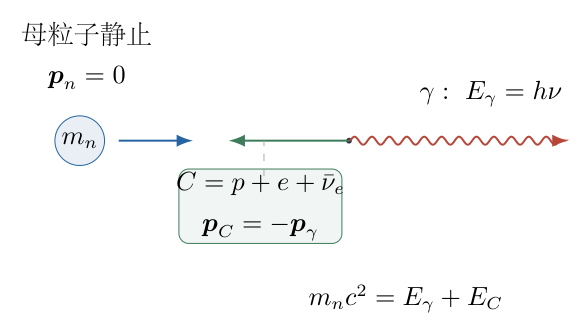
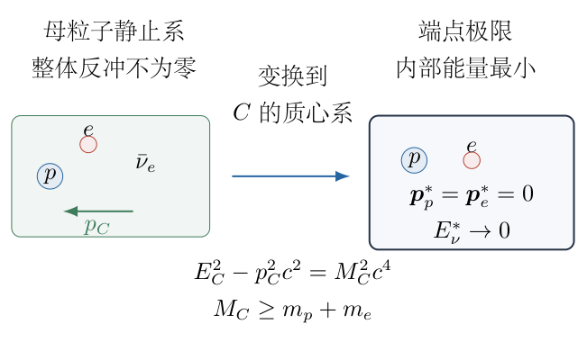
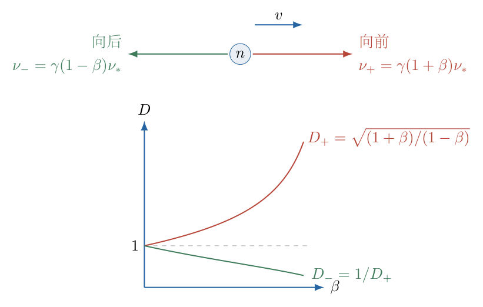

# 第 2 题

<!-- question-start -->
一个静止的中性粒子衰变为一个质子、一个电子、一个反电子中微子和一个光子。在大量衰变事件中，测得光子的最大频率为 $\nu_m$。已知质子和电子的静质量分别为 $m_p$、$m_e$，普朗克常量为 $h$，光速为 $c$。

（1）求原中性粒子的静质量 $m_n$。

（2）若原粒子在实验室系中并非完全静止，而是可能具有不超过 $v_0$ 的速度，讨论最大光子频率的变化，以及仍把它当作静止衰变端点时算出的表观质量 $m'_n$。

条件说明：采用中微子静质量可忽略的近似，“最大频率”表示衰变运动学端点；第二问假定样本能逼近最大速度且能采集向前发射的端点光子。若这些条件不成立，仅给速度上界不能保证观测样本恰好达到理论端点。

<!-- question-end -->

## 一、题型定位

多体衰变的运动学端点问题。核心不是逐个猜测产物的速度，而是把未单独测量的质子、电子和中微子视为一个总反冲系统，用能量与动量同时守恒，确定这个系统的不变质量下界。第二问还涉及光子的相对论多普勒效应和错误静止假设造成的质量偏差。

## 二、知识点

相对论总能量 $E^2=p^2c^2+m^2c^4$；光子关系 $E_\gamma=h\nu=cp_\gamma$；能量与动量守恒；复合系统的不变质量；两体反冲的等效处理；洛伦兹变换中的光子能量变换；运动学端点、统计样本最大值和测量误差的区别。

质子和电子的 $m_p$、$m_e$均为静质量，不能用它们乘以 $c^2$替代运动后的总能量。母粒子的静质量不因观察系改变，改变的是实验室光子频率，以及用不适用公式算出的表观质量。

## 三、物理图像

把一个光子单独拿出来后，其余三个粒子的总动量必须与光子动量大小相等、方向相反。即使中微子的能量趋于零，两个有质量的产物仍须共同反冲，不能都留在母粒子静止系的原处。

同一光子频率可以对应多种产物内部运动状态；最大频率出现在反冲系统内部能量尽可能小的端点。端点处质子与电子没有相对运动，但它们相对于母粒子仍一起运动。图中的“整体反冲”是这种区别的表示，不是认为三个产物粘成一个新粒子。

母粒子向观察者运动时，向前发射的光子被蓝移。若忽略母粒子的运动，把蓝移后的端点当作静止端点，则会高估母粒子的静质量。

## 四、解题入口

先定义质子和电子的静质量和

$$M_0=m_p+m_e,$$

再把除光子外的全部产物合为系统 $C$，设其不变质量为 $M_C$。按顺序完成：写出 $C$ 的总能量和总动量；由不变量消去反冲动量；证明 $M_C\geq M_0$；把下界代入以获得光子端点；最后解出 $m_n$并筛除负质量根。

第二问先在母粒子静止系确定同一个端点，再将该光子的四动量变换到实验室系。不能在原静止系公式中直接把 $m_n$ 换成所谓“相对论质量”。

## 五、解析

（1）选定参考系并写出光子动量。

第一问取母粒子静止系。设一件事件中光子沿 $+x$方向发射，其能量为 $E_\gamma$。光子静质量为零，因此

$$E_\gamma=h\nu,\qquad p_\gamma=\frac{E_\gamma}{c}.$$

母粒子初动量为零，初总能量为 $m_nc^2$。把质子、电子和中微子组成的总系统记为 $C$，不对它们各自的方向作额外假定。动量守恒给出

$$\boldsymbol p_C=-\boldsymbol p_\gamma,$$

所以

$$p_C=\frac{E_\gamma}{c}.$$

这里是三粒子动量的矢量和与光子动量相反，不是每一个产物都必须单独与光子反向。

（2）利用总反冲系统的不变量消元。

图 2-2 左侧把复杂的四体衰变改写为“一个光子与一个总反冲系统”；右侧区分系统整体平动与内部相对运动。随后使用的是图中 $E_C$、$p_C$和 $M_C$，并不把系统的总能量误写为静能。

能量守恒为

$$m_nc^2=E_\gamma+E_C,$$

因此

$$E_C=m_nc^2-E_\gamma.$$

总系统 $C$的不变质量由总能量和总动量定义：

$$E_C^2-p_C^2c^2=M_C^2c^4.$$

把前两步的结果代入，逐项展开：

$$\begin{aligned}
M_C^2c^4
&=(m_nc^2-E_\gamma)^2-
\left(\frac{E_\gamma}{c}\right)^2c^2\\
&=m_n^2c^4-2m_nc^2E_\gamma+E_\gamma^2-E_\gamma^2\\
&=m_n^2c^4-2m_nc^2E_\gamma.
\end{aligned}$$

两处 $E_\gamma^2$恰好相消，来源是光子的能量—动量关系，不是忽略一个高阶小量。于是

$$\boxed{E_\gamma=\frac{m_n^2-M_C^2}{2m_n}c^2.}$$

这是给定 $M_C$时的严格反冲关系。多体衰变的复杂性现在集中在 $M_C$可以取哪些值。

（3）证明反冲系统不变质量的下界。

由于系统 $C$中包含质子和电子两个正静质量粒子，它的总四动量是类时的，可以选取 $C$的质心系。在该系中，总动量为零，总能量就是 $M_Cc^2$。设各产物在此系中的动量分别为 $\boldsymbol p_p^*$、$\boldsymbol p_e^*$、$\boldsymbol p_\nu^*$，星号只表示所取参考系，不表示新粒子。

中微子静质量可忽略时，各项能量为

$$\begin{aligned}
E_p^*&=\sqrt{m_p^2c^4+p_p^{*2}c^2}\geq m_pc^2,\\
E_e^*&=\sqrt{m_e^2c^4+p_e^{*2}c^2}\geq m_ec^2,\\
E_\nu^*&=c|\boldsymbol p_\nu^*|\geq0.
\end{aligned}$$

相加得到

$$\begin{aligned}
M_Cc^2
&=E_p^*+E_e^*+E_\nu^*\\
&\geq(m_p+m_e)c^2,
\end{aligned}$$

也就是

$$\boxed{M_C\geq M_0=m_p+m_e.}$$

达到下界所需的极限状态是：质子和电子在 $C$的质心系中都静止，中微子能量趋于零。变换回母粒子静止系，质子和电子以同一个速度整体反冲。因此“不变质量最小”不是“反冲动量为零”。

严格说来，一个具有正能量的真实中微子事件不能恰好等于零能量状态。因此无质量中微子近似下的“最大”是可逼近的上端点，而不要求有限数据中某件事件正好位于端点。

（4）确定光子能量端点。

在 $m_n$固定时，前面的反冲关系对 $M_C$求导为

$$\frac{\partial E_\gamma}{\partial M_C}
=-\frac{M_C}{m_n}c^2<0.$$

所以 $M_C$越小，光子能量越大。将允许的下界 $M_C=M_0$代入，得到

$$\boxed{h\nu_m
=\frac{m_n^2-(m_p+m_e)^2}{2m_n}c^2.}$$

衰变必须在能量上允许，故 $m_n\geq M_0$。若光子端点为正，则有严格不等式 $m_n>M_0$。

（5）解出母粒子质量并选择物理解。

定义具有质量量纲的参数

$$\varepsilon=\frac{h\nu_m}{c^2}.$$

端点关系变为

$$\varepsilon=\frac{m_n^2-M_0^2}{2m_n}.$$

先乘以正量 $2m_n$，再把全部项移到左边：

$$m_n^2-2\varepsilon m_n-M_0^2=0.$$

用求根公式，保留判别式化简过程：

$$\begin{aligned}
m_n
&=\frac{2\varepsilon\pm
\sqrt{4\varepsilon^2+4M_0^2}}{2}\\
&=\varepsilon\pm\sqrt{\varepsilon^2+M_0^2}.
\end{aligned}$$

由于 $M_0>0$，有 $\sqrt{\varepsilon^2+M_0^2}>\varepsilon$。负号根为负数，不代表母粒子的正静质量，必须舍去。最终

$$\boxed{m_n=
\frac{h\nu_m}{c^2}+
\sqrt{\left(\frac{h\nu_m}{c^2}\right)^2+(m_p+m_e)^2}.}$$

（6）核对端点反冲的能量收支。

端点处总反冲系统的能量由总能量减去光子能量得到：

$$\begin{aligned}
E_{C,m}
&=m_nc^2-\frac{m_n^2-M_0^2}{2m_n}c^2\\
&=\frac{m_n^2+M_0^2}{2m_n}c^2.
\end{aligned}$$

其整体反冲动能为

$$\begin{aligned}
K_{C,m}
&=E_{C,m}-M_0c^2\\
&=\frac{m_n^2+M_0^2-2m_nM_0}{2m_n}c^2\\
&=\boxed{\frac{(m_n-M_0)^2}{2m_n}c^2}>0.
\end{aligned}$$

定义可释放的总静能差 $Q=(m_n-M_0)c^2$，则

$$\begin{aligned}
Q-K_{C,m}
&=(m_n-M_0)c^2-
\frac{(m_n-M_0)^2}{2m_n}c^2\\
&=\frac{(m_n-M_0)(m_n+M_0)}{2m_n}c^2\\
&=h\nu_m.
\end{aligned}$$

因此端点光子能量略小于总静能差，差额就是必需的整体反冲动能。直接写 $m_n=M_0+h\nu_m/c^2$会漏掉这部分能量。

还可核对反冲速率。由 $p_C=E_\gamma/c$、$p_Cc/E_C=\beta_C$，

$$\beta_{C,m}=
\frac{m_n^2-M_0^2}{m_n^2+M_0^2}<1.$$

这个结果满足有质量系统的速度不能达到光速。

（7）小能量差近似及近似误差。

当 $\varepsilon\ll M_0$时，将平方根写为

$$\sqrt{M_0^2+\varepsilon^2}
=M_0\sqrt{1+\frac{\varepsilon^2}{M_0^2}}.$$

利用 $\sqrt{1+s}=1+s/2+O(s^2)$，保留至 $\varepsilon^2$项：

$$m_n=M_0+\varepsilon+
\frac{\varepsilon^2}{2M_0}
+O\!\left(\frac{\varepsilon^4}{M_0^3}\right).$$

前两项是忽略反冲的近似；第三项是质量修正，必须是正的。精确差值也可以有理化而不用展开：

$$\begin{aligned}
m_n-(M_0+\varepsilon)
&=\sqrt{M_0^2+\varepsilon^2}-M_0\\
&=\frac{\varepsilon^2}
{\sqrt{M_0^2+\varepsilon^2}+M_0}>0.
\end{aligned}$$

这一形式在 $\varepsilon$很小时便于数值计算，避免两个接近的大数相减。

（8）第二问：把端点光子变换到实验室系。

为避免同一个符号同时表示静止端点与移动样本端点，将第一问的母粒子静止系端点记为 $\nu_{*,m}$。令母粒子沿实验室 $+x$方向以速度 $v$运动，定义

$$\beta=\frac vc,\qquad
\gamma=\frac1{\sqrt{1-\beta^2}}.$$

在母粒子静止系中，某光子与母粒子运动方向的夹角为 $\vartheta_*$。光子在该系中的 $x$动量为

$$p_{\gamma x}^*=\frac{E_\gamma^*}{c}\cos\vartheta_*.$$

洛伦兹能量变换给出

$$\begin{aligned}
E_\gamma^{\rm lab}
&=\gamma(E_\gamma^*+vp_{\gamma x}^*)\\
&=\gamma E_\gamma^*(1+\beta\cos\vartheta_*).
\end{aligned}$$

这一步同时包含能量和动量，不是把频率简单乘以 $\gamma$。

图 2-3 中向前光子取 $\cos\vartheta_*=1$，向后取 $-1$。端点频率的最大蓝移对应向前发射；只有速度和发射方向都能达到极值，才能达到图中理论上边界。

（9）求实验室端点的最大放大因子。

对给定 $v\geq0$，向前发射因子为

$$\begin{aligned}
D(\beta)
&=\gamma(1+\beta)\\
&=\frac{1+\beta}{\sqrt{(1-\beta)(1+\beta)}}\\
&=\sqrt{\frac{1+\beta}{1-\beta}}.
\end{aligned}$$

平方根内的比值对 $\beta$求导为

$$\frac{d}{d\beta}\frac{1+\beta}{1-\beta}
=\frac{2}{(1-\beta)^2}>0,$$

故 $D$随速度单调增大。取 $\beta_0=v_0/c$，最大因子为

$$D_0=\sqrt{\frac{1+\beta_0}{1-\beta_0}}.$$

在题设样本能够逼近极值的条件下，实验室端点为

$$\boxed{\nu_m^{\rm lab}=D_0\nu_{*,m}.}$$

如果只知道 $v\leq v_0$而不知道样本是否含有相应的速度、方向和端点事件，那么只能保证单件光子满足 $\nu^{\rm lab}\leq D_0\nu_{*,m}$，不能把有限样本中测得的最大值无条件替换为等号。

（10）写出误用静止公式得到的表观质量。

令

$$\varepsilon_*=\frac{h\nu_{*,m}}{c^2}
=\frac{m_n^2-M_0^2}{2m_n}.$$

移动样本的实验室端点具有 $\varepsilon_{\rm lab}=D_0\varepsilon_*$。若把它错误地代入第一问静止公式，得到

$$\boxed{m'_n=D_0\varepsilon_*+
\sqrt{D_0^2\varepsilon_*^2+M_0^2}.}$$

若希望只用真实 $m_n$、$M_0$和 $v_0$表示，则为

$$\boxed{m'_n=
D_0\frac{m_n^2-M_0^2}{2m_n}
+\sqrt{
D_0^2\left(\frac{m_n^2-M_0^2}{2m_n}\right)^2+M_0^2}.}$$

第二式不是说真实静质量变成 $m'_n$，而是报告错误分析方法所得的数值。

函数 $f(\varepsilon)=\varepsilon+\sqrt{\varepsilon^2+M_0^2}$的导数为

$$f'(\varepsilon)=1+
\frac{\varepsilon}{\sqrt{\varepsilon^2+M_0^2}}>0.$$

所以只要 $v_0>0$且衰变端点为正，便有 $D_0>1$、$m'_n>m_n$：误差方向是高估。

（11）若问题是用已知速度纠正实测端点。

这一问与“计算表观质量”要区分。设真正测得的移动样本端点为 $\nu_m^{\rm lab}$，并且确认已达到 $D_0$放大后的理论端点，那么先去除蓝移：

$$\nu_{*,m}=\frac{\nu_m^{\rm lab}}{D_0}.$$

然后静质量为

$$\boxed{m_n=
\frac{h\nu_m^{\rm lab}}{D_0c^2}
+\sqrt{\left(\frac{h\nu_m^{\rm lab}}{D_0c^2}\right)^2+M_0^2}.}$$

同一实验室频率若不作此修正，则得到较大的 $m'_n$。写清频率属于哪个系，才能避免两个正确公式看上去相互矛盾。

<!-- KEEP_STUDENT_START -->
（12）量纲、极限及独立数值核验。

$h\nu/c^2$的量纲为质量；平方根内各项为质量平方。$v_0\to0$时 $D_0\to1$，表观质量恢复真实质量。$\nu_{*,m}\to0$时 $m_n\to M_0$，对应衰变静能差趋于零。

用不涉及具体粒子常数的一组归一化数据检查反冲。取 $c=1$、$M_0=1$、真实 $m_n=1.05$，由两体反冲关系得到

$$\begin{aligned}
E_{\gamma,m}
&=\frac{1.05^2-1^2}{2(1.05)}\\
&=\frac{0.1025}{2.10}
\approx0.04880952381.
\end{aligned}$$

直接用动量 $p_C=E_{\gamma,m}$计算反冲能量：

$$E_C=\sqrt{1+p_C^2}\approx1.00119047619.$$

相加得 $E_{\gamma,m}+E_C=1.05$，同时恢复初总能量和零总动量。反代求根公式也得到 $m_n=1.05$。取 $\beta_0=0.3$，

$$D_0=\sqrt{\frac{1.3}{0.7}}\approx1.36277029,$$

于是错误静止分析得 $m'_n\approx1.06872593>1.05$。数值核验使用的是原始能量—动量关系，而不只是重复最终质量公式。
<!-- KEEP_STUDENT_END -->

## 六、关键洞察

“不可测的中微子能量”并不意味着无法确定母粒子质量；端点提供的是一个优化条件。把多体产物聚合后，必须求的是不变质量最小值，而不是让所有产物在同一个参考系中都静止。整体反冲动能和内部动能具有不同作用：内部动能增大 $M_C$，使光子端点下降；整体反冲则即使在 $M_C$最小时也不能消失。

小能量差时反冲修正虽小，却决定精确公式的结构。判断是否可略去，应比较 $\varepsilon/M_0$而不是只看光子频率数值“大不大”。不同粒子质量下，同一光子能量对应的相对反冲误差不同。

另一条证明路线是直接在母粒子静止系把质子和电子共同反冲，写 $m_nc^2=E_\gamma+\sqrt{M_0^2c^4+E_\gamma^2}$。移项平方也得到端点式，但它必须以事先证明的最小不变质量为前提，不能直接把三个粒子未经论证地合成静质量和。

## 七、易错点

只写能量守恒而不写动量守恒，会得 $m_n=M_0+\varepsilon$；此式少了正的反冲修正。让质子和电子都在母粒子系静止，又让中微子能量为零，会使光子动量无法平衡。如果让中微子单独承担反向动量，它必须承担与光子相等的能量，反而不是最大光子能量状态。

用 $\gamma h\nu$作为所有方向的频移，会漏掉 $1+\beta\cos\vartheta_*$。把 $m'_n$称作运动后“真实质量”，则混淆了静质量和推断偏差。只有速度上界而没有端点采集假设时，等号必须改为上界关系。

中微子质量可忽略并不等于任何事件中中微子能量都为零。零能量只是端点极限；真实谱形、衰变概率和仪器分辨率不由本题的纯运动学关系决定。

## 八、课堂讲解建议

先让学生画出母粒子静止时的总动量箭头，问“光子向右飞走后，剩下的系统能否完全不动”。在学生否定之后，再引入总反冲系统，先完成两体式的能量代数，不急于引入所有单粒子速度。

第二步在板书中分开写两栏：母粒子系负责整体反冲，反冲系统质心系负责不变质量下界。用不同上标标明参考系，避免把“质子电子静止”误放到同一个参考系。最后用归一化数值检验，展示忽略反冲得到的质量确实偏小。

多普勒部分先处理向前和向后两个方向，再推广角度公式。讨论表观质量时，要求学生口头说明每一个 $\nu$属于哪个参考系；这样比单独背诵一个修正因子更可靠。

## 九、变式训练

（1）若中微子有已知正静质量 $m_\nu$，求最大光子频率对应的母粒子质量，并说明与无质量近似的差别。

完整解答：在总反冲系统质心系中，各产物总能量不小于各自静能之和，故 $M_C\geq m_p+m_e+m_\nu$。三个粒子共同静止于该系时达到下界，它们在母粒子系中共同反冲。令 $M_{\min}=m_p+m_e+m_\nu$，则

$$h\nu_m=\frac{m_n^2-M_{\min}^2}{2m_n}c^2,$$

所以

$$\boxed{m_n=\frac{h\nu_m}{c^2}
+\sqrt{\left(\frac{h\nu_m}{c^2}\right)^2+
(m_p+m_e+m_\nu)^2}.}$$

与无质量近似相比，同一实测端点要求更大的母粒子质量；不能单独把 $m_\nu$加到旧答案外面，因为平方根内部也改变。

<!-- KEEP_TOGETHER_START -->
（2）同一速度的母粒子束，分别测得严格向前、向后光子端点 $\nu_+$、$\nu_-$。求束流速度与无蓝移端点，并求母粒子静质量。

完整解答：两个方向的变换为

$$\nu_+=\gamma(1+\beta)\nu_{*,m},\qquad
\nu_-=\gamma(1-\beta)\nu_{*,m}.$$

相乘时 $\gamma^2(1-\beta^2)=1$，故

$$\boxed{\nu_{*,m}=\sqrt{\nu_+\nu_-}.}$$

相加、相减分别得到 $\nu_++\nu_-=2\gamma\nu_{*,m}$与 $\nu_+-\nu_-=2\gamma\beta\nu_{*,m}$，相除得

$$\boxed{\beta=\frac{\nu_+-\nu_-}{\nu_++\nu_-},\qquad v=c\beta.}$$

将几何平均端点代入静止质量公式：

$$\boxed{m_n=\frac{h\sqrt{\nu_+\nu_-}}{c^2}
+\sqrt{\frac{h^2\nu_+\nu_-}{c^4}+(m_p+m_e)^2}.}$$

只用向前频率会高估质量，向后频率会低估质量；几何平均恰好消除束流速度。该方法要求两个方向都测得同一静止衰变谱的端点，而不是把两件任意事件的频率相乘。
<!-- KEEP_TOGETHER_END -->
