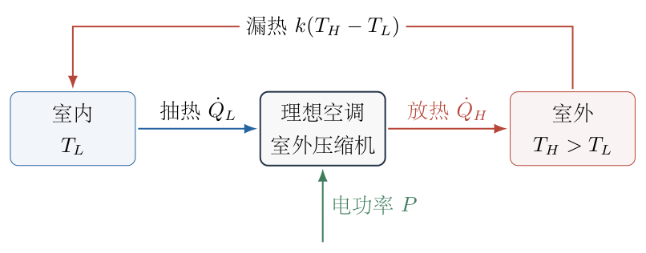
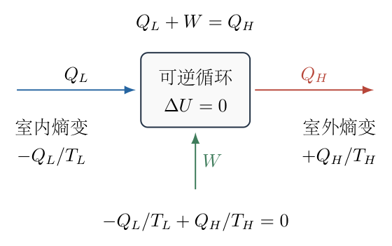
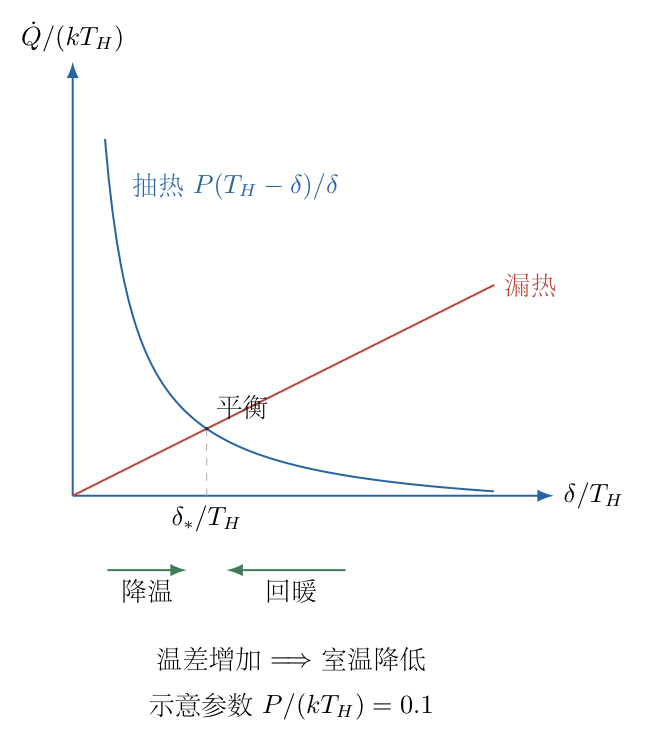

# 第 4 题

<!-- question-start -->
一台理想空调在温度为 $T_L$的房间内吸热，并向温度为 $T_H$的室外环境放热，$0<T_L<T_H$。每个循环从室内吸收热量 $Q_L$，向室外放出热量 $Q_H$，消耗电能 $W$。压缩机置于室外，空调达到两热源之间允许的极限制冷性能。

（1）空调耗电功率为 $P$，求单位时间内从室内抽走的热量。

（2）房间通过围护结构从室外漏入热量，漏热功率为 $k\Delta T$，其中 $k>0$为常数，$\Delta T=T_H-T_L$。耗电功率 $P$固定，求空调可维持的最低室温。

（3）取 $k=173\ \mathrm{W/K}$，室外温度 $40\,^{\circ}\mathrm C$，室温 $25\,^{\circ}\mathrm C$，求稳态耗电功率。

模型说明：热力学温度均用开尔文；摄氏温差与开尔文温差数值相同。整个制冷循环与室内外有热交换，不能称为整个循环绝热；“极限性能”按可逆Carnot制冷循环处理。除给定漏热外不计室内其他热源，室外温度恒定。

<!-- question-end -->

## 一、题型定位

理想制冷机与环境漏热共同决定的稳态温度问题。第一問通过热力学第一、第二定律求制冷性能系数，第二问将制冷功率与漏热功率联立，筛除不属于制冷状态的代数根，第三问进行开尔文温度和功率的数值计算。

“最低温度”不是把空调抽走的热量累积到无穷大，而是随着室温降低，漏热增大、理想制冷能力减弱，最终只能维持某个平衡温度。该温度还应能稳定地抵抗微小扰动。

## 二、知识点

循环系统内能改变量为零；可逆热量与热源熵变；Carnot制冷性能系数；功率与每循环能量的转换；稳态热收支；二次方程根筛选；摄氏温度与绝对温度；平衡点稳定性；有理化及小参数极限检验。

空调的制冷性能系数是 $Q_L/W$，不是热机效率 $W/Q_H$。这个比值可以大于 $1$，因为电能的作用是搬运室内原有的热量，并非把全部冷量凭空变成电能。

## 三、物理图像

房间向外移走热量的通道是空调，向内流入热量的通道是墙壁、窗户等围护结构。室外越热、室内越冷，漏热越大。与此同时，在较大的温差下把热量从低温处搬到高温处需要更多电功，每瓦电功可抽走的热量减少。

压缩机放在室外意味着耗电后产生的热量随室外放热端排出，不另外在室内成为 $P$大小的热源。稳态室内收支应比较“漏热”与“制冷抽热”，不能把整个室外放热功率再加回室内。

## 四、解题入口

先统一取 $Q_L$、$Q_H$、$W$为正的能量大小，用热量箭头决定各项的方向。循环能量守恒给 $Q_H=Q_L+W$，可逆条件给 $Q_L/T_L=Q_H/T_H$。两式消去 $Q_H$，得到每瓦电功对应的抽热功率。

再定义温差 $\delta=T_H-T_L>0$。把漏热 $k\delta$与抽热 $P(T_H-\delta)/\delta$相等，先解温差再还原室温。这样可以直接检查温差是否在 $0$与 $T_H$之间，避免把超过室外温度的根当成制冷解。

## 五、解析

（1）写清循环中的能量流向。

以空调内部工质为研究对象。一个完整循环结束时工质回到初态，故其内能改变为

$$\Delta U_{\rm cycle}=0.$$

室内向工质输入热量 $Q_L$，电源向机器输入功 $W$，机器向室外输出热量 $Q_H$。第一定律因此为

$$Q_L+W-Q_H=0,$$

即

$$\boxed{Q_H=Q_L+W.}$$

这里的 $Q_H$比 $Q_L$大，差值正是耗电能量。把两端热量写成相等，会漏掉电源对循环的输入。

图 4-2 的三个箭头对应这三个能量项。后面的推导先用左、右热源的熵变，最后再把这些能量除以循环时间；图中的室外总放热不等于室内抽热。

（2）由可逆条件得到热量比。

室内热源失去 $Q_L$，其熵变为

$$\Delta S_L=-\frac{Q_L}{T_L}.$$

室外热源得到 $Q_H$，其熵变为

$$\Delta S_H=\frac{Q_H}{T_H}.$$

工质完成循环后自身熵变为零。机器达到理想极限时，整个过程可逆，两热源总熵变为零：

$$-\frac{Q_L}{T_L}+\frac{Q_H}{T_H}=0.$$

从而

$$\frac{Q_H}{Q_L}=\frac{T_H}{T_L}.$$

实际不可逆机器则有 $Q_H/T_H-Q_L/T_L>0$，对应同样热量搬运需更大的功；本题采用等号的理想上限。

（3）消去 $Q_H$并求制冷性能系数。

代入能量关系 $Q_H=Q_L+W$：

$$\frac{Q_L+W}{T_H}=\frac{Q_L}{T_L}.$$

乘以正量 $T_HT_L$：

$$T_L(Q_L+W)=T_HQ_L.$$

展开并移项：

$$\begin{aligned}
T_LQ_L+T_LW&=T_HQ_L,\\
T_LW&=(T_H-T_L)Q_L.
\end{aligned}$$

所以

$$\boxed{\mathrm{COP}_{\rm C}=\frac{Q_L}{W}
=\frac{T_L}{T_H-T_L}.}$$

两边均无量纲；分母必须为正温差。若换成热机效率 $1-T_L/T_H$，将得到完全不同且不适用于制冷的问题。

（4）由每循环能量变为抽热功率。

设一个循环的时间为 $\tau$。耗电功率为 $P=W/\tau$，抽热功率为 $\dot Q_L=Q_L/\tau$。两者之比与每循环能量之比相同：

$$\frac{\dot Q_L}{P}=\frac{Q_L}{W}.$$

因此第一问的答案为

$$\boxed{\dot Q_L=P\frac{T_L}{T_H-T_L}.}$$

若考察时间 $\Delta t$内被抽走的热量，且温度近似不变，则

$$Q_{\rm removed}=\dot Q_L\Delta t
=P\frac{T_L}{T_H-T_L}\Delta t.$$

室外放热功率则为

$$\begin{aligned}
\dot Q_H
&=\dot Q_L+P\\
&=P\left(\frac{T_L}{T_H-T_L}+1\right)\\
&=\boxed{P\frac{T_H}{T_H-T_L}}.
\end{aligned}$$

抽热功率可以显著大于耗电功率，但室外接收的热量也相应更大，能量守恒始终成立。

（5）为最低温度建立室内稳态方程。

定义漏热功率为 $\dot Q_{\rm leak}=k(T_H-T_L)$。在稳态，房间内能不再随时间改变，所以流入与流出的热量功率相等：

$$k(T_H-T_L)=P\frac{T_L}{T_H-T_L}.$$

因为 $T_H-T_L>0$，可以乘以这个温差，不改变方程的解集：

$$\boxed{k(T_H-T_L)^2=PT_L.}$$

不是 $k(T_H-T_L)=P$，因为 $P$是电功率而非制冷功率；也不是 $k(T_H-T_L)=\dot Q_H$，因为高温端放热不流入房间。

（6）解温差方程并筛选根。

令

$$\delta=T_H-T_L,$$

于是 $T_L=T_H-\delta$，且物理范围为

$$0<\delta<T_H.$$

代入稳态式：

$$k\delta^2=P(T_H-\delta).$$

整理为

$$k\delta^2+P\delta-PT_H=0.$$

由于 $k>0$，求根公式为

$$\delta=\frac{-P\pm\sqrt{P^2+4kPT_H}}{2k}.$$

当 $P>0$时，判别式的平方根大于 $P$。负号根小于零，不是室内低于室外的制冷状态；正号根大于零，可以保留：

$$\boxed{\delta_*=
\frac{\sqrt{P^2+4kPT_H}-P}{2k}.}$$

还要检查它小于 $T_H$。由原方程 $P(T_H-\delta_*)=k\delta_*^2>0$，且 $P>0$，可知 $T_H-\delta_*>0$。因此正号根确实满足完整物理范围。

最低可维持温度为

$$\boxed{T_{L,\min}=T_H+
\frac{P}{2k}-\sqrt{\frac{PT_H}{k}+\frac{P^2}{4k^2}}.}$$

（7）直接以室温求根的交叉检查。

将 $k(T_H-T_L)^2=PT_L$展开：

$$kT_L^2-(2kT_H+P)T_L+kT_H^2=0.$$

其判别式为

$$\begin{aligned}
\Delta
&=(2kT_H+P)^2-4k^2T_H^2\\
&=4kPT_H+P^2.
\end{aligned}$$

因此

$$T_L=\frac{2kT_H+P\pm\sqrt{P^2+4kPT_H}}{2k}.$$

正号根大于 $T_H$，不满足低温端条件；负号根就是上一步 $T_H-\delta_*$。两种求根方式一致，但负号分别出现在室温根与温差根的不同位置，不能混用。

为避免大功率时两个接近的大数相减，将室温答案有理化。设 $A=2kT_H+P$、$B=\sqrt{P^2+4kPT_H}$，则

$$A^2-B^2=4k^2T_H^2.$$

于是

$$\begin{aligned}
T_{L,\min}
&=\frac{A-B}{2k}\\
&=\frac{A^2-B^2}{2k(A+B)}\\
&=\boxed{\frac{2kT_H^2}
{2kT_H+P+\sqrt{P^2+4kPT_H}}}.
\end{aligned}$$

这一形式明确为正，也便于数值计算。

（8）证明此平衡确实限制持续制冷。

设房间的有效热容量为 $C_r>0$，温度缓慢变化时的瞬时热收支是

$$C_r\frac{dT_L}{dt}
=k(T_H-T_L)-P\frac{T_L}{T_H-T_L}.$$

图 4-3 使用温差 $\delta$为横轴：漏热曲线是随温差增加的直线，抽热曲线随温差增加而下降。交点对应 $\delta_*$，交点左侧抽热大于漏热，交点右侧漏热大于抽热。

令右侧函数为 $G(T_L)$。对室温求导时要对整个分式用商法则：

$$\begin{aligned}
G'(T_L)
&=-k-P\frac{(T_H-T_L)+T_L}{(T_H-T_L)^2}\\
&=\boxed{-k-\frac{PT_H}{(T_H-T_L)^2}}<0.
\end{aligned}$$

平衡点附近若温度比 $T_{L,\min}$高，$G<0$，房间继续降温；若温度比该值低，$G>0$，房间回暖。因此这是稳定平衡。固定 $P$在给定漏热模型下不能长期维持更低温度，即使一次短时扰动把室温拉得更低也会回暖。

这一步没有改变理想性能系数，只是检验“最低可维持”的含义。真实机器的极限还会受到制冷剂、换热器和功率控制影响，本题未给这些条件，不能外推为现实设备可无限接近零开尔文。

（9）第三问：先换算绝对温度。

室外、室内的开尔文温度分别为

$$T_H=40+273.15=313.15\ \mathrm K,$$

$$T_L=25+273.15=298.15\ \mathrm K.$$

温差为

$$\delta=T_H-T_L=15.00\ \mathrm K.$$

$173\ \mathrm{W/^{\circ}C}$是每摄氏度温差的漏热系数，因一开尔文温差等于一摄氏度温差，数值上就是 $173\ \mathrm{W/K}$。这并不允许把性能系数中的 $T_L$写成 $25$。

先算需要抽走的漏热功率：

$$\dot Q_{\rm leak}=173\times15
=2595\ \mathrm W.$$

理想制冷性能系数为

$$\mathrm{COP}_{\rm C}=
\frac{298.15}{15.00}\approx19.8766667.$$

电功率是抽热功率除以性能系数：

$$\begin{aligned}
P
&=\frac{2595}{19.8766667}\ \mathrm W\\
&=k\frac{\delta^2}{T_L}\\
&=173\frac{(15.00)^2}{298.15}\ \mathrm W\\
&=\frac{38925}{298.15}\ \mathrm W\\
&\approx130.55509\ \mathrm W.
\end{aligned}$$

所以

$$\boxed{P\approx1.31\times10^2\ \mathrm W.}$$

室外放热功率为 $\dot Q_H=2595+130.55509\approx2725.55509\ \mathrm W$。电源供给约 $131\ \mathrm W$，并非空调只从室内抽走约 $131\ \mathrm W$；两者差别由接近 $20$的理想性能系数解释。

（10）将数值回代温度根。

把所得 $P$、$k$和 $T_H$代入温差的二次方程，直接算两项：

$$k\delta^2=173\times225=38925,$$

$$P(T_H-\delta)
=130.55509\times298.15\approx38925.$$

相等后确认 $\delta=15.00\ \mathrm K$确是正温差根，得到 $T_L=313.15-15.00=298.15\ \mathrm K$，即 $25\,^{\circ}\mathrm C$。两项的单位都是 $\mathrm{W\cdot K}$，来自将功率平衡乘以温差，不应误把中间的数值 $38925$称为功率。

（11）量纲、单调性与极限。

参数 $P/k$的量纲为温度，根号中 $PT_H/k$与 $P^2/(4k^2)$均为温度平方。方程 $P=k\delta^2/(T_H-\delta)$的右侧对温差求导为

$$\frac{dP}{d\delta}
=k\frac{2\delta(T_H-\delta)+\delta^2}{(T_H-\delta)^2}
=k\frac{\delta(2T_H-\delta)}{(T_H-\delta)^2}>0.$$

因此更低的维持温度需要更大功率，物理方向正确。$P\to0$时 $\delta_*\to0$、$T_L\to T_H$；没有制冷功，就不能长期保持室内低于室外。

当 $P\gg kT_H$时，用有理化式的分母约为 $2P$，得

$$T_{L,\min}\sim\frac{kT_H^2}{P}>0.$$

温度只是在理想模型中随功率增加趋于零，不会取负值。弱制冷 $P\ll kT_H$时，正根的主导项为

$$\delta_*\sim\sqrt{\frac{PT_H}{k}},$$

而不是直接与 $P$成正比。这是“漏热随温差增加”和“性能系数随温差减小而提高”共同作用的结果。

## 六、关键洞察

本题有三个不同功率：耗电 $P$、抽热 $\dot Q_L$和室外放热 $\dot Q_H$。区分这三项以后，能量守恒与大于一的制冷性能系数没有任何冲突。最低温度是两条温差响应曲线的交点，不是机器单独具有一个与房间无关的“最低设定温度”。

也可以不引入温差，直接联立熵平衡、循环第一定律和房间稳态，先消去 $Q_H$再求 $T_L$。温差法的优势在于根筛选和物理范围清晰，室温有理化式则适合大功率数值计算。

若机器不是可逆，其总熵产生率 $\dot S_{\rm gen}>0$。设两端仍在同一温度，则

$$\frac{\dot Q_L+P}{T_H}-\frac{\dot Q_L}{T_L}
=\dot S_{\rm gen}.$$

移项得

$$\dot Q_L=
\frac{PT_L-T_HT_L\dot S_{\rm gen}}{T_H-T_L}
<P\frac{T_L}{T_H-T_L}.$$

因此同样电功率下，实际可维持温度高于理想结果；这不是通过修改开尔文温标实现，而是由熵产生降低抽热能力。

## 七、易错点

把 $25$直接代入 $T_L/(T_H-T_L)$会得到错误的低性能系数，耗电功率被严重高估。温差可以用摄氏数值，温度比必须用开尔文，这是两个不同规则。

若用 $Q_H/W$代替 $Q_L/W$，算出的其实是高温端供热性能系数，其值比制冷系数大 $1$。它适用于室内在高温端的热泵供暖，不适用于本题室内低温端制冷。

二次方程的两个根不能都叫最低温度。高于 $T_H$的根落在不同的热流方向，求解前已经规定 $T_L<T_H$，所以必须舍去。功率、温度和温差都不能在推导途中更换符号约定。

“绝热”若用来描述整个机器与外界无热交换，就与 $Q_L$、$Q_H$的存在直接矛盾；可逆Carnot循环只包含两个绝热过程，另外两个过程负责热交换。压缩机在室外并不等于室内无漏热，后者已用 $k$描述。

## 八、课堂讲解建议

先让学生在房间和机器旁分别画热量箭头，要求学生说明 $P$、抽热和排热各自在哪里进入或离开。板书第一定律之后，立即核对 $Q_H-Q_L=W$，再推性能系数，避免直接背公式而混用高温端和低温端。

稳态部分先用图 4-3判断交点与恢复方向，再做求根。让学生分别说出室温根为什么取负号、温差根为什么取正号，训练物理范围筛选而不是机械选“正根”。

数值计算前单独写 $298.15\ \mathrm K$与 $15\ \mathrm K$，比较制冷功率2595 W和耗电功率约131 W。最后用室外放热核验能量收支，帮助学生理解理想制冷可以搬运远大于耗电能量的热量。

## 九、变式训练

（1）若实际制冷性能系数为Carnot值的固定比例 $\eta$，$0<\eta<1$，其余条件不变，求维持 $25\,^{\circ}\mathrm C$所需功率及固定功率的最低温度。取 $\eta=0.4$核算第一项。

完整解答：实际抽热功率为 $\dot Q_L=\eta P T_L/(T_H-T_L)$，稳态时

$$k\delta^2=\eta P(T_H-\delta).$$

因此维持指定温度所需功率为

$$\boxed{P=\frac{k\delta^2}{\eta T_L}.}$$

当 $\eta=0.4$时，$P=130.55509/0.4\approx326.38772\ \mathrm W$。固定功率对应的正温差根为

$$\boxed{\delta_*=
\frac{\sqrt{\eta^2P^2+4k\eta PT_H}-\eta P}{2k},\qquad
T_{L,\min}=T_H-\delta_*.}$$

若只知实际性能不超过Carnot值的 $\eta$倍，则上式给出的最低室温是下界，实际值可能更高，不能将能力上界等同于一定达到的性能。

（2）保持室温 $T_s$不变，已知漏热系数 $k$与最大理想耗电功率 $P_{\max}$。求能维持该室温的最高室外温度，并说明为何温差增加一倍时功率不只增加一倍。

完整解答：稳态所需功率为

$$P=k\frac{(T_H-T_s)^2}{T_s}.$$

要求 $P\leq P_{\max}$，且 $T_H\geq T_s$，于是

$$0\leq T_H-T_s\leq\sqrt{\frac{P_{\max}T_s}{k}}.$$

所以

$$\boxed{T_{H,\max}=T_s+
\sqrt{\frac{P_{\max}T_s}{k}}.}$$

在 $T_s$固定时，温差加倍使漏热功率加倍，同时Carnot制冷性能系数减半，故电功率加至原来的 $4$倍。取 $T_s=298.15\ \mathrm K$、$k=173\ \mathrm{W/K}$、$P_{\max}=500\ \mathrm W$，

$$\begin{aligned}
\delta_{\max}
&=\sqrt{\frac{500\times298.15}{173}}\ \mathrm K\\
&\approx29.35482\ \mathrm K,
\end{aligned}$$

得 $T_{H,\max}\approx327.50485\ \mathrm K$，即约 $54.35485\,^{\circ}\mathrm C$。这仍是理想性能与恒定漏热系数模型的计算，不是某种现实空调型号的保证温度。
