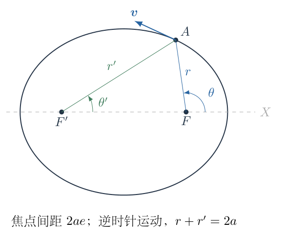
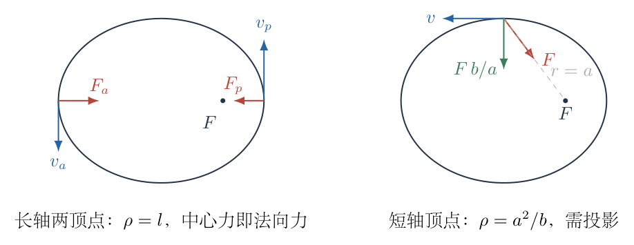
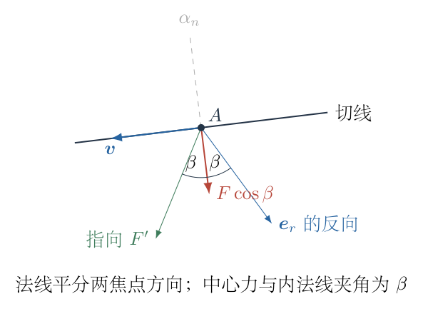
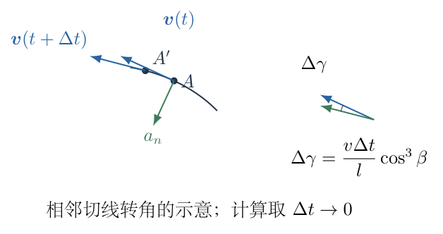

# 第 7 题

<!-- question-start -->
开普勒第二定律对应角动量守恒，由此可知中心天体对运动物体的力是有心力。现进一步研究开普勒定律如何确定力的距离依赖。

（1）对圆轨道，利用开普勒第三定律证明力与轨道半径的平方成反比。

（2）假设开普勒第一、第二定律成立。物体质量为 $m$，绕一个焦点运动，椭圆的极坐标方程为

$$r=\frac{l}{1+e\cos\theta},\qquad 0<e<1,$$

其中 $l$为半通径、$e$为偏心率，角动量大小为 $L$。

（a）在椭圆长轴或短轴的顶点求力的具体形式。

（b）在椭圆上任意点 $A$，到中心天体所在焦点和另一焦点的距离分别为 $r$、$r'$，两连线与长轴正向的角度分别为 $\theta$、$\theta'$。瞬时速度大小为 $v$。求一小段时间 $\Delta t$内两连线转过的角度 $\Delta\theta$、$\Delta\theta'$。

（c）定义 $\beta=(\theta-\theta')/2$，求同一时间内速度方向的转角 $\Delta\gamma$，再求法向加速度，并证明顶点得到的平方反比力适用于椭圆上的任意点。

取运动方向为逆时针，几何关系先在上半椭圆建立，再按连续性推广；小时间式均保留到 $\Delta t$的一阶。

<!-- question-end -->

## 一、题型定位

由轨道几何和面积定律反推中心力。圆轨道用周期直接求向心力，椭圆轨道则要区分指向焦点的中心加速度与垂直切线的法向加速度。核心连接是椭圆的焦点角平分性质、曲率与角动量。

## 二、知识点

开普勒三定律；角动量与面积速度；椭圆长短轴及半通径；焦点距离和；角平分线；瞬时角速度；曲率半径；法向加速度；中心力分解；极坐标加速度；轨道反演。

记半长轴为 $a$、半短轴为 $b$，焦距的一半为 $c=ae$。注意题目中的 $l$不是半长轴，而是 $l=b^2/a=a(1-e^2)$。

## 三、物理图像

在近日点、远日点，速度垂直于焦点连线，中心力恰好就是法向力；在其他点，中心力与轨道法线通常不重合。若仍令 $F=mv^2/\rho$，就漏掉了中心力的法向投影。

椭圆法线平分指向两个焦点的两条方向。这个性质把焦点角速度的平均与切线转速联系起来。利用两个焦点距离之和恒定，就可以把看似复杂的曲率写成 $l/\cos^3\beta$，再用角动量消掉速度。

## 四、解题入口

先从圆轨道得到 $F\propto r^{-2}$，但不把这个结论未经证明直接推广到椭圆。对椭圆先整理 $l,a,b,e$关系，在顶点由曲率与角动量求 $F$。

任意点的路线是：两焦点角速度 $\rightarrow$切线转速 $\rightarrow$法向加速度 $\rightarrow$中心力投影；最后使用 $L=mr v\cos\beta$，让额外的几何因子抵消。

## 五、解析

（1）圆轨道的周期决定力的距离依赖。

设绕同一中心天体的圆轨道都满足

$$T^2=Kr^3,$$

其中 $K$不随轨道半径改变。圆周速度为 $v=2\pi r/T$，所需中心力大小为

$$\begin{aligned}
F
&=\frac{mv^2}{r}\\
&=\frac m r\frac{4\pi^2r^2}{T^2}\\
&=\frac{4\pi^2mr}{Kr^3}\\
&=\boxed{\frac{4\pi^2m}{Kr^2}.}
\end{aligned}$$

因此相同中心天体的圆轨道要求 $F\propto r^{-2}$。这里能确定的是中心场强常量 $4\pi^2/K$，如果写成 $GM$，就有 $K=4\pi^2/(GM)$。

这一步只利用了圆轨道，尚未证明给定椭圆上所有位置的力都服从同一距离函数；第（2）问正是补上这个缺口。

（2）整理椭圆几何与角动量。

椭圆标准形式为

$$\frac{X^2}{a^2}+\frac{Y^2}{b^2}=1,\qquad
b^2=a^2-c^2=a^2(1-e^2).$$

绕右焦点 $F=(c,0)$建立极坐标，题目给出的半通径满足

$$l=\frac{b^2}{a}=a(1-e^2).$$

近日点、远日点的焦点距离分别是

$$r_p=a-c=\frac{l}{1+e},\qquad
r_a=a+c=\frac{l}{1-e}.$$

角动量守恒写成

$$L=mr^2\dot\theta=mr v_\perp,$$

其中 $v_\perp$是速度垂直于焦点连线的分量，不是任意位置的全部速度。

（3）先求长轴顶点的曲率半径。

使用参数 $E$表示椭圆：

$$X=a\cos E,\qquad Y=b\sin E.$$

一、二阶导数分别为

$$\begin{aligned}
X'&=-a\sin E,&Y'&=b\cos E,\\
X''&=-a\cos E,&Y''&=-b\sin E.
\end{aligned}$$

平面曲线的曲率半径为

$$\rho=\frac{(X'^2+Y'^2)^{3/2}}
{|X'Y''-Y'X''|}.$$

分母展开为

$$X'Y''-Y'X''
=ab\sin^2E+ab\cos^2E=ab.$$

因此

$$\rho(E)=\frac{(a^2\sin^2E+b^2\cos^2E)^{3/2}}{ab}.$$

长轴顶点对应 $E=0,\pi$，所以 $\rho=b^3/(ab)=b^2/a=l$。图 7-2 的长轴顶点处，焦点连线沿水平，速度沿竖直，中心力和法向力同向，才可以不加投影因子。

在任一长轴顶点，$v=L/(mr)$，因此

$$\begin{aligned}
F
&=\frac{mv^2}{\rho}\\
&=\frac m l\left(\frac L{mr}\right)^2\\
&=\boxed{\frac{L^2}{mlr^2}.}
\end{aligned}$$

近日点与远日点分别代入自己的 $r$，使用的是同一个系数 $L^2/(ml)$。题目希望推广的候选规律由此得到。

（4）用短轴顶点独立核对投影。

上短轴顶点为 $(0,b)$。它到任一焦点的距离是 $\sqrt{c^2+b^2}=a$；切线水平，法线竖直。速度大小为 $v$，到右焦点的力指向 $(c,-b)$。

法向投影为 $F b/a$。角动量的力臂是 $b$，所以 $L=mbv$。曲率半径在 $E=\pi/2$处为 $\rho=a^2/b$。法向动力学给

$$\frac{Fb}{a}=\frac{mv^2}{a^2/b}
=\frac{mv^2b}{a^2}.$$

约去 $b$后，$F=mv^2/a$；再代入 $v=L/(mb)$：

$$F=\frac{L^2}{mab^2}
=\frac{L^2}{ml a^2}.$$

因该点 $r=a$，这与 $L^2/(mlr^2)$完全一致。短轴顶点已经展示了为什么不能在一般位置直接令整个中心力等于法向力。

（5）在任意点定义角平分线。

设从两个焦点指向点 $A$的单位矢量分别为 $\boldsymbol e_r$与 $\boldsymbol e_{r'}$。上半椭圆中 $\theta>\theta'$，定义

$$\alpha_n=\frac{\theta+\theta'}2,\qquad
\beta=\frac{\theta-\theta'}2.$$

$\alpha_n$是外法线方向角。可从椭圆的定义 $r+r'=2a$验证：沿轨道位移 $d\boldsymbol r$时，

$$0=d(r+r')
=(\boldsymbol e_r+\boldsymbol e_{r'})\cdot d\boldsymbol r.$$

所以切线垂直于 $\boldsymbol e_r+\boldsymbol e_{r'}$。两个单位矢量的和沿夹角平分线，恰与外法线一致。其大小为 $2\cos\beta$，且凸椭圆上 $\cos\beta>0$。

图 7-3 标出 $\alpha_n$与 $\beta$。逆时针速度沿外法线再转过 $\pi/2$的方向，所以其方向角为

$$\gamma=\alpha_n+\frac\pi2
=\frac{\theta+\theta'}2+\frac\pi2.$$

注意指向焦点的中心力为 $-F\boldsymbol e_r$，与内法线之间的夹角为 $\beta$，其内法向分量是 $F\cos\beta$。

（6）逐项计算两条焦点连线的转角。

时间 $\Delta t$足够短时，位置变化为

$$\Delta\boldsymbol r=\boldsymbol v\Delta t
+O(\Delta t^2).$$

相对右焦点，只有垂直于连线的位移分量造成一阶角度改变。速度方向与 $\boldsymbol e_r$的夹角为

$$\gamma-\theta
=\frac\pi2-\beta.$$

因此垂直分量为 $v\sin(\pi/2-\beta)=v\cos\beta$，有

$$\boxed{\Delta\theta
=\frac{v\cos\beta}{r}\Delta t+O(\Delta t^2).}$$

对另一个焦点，同样有 $\gamma-\theta'=\pi/2+\beta$，其正弦仍等于 $\cos\beta$。故

$$\boxed{\Delta\theta'
=\frac{v\cos\beta}{r'}\Delta t+O(\Delta t^2).}$$

不能因两个焦点分处左右就给第二个角速度加一个负号；在逆时针运动的这一位置，两条连线均按正方向转动。

（7）证明所需的焦点距离恒等式。

三角形 $F A F'$的两条边为 $r,r'$，焦点间距为 $2ae$，点 $A$处两条指向焦点的射线夹角为 $2\beta$。余弦定理给

$$(2ae)^2=r^2+r'^2-2rr'\cos(2\beta).$$

使用 $\cos2\beta=2\cos^2\beta-1$：

$$\begin{aligned}
4a^2e^2
&=r^2+r'^2+2rr'-4rr'\cos^2\beta\\
&=(r+r')^2-4rr'\cos^2\beta\\
&=4a^2-4rr'\cos^2\beta.
\end{aligned}$$

移项、除以四，得

$$rr'\cos^2\beta=a^2(1-e^2)=al.$$

从而

$$\boxed{\frac1r+\frac1{r'}
=\frac{r+r'}{rr'}
=\frac{2a}{rr'}
=\frac{2\cos^2\beta}{l}.}$$

这一恒等式是几何项消去的关键。它由焦点距离和与余弦定理共同导出，不是把 $r$和 $r'$误当成相等。

（8）求切线转角、曲率半径和法向加速度。

由 $\gamma=(\theta+\theta')/2+\pi/2$：

$$\begin{aligned}
\Delta\gamma
&=\frac{\Delta\theta+\Delta\theta'}2\\
&=\frac{v\Delta t\cos\beta}{2}
 \left(\frac1r+\frac1{r'}\right)+O(\Delta t^2)\\
&=\boxed{\frac{v\Delta t}{l}\cos^3\beta
+O(\Delta t^2).}
\end{aligned}$$

图 7-4 中速度方向转角 $\Delta\gamma$对应法向加速度；速度大小的变化则沿切线，二者不能混为同一个速度差。

弧长增量 $\Delta s=v\Delta t+O(\Delta t^2)$。按曲率定义，

$$\frac1\rho
=\lim_{\Delta t\to0}\frac{\Delta\gamma}{\Delta s}
=\frac{\cos^3\beta}{l},$$

所以

$$\rho=\frac{l}{\cos^3\beta},\qquad
a_n=\frac{v^2}{\rho}
=\frac{v^2\cos^3\beta}{l}.$$

也可从速度方向的微小旋转得到法向速度变化 $v\Delta\gamma$，再除以 $\Delta t$；这会给出同一个 $a_n$。

（9）将法向加速度还原为中心力。

中心力在内法向的投影是 $F\cos\beta$。牛顿第二定律：

$$F\cos\beta=m a_n
=\frac{mv^2\cos^3\beta}{l}.$$

因 $\cos\beta>0$，可约去一个因子：

$$F=\frac{mv^2\cos^2\beta}{l}.$$

角动量则为

$$L=mr v_\perp=mr v\cos\beta,$$

所以 $v\cos\beta=L/(mr)$。代回中心力：

$$\begin{aligned}
F
&=\frac m l\left(v\cos\beta\right)^2\\
&=\frac m l\left(\frac L{mr}\right)^2\\
&=\boxed{\frac{L^2}{mlr^2}.}
\end{aligned}$$

几何因子之所以消失，不是因为它可以忽略，而是曲率与角动量中恰好包含相互配套的投影因子。

在下半椭圆，角度可按连续支路延伸；$\beta$可改变符号，但最终只出现 $\cos\beta$，且所有距离与曲率关系不变。故结论适用于完整椭圆，不只适用于最初作图的上半部分。

（10）用极坐标路线独立复核，不借助曲率结论。

令 $h=L/m$为单位质量角动量，$u=1/r$。由 $r^2\dot\theta=h$，有 $\dot\theta=hu^2$。对 $r=1/u$求时间导数：

$$\dot r=\frac{dr}{d\theta}\dot\theta
=-\frac{u'}{u^2}hu^2=-hu'.$$

再求导：

$$\ddot r=-hu''\dot\theta=-h^2u^2u''.$$

极坐标径向加速度为

$$a_r=\ddot r-r\dot\theta^2
=-h^2u^2u''-h^2u^3
=-h^2u^2(u''+u).$$

给定椭圆 $u=(1+e\cos\theta)/l$，故 $u''=-e\cos\theta/l$，相加得 $u''+u=1/l$。于是

$$a_r=-\frac{h^2}{lr^2},\qquad
\boldsymbol F=-\frac{L^2}{mlr^2}\boldsymbol e_r.$$

这一路线直接求出力的方向和大小，与焦点几何法一致。径向式前面的负号表示指向焦点；前面求 $F$时用的是正的大小，两者记号并不矛盾。

（11）由面积速度重新连回第三定律。

椭圆面积为 $\pi ab$，面积速度为 $L/(2m)$，周期为

$$T=\frac{\pi ab}{L/(2m)}
=\frac{2\pi mab}{L}.$$

若中心力写作 $GMm/r^2$，比较系数给 $L^2=m^2GMl$。于是

$$\begin{aligned}
T^2
&=\frac{4\pi^2m^2a^2b^2}{L^2}\\
&=\frac{4\pi^2a^2b^2}{GMl}\\
&=\frac{4\pi^2a^2b^2}{GM(b^2/a)}\\
&=\frac{4\pi^2a^3}{GM}.
\end{aligned}$$

第三定律的椭圆形式因此自然恢复。相同中心天体要求不同轨道的 $L^2/(m^2l)$均为同一个 $GM$；单凭一条椭圆的形状和面积律，只能先确定这条轨道对应的力系数。

（12）量纲与几何极限。

$L$的单位为 $\mathrm{kg\,m^2/s}$，故 $L^2/(mlr^2)$的单位为 $\mathrm{kg\,m/s^2}$，是力。$\Delta\gamma=v\Delta t\cos^3\beta/l$无量纲，符合角度必须用弧度的要求。

$e\to0$时 $a=b=l=r$、两个焦点重合、$\beta\to0$，曲率 $\rho\to r$，力式化为 $L^2/(mr^3)=mv^2/r$，与圆周运动一致。

在长轴顶点 $\beta=0$、$\rho=l$，恢复前面的顶点计算。在短轴顶点 $\cos\beta=b/a$，代入 $\rho=l/\cos^3\beta$：

$$\rho=\frac{b^2/a}{b^3/a^3}=\frac{a^2}{b},$$

也恢复独立曲率计算。$e\to1$时若保持 $a$，$l\to0$，长轴顶点的曲率趋于极端；不能在固定 $L$的同时又声称力系数 $GM$不变，因为此时 $L^2=m^2GMl$要求角动量相应变化。

## 六、关键洞察

椭圆的几何结构把“到焦点的角速度”和“切线方向的转速”联系起来。力的平方反比并不是从图形像椭圆直接猜出，而是由轨道方程加面积速度共同确定。少了面积律，同一几何曲线可以按不同快慢行进，所需合力也不同。

法向加速度与径向加速度是两套分解。前者由曲率决定，后者由焦点极坐标决定；它们只有在特定顶点才重合。将这两者混用，会把本题最重要的 $\cos\beta$因子删掉。

极坐标复核展示了轨道反演的通用形式 $F=mh^2u^2(u''+u)$。椭圆之所以给出平方反比，是 $u''+u$恰为常量。它不需要额外假设总速度恒定。

## 七、易错点

把半通径 $l$当成半长轴；把近日点距离误写为 $l$；圆轨道证明后直接宣布所有轨道已证；一般点写 $L=mrv$而漏投影；把力大小与径向分量的负号混为一谈；第二焦点角速度乱加负号；在切线转角中少除以二；将全部中心力设为 $mv^2/\rho$；在极坐标求导时把 $u'$误当时间导数。

短轴顶点是检查这些错误的好位置：其中心力方向不是竖直，但法向是竖直，必须保留 $b/a$的投影。同时该点到焦点的距离是 $a$而不是 $b$。

## 八、课堂讲解建议

先让学生在长轴、短轴两个顶点分别画速度、中心力和法线，再比较为什么只有长轴顶点可以直接用 $F=mv^2/\rho$。在任意点，先用 $d(r+r')=0$建立角平分性质，然后再谈两个焦点连线的转角。

板书按“转角—曲率—法向力—中心力—角动量”顺序推进，每一步保留几何因子，最后让学生亲自看到抵消。极坐标路线作为独立复核，不跳过 $\dot r=-hu'$的推导，并明确撇号对 $\theta$求导。

## 九、变式训练

变式一：偏心率 $e=3/5$，求近日点与远日点的速度比、力比以及长轴顶点曲率之比。

完整解答：两顶点处 $v=L/(mr)$，所以

$$\frac{v_p}{v_a}
=\frac{r_a}{r_p}
=\frac{1+e}{1-e}=4.$$

平方反比力给 $F_p/F_a=(r_a/r_p)^2=16$。但两顶点曲率半径均为 $l$，所以曲率半径比为 $1$。这与 $F\propto v^2$相容：同一曲率半径，速度四倍则法向力十六倍，不应把焦点距离当成局部曲率半径。

变式二：绕同一中心天体的两个椭圆，半长轴之比为 $\kappa$、偏心率相同，质量相同。求半通径、角动量、周期及对应角位置速度之比。

完整解答：$l=a(1-e^2)$，故 $l_2/l_1=\kappa$。由 $L^2=m^2GMl$，得 $L_2/L_1=\sqrt\kappa$。面积律周期或第三定律给 $T_2/T_1=\kappa^{3/2}$。

在相同真近点角 $\theta$，$r_2/r_1=\kappa$且 $\beta$相同。利用 $L=mr v\cos\beta$：

$$\frac{v_2}{v_1}
=\frac{L_2/L_1}{r_2/r_1}
=\kappa^{-1/2}.$$

力比则是 $\kappa^{-2}$。相同几何形状放大后，速度变小、周期变长，满足引力轨道的统一缩放规律。
