# 第 1 题

质量均为$m$的直角三角形木块$A$与梯形木块$B$如图放置，接触斜面与水平面的夹角为$\theta$，$0<\theta<\pi/2$。木块$A$位于水平地面上，木块$B$受到光滑竖直导向装置约束，只能上下平动。两接触面的摩擦均采用同一库仑系数$\mu$，极限静摩擦与滑动摩擦按该系数处理。取$x$轴水平向右，$y$轴竖直向上，重力加速度为$g$。

（1）若$A$的有符号速度、加速度分别为$v$、$a$，求$B$的速度和加速度。

（2）设无外力时系统能够保持静止。从静止状态对$A$施加恒定水平外力$F$，向右为正。列出静止及滑动分支，以$F$为横轴、$a$为纵轴分析响应图；说明接触失效、分支退化或非唯一时的适用范围。

（3）取$F_0\ge0$，从静止开始施加周期性锯齿力
$$
F(t)=\frac{F_0}{t_0}t\quad(0\le t<t_0),\qquad
F(t+t_0)=F(t).
$$
在接触约束及可确定的摩擦分支有效时，按不同参数情况画出$v(t)$并写出分段关系。

修订说明：明确静、动摩擦模型及有符号外力；“始终保持接触”作为需要检验的约束，不把违反约束或退化的刚性摩擦分支误作确定运动。

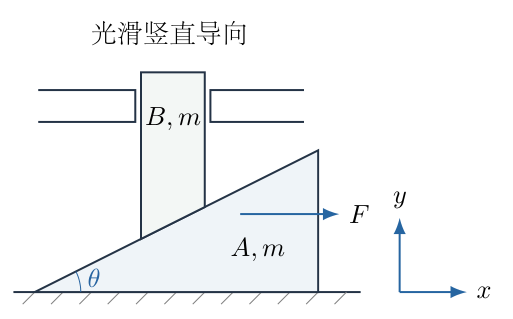

## 一、题型定位

双接触库仑摩擦系统的约束动力学与分段运动。几何约束把两个物体的运动联系起来，竖直导向装置提供水平反力，两处摩擦又通过法向力与加速度相互耦合。恒力响应并非只由一个滑动方程组成，还包括静摩擦允许区间、滑动方向、重新停止、法向力非负及刚性模型的退化情形。

## 二、知识点

相对速度与接触几何；牛顿第二定律的分物体受力；静摩擦的区间约束与滑动摩擦的定值规则；有符号正方向；法向力对加速度的依赖；接触的单边条件；分段积分、速度连续与加速度跃变；周期外力的平均作用及停止事件；刚性摩擦模型的适用边界。

## 三、物理图像

图中的斜面向右升高。$A$向右运动时，固定在同一水平位置的$B$下方遇到的是斜面更靠左、较低的位置，因此$B$下降。$B$相对于$A$沿斜面向左下滑，作用于$B$的滑动摩擦沿斜面向右上。$A$与地面的摩擦向左。

锯齿力在每个周期末从$F_0$突然降到零，但有限的力跳变没有冲量，速度不会突然变为零。此前已经滑动的系统仍按滑动方程减速；真正减到零后，才重新检查静摩擦能否使它停住。周期内既可能“滑动—停止—再次起动”，也可能只触及零速，或者始终向右运动并逐周期增加速度。

## 四、解题入口

先用斜面方程求出$v_B$和$a_B$。再分别对$A$、$B$写受力方程，始终保留接触法向力$N$和地面法向力$Q$，不能预先取$Q=2mg$。在静止时求两个摩擦力各自的允许区间，在滑动时按速度符号消元。最后用起动阈值$F_+$与平均驱动力$F_0/2$分类锯齿响应，每次积分都以实际的起动或停止时刻作为下限。

## 五、解析

（1）由固定水平位置处的斜面高度建立约束。

设$A$沿$x$轴的位移为$X(t)$。记$B$某一固定竖直参考线的水平位置为$x_b$，斜面高度与$B$参考高度之间的常量差为$y_c$。斜面的方程给出
$$
y_B(t)=\bigl[x_b-X(t)\bigr]\tan\theta+y_c.
$$
$x_b$、$y_c$与$\theta$不随时间改变。对时间求导，不需要知道木块的具体边长：
$$
\begin{aligned}
\dot y_B&=-\dot X\tan\theta,\\
\ddot y_B&=-\ddot X\tan\theta.
\end{aligned}
$$
以后以
$$
\xi=\tan\theta>0
$$
简写几何系数。第一问的矢量答案为
$$
\boxed{\boldsymbol v_B=-\xi v\,\boldsymbol e_y,\qquad
\boldsymbol a_B=-\xi a\,\boldsymbol e_y.}
$$
若$v>0$，$B$向下；若$a<0$，即使$B$此时仍向下运动，它的加速度也向上。运动方向由速度决定，不能由加速度的符号代替。

图1-2把两个对应位置画在同一导向线上。$A$向右增加位移$\Delta X$时，$B$下降$\xi\Delta X$；随后所有受力方程中的$a_B$都使用这一关系。

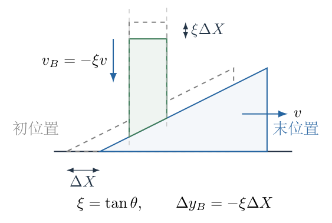

（2）明确相对滑动方向，而不是直接猜摩擦方向。

沿斜面向右上的单位矢量为
$$
\boldsymbol\tau=(\cos\theta,\sin\theta),
$$
从$A$指向$B$的法向单位矢量为
$$
\boldsymbol n=(-\sin\theta,\cos\theta).
$$
$A$只有水平平动，$B$只有竖直平动，所以两木块接触材料点的相对速度为
$$
\begin{aligned}
\boldsymbol v_{B/A}
&=\boldsymbol v_B-\boldsymbol v_A\\
&=(-v,-\xi v)\\
&=-\frac{v}{\cos\theta}\boldsymbol\tau.
\end{aligned}
$$
$\cos\theta>0$，故相对速度沿斜面的符号与$v$相反。定义滑动符号
$$
\sigma=\operatorname{sgn}v,\qquad \sigma=\pm1.
$$
作用于$B$的接触摩擦为$+\sigma\mu N\boldsymbol\tau$，其中$N\ge0$为斜面法向力；作用于$A$的地面滑动摩擦为$-\sigma\mu Q\boldsymbol e_x$，其中$Q\ge0$为地面法向力。$v=0$时不能直接使用$\sigma=\pm1$，静摩擦必须另列。

（3）建立两个物体的真实受力方程。

图1-3按$v>0$画出摩擦方向。向左滑动时两摩擦箭头均反向。导向反力$H$取向右为正，由$B$的水平平衡有$H=N(\sin\theta-\mu\cos\theta)$；$H<0$时真实反力向左，图中箭头只规定其正方向。导向反力不进入竖直方程，也不做功。

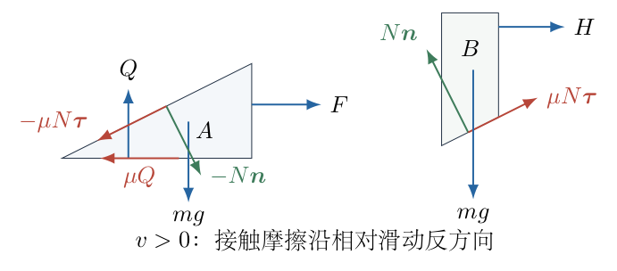

$B$的竖直方程为
$$
N\cos\theta+\sigma\mu N\sin\theta-mg=-m\xi a.
$$
把$N$的两项合并：
$$
N\cos\theta(1+\sigma\mu\xi)=m(g-\xi a).
$$
若$1+\sigma\mu\xi\ne0$，
$$
\boxed{N_\sigma=
\frac{m(g-\xi a)}
{\cos\theta(1+\sigma\mu\xi)}.}
$$
这一式不仅用于消元，还必须用于检验接触。

$A$无竖直加速度。$B$对$A$的接触力与$A$对$B$的接触力相反，故
$$
Q-mg-N\cos\theta-\sigma\mu N\sin\theta=0.
$$
利用$B$的竖直方程，
$$
\begin{aligned}
Q&=mg+N\cos\theta(1+\sigma\mu\xi)\\
&=mg+m(g-\xi a),
\end{aligned}
$$
从而
$$
\boxed{Q=m(2g-\xi a).}
$$
只有$a=0$时才有$Q=2mg$。$B$下降加速时传给地面的竖直负荷减小，$B$上升加速时负荷增大。

$A$的水平接触力为$N\sin\theta-\sigma\mu N\cos\theta$，所以
$$
ma=F+N\cos\theta(\xi-\sigma\mu)-\sigma\mu Q.
$$
这是最后的水平动力学方程。导向装置能够对整个系统提供水平外力，因此不能把两物体作为系统后误用水平动量守恒。

（4）完整消去$N$与$Q$。

将上一步的两个表达式代入：
$$
a=\frac Fm+
\frac{(g-\xi a)(\xi-\sigma\mu)}
{1+\sigma\mu\xi}
-\sigma\mu(2g-\xi a).
$$
乘以$1+\sigma\mu\xi$，先展开，再分别收集$a$和$g$：
$$
\begin{aligned}
a(1+\sigma\mu\xi)
={}&\frac Fm(1+\sigma\mu\xi)
+g(\xi-\sigma\mu)\\
&-a\xi(\xi-\sigma\mu)
-2\sigma\mu g(1+\sigma\mu\xi)\\
&+\sigma\mu\xi a(1+\sigma\mu\xi).
\end{aligned}
$$
移到左边的$a$系数为
$$
\begin{aligned}
D_\sigma
&=(1+\sigma\mu\xi)+\xi(\xi-\sigma\mu)
-\sigma\mu\xi(1+\sigma\mu\xi)\\
&=1+\sigma\mu\xi+\xi^2-\sigma\mu\xi
-\sigma\mu\xi-\mu^2\xi^2\\
&=\boxed{1+(1-\mu^2)\xi^2-\sigma\mu\xi}.
\end{aligned}
$$
右边的重力系数为
$$
\begin{aligned}
(\xi-\sigma\mu)-2\sigma\mu(1+\sigma\mu\xi)
&=\xi-\sigma\mu-2\sigma\mu-2\mu^2\xi\\
&=(1-2\mu^2)\xi-3\sigma\mu.
\end{aligned}
$$
于是滑动分支满足
$$
\boxed{
D_\sigma a=
(1+\sigma\mu\xi)\frac Fm+
g\bigl[(1-2\mu^2)\xi-3\sigma\mu\bigr].
}
$$
只有$D_\sigma\ne0$时才能除以它求$a$；除完后仍须同时检验$\sigma v>0$、$N_\sigma\ge0$、$Q\ge0$。

（5）静止分支不能把两处摩擦都先取成最大值。

静止时令作用于$B$的斜面摩擦为$f\boldsymbol\tau$，地面对$A$的水平摩擦为$f_G\boldsymbol e_x$。二者是待定反力：
$$
|f|\le\mu N,\qquad |f_G|\le\mu Q.
$$
由$B$的竖直平衡，
$$
N\cos\theta+f\sin\theta=mg.
$$
由$A$的竖直平衡，静止时$Q=2mg$。令
$$
\lambda=\frac fN,\qquad -\mu\le\lambda\le\mu.
$$
还需$N>0$，因此
$$
1+\lambda\xi>0,\qquad
N=\frac{mg}{\cos\theta(1+\lambda\xi)}.
$$
$A$的水平平衡为
$$
0=F+N\cos\theta(\xi-\lambda)+f_G.
$$
整理外力：
$$
\frac F{mg}=
\frac{\lambda-\xi}{1+\lambda\xi}
-\frac{f_G}{mg}.
$$
这里不是一个定值，而是两个允许区间合成的外力范围。

（6）求静摩擦允许的外力端点。

定义
$$
H(\lambda)=\frac{\lambda-\xi}{1+\lambda\xi}.
$$
用商法则求导：
$$
\begin{aligned}
H'(\lambda)
&=\frac{(1+\lambda\xi)-\xi(\lambda-\xi)}
{(1+\lambda\xi)^2}\\
&=\frac{1+\xi^2}{(1+\lambda\xi)^2}>0.
\end{aligned}
$$
所以最大的$F$对应$\lambda=\mu$及$f_G=-2\mu mg$：
$$
\begin{aligned}
F_+
&=mg\left[\frac{\mu-\xi}{1+\mu\xi}+2\mu\right]\\
&=\boxed{mg\frac{3\mu-(1-2\mu^2)\xi}{1+\mu\xi}}.
\end{aligned}
$$
若$\mu\xi<1$，最小的$F$对应$\lambda=-\mu$及$f_G=+2\mu mg$：
$$
\begin{aligned}
F_-
&=mg\left[\frac{-\mu-\xi}{1-\mu\xi}-2\mu\right]\\
&=\boxed{mg\frac{-3\mu-(1-2\mu^2)\xi}{1-\mu\xi}}.
\end{aligned}
$$
$F_-$是有符号的负阈值，不是摩擦力大小。

若$\mu\xi\ge1$，$\lambda$可以从大于$-1/\xi$的一侧逼近$-1/\xi$，此时$H(\lambda)\to-\infty$，而$N\to+\infty$。理想刚性模型给出向左外力下的自锁：
$$
F_-= -\infty.
$$
这表示静止平衡允许任意有限负$F$，不是实际材料能够承受无限法向力。真实装置会先受到变形、强度及导向间隙限制。

图1-4显示有限$F_-$的常规静止区间，以及自锁时向左无界的理想静止分支。它只标静止允许性，并不代替滑动方程。

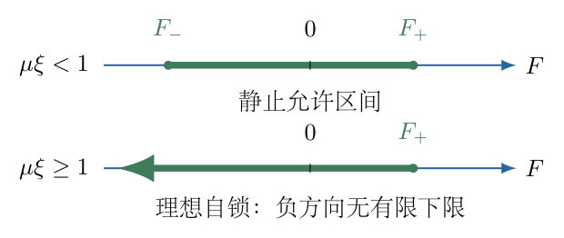

（7）把题设“初态能静止”写成参数条件。

因为$F_-$始终小于零或为$-\infty$，无外力静止的条件就是$F_+\ge0$：
$$
3\mu-(1-2\mu^2)\xi\ge0.
$$
将其改写为关于$\mu$的二次不等式：
$$
2\xi\mu^2+3\mu-\xi\ge0.
$$
两根异号，$\mu\ge0$只需取正根：
$$
\boxed{
\mu\ge\mu_{\mathrm{stat}}
=\frac{\sqrt{9+8\xi^2}-3}{4\xi}.
}
$$
为避免$\xi$很小时两个接近数相减，可以有理化：
$$
\mu_{\mathrm{stat}}
=\frac{2\xi}{\sqrt{9+8\xi^2}+3}.
$$
在小角度极限$\xi\to0$，$\mu_{\mathrm{stat}}\sim\xi/3$。这个条件仅保证初态静止，不保证滑动方程始终正常，更不保证外力任意增大时不失去接触。

（8）正常向右分支的$a(F)$与接触上限。

记
$$
D_+=1+(1-\mu^2)\xi^2-\mu\xi.
$$
先讨论$D_+>0$。定义正的响应系数
$$
\kappa=\frac{1+\mu\xi}{mD_+}>0.
$$
向右滑动方程化为
$$
\boxed{a_+=\kappa(F-F_+).}
$$
这一步使用了$F_+$的定义，没有重新假定两摩擦的方向。从静止起动且$F\ge0$时，
$$
a=
\begin{cases}
0,&0\le F\le F_+,\\
\kappa(F-F_+),&F>F_+,
\end{cases}
$$
但第二行只在接触仍有效时成立。

向右分支中$1+\mu\xi>0$，故$N_+\ge0$要求
$$
a\le \frac g\xi.
$$
此时$Q=m(2g-\xi a)\ge mg>0$，斜面接触先达到边界。把$a=g/\xi$代入$A$的水平方程，此时$N=0$、$Q=mg$，得到
$$
\boxed{F_{\mathrm d}=mg\left(\frac1\xi+\mu\right).}
$$
因此严格接触区间为
$$
F_+<F<F_{\mathrm d}.
$$
$F=F_{\mathrm d}$是$N=0$的边界；超过它不能继续声称两木块始终接触。

两个力端点之差为
$$
\begin{aligned}
F_{\mathrm d}-F_+
&=mg\frac{
(1/\xi+\mu)(1+\mu\xi)
-[3\mu-(1-2\mu^2)\xi]}
{1+\mu\xi}\\
&=mg\frac{1/\xi-\mu+(1-\mu^2)\xi}
{1+\mu\xi}\\
&=\boxed{\frac{mgD_+}{\xi(1+\mu\xi)}}.
\end{aligned}
$$
所以$D_+>0$确实保证接触上限大于起动阈值，这不是图形外观推测。

（9）向左分支与从静止起动的选择。

若$\mu\xi<1$，$D_-=1+(1-\mu^2)\xi^2+\mu\xi>0$。向左起动时
$$
\boxed{
a_-=\frac{1-\mu\xi}{mD_-}(F-F_-).
}
$$
$F<F_-$使$a_-<0$，与由静止向左起动相容，且$N_->0$、$Q>0$。

因此在两侧均为正常分支时，初始恒力响应为
$$
a(F)=
\begin{cases}
\dfrac{1-\mu\xi}{mD_-}(F-F_-),&F<F_-,\\[4pt]
0,&F_-\le F\le F_+,\\[4pt]
\kappa(F-F_+),&F_+<F<F_{\mathrm d}.
\end{cases}
$$
最右侧超过$F_{\mathrm d}$的部分不是本题保持接触的运动。

若$\mu\xi\ge1$，由静止向左起动将要求$a<0$，但向左滑动时$B$的竖直方程左侧接触合力$N\cos\theta(1-\mu\xi)\le0$，使
$$
g-\xi a\le0,\qquad a\ge g/\xi>0.
$$
这与从零速向左起动不相容。因此负外力下静止自锁分支不能随意接成“向左加速”的直线。已经具有负速度的运动是另一个初值问题，不等于本题从静止起动。

（10）$D_+=0$及$D_+<0$时不能机械地画同一种折线。

$D_+$的零点满足
$$
(\mu\xi)^2+\mu\xi-(1+\xi^2)=0.
$$
于是
$$
\mu_{\mathrm P}
=\frac{\sqrt{5+4\xi^2}-1}{2\xi}.
$$
只有$\mu<\mu_{\mathrm P}$才有前述正斜率向右分支。

若$D_+=0$，消元方程成为
$$
0=\frac{1+\mu\xi}{m}(F-F_+).
$$
只有$F=F_+$时滑动受力方程才相容，此时$a$没有由该方程唯一确定；还须保留接触条件$a\le g/\xi$。同时$F_+=F_{\mathrm d}$。不能把“分母为零”写成无限加速度。

若$D_+<0$，向右滑动直线斜率为负。由于$F_{\mathrm d}<F_+$，在
$$
F_{\mathrm d}<F<F_+
$$
内，滑动方程给出$0<a<g/\xi$，同时静摩擦也允许$a=0$。从静止开始的理想刚性方程可出现多种可行分支，不能仅由外力选出唯一轨迹。若$F>F_+$，静止不再允许，而代数滑动分支给$a<0$，又不相容于由静止向右起动；保持接触的模型无相容起动解。

这类情况说明“刚性接触、定值库仑摩擦、始终接触”在部分参数区间不足以确定运动。需要接触柔性、冲击规律等额外模型才能继续；本题不凭空增加这些资料。

图1-5分开画正常、退化和非唯一情形。正常图上的实线只延伸到接触上限，退化图用允许集合而非无穷高直线表示，非唯一图同时保留静止支与滑动支。

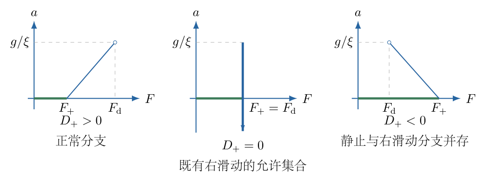

（11）以功率关系独立检查滑动消元式。

在$v\ne0$且接触约束有效时，两木块总动能为
$$
K=\frac12mv^2+\frac12m(\xi v)^2
=\frac12m(1+\xi^2)v^2.
$$
重力对$B$的功率为$(-mg)\dot y_B=mg\xi v$；$A$的重力不做功。地面滑动耗散功率为$-\mu Q|v|$。斜面摩擦的总耗散由相对速度决定：
$$
-\mu N|\boldsymbol v_{B/A}|
=-\mu N\frac{|v|}{\cos\theta}.
$$
导向反力与$B$速度垂直，功率为零。因此
$$
m(1+\xi^2)av
=Fv+mg\xi v-\mu Q|v|-\frac{\mu N|v|}{\cos\theta}.
$$
除以非零$v$，$\lvert v\rvert/v=\sigma$：
$$
m(1+\xi^2)a=
F+mg\xi-\sigma\mu Q-\frac{\sigma\mu N}{\cos\theta}.
$$
代入
$$
Q=m(2g-\xi a),\qquad
\frac N{\cos\theta}
=\frac{m(g-\xi a)(1+\xi^2)}{1+\sigma\mu\xi}.
$$
乘以$1+\sigma\mu\xi$后，$a$的系数为
$$
\begin{aligned}
&(1+\xi^2)(1+\sigma\mu\xi)
-\sigma\mu\xi(1+\xi^2)
-\sigma\mu\xi(1+\sigma\mu\xi)\\
&=1+\xi^2-\sigma\mu\xi-\mu^2\xi^2
=D_\sigma,
\end{aligned}
$$
重力项化为$g[(1-2\mu^2)\xi-3\sigma\mu]$。它与分物体受力路线完全一致。若把斜面耗散错用$\mu N|v|$，就会漏掉$1/\cos\theta$，无法得到同一个方程。

（12）锯齿力分析的适用条件与首个起动时刻。

以下讨论
$$
D_+>0,\qquad F_+\ge0,
$$
并要求峰值没有越过接触上限：
$$
F_0<F_{\mathrm d}.
$$
若只取$F_0=F_{\mathrm d}$，周期末是法向力为零的极限边界，不能替代严格接触。若$F_0>F_{\mathrm d}$，首个周期在达到$F_{\mathrm d}$时就必须切换到离开接触的模型，下面的整周期曲线不再适用。

图1-6标出各周期相位、起动力阈值与力的跳变。它用来确定积分区间，不把周期末的力跳变误作速度跳变。

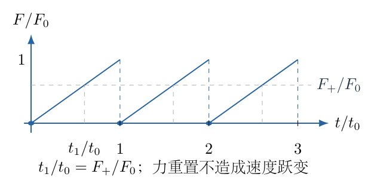

令斜率
$$
K_F=\frac{F_0}{t_0}.
$$
若$F_0\le F_+$，每一时刻外力都处于静摩擦允许区间，故
$$
\boxed{v(t)=0\quad\text{对全部 }t\ge0.}
$$
若$F_0>F_+$，首个周期起动时刻为
$$
\boxed{t_1=\frac{F_+}{K_F}=\frac{F_+}{F_0}t_0.}
$$
首周期$t<t_1$仍静止，$t>t_1$时
$$
a(t)=\kappa K_F(t-t_1).
$$
以$v(t_1)=0$为积分下限：
$$
\begin{aligned}
v(t)
&=\int_{t_1}^t\kappa K_F(s-t_1)\,ds\\
&=\frac{\kappa K_F}{2}(t-t_1)^2.
\end{aligned}
$$
首周期结束前的速度为
$$
\boxed{
v_{\mathrm p}
=\frac{\kappa t_0(F_0-F_+)^2}{2F_0}.
}
$$
这不是稳态最大速度的先验假定，而是首周期积分得到、以后各分类都会使用的连续边界值。

（13）力重置后的速度抛物线与是否停止。

在后续周期令相位
$$
u=t-nt_0,\qquad 0\le u<t_0,\qquad n\ge1.
$$
设周期开始速度为$v_n$。只要尚未停住，速度仍正，滑动方程不因外力降到阈值以下就立即停止：
$$
a(u)=\kappa(K_Fu-F_+).
$$
积分得
$$
\boxed{
v(u)=v_n+\kappa\left(\frac{K_Fu^2}{2}-F_+u\right).
}
$$
把平方项配方：
$$
v(u)=v_n-\frac{\kappa F_+^2}{2K_F}
+\frac{\kappa K_F}{2}(u-t_1)^2.
$$
所以这一滑动抛物线的最低点在$u=t_1$。若最低速度为负，不能保留抛物线的负值；它会在前一个根首次停住，然后重新按静摩擦判断。

整个周期都不停止时，周期速度增量为
$$
\begin{aligned}
\Delta v
&=\int_0^{t_0}\kappa(K_Fu-F_+)\,du\\
&=\kappa\left(\frac{F_0t_0}{2}-F_+t_0\right)\\
&=\boxed{\kappa t_0\left(\frac{F_0}{2}-F_+\right)}.
\end{aligned}
$$
$F_0/2$是锯齿力的平均值；$F_+$是向右滑动方程中的常量平衡力。只有没有中途停止时，才可把整周期积分直接用作下一周期的速度增量。

（14）$F_+<F_0<2F_+$：减速到零、等待、再起动。

第一个重置周期的$v_n=v_{\mathrm p}$。最低点为
$$
\begin{aligned}
v_{\min}
&=v_{\mathrm p}-\frac{\kappa F_+^2}{2K_F}\\
&=\frac{\kappa}{2K_F}
\left[(F_0-F_+)^2-F_+^2\right]\\
&=\frac{\kappa}{2K_F}F_0(F_0-2F_+)<0.
\end{aligned}
$$
这是自由延拓抛物线会越过零的信号，不是实际出现向左速度。

令真实停止时刻的相位为$u_s$。将速度方程乘以$2K_F/\kappa$：
$$
(K_Fu_s)^2-2F_+K_Fu_s+(F_0-F_+)^2=0.
$$
用求根公式，
$$
K_Fu_s=F_+\pm\sqrt{F_+^2-(F_0-F_+)^2}.
$$
首次停止取较小根，并化简根号：
$$
\boxed{
u_s=
\frac{t_0}{F_0}
\left[F_+-\sqrt{F_0(2F_+-F_0)}\right].
}
$$
由$F_+<F_0<2F_+$可得$0<u_s<t_1$，停止时外力$K_Fu_s<F_+$，静摩擦可以保持静止。于是每个$n\ge1$的周期都重复
$$
\boxed{
v(nt_0+u)=
\begin{cases}
v_{\mathrm p}+\kappa\left(\dfrac{K_Fu^2}{2}-F_+u\right),
&0\le u\le u_s,\\[5pt]
0,&u_s\le u\le t_1,\\[4pt]
\dfrac{\kappa K_F}{2}(u-t_1)^2,
&t_1\le u<t_0.
\end{cases}
}
$$
在$u_s$处速度连续，原滑动加速度可能为负，停止后改为零；在$t_1$处加速度从零开始增长。后一段积分到$t_0$又得到相同$v_{\mathrm p}$，所以这确实是重复脉冲，而不是只画了一个周期的示意。

（15）$F_0=2F_+$：恰好触及零速，无有限静止时段。

此时
$$
\Delta v=0,\qquad
t_1=\frac{t_0}{2},\qquad
u_s=t_1.
$$
每个重置周期的最低速度恰为零：
$$
v_{\mathrm p}=\frac{\kappa F_+t_0}{4}.
$$
配方后的完整速度为
$$
\boxed{
v(nt_0+u)=
\frac{\kappa K_F}{2}
\left(u-\frac{t_0}{2}\right)^2,\qquad n\ge1.
}
$$
它在周期中点与时间轴相切，随后立即重新增大。没有一段长度非零的等待区间。首周期仍须单列：前半周期静止、后半周期从零起动，不能把后续周期的整条抛物线追溯到$t=0$。

（16）$F_0>2F_+$：不再停住，逐周期增加速度。

第一个重置周期的最低速度已经为正。以后每周期增加
$$
\Delta v=\kappa t_0(F_0/2-F_+)>0,
$$
故最低速度也逐周期增加。记第$n$个重置时刻$t=nt_0$的速度，则
$$
v_n=v_{\mathrm p}+(n-1)\Delta v,\qquad n\ge1.
$$
因而
$$
\boxed{
v(nt_0+u)=
v_{\mathrm p}+(n-1)\Delta v+
\kappa\left(\frac{K_Fu^2}{2}-F_+u\right).
}
$$
每个周期前段仍减速、后段仍加速，但后一段弥补了前段损失并有净增量。因此“持续加速”指周期包络整体上升，不表示每一时刻$a>0$。

图1-7分别画全程静止、脉冲、相切临界和逐周期上升。各图在力重置时保持速度连续，停止后的等待段才贴住时间轴。

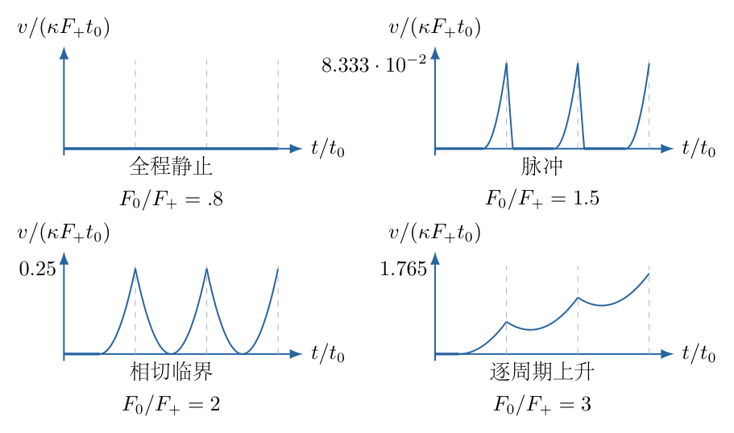

（17）检验各分类是否落在接触允许范围内。

最大向右加速度出现在力峰值附近：
$$
a_{\max}=\kappa(F_0-F_+).
$$
$N_+>0$要求$a_{\max}<g/\xi$，恰等价于$F_0<F_{\mathrm d}$。停止后的静摩擦允许性已经在$u_s<t_1$处检查，不能只检查峰值。

持续上升分类还要求存在区间
$$
2F_+<F_0<F_{\mathrm d}.
$$
若$F_{\mathrm d}\le2F_+$，保持严格接触的任何峰值都无法进入该分类。图中的四类曲线是参数分类，并不保证固定的一组$\theta,\mu$能同时实现全部四种。

比较两个端点：
$$
\begin{aligned}
F_{\mathrm d}-2F_+
&=\frac{mg}{1+\mu\xi}
\left[\frac1\xi-4\mu+(2-3\mu^2)\xi\right]\\
&=\frac{mg}{\xi(1+\mu\xi)}
\left[1+2\xi^2-4\mu\xi-3\mu^2\xi^2\right].
\end{aligned}
$$
因此持续上升区间存在，当且仅当
$$
1+2\xi^2-4\mu\xi-3\mu^2\xi^2>0
$$
并同时满足初态静止及$D_+>0$。没有必要用不合接触条件的大$F_0$来强行补画一种速度图。

若$D_+\le0$，周期力下也不能把$\kappa$当正系数套用脉冲公式。此时须回到退化或多分支的受力集合，本题资料不足以选出唯一整周期轨迹；不提供貌似确定、实际上超出模型的$v(t)$。

（18）量纲、边界和速度连续性检查。

$F_\pm$与$F_{\mathrm d}$的量纲为力，$\kappa$的量纲为质量的倒数，所以$\kappa(F-F_+)$为加速度。$K_F$的量纲为力除以时间，$\kappa K_F(t-t_1)^2$为速度；$u_s$中的方括号具有力的量纲，乘$t_0/F_0$后是时间。

令$F_0\to F_+^+$，$t_1\to t_0$且$v_{\mathrm p}\to0$，与全程静止连续接上。令$F_0\to2F_+^-$，根号趋零，$u_s\to t_1$，等待段消失；从$F_0>2F_+$趋近临界，$\Delta v\to0$，最低速度也趋零。三个分支在分类边界相容。

每次外力重置的前后速度相等，但加速度一般由$\kappa(F_0-F_+)$跃为$-\kappa F_+$。这是有限力跳变的结果。若绘图把$v$在周期末竖直降到零，就等于额外添加了未给定的冲量。

## 六、关键洞察

最重要的耦合不是$v_B=-v\tan\theta$本身，而是$N$和$Q$都含有$a$。摩擦力并非“给定质量乘$\mu g$”的常量，法向反力的反馈改变了滑动响应的分母。静摩擦先形成力的允许区间，滑动摩擦再形成两条有方向的动力学分支，二者职责不同。

锯齿力的分类有两个独立阈值：$F_0=F_+$决定是否第一次起动，$F_0=2F_+$决定已滑动系统的整周期净速度变化。还存在第三个接触阈值$F_{\mathrm d}$。这三个阈值不能合并为一句“外力超过摩擦力就一直加速”。

用平均力判断净变化只适用于整周期保持滑动。脉冲分支在停止区间使用静摩擦，实际加速度为零，因此若不先检查停止事件就把负的$\Delta v$逐周期累加，会错误预测向左运动。

$D_+\le0$的异常并不是三角函数算错，也不是惯性质量真的变成负数，而是理想刚性库仑模型的接触反力反馈使代数方程退化或失去唯一性。物理模型的可解性本身必须成为答案的一部分。

## 七、易错点

斜面向右升高却把$v_B$写为$+v\tan\theta$，会使所有后续方向颠倒。判断斜面摩擦时若只看$B$对地的竖直速度，而不看$B$对$A$的相对速度，也容易画反。

把$Q$从头到尾取为$2mg$，或把斜面耗散写为$\mu N|v|$，分别漏掉动态负荷和相对滑动距离。两条错误路线可能给出不同的加速度，功率核验可以及时识别。

在静止区间把$f=\mu N$及$f_G=\mu Q$同时固定，得到的只是边界，不能代表整个静止状态。$v=0$时直接定义$\sigma=0$再代入滑动式，也不能正确恢复静摩擦。

将负斜率滑动支理解为从静止后必定反向加速，忽略速度方向和法向力条件，会掩盖多解或无解。接触约束是单边条件，不能允许$N<0$来拉住两个木块。

在周期末令速度随力跳变、把抛物线的负值保留下来、把首周期与重复周期混为一谈，都属于分段条件错误。图像必须标起动、停止、阈值相切和力重置四类不同事件。

## 八、课堂讲解建议

先让学生在图1-2上画出$A$向右平移后的斜面位置，再判断$B$是升还是降；不急于受力计算。随后在图1-3分别标两木块接触摩擦及地面摩擦，要求学生用相对速度解释方向，并用作用与反作用核对斜面两侧箭头。

板书按“几何约束—两个竖直方程—水平方程—静止区间”四栏展开。在完成$Q=m(2g-\xi a)$之前不让学生代入$2mg$。消元时保留$D_\sigma$，再讨论它的符号，避免提前消去物理适用条件。

周期部分先只讲正常$D_+>0$。将首周期起动抛物线画完整，再把末速度作为下一周期初值；让学生根据最低点是否低于零，自行找停止事件。临界$F_0=2F_+$可用同一配方式解释，不另背一条公式。

最后用功率路线进行独立检查，把导向反力不做功与不守恒水平动量并列比较。进阶讲解再讨论退化分支和接触失效，明确它们是模型边界，不把异常情况省略成“摩擦太大不讨论”。

## 九、变式训练

变式一：取$\theta=\pi/4$、$\mu=2/5$，其余模型不变，$F_0=(3/2)F_+$。求每个重复周期的停止相位、再起动相位、周期末速度，并核验接触。

解：此时$\xi=1$，
$$
\begin{aligned}
D_+&=1+(1-4/25)-2/5=36/25,\\
\kappa&=\frac{7/5}{m(36/25)}=\frac{35}{36m},\\
F_+&=mg\frac{6/5-17/25}{7/5}=\frac{13}{35}mg,\\
F_{\mathrm d}&=(1+2/5)mg=\frac75mg.
\end{aligned}
$$
峰值为$F_0=39mg/70<F_{\mathrm d}$，再起动时刻为
$$
t_1/t_0=F_+/F_0=2/3.
$$
停止相位由小根给出：
$$
\begin{aligned}
u_s/t_0
&=\frac{1-\sqrt{(3/2)(2-3/2)}}{3/2}\\
&=\boxed{\frac{2-\sqrt3}{3}\approx0.0893}.
\end{aligned}
$$
从$u_s$到$2t_0/3$保持静止。周期末速度为
$$
\begin{aligned}
v_{\mathrm p}
&=\frac{\kappa t_0( F_+/2)^2}{3F_+}\\
&=\frac{\kappa F_+t_0}{12}
=\boxed{\frac{13}{432}gt_0}.
\end{aligned}
$$
用$\kappa F_+=13g/36$及$K_F=(3F_+/2)/t_0$写成无量纲相位$\zeta=u/t_0$：
$$
\frac{v}{gt_0}=
\begin{cases}
\dfrac{13}{432}+
\dfrac{13}{36}\left(\dfrac34\zeta^2-\zeta\right),
&0\le\zeta\le(2-\sqrt3)/3,\\[4pt]
0,&(2-\sqrt3)/3\le\zeta\le2/3,\\[4pt]
\dfrac{13}{48}(\zeta-2/3)^2,&2/3\le\zeta<1.
\end{cases}
$$
最大加速度为
$$
a_{\max}=\kappa(F_0-F_+)=\frac{13}{72}g<g.
$$
因此$N>0$；同时$Q=m(2g-a)>0$。首周期只保留等待与后一段起动，不加上前一周期遗留的减速段。

变式二：地面摩擦系数为$\mu_G$，两木块间的摩擦系数为$\nu$，二者不再相等。推导有符号滑动分支，并判断地面完全光滑时是否仍有同一种分母退化。

解：$B$的摩擦换为$\sigma\nu N\boldsymbol\tau$，$A$的地面摩擦换为$-\sigma\mu_GQ\boldsymbol e_x$。两个竖直方程仍给出
$$
N=\frac{m(g-\xi a)}{\cos\theta(1+\sigma\nu\xi)},\qquad
Q=m(2g-\xi a).
$$
$A$的水平式变为
$$
a=\frac Fm+
\frac{(g-\xi a)(\xi-\sigma\nu)}{1+\sigma\nu\xi}
-\sigma\mu_G(2g-\xi a).
$$
乘分母后，$a$系数完整化简为
$$
\begin{aligned}
D_{\sigma,\mathrm{new}}
&=(1-\sigma\mu_G\xi)(1+\sigma\nu\xi)
+\xi(\xi-\sigma\nu)\\
&=1+\sigma\nu\xi-\sigma\mu_G\xi-\mu_G\nu\xi^2
+\xi^2-\sigma\nu\xi\\
&=\boxed{1+(1-\mu_G\nu)\xi^2-\sigma\mu_G\xi}.
\end{aligned}
$$
重力项为
$$
(\xi-\sigma\nu)-2\sigma\mu_G(1+\sigma\nu\xi)
=(1-2\mu_G\nu)\xi-\sigma(\nu+2\mu_G).
$$
所以
$$
\boxed{
a_\sigma=
\frac{(1+\sigma\nu\xi)F/m+
g[(1-2\mu_G\nu)\xi-\sigma(\nu+2\mu_G)]}
{1+(1-\mu_G\nu)\xi^2-\sigma\mu_G\xi}.
}
$$
令$\mu_G=\nu=\mu$恢复主解。若地面完全光滑$\mu_G=0$，
$$
D_{\sigma,\mathrm{new}}=1+\xi^2>0,
$$
故这一分母不会因$\nu$增大而变成零或负。向右分支的起动力为
$$
F_+=mg\frac{\nu-\xi}{1+\nu\xi}.
$$
无外力静止要求$\nu\ge\xi$。滑动仍可能达到$N=0$而失去接触，但原来的双摩擦反馈退化已经消失。这样区分“接触失效”和“代数分母退化”，比仅说摩擦越大越难运动更准确。

\newpage

# 第 2 题

两颗质量均为$M$的星体相距$2l$，在万有引力作用下绕共同质心作匀速圆周运动。忽略星体大小及其他天体的影响，万有引力常量为$G$。一质量为$m$的试探物体位于轨道平面内，距质心$r\gg l$；用外部约束使其位置保持不变，但不把约束力计入所求引力。

（1）求双星的轨道角速度及运动周期$T$。

（2）取径向向外、切向逆时针为正。求试探物体处引力场的径向分量$E_r$、切向分量$E_\tau$随时间的变化，保留至相对阶$(l/r)^2$，并给出周期。可用尺度参数$p=2Ml$表达结果；说明它是否为质心引力偶极矩。

（3）另在弱场、慢运动的引力四极辐射近似下，取引力波传播速度为$c$，求双星主导辐射的频率及波长。区分本问辐射与第（2）问的牛顿远距离场。

修订说明：两正质量星体在质心系中的引力偶极矩为零，故改称等质量双星，保留首个非零的四极修正；波长计算另明确采用辐射近似，不把牛顿时变场直接认作引力波。

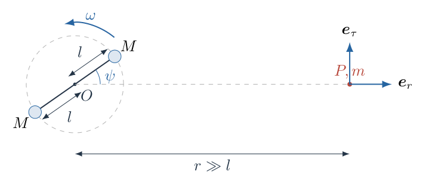

## 一、题型定位

中心力圆周运动、远距离引力场的多极展开，以及周期由几何对称性决定的问题。两星各自的轨道半径与相互距离不同；远处的场也不是只剩某个“偶极场”，而是以总质量的单极场为主，再叠加时变四极修正。辐射频率可借助四极矩的时间变化判断，但必须与牛顿场计算的适用区域区分。

## 二、知识点

万有引力与向心加速度；质心及质量偶极矩；矢量叠加与引力势；二项式展开及小参数的阶数；极坐标中场与势的关系；对称性和最小重复周期；四极矩的二倍频；近区与波区；量纲及特殊方位检验。

## 三、物理图像

质心为$O$，每颗星体到$O$的距离都是$l$。设连向其中一星的单位矢量为$\boldsymbol u$，两星位置就是$+l\boldsymbol u$与$-l\boldsymbol u$。转过半周后，两颗等质量星体交换位置，但整个质量分布与原先完全相同。因此任意固定观察点的引力场在半个轨道周期后重复。这一判断不要求先作远区展开。

远处看见的主要是位于$O$的总质量$2M$。有限的分离距离使场在连星方向与垂直方向略有不同；这一较小修正随双星旋转变化。切向场是有符号量，会随着星体处于观察方向两侧而改变方向，不能把其绝对值的周期当作矢量分量的周期。

## 四、解题入口

第一问对一颗星体写向心力方程。第二问先写两项精确引力势，再以$\varepsilon=l/r$展开；奇数阶相互抵消，保留二阶后分别求$r$和观察方位角的偏导。接着用直接矢量叠加交叉核对符号。第三问从质量四极矩中的$\cos2\omega t$、$\sin2\omega t$判断主导频率，不从“传播速度是$c$”单独猜波长。

## 五、解析

（1）区分轨道半径与两星距离。

由等质量及质心定义，$O$位于两星连线中点。对其中一颗星体，另一颗施加的引力大小为
$$
F_g=\frac{GM^2}{(2l)^2}=\frac{GM^2}{4l^2}.
$$
该星绕$O$运动的半径为$l$，而非$2l$。向心力方程因此是
$$
\frac{GM^2}{4l^2}=M\omega^2l.
$$
两边除以$Ml$，得到
$$
\boxed{\omega^2=\frac{GM}{4l^3},\qquad
\omega=\frac12\sqrt{\frac{GM}{l^3}}.}
$$
这里取$\omega>0$表示逆时针转动。由匀速圆周运动的周期定义，
$$
\boxed{T=\frac{2\pi}{\omega}
=4\pi\sqrt{\frac{l^3}{GM}}.}
$$
单颗星体的线速度为
$$
v_* =\omega l=\frac12\sqrt{\frac{GM}{l}}.
$$
这一速度既可检验圆周运动，也将在第三问用于判断慢运动近似是否成立。注意$v_*$不是两星的相对线速度；两者相对速度的大小为$2v_*$。

（2）定义观察方向、相位与有符号场分量。

设观察点的固定极角为$\varphi$，星体连线的定向角为$\omega t+\varphi_0$。定义相对角
$$
\psi(t)=\omega t+\varphi_0-\varphi.
$$
在观察点使用单位矢量$\boldsymbol e_r$、$\boldsymbol e_\tau$：$\boldsymbol e_r$从$O$指向观察点，$\boldsymbol e_\tau$沿逆时针方向。于是
$$
\boldsymbol u=\cos\psi\,\boldsymbol e_r
+\sin\psi\,\boldsymbol e_\tau.
$$
以下$E_r$是沿$\boldsymbol e_r$的有符号投影。引力主要朝向$O$，所以$E_r$的主项应为负。若题目要“径向引力大小”，在本题远区条件下应取$-E_r$。

图2-2给出两星至观察点的距离$d_+$、$d_-$。图中的$\psi$决定两个距离及切向投影，不能把两段距离都直接写成$r$，否则全部时变信息都会丢失。

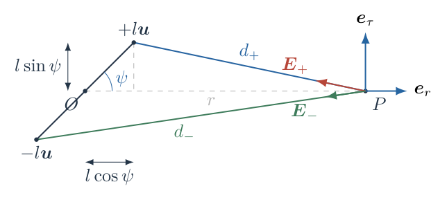

由余弦定理，
$$
\begin{aligned}
d_+^2&=r^2+l^2-2rl\cos\psi,\\
d_-^2&=r^2+l^2+2rl\cos\psi.
\end{aligned}
$$
星体$+$在靠近观察方向时$d_+$较短；星体$-$的距离对应另一个符号。后续展开中应始终保留这个配对。

（3）写出精确引力势并明确展开对象。

取无穷远处引力势为零，单位试探质量的总引力势为
$$
\Phi(r,\varphi,t)
=-GM\left(\frac1{d_+}+\frac1{d_-}\right).
$$
试探质量$m$不出现在$\Phi$中；其引力势能才是$m\Phi$。令
$$
\varepsilon=\frac lr\ll1,\qquad z=\cos\psi.
$$
可把精确式写为
$$
\Phi=-\frac{GM}{r}
\left[(1+\varepsilon^2-2\varepsilon z)^{-1/2}
+(1+\varepsilon^2+2\varepsilon z)^{-1/2}\right].
$$
“远处”仅说明$\varepsilon$小，尚未说明是否处于引力波的波区。此时计算的仍是瞬时牛顿模型的场。

（4）逐项展开到二阶并说明奇数阶为何消失。

使用二项式展开
$$
(1+x)^{-1/2}=1-\frac{x}{2}+\frac{3x^2}{8}+O(x^3).
$$
把$x=\varepsilon^2\mp2\varepsilon z$代入。在二阶精度下，$x^2$只需保留$4\varepsilon^2z^2$：$\varepsilon^4$及$\varepsilon^3z$均超出当前阶数。因此
$$
\begin{aligned}
(1+\varepsilon^2-2\varepsilon z)^{-1/2}
&=1+\varepsilon z
+\frac{\varepsilon^2}{2}(3z^2-1)+O(\varepsilon^3),\\
(1+\varepsilon^2+2\varepsilon z)^{-1/2}
&=1-\varepsilon z
+\frac{\varepsilon^2}{2}(3z^2-1)+O(\varepsilon^3).
\end{aligned}
$$
相加后，线性项$+\varepsilon z$、$-\varepsilon z$相消。更一般地，两项交换对应$\varepsilon\mapsto-\varepsilon$，而总势不变，所以总展开中所有奇数次幂都消失，下一项从四阶开始。于是
$$
\boxed{\Phi=-\frac{2GM}{r}
-\frac{GMl^2}{r^3}(3\cos^2\psi-1)
+O\left(\frac{GMl^4}{r^5}\right).}
$$
第一项为总质量$2M$的单极势，第二项为四极修正。四极项对势的相对大小为$(l/r)^2$，并不是比单极场更大的独立“偶极引力”。

（5）由势求径向场，解释求导时固定的变量。

在同一时刻沿同一观察方向改变$r$时，$\psi$不变。极坐标中
$$
E_r=-\left(\frac{\partial\Phi}{\partial r}\right)_{\varphi,t}.
$$
逐项求导：
$$
\begin{aligned}
\frac{\partial}{\partial r}\left(-\frac{2GM}{r}\right)
&=\frac{2GM}{r^2},\\
\frac{\partial}{\partial r}
\left[-GMl^2r^{-3}(3\cos^2\psi-1)\right]
&=3GMl^2r^{-4}(3\cos^2\psi-1).
\end{aligned}
$$
再取负号，得到
$$
\boxed{E_r=-\frac{2GM}{r^2}
-\frac{3GMl^2}{r^4}(3\cos^2\psi-1)
+O\left(\frac{GMl^4}{r^6}\right).}
$$
若使用$\cos^2\psi=(1+\cos2\psi)/2$，则
$$
3\cos^2\psi-1=\frac12+\frac32\cos2\psi.
$$
因此
$$
\boxed{E_r=-\frac{2GM}{r^2}
-\frac{3GMl^2}{2r^4}
-\frac{9GMl^2}{2r^4}\cos2\psi.}
$$
这个形式分别显示主要向心场、四极的平均修正、二倍频振荡。二倍频项并非全部四极项；四极项中还含不随时间变化的一部分。

（6）由势求切向场，逐层核对角度求导的符号。

极坐标的切向分量为
$$
E_\tau=-\frac1r
\left(\frac{\partial\Phi}{\partial\varphi}\right)_{r,t}.
$$
因$\psi=\omega t+\varphi_0-\varphi$，有$\partial\psi/\partial\varphi=-1$。从内到外求导：
$$
\begin{aligned}
\frac{\partial}{\partial\varphi}\cos\psi
&=-\sin\psi\cdot(-1)=\sin\psi,\\
\frac{\partial}{\partial\varphi}\cos^2\psi
&=2\cos\psi\sin\psi=\sin2\psi,\\
\frac{\partial\Phi}{\partial\varphi}
&=-\frac{3GMl^2}{r^3}\sin2\psi.
\end{aligned}
$$
外部再乘$-1/r$，最终为
$$
\boxed{E_\tau=\frac{3GMl^2}{r^4}\sin2\psi
+O\left(\frac{GMl^4}{r^6}\right).}
$$
例如$0<\psi<\pi/2$，靠近观察点的星体位于其逆时针一侧，切向引力应为正；上述式子确实给出正值。若把$\psi$定义成$\varphi-\omega t-\varphi_0$，正弦表达式需要随定义一同调整，物理矢量不能改变。

（7）用直接引力叠加独立检查场分量。

引力从观察点指向各星体。精确矢量式是
$$
\boldsymbol E=GM\left[
\frac{l\boldsymbol u-r\boldsymbol e_r}{d_+^3}
+\frac{-l\boldsymbol u-r\boldsymbol e_r}{d_-^3}
\right].
$$
投影后得到
$$
\begin{aligned}
E_r&=GM\left[
\frac{l\cos\psi-r}{d_+^3}
+\frac{-l\cos\psi-r}{d_-^3}\right],\\
E_\tau&=GMl\sin\psi\left(d_+^{-3}-d_-^{-3}\right).
\end{aligned}
$$
用$(1+x)^{-3/2}=1-3x/2+15x^2/8+\cdots$，有
$$
d_\pm^{-3}=r^{-3}\left[
1\pm3\varepsilon z
+\frac{\varepsilon^2}{2}(15z^2-3)
+O(\varepsilon^3)\right],
$$
其中$d_+$对应展开中的正线性项。切向式只需取两项之差的一阶：
$$
\begin{aligned}
E_\tau
&=GMl\sin\psi\cdot r^{-3}
\left(6\varepsilon\cos\psi+O(\varepsilon^3)\right)\\
&=\frac{6GMl^2}{r^4}\sin\psi\cos\psi
+O\left(\frac{GMl^4}{r^6}\right)\\
&=\frac{3GMl^2}{r^4}\sin2\psi
+O\left(\frac{GMl^4}{r^6}\right).
\end{aligned}
$$
径向式把$(-1\pm\varepsilon z)$与对应展开相乘，相加时二阶系数为
$$
-2\cdot\frac{15z^2-3}{2}+6z^2
=3-9z^2=-3(3z^2-1).
$$
故它也给出$-2GM/r^2-3GMl^2(3z^2-1)/r^4$。这是从力的矢量方向而不是从势的求导得到的交叉核验。

（8）判断分量周期与幅值，保留正弦的方向信息。

图2-3把四极的径向振荡部分与切向分量按同一轨道相位画出。径向振荡的绝对幅值为$9GMl^2/(2r^4)$，切向幅值为$3GMl^2/r^4$，前者是后者的$3/2$；两者相差四分之一振荡周期。

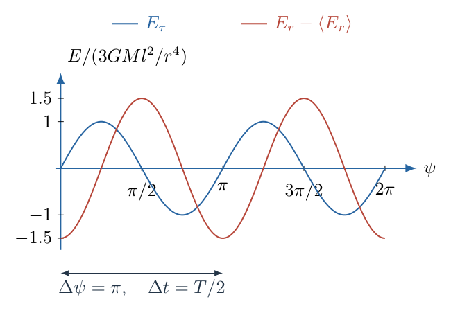

由于$\psi$随时间以$\omega$增加，$\cos2\psi$与$\sin2\psi$的最小正重复时间均为
$$
\boxed{T_E=\frac{\pi}{\omega}=\frac T2
=2\pi\sqrt{\frac{l^3}{GM}}.}
$$
切向大小$|E_\tau|$在此二阶近似下具有更短的重复时间$T/4$，因为$|\sin2\psi|$每隔$\pi$重复。但$E_\tau$本身在$T/4$后反号，故整个引力场矢量并未重复。高阶项一般也会破坏切向绝对值在近似式中出现的额外短周期。

图2-4展示相隔$T/2$的质量分布。两星互换、质量不变，精确引力场必定重复；因此$T/2$不是截断级数人为产生的周期。两星存在非零分离且观察点在轨道平面远处时，场通常在此前不会完整重复。

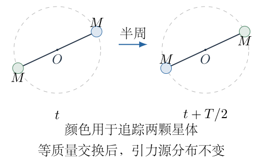

试探物体所受引力为
$$
\boldsymbol F=mE_r\boldsymbol e_r+mE_\tau\boldsymbol e_\tau.
$$
保持它静止所需的外力为$-\boldsymbol F$。把物体称为固定观察点不代表引力为零；它也不能同时被当成无约束自由下落的物体。

（9）用$p$表达结果，并核对“偶极”称谓。

质量偶极矩在质心坐标系中的定义为
$$
\boldsymbol D=\sum_a M_a\boldsymbol x_a.
$$
本题两颗星体的质量为正且相等，故
$$
\boldsymbol D=M(l\boldsymbol u)+M(-l\boldsymbol u)=0.
$$
电偶极由一正一负电荷构成，正负电荷的单极项抵消、偶极项保留；这里却是两正质量的单极项相加、偶极项抵消。类比必须同时保留源的符号，不能只依据两源间有一段距离。

题设$p=2Ml$的量纲为质量乘长度，可以作为尺度参数，却不是上述$\boldsymbol D$。由
$$
2GM=\frac{Gp}{l},\qquad
GMl^2=\frac{Gpl}{2}=\frac{Gp^2}{4M},
$$
场分量可写为
$$
\begin{aligned}
\boxed{E_r}&=\boxed{-\frac{Gp}{lr^2}
-\frac{3Gpl}{4r^4}(1+3\cos2\psi)},\\
\boxed{E_\tau}&=\boxed{\frac{3Gpl}{2r^4}\sin2\psi}.
\end{aligned}
$$
这些式子仍须保留$l$或$M$。仅给$p$不能唯一确定总质量、轨道周期及四极强度；不能用一个被误叫为“偶极矩”的参数代替整个双星系统。

（10）作量纲、方位及极限检查。

$[G]=\mathrm{m^3\,kg^{-1}\,s^{-2}}$，故
$$
\left[\frac{GM}{r^2}\right]
=\left[\frac{GMl^2}{r^4}\right]
=\mathrm{m\,s^{-2}}.
$$
这是引力场、即单位质量受力的量纲；乘$m$后才变为牛顿。$l^3/(GM)$的量纲为时间平方，周期公式也一致。

当$\psi=0$时，两星在观察方向上，精确径向场为
$$
E_r=-GM\left[(r-l)^{-2}+(r+l)^{-2}\right].
$$
用$(1\mp\varepsilon)^{-2}=1\pm2\varepsilon+3\varepsilon^2+\cdots$，得
$$
E_r=-\frac{2GM}{r^2}-\frac{6GMl^2}{r^4}+\cdots.
$$
当$\psi=\pi/2$时，两星与观察方向垂直，各星的径向投影为$-r$，故
$$
E_r=-\frac{2GMr}{(r^2+l^2)^{3/2}}
=-\frac{2GM}{r^2}+\frac{3GMl^2}{r^4}+\cdots.
$$
这两种情形的切向分量均为零，与所得通式完全一致。$l/r\to0$时四极相对修正消失，恢复总质量$2M$的中心场；本近似不应用于$r$接近$l$、尤其靠近其中一颗星体的位置。

（11）独立建立辐射频率所需的四极时间结构。

第（3）问额外采用弱引力场及慢运动近似，要求
$$
\frac{GM}{lc^2}\ll1,\qquad \frac{\omega l}{c}\ll1.
$$
定义去迹质量四极矩
$$
Q_{ij}=\sum_a M_a\left(x_{a,i}x_{a,j}
-\frac13\delta_{ij}|\boldsymbol x_a|^2\right).
$$
把两星坐标$\pm l(\cos\omega t,\sin\omega t,0)$代入，可选时间原点使$\varphi_0=0$，得到
$$
\begin{aligned}
Q_{xx}&=2Ml^2\left(\cos^2\omega t-\frac13\right)
=Ml^2\left(\frac13+\cos2\omega t\right),\\
Q_{yy}&=Ml^2\left(\frac13-\cos2\omega t\right),\\
Q_{xy}&=2Ml^2\sin\omega t\cos\omega t
=Ml^2\sin2\omega t,\\
Q_{zz}&=-\frac23Ml^2.
\end{aligned}
$$
四极辐射近似中的波形与这些矩的二阶时间导数有关。常量项的导数为零，$\cos2\omega t$、$\sin2\omega t$求导后仍有角频率$2\omega$，所以主导辐射角频率为
$$
\Omega_{\rm gw}=2\omega.
$$
此处只用辐射公式的时间结构判断频率，不把牛顿势的径向衰减$r^{-3}$当成辐射振幅的传播规律。

（12）求主导辐射频率与波长，并区分适用区域。

由角频率与频率的关系，
$$
\boxed{f_{\rm gw}=\frac{2\omega}{2\pi}
=\frac2T=\frac1{2\pi}\sqrt{\frac{GM}{l^3}}.}
$$
相应周期为$T_{\rm gw}=T/2$，波长为
$$
\begin{aligned}
\lambda_{\rm gw}
&=\frac{c}{f_{\rm gw}}=\frac{cT}{2}\\
&=\frac{\pi c}{\omega}
=2\pi c\sqrt{\frac{l^3}{GM}}.
\end{aligned}
$$
即
$$
\boxed{\lambda_{\rm gw}=\frac{cT}{2}.}
$$
若仅知道场在某处随时间变化、又知道某种波速为$c$，还不能保证该处场就是传播波。第（2）问的$r\gg l$只表示观察点远于源尺寸；在慢运动条件下，$c/\omega$比$l$大得多，可以同时有
$$
l\ll r\ll\frac c\omega.
$$
这一区域仍可主要由近区的准静态场描述。讨论远处辐射波形，则需位于远大于特征波长尺度的波区，例如$r\gg c/\omega$，并使用推迟时间。物理模型不同，不能把本题的牛顿场分量公式外推为波区的完整引力波表达式。

## 六、关键洞察

零偶极矩来自质心定义与正质量叠加，不仅是本题的一次代数抵消。任何孤立正质量系统，在质心原点下质量偶极矩都为零；换到偏离质心的原点产生的偶极项反映原点选择，不等同于内禀的引力偶极辐射。

周期可以先于运算确定：相同源的交换不改变物理分布，故等质量双星的场具有半周重复。四极展开把这一对称性具体表现成二倍频；这是几何判断与代数结果彼此检验的方式，而不是两个互不相关的结论。

一个参数$p=2Ml$并不完整描述双星。固定$p$而增加$l$会减小总质量$2M$，却改变四极尺度$Ml^2=pl/2$；同时$T\propto l^2$。因此“同一个$p$”并不意味着同一引力场或同一波长。

精确场也提供更可靠的数值检查。以$G=M=r=1$、不同$l/r$直接叠加两星引力，二阶近似的余项应随$(l/r)^4$缩小；把$l/r$减半，误差约变为原来的$1/16$。这比将同一个闭式表达式反复代入更能发现错号及遗漏阶数。

## 七、易错点

把向心半径取为两星间距$2l$，会使角速度平方出现错误倍数；力的分母用$(2l)^2$，向心加速度用$\omega^2l$，两处长度承担不同角色。

把两质量写成“正负一对”，会误删真正占主导的单极项；两星质量均为正。把$p$直接当成引力偶极矩，同样与质心系定义矛盾。

只展开到一阶而得到零修正后就停止，会漏掉题目真正的时变场；相消说明必须继续到二阶，不说明两星完全等价于一点质量。

对$\varphi$求导漏掉$\partial\psi/\partial\varphi=-1$，或忘记切向公式外面的$-1/r$，均会反转切向场。应另用靠近观察点的一颗星的方位检查方向。

把$|\sin2\psi|$的周期$T/4$报告成整个场的周期，丢失了方向。又或者把主导辐射频率写成$1/T$，忽略相同双星半周交换的对称性。

在$r\sim l$使用远距离截断展开，在波区用牛顿瞬时势描述传播，或仅凭时变就称为引力波，均属于适用条件错置。频率一致不意味着近区场与辐射场是同一个数学对象。

## 八、课堂讲解建议

先让学生画出两个等质量点绕中点运动，分别标出$l$与$2l$。用“半周后两个点交换位置，外部观察者能否区分”先确定场的周期，再开展级数计算；这样学生可以用已知周期检查是否错误留下单倍频项。

板书分三列：精确距离、势的展开、场的求导。展开阶段仅关注小参数阶数，不同时混入受力投影；完成势后，再明确径向求导固定角度、切向求导固定位置半径。随后以直接力叠加检查正弦的方向，让学生知道独立路线用于检错而不是重复誊写。

讲解辐射时只引入本题必要的四极时间结构，不要求学生掌握完整广义相对论波形。明确“两星转一圈”和“质量分布重复一次”的差别，以及$r\gg l$与远大于波长尺度的差别。可追问：若质量不等，半周交换还是否相同？这能自然引入下面的变式。

## 九、变式训练

（1）固定尺度参数$p=2Ml$，把半间距从$l$增至$2l$。求总质量、轨道周期、径向主场、切向四极振幅及主导波长的变化倍数。

完整解答：$p$不变而$l'=2l$，所以$M'=M/2$，总质量也变为原来的$1/2$。圆轨道周期满足
$$
\frac{T'}T
=\sqrt{\frac{l'^3/M'}{l^3/M}}
=\sqrt{\frac{8}{1/2}}=4.
$$
在同一固定观察半径$r$，主要径向场$2GM/r^2$变为原来的$1/2$。切向四极幅值与$Ml^2$成正比，因此
$$
\frac{M'l'^2}{Ml^2}=\frac12\cdot4=2.
$$
主导波长$cT/2$变为原来的$4$倍。虽然四极幅值增加，它仍须比新系统的主场小；要求$2l/r\ll1$而不是只沿用原先$l/r\ll1$。这也说明$p$相同不表示场相同。

（2）两星质量改为$M_1=M(1+\eta)$、$M_2=M(1-\eta)$，$0<|\eta|<1$，间距仍为$2l$。求质心位置、角速度、偶极矩与四极修正，并判断精确场是否仍有$T/2$的周期。

完整解答：设两星到质心的距离为$a_1$、$a_2$。由质心及间距条件
$$
M_1a_1=M_2a_2,\qquad a_1+a_2=2l,
$$
可解得
$$
a_1=(1-\eta)l,\qquad a_2=(1+\eta)l.
$$
相对运动等价于总质量$M_1+M_2=2M$产生的中心作用，故
$$
\omega^2=\frac{G(M_1+M_2)}{(2l)^3}
=\frac{GM}{4l^3},
$$
与等质量情形相同。质心偶极矩仍为
$$
\boldsymbol D=(M_1a_1-M_2a_2)\boldsymbol u=0.
$$
四极尺度由二次质量矩决定：
$$
\begin{aligned}
M_1a_1^2+M_2a_2^2
&=Ml^2\bigl[(1+\eta)(1-\eta)^2
+(1-\eta)(1+\eta)^2\bigr]\\
&=2Ml^2(1-\eta^2).
\end{aligned}
$$
所以二阶势为
$$
\Phi=-\frac{2GM}{r}
-\frac{GMl^2(1-\eta^2)}{r^3}(3\cos^2\psi-1)+\cdots.
$$
四极场仍呈二倍频，只是振幅乘$1-\eta^2$。但半周后不同质量交换位置，精确质量分布不再相同。可进一步用第三质量矩检验首个奇数阶修正：
$$
\begin{aligned}
M_1a_1^3-M_2a_2^3
&=Ml^3(1-\eta^2)
\bigl[(1-\eta)^2-(1+\eta)^2\bigr]\\
&=-4M\eta(1-\eta^2)l^3.
\end{aligned}
$$
势的三阶项为
$$
\Phi_3=\frac{4GM\eta(1-\eta^2)l^3}{r^4}P_3(\cos\psi),
$$
其中
$$
P_3(\cos\psi)=\frac{5\cos^3\psi-3\cos\psi}{2}
=\frac{3\cos\psi+5\cos3\psi}{8}.
$$
它包含单倍频及三倍频，半周后反号。因此精确场通常需完整轨道周期$T$才重复，而只保留四极的近似场仍表现为$T/2$。近似式的对称性可能高于精确系统，判断周期时必须注明保留到哪一阶。

\newpage

# 第 3 题

一组同面密度的均匀薄板按图排列。最初图案由六个全等的等边三角形薄板组成，阴影薄板总质量为$m$；六个外顶点构成外接圆半径为$r$的正六边形。中央空白正六边形的外接圆半径为$r/\sqrt3$，相对外侧正六边形转过$\pi/6$。

在中央空白正六边形内加入与最初图案相似的六三角板图案，面密度不变；此后只对新出现的中央空白正六边形重复同一操作。图中依次给出完成一层、两层、三层后的图案。各层薄板不重叠。

（1）求无限次添加后的总质量$M$。

（2）求最初图案绕过对称中心、垂直板面的固定轴的转动惯量$I_0$。

（3）求无限次添加后绕同一轴的转动惯量$I_\infty$。

修订说明：明确递归仅发生在中央空白正六边形中，所有新增薄板与最初薄板具有相同面密度；保留图示几何关系，删除与物理模型无关的叙述。

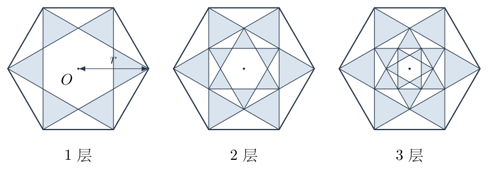

## 一、题型定位

均匀薄板的几何积分、平行轴定理与递归相似结构的质量及转动惯量求和。新增图案同时改变面积、质量和到轴的距离，因此质量级数与惯量级数的公比不同。题目不是把整个外六边形逐步填满，而是每次只进入更小的中央区域。

## 二、知识点

正六边形与等边三角形的几何；均匀面密度；质心坐标积分；转动惯量的定义$I=\int\rho_\perp^2\,\mathrm dm$；平行轴定理；相似图形的面积和二阶矩缩放；有限与无限等比级数；截断误差及极限检验。

## 三、物理图像

最初的六个三角板各自远离中心，随后每次加入的六个三角板整体向中心缩小。边长缩小至$1/\sqrt3$，面积及质量缩小至$1/3$；转动惯量还要再乘距离平方缩放的$1/3$，所以新增层的惯量是前一层的$1/9$。

每层相对上一层旋转$\pi/6$，但绕垂直中心轴的距离平方$x^2+y^2$不因整体旋转改变。因此转角影响图案外观，不影响该轴惯量的缩放。不能据此忽略缩放，也不能把三角板的质心轴惯量当成整个图案的中心轴惯量。

## 四、解题入口

先选朝向$x$轴正向的一块三角板，明确其三个顶点。由坐标计算边长、面积和质心位置，再对这块薄板积分求中心轴惯量。六块相加得到$I_0$。最后按同面密度的相似规律列出每层质量$m_j$和惯量$I_j$，分别求和，并用有限层结果说明极限如何达到。

## 五、解析

（1）从图形读出单个三角板的准确坐标。

取对称中心为$O$，垂直板面轴为$z$轴。把朝右的一块三角板记为$ABC$，其中$A$为最外侧顶点。图3-2给出三角板与中央正六边形的关系。由于中央六边形相对外六边形旋转$\pi/6$，其朝右上下两顶点与$x$轴分别成$\pm\pi/6$。

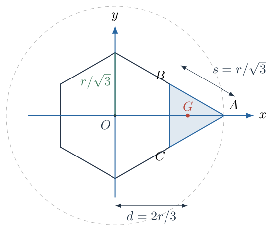

中央六边形的外接圆半径为$r/\sqrt3$，所以
$$
\begin{aligned}
A&=(r,0),\\
B&=\left(\frac r{\sqrt3}\cos\frac\pi6,
\frac r{\sqrt3}\sin\frac\pi6\right)
=\left(\frac r2,\frac r{2\sqrt3}\right),\\
C&=\left(\frac r2,-\frac r{2\sqrt3}\right).
\end{aligned}
$$
底边长度为
$$
BC=\frac r{\sqrt3},
$$
而
$$
AB^2=\left(\frac r2\right)^2+
\left(\frac r{2\sqrt3}\right)^2
=\frac{r^2}{3}.
$$
$AC$同理。因此三边均为
$$
s=\frac r{\sqrt3},
$$
确为等边三角板。其面积是
$$
A_\triangle=\frac{\sqrt3}{4}s^2
=\frac{\sqrt3r^2}{12}.
$$
六块质量相同，单块质量$m_\triangle=m/6$。统一面密度记为$\sigma$，则
$$
\sigma=\frac{m/6}{A_\triangle}
=\frac{2m}{\sqrt3r^2}.
$$
以后所有层均使用这个$\sigma$，而不是每层重新设成与面积无关的同一总质量。

（2）确定单块质心到中心轴的距离。

均匀三角形的质心为三个顶点位置的平均。由上述坐标，
$$
\begin{aligned}
x_G&=\frac{r+r/2+r/2}{3}=\frac{2r}{3},\\
y_G&=\frac{0+r/(2\sqrt3)-r/(2\sqrt3)}3=0.
\end{aligned}
$$
所以单块质心$G$到$O$的距离为
$$
d=OG=\frac{2r}{3}.
$$
三角板的外顶点在$r$处，内侧底边在$r/2$处，而质心在$2r/3$处。用$r$或$r/2$代替$d$均会改变平行轴项，不能凭图的视觉重心估算。

为了同时核对质心公式和后续积分，可使用$x$向薄条。三角板的两斜边是
$$
y=\pm\frac{r-x}{\sqrt3},\qquad \frac r2\le x\le r.
$$
于是薄条面积为
$$
\mathrm dA=\frac{2(r-x)}{\sqrt3}\,\mathrm dx.
$$
直接积分有
$$
\begin{aligned}
\int_A x\,\mathrm dA
&=\frac2{\sqrt3}\int_{r/2}^{r}x(r-x)\,\mathrm dx\\
&=\frac2{\sqrt3}
\left[\frac{rx^2}{2}-\frac{x^3}{3}\right]_{r/2}^{r}\\
&=\frac{r^3}{6\sqrt3}.
\end{aligned}
$$
除以$A_\triangle=r^2/(4\sqrt3)$，也得到$x_G=2r/3$；$y$向的奇函数积分为零。这样确认了质心位置与实际区域边界一致。

（3）对中心轴积分，先写出面积元而不是直接套系数。

垂直板面、通过$O$的轴到点$(x,y)$的距离平方为$x^2+y^2$。故单块的惯量为
$$
I_{O,\triangle}=\sigma
\int_{r/2}^{r}\int_{-(r-x)/\sqrt3}^{(r-x)/\sqrt3}
(x^2+y^2)\,\mathrm dy\,\mathrm dx.
$$
图3-3突出积分薄条的上下边界。薄条虽然可用于面积积分，但求极惯量时不能只保留$x^2\mathrm dm$，还必须积分条内不同$y$位置的距离平方。

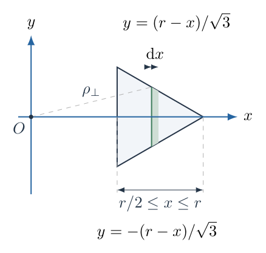

设$h=(r-x)/\sqrt3$为半条宽，先积$y$：
$$
\begin{aligned}
\int_{-h}^{h}(x^2+y^2)\,\mathrm dy
&=x^2(2h)+\left[\frac{y^3}{3}\right]_{-h}^{h}\\
&=2hx^2+\frac{2h^3}{3}\\
&=\frac{2x^2(r-x)}{\sqrt3}
+\frac{2(r-x)^3}{9\sqrt3}.
\end{aligned}
$$
定义面积二阶矩$J_O=I_{O,\triangle}/\sigma$，则
$$
J_O=\frac2{\sqrt3}\int_{r/2}^{r}x^2(r-x)\,\mathrm dx
+\frac2{9\sqrt3}\int_{r/2}^{r}(r-x)^3\,\mathrm dx.
$$
这里$J_O$的量纲为长度四次方，而$I_{O,\triangle}$的量纲为质量乘长度平方，两者通过$\sigma$联系，不能混为一谈。

（4）完整计算两个定积分。

第一项的原函数为
$$
\int x^2(r-x)\,\mathrm dx
=\frac{rx^3}{3}-\frac{x^4}{4}.
$$
代上下限：
$$
\begin{aligned}
\left[\frac{rx^3}{3}-\frac{x^4}{4}\right]_{r/2}^{r}
&=r^4\left(\frac13-\frac14\right)
-r^4\left(\frac1{24}-\frac1{64}\right)\\
&=r^4\left(\frac1{12}-\frac5{192}\right)
=\frac{11r^4}{192}.
\end{aligned}
$$
第二项令$u=r-x$，$\mathrm du=-\mathrm dx$。当$x$由$r/2$变到$r$时，$u$由$r/2$变到零，调换上下限后
$$
\int_{r/2}^{r}(r-x)^3\,\mathrm dx
=\int_0^{r/2}u^3\,\mathrm du
=\frac14\left(\frac r2\right)^4
=\frac{r^4}{64}.
$$
合并两个贡献：
$$
\begin{aligned}
J_O
&=\frac2{\sqrt3}\cdot\frac{11r^4}{192}
+\frac2{9\sqrt3}\cdot\frac{r^4}{64}\\
&=\frac{11r^4}{96\sqrt3}
+\frac{r^4}{288\sqrt3}\\
&=\frac{34r^4}{288\sqrt3}
=\frac{17r^4}{144\sqrt3}.
\end{aligned}
$$
利用$\sigma=m_\triangle/A_\triangle$，可避免再代入总质量：
$$
\begin{aligned}
I_{O,\triangle}
&=m_\triangle\frac{J_O}{A_\triangle}\\
&=m_\triangle
\frac{17r^4/(144\sqrt3)}{r^2/(4\sqrt3)}\\
&=\frac{17}{36}m_\triangle r^2.
\end{aligned}
$$
六块绕同一$O$轴相加，第二问得到
$$
\boxed{I_0=6I_{O,\triangle}=\frac{17}{36}mr^2.}
$$

（5）用平行轴定理拆解系数，说明轴的位置。

垂直板面、通过$G$的轴与$O$轴平行。平行轴定理为
$$
I_{O,\triangle}=I_{G,\triangle}+m_\triangle d^2.
$$
由已积分的$I_{O,\triangle}$和$d=2r/3$，
$$
\begin{aligned}
I_{G,\triangle}
&=m_\triangle r^2\left(\frac{17}{36}-\frac49\right)\\
&=\frac1{36}m_\triangle r^2
=\frac1{12}m_\triangle s^2.
\end{aligned}
$$
等边三角板的质心极惯量系数$1/12$由本题积分得到了验证，而不是凭记忆引用。反过来，如果已知这一质心轴公式，也可以写
$$
\begin{aligned}
I_0
&=6\left(\frac1{12}\frac m6\frac{r^2}{3}
+\frac m6\frac{4r^2}{9}\right)\\
&=mr^2\left(\frac1{36}+\frac{16}{36}\right)
=\frac{17}{36}mr^2.
\end{aligned}
$$
质心自转项占$1/36$，质心到中心的平行轴项占$16/36$。后者占主要部分，说明这组六三角板的质量大部分离中心较远。只算质心项会把惯量低估十几倍。

（6）建立逐层几何缩放，而不是先写求和公式。

把最初六块组成的图案记为第$j=0$层，其外接圆半径$r_0=r$、质量$m_0=m$、惯量$I_0$。每次进入中央正六边形，其外接圆半径缩小至前一次的$1/\sqrt3$。于是
$$
r_j=r\left(\frac1{\sqrt3}\right)^j,
\qquad j=0,1,2,\ldots.
$$
相似缩放将每个点$(x,y)$映射为旋转后的$s_j(x,y)$，其中$s_j=3^{-j/2}$。旋转不改变$x^2+y^2$；缩放使
$$
\mathrm dA_j=s_j^2\mathrm dA_0,\qquad
x_j^2+y_j^2=s_j^2(x_0^2+y_0^2).
$$
面密度不变，所以
$$
\mathrm dm_j=\sigma\mathrm dA_j=s_j^2\mathrm dm_0.
$$
先积分质量，得到
$$
\boxed{m_j=m\,s_j^2=\frac m{3^j}.}
$$
再积分距离平方乘质量元，得到
$$
\begin{aligned}
I_j&=\int(x_j^2+y_j^2)\,\mathrm dm_j\\
&=s_j^4\int(x_0^2+y_0^2)\,\mathrm dm_0
=I_0s_j^4.
\end{aligned}
$$
即
$$
\boxed{I_j=\frac{I_0}{9^j}.}
$$
图3-4在同一递推中分别标出长度、质量与惯量的变化。后续的两个等比级数分别使用$1/3$、$1/9$，不能只凭“图案缩小”给它们同一个公比。

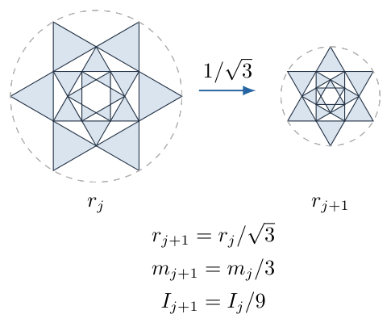

（7）先写有限层质量，再取无穷极限。

设已经加入$N$层，包含$j=0$至$j=N-1$，则
$$
M_N=m\sum_{j=0}^{N-1}\left(\frac13\right)^j.
$$
令$S_N=1+q+\cdots+q^{N-1}$，把$qS_N$与$S_N$相减，有
$$
(1-q)S_N=1-q^N.
$$
取$q=1/3$，
$$
\boxed{M_N=\frac{3m}{2}(1-3^{-N}).}
$$
因为$3^{-N}\to0$，第一问的质量极限为
$$
\boxed{M=\lim_{N\to\infty}M_N=\frac{3m}{2}.}
$$
新添加的全部质量为$M-m=m/2$，并不是$m$或整个外六边形的缺失质量。所有层面积互不重叠，故质量可直接相加；如果重复涂在已存在薄板上，这个结论会属于另一种模型。

（8）分别计算有限层及无限层惯量。

同样有
$$
I_N=I_0\sum_{j=0}^{N-1}\left(\frac19\right)^j
=\frac98I_0(1-9^{-N}).
$$
代入$I_0=17mr^2/36$：
$$
\begin{aligned}
I_N&=\frac98\cdot\frac{17}{36}mr^2(1-9^{-N})\\
&=\frac{17}{32}mr^2(1-9^{-N}).
\end{aligned}
$$
取极限得到第三问
$$
\boxed{I_\infty=\frac{17}{32}mr^2.}
$$
这里$m$仍为最初六三角板的总质量。如果希望改写为最终总质量$M=3m/2$，则$m=2M/3$，所以
$$
\boxed{I_\infty=\frac{17}{48}Mr^2.}
$$
这两个系数分别对应不同的质量定义，不存在矛盾。把$17/32$直接乘$M$会错误增加一半的惯量。

（9）检查整体质心、量纲、填充面积与收敛速度。

每层由绕$O$等角度分布的六个相同三角板组成，其六个质心位置矢量相加为零。因此每层质心及所有有限层组合的质心均在$O$；无限层的质量和位置矩均收敛，极限的质心也在$O$。所求轴不需要再平移一次。

质量公式具有$m$的量纲，惯量公式具有$mr^2$的量纲。令全部长度缩小到$kr$而保持面密度不变，最初质量变成$k^2m$，最终惯量变成$k^4I_\infty$；若题目改为保持最初总质量不变，则惯量只随$r^2$变化。两种实验条件不同，不能混用。

外正六边形的面积为
$$
A_{\rm hex}=6\cdot\frac{\sqrt3r^2}{4}
=\frac{3\sqrt3r^2}{2}.
$$
最初六三角板总面积为$6A_\triangle=\sqrt3r^2/2$，占外六边形面积的$1/3$。无限递归后的阴影面积是初始的$3/2$倍，故最终占比为
$$
\frac13\cdot\frac32=\frac12.
$$
中央空白半径趋于零，不代表整个外六边形被填满：各层周围未添加的区域仍然存在。最终总质量为满外六边形薄板质量$3m$的一半，与$M=3m/2$一致。

截断误差为
$$
\begin{aligned}
M-M_N&=\frac{3m}{2}3^{-N},\\
I_\infty-I_N&=\frac{17mr^2}{32}9^{-N}.
\end{aligned}
$$
以各自无限极限归一化，质量相对误差为$3^{-N}$，惯量相对误差为$9^{-N}$。更靠近轴的末端质量对惯量影响更小，因此惯量比质量更快接近极限。

<!-- KEEP_STUDENT_START -->

（10）用有限层数值和几何界限核验结果。

前两层应满足
$$
\begin{aligned}
M_1&=m,\qquad M_2=m+\frac m3=\frac{4m}{3},\\
I_1&=I_0,\qquad I_2=I_0+\frac{I_0}{9}
=\frac{10}{9}I_0.
\end{aligned}
$$
把$N=1,2$代入有限层闭式，均能恢复这两个直接加和的结果。无限惯量与初始惯量之比为$9/8$，虽然质量增加了$1/2$，惯量却只增加$1/8$，符合新增质量集中在内侧的物理图像。

所有质量均位于外接圆内，所以必须有$0<I_\infty<Mr^2$。所得$I_\infty/(Mr^2)=17/48\approx0.3542$满足该界限。均方到轴距离为
$$
\langle\rho_\perp^2\rangle=\frac{I_\infty}{M}
=\frac{17r^2}{48},
$$
故回转半径为$r\sqrt{17/48}\approx0.5951r$。它小于最初各三角板质心距离$2r/3$，符合递归不断增加内侧质量的趋势；不能将回转半径与质心到轴距离混同。

<!-- KEEP_STUDENT_END -->

## 六、关键洞察

转动惯量本质上是质量关于距离平方的加权总和。在二维同密度相似缩放中，质量具有长度二次缩放，距离平方再带来长度二次缩放，所以惯量具有长度四次缩放。这个规律既能简化递归，也能检出把$1/3$错用成惯量公比的错误。

旋转、平移与缩放对惯量的作用不同。绕同一个中心的整体旋转保持极惯量；平移轴要使用平行轴定理；缩放改变每个质量元及其到轴的距离。本题同时出现旋转和缩放，但不存在把每个新层整体移离$O$的过程。

极限图形不必具有简单的填充轮廓，积分量却可以有简单极限。只要新增区域互不重叠且求和绝对收敛，就可以分别求质量与惯量。判断阴影最终覆盖比例，则要追踪真正被添加的区域，而非只看中心空白是否消失。

把一个等边三角板的中心轴惯量分成质心项与平行轴项，能揭示质量分布：本题的$17/36$中有$16/36$来自质心离轴距离。积分不是只为给出系数，也用于验证图形坐标、薄条边界和所选轴是否一致。

## 七、易错点

误把初始三角形边长取为$r$；它实际为$r/\sqrt3$。外正六边形的边长为$r$，但阴影三角板并非组成外六边形的六个中心扇形三角形。

把三角板质心写在$r/2$或$3r/4$处；应由三个顶点平均或面积积分得到$2r/3$。质心位置错误会直接改变最大的平行轴贡献。

积分薄条时只用$x^2\mathrm dm$；本题绕垂直板面轴旋转，到轴距离是$\sqrt{x^2+y^2}$，需要同时积分$y^2$。

每层质量公比为$1/3$，不是长度公比$1/\sqrt3$；惯量公比为$1/9$，又不是质量公比$1/3$。应明确一次长度平方来自面积，一次来自距离平方。

有限层索引从$j=0$开始，$N$层最后一层为$j=N-1$。把$3^{-N}$错写为$3^{-(N+1)}$会使$N=1$不能回到初始质量。

最终公式中的$m$是初始质量，$M$是极限质量；写成$17Mr^2/32$会错用定义。忽略各层永久空白区域，则会错误认为最终质量达到$3m$。

## 八、课堂讲解建议

先把一块朝右的阴影三角板单独放大，让学生从中央六边形半径和$30^\circ$角读出三个顶点。不要立即给出等边三角形惯量公式；先建立积分条边界，算面积和质心，再加入距离平方。学生由同一个区域完成三个积分，容易理解为何积分范围必须一致。

板书使用两条并行递推：长度$1/\sqrt3$、质量$1/3$、惯量$1/9$。让学生解释每个平方因子的来源，再求等比和。课堂中可以只画前三层，但要用有限层公式而不是凭越来越密的图形猜无限覆盖率。

最后比较“质量增加一半、惯量只增加八分之一”，让学生用质量离轴的远近解释。再用$N=1$的代入检验有限和的索引，用$M$与$m$转换检验符号定义，使几何直觉、代数和量纲形成闭环。

## 九、变式训练

（1）已经加入$N$层，要求质量与惯量相对于各自无限极限的误差均小于$1\%$。分别至少需要多少层？若取共同满足条件的最少层数，写出剩余误差。

完整解答：质量相对误差$3^{-N}<0.01$，相当于$3^N>100$。$3^4=81<100$，$3^5=243>100$，故质量需要至少$5$层。惯量相对误差$9^{-N}<0.01$，相当于$9^N>100$。$9^2=81<100$，$9^3=729>100$，故惯量只需至少$3$层。

两者共同达标需要$N=5$。此时质量相对误差为$(M-M_5)/M=1/243\approx0.4115\%$，惯量相对误差为$(I_\infty-I_5)/I_\infty=1/59049\approx0.001694\%$。
对应绝对误差分别为$M/243=m/162$和$I_\infty/59049=17mr^2/(32\cdot59049)$。这里“第5层”包含最初层，而非在最初层之后再加五次。

（2）几何递归不变，但第$j$层的面密度改为$\sigma_j=\sigma_0q^j$，$q>0$，最初层质量仍为$m$。求总质量与总惯量的收敛条件和收敛值；说明它们是否必须同时收敛。

完整解答：第$j$层面积仍缩放为$3^{-j}$，质量同时乘面密度倍数$q^j$；惯量还要乘距离平方缩放的$3^{-j}$。因此
$$
\begin{aligned}
m_j&=m\left(\frac q3\right)^j,\\
I_j&=I_0\left(\frac q9\right)^j.
\end{aligned}
$$
质量级数在$q<3$时收敛，惯量级数在$q<9$时收敛。两者均收敛且总质量有限的区间$0<q<3$内，
$$
\boxed{M(q)=\frac{m}{1-q/3},\qquad
I(q)=\frac{17mr^2/36}{1-q/9}.}
$$
取$q=1$恢复本题$M=3m/2$、$I=17mr^2/32$。当$3\le q<9$时，总质量发散，但二阶矩仍可收敛，这是越来越大的质量集中到越来越靠近轴处的数学极限；它不是有限总质量薄板，不能继续把$I/M$当成普通刚体回转半径。$q\ge9$时惯量也发散。是否收敛由各自的权重决定，不可仅用质量求和结果推断惯量。

\newpage

# 第 4 题

在单气泡声致发光的简化热力学模型中，气泡内为物质的量不变的单原子理想气体，水温为$T_0=293\,\mathrm K$。初态气体压强为$P_0=101\,\mathrm{kPa}$。气泡先在$T_0$下等温膨胀至半径$36.0\,\mu\mathrm m$；随后在不散热、机械准静态的可逆绝热近似下压缩至半径$4.50\,\mu\mathrm m$；最后等容冷却，回到初态压强及温度。

取气体常量$R=8.31\,\mathrm{J\,mol^{-1}\,K^{-1}}$，摩尔定容热容$C_V=3R/2$，热容比$\gamma=5/3$。忽略表面张力、水蒸气、气体逸出和高温下热容变化。

求：（1）气泡内气体的物质的量$n$；（2）等温膨胀后的压强；（3）绝热压缩后的压强；（4）绝热压缩后的温度；（5）整个循环外界对气体所做的净功。

修订说明：补明可逆绝热近似。仅由“压缩迅速、不散热”不能推出$PV^\gamma$为常量；正文另分析不可逆绝热情形下能够确定的下界。

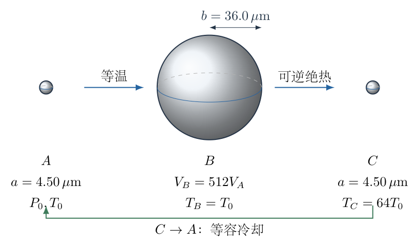

## 一、题型定位

球形气泡中的理想气体循环，组合几何体积、状态方程、等温过程、可逆绝热过程及热力学第一定律。题目的三个阶段有不同约束，必须先建立状态对应，不能对整段过程使用同一温度或同一$PV$关系。外界对气体做功与气体对外做功的符号也须统一。

## 二、知识点

球体体积与半径立方关系；理想气体状态方程；物质的量守恒；单原子气体内能；可逆过程的体积功；可逆绝热方程的微分推导；等容热交换；循环的内能变化；熵增与不可逆绝热下界；有效数字、量纲及模型适用范围。

## 三、物理图像

将初态、最大气泡态、压缩后高温态依次记为$A$、$B$、$C$。$A\to B$温度不变，体积增加、压强降低；$B\to C$无热交换，压缩功转化为内能，温度及压强迅速升高；$C\to A$体积不变，只向水中放热而不做体积功。

膨胀与压缩半径之比为$8$，体积之比却为$8^3=512$。这是高温结果的主要几何来源。完整循环的起点与终点相同，因此$\Delta U_{\rm cycle}=0$，但净功与净热量都不为零。压缩所需功大于等温膨胀所输出的功，外界向循环净输入能量。

## 四、解题入口

先利用最后等容冷却回到初态这一条件，确定初态半径也是$4.50\,\mu\mathrm m$。再用初态求$n$，用等温关系求$P_B$。从第一定律推导可逆绝热的$TV^{\gamma-1}$与$PV^\gamma$关系，得到$T_C$和$P_C$。功按三个阶段分别计算，最后用循环热量作独立符号检查。

## 五、解析

（1）先确定闭合循环的初态体积。

最后一段$C\to A$是等容冷却，且终点回到初态压强$P_0$和初态温度$T_0$。气体物质的量不变，由状态方程
$$
P_AV_A=nRT_A,\qquad P_0V_C=nRT_0,
$$
并使用$P_A=P_0$、$T_A=T_0$，有
$$
V_C=V_A.
$$
因此初态与压缩末态半径相同。记
$$
a=4.50\,\mu\mathrm m=4.50\times10^{-6}\,\mathrm m,
\qquad b=36.0\,\mu\mathrm m=3.60\times10^{-5}\,\mathrm m.
$$
三个状态的体积满足
$$
V_A=V_C=\frac{4\pi a^3}{3},\qquad
V_B=\frac{4\pi b^3}{3}.
$$
初态半径不是额外猜出的条件，而是等容返回及状态方程共同确定的结果。如果气体漏出导致$n$改变，则该推断不再成立，所以题干须明确$n$不变。

（2）完整换算球体体积和体积比。

先算小半径的立方：
$$
a^3=(4.50)^3\times10^{-18}\,\mathrm{m^3}
=91.125\times10^{-18}\,\mathrm{m^3}.
$$
故
$$
V_A=\frac{4\pi}{3}\times91.125\times10^{-18}
=3.817035\times10^{-16}\,\mathrm{m^3}.
$$
两体积之比可不必分别计算：
$$
x=\frac{V_B}{V_A}=\left(\frac ba\right)^3
=\left(\frac{36.0}{4.50}\right)^3
=8^3=512.
$$
所以
$$
V_B=512V_A=1.954322\times10^{-13}\,\mathrm{m^3}.
$$
注意微米在体积计算中要立方换算：$(1\,\mu\mathrm m)^3=10^{-18}\,\mathrm{m^3}$，不能只乘$10^{-6}$。

（3）用初态求气体物质的量。

初态$A$满足$P_0V_A=nRT_0$。先把压强换成国际单位：
$$
P_0=101\times10^3\,\mathrm{Pa}.
$$
于是
$$
\begin{aligned}
n&=\frac{P_0V_A}{RT_0}\\
&=\frac{(101\times10^3)(3.817035\times10^{-16})}
{8.31\times293}\\
&=\frac{3.855205\times10^{-11}}{2434.83}\\
&=1.583357\times10^{-14}\,\mathrm{mol}.
\end{aligned}
$$
第一问答案为
$$
\boxed{n\simeq1.58\times10^{-14}\,\mathrm{mol}.}
$$
$P_0V_A$的单位是焦耳，$RT_0$的单位是焦耳每摩尔，商为摩尔。该$n$虽小，却对应大量分子；理想气体的宏观近似并非因物质的量小就自动失效，其主要风险是后续高温、真实组分及快速过程。

（4）等温膨胀求$P_B$。

$A\to B$的温度保持$T_0$，且$n$不变，所以
$$
P_AV_A=P_BV_B=nRT_0.
$$
移项得到
$$
\begin{aligned}
P_B&=P_0\frac{V_A}{V_B}
=\frac{P_0}{512}\\
&=\frac{101000}{512}\,\mathrm{Pa}
=197.265625\,\mathrm{Pa}.
\end{aligned}
$$
第二问为
$$
\boxed{P_B\simeq197\,\mathrm{Pa}=0.197\,\mathrm{kPa},\qquad T_B=293\,\mathrm K.}
$$
这里求的是气泡内气体压强。真实液体的外界压强、表面张力引起的附加压强及惯性压差并未进入该简化模型，不能将此数值解释为所有情况下的实际水压。

（5）从第一定律推导可逆绝热方程。

取$Q$为气体吸热、$W_{\rm on}$为外界对气体做功，第一定律写为
$$
\mathrm dU=\delta Q+\delta W_{\rm on}.
$$
理想气体内能只与温度有关，定容热容为常量时
$$
\mathrm dU=nC_V\,\mathrm dT.
$$
对机械准静态、可逆的体积变化，外界压强与气体压强在极限上相等，故
$$
\delta W_{\rm on}=-P\,\mathrm dV.
$$
绝热条件给出$\delta Q=0$。结合$P=nRT/V$：
$$
\begin{aligned}
nC_V\,\mathrm dT&=-\frac{nRT}{V}\,\mathrm dV,\\
\frac{\mathrm dT}{T}&=-\frac{R}{C_V}\frac{\mathrm dV}{V}.
\end{aligned}
$$
此处使用分离变量法，从$B$积分到任意状态：
$$
\ln\frac{T}{T_B}=-\frac{R}{C_V}\ln\frac{V}{V_B}.
$$
由$C_P=C_V+R$及$\gamma=C_P/C_V$，有
$$
\frac{R}{C_V}=\gamma-1.
$$
指数化后得到
$$
\boxed{TV^{\gamma-1}=T_BV_B^{\gamma-1}.}
$$
再用$PV=nRT$消去$T$，得到
$$
\boxed{PV^\gamma=P_BV_B^\gamma.}
$$
这两个关系需要“绝热、可逆、理想气体、热容比恒定”同时成立。若只有不散热，却有激波、粘滞耗散或有限压差不可逆压缩，就不能把功直接写成气体平衡压强的$-P\,\mathrm dV$而推出同一个等式。

（6）先求压缩末态温度，明确指数的来源。

从$B$压缩到$C$时$V_B/V_C=x=512$，所以
$$
\frac{T_C}{T_B}=\left(\frac{V_B}{V_C}\right)^{\gamma-1}.
$$
单原子气体$\gamma-1=2/3$，故
$$
\begin{aligned}
\frac{T_C}{T_0}
&=512^{2/3}
=(8^3)^{2/3}
=8^2=64,\\
T_C&=64\times293\,\mathrm K
=18752\,\mathrm K.
\end{aligned}
$$
第四问答案为
$$
\boxed{T_C\simeq1.88\times10^4\,\mathrm K.}
$$
温度比随半径压缩比的平方变化，是本题$\gamma=5/3$特有的结果；不能把温度比直接取为半径比$8$或体积比$512$。

（7）用两条独立状态关系求$P_C$。

先用可逆绝热压强公式：
$$
\begin{aligned}
P_C&=P_B\left(\frac{V_B}{V_C}\right)^\gamma\\
&=\frac{P_0}{512}\,512^{5/3}
=P_0\,512^{2/3}
=64P_0.
\end{aligned}
$$
因此第三问为
$$
\boxed{P_C=6.464\times10^6\,\mathrm{Pa}\simeq6.46\,\mathrm{MPa}.}
$$
再从$A$、$C$体积相同的状态方程检查：
$$
\frac{P_C}{P_A}
=\frac{nRT_C/V_A}{nRT_0/V_A}
=\frac{T_C}{T_0}=64.
$$
与上式一致。若将$P_C$误写成$P_0\,512^{5/3}$，就是把绝热起点$B$的压强$P_B$误替换成了$P_0$。

（8）整理三个状态并读出各段的方向。

$$
\begin{array}{c|ccc}
\text{状态}&V&P&T\\ \hline
A&V_A&P_0&T_0\\
B&512V_A&P_0/512&T_0\\
C&V_A&64P_0&64T_0
\end{array}
$$
图4-2使用$\ln(V/V_A)$、$\ln(P/P_0)$坐标，使体积跨度$512$仍能清楚显示。等温路径斜率为$-1$，可逆绝热路径斜率为$-\gamma=-5/3$，等容冷却为竖直向下。

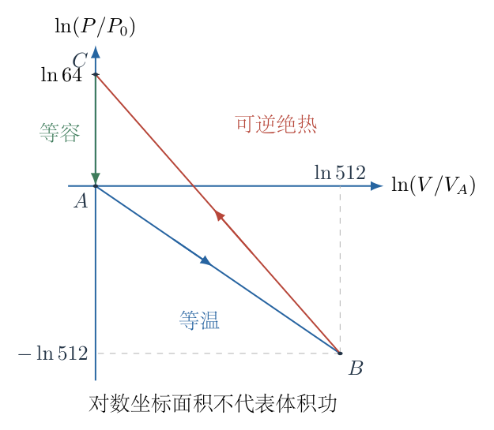

图中等温段从$(0,0)$到$(\ln512,-\ln512)$；绝热段回到体积坐标零时，压强坐标为$\ln64$。对数坐标的围成面积不等于机械功；功的定义仍为$\int P\,\mathrm dV$，后续必须回到真实$P(V)$积分。

（9）计算等温膨胀时外界对气体的功。

膨胀使$\mathrm dV>0$，气体对外做正功，所以外界对气体做负功。沿等温路径$P=nRT_0/V=P_0V_A/V$：
$$
\begin{aligned}
W_{{\rm on},AB}
&=-\int_{V_A}^{V_B}P\,\mathrm dV\\
&=-P_0V_A\int_{V_A}^{V_B}\frac{\mathrm dV}{V}\\
&=-P_0V_A\left[\ln V\right]_{V_A}^{V_B}\\
&=-P_0V_A\ln\frac{V_B}{V_A}
=-P_0V_A\ln512.
\end{aligned}
$$
对数中的比值无量纲，不能单独对有量纲体积取对数作为最后答案。数值为
$$
W_{{\rm on},AB}\simeq-2.405\times10^{-10}\,\mathrm J.
$$
理想气体等温内能不变，$\Delta U_{AB}=0$，所以本段气体吸热
$$
Q_{AB}=-W_{{\rm on},AB}=P_0V_A\ln512>0.
$$
气体从恒温水中吸热，补偿了它对外做的功。

（10）用内能变化计算可逆绝热压缩功。

本段$Q_{BC}=0$，所以第一定律直接给出
$$
W_{{\rm on},BC}=\Delta U_{BC}
=nC_V(T_C-T_B).
$$
代入$C_V=3R/2$、$T_C=64T_0$、$nRT_0=P_0V_A$：
$$
\begin{aligned}
W_{{\rm on},BC}
&=\frac32nR(64T_0-T_0)\\
&=\frac32nRT_0\cdot63\\
&=\frac{189}{2}P_0V_A
=94.5P_0V_A.
\end{aligned}
$$
数值为
$$
W_{{\rm on},BC}\simeq3.643\times10^{-9}\,\mathrm J>0.
$$
这是外界克服气体压强做的压缩功。若采用气体对外做功的记号，则这一段符号相反，但全篇不能中途切换约定。

（11）用压强积分核对绝热压缩功。

沿可逆绝热路径
$$
P(V)=P_B\left(\frac{V_B}{V}\right)^\gamma.
$$
由于积分从大体积$V_B$到小体积$V_A$，外界功为
$$
\begin{aligned}
W_{{\rm on},BC}
&=-P_BV_B^\gamma\int_{V_B}^{V_A}V^{-\gamma}\,\mathrm dV\\
&=-\frac{P_BV_B^\gamma}{1-\gamma}
\left(V_A^{1-\gamma}-V_B^{1-\gamma}\right)\\
&=\frac{P_CV_A-P_BV_B}{\gamma-1}.
\end{aligned}
$$
最后一步使用$P_BV_B^\gamma=P_CV_A^\gamma$。再用$P_CV_A=64P_0V_A$、$P_BV_B=P_0V_A$及$\gamma-1=2/3$：
$$
W_{{\rm on},BC}
=\frac{63P_0V_A}{2/3}
=94.5P_0V_A.
$$
这是以路径积分而非内能计算得到的同一结果，也确认了定积分上下限与外界功负号一致。

（12）计算等容冷却的功与热，并合成循环净功。

本段$\mathrm dV=0$，故
$$
W_{{\rm on},CA}=0.
$$
但温度从$64T_0$降至$T_0$，内能减少，所以
$$
Q_{CA}=\Delta U_{CA}
=nC_V(T_0-64T_0)
=-94.5P_0V_A.
$$
图4-3将能量交换及符号放在三个实际过程上。等容段不做功，不代表它不交换能量。

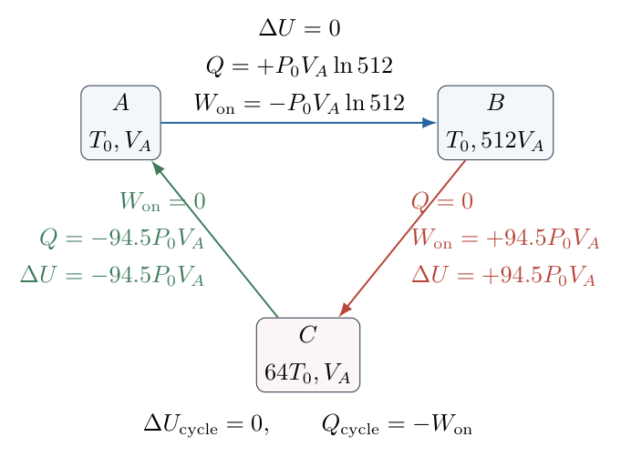

整个循环外界对气体做的净功为
$$
\begin{aligned}
W_{\rm on}
&=W_{{\rm on},AB}+W_{{\rm on},BC}+W_{{\rm on},CA}\\
&=P_0V_A\left(\frac{189}{2}-\ln512\right).
\end{aligned}
$$
由于$\ln512=9\ln2\simeq6.2383246$，
$$
\begin{aligned}
W_{\rm on}
&=(3.855205\times10^{-11})
(94.5-6.2383246)\,\mathrm J\\
&=3.402669\times10^{-9}\,\mathrm J.
\end{aligned}
$$
第五问为
$$
\boxed{W_{\rm on}\simeq3.40\times10^{-9}\,\mathrm J.}
$$
循环净热量为
$$
Q_{\rm cycle}=Q_{AB}+Q_{BC}+Q_{CA}
=P_0V_A(\ln512-94.5)=-W_{\rm on}.
$$
所以$Q_{\rm cycle}+W_{\rm on}=0=\Delta U_{\rm cycle}$，能量守恒及循环符号均通过检查。

（13）说明若压缩只保证绝热，哪些结论仍然成立。

第（1）、（2）问依赖初态、等温膨胀及循环闭合，仍能求$n$、$P_B$。但仅有$Q_{BC}=0$时，末态$T_C$、$P_C$不由给定体积唯一确定。第一定律只给出$W_{{\rm on},BC}=nC_V(T_C-T_0)$，还需过程模型才能定温度。

对于封闭理想气体，由平衡起终态的熵变公式
$$
\Delta S_{BC}
=nC_V\ln\frac{T_C}{T_0}
+nR\ln\frac{V_A}{V_B}
$$
及绝热过程熵增$\Delta S_{BC}\ge0$，可得
$$
\begin{aligned}
C_V\ln\frac{T_C}{T_0}&\ge R\ln512,\\
\frac{T_C}{T_0}&\ge512^{R/C_V}=64.
\end{aligned}
$$
因此，在这些始末态及定热容模型下，
$$
T_C\ge64T_0,\qquad P_C\ge64P_0,
$$
压缩功及循环外界净功也不小于上面可逆值。等号对应无熵产生的可逆绝热，不等号不能提供唯一数值。若另有辐射散热、气体逸出、化学反应等，这一简化闭系统比较也须重新建立。

（14）检查“快速”与“可逆”以及高温模型的边界。

“压缩快于散热”说明热量来不及传出；“机械准静态”说明气体内部能维持近似均匀压强。二者可作为一个理想化的时间尺度分离：
$$
\tau_{\rm mechanical}\ll\tau_{\rm compression}\ll\tau_{\rm thermal}.
$$
真实气泡是否满足该条件要另做判断，不能只凭“快”就保证可逆。声致发光的实际压缩还可能涉及激波、蒸气、非球形运动和辐射。

$1.88\times10^4\,\mathrm K$是本题恒定$C_V$单原子理想气体模型的结果。真实高温气体可能激发、离化，热容、粒子数及能量分配改变；不能把这里的数值当成已包含这些机制的精确温度预测。模型计算正确与模型对实际现象充分是两个不同问题。

## 六、关键洞察

循环闭合条件不仅用于最后检查，也提供了开头缺少的初态体积。利用等容回到相同$P$、$T$，初态半径就能确定；从状态关系读出隐藏信息，比随意假定半径更可靠。

半径比与体积比承担不同角色。对于球形气泡和单原子气体，可逆绝热温度比为$(b/a)^{3(\gamma-1)}=(b/a)^2$，压强相对初态的倍数也恰为这一值。这种简化来自“先等温膨胀再压回原体积”的组合，并非所有绝热气泡都满足$P\propto a^{-2}$。

压缩功可以通过内能变化和路径积分独立求得。前者抓住绝热条件，后者检查压强路径及上下限；两条路线互证，但不可逆过程不能使用可逆路径的$P(V)$积分替代真实过程。

从熵增可识别题目信息不足。对绝热而未保证可逆的过程，给出下界比制造唯一答案更准确；本题修订后的可逆数值可作为明确模型下的标准结果，同时保留成立条件。

## 七、易错点

未利用闭合循环就默认初态半径，或把膨胀末态半径$36\,\mu\mathrm m$用于初态$n$，都会使物质的量错$512$倍。

半径缩小$8$倍，体积缩小$512$倍；指数计算应从$512^{2/3}$展开，而不是从$8^{2/3}$展开。微米的立方换算也容易漏掉。

在等温膨胀用$PV^\gamma$，或在绝热压缩用$PV$，属于过程约束混淆。绝热起点是$B$，所以计算$P_C$必须从$P_B=P_0/512$开始。

把外界压缩功写成负，或把气体膨胀对外功直接加入外界功总和，会得到错误符号。全过程统一$\Delta U=Q+W_{\rm on}$。

等容段功为零，但热量并非零；循环内能变化为零，但净功并非零。内能为状态函数，功与热为过程量。

把“绝热”直接等同“可逆绝热”，或把对数坐标图的面积当成$\int P\,\mathrm dV$，都跳过了数学关系所需的条件。对真实声致发光的解释还必须区分恒定热容模型与高温气体的实际物性。

## 八、课堂讲解建议

先让学生只填三个状态的$V$、$P$、$T$，暂时不算功。通过等容返回读出$V_A=V_C$，再用半径立方求体积比。板书上将$512$框住，后续等温压强、绝热温度和功全部回到这个统一几何量。

讲解绝热式时，从$\mathrm dU=-P\,\mathrm dV$开始，让学生指出为什么需要准静态可逆条件。完成分离变量积分后，才给出$TV^{\gamma-1}$与$PV^\gamma$，不要把它们作为没有来源的两个背诵公式。

功的部分用“气体吸热为正、外界做功为正”的固定符号表逐段核算。最后让学生使用循环$\Delta U=0$检验净热与净功是否相反；若符号对不上，应回到某段的运动方向而不是修改总结果。熵增下界可在标准解答后讲，用于理解为什么原来的快速压缩描述不足。

## 九、变式训练

（1）等温膨胀半径改为初态半径的$q>1$倍，仍可逆绝热压回初始体积并等容冷却。求$P_B$、$T_C$、$P_C$和循环外界净功，并证明净功为正。

完整解答：体积比$x=q^3$，等温关系给出$P_B=P_0/q^3$。单原子气体绝热温度比为$x^{2/3}=q^2$，所以
$$
T_C=q^2T_0,\qquad P_C=q^2P_0.
$$
膨胀外界功为$-3P_0V_A\ln q$，压缩外界功为$(3/2)P_0V_A(q^2-1)$，故
$$
W_{\rm on}(q)=\frac32P_0V_A\left(q^2-1-2\ln q\right).
$$
令$f(q)=q^2-1-2\ln q$，$f(1)=0$，而
$$
f'(q)=2q-\frac2q=\frac{2(q^2-1)}q>0\quad(q>1).
$$
所以$f(q)>0$，即$W_{\rm on}>0$。若$q=1+\varepsilon$、$|\varepsilon|\ll1$，利用
$$
q^2=1+2\varepsilon+\varepsilon^2,\qquad
2\ln q=2\varepsilon-\varepsilon^2+O(\varepsilon^3),
$$
得$W_{\rm on}=3P_0V_A\varepsilon^2+O(\varepsilon^3)$。小幅循环的净功从二阶开始，符合循环面积随幅度平方缩小的趋势。

（2）保持本题体积比$x=512$与初态不变，将气体改为恒定热容比$\gamma>1$的理想气体。求循环净功的一般式，并比较$\gamma=7/5$与$\gamma=5/3$的压缩末温度。

完整解答：$C_V=R/(\gamma-1)$，可逆绝热给出$T_C=T_0x^{\gamma-1}$，$P_C=P_0x^{\gamma-1}$。因此
$$
\boxed{W_{\rm on}
=P_0V_A\left[\frac{x^{\gamma-1}-1}{\gamma-1}-\ln x\right].}
$$
令$y=(\gamma-1)\ln x>0$，括号为$(e^y-1-y)/(\gamma-1)>0$，因为$e^y>1+y$。故所有$\gamma>1$、$x>1$的该类循环都需外界净输入功。

对$\gamma=7/5$，有
$$
\frac{T_C}{T_0}=512^{2/5}
=(2^9)^{2/5}=2^{18/5}\simeq12.1257,
$$
所以$T_C\simeq3553\,\mathrm K$，远低于恒定$\gamma=5/3$模型的$18752\,\mathrm K$。原因是定容热容更大，同样的绝热体积比使温度升高较少。该比较仍属于恒定热容模型，不自动包含真实双原子气体高温下的振动、解离等变化。

\newpage

# 第 5 题

在反射光观察的牛顿干涉实验中，将相对的两块玻璃表面改为两圆柱的凸面。两凸面在接触处具有共同切平面，中间形成薄空气膜，两圆柱曲率半径分别为$R_1$、$R_2$，均远大于所观察条纹的横向尺度。用波长为$\lambda$的单色光近法向照明。

分别讨论两圆柱轴线平行、相互垂直、成锐角$\phi$时，反射干涉条纹的形状和从接触区域向外的间距变化。给出一般曲率半径的结论，并说明$R_1=R_2=R$时的结果。

修订说明：明确相对凸面、反射光及空气膜。轴线正交时只有两曲率半径相等才得到圆纹；不等半径时为椭圆纹，不能无条件回答为圆。

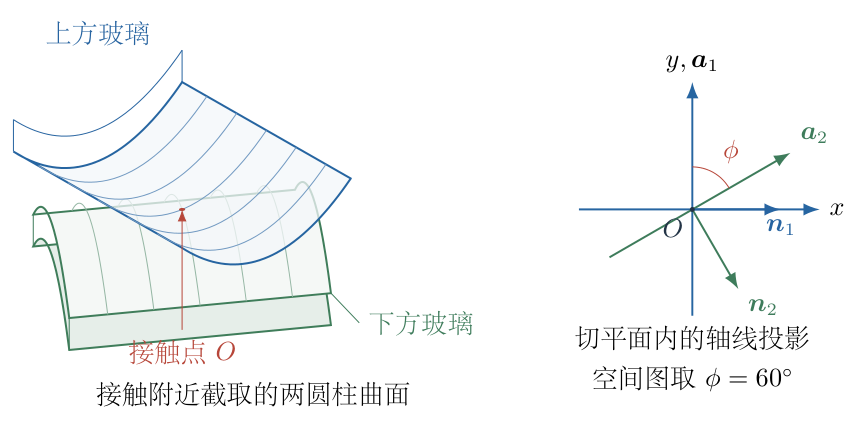

## 一、题型定位

非球面接触形成的薄膜干涉。条纹是空气膜等厚线，关键不是把熟悉的圆形牛顿环图搬过来，而是根据两个圆柱的曲率方向求出膜厚函数。平行、垂直和斜交分别对应退化二次型与不同主轴的正定二次型。

## 二、知识点

曲面接触的共同切平面；圆柱只有一个方向有曲率；圆弧矢高的二阶近似；相对凸面间隙的相加；薄膜反射的半波损失；等厚干涉；二次型与主轴旋转；等间距的平方坐标；同心相似椭圆及间距渐减；近轴适用范围。

## 三、物理图像

沿圆柱轴线移动时，其表面高度不变；垂直轴线移动时，表面远离接触切平面，空气膜增厚。两个凸面相对时，上面向上离开切平面、下面向下离开切平面，二者对间隙的贡献相加。

轴线平行，两表面沿同一个方向弯曲，另一方向不变，形成等厚直线。轴线正交，两独立方向都出现二次厚度变化；曲率相等时等厚线才是圆，否则是椭圆。轴线斜交时仍有两个正曲率主方向，条纹是旋转的椭圆，锐角越小，长短轴差别通常越明显。

## 四、解题入口

先在共同切平面内建$x,y$坐标，把膜厚写成两段圆柱矢高之和。用二阶展开得到$h(x,y)$，再代入反射暗纹条件$2h=m\lambda$。平行和正交可直接读出形状；锐角情形通过曲率矩阵对角化，求主曲率、主轴方向与半轴。间距变化从$\sqrt m$规律解释，不凭图形密度猜测。

## 五、解析

（1）用共同切平面定义膜厚和轴线方向。

设接触位置为$O$，切平面为$z=0$。第一圆柱轴线沿$y$方向，它的曲率方向沿$x$；第二圆柱的轴线投影相对$y$轴转过$\phi$，取单位方向
$$
\boldsymbol a_2=(\sin\phi,\cos\phi).
$$
其垂直方向可取
$$
\boldsymbol n_2=(\cos\phi,-\sin\phi).
$$
切平面内位置矢量为$\boldsymbol\rho=(x,y)$，它到两轴线投影的有符号垂距分别为
$$
u_1=x,\qquad u_2=x\cos\phi-y\sin\phi.
$$
圆柱轴线在三维空间中分别位于切平面的上、下方；这里使用的是它们在切平面上的方向与投影。两个实际轴线并非都穿过接触点，不能为了画俯视图把实体圆柱画成互相贯穿。

（2）求两表面的矢高并作近轴展开。

半径$R$的圆截面在切点附近，离切平面的高度为
$$
g(u)=R-\sqrt{R^2-u^2}
=R\left[1-\sqrt{1-\frac{u^2}{R^2}}\right].
$$
利用$(1-\eta)^{1/2}=1-\eta/2-\eta^2/8+\cdots$，
$$
g(u)=\frac{u^2}{2R}+\frac{u^4}{8R^3}
+O\left(\frac{u^6}{R^5}\right).
$$
近轴条件为$|u|\ll R$，保留二阶项即可。上表面的下侧高度为$z_1=+g_1(u_1)$，下表面的上侧高度为$z_2=-g_2(u_2)$，故膜厚为
$$
h=z_1-z_2=g_1+g_2.
$$
图5-2使用包含某一曲率方向的截面，显示两面向相反空间方向离开切平面，而厚度为两矢高之和。后续公式中的加号由这个真实间隙决定。

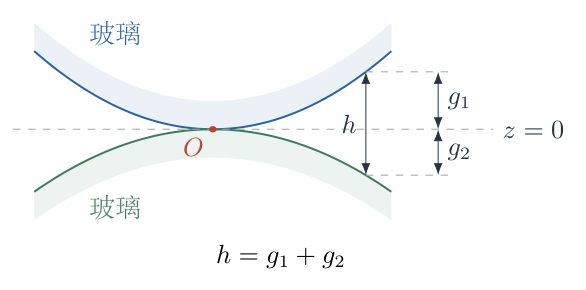

于是一般二阶膜厚为
$$
\boxed{h(x,y)=\frac{x^2}{2R_1}
+\frac{(x\cos\phi-y\sin\phi)^2}{2R_2}.}
$$
如果误取矢高之差，可能得到负厚度或虚假双曲线；本题两相对凸面的几何模型不允许这样的间隙。

（3）先确定反射干涉条件。

两束主要反射光分别来自空气膜上、下界面。上界面的玻璃到空气反射不产生$\pi$相变，下界面的空气到玻璃反射产生$\pi$相变，两束之间有一次半波损失。近法向入射、空气折射率取$1$，传播光程差为$2h$，相位差可写成
$$
\Delta=\frac{4\pi h}{\lambda}+\pi
\quad(\text{模 }2\pi).
$$
相消暗纹对应奇数倍$\pi$，所以
$$
\boxed{2h=m\lambda,\qquad m=0,1,2,\ldots.}
$$
相长亮纹对应偶数倍$\pi$，所以
$$
\boxed{2h=(m+\tfrac12)\lambda,\qquad m=0,1,2,\ldots.}
$$
接触处$h=0$是暗纹。反射系数幅度不相等时暗纹未必完全为零亮度，但等厚线形状及条纹阶次条件不因此变成另一种几何图形。

（4）轴线平行：膜厚只随一个坐标改变。

取$\phi=0$，则$u_2=x$，故
$$
2h=x^2\left(\frac1{R_1}+\frac1{R_2}\right).
$$
定义有效曲率半径
$$
\frac1{R_{\rm eff}}=\frac1{R_1}+\frac1{R_2},
\qquad R_{\rm eff}=\frac{R_1R_2}{R_1+R_2}.
$$
第$m$级暗纹满足
$$
\frac{x^2}{R_{\rm eff}}=m\lambda,
$$
所以
$$
\boxed{x_m=\pm\sqrt{m\lambda R_{\rm eff}}.}
$$
式中不含$y$，条纹沿圆柱轴线方向延伸，为相互平行的直条纹。$m=0$是一条接触暗线；对于$m\ge1$，在其两侧各出现一条同阶暗纹。

若$R_1=R_2=R$，则$R_{\rm eff}=R/2$，有
$$
x_m=\pm\sqrt{\frac{m\lambda R}{2}}.
$$
不能在两面都弯曲时仍使用单凸面与平板接触的$R_{\rm eff}=R$；两个相同凸面使间隙二次系数加倍。

（5）计算平行条纹的间距变化。

同一侧相邻暗纹的间距为
$$
\begin{aligned}
\Delta x_m
&=x_{m+1}-x_m\\
&=\sqrt{\lambda R_{\rm eff}}\,
(\sqrt{m+1}-\sqrt m)\\
&=\frac{\sqrt{\lambda R_{\rm eff}}}
{\sqrt{m+1}+\sqrt m}.
\end{aligned}
$$
最后一步使用分母有理化。随$m$增大，分母增大，故
$$
\boxed{\text{离接触线越远，条纹间距越小。}}
$$
等间隔的是$x_m^2$而非$x_m$：
$$
x_{m+1}^2-x_m^2=\lambda R_{\rm eff}.
$$
对于较大$m$，$\Delta x_m\simeq\sqrt{\lambda R_{\rm eff}}/(2\sqrt m)$。亮纹只需把$m$换成$m+1/2$，同样向外渐密。跨越中心、比较左右两个同阶条纹的距离并不等于同侧相邻阶次的间距。

（6）轴线正交：判断圆纹成立的附加条件。

取$\phi=\pi/2$，则$u_2=-y$，平方后负号消失：
$$
2h=\frac{x^2}{R_1}+\frac{y^2}{R_2}.
$$
第$m$级暗纹为
$$
\boxed{\frac{x^2}{m\lambda R_1}
+\frac{y^2}{m\lambda R_2}=1,\qquad m\ge1.}
$$
这是中心在$O$、主轴沿$x,y$的椭圆，半轴分别为
$$
a_{x,m}=\sqrt{m\lambda R_1},\qquad
a_{y,m}=\sqrt{m\lambda R_2}.
$$
只有当$R_1=R_2=R$时，两半轴相等，才得到圆纹
$$
\boxed{x^2+y^2=m\lambda R,\qquad
\rho_m=\sqrt{m\lambda R}.}
$$
这比相同半径球面与平板形成的$\rho_m=\sqrt{m\lambda R}$形式相同，但这里的膜厚来自两独立圆柱曲率的合成，不能据相同公式混淆三维结构。

（7）正交条纹的间距仍随阶次减小。

在$x$轴上，相邻椭圆交点的间距为
$$
\Delta a_{x,m}
=\frac{\sqrt{\lambda R_1}}{\sqrt{m+1}+\sqrt m};
$$
在$y$轴上，相应间距为
$$
\Delta a_{y,m}
=\frac{\sqrt{\lambda R_2}}{\sqrt{m+1}+\sqrt m}.
$$
二者都向外渐小，但$R_1\ne R_2$时并不相等。对于圆纹，各个方位的间距相同，且
$$
\Delta\rho_m
=\frac{\sqrt{\lambda R}}{\sqrt{m+1}+\sqrt m}.
$$
对于椭圆纹，不能给全周一个与方位无关的“宽度”；应说明沿同一射线向外比较，或在某一局部沿条纹法向比较。

（8）锐角相交：展开二次型并求主曲率。

将一般膜厚展开：
$$
2h=Ax^2+2Bxy+Cy^2,
$$
其中
$$
A=\frac1{R_1}+\frac{\cos^2\phi}{R_2},
\quad B=-\frac{\sin\phi\cos\phi}{R_2},
\quad C=\frac{\sin^2\phi}{R_2}.
$$
对应曲率矩阵为
$$
H=\begin{pmatrix}A&B\\B&C\end{pmatrix}.
$$
图5-3把圆柱轴线与其垂直曲率方向分开画出。两个曲率方向不正交时产生混合项$2Bxy$；将坐标旋转到矩阵的主轴，才能得到无交叉项的椭圆方程。

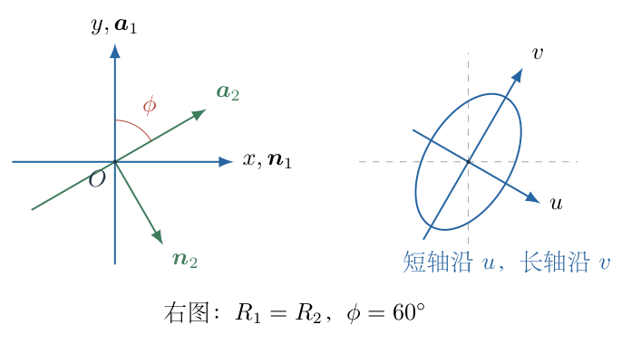

矩阵迹与行列式为
$$
\begin{aligned}
\operatorname{tr}H&=\frac1{R_1}+\frac1{R_2},\\
\det H&=AC-B^2=\frac{\sin^2\phi}{R_1R_2}.
\end{aligned}
$$
当$0<\phi<\pi/2$时，迹与行列式均为正，所以两个本征值均正，等厚线为椭圆，而非双曲线。由特征方程
$$
\kappa^2-(\operatorname{tr}H)\kappa+\det H=0
$$
得主曲率
$$
\boxed{\kappa_\pm=
\frac12\left[
\frac1{R_1}+\frac1{R_2}
\pm\sqrt{\frac1{R_1^2}+\frac1{R_2^2}
+\frac{2\cos2\phi}{R_1R_2}}
\right].}
$$
根号中间形式也可写为$(1/R_1-1/R_2)^2+4\cos^2\phi/(R_1R_2)$，显然非负。$\kappa_+\ge\kappa_->0$，这里的下标表示主曲率大小，不是两圆柱编号。

（9）写出主轴坐标中的椭圆并解释半轴大小。

取正交主轴坐标$u,v$，其中$u$沿$\kappa_+$的本征方向，$v$沿$\kappa_-$方向。则
$$
2h=\kappa_+u^2+\kappa_-v^2.
$$
暗纹方程为
$$
\frac{u^2}{m\lambda/\kappa_+}
+\frac{v^2}{m\lambda/\kappa_-}=1.
$$
对应短、长半轴分别为
$$
\boxed{b_m=\sqrt{\frac{m\lambda}{\kappa_+}},
\qquad a_m=\sqrt{\frac{m\lambda}{\kappa_-}}.}
$$
大曲率方向的厚度增加更快，因此达到同一膜厚所需距离更短；不是曲率越大半轴越大。一般主轴转角$\beta$满足
$$
\tan2\beta=\frac{2B}{A-C},
$$
但仅凭正切不能区分互相垂直的两个方向，应将本征矢代回$H$确认哪个对应$\kappa_+$。当$A=C$时不能直接除以零，应由矩阵或极限取主轴方向。

（10）等半径锐角情形可完全化简。

令$R_1=R_2=R$。因为锐角$\cos\phi>0$，主曲率成为
$$
\kappa_+=\frac{1+\cos\phi}{R},\qquad
\kappa_-=\frac{1-\cos\phi}{R}.
$$
相应主轴坐标可取
$$
\begin{aligned}
u&=x\cos\frac\phi2-y\sin\frac\phi2,\\
v&=x\sin\frac\phi2+y\cos\frac\phi2.
\end{aligned}
$$
把坐标代回或使用本征矢检查，有
$$
\boxed{2h=\frac{1+\cos\phi}{R}u^2
+\frac{1-\cos\phi}{R}v^2.}
$$
因此
$$
b_m=\sqrt{\frac{m\lambda R}{1+\cos\phi}},
\qquad a_m=\sqrt{\frac{m\lambda R}{1-\cos\phi}}.
$$
利用$1+\cos\phi=2\cos^2(\phi/2)$、$1-\cos\phi=2\sin^2(\phi/2)$，得到轴比
$$
\boxed{\frac{a_m}{b_m}=\cot\frac\phi2.}
$$
轴比与阶次$m$无关，所以各条纹为同心相似椭圆。$\phi\to\pi/2$时轴比趋于$1$，恢复圆；$\phi\to0$时长轴趋于无穷，恢复沿共同轴线延伸的直条纹。

（11）对任意固定射线说明向外渐密。

取某条固定射线的方向角为$\chi$，令$x=\rho\cos\chi$、$y=\rho\sin\chi$。膜厚可写为
$$
2h=\rho^2 f(\chi),
$$
其中
$$
f(\chi)=\frac{\cos^2\chi}{R_1}
+\frac{\cos^2(\chi+\phi)}{R_2}.
$$
在非平行情形$f(\chi)>0$。暗纹与这条射线的交点满足
$$
\rho_m(\chi)=\sqrt{\frac{m\lambda}{f(\chi)}}.
$$
因此
$$
\boxed{\Delta\rho_m(\chi)
=\frac{\sqrt{\lambda/f(\chi)}}{\sqrt{m+1}+\sqrt m}}
$$
随$m$增大而减小。椭圆各方位因$f(\chi)$不同而有不同尺度，但同一方位向外的变化趋势一致。

若观察局部法向宽度，在阶次较大、两条相邻线间距足够小时，可用微分近似
$$
2|\nabla h|\,\Delta n\simeq\lambda,
\qquad \Delta n\simeq\frac{\lambda}{2|\nabla h|}.
$$
二次膜厚的梯度随位置尺度增大而增大，故同样向外变窄；这不是把射线方向强行等同于椭圆法线。

（12）汇总形状并作物理极限检查。

图5-4以等半径特例展示平行直纹、正交圆纹、锐角椭圆纹。图中的每组曲线按$m$增加排列，间隔不是人为均分。

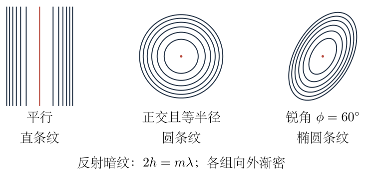

一般结论为：平行时是直条纹；正交时是椭圆纹，等半径时为圆；锐角时是旋转椭圆纹。三种情况下，沿同一方位从接触区向外比较，相邻同类条纹都逐渐变密。

若$R_2\to\infty$，第二表面趋于平板，$h=x^2/(2R_1)$，只剩第一圆柱曲率，所以条纹仍为直线，而非普通球面牛顿环。若$\phi\to0$，曲率矩阵的一个本征值趋零，椭圆退化成直线；这一极限和直接代入平行情形一致。

量纲上，曲率$\kappa$为长度的倒数，$\kappa u^2$为长度，等于光程尺度$m\lambda$；半轴$\sqrt{m\lambda/\kappa}$为长度。近轴近似的相对厚度误差约为$u_i^2/(4R_i^2)$，仅在$|u_i|\ll R_i$时较小。很外侧的条纹若不满足该条件，应返回准确圆柱矢高及入射角模型，不继续外推二次型。

## 六、关键洞察

“条纹形状等于等厚线形状”把光学相位与三维几何分成两个可核验层次。反射相变决定暗亮阶次；曲率矩阵决定形状。改变半波损失会调换中心暗亮或阶次，不会把同一个空气膜的椭圆等厚线变成圆。

曲率的叠加是方向性的。两个圆柱均为相同半径，不代表任意轴线夹角都得到圆；只有两个独立曲率方向正交且强度相同，合成二次型才具有各向同性。

平行直纹是椭圆长轴无穷大的退化极限。正定矩阵的行列式$\sin^2\phi/(R_1R_2)$清楚显示：非平行时有两维约束，平行时只剩一维曲率。这比凭表面俯视轮廓猜干涉图更本质。

平方坐标等间隔是所有二次膜厚的统一规律。条纹位置随$\sqrt m$增长，所以外侧间距下降；将椭圆横向或纵向分别缩放到主曲率坐标后，条纹方程也化为同心圆，这只是分析坐标变换，不代表真实几何突然成为圆。

## 七、易错点

把上、下凸面的矢高相减，忽略它们分别位于切平面两侧。应先画截面再确定膜厚加号。

把轴线方向当成曲率方向；沿轴线没有圆柱曲率，垂直轴线才有。斜交时混合项的符号由第二曲率方向投影决定。

无条件把正交条纹写成圆，漏掉$R_1=R_2$。一般正交结果仍为椭圆，两半轴比为$\sqrt{R_1/R_2}$或其倒数。

忘记反射半波损失，使中心暗纹误写成亮纹；把$\lambda$写成膜厚而漏掉往返光程$2h$，会使条纹尺寸错$\sqrt2$倍。

用面积分布或轮廓均匀性判断条纹等间距；真正等间距的是距离平方。对椭圆只给一个全周不变的间距，也混淆了射线方向与局部法向。

把主曲率大的方向当成长轴，或只用$\tan2\beta$而未确认本征方向，可能把长短轴交换。条纹阶次过大时还须重新检查二阶曲面近似。

## 八、课堂讲解建议

先让学生用纸卷或两段圆柱模型观察：沿轴线滑动不改变高度，垂直轴线才离开切平面。展示三维接触图后，再切到二维膜厚坐标，避免学生把轴线投影的交叉误看成实体穿透。

板书先处理平行、正交，所有公式都从$h$进入$2h=m\lambda$。学生熟悉平方坐标等间隔后，再把锐角情形视为“需要旋转坐标的椭圆”，不必一开始就背矩阵本征值。对于刚接触二次型的学生，可先讲等半径角平分方向，再给一般矩阵结果。

最后用三个极限提问：第二面变平会怎样、两轴角度趋零会怎样、两半径相等且正交会怎样。让学生同时检查空间结构和条纹方程，能发现背记“正交一定圆”的模型遗漏。

## 九、变式训练

（1）两圆柱轴线正交，$R_1=2.00\,\mathrm m$、$R_2=1.00\,\mathrm m$，入射光波长$600\,\mathrm{nm}$。求第$100$级暗纹的半轴及轴比，并检查近轴条件。

完整解答：由正交结果
$$
a_x=\sqrt{100(600\times10^{-9})(2.00)}
=\sqrt{1.20\times10^{-4}}\,\mathrm m
=10.95\,\mathrm{mm},
$$
$$
a_y=\sqrt{100(600\times10^{-9})(1.00)}
=\sqrt{6.00\times10^{-5}}\,\mathrm m
=7.746\,\mathrm{mm}.
$$
长轴沿$x$，轴比$a_x/a_y=\sqrt2$。两垂距与各自曲率半径之比分别约$0.00548$、$0.00775$，远小于$1$；相应矢高的相对二阶误差约为这些比值平方的$1/4$，分别约$7.5\times10^{-6}$、$1.5\times10^{-5}$。近轴模型成立。轴线虽正交，曲率不等，因此不能回答圆形条纹。

（2）等半径圆柱的轴线夹角由$60^\circ$减至$30^\circ$，在同一暗纹阶次下求长、短半轴及轴比变化。

完整解答：令$K=\sqrt{m\lambda R}$。当$\phi=60^\circ$，
$$
a_{60}=\sqrt2K,\qquad b_{60}=\sqrt{\frac23}K,
\qquad \frac{a_{60}}{b_{60}}=\sqrt3.
$$
当$\phi=30^\circ$，$\cos\phi=\sqrt3/2$，因此
$$
a_{30}=\frac{K}{\sqrt{1-\sqrt3/2}},
\qquad b_{30}=\frac{K}{\sqrt{1+\sqrt3/2}}.
$$
轴比为
$$
\frac{a_{30}}{b_{30}}
=\cot15^\circ=2+\sqrt3\simeq3.732.
$$
长半轴的变化倍数为
$$
\frac{a_{30}}{a_{60}}
=\sqrt{\frac{1/2}{1-\sqrt3/2}}
=\sqrt{2+\sqrt3}\simeq1.932,
$$
短半轴的变化倍数为
$$
\frac{b_{30}}{b_{60}}
=\sqrt{\frac{3/2}{1+\sqrt3/2}}
=\sqrt{6-3\sqrt3}\simeq0.8966.
$$
长轴显著增加、短轴略减小，椭圆更扁长。若继续让$\phi$趋零，长轴会超出有限实验区域，且局部近轴图案不能被当成无限大的真实条纹；退化直纹应在相应局部尺度内理解。

\newpage

# 第 6 题

$\beta$-胡萝卜素的分子式为$\mathrm C_{40}\mathrm H_{56}$，其共轭结构示意如图。采用自由电子的一维无限深势阱近似，以有效长度$L$描述共轭体系，考虑$22$个$\pi$电子。势阱两端为驻波节点，电子物质波的波长满足$\lambda_n=2L/n$，$n=1,2,\ldots$。电子遵循德布罗意关系，非相对论动能为$E=p^2/(2m_e)$，其中$m_e$为电子质量。

（1）求单电子能级$E_n$。

（2）在零温基态、每个空间能级可容纳两种相反自旋的近似下，说明最低吸收跃迁为何为$n=11\to12$，并求相应光子波长。

（3）取$L=1.83\,\mathrm{nm}$，计算上述吸收波长。可取$h=6.62607015\times10^{-34}\,\mathrm{J\,s}$、$c=2.99792458\times10^8\,\mathrm{m\,s^{-1}}$、$m_e=9.1093837139\times10^{-31}\,\mathrm{kg}$。

修订说明：区分化学结构与有效一维势阱，不沿用“21个碳原子对应22个$\pi$电子”的不准确表述；补明能级的自旋容纳规则。$L$为给定模型的有效长度，所得波长不是包含真实分子全部相互作用的精确光谱预测。

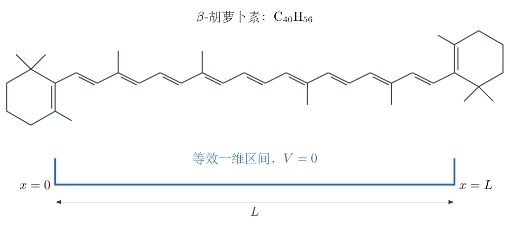

## 一、题型定位

物质波边界条件导致能量量子化，以及多电子基态的泡利填充和最低吸收。驻波关系给出允许动量的大小，非相对论动能给出离散能级；吸收能量则由最高已占据能级与最低空能级的差决定，不能只从最低两个单电子能级选择。

## 二、知识点

德布罗意关系；定端驻波节点；无限深势阱的边界；非相对论动能；量子数与零点能；电子自旋及泡利不相容原理；基态能级填充；光子能量与波长；量纲及纳米单位换算；有效模型的局限；跃迁矩阵元的条件核验。

## 三、物理图像

电子的波函数在有效区间两端为零，允许的驻波必须在长度$L$中恰好容纳整数个半波长。量子数$n$越大，波形节点越密，动量大小及能量越大。这里的电子物质波不是吸收光子的电磁波，两者的波长关系不同。

$22$个电子按最低总能量填充：每个空间能级最多容纳两个相反自旋电子，因此$n=1$至$n=11$全部占满，$n=12$为空。已经占满的低能级阻止别的电子跃入，最低可用的向上跃迁由第$11$级进入第$12$级。所需光子能量只等于这一差值，而不是$E_{12}$本身。

## 四、解题入口

用$L=n\lambda_n/2$确定电子物质波长，再代入$p_n=h/\lambda_n$和$E_n=p_n^2/(2m_e)$。在求吸收之前先画出电子填充，说明为什么是$11\to12$。完成平方差后用$\Delta E=hc/\lambda_{\rm ph}$，最后统一单位、逐项计算并检查波长与长度的平方关系。

## 五、解析

（1）由端点节点推出允许的物质波长。

将一维势阱坐标取为$0\le x\le L$，端点边界为
$$
\psi(0)=0,\qquad\psi(L)=0.
$$
阱内自由电子的驻波可写成$\psi(x)=A\sin kx$。左端条件已满足，右端要求
$$
\sin kL=0,
$$
即
$$
kL=n\pi,\qquad n=1,2,\ldots.
$$
$n=0$只给出处处为零的函数，不能表示一个归一化存在的电子；负$n$与正$n$只差整体符号，不产生新的独立空间能级。由$k=2\pi/\lambda_n$，有
$$
\boxed{k_n=\frac{n\pi}{L},\qquad \lambda_n=\frac{2L}{n}.}
$$
图6-2显示第$1$、$2$、$11$级的端点及内部节点。第$n$级包含$n$个半波长，内部有$n-1$个节点；不能将“波腹个数”与“完整波长个数”混淆。

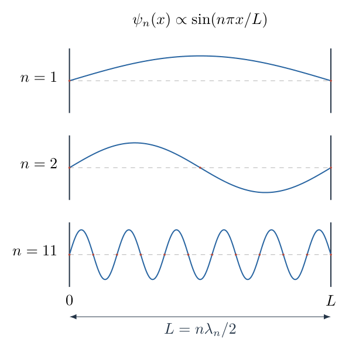

（2）由德布罗意关系求动量和单电子能量。

电子物质波的德布罗意关系为$p=h/\lambda$，因此允许的动量大小为
$$
|p_n|=\frac{h}{\lambda_n}=\frac{nh}{2L}.
$$
驻波是相反传播方向分量的叠加，并不是电子以一个固定正动量匀速穿过两端。动能依赖$p^2$，所以可使用上述动量大小求能量：
$$
\begin{aligned}
E_n&=\frac{p_n^2}{2m_e}\\
&=\frac1{2m_e}\left(\frac{nh}{2L}\right)^2\\
&=\frac{n^2h^2}{8m_eL^2}.
\end{aligned}
$$
第一问为
$$
\boxed{E_n=n^2E_1,\qquad E_1=\frac{h^2}{8m_eL^2}.}
$$
这里把阱内势能取为零，$E_1>0$由边界限制引起，并不是绝对真空能量的任意约定。相邻能级差为
$$
E_{n+1}-E_n=[(n+1)^2-n^2]E_1=(2n+1)E_1,
$$
随$n$增加而增大，所以本题能级并不等间隔。

（3）区分驻波的平均动量与动量平方。

为检验把驻波动量大小代入动能的合理性，可取归一化波函数
$$
\psi_n(x)=\sqrt{\frac2L}\sin\frac{n\pi x}{L}.
$$
归一化来自
$$
\int_0^L\sin^2\frac{n\pi x}{L}\,\mathrm dx=\frac L2.
$$
实驻波中两个传播方向相对称，平均动量为零；但动量平方并非零。由于
$$
\frac{\mathrm d^2\psi_n}{\mathrm dx^2}
=-\left(\frac{n\pi}{L}\right)^2\psi_n,
$$
使用动量平方算符$-\hbar^2\mathrm d^2/\mathrm dx^2$，得到
$$
\langle p^2\rangle_n
=\hbar^2\left(\frac{n\pi}{L}\right)^2
=\frac{n^2h^2}{4L^2}.
$$
于是$\langle p^2\rangle_n/(2m_e)$恢复$E_n$。不能把$\langle p\rangle^2=0$当成$\langle p^2\rangle=0$；平均量的平方与平方量的平均通常不同。

（4）用泡利原理确定$22$电子基态。

在这一独立电子近似下，每个空间驻波状态有两种可区分的自旋状态。同一空间能级最多容纳两个电子，且两者自旋相反。设最高占满能级的量子数为$n_F$，则
$$
2n_F=22,\qquad n_F=11.
$$
故占据数为
$$
N_n=
\begin{cases}
2,&1\le n\le11,\\
0,&n\ge12.
\end{cases}
$$
图6-3标出最低能级、最高两个占据能级和最低空能级，中间省略的部分用轴断裂表示，不把高低能级画成等间距。后续能量差严格采用$121E_1$与$144E_1$。

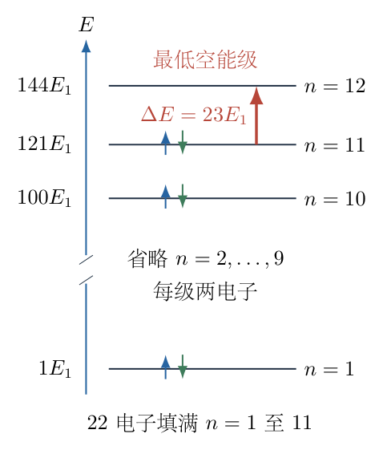

两电子占据同一空间能级不是违反泡利原理，因为它们的完整量子状态含不同自旋。反之，不能允许第三个电子也处于完全相同的空间状态及这两种自旋状态之一。

（5）说明最低吸收为何不能取$1\to2$。

在基态中，第$2$级已经有两个电子。若把第$1$级的电子激发到第$2$级，而原有电子不改变状态，末态会有三个电子挤入同一空间能级，泡利原理不允许。

对单光子激发一个电子的过程，可用的初态必须已占据，末态必须空着。因此任意候选跃迁有$n\le11$、$m\ge12$，其能量差为
$$
\Delta E_{n\to m}=(m^2-n^2)E_1.
$$
在$m$固定时，$n$越大差值越小；在$n$固定时，$m$越小差值越小。因此全部候选中最小者为$n=11$、$m=12$。先填充再筛选，是本题与单电子最低跃迁的关键区别。

（6）计算最低跃迁能量与光子波长。

完整平方差为
$$
\begin{aligned}
\Delta E_{\min}
&=E_{12}-E_{11}\\
&=(12^2-11^2)\frac{h^2}{8m_eL^2}\\
&=(144-121)\frac{h^2}{8m_eL^2}\\
&=\frac{23h^2}{8m_eL^2}.
\end{aligned}
$$
也可由$(12-11)(12+11)=23$核验系数。光子能量满足
$$
\Delta E_{\min}=hf_{\rm ph}
=\frac{hc}{\lambda_{\rm ph}}.
$$
移项并约去一个$h$：
$$
\begin{aligned}
\lambda_{\rm ph}
&=\frac{hc}{\Delta E_{\min}}\\
&=\frac{hc}{23h^2/(8m_eL^2)}
=\frac{8m_ecL^2}{23h}.
\end{aligned}
$$
第二问为
$$
\boxed{\lambda_{\rm ph}=\frac{8m_ecL^2}{23h}.}
$$
这里$\lambda_{\rm ph}$为吸收光子波长，$\lambda_{11}=2L/11$为电子物质波波长。它们虽同用长度单位，物理含义和数值尺度不同，不能以$\lambda_{11}$直接代替吸收波长。

（7）逐项代入$L$计算能级尺度。

先换算
$$
L=1.83\times10^{-9}\,\mathrm m,\qquad
L^2=3.3489\times10^{-18}\,\mathrm{m^2}.
$$
基级能量为
$$
\begin{aligned}
E_1
&=\frac{(6.62607015\times10^{-34})^2}
{8(9.1093837139\times10^{-31})(3.3489\times10^{-18})}\\
&=\frac{4.3904806\times10^{-67}}
{2.4405132\times10^{-47}}\,\mathrm J\\
&=1.798999\times10^{-20}\,\mathrm J.
\end{aligned}
$$
取$1\,\mathrm{eV}=1.602176634\times10^{-19}\,\mathrm J$，其电子伏特值为
$$
E_1=0.112285\,\mathrm{eV}.
$$
于是
$$
\begin{aligned}
\Delta E_{\min}
&=23E_1=4.137697\times10^{-19}\,\mathrm J\\
&=2.58255\,\mathrm{eV}.
\end{aligned}
$$
不是将$12^2E_1$当成吸收能量；电子本来已在第$11$级，原有的$121E_1$应扣除。

（8）计算光子频率及波长，并以两种数值路线核验。

由上述能量差，
$$
f_{\rm ph}=\frac{\Delta E_{\min}}h
=6.244572\times10^{14}\,\mathrm{Hz}.
$$
再用$\lambda_{\rm ph}=c/f_{\rm ph}$：
$$
\begin{aligned}
\lambda_{\rm ph}
&=\frac{2.99792458\times10^8}
{6.244572\times10^{14}}\,\mathrm m\\
&=4.800848\times10^{-7}\,\mathrm m\\
&=480.085\,\mathrm{nm}.
\end{aligned}
$$
直接代入闭式也有
$$
\lambda_{\rm ph}
=\frac{8(9.1093837139\times10^{-31})
(2.99792458\times10^8)(3.3489\times10^{-18})}
{23(6.62607015\times10^{-34})}\,\mathrm m.
$$
两路线一致，第三问按给定$L$的有效数字写成
$$
\boxed{\lambda_{\rm ph}\simeq480\,\mathrm{nm}.}
$$
本模型预示可见光量级的吸收。颜色由完整吸收谱与照明、观察条件共同决定，不能凭一个模型跃迁就推断所有实际颜色表现。

（9）检查量纲及非相对论动能近似。

由于$[h]=\mathrm{kg\,m^2\,s^{-1}}$，
$$
\left[\frac{h^2}{m_eL^2}\right]
=\mathrm{kg\,m^2\,s^{-2}}=\mathrm J,
$$
以及
$$
\left[\frac{m_ecL^2}{h}\right]=\mathrm m.
$$
能级与光子波长的量纲均正确。对于最高占据能级，
$$
\frac{v_{11}}c\ \text{的动量尺度}
=\frac{|p_{11}|}{m_ec}
=\frac{11h}{2Lm_ec}\simeq0.00729\ll1.
$$
这里$v_{11}$是动量对应的速度尺度，不表示驻波电子具有确定方向的经典速度。所给非相对论动能近似在该尺度下合理；它并未同时证明独立电子及无限高边界在真实分子中精确成立。

（10）核对长度变化和能量差的物理趋势。

在电子数不变时，$E_n\propto L^{-2}$、$\Delta E_{\min}\propto L^{-2}$，所以$\lambda_{\rm ph}\propto L^2$。共轭有效长度增加，量子限制减弱，吸收能量下降、波长增加。若实际有效长度比$1.83\,\mathrm{nm}$略大，本模型会给出比$480\,\mathrm{nm}$更长的波长。

但电子数改变时，最高占据级也改变，不能只用$L^2$比例。真实体系中电子相互作用、有限势阱、分子振动与非均匀键长都会修正谱线；本题的目标是给出规定有效模型下的清楚推导，不将结构示意中的几何路径逐段相加后擅自替换给定$L$。

## 六、关键洞察

量子化来自边界而不是先假定能量只能取整数倍。允许波数为$n\pi/L$，动能依赖波数平方，所以谱是$n^2$而非$n$。将已知驻波关系用于电子时，还必须明确这是一维有效势阱近似，不是弦的张力振动能量公式。

多电子吸收有两重条件：能量差满足光子能量，末态还必须可占据。只算单电子谱不足以确定最低吸收，泡利填充使本题的最低跃迁从$1\to2$提高到$11\to12$。此外，在完整量子跃迁模型中还要检查耦合是否允许。

本题的$11\to12$在电偶极近似下并非被奇偶性禁止。位置矩阵元可从一维波函数直接验证：
$$
x_{mn}=\frac2L\int_0^L x
\sin\frac{m\pi x}{L}\sin\frac{n\pi x}{L}\,\mathrm dx.
$$
使用积化和差$\sin a\sin b=[\cos(a-b)-\cos(a+b)]/2$，并对非零整数$k$计算
$$
\int_0^L x\cos\frac{k\pi x}{L}\,\mathrm dx
=\frac{L^2[(-1)^k-1]}{k^2\pi^2},
$$
其中原函数为$x\sin(k\pi x/L)/(k\pi/L)+\cos(k\pi x/L)/(k\pi/L)^2$。代上下限后，正弦项均为零。合并两项得$m\ne n$时
$$
x_{mn}
=\frac{4Lmn[(-1)^{m+n}-1]}
{\pi^2(m^2-n^2)^2}.
$$
$m+n$为偶数时矩阵元为零；$11+12=23$为奇数，故
$$
x_{12,11}
=-\frac{8L(12)(11)}{\pi^2(144-121)^2}
\simeq-0.202259L\ne0.
$$
因此沿有效链方向的电场可以耦合这两个状态。矩阵元符号依赖波函数相位选择，不改变吸收强度与其模平方有关的结论。

基态总能量与一次吸收差值不能混同。基态总能量为
$$
U_0=2E_1\sum_{n=1}^{11}n^2
=2E_1\frac{11\cdot12\cdot23}{6}=1012E_1,
$$
但一次$11\to12$激发只改变$23E_1$，其余电子能级不动。总能量很大不意味着最低光子必须补上整个基态能量。

## 七、易错点

把$L=n\lambda$而非$n\lambda/2$，会使动量及能量系数错倍数。波长$\lambda_n$是电子物质波，不是光子波长。

允许$n=0$并把零能量当成基态，忽略零函数不表示电子。用驻波平均动量为零推断动能为零，也混淆了$\langle p\rangle^2$与$\langle p^2\rangle$。

忘记自旋，每级只放一个电子，就会填至$n=22$，错误选择$22\to23$；反过来允许所有电子挤在$n=1$，又违反泡利原理。

未检查末态占据而选择$1\to2$；把跃迁能量取为$E_{12}$而漏掉$E_{11}$；把平方差$144-121$误算为$1$，都会显著改变答案。

纳米换算要在$L^2$处变为$10^{-18}$。先用电子伏特计算又在$hc$中使用焦耳而未换算单位，会得到无意义数值。

把无限深势阱结果称为精确分子光谱、按骨架图尺量后替换给定$L$，或把颜色由单条谱线完全决定，均超过本题有效模型的依据。

## 八、课堂讲解建议

先让学生在长度相同的三条区间中画$n=1,2,3$驻波，数半波长，再逐步移到$n=11$。板书将$\lambda_n\to p_n\to E_n$依次连接，强调每一箭头所用关系，不让学生把电子波长与光子波长混用。

画能级填充时使用两个相反自旋箭头，让学生亲自数到$22$。先问“第1级能不能跃入第2级”，再问“所有已占据—空能级组合中哪一个差最小”，由占据规则推出$11\to12$，避免直接给定平方差。

数值计算保持一次完整国际单位制路线，再用电子伏特作量级核对。教师可将位置矩阵元推导作为补充，说明最低能量并非唯一跃迁条件；不要求初学学生在尚未理解填充时同时掌握全部量子算符语言。

## 九、变式训练

（1）有效势阱中有$N=2J$个电子，$J$为正整数。求零温基态下最低单电子吸收能量及光子波长；电子数不变而$L$增大至$2L$时，结果怎样变化？

完整解答：每级两电子，填满$n=1$至$J$，最低空级为$J+1$。因此
$$
\Delta E_{\min}=[(J+1)^2-J^2]E_1
=\frac{(2J+1)h^2}{8m_eL^2},
$$
$$
\boxed{\lambda_{\rm ph}
=\frac{8m_ecL^2}{(2J+1)h}.}
$$
相邻级量子数奇偶性相反，位置矩阵元非零，沿链方向电偶极跃迁允许。$L\to2L$而$J$不变时，能量差变为原来的$1/4$，光子波长变为原来的$4$倍。取$J=11$恢复系数$23$。

（2）在同一无限深势阱中，先取$22$电子，再加两个电子但不改变$L$。求基态总能量增加量，以及新最低吸收波长与原值的比。

完整解答：原基态填满至$11$级，新增两个相反自旋电子占据$12$级，不改变已有占据。总能量增加
$$
\Delta U_0=2E_{12}=288E_1.
$$
新基态最低空级为$13$，所以最低吸收能量为
$$
\Delta E'=(13^2-12^2)E_1=(169-144)E_1=25E_1.
$$
故
$$
\frac{\lambda'}{\lambda}=\frac{23}{25}=0.92,
\qquad \lambda'\simeq441.678\,\mathrm{nm}
$$
（使用本题$L$）。基态总能量的增加$288E_1$与下一次最低吸收$25E_1$不是同一问题；前者增加粒子，后者改变一个已有电子的状态。真实分子若改变电子数，势场及结构通常也会改变，这里只讨论势阱固定的数学模型。

\newpage

# 第 7 题

一球形恒星初始半径为$r$，初始赤道表面磁感应强度大小为$B$。恒星导电性理想，收缩为相似的球体，物质及磁通图案按同一比例缩小，采用理想磁通冻结模型。

为计算赤道平面内的场，将轴对称磁场等效为位于对称轴两端、间距为两倍恒星半径的一对相反“磁荷”。此处“磁荷”只是等效计算工具，不表示真实磁单极存在。

（1）在收缩前，求赤道平面内距恒星中心$x$处的磁感应强度大小$B_1(x)$。

（2）当恒星半径变为$kr$，$0<k<1$时，求赤道表面磁感应强度$B_2$，并说明磁通冻结的尺度关系。

（3）一闭合导电环位于赤道平面，环半径始终与恒星半径相同，随恒星一起收缩。在某时刻记恒星半径为$R$，有符号径向速度$a=\mathrm dR/\mathrm dt<0$。求环上的总电动势大小，须同时计入感生与运动电动势。

修订说明：明确随动环、有符号收缩速度与总电动势。磁通变化对移动边界必须作全导数，不能将环当成固定边界而漏掉运动项。

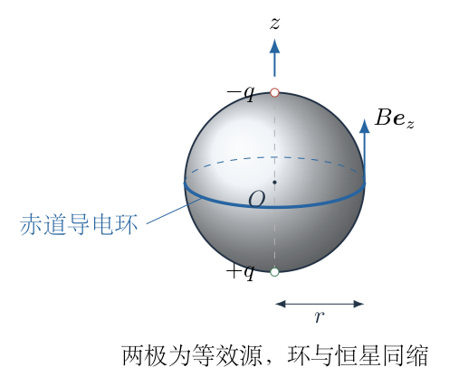

## 一、题型定位

轴对称磁场的几何叠加、相似收缩的磁通冻结，以及移动回路的法拉第定律。题目的关键不只是“磁场变强”，而是区分固定空间点与随物质移动的点，区分固定回路感生电动势与移动回路的总电动势。

## 二、知识点

成对等效磁荷的赤道场；向量分量相消与相加；用已知表面场消去源强；磁通面积缩放；非均匀磁场的面积积分；全导数与偏导数；轴对称感生电场；洛伦兹力运动电动势；环路正向与曲面法向；量纲及远场极限。

## 三、物理图像

赤道平面上的点到两个轴端等效源距离相等，两个场的水平分量抵消，垂直赤道平面的分量相加。随着恒星相似收缩，赤道表面面积尺度减小至$k^2$，同一随动面积上的磁通不变，因此随动赤道表面的场增大至$1/k^2$。

导电环也同时变小。场变强的感生作用与环运动穿越磁场的作用不能分开只算一个。对该物质环，磁通冻结意味着穿过它的总磁通保持不变；因此总电动势应为零。这个结论要通过非均匀场积分或感生、运动两项的具体抵消加以验证，而非把两种电动势都直接置零。

## 四、解题入口

先选环的正向并约定磁场方向，利用等距离三角形求$B_1$，再由$x=r$处给定$B$消去等效源强。第二问通过面积缩放得$B_2$。第三问先对赤道圆面作真实磁通积分，再对移动环作全导数；另计算实验室感生场和$\boldsymbol u\times\boldsymbol B$项独立核验，始终保持同一正向。

## 五、解析

（1）选择便于符号核验的场方向与环路正向。

取恒星中心$O$为原点，对称轴为$z$轴，赤道面为$z=0$。选择赤道场方向为$+\boldsymbol e_z$；对应等效模型中，上端$z=+r$放负源、下端$z=-r$放正源。若把两个源符号互换，所有有符号场、电动势同时反向，最后电动势大小不改变。

环的正向按右手定则取从$+z$方向看为逆时针，即沿$+\boldsymbol e_\varphi$；所选圆面正法向为$+\boldsymbol e_z$。以后磁通、感生项、运动项均按这一配对正向计算。

用$K>0$表示单个等效源的场强系数，单源在距离$d$处产生大小$K/d^2$的场。$K$含源强与模型常数，量纲为$\mathrm{T\,m^2}$；无须假设某种真实磁荷单位。

（2）由赤道等距离几何求收缩前的场。

在赤道面取$P=(x,0,0)$，$x\ge0$。两个轴端到$P$的距离都是
$$
d=\sqrt{x^2+r^2}.
$$
图7-2显示两个场沿各自连线的方向。下端正源的场从下端指向$P$，上端负源的场从$P$指向上端；两者在$z$方向同向，在径向相反。

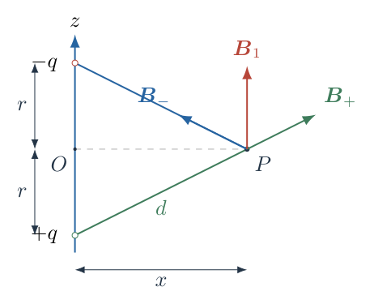

以赤道径向$\boldsymbol e_x$为局部水平正向，两场为
$$
\begin{aligned}
\boldsymbol B_+
&=\frac K{d^3}(x\boldsymbol e_x+r\boldsymbol e_z),\\
\boldsymbol B_-
&=\frac K{d^3}(-x\boldsymbol e_x+r\boldsymbol e_z).
\end{aligned}
$$
系数$K/d^3$来源于场大小$K/d^2$再乘单位方向矢量$1/d$。相加后
$$
\boldsymbol B_1(x)=\frac{2Kr}{(x^2+r^2)^{3/2}}\boldsymbol e_z.
$$
因此
$$
B_1(x)=\frac{2Kr}{(x^2+r^2)^{3/2}}.
$$
不能把场大小直接相加为$2K/d^2$，因为各单源场与$z$轴有夹角，需再乘轴向投影$r/d$。

（3）用初始赤道表面场消去$K$。

题设给定$x=r$处$B_1(r)=B$，所以
$$
\begin{aligned}
B&=\frac{2Kr}{(2r^2)^{3/2}}
=\frac{2Kr}{2\sqrt2r^3}
=\frac K{\sqrt2r^2},\\
K&=\sqrt2Br^2.
\end{aligned}
$$
代回得第一问
$$
\boxed{B_1(x)=\frac{2\sqrt2Br^3}{(x^2+r^2)^{3/2}}
=2\sqrt2B\left(1+\frac{x^2}{r^2}\right)^{-3/2}.}
$$
若只用于真实恒星外部场，取$x\ge r$；本题两源模型的赤道公式也可作为圆面磁通积分所需的等效场延拓，但不把该延拓称为恒星内部真实磁场的唯一分布。

在$x=r$回到$B$。模型在$x=0$给出$2\sqrt2B$，有限而非发散；在$x\gg r$时
$$
B_1(x)\simeq\frac{2\sqrt2Br^3}{x^3}.
$$
只有远于两源间距的区域才出现纯$x^{-3}$近似，不能把它直接用到赤道表面$x=r$。

（4）由磁通冻结求相似收缩的场尺度。

相似收缩把一个物质面积元的两条横向边长都乘$k$，所以
$$
\mathrm d\boldsymbol S_2=k^2\mathrm d\boldsymbol S_1.
$$
理想磁通冻结保持对应物质面积的通量：
$$
\boldsymbol B_2\cdot\mathrm d\boldsymbol S_2
=\boldsymbol B_1\cdot\mathrm d\boldsymbol S_1.
$$
在本题保持场方向结构的各向同性相似收缩中，得到
$$
\boldsymbol B_2(k\boldsymbol x)=k^{-2}\boldsymbol B_1(\boldsymbol x).
$$
故赤道表面为
$$
\boxed{B_2=\frac B{k^2}.}
$$
这不是因为场线的“条数”可作为任意选择的计数守恒，而是有方向的真实磁通在物质面上守恒。仅半径缩小、却未给理想导电及磁通冻结条件时，不能自动推出这一缩放。

（5）检查等效源强与固定点场的不同变化。

当前半径记为$R=kr$。如果继续使用轴端两源模型，当前赤道场为
$$
B_{\rm eq}(R)=\frac{K(R)}{\sqrt2R^2}.
$$
结合$B_{\rm eq}(R)=B/k^2$，解得
$$
K(R)=\sqrt2R^2\frac B{k^2}
=\sqrt2Br^2=K.
$$
所以等效系数$K$恒定。这是由磁通冻结与同一场形模型推出来的，不是预先把两个“磁荷”当成真实守恒粒子。

当前赤道场函数因此为
$$
\boxed{B(x,R)=\frac{2KR}{(x^2+R^2)^{3/2}}.}
$$
把$x=kx_0$与$R=kr$代入，确实给$B(kx_0,kr)=k^{-2}B(x_0,r)$。图7-3对比初始与当前的同缩位置；半径、环面积及对应场同时改变。

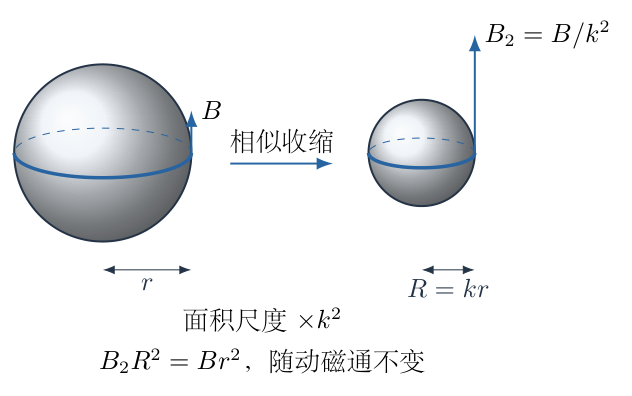

但在固定的很远观察点$x\gg R$，有$B(x,R)\simeq2KR/x^3$，它反而随$R$减小而减弱。不能把“随动表面场变强”误读成“每个固定空间点的场都变强”；比较时必须说明点是否也在移动。

（6）写出移动回路总电动势的定义。

设导电环上材料点的速度为$\boldsymbol u$，磁场、电场在实验室坐标系中分别为$\boldsymbol B$、$\boldsymbol E$。每单位电荷受到沿导线驱动的作用含电场及磁力，因此总电动势为
$$
\mathcal E=\oint_{C(t)}
(\boldsymbol E+\boldsymbol u\times\boldsymbol B)\cdot\mathrm d\boldsymbol l.
$$
对于连续闭合的移动回路，移动边界的法拉第通量关系为
$$
\boxed{\mathcal E=-\frac{\mathrm d}{\mathrm dt}
\int_{S(t)}\boldsymbol B\cdot\mathrm d\boldsymbol S.}
$$
这里是全导数$\mathrm d/\mathrm dt$，既包含场在固定空间点随时间变化，也包含面积边界改变。固定回路的实验室感生项则为
$$
\mathcal E_{\rm lab}
=-\int_{S(t)}\frac{\partial\boldsymbol B}{\partial t}
\cdot\mathrm d\boldsymbol S
$$
（在该时刻取固定边界）。两种导数不是同一对象。

（7）对非均匀赤道场作真实磁通积分。

在两源等效场中，半径为$b$的赤道圆面的磁通为
$$
\Phi(b,R)=\int_0^b B(x,R)\,2\pi x\,\mathrm dx.
$$
代入$B(x,R)$：
$$
\Phi(b,R)=4\pi KR\int_0^b
\frac{x\,\mathrm dx}{(x^2+R^2)^{3/2}}.
$$
令$u=x^2+R^2$，$\mathrm du=2x\,\mathrm dx$，则
$$
\int\frac{x\,\mathrm dx}{(x^2+R^2)^{3/2}}
=\frac12\int u^{-3/2}\,\mathrm du
=-u^{-1/2}.
$$
代上下限：
$$
\begin{aligned}
\Phi(b,R)
&=4\pi KR\left(\frac1R-\frac1{\sqrt{b^2+R^2}}\right)\\
&=\boxed{4\pi K\left(1-\frac R{\sqrt{b^2+R^2}}\right).}
\end{aligned}
$$
不能用$\pi b^2B(b,R)$代替，因为$B$随圆面内$x$变化。特别是中心场比边缘场强，均匀边缘近似会低估磁通。

（8）令环与恒星同缩，计算全导数。

本题环半径$b=R$，因此
$$
\begin{aligned}
\Phi_{\rm comoving}
&=4\pi K\left(1-\frac1{\sqrt2}\right)\\
&=4\pi(\sqrt2-1)Br^2.
\end{aligned}
$$
这里$B$与$r$为初态常量。也可用当前场表示为
$$
\Phi_{\rm comoving}
=4\pi(\sqrt2-1)B_{\rm eq}(R)R^2.
$$
由$B_{\rm eq}R^2=Br^2$，磁通恒定，故
$$
\boxed{\mathcal E=0,\qquad E_0=|\mathcal E|=0.}
$$
这一零结果与任何非零$a$都相容，绝不是因为恒星没有收缩。

该结论更直接地来自物质环磁通冻结，并不依赖把真实内部场完全等同于两个虚拟源。上面的模型积分用于展示非均匀场及缩放如何实现相消；理想冻结条件已经保证随物质闭合环的磁通不变。

（9）在固定空间半径处求实验室感生电场。

先将积分上限$b$保持固定，仅$R(t)$改变。由上一磁通式，
$$
\left(\frac{\partial\Phi}{\partial R}\right)_b
=-4\pi K\frac{b^2}{(b^2+R^2)^{3/2}}.
$$
乘$a=\dot R$，得到
$$
\left(\frac{\partial\Phi}{\partial t}\right)_b
=-\frac{4\pi Ka b^2}{(b^2+R^2)^{3/2}}.
$$
轴对称使环上实验室感生场的切向分量相同，故
$$
\begin{aligned}
2\pi bE_\varphi(b,R)
&=-\left(\frac{\partial\Phi}{\partial t}\right)_b,\\
E_\varphi(b,R)
&=\frac{2Ka b}{(b^2+R^2)^{3/2}}.
\end{aligned}
$$
最后才将观察半径取为当前环位置$b=R$：
$$
\boxed{E_\varphi(R,R)=aB_{\rm eq}(R).}
$$
因此沿当前环的实验室感生电动势为
$$
\boxed{\mathcal E_{\rm lab}=2\pi RaB_{\rm eq}.}
$$
$a<0$时它为负，方向从$+z$看为顺时针。先做固定上限偏导，再取$b=R$，不能在求偏导之前令上限随$R$变化，否则就把全导数误当偏导。

（10）求运动项并逐符号核对抵消。

环上材料点速度为
$$
\boldsymbol u=a\boldsymbol e_r,
$$
当前赤道场为$B_{\rm eq}\boldsymbol e_z$。圆柱坐标基满足
$$
\boldsymbol e_r\times\boldsymbol e_z=-\boldsymbol e_\varphi,
$$
故
$$
\boldsymbol u\times\boldsymbol B
=-aB_{\rm eq}\boldsymbol e_\varphi.
$$
沿逆时针正向积分$\mathrm d\boldsymbol l=R\,\mathrm d\varphi\,\boldsymbol e_\varphi$：
$$
\begin{aligned}
\mathcal E_{\rm mot}
&=\int_0^{2\pi}(-aB_{\rm eq})R\,\mathrm d\varphi\\
&=\boxed{-2\pi RaB_{\rm eq}.}
\end{aligned}
$$
收缩$a<0$时运动项为正，即逆时针。图7-4将这两项的环向方向分开显示；二者都非零，但大小相等、方向相反。

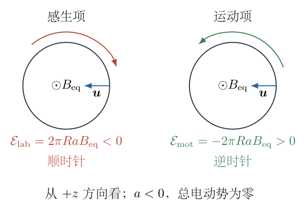

因此
$$
\mathcal E=\mathcal E_{\rm lab}+\mathcal E_{\rm mot}
=2\pi RaB_{\rm eq}-2\pi RaB_{\rm eq}=0.
$$
对应单位长度的切向驱动也是$E_\varphi+(\boldsymbol u\times\boldsymbol B)_\varphi=0$，与理想导体物质系中电磁驱动消失一致。

（11）用移动积分上限的微积分关系再次检验。

对于$\Phi(t)=\int_0^{R(t)}2\pi xB(x,t)\,\mathrm dx$，莱布尼茨求导规则给出
$$
\frac{\mathrm d\Phi}{\mathrm dt}
=\int_0^R2\pi x\frac{\partial B}{\partial t}\,\mathrm dx
+2\pi RB(R,t)\dot R.
$$
第一项由固定环计算为$-2\pi RaB_{\rm eq}$，第二项为$+2\pi RaB_{\rm eq}$，所以全导数为零。第一项对应$-\mathcal E_{\rm lab}$，边界项对应$-\mathcal E_{\rm mot}$，符号与环路定义一致。

量纲上，$\Phi$具有$\mathrm{T\,m^2}=\mathrm{Wb}$，$RaB$具有$\mathrm{m^2\,s^{-1}T}=\mathrm V$。$a=0$时两项分别消失；$a\ne0$时两项抵消而非各自消失。若回路不随物质同缩、导体不理想或场结构改变，零总电动势结论不应无条件继续使用。

## 六、关键洞察

“变化的磁场产生电场”与“运动导线受磁力”是实验室系中总驱动的两个来源。它们可以相加，也可以抵消。只看磁场增强就断言随动环出现净电流，漏掉了回路边界的运动。

冻结的是物质曲面的磁通，不是固定空间点的磁场强度。当前赤道点场增强，而固定远处点的场可减弱，两者不矛盾。比较不同状态时，必须说明位置是固定坐标还是随物质同比例移动。

相似收缩中等效源强$K$恒定，等效偶极尺度$2KR$却随$R$减小。表面场$K/(\sqrt2R^2)$增强、远场$2KR/x^3$减弱，正是不同距离尺度与源间距变化共同作用的结果。

若把边缘场误当均匀场，得到$\Phi_{\rm edge}=\pi R^2B_{\rm eq}$，它同样因缩放而恒定，碰巧也给零总电动势；这不证明该近似正确。真实模型积分为$4\pi(\sqrt2-1)B_{\rm eq}R^2$，两者系数不同。结果为零时更要核验中间物理量，避免错误互相抵消。

## 七、易错点

两源场直接相加大小，漏掉轴向投影$r/\sqrt{x^2+r^2}$。又或者在表面处使用远场$x^{-3}$，忽略该近似需要$x\gg r$。

把等效“磁荷”当成实际磁单极或实际守恒粒子。其系数$K$由冻结缩放和所选模型确定，不能代替真实恒星内部的磁场方程。

磁通取$\pi R^2B_{\rm eq}$，忽略赤道面场不均匀。虽然可能碰巧得零，绝对磁通及固定环电动势仍会算错。

将$-\partial\Phi/\partial t$当作随动环总电动势，遗漏边界项；先令积分上限$b=R$再声称固定上限偏导，也混淆了两种过程。

把收缩速度$a$当成正的大小，或在$\boldsymbol e_r\times\boldsymbol e_z$处错号，会使两项错误同向。应固定$+z$法向及逆时针环向，明确$a<0$。

看到总电动势为零就推断实验室电场为零。实际$E_\varphi=aB_{\rm eq}$非零，只是与运动磁力的切向作用相消。

## 八、课堂讲解建议

先用两个等效源和一个赤道点，让学生把单源场分解成径向与轴向分量，观察相消和相加。再用对应面积缩放推导$B\propto R^{-2}$，并分别询问固定远点与随动表面点如何变化。

讲解电动势时在板书固定两个符号：上法向为正、逆时针环向为正。分别计算感生项和运动项，要求学生在每次叉乘后核对方向。用图7-4让两条相反环向箭头进入实际方程，不能只把图作为结果旁的示意。

最后展示同一磁通函数$\Phi(b,R)$：先固定$b$求偏导，再令$b=R(t)$求全导数。学生能直接看见边界运动的差别。讨论固定环变式时保持同一模型，说明零结论来自随动冻结条件，不是所有收缩恒星旁的环都没有电动势。

## 九、变式训练

（1）导电环不随恒星收缩，半径固定为$b$。在同一两源模型下求有符号总电动势，并分析其与$b$的关系。

完整解答：固定环$\boldsymbol u=0$，总电动势只含实验室感生项。由$\Phi(b,R)$求偏导，得到
$$
\boxed{\mathcal E_{\rm fixed}
=\frac{4\pi Ka b^2}{(b^2+R^2)^{3/2}}.}
$$
$a<0$时方向为顺时针；大小为$4\pi K|a|b^2/(b^2+R^2)^{3/2}$。当$b\ll R$，大小约为$4\pi K|a|b^2/R^3$；当$b\gg R$，约为$4\pi K|a|/b$。若在这一等效模型中允许任意$b>0$，令$f(b)=b^2(b^2+R^2)^{-3/2}$，
$$
f'(b)=\frac{b(2R^2-b^2)}{(b^2+R^2)^{5/2}},
$$
故最大值在$b=\sqrt2R$，相应
$$
|\mathcal E|_{\max}
=\frac{8\pi K|a|}{3\sqrt3R}.
$$
固定环结果非零，与随动环不矛盾，因为两者不是同一移动边界。

（2）环半径$b(t)$按$b\propto R^s$变化，$s$为常数，恒星仍同样收缩。求总电动势并找出零条件。

完整解答：一般磁通为$\Phi=4\pi K[1-R/\sqrt{b^2+R^2}]$。对两变量作全导数：
$$
\begin{aligned}
\mathcal E
&=-\frac{\mathrm d\Phi}{\mathrm dt}\\
&=\frac{4\pi K\,[ab^2-Rb\dot b]}
{(b^2+R^2)^{3/2}}.
\end{aligned}
$$
由$b\propto R^s$，取对数求导$\dot b/b=s\,a/R$，所以
$$
\boxed{\mathcal E=
\frac{4\pi Ka b^2(1-s)}
{(b^2+R^2)^{3/2}}.}
$$
只要$a\ne0$、$b>0$，零条件为$s=1$，即环与恒星按同一比例缩放。$s=0$为固定环，恢复上一式；$s>1$时环缩得相对更快，电动势方向与固定环相反。$s=1$并不要求$b=R$，任意固定比例$b/R$的同缩环都保持该模型磁通不变。

\newpage

# 第 8 题

Gunn器件的伏安特性如图。在电压$V_1<V<V_2$的负微分电阻区，取工作点的小信号微分电阻为
$$
\frac{\mathrm dV}{\mathrm dI}=-r,\qquad r>0,
$$
并在小信号范围内视为常量。器件的直流电压、电流为$V$、$I$，交流电压为$v_{\rm out}(t)$。直流电源电压为$V_b$，RFC扼流圈在直流下视为短路、在所研究交流频率下视为开路。

电路上、下两节点之间有三条支路：左支路为$L$与$C$串联，中支路为电阻$R$与Gunn器件串联，右支路为RFC与直流电源串联。取交流回路电流$i(t)$沿左支路向上、中支路向下；器件总电流为$I+i(t)$。小信号满足$|i|\ll I$。输出电压正向取器件上端对下端，输入$v_{\rm in}$取整个$LC$串联支路上端对下端的交流电压。

（a）若$i(0)=0$、$i'(0)=\alpha$，求线性模型中的$i(t)$，区分复根、重根及实根情况。

（b）求振荡条件与频率，分别说明衰减振荡、线性中性振荡和起振增长。

（c）在$\sqrt{L/C}\gg R$时求回路内电压比$v_{\rm out}/v_{\rm in}$，说明$r=R$处该比值的定义问题；若作频率近似，另写明对$r-R$的要求。

（d）把直流工作点取在电压区间中点$V=(V_1+V_2)/2$。若交流为给定零均值稳态$i(t)=\hat i\sin\omega t$，求器件平均消耗功率。说明恒定线性负阻能否自行确定稳定振幅，以及线性模型内非零稳态对$r$、$R$的要求。

修订说明：$\mathrm dI/\mathrm dV$是微分电导，不能称为电阻；负微分电阻不代表器件的直流功率为负。纠正工作点中点，明确输入端口及平均功率所需的振幅条件，避免从无限线性负阻模型猜造稳定振幅。

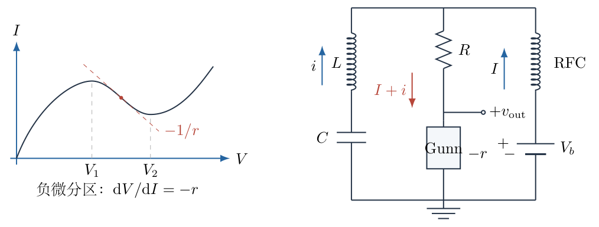

## 一、题型定位

负微分电阻驱动的串联谐振回路、小信号线性化、二阶常系数微分方程与交流能量收支。需要分清负微分电阻和直流静态电阻，分清欠阻尼振荡与自激增长，分清元件内部电压与整个串联支路端电压。线性增长模型只能描述起振阶段，不能给出未提供非线性条件的稳定振幅。

## 二、知识点

工作点线性化；微分电导与微分电阻的倒数关系；RFC的直流、交流等效；基尔霍夫电压定律；电感与电容的有符号元件关系；初始电流导数与电容初始电荷；特征根及欠阻尼、临界、实根解；负阻供给交流能量；串联谐振电压相消；零均值与均方值；偏置范围及小信号适用条件。

## 三、物理图像

器件的直流电压和电流仍可都为正，但在负微分区，电流小幅增加时电压反而下降，即$v_{\rm out}=-ri$。负阻交流作用来自直流电源提供的能量，并不是器件无需电源就产生能量。

交流下RFC阻断右支路，剩下$LC$与$R$、负阻构成闭合回路。电阻$R$损耗交流能量，负阻$r$向交流模式供能。$r<R$时能量衰减，$r=R$时线性损耗恰被抵消，$r>R$时小扰动增长；增长若一直继续会离开负微分区，因此真实稳定振荡还需非线性饱和模型。

## 四、解题入口

先分离直流与交流，明确电流、输出电压及电容电荷的正向。写未求导的回路方程，再对时间求导得到二阶电流方程；初始导数必须回到未求导方程检查所需电容初态。由特征根分类求解。电压比直接用同一端口的节点关系，不把单独电容电压改叫输入。最后展开器件瞬时功率再取周期平均，使用能量方程检查负阻供能和有限稳态条件。

## 五、解析

（1）纠正微分量定义并建立工作点线性关系。

在工作点附近，器件伏安关系的小变化满足
$$
v_{\rm out}=\left(\frac{\mathrm dV}{\mathrm dI}\right)_0i=-ri.
$$
所以
$$
\boxed{v_{\rm out}(t)=-r\,i(t).}
$$
相应微分电导为
$$
\left(\frac{\mathrm dI}{\mathrm dV}\right)_0=-\frac1r.
$$
$r$的单位为欧姆，$1/r$的单位为西门子。直流静态比值$V/I$通常为正，与负的导数$\mathrm dV/\mathrm dI$不矛盾。图8-1中曲线纵轴为电流、横轴为电压，所以负斜率应标$-1/r$，而非$-r$。

（2）建立直流与交流的两个等效电路。

直流下电容开路、电感短路，左支路不通直流，RFC短路。中支路直流电压关系为
$$
V_b=RI+V,
$$
所以
$$
\boxed{I=\frac{V_b-V}{R}.}
$$
这还须与真实Gunn曲线的工作点匹配；单凭电源、电阻不能保证$V$恰落在负微分区。

交流下理想电源的小信号为零、RFC开路，右支路隔离。图8-2给出剩余闭合回路，左支路电流向上、中支路向下。图中的$T$、$O$两节点用来定义整个$LC$支路的端电压；$D$是电阻与器件之间的节点，输出为$D$对$O$。

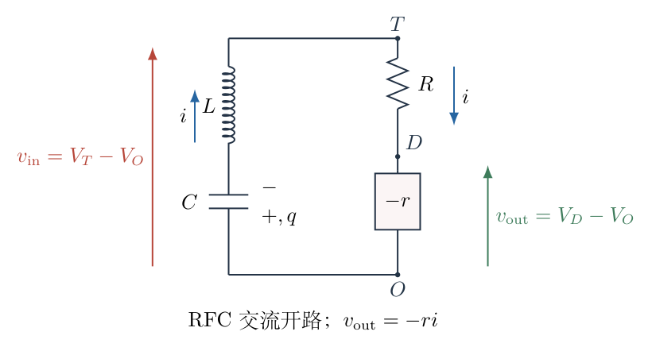

（3）定义电容电荷并写未求导回路方程。

令$q(t)$为电容小信号的有符号电荷，按左支路向上电流进入的下极板定义，则
$$
\dot q=i.
$$
电容沿电流方向的电压降为$q/C$，电感沿电流方向的电压降为$L\dot i$。中支路向下的电阻降为$Ri$，器件小信号降为$-ri$。

沿闭合电流方向走一周，电压降之和为零：
$$
\boxed{L\dot i+(R-r)i+\frac qC=0.}
$$
这一式中$q$只是交流电荷变量，直流电容偏置已在小信号分离中扣除。不能把电容预先写成$q=0$且同时任意指定$\alpha$，两者需要通过初始方程相容。

（4）对时间求导并核对初始电荷。

$L$、$R$、$r$、$C$在此线性模型中均为常量。求导且用$\dot q=i$，有
$$
L\ddot i+(R-r)\dot i+\frac iC=0.
$$
即
$$
\boxed{\ddot i+\frac{R-r}{L}\dot i+\frac1{LC}i=0.}
$$
初始$i(0)=0$、$\dot i(0)=\alpha$代回未求导方程：
$$
L\alpha+\frac{q(0)}C=0,
$$
因此
$$
\boxed{q(0)=-LC\alpha,\qquad \frac{q(0)}C=-L\alpha.}
$$
前者为电荷，后者为电压；漏乘$C$而写$q(0)=-L\alpha$会使量纲错误。指定$\alpha$实际指定了相应初始电容能量，不是凭空加入一个无能量来源的电流增长条件。

（5）求特征根并引入统一符号。

定义
$$
\omega_0=\frac1{\sqrt{LC}},\qquad
\beta=\frac{r-R}{2L}.
$$
电流方程化为
$$
\ddot i-2\beta\dot i+\omega_0^2i=0.
$$
令$i=e^{st}$，得特征方程
$$
s^2-2\beta s+\omega_0^2=0.
$$
完成平方：
$$
(s-\beta)^2=\beta^2-\omega_0^2,
$$
故
$$
s_\pm=\beta\pm\sqrt{\beta^2-\omega_0^2}.
$$
定义$\delta=\omega_0^2-\beta^2$。$\delta>0$对应复共轭根，$\delta=0$对应重根，$\delta<0$对应两个实根。$\beta$决定包络增长或衰减，$\delta$决定是否有正弦振荡，二者是不同分类条件。

（6）复根情况逐项使用初值。

当$\delta>0$，令
$$
\omega=\sqrt{\delta}
=\sqrt{\frac1{LC}-\frac{(r-R)^2}{4L^2}}>0.
$$
一般实解为
$$
i(t)=e^{\beta t}(A\cos\omega t+B\sin\omega t).
$$
由$i(0)=0$，得$A=0$。求导：
$$
\dot i=B e^{\beta t}(\beta\sin\omega t+\omega\cos\omega t).
$$
令$t=0$，$\dot i(0)=B\omega=\alpha$，故$B=\alpha/\omega$。于是
$$
\boxed{i(t)=\frac{\alpha}{\omega}e^{\beta t}\sin\omega t
\qquad(\delta>0).}
$$
包络系数$\alpha/\omega$具有安培单位，指数$\beta t$及相位$\omega t$均无量纲。若$\alpha=0$，该给定零初值的线性解恒为零；自激系统的起振也需非零扰动或噪声作为种子。

（7）重根和实根不能强行沿用实正弦频率。

若$\delta=0$，一般解为$(A+Bt)e^{\beta t}$。由$i(0)=0$得$A=0$，再由$\dot i(0)=\alpha$得$B=\alpha$，所以
$$
\boxed{i(t)=\alpha t e^{\beta t}\qquad(\delta=0).}
$$
若$\delta<0$，令$\sigma=\sqrt{\beta^2-\omega_0^2}>0$。一般解为
$$
i=Ae^{(\beta+\sigma)t}+Be^{(\beta-\sigma)t}.
$$
由$i(0)=0$得$B=-A$，由$\dot i(0)=2\sigma A=\alpha$得$A=\alpha/(2\sigma)$，故
$$
\begin{aligned}
i(t)&=\frac{\alpha}{2\sigma}
\left[e^{(\beta+\sigma)t}-e^{(\beta-\sigma)t}\right]\\
&=\boxed{\frac{\alpha}{\sigma}e^{\beta t}\sinh\sigma t.}
\end{aligned}
$$
两式在$\omega\to0$或$\sigma\to0$时都趋于$\alpha t e^{\beta t}$，因为$\sin z/z\to1$、$\sinh z/z\to1$。三种分支在重根边界连续衔接，但实根情况下没有非零实正弦频率。

（8）分别列出暂态振荡与增长起振条件。

定义回路阻抗尺度
$$
Z_0=\sqrt{\frac LC}.
$$
复根条件$\delta>0$等价于
$$
\frac{(r-R)^2}{4L^2}<\frac1{LC}
\quad\Longleftrightarrow\quad
\boxed{|r-R|<2Z_0.}
$$
在该条件内：

$r<R$使$\beta<0$，为衰减振荡；$r=R$使$\beta=0$，为线性中性、不增不减的正弦；$r>R$使$\beta>0$，为振荡包络增长。因此小信号振荡起振的增长区间为
$$
\boxed{R<r<R+2Z_0.}
$$
若$r>R$但$r-R\ge2Z_0$，扰动仍可能增长，却是重根或实根型非正弦增长，不能仅凭负阻大于损耗就给出一个实振荡频率。

图8-3将衰减、中性、增长及实根情况分开显示，使用同一初始电流导数。后续频率只在复根区使用；包络增长到$|i|\ll I$失效之前，才属于本题线性近似。

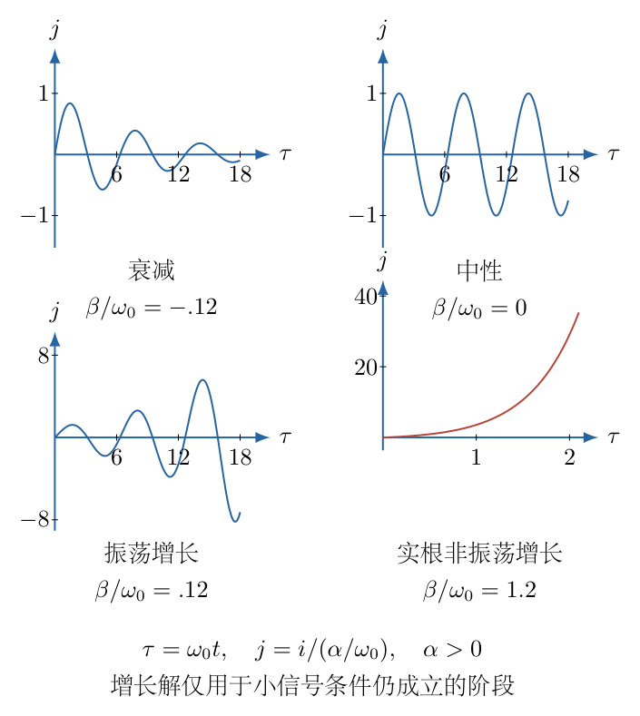

（9）计算振荡频率并检查高频近似的条件。

在复根区，正弦部分角频率为
$$
\boxed{\omega=\sqrt{\frac1{LC}-\frac{(r-R)^2}{4L^2}},
\qquad f=\frac{\omega}{2\pi}.}
$$
定义$\varepsilon=(r-R)/Z_0$，则
$$
\omega=\omega_0\sqrt{1-\frac{\varepsilon^2}{4}}.
$$
只有$|\varepsilon|\ll1$，即$|r-R|\ll Z_0$，才可用平方根二阶展开：
$$
\omega=\omega_0\left[1-\frac{(r-R)^2}{8Z_0^2}
+O(\varepsilon^4)\right].
$$
最低阶近似为$f\simeq1/(2\pi\sqrt{LC})$。题给$Z_0\gg R$本身没有限制$r$，所以不足以自动保证该近似。若$r$与$R$接近，或另给$r\ll Z_0$，才满足所需小量条件。

（10）从节点关系求字面定义的输入输出比。

中支路从$T$到$O$的交流电压为电阻降与器件降之和：
$$
v_{\rm in}=Ri+v_{\rm out}=(R-r)i.
$$
左支路与中支路跨接同一节点对，所以这确实是整个$LC$串联支路端电压。按左支路向上的电流约定，也可写成
$$
v_{\rm in}=-L\dot i-\frac qC,
$$
两者由回路方程相等。不是把$v_{\rm in}$定义为单独电容电压$q/C$，也不是电感电压$L\dot i$。

当$r\ne R$时，回路内的线性电压比例为
$$
\boxed{\frac{v_{\rm out}}{v_{\rm in}}
=\frac{-ri}{(R-r)i}
=\frac r{r-R}.}
$$
这个代数比例不要求$Z_0\gg R$；该条件主要涉及谐振内部电压和频率近似。瞬时$i=0$时两电压均零，直接相除是$0/0$，但两个线性关系的系数比及非零信号振幅比仍由上式定义。

（11）解释$r=R$处为何不能报一个普通有限增益。

若$r=R$，则对任意交流电流
$$
v_{\rm in}=0,\qquad v_{\rm out}=-Ri.
$$
非零振荡下分母恒为零，故按本题整个串联支路端电压的定义，$v_{\rm out}/v_{\rm in}$未定义。写“趋于无穷”只能描述$r\to R$的形式极限，不能把$r=R$时的端口比当成某个有限放大器增益。

图8-4用按元件电流被动约定的电压矢量显示：在$\omega_0$下$V_L$与$V_C$大小相等、相位相反；$V_R$与负阻电压也相反。整个$LC$端电压为零，并不代表其内部元件电压为零。

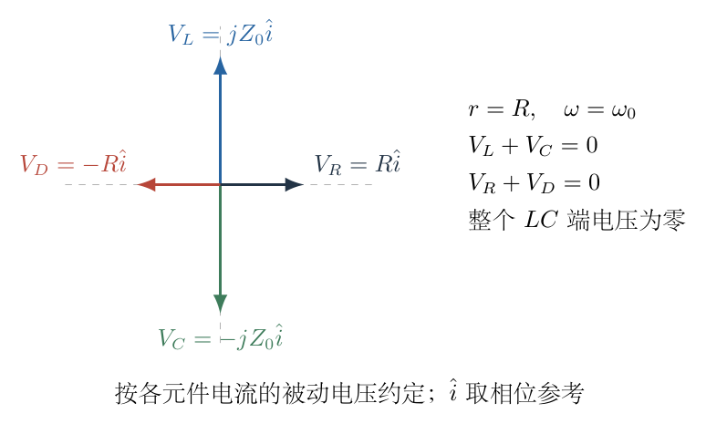

若电流峰值为$\hat i$，中性谐振时电感、电容内部电压峰值均为
$$
\omega_0L\hat i
=\frac{\hat i}{\omega_0C}
=Z_0\hat i,
$$
而输出峰值为$R\hat i$。若另改输入为单独电容电压，幅值比会成为$R/Z_0$，但那是另一端口定义，不能暗中替换本题的输入以获得想要的答案。

（12）用能量方程判断负阻作用与非零稳态。

仅对交流模式定义储能
$$
U_{\rm ac}=\frac12Li^2+\frac{q^2}{2C}.
$$
求导且用$\dot q=i$：
$$
\frac{\mathrm dU_{\rm ac}}{\mathrm dt}
=Li\dot i+\frac qC i.
$$
把未求导回路方程乘$i$：
$$
Li\dot i+(R-r)i^2+\frac qC i=0,
$$
因此
$$
\boxed{\frac{\mathrm dU_{\rm ac}}{\mathrm dt}=(r-R)i^2.}
$$
$R$损耗功率$Ri^2$，负微分器件向交流模式供给$ri^2$。二者差值决定能量增减，与$\beta$符号一致。

若要求线性模型内非零周期稳态，周期平均储能变化须为零：
$$
0=(r-R)\langle i^2\rangle.
$$
$\langle i^2\rangle>0$时只可能
$$
\boxed{r=R.}
$$
此时不同振幅都可保持，振幅由初始条件决定，不是线性模型自行选出的稳定值。$r>R$的真实稳定自激振荡需非线性使平均供能与损耗平衡；本题没有给出该非线性，不能由线性增长式推算一个唯一有限饱和振幅。

（13）校正偏置中点并列出小信号幅度限制。

电压区间$(V_1,V_2)$的中点为
$$
\boxed{V=\frac{V_1+V_2}{2}.}
$$
原来的差的一半$(V_2-V_1)/2$是区间半宽，而不是中点。代入直流关系，
$$
I=\frac{V_b-(V_1+V_2)/2}{R}.
$$
器件总电压为$V-ri$。对于$i=\hat i\sin\omega t$，要使全过程留在该负微分区，需
$$
\boxed{r\hat i<\frac{V_2-V_1}{2},\qquad \hat i\ll I.}
$$
第一个约束控制电压摆幅，第二个控制小信号电流；两者必须分别检验，不应只检验平均偏置。实际可用线性范围还可能比整个负微分区更小，取常数$r$时应说明局部近似。

（14）展开瞬时功率再取周期平均。

器件总电流为$I+i$、总电压为$V-ri$，按照电流进入电压正端的被动符号，瞬时消耗功率为
$$
\begin{aligned}
p_D(t)&=(V-ri)(I+i)\\
&=VI+Vi-rIi-ri^2\\
&=VI+(V-rI)i-ri^2.
\end{aligned}
$$
对给定零均值正弦，
$$
\langle i\rangle=0,\qquad
\langle i^2\rangle=\frac{\hat i^2}{2}.
$$
后一个关系由$\sin^2\omega t=(1-\cos2\omega t)/2$在完整周期平均得到。因此
$$
\boxed{\overline P_D=VI-\frac{r\hat i^2}{2}.}
$$
代入正确偏置与直流电流：
$$
\boxed{\overline P_D=
\frac{V_1+V_2}{2R}
\left[V_b-\frac{V_1+V_2}{2}\right]
-\frac{r\hat i^2}{2}.}
$$
第一项是直流输入器件的功率，第二项是器件输送给交流模式的平均功率。这不是负阻从无源环境中创造能量；在有效的小信号正偏置下，器件总平均消耗仍可为正。

（15）中性线性稳态可将振幅写成初值，但不得外推到饱和振荡。

若$r=R$，复根解退化为
$$
i(t)=\frac{\alpha}{\omega_0}\sin\omega_0t.
$$
因而$\hat i=|\alpha|/\omega_0$，只要满足上一幅度限制，就有
$$
\boxed{\overline P_D
=VI-\frac{R\alpha^2}{2\omega_0^2}
=VI-\frac{RLC\alpha^2}{2}.}
$$
这个替换仅适用于给定初态的中性线性模式。$r>R$时包络为指数增长，不能把$t=0$的$\alpha/\omega$永久当作稳定峰值，也不能将未给出的限幅值设成电压区间半宽而称为唯一答案。

（16）用直流电源、负阻供能和电阻损耗检查平均功率。

理想RFC阻交流时，直流电源平均输出为$V_bI$。电阻的总电流同为$I+i$，所以平均损耗
$$
\overline P_R=R\langle(I+i)^2\rangle
=RI^2+\frac{R\hat i^2}{2}.
$$
在非零线性中性稳态$r=R$，
$$
\begin{aligned}
\overline P_R+\overline P_D
&=RI^2+\frac{R\hat i^2}{2}
+VI-\frac{r\hat i^2}{2}\\
&=(RI+V)I=V_bI.
\end{aligned}
$$
交流供能与交流损耗抵消，总平均功率守恒。图8-5将直流功率与交流转换分开；图中负阻交流供能$r\hat i^2/2$实际进入后续平均式，而不是装饰箭头。

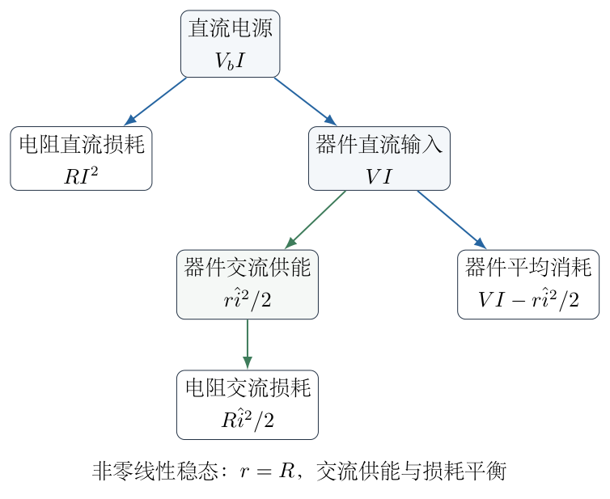

若$r\ne R$仍强行给非零固定正弦，会有未平衡的$(r-R)\langle i^2\rangle$。应由储能变化、外部交流源或非线性饱和补偿；既无这些条件又宣称已进入有限稳态，和能量方程矛盾。

## 六、关键洞察

“负阻”在本题中指工作点斜率，而非直流比值或无源电阻。器件既接受正的直流功率，也能把其中部分转给交流回路。把总功率和增量功率分别展开，可避免“负阻器件不耗能”的错误说法。

特征根提供两个独立判断：实部$\beta$决定幅度增减，虚部$\omega$决定是否周期变化。仅满足$r>R$保证负净阻尼，未必保证根有虚部；仅满足复根也未必会自激增长。

电容初态是初始导数的来源。求导后的二阶方程容易隐藏$q(0)$，必须回到未求导KVL恢复$q(0)=-LC\alpha$。这样才不会无意中给出互相矛盾的三项初始条件。

整个串联$LC$端口在谐振时可以零电压，内部却有较大的反相电压。这是串联相消而不是所有场消失。本题所称“增益”实际上是回路内电压比，不能直接当成带外部输入和负载的放大器传递增益。

线性中性振荡与非线性稳定极限环不同：前者任意初始振幅都不增不减，对扰动没有振幅恢复机制；后者需要振幅偏大时净供能下降、偏小时净供能增加。题目未给非线性，故只能明确线性起振、幅度限制和条件性功率表达式。

## 七、易错点

把$I$—$V$图的斜率$\mathrm dI/\mathrm dV$写成$-r$，量纲不对；正确为$-1/r$。再把$V/I$也当成负值，则进一步混淆工作点和导数。

电流经过中支路向下，输出正向为器件上端对下端，所以$v_{\rm out}=-ri$；回路损耗为$R-r$而不是$R+r$。电容电荷方向需要与左支路向上电流配对。

只使用二阶方程而忽略$q(0)=-LC\alpha$；漏掉$C$使电荷写成电压。初始$\alpha$的单位为安培每秒，不是振荡峰值。

把$r>R$与欠阻尼条件混同，或在实根区继续写实数振荡频率。频率$f$还要由角频率除以$2\pi$。

$Z_0\gg R$并不自动限制$r-R$。求高频近似时要另检验$|r-R|/Z_0$，不能只比较$R$。

将整个$LC$端电压换成电容电压以得到有限比例；在$r=R$处直接约掉零分母；把差的一半当成区间中点，都是定义层面的错误。

平均功率不能只取$VI$而漏掉$-r\langle i^2\rangle$，也不能把它仅写成负的交流输出。未给振幅时只应给含$\hat i$的表达式，不擅自设定饱和幅度。

## 八、课堂讲解建议

先让学生在$I$—$V$图旁分别写斜率单位和直流$VI$符号，理解负微分区仍有直流供能。之后画直流、交流两个等效电路，标出$T,D,O$及电流正向，避免一开始直接写二阶方程却不知道输出取自哪里。

板书先保留电容电荷的未求导KVL，再求导得到电流方程。用初值回代恢复$q(0)$，让学生看到每个初始条件对应的储能。特征根分类与能量分类并排解释，增长来自$r-R$，振荡还需复根。

讨论增益时用相消图展示“单元件大电压、总端口零电压”，要求学生先确认输入定义。功率部分让学生逐项展开$(V-ri)(I+i)$，先平均再代偏置，最后以电源平均功率核验。非线性稳态只讲明缺少哪些条件，不凭课堂经验填入题目未给的数据。

## 九、变式训练

（1）取$L=1.00\,\mu\mathrm H$、$C=100\,\mathrm{pF}$、$R=20.0\,\Omega$、$r=30.0\,\Omega$，$\alpha=1.00\times10^6\,\mathrm{A\,s^{-1}}$。判断线性起振类型，求频率、包络增长时间尺度、初始交流电容电荷和回路电压比。

完整解答：$LC=10^{-16}\,\mathrm{s^2}$，所以$\omega_0=10^8\,\mathrm{s^{-1}}$，$Z_0=\sqrt{10^4}=100\,\Omega$。$r-R=10\,\Omega<2Z_0$，且$r>R$，故为复根振荡增长。包络指数为
$$
\beta=\frac{10}{2\times10^{-6}}
=5.00\times10^6\,\mathrm{s^{-1}},
\qquad \tau=\beta^{-1}=200\,\mathrm{ns}.
$$
频率为
$$
\omega=\sqrt{10^{16}-2.50\times10^{13}}
=9.98749\times10^7\,\mathrm{s^{-1}},
\qquad f\simeq15.8956\,\mathrm{MHz}.
$$
初态电荷$q(0)=-LC\alpha=-1.00\times10^{-10}\,\mathrm C$，交流电容电压为$-1.00\,\mathrm V$。解为
$$
i(t)=0.0100125\,e^{5.00\times10^6t}
\sin(9.98749\times10^7t)\,\mathrm A.
$$
电压比例$r/(r-R)=30/10=3$。它只在小信号及负微分区范围有效，增长数周期后须重新检查幅度；不能把该指数增长解说成永远维持的稳态输出。

（2）保持上题$L,C,R$，改为$r=R$。取$V_1=1.00\,\mathrm V$、$V_2=5.00\,\mathrm V$、$V_b=7.00\,\mathrm V$，已给定中性正弦电流峰值$\hat i=0.0100\,\mathrm A$。求器件、总电阻及电源平均功率，并核对幅度限制。

完整解答：偏置中点为$V=3.00\,\mathrm V$，直流电流
$$
I=\frac{7.00-3.00}{20.0}=0.200\,\mathrm A.
$$
器件交流电压峰值$r\hat i=0.200\,\mathrm V<2.00\,\mathrm V$，始终位于$(1,5)\,\mathrm V$内；$\hat i/I=0.05$，为小幅扰动。器件直流功率$VI=0.600\,\mathrm W$，向交流模式输出
$$
\frac{r\hat i^2}{2}=0.00100\,\mathrm W.
$$
故器件平均消耗为$0.599\,\mathrm W$。电阻总平均损耗为
$$
\overline P_R=20.0\left(0.200^2+\frac{0.0100^2}{2}\right)
=0.801\,\mathrm W.
$$
电源平均输出为$V_bI=1.400\,\mathrm W$，与$0.599+0.801=1.400\,\mathrm W$一致。$LC$交流储能恒定，峰值储能为$L\hat i^2/2=5.00\times10^{-11}\,\mathrm J$。该模式振幅是题目给定的，线性$r=R$自身不选择或稳定这个特定数值。
