# 第 1 题

一个内、外半径分别为 $r$ 和 $2r$ 的同轴圆筒放在水平地面上，截面圆心为 $C$。地面上的 $A$ 点铰接一根细杆，杆始终与内圆相切，接触位置记为 $B$。在所考察时刻，杆与地面的夹角为 $45^\circ$，杆顺时针转动的角速度为 $\omega$、角加速度为 $\beta$。杆与内圆接触处不滑动，外圆与地面之间可以滑动。

（1）求接触点 $B$ 沿杆的速度分量 $v_{B\tau}$ 和垂直于杆的速度分量 $v_{Bn}$。

（2）求接触点 $B$ 沿杆的加速度分量 $a_{B\tau}$ 和垂直于杆的加速度分量 $a_{Bn}$。

（3）求圆心 $C$ 的速度 $v_C$ 和加速度 $a_C$。

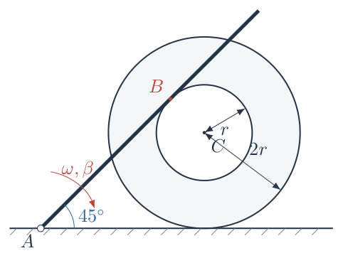

## 一、题型定位

带移动接触位置的刚体平面运动。外圆半径确定圆心高度，内圆半径确定杆的切线几何；二者作用不同。内圆与杆无滑动提供材料点的速度约束，外圆与地面可滑动，不能另加纯滚动约束。求加速度时，必须说明 $B$ 是哪一个刚体上的材料点，还是随时间迁移的几何接触位置。

## 二、知识点

相切时半径与切线垂直；转动基矢的时间导数；定轴转动的切向与法向加速度；刚体上两点的速度、加速度关系；无滑动接触的瞬时速度相等；对迁移位置求导与追踪材料点求导的区别；三角函数求导及角速度、角加速度的符号约定。

## 三、物理图像

杆顺时针压低时，圆筒为了维持相切关系向右移动。圆心只能水平运动，但圆筒同时转动。此刻在接触位置相遇的杆材料点与圆筒材料点速度相同；稍后原来的这两个材料点分别离开接触位置，新的材料点在另一位置相遇。几何接触位置并不是持续属于某一个刚体的固定点，因此“接触点速度”和“接触点加速度”不能不加定义地混用。

## 四、解题入口

先以任意夹角 $\theta$ 建立相切几何，求 $C$ 的坐标及其两次时间导数。再使用接触处无滑动条件求圆筒角速度 $\Omega$ 和角加速度 $\alpha$，最后把刚体加速度投影到杆向与法向。全程保留 $\theta$，完成求导后才代入 $\theta=\pi/4$；先代入定值再求导会丢失杆在转动这一事实。

## 五、解析

（1）明确研究对象、坐标和正方向。

取 $A$ 为原点，$x$ 轴水平向右、$y$ 轴竖直向上，$\boldsymbol e_z$ 垂直纸面向外。杆与 $+x$ 轴的夹角为 $\theta$。沿杆由 $A$ 指向 $B$ 的单位矢量以及它左侧的法向单位矢量分别为

$$\boldsymbol\tau=(\cos\theta,\sin\theta),\qquad
\boldsymbol n=(-\sin\theta,\cos\theta).$$

于是 $\boldsymbol e_z\times\boldsymbol\tau=\boldsymbol n$，$\boldsymbol e_z\times\boldsymbol n=-\boldsymbol\tau$。本题的杆沿顺时针转动，因此

$$\dot\theta=-\omega,\qquad \ddot\theta=-\beta.$$

这里 $\omega>0$ 表示顺时针角速率，$\beta$ 是顺时针角加速度的有符号分量；减速时 $\beta$ 可以为负。圆筒的 $\Omega$、$\alpha$ 则按逆时针为正，不能把它们直接等同于杆的 $\omega$、$\beta$。

把圆筒上此刻到达接触位置的材料点记为 $B_c$，杆上此刻在该位置的材料点记为 $B_r$，随时间改变的几何接触位置记为 $B_g$。第（1）问两材料点速度相同，答案没有区别。第（2）问先给出圆筒材料点 $B_c$ 的加速度，再完整列出另两种点定义的结果。

（2）建立几何关系，确定 $AB$ 与圆心横坐标。

令瞬时接触距离 $AB_g=s$。图 1-2 中，$CB_g=r$ 且垂直于杆，圆心位于杆的右下方。故

$$\boldsymbol r_{B_g}=s\boldsymbol\tau,\qquad
\boldsymbol r_C=s\boldsymbol\tau-r\boldsymbol n.$$

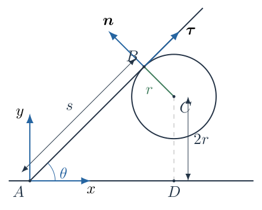

外圆接触水平地面，圆心高度恒为 $2r$。将矢量式分别投影到两坐标轴：

$$x_C=s\cos\theta+r\sin\theta,\qquad
y_C=s\sin\theta-r\cos\theta=2r.$$

从竖直式解出 $s$：

$$s\sin\theta=2r+r\cos\theta,\qquad
s=r\frac{2+\cos\theta}{\sin\theta}.$$

再代回水平式，逐步通分：

$$\begin{aligned}
x_C
&=r\frac{(2+\cos\theta)\cos\theta}{\sin\theta}
+r\sin\theta\\
&=r\frac{2\cos\theta+\cos^2\theta+\sin^2\theta}{\sin\theta}\\
&=r\frac{2\cos\theta+1}{\sin\theta}.
\end{aligned}$$

所用数学关系是 $\sin^2\theta+\cos^2\theta=1$。在所考察的时刻，

$$s_0=r(1+2\sqrt2),\qquad x_C=r(2+\sqrt2),\qquad y_C=2r.$$

$s_0$ 是当时的几何接触距离，不意味着随后的接触位置仍固定在杆的这个材料点上。

（3）先对角度求导，再对时间求导，得到圆心速度。

对 $x_C(\theta)$ 使用商法则：

$$\begin{aligned}
\frac{dx_C}{d\theta}
&=r\frac{(-2\sin\theta)\sin\theta-(2\cos\theta+1)\cos\theta}
{\sin^2\theta}\\
&=-r\frac{2\sin^2\theta+2\cos^2\theta+\cos\theta}{\sin^2\theta}\\
&=-r\frac{2+\cos\theta}{\sin^2\theta}.
\end{aligned}$$

由链式法则 $\dot x_C=(dx_C/d\theta)\dot\theta$：

$$\dot x_C=r\omega\frac{2+\cos\theta}{\sin^2\theta}.$$

圆心竖直速度为零。代入 $\sin\theta=\cos\theta=1/\sqrt2$：

$$\boxed{\boldsymbol v_C=r(4+\sqrt2)\omega\,\boldsymbol e_x.}$$

结果向右，符合杆顺时针压低、圆筒右移的几何图像。此处用的是相切约束，不是外圆纯滚动关系 $v_C=2r\Omega$。

（4）求圆心加速度，保留两种来源。

再次对角度求导：

$$\begin{aligned}
\frac{d^2x_C}{d\theta^2}
&=-r\frac{d}{d\theta}\left[(2+\cos\theta)\sin^{-2}\theta\right]\\
&=\frac r{\sin\theta}
+\frac{2r(2+\cos\theta)\cos\theta}{\sin^3\theta}.
\end{aligned}$$

链式法则的二阶形式为

$$\ddot x_C=\frac{d^2x_C}{d\theta^2}\dot\theta^2+
\frac{dx_C}{d\theta}\ddot\theta.$$

第一项来自几何关系对角度的非线性，第二项来自杆角速率本身的变化。即使 $\beta=0$，第一项也不为零。代入 $\dot\theta=-\omega$、$\ddot\theta=-\beta$：

$$\ddot x_C=
r\left[
\frac1{\sin\theta}+
\frac{2(2+\cos\theta)\cos\theta}{\sin^3\theta}
\right]\omega^2
+r\frac{2+\cos\theta}{\sin^2\theta}\beta.$$

在 $\theta=\pi/4$，

$$\frac1{\sin\theta}=\sqrt2,\qquad
\frac{2(2+\cos\theta)\cos\theta}{\sin^3\theta}
=4\left(2+\frac1{\sqrt2}\right)=8+2\sqrt2.$$

所以

$$\boxed{\boldsymbol a_C=
r\big[(8+3\sqrt2)\omega^2+(4+\sqrt2)\beta\big]\boldsymbol e_x.}$$

这也给出第（3）问的完整有符号结果；若只要求加速度大小，应在方括号外取绝对值，而不能预先假设 $\beta$ 必为正。

（5）利用无滑动条件求材料接触点速度。

杆绕固定 $A$ 转动。此刻杆材料点 $B_r$ 距铰点 $s_0$，其速度为

$$\boldsymbol v_{B_r}=\dot\theta\,\boldsymbol e_z\times
(s_0\boldsymbol\tau)=-s_0\omega\boldsymbol n.$$

因此沿杆分量为零、法向分量为负。内圆无滑动要求此刻

$$\boldsymbol v_{B_c}=\boldsymbol v_{B_r},$$

故第（1）问为

$$\boxed{v_{B\tau}=0,\qquad v_{Bn}=-r(1+2\sqrt2)\omega.}$$

负法向指向杆的右下方。这是运动学分量的正负号，不表示接触处发生穿透。两个物体在接触处具有同一法向速度，仍能保持接触。

（6）从圆筒刚体速度关系确定 $\Omega$。

圆筒上 $B_c$ 相对于圆心的位置为 $r\boldsymbol n$。刚体速度关系为

$$\boldsymbol v_{B_c}=\dot x_C\boldsymbol e_x+
\Omega\boldsymbol e_z\times(r\boldsymbol n)
=\dot x_C\boldsymbol e_x-r\Omega\boldsymbol\tau.$$

图 1-3 分别表示接触处材料点的共同速度与几何位置沿杆的迁移速率。沿杆的绿色箭头表示更换接触材料点的速率，不是杆材料点的附加速度；它将在求几何位置的导数时使用。

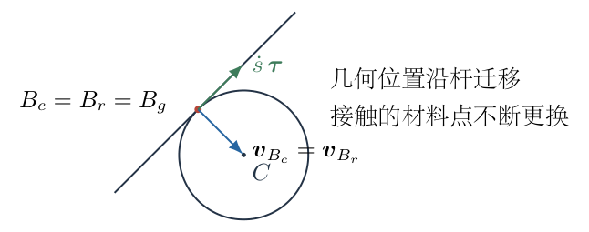

由于

$$\boldsymbol e_x=\cos\theta\,\boldsymbol\tau-
\sin\theta\,\boldsymbol n,$$

可得

$$v_{B_c,\tau}=\dot x_C\cos\theta-r\Omega,\qquad
v_{B_c,n}=-\dot x_C\sin\theta.$$

无滑动要求第一式为零：

$$\Omega=\frac{\dot x_C\cos\theta}{r}
=\omega\frac{(2+\cos\theta)\cos\theta}{\sin^2\theta}.$$

于是

$$\boxed{\Omega=(1+2\sqrt2)\omega.}$$

这是逆时针转动；它与杆的顺时针转动方向相反。第二式同时核对法向相容性：

$$-\dot x_C\sin\theta
=-r\omega\frac{2+\cos\theta}{\sin\theta}
=-s\omega.$$

无滑动条件与相切几何给出一致的法向速度，说明前面没有把内、外半径用反。

（7）对 $\Omega(\theta,\omega)$ 完整求导，得到圆筒角加速度。

令

$$F(\theta)=\frac{(2+\cos\theta)\cos\theta}{\sin^2\theta},\qquad
\Omega=\omega F(\theta).$$

则乘积与链式法则给出

$$\alpha=\dot\Omega=\beta F(\theta)+\omega F'(\theta)\dot\theta
=\beta F(\theta)-\omega^2F'(\theta).$$

把 $F=(2\cos\theta+\cos^2\theta)\sin^{-2}\theta$ 求导：

$$F'(\theta)=
-\frac{2(1+\cos\theta)}{\sin\theta}
-\frac{2(2\cos\theta+\cos^2\theta)\cos\theta}{\sin^3\theta}.$$

在 $\theta=\pi/4$，两项依次为 $-2\sqrt2-2$ 与 $-4\sqrt2-2$，因此

$$F'(\pi/4)=-4-6\sqrt2,$$

$$\boxed{\alpha=(1+2\sqrt2)\beta+(4+6\sqrt2)\omega^2.}$$

不能把瞬时等式 $\Omega=(1+2\sqrt2)\omega$ 当成在所有时刻系数恒定的关系，再写 $\alpha=(1+2\sqrt2)\beta$。系数来自不断变化的角度，漏掉其导数就漏掉后一项。

（8）用刚体加速度公式求圆筒材料点 $B_c$。

圆筒上的固定材料点满足

$$\boldsymbol a_{B_c}=\boldsymbol a_C+
\alpha\boldsymbol e_z\times(r\boldsymbol n)
+\Omega\boldsymbol e_z\times
\big[\Omega\boldsymbol e_z\times(r\boldsymbol n)\big].$$

第二项为切向加速度，第三项为指向圆心的向心加速度。利用两个叉乘方向：

$$\boldsymbol a_{B_c}=a_C\boldsymbol e_x-r\alpha\boldsymbol\tau
-r\Omega^2\boldsymbol n.$$

图 1-4 将三项分别表示。图中的 $a_C$ 为有符号水平分量，示意箭头对应 $a_C>0$；计算仍使用上一步的有符号表达式。

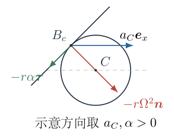

沿 $\boldsymbol\tau$ 和 $\boldsymbol n$ 投影：

$$a_{B_c,\tau}=a_C\cos\theta-r\alpha,\qquad
a_{B_c,n}=-a_C\sin\theta-r\Omega^2.$$

先算沿杆分量。在 $\theta=\pi/4$，

$$\begin{aligned}
a_C\cos\theta
&=r\big[(4\sqrt2+3)\omega^2+(2\sqrt2+1)\beta\big],\\
r\alpha
&=r\big[(4+6\sqrt2)\omega^2+(1+2\sqrt2)\beta\big].
\end{aligned}$$

相减时 $\beta$ 项抵消：

$$\boxed{a_{B_c,\tau}=-r(1+2\sqrt2)\omega^2.}$$

法向分量则是两项相加后的负号。注意

$$\Omega^2=(1+2\sqrt2)^2\omega^2=(9+4\sqrt2)\omega^2.$$

所以

$$\begin{aligned}
a_{B_c,n}
&=-r\big[(4\sqrt2+3)\omega^2+(2\sqrt2+1)\beta
+(9+4\sqrt2)\omega^2\big]\\
&=\boxed{-r\big[(12+8\sqrt2)\omega^2+(1+2\sqrt2)\beta\big]}.
\end{aligned}$$

这两个分量是第（2）问按“圆筒材料接触点”理解时的答案。它们不是几何接触位置的二阶导数。

（9）给出杆材料点的加速度，解释题目点定义的区别。

杆上此刻到达 $B$ 的固定材料点距 $A$ 为 $s_0$。对这个材料点追踪时距离不变，其加速度是

$$\boldsymbol a_{B_r}=
-s_0\omega^2\boldsymbol\tau-s_0\beta\boldsymbol n.$$

因此

$$\boxed{a_{B_r,\tau}=-r(1+2\sqrt2)\omega^2,\qquad
a_{B_r,n}=-r(1+2\sqrt2)\beta.}$$

两材料点的沿杆加速度相同，法向加速度不同：

$$\boxed{\boldsymbol a_{B_c}-\boldsymbol a_{B_r}
=-r(12+8\sqrt2)\omega^2\boldsymbol n.}$$

这不与速度相同矛盾。“此刻这两个材料点速度相同”是瞬时约束，不是说以后仍由同一对材料点持续接触；不能在忽略材料点更换的情况下对该等式求导。

（10）若求的是几何接触位置 $B_g$，必须保留 $s(t)$ 的变化。

由 $s=r(2+\cos\theta)/\sin\theta$：

$$\frac{ds}{d\theta}=-r\frac{1+2\cos\theta}{\sin^2\theta},$$

$$\dot s=r\omega\frac{1+2\cos\theta}{\sin^2\theta},\qquad
\dot s\big|_{\pi/4}=r(2+2\sqrt2)\omega.$$

对 $\boldsymbol r_{B_g}=s\boldsymbol\tau$ 使用乘积法则：

$$\boldsymbol v_{B_g}=\dot s\boldsymbol\tau+s\dot\theta\boldsymbol n
=\dot s\boldsymbol\tau-s\omega\boldsymbol n.$$

所以几何位置的沿杆速度不为零；该分量正是接触位置沿杆的迁移速率，不是相对滑动速度。

再次求导：

$$\boldsymbol a_{B_g}=(\ddot s-s\omega^2)\boldsymbol\tau
-(2\dot s\omega+s\beta)\boldsymbol n.$$

其中 $2\dot s\omega$ 来自两个乘积项，各贡献一次 $\dot s\omega$。在本时刻，

$$\ddot s=r\big[(4+6\sqrt2)\omega^2+(2+2\sqrt2)\beta\big].$$

得到第三种点定义的结果：

$$\boxed{\begin{aligned}
v_{B_g,\tau}&=r(2+2\sqrt2)\omega,\\
v_{B_g,n}&=-r(1+2\sqrt2)\omega,\\
a_{B_g,\tau}&=r\big[(3+4\sqrt2)\omega^2+(2+2\sqrt2)\beta\big],\\
a_{B_g,n}&=-r\big[(4+4\sqrt2)\omega^2+(1+2\sqrt2)\beta\big].
\end{aligned}}$$

题目未说明第（2）问使用哪个刚体上的材料点，因此应先声明点定义，不能把三套结果混合为一个“接触点加速度”。

（11）用量纲、静止瞬间与接触相容性检验。

所有速度项为 $r\omega$，量纲是长度每时间；所有加速度项为 $r\omega^2$ 或 $r\beta$，量纲是长度每时间平方。若 $\omega=0$、$\beta\ne0$，两材料点速度都为零，但加速度仍可非零；此时法向加速度差也为零，因为迁移速率与角速度之积消失。若 $\beta=0$、$\omega\ne0$，圆心仍有加速度，圆筒也有角加速度，说明“杆匀速转动”不等于“整个系统所有速度恒定”。

还可以直接检验外圆底点速度。底点相对圆心的位置为 $-2r\boldsymbol e_y$，故其水平速度为

$$v_{\mathrm{bottom},x}=v_C+2r\Omega
=r(6+5\sqrt2)\omega.$$

它不为零，恰好符合题设外圆在地面滑动。若错误地追加底点静止条件，将与已经满足的内圆相切和无滑动约束发生矛盾。

## 六、关键洞察

“点的位置”与“物体上固定点的位置”是不同的函数。几何接触位置有沿杆迁移速度，材料接触点却可以没有沿杆速度。加速度差来自迁移过程中对速度场的取样变化，而不是来自接触处突然发生滑动。

可从速度场的空间变化再核对加速度差。几何位置相对任一材料速度场的迁移速度都是 $\dot s\boldsymbol\tau$。沿几何接触位置对相同的两个速度场求全导数，得到

$$\boldsymbol a_{B_c}+\Omega\boldsymbol e_z\times(\dot s\boldsymbol\tau)
=\boldsymbol a_{B_r}+\dot\theta\boldsymbol e_z\times(\dot s\boldsymbol\tau).$$

因此

$$\boldsymbol a_{B_c}-\boldsymbol a_{B_r}
=-(\omega+\Omega)\dot s\,\boldsymbol n.$$

代入 $\omega+\Omega=2(1+\sqrt2)\omega$、$\dot s=2r(1+\sqrt2)\omega$，得到 $-4r(1+\sqrt2)^2\omega^2\boldsymbol n=-r(12+8\sqrt2)\omega^2\boldsymbol n$，与刚体加速度路线一致。两条路线的出发点不同，因而是有效的交叉检验。

## 七、易错点

把地面可滑动改成纯滚动，会多加一个不存在的约束。把内半径 $r$ 写成外半径 $2r$，会同时破坏切线关系和圆筒接触点的转动速度。把顺时针 $\omega$ 当成逆时针有符号角速度，会使速度、角加速度和法向分量的符号相互冲突。

先把 $\theta$ 固定为 $45^\circ$ 再求导，相当于错误地宣布杆不再转动。对瞬时比例 $\Omega=(1+2\sqrt2)\omega$ 直接求导会漏掉几何系数变化。最隐蔽的错误是把 $\boldsymbol v_{B_c}=\boldsymbol v_{B_r}$ 当成同一对材料点在一个时间区间内的等式，从而断言加速度也相同。

## 八、课堂讲解建议

先在图1-1上用两种颜色各标一个接触材料点，让学生说明短时间后这两个点是否还相遇，再引入第三个几何点。板书分成几何、圆心平动、材料点转动三列，避免将 $s(t)$ 与固定材料距离混写。

求导前要求学生写出 $\dot\theta=-\omega$ 和 $\ddot\theta=-\beta$。讲解时可先令 $\beta=0$，让学生用图1-4解释为何圆心加速度和接触材料点加速度仍不为零。最后用外圆底点滑动速度检验，帮助学生识别“看见轮子就写纯滚动”的惯性误判。

## 九、变式训练

变式：内半径仍为 $r$，外半径改为一般的 $R>r$，其余条件不变。求任意夹角 $\theta$ 下圆心速度以及圆筒角速度，并说明几何高度如何进入结果。

解：圆心高度改为 $R$，相切关系成为 $s\sin\theta-r\cos\theta=R$。因此

$$s=\frac{R+r\cos\theta}{\sin\theta},\qquad
x_C=\frac{R\cos\theta+r}{\sin\theta}.$$

商法则给出

$$\frac{dx_C}{d\theta}
=-\frac{R+r\cos\theta}{\sin^2\theta},\qquad
v_C=\omega\frac{R+r\cos\theta}{\sin^2\theta}.$$

材料点无滑动仍要求 $v_C\cos\theta-r\Omega=0$，所以

$$\boxed{\Omega=\omega\frac{(R+r\cos\theta)\cos\theta}{r\sin^2\theta}.}$$

法向速度检验为 $-v_C\sin\theta=-s\omega$。代入 $R=2r$、$\theta=\pi/4$ 恢复本题。外半径仅通过圆心高度及平动几何进入，内半径则同时进入切线偏移和材料点转动臂长；这种角色区别在一般式中更清楚。

\newpage

# 第 2 题

一根轻质刚性杆的上、下两端分别固定质量为 $m$ 和 $m'$ 的质点。将杆竖直放在光滑水平桌面上，施加微小扰动后让其倒下。题目提出：当 $m'=0$ 时，底端与桌面之间的作用力立即为零；当 $m'\to\infty$ 时，底端与桌面之间的作用力始终不为零，并据此设想存在临界质量 $m_c$。

（1）求临界质量 $m_c$，以及 $m'=m_c$ 时支持力降为零的杆与桌面的夹角 $\theta_0$。

（2）若空间中存在垂直纸面向外的匀强磁场，磁感应强度为 $B$，两个质点均带正电荷 $+q$，杆长为 $l$，求从竖直状态微扰后、底端离开桌面之前，杆与水平面夹角为 $\theta$ 时两质点的相对速度。

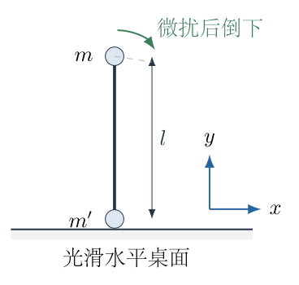

## 一、题型定位

刚性杆连接的双质点受约束运动。第一问是可滑动底端的倒杆问题，第二问是在同一约束中加入洛伦兹力。质量集中在两个端点，不能套用均匀杆的转动惯量或离地条件。题目对临界质量的设想需要由支持力的符号检验，而不是把它直接作为已经成立的结论。

## 二、知识点

刚性杆长约束；质心横向运动；机械能守恒；动能中的交叉项及配方；带电粒子的洛伦兹力；机械动量与广义动量的区别；支持力的单侧约束；相对速度和角速度的联系；微扰初态与恰好竖直不动的区别。

## 三、物理图像

杆向右倒下时，上端通常向右下方运动，下端则可以沿桌面向左滑动。桌面光滑意味着没有水平接触力，不意味着底端固定。两质点之间的杆力可以拉伸，也可以压缩，但杆不伸长。磁场力始终垂直各自的速度，所以它改变运动方向而不改变总机械能。磁场可以交换水平动量，因而不能把无磁场时的横向机械动量守恒式原样保留。

## 四、解题入口

先在底端仍贴着桌面的阶段建立两个质点的坐标。无磁场时用水平动量守恒消去底端速度，再由能量求杆角速度，由受力求支持力，并检验是否真的存在正临界质量。有磁场时从总水平受力积分得到新的守恒组合，再与能量联立。第二问的速度公式必须附带“根号非负、支持力非负”的适用条件。

## 五、解析

（1）确定坐标、运动方向及参数的含义。

取桌面为 $x$ 轴，竖直向上为 $y$ 轴，纸面外为 $+z$。以底端质点的位置为 $(X,0)$，以上端在底端右上方的一支运动为例。杆与水平面的夹角为 $\theta$，倒下时 $\theta$ 从接近 $\pi/2$ 减小，故 $\dot\theta<0$。上端和下端的位置分别为

$$\boldsymbol r_u=(X+l\cos\theta,l\sin\theta),\qquad
\boldsymbol r_b=(X,0).$$

将两位置各自对时间求导，得到

$$\begin{aligned}
\boldsymbol v_u&=(\dot X-l\sin\theta\,\dot\theta,\ l\cos\theta\,\dot\theta),\\
\boldsymbol v_b&=(\dot X,0),\\
\boldsymbol v_u-\boldsymbol v_b
&=l\dot\theta(-\sin\theta,\cos\theta).
\end{aligned}$$

相对速度沿杆的垂线，而不是沿杆。图 2-2 中 $\boldsymbol e=(\cos\theta,\sin\theta)$ 沿杆由下端指向上端，$\boldsymbol n=(-\sin\theta,\cos\theta)$ 为逆时针转过 $90^\circ$ 的单位矢量。

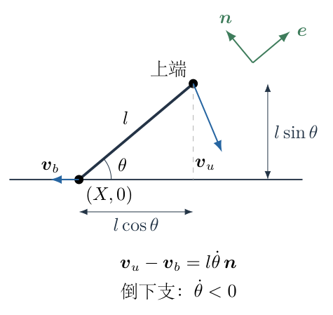

相对速度的矢量和大小分别为

$$\boldsymbol v_{\mathrm{rel}}=l\dot\theta\,\boldsymbol n,\qquad
v_{\mathrm{rel}}=l|\dot\theta|.$$

以下使用 $M=m+m'$、$\mu=m/M$。在 $m>0,m'>0$ 时，有 $0<\mu<1$。这一严格不等式在判定支持力时至关重要；不能先把 $m'=0$ 代入一个除以 $m'$ 得来的受力公式。

（2）无磁场时建立水平动量守恒式。

两端的重力和桌面支持力均竖直，杆力是系统内力，桌面不提供摩擦力。因此系统水平合外力为零。微扰取为无限小的位形扰动，初始水平动量为零，有

$$\begin{aligned}
P_x
&=m(\dot X-l\sin\theta\,\dot\theta)+m'\dot X\\
&=M\dot X-ml\sin\theta\,\dot\theta=0.
\end{aligned}$$

从而

$$\boxed{\dot X=\mu l\sin\theta\,\dot\theta.}$$

因为 $\dot\theta<0$，下端向左运动。上端水平速度为

$$v_{ux}=(\mu-1)l\sin\theta\,\dot\theta>0.$$

底端能移动是本题与“下端铰接的倒杆”的根本差别。若错误地设 $\dot X=0$，不仅能量中的动能项改变，后续杆力与支持力也会全部改变。

（3）展开总动能，消去底端速度。

先不使用任何转动惯量简式，直接写两质点的平动动能：

$$\begin{aligned}
K
&=\frac12m\left[(\dot X-l\sin\theta\,\dot\theta)^2
+l^2\cos^2\theta\,\dot\theta^2\right]
+\frac12m'\dot X^2\\
&=\frac12M\dot X^2
-ml\sin\theta\,\dot X\dot\theta
+\frac12ml^2\dot\theta^2.
\end{aligned}$$

这里将 $\sin^2\theta+\cos^2\theta=1$ 合并进最后一项。将 $\dot X=\mu l\sin\theta\,\dot\theta$ 代入：

$$\begin{aligned}
K
&=\frac12M\mu^2l^2\sin^2\theta\,\dot\theta^2
-m\mu l^2\sin^2\theta\,\dot\theta^2
+\frac12ml^2\dot\theta^2\\
&=\frac12m\mu l^2\sin^2\theta\,\dot\theta^2
-m\mu l^2\sin^2\theta\,\dot\theta^2
+\frac12ml^2\dot\theta^2\\
&=\frac12ml^2(1-\mu\sin^2\theta)\dot\theta^2.
\end{aligned}$$

第二行用了 $M\mu=m$。定义

$$s=\sin\theta,\qquad D=1-\mu s^2.$$

注意 $s$ 是角度的函数，不是固定数。$D>0$，所以约化动能始终为正。这也保证后面的除法在 $m'>0$、$0\le\theta\le\pi/2$ 内合法。

（4）用能量确定角速度，说明微扰极限。

下端高度固定，其重力势能不变；上端高度为 $l\sin\theta$。杆力对两质点的总功为零，桌面支持力与底端水平速度垂直，也不做功。因此总机械能守恒。

若先从 $\theta_i<\pi/2$ 静止释放，则初始势能为 $mgl\sin\theta_i$，精确能量式为

$$\frac12ml^2D\dot\theta^2
=mgl(\sin\theta_i-\sin\theta).$$

题设“竖直状态微扰”取 $\theta_i\to\pi/2$ 的极限，故

$$\boxed{\dot\theta^2=\frac{2g}{l}\frac{1-s}{D}.}$$

下降支应取

$$\dot\theta=-\sqrt{\frac{2g(1-s)}{lD}}.$$

恰好竖直且完全静止的系统可以永远停在不稳定平衡位置。上式描述的是微扰后已经进入倒下过程的极限轨迹，并不表示在完全无扰动的初态会自发运动。

（5）求角加速度，不遗漏角度相关系数。

将能量式写为

$$\frac12ml^2D\dot\theta^2+mgl\sin\theta=mgl.$$

对时间求导，逐项使用乘积法则和链式法则：

$$\begin{aligned}
0&=\frac12ml^2\dot D\,\dot\theta^2
+ml^2D\dot\theta\ddot\theta
+mgl\cos\theta\,\dot\theta,\\
\dot D&=-2\mu\sin\theta\cos\theta\,\dot\theta.
\end{aligned}$$

在已经运动、$\dot\theta\ne0$ 的区间除以 $ml^2\dot\theta$，得

$$D\ddot\theta-\mu\sin\theta\cos\theta\,\dot\theta^2
+\frac gl\cos\theta=0.$$

即

$$\boxed{\ddot\theta=
\frac{\mu s\cos\theta\,\dot\theta^2-(g/l)\cos\theta}{D}.}$$

初始端点的结果由连续极限给出，不能直接在 $\dot\theta=0$ 的瞬间把除法当成合法运算。此式中的第一项来自动能系数随杆角度变化，不能把 $D$ 当常量。

（6）由系统竖直运动求桌面支持力。

图 2-3 中，令杆的轴向力为有符号量 $T$，规定 $T>0$ 时杆拉上端向下端，上端受 $-T\boldsymbol e$，下端受 $+T\boldsymbol e$。$T<0$ 时杆处于压缩状态。杆是刚性杆，不是只能受拉的绳。

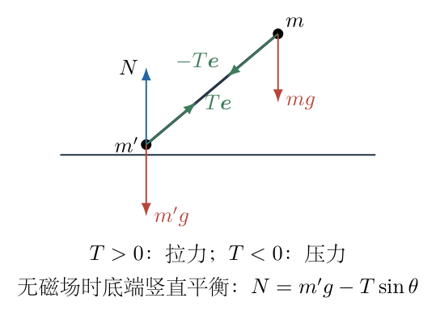

无磁场时，两质点系统的竖直外力为 $N-Mg$。下端竖直加速度为零，上端的竖直加速度为

$$a_{uy}=l(\cos\theta\,\ddot\theta-\sin\theta\,\dot\theta^2).$$

故

$$N=Mg+ml(\cos\theta\,\ddot\theta-s\dot\theta^2).$$

先将角加速度代入，暂不代入角速度：

$$\begin{aligned}
\frac{N}{Mg}
&=1+\mu\left[
\frac{\mu s\cos^2\theta(l\dot\theta^2/g)-\cos^2\theta}{D}
-s(l\dot\theta^2/g)\right]\\
&=1-\frac{\mu\cos^2\theta}{D}
+\frac{\mu s}{D}\left[\mu\cos^2\theta-D\right]
\frac{l\dot\theta^2}{g}.
\end{aligned}$$

因为

$$\mu\cos^2\theta-D
=\mu(1-s^2)-(1-\mu s^2)=\mu-1,$$

以及

$$1-\frac{\mu\cos^2\theta}{D}
=\frac{1-\mu}{D},$$

所以

$$\frac{N}{Mg}
=\frac{1-\mu}{D}
-\frac{\mu(1-\mu)s}{D}\frac{l\dot\theta^2}{g}.$$

再使用 $l\dot\theta^2/g=2(1-s)/D$，得到

$$\begin{aligned}
\frac{N}{Mg}
&=(1-\mu)\frac{D-2\mu s(1-s)}{D^2}\\
&=(1-\mu)\frac{1-\mu s^2-2\mu s+2\mu s^2}{D^2}\\
&=(1-\mu)\frac{1-\mu(2s-s^2)}{D^2}.
\end{aligned}$$

最后由 $M(1-\mu)=m'$，得

$$\boxed{N=m'g\,
\frac{1-\mu(2s-s^2)}{(1-\mu s^2)^2}.}$$

（7）独立用杆长约束与两端受力核对支持力。

这一核对不重新对能量求导。上端受力为

$$m\boldsymbol a_u=-T\boldsymbol e-mg\boldsymbol e_y.$$

下端的水平、竖直受力分别为

$$m'a_{bx}=T\cos\theta,\qquad
0=N+T\sin\theta-m'g.$$

由 $\boldsymbol r_u-\boldsymbol r_b=l\boldsymbol e$ 连续求两次导数，

$$\boldsymbol a_u-\boldsymbol a_b
=l\ddot\theta\,\boldsymbol n-l\dot\theta^2\boldsymbol e.$$

沿 $\boldsymbol e$ 投影，利用 $\boldsymbol e\cdot\boldsymbol n=0$，得到

$$\boldsymbol e\cdot(\boldsymbol a_u-\boldsymbol a_b)
=-l\dot\theta^2.$$

将受力式代入这个投影：

$$-\frac Tm-g\sin\theta-\frac{T\cos^2\theta}{m'}
=-l\dot\theta^2.$$

于是

$$T=\frac{l\dot\theta^2-gs}{1/m+\cos^2\theta/m'}
=\frac{mm'}{M D}(l\dot\theta^2-gs).$$

这里分母为 $1/m+\cos^2\theta/m'$，不是 $1/m+1/m'$，因为下端不能竖直加速。由下端竖直平衡，

$$\begin{aligned}
N&=m'g-Ts\\
&=m'g\left[1-\frac{\mu s}{D}
\left(\frac{l\dot\theta^2}{g}-s\right)\right]\\
&=\frac{m'g}{D}\left[1-\mu s\frac{l\dot\theta^2}{g}\right]\\
&=m'g\frac{1-\mu(2s-s^2)}{D^2}.
\end{aligned}$$

两条不同路线得到完全相同的结果。杆力由负变正并不等同于支持力变为零；必须比较 $Ts$ 与底端重量 $m'g$。

（8）检验临界质量是否存在，不能预设正根。

对于倒下阶段 $0\le s\le1$，

$$2s-s^2=1-(1-s)^2,\qquad 0\le2s-s^2\le1.$$

因此当 $m'>0$、$0<\mu<1$ 时，

$$1-\mu(2s-s^2)\ge1-\mu>0.$$

分母 $D^2>0$，故

$$\boxed{N>0\quad(m'>0,\ 0\le\theta\le\pi/2).}$$

由此可知，在“轻质杆、质量仅在端点、桌面光滑、从竖直微扰”的题设下，不存在正的临界质量。若直接令 $N=0$，会得到

$$2s-s^2=\frac1\mu>1,$$

而左边在允许区间最多为 $1$，所以这不是可以筛选的物理解。题目由 $m'=0$ 与 $m'\to\infty$ 两个极端推测中间必有正临界值，推测并不成立。

对 $m'\to0^+$，在任意固定 $0\le\theta<\pi/2$ 处有 $N\to0$；但这一极限不能提供唯一的 $\theta_0$。当底端本身没有质量、无磁场、杆端约束只维持几何连接时，杆力和支持力可均为零。若把 $m_c=0$ 称为边界值，则支持力在整个运动区间为零，而不是在某一唯一角度首次归零。因此第一问的严格结论是：没有正临界质量，也没有题设所要求的唯一 $\theta_0$。

两个端点检验为

$$\lim_{\theta\to\pi/2}N=Mg,\qquad N(0)=m'g.$$

上端接近竖直静态时通过杆把自身重量传给底端，因此支持力接近两质点总重；杆水平时杆力没有竖直分量，支持力等于底端重量。这与受力图一致。

（9）加入磁场，先确定洛伦兹力方向。

第二问仍取 $m,m'>0$。令 $\boldsymbol B=B\boldsymbol e_z$、$q>0$。对任意平面速度 $\boldsymbol v=(v_x,v_y,0)$，

$$q\boldsymbol v\times\boldsymbol B
=qB(v_y,-v_x,0).$$

图 2-4 中磁场垂直纸面向外，运动中的正电荷所受磁场力是把速度顺时针转过 $90^\circ$ 后乘以 $qB$。下端水平运动，因此其磁场力竖直；上端的竖直速度则产生水平磁场力。

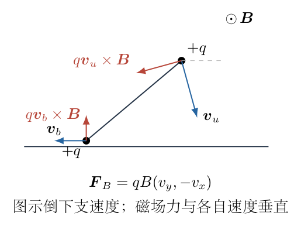

磁场力不做功，因为每个质点都满足

$$\boldsymbol F_B\cdot\boldsymbol v
=q(\boldsymbol v\times\boldsymbol B)\cdot\boldsymbol v=0.$$

桌面支持力仍不做功。因此本问的能量守恒式与前问相同；发生变化的是水平动量关系。

（10）从水平合外力积分得到正确的守恒组合。

下端的 $v_{by}=0$，两质点系统的水平磁场力为

$$F_{x,\mathrm{ext}}
=qB(v_{uy}+v_{by})
=qBl\cos\theta\,\dot\theta.$$

于是

$$\frac{dP_x}{dt}=qBl\frac{d(\sin\theta)}{dt}.$$

移项后，

$$\frac d{dt}(P_x-qBl\sin\theta)=0.$$

在竖直静止微扰极限，初始 $P_x=0$、$\sin\theta=1$，故

$$\boxed{P_x-qBl\sin\theta=-qBl.}$$

代入两质点水平动量的表达式：

$$M\dot X-mls\dot\theta=qBl(s-1),$$

即

$$\boxed{\dot X=\mu ls\dot\theta+\frac{qBl}{M}(s-1).}$$

右边第二项是磁场产生的共同横向漂移。它不能被遗漏，也不能把原来的 $P_x=0$ 继续用于带磁场的运动。若从有限初角 $\theta_i$ 静止释放，只需把 $(s-1)$ 换成 $(s-\sin\theta_i)$。

（11）用配方区分共同运动能量与相对运动能量。

动能的未消元表达式仍为

$$K=\frac12M\dot X^2-mls\dot X\dot\theta
+\frac12ml^2\dot\theta^2.$$

此处用平方配方法，而不是把 $\dot X$ 的两项逐项展开后省略交叉项：

$$\begin{aligned}
K
&=\frac12M(\dot X-\mu ls\dot\theta)^2
+\frac12ml^2\dot\theta^2
-\frac12M\mu^2l^2s^2\dot\theta^2\\
&=\frac12M(\dot X-\mu ls\dot\theta)^2
+\frac12ml^2D\dot\theta^2.
\end{aligned}$$

由第（10）步，

$$\dot X-\mu ls\dot\theta=\frac{qBl}{M}(s-1).$$

所以

$$K=\frac{q^2B^2l^2}{2M}(1-s)^2
+\frac12ml^2D\dot\theta^2.$$

第一项是横向共同运动所消耗的动能；第二项对应杆姿态变化。磁场不做功，但它可以使同样的势能下降分配给不同类型的运动。这正是最终相对速度中出现磁场减项的物理原因。

（12）与能量联立，逐项消元得到相对速度。

上端的势能下降为 $mgl(1-s)$，故

$$\frac{q^2B^2l^2}{2M}(1-s)^2
+\frac12ml^2D\dot\theta^2=mgl(1-s).$$

先把第一项移到右边，再乘以 $2/m$：

$$l^2D\dot\theta^2
=2gl(1-s)-\frac{q^2B^2l^2}{mM}(1-s)^2.$$

因为 $v_{\mathrm{rel}}^2=l^2\dot\theta^2$，得到

$$\boxed{
v_{\mathrm{rel}}=
\sqrt{
\frac{2gl(1-\sin\theta)
-\dfrac{q^2B^2l^2}{m(m+m')}(1-\sin\theta)^2}
{1-\dfrac{m}{m+m'}\sin^2\theta}
}.}$$

这给出相对速率。若要求相对速度矢量，在首次倒下的下降支有

$$\boxed{\boldsymbol v_u-\boldsymbol v_b
=-v_{\mathrm{rel}}\,\boldsymbol n.}$$

杆向右倒时，$\boldsymbol n$ 指向左上方，相对速度因而指向右下方。一个是有方向的矢量，另一个是非负速率，不能把二者的负号混写。

（13）核对实根条件和桌面接触条件。

分母 $D>0$。令 $w=1-\sin\theta\ge0$，根号分子为

$$w\left(2gl-\frac{q^2B^2l^2}{mM}w\right).$$

当 $qB\ne0$，要求

$$0\le w\le\frac{2mMg}{q^2B^2l}.$$

若上界小于 $1$，杆可能在到达水平前出现角速度为零的转折；不能把负的根号分子解释成新的倒下速度。转折之后 $\dot\theta$ 的符号需要按实际运动重新选择。

另外，公式的推导假定底端竖直加速度为零，故必须检验支持力。加入磁场后的两端受力为

$$\begin{aligned}
m\boldsymbol a_u&=qB(v_{uy},-v_{ux})
-T\boldsymbol e-mg\boldsymbol e_y,\\
m'a_{bx}&=T\cos\theta,\\
0&=N+T\sin\theta-m'g-qB\dot X.
\end{aligned}$$

沿杆投影相对加速度，逐项计算磁场力的投影：

$$\cos\theta\,v_{uy}-\sin\theta\,v_{ux}
=l\dot\theta-\sin\theta\,\dot X.$$

于是杆力满足

$$\boxed{
T=\frac{
l\dot\theta^2-g\sin\theta
+\dfrac{qB}{m}(l\dot\theta-\sin\theta\,\dot X)}
{1/m+\cos^2\theta/m'}
},$$

支持力为

$$\boxed{N=m'g+qB\dot X-T\sin\theta.}$$

由前面已求出的 $\dot\theta$、$\dot X$ 可逐一计算 $T,N$。只有 $N\ge0$ 的区间才与桌面约束相容。一旦计算要求 $N<0$，说明桌面必须向下“拉住”底端，而普通接触面不能做到，底端应离地；离地以后不能继续使用本题的约化坐标和相对速度公式。

（14）检查量纲、无磁场极限和极重底端极限。

$qB$ 的量纲为 $\mathrm{kg\,s^{-1}}$，故

$$\frac{q^2B^2l^2}{mM}$$

的量纲为 $\mathrm{m^2\,s^{-2}}$，与 $gl$ 一致，整个根号确实给出速度。取 $B\to0$，第二问退化为

$$v_{\mathrm{rel}}^2=\frac{2gl(1-\sin\theta)}
{1-\mu\sin^2\theta},$$

与第一问由能量得到的 $l^2\dot\theta^2$ 相同。取 $m'\to\infty$，则 $\mu\to0$、磁场共同漂移动能趋于零，得到

$$v_{\mathrm{rel}}^2\to2gl(1-\sin\theta).$$

这是上端绕近似固定的下端下降、势能直接变为其动能的结果。两个极限都支持前面的消元路线，但不替代对 $N$ 的实际接触检查。

## 六、关键洞察

一个关于临界值的叙述本身不是证明。本题无磁场支持力可整理成“正的质量因子、正的分母、严格正的括号”三部分，这比解高次方程更直接。先判断允许区间内表达式的符号，可以避免给一个不存在的临界值编造数值。

带磁场时，能量守恒与机械动量不守恒可以同时成立。总水平磁场力是 $qBl\,d(\sin\theta)/dt$，所以真正的常量是 $P_x-qBl\sin\theta$。配方后的动能把磁场引起的共同漂移单独列出，说明它占用势能下降所释放的能量，使角度变化的速率减小。

还可对有限初角检验第一问结论。设 $s_i=\sin\theta_i\le1$，初态静止，则

$$\dot\theta^2=\frac{2g(s_i-s)}{lD}.$$

由独立杆力路线可得

$$N=m'g\frac{D-2\mu s(s_i-s)}{D^2}
=m'g\frac{1+\mu s^2-2\mu ss_i}{D^2}.$$

分子也可写成

$$1-\mu s_i^2+\mu(s-s_i)^2>0.$$

因此从任意第一象限初角静止释放，正质量底端仍不因这一模型而离地。异常不是“微扰极限取错一点点”造成的。

## 七、易错点

把轻杆换成均匀杆，会增加连续质量的惯性和重力作用，已是另一道题。把光滑桌面上的下端当作铰点，会错误地消去底端动能。杆力必须允许正负；一旦把杆当成只能受拉的绳，就会在初始压缩阶段错误地宣布约束失效。

支持力为零与杆力为零不是同一条件。无磁场时 $N=m'g-Ts$，杆力已经变为拉力也可能仍不足以抵消底端重量。带磁场时还有 $qB\dot X$ 项；遗漏底端的竖直磁场力，可能得到正确的相对速度却错误判断离地。

不能将 $m'=0$、$\theta=\pi/2$ 同时硬代入含 $D$ 的约化式：此时 $D$ 可能为零，运动变量选择退化。也不能把 $B\to0$ 与“带电无质量质点”的极限随意交换。第二问的公式适用于两个质量均为正且仍接触桌面的阶段。

## 八、课堂讲解建议

先让学生根据图 2-2 写出两个质点的速度，而不要直接给出转动动能。板书保留 $\dot X$ 与 $\dot\theta$ 两个变量，让学生看见水平动量守恒怎样消掉一个变量，再用平方配方检查动能。

得到支持力公式后，让学生先求 $2s-s^2$ 在 $[0,1]$ 的最大值，再讨论有没有正临界质量。这一步可以训练“先检验问题前提，再计算答案”的习惯，而不是把题干的推测当成不可质疑的定理。

讲第二问时，先画出正电荷速度对应的洛伦兹力，分别指出上端的水平磁场力与下端的竖直磁场力。然后将水平合力写成一个全导数，让学生自己识别守恒组合；最后比较配方后的两种动能，解释磁场不做功却能改变相对速率的原因。

## 九、变式训练

变式一：无磁场，杆从 $\theta_i=\pi/3$ 静止释放，两端质量相等。求杆水平时的相对速率与支持力。

此时 $\mu=1/2$、$s_i=\sqrt3/2$。杆水平时 $s=0,D=1$，能量给出

$$v_{\mathrm{rel}}^2=2gls_i=\sqrt3\,gl,\qquad
v_{\mathrm{rel}}=\sqrt{\sqrt3\,gl}.$$

杆水平时杆力无竖直分量，所以

$$N=m'g=mg.$$

全程是否接触可用有限初角式检查：

$$1-\mu s_i^2+\mu(s-s_i)^2
=\frac58+\frac12\left(s-\frac{\sqrt3}2\right)^2>0.$$

因此从初角到水平期间底端不离地，所求末态公式适用。

变式二：保持第二问的磁场和约束，上端电荷为 $q_u$，下端电荷为 $q_b$，均为有符号电荷。求相对速率是否只与两电荷之和有关。

下端竖直速度为零，其水平洛伦兹力为零。水平总外力因此仍只来自上端：

$$\frac{dP_x}{dt}=q_uBl\cos\theta\,\dot\theta.$$

故

$$P_x-q_uBl\sin\theta=-q_uBl,\qquad
\dot X=\mu ls\dot\theta+\frac{q_uBl}{M}(s-1).$$

两个磁场力各自不做功，同样配方得到

$$v_{\mathrm{rel}}^2=
\frac{2gl(1-s)-q_u^2B^2l^2(1-s)^2/(mM)}{D}.$$

所以在维持桌面接触的阶段，相对速率不是由 $q_u+q_b$ 决定，而只含上端电荷 $q_u$。但接触条件不同：下端竖直平衡变为

$$N=m'g+q_bB\dot X-Ts,$$

其中

$$T=\frac{l\dot\theta^2-gs+
(q_uB/m)(l\dot\theta-s\dot X)}
{1/m+\cos^2\theta/m'}.$$

改变 $q_b$ 会改变支持力及离地角，因此“约束阶段内的速率公式不含 $q_b$”不等于“整个运动完全不受 $q_b$ 影响”。相对速度表达式和它的适用区间必须分开讨论。

例如取 $m=m'=1\,\mathrm{kg}$、$l=1\,\mathrm m$、$g=1\,\mathrm{m\,s^{-2}}$、$q_uB=0.2\,\mathrm{kg\,s^{-1}}$，考察 $\theta=\pi/6$ 的下降支。此时 $s=1/2,D=7/8$，逐项代入得

$$\begin{aligned}
\dot\theta&=-\sqrt{\frac{1-0.005}{0.875}}
=-1.066369\,\mathrm{s^{-1}},\\
\dot X&=\frac14\dot\theta-0.05\,\mathrm{m\,s^{-1}}
=-0.316592\,\mathrm{m\,s^{-1}},\\
T&=\frac{1.137143-0.5+0.2(-1.066369+0.158296)}{1.75}
\,\mathrm N=0.260302\,\mathrm N.
\end{aligned}$$

以 $b=q_bB/(1\,\mathrm{kg\,s^{-1}})$ 表示下端磁场参数的数值，则

$$N=(0.869849-0.316592b)\,\mathrm N.$$

若 $b=0.2$，这一角度处 $N=0.806531\,\mathrm N>0$；若 $b>2.74754$，假定仍接触桌面会算出负支持力，表明实际轨迹已不能继续使用该约束。后一结论只判定该角度处的接触相容性，不把 $2.74754$ 冒称为全程首次离地的临界参数；求首次离地必须沿实际下降轨迹找到最早的 $N=0$。

\newpage

# 第 3 题

边长为 $2l$ 的正三角形 $DEF$ 固定在水平面上。三个质量均为 $m$ 的光滑小环分别套在三边的杆上：$A$ 在 $EF$ 上，$B$ 在 $FD$ 上，$C$ 在 $DE$ 上。一根原长为 $3l$、整体劲度系数为 $k$ 的轻质闭合弹簧绳穿过三个小环。

（1）将三角形适当放大，并改为非正三角形，证明平衡时 $A$、$B$、$C$ 分别位于 $D$、$E$、$F$ 到对边的垂足。

（2）保持原来的正三角形，固定平衡位置处的 $A$、$B$，给 $C$ 一个小扰动，求振动周期。

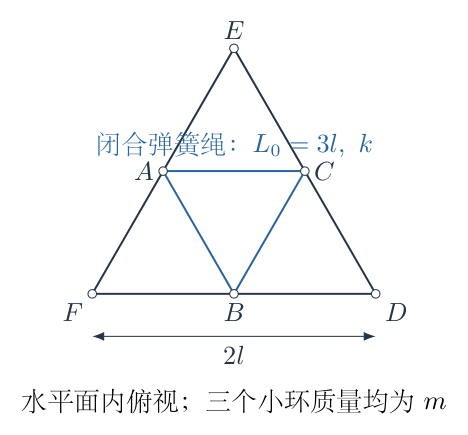

## 一、题型定位

受几何约束的弹性系统平衡与非线性振动。第一问涉及三角形内接三角形的最短周长及弹性能极小；第二问需要先检查预张力，再判断势能最低非零项的阶数。平衡位置稳定并不自动意味着附近运动是简谐振动。

## 二、知识点

光滑杆上的切向平衡；弹簧绳整体伸长量与张力；反射等距变换和三角不等式；锐角三角形的垂足三角形；泰勒展开的奇偶性；势能与恢复力；能量法周期积分；线性化的适用条件与退化情况。

## 三、物理图像

系统在水平面内运动，重力由竖直约束抵消，不参与沿杆的平衡。三个环的位置决定绳的总周长，周长改变决定弹性势能。绳张紧时，系统趋向周长最短的位置。原正三角形的中点三角形周长正好是 $3l$，与绳的原长相同，所以平衡张力为零。移动 $C$ 时，绳长的一阶改变抵消，伸长从位移平方开始，恢复力因而从位移三次方开始。

## 四、解题入口

第一问先明确“锐角、垂足在杆段内部、平衡绳张紧”的条件，再通过反射把折线路径变成直线距离，证明垂足构型确实实现最短周长。第二问对 $C$ 的位移写精确绳长，再展开到足以确定势能的阶数。不能在计算张力之前把某个 $k$ 直接当成 $C$ 的线性有效劲度。

## 五、解析

（1）说明平衡结论的适用条件。

将三个环所围三角形的周长记为

$$P=AB+BC+CA,$$

绳的自然长度为 $L_0=3l$。如果 $P>L_0$，整体张力及弹性势能为

$$T=k(P-L_0),\qquad U=\frac12k(P-L_0)^2.$$

这里 $k$ 对应整条闭合绳的总伸长，不是每段绳各自都以 $k$ 乘伸长。环处光滑、绳轻，绳张紧时各段张力相同。

若以某个环的沿杆坐标 $u_i$ 为广义坐标，则沿杆弹性力为

$$F_i=-\frac{\partial U}{\partial u_i}
=-T\frac{\partial P}{\partial u_i}.$$

当 $T>0$ 时，内部平衡要求 $\partial P/\partial u_i=0$。稳定平衡可通过周长最小值确定。若绳松弛，张力为零，即使周长没有取得最小值，环也可能不受沿杆弹性力；这时不能由平衡推出唯一垂足位置。

因此，第一问的垂足结论需要三角形为锐角三角形，三个环可以到达相应垂足，并且放大后的最短周长仍大于 $L_0$，保证平衡绳张紧。只说“不再是正三角形”并不能保证这些条件。以下先证明这一条件下的结论，随后说明边界情况。

（2）固定 $B$，对折线路径做反射。

取锐角三角形 $DEF$，$B$ 在底边 $FD$ 上。将 $B$ 分别关于直线 $EF$、$ED$ 反射，得到 $B_1$、$B_2$。反射保持距离，而 $A$ 在 $EF$ 上、$C$ 在 $ED$ 上，所以

$$AB=AB_1,\qquad CB=CB_2.$$

图 3-2 中，闭合绳的周长于是等于从 $B_1$ 经 $A,C$ 到 $B_2$ 的折线路径长。

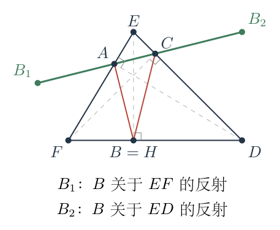

应用三角不等式，

$$\begin{aligned}
P&=AB+AC+CB\\
&=B_1A+AC+CB_2\\
&\ge B_1B_2.
\end{aligned}$$

等号不只是要求四点共线，还要求沿该直线的次序为 $B_1,A,C,B_2$。若次序错误，路径会往返，折线总长仍大于端点距离。

两次反射均以经过 $E$ 的直线为轴，因此

$$EB_1=EB_2=EB.$$

两反射轴的夹角为 $\angle FED=\angle E$，反射后两径向方向的夹角对应 $2\angle E$。用等腰三角形的弦长公式，

$$B_1B_2=2EB\sin\angle E.$$

也可由余弦定理直接核对：

$$B_1B_2^2=2EB^2[1-\cos(2\angle E)]
=4EB^2\sin^2\angle E.$$

因为 $\sin\angle E>0$，得

$$P\ge2EB\sin\angle E.$$

（3）再对 $B$ 的位置求最小值。

设 $H$ 为 $E$ 到 $FD$ 的垂足。锐角三角形保证 $H$ 位于线段 $FD$ 内。对任意 $B\in FD$，

$$EB^2=EH^2+HB^2\ge EH^2.$$

故

$$P\ge2EH\sin\angle E.$$

只有 $B=H$ 时才能达到这一级不等式的等号。因此，如果整个下界确实可以实现，平衡环 $B$ 必为 $E$ 到 $FD$ 的垂足。还需检验 $A,C$ 的位置和展开路径的点序，不能到这里就未经证明宣布三环全是垂足。

（4）用坐标核验下界的可达性与全部垂足。

设

$$F=(0,0),\quad D=(d,0),\quad E=(p,h),\quad a=d-p.$$

锐角条件为

$$0<p<d,\qquad h>0,\qquad h^2>pa.$$

前两边的平方长度记为

$$L_F^2=p^2+h^2,\qquad L_D^2=a^2+h^2.$$

此时 $B=H=(p,0)$。$D$ 到直线 $EF$ 的垂足为 $A$。沿 $EF$ 的方向向量是 $(p,h)$，把 $(d,0)$ 投影到该方向：

$$\begin{aligned}
A
&=\frac{(d,0)\cdot(p,h)}{p^2+h^2}(p,h)\\
&=\left(\frac{dp^2}{L_F^2},\frac{dph}{L_F^2}\right).
\end{aligned}$$

$F$ 到 $DE$ 的垂足为 $C$。以 $D$ 为起点，$DE$ 的方向向量为 $(-a,h)$，于是

$$\begin{aligned}
C
&=(d,0)+\frac{(-d,0)\cdot(-a,h)}{a^2+h^2}(-a,h)\\
&=\left(d-\frac{da^2}{L_D^2},\frac{dah}{L_D^2}\right)\\
&=\left(\frac{dh^2}{L_D^2},\frac{dah}{L_D^2}\right).
\end{aligned}$$

反射一个点的方法是：先求其在反射轴上的投影，再用“投影点的两倍减原点”。因此两个反射点为

$$\begin{aligned}
B_1&=\left(\frac{p(p^2-h^2)}{L_F^2},
\frac{2p^2h}{L_F^2}\right),\\
B_2&=\left(d+\frac{a(h^2-a^2)}{L_D^2},
\frac{2a^2h}{L_D^2}\right).
\end{aligned}$$

这些表达式来自同一个反射公式，不需要对图形的对称外观做额外假设。

（5）核对四点共线并按正确顺序排列。

引入非零向量

$$\boldsymbol w=(pa+h^2,\ h(a-p)).$$

由上一步的坐标逐项相减，可得

$$\begin{aligned}
A-B_1&=\frac{p}{L_F^2}\boldsymbol w,\\
B_2-C&=\frac{a}{L_D^2}\boldsymbol w,\\
C-A&=\frac{d(h^2-pa)}{L_F^2L_D^2}\boldsymbol w.
\end{aligned}$$

例如第一式的横坐标差为

$$\frac{dp^2-p(p^2-h^2)}{L_F^2}
=\frac{p[\,p(d-p)+h^2\,]}{L_F^2}
=\frac{p(pa+h^2)}{L_F^2},$$

纵坐标差为

$$\frac{dph-2p^2h}{L_F^2}
=\frac{ph(d-2p)}{L_F^2}
=\frac{ph(a-p)}{L_F^2}.$$

第二式的横坐标也逐项通分：

$$\begin{aligned}
B_{2x}-C_x
&=d+\frac{a(h^2-a^2)-dh^2}{L_D^2}\\
&=\frac{da^2+ah^2-a^3}{L_D^2}\\
&=\frac{a[(d-a)a+h^2]}{L_D^2}
=\frac{a(pa+h^2)}{L_D^2}.
\end{aligned}$$

其纵坐标差为

$$B_{2y}-C_y=\frac{2a^2h-dah}{L_D^2}
=\frac{ah(2a-d)}{L_D^2}
=\frac{ah(a-p)}{L_D^2}.$$

对第三式，横坐标通分后为

$$\begin{aligned}
C_x-A_x
&=\frac{d[h^2(p^2+h^2)-p^2(a^2+h^2)]}
{L_F^2L_D^2}\\
&=\frac{d(h^4-p^2a^2)}{L_F^2L_D^2}\\
&=\frac{d(h^2-pa)(h^2+pa)}{L_F^2L_D^2},
\end{aligned}$$

纵坐标同样为

$$\begin{aligned}
C_y-A_y
&=\frac{dh[a(p^2+h^2)-p(a^2+h^2)]}
{L_F^2L_D^2}\\
&=\frac{dh(a-p)(h^2-pa)}{L_F^2L_D^2}.
\end{aligned}$$

所以三段位移确实沿同一个 $\boldsymbol w$。由于 $p>0,a>0,h^2-pa>0$，三个比例系数全为正，得到点序

$$B_1\longrightarrow A\longrightarrow C\longrightarrow B_2.$$

这证明垂足三角形实现了反射法得到的下界。还需说明它不只是某一个可选的平衡：将三个环的沿杆坐标作为变量，每一段距离都是仿射坐标差的欧氏范数，因此是凸函数，三段之和 $P$ 也是凸函数。凸函数的内部驻点必是全局最小点，而上述两级不等式的等号依次唯一确定 $B$ 及有序的 $A,C$。所以张紧条件下的内部平衡只能是这一构型，即

$$\boxed{A,B,C\text{ 分别是 }D,E,F\text{ 到对边的垂足。}}$$

结论不依赖三个环的质量，因为水平静态平衡中没有沿杆的重力分量。若三角形钝角，$h^2-pa$ 的符号或垂足位置发生改变，上述内部点序及可达条件失效，不能把垂足结论无条件推广。

（6）回到原正三角形，检查平衡张力。

原正三角形边长 $2l$，三条高的垂足都是边中点。垂足三角形的每边长为 $l$，因此

$$P(0)=3l=L_0,\qquad T(0)=k[P(0)-L_0]=0.$$

虽然垂足构型仍是周长最小构型，但它恰好位于零张力边界。第二问不能沿用第一问“严格正张力”的线性恢复力直觉。必须从精确几何重新计算 $C$ 偏离后的伸长量。

（7）给 $C$ 定义位移，写两段绳长。

取

$$F=(-l,0),\quad D=(l,0),\quad E=(0,\sqrt3l).$$

固定的两环为

$$A=\left(-\frac l2,\frac{\sqrt3l}{2}\right),\qquad B=(0,0).$$

$C$ 的平衡位置为

$$C_0=\left(\frac l2,\frac{\sqrt3l}{2}\right).$$

沿 $DE$ 由 $C_0$ 指向 $D$ 为位移 $u$ 的正方向，其单位矢量为

$$\boldsymbol e_C=\left(\frac12,-\frac{\sqrt3}{2}\right),\qquad
C=C_0+u\boldsymbol e_C.$$

图 3-3 中 $A,B$ 不动，只有 $C$ 沿杆运动；$u$ 不是某段绳的伸长量。为避免环到达顶点，考虑 $|u|<l$ 的局部运动。

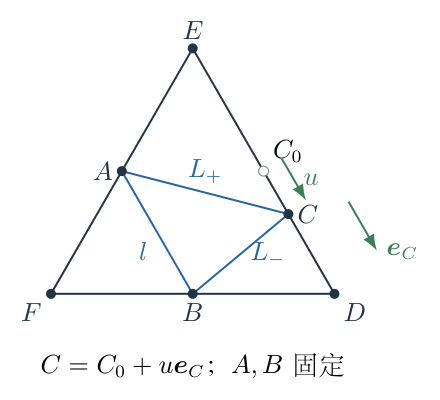

由坐标差计算：

$$\begin{aligned}
AC^2
&=\left(l+\frac u2\right)^2+\left(-\frac{\sqrt3u}{2}\right)^2
=l^2+lu+u^2,\\
BC^2
&=\left(\frac l2+\frac u2\right)^2
+\left(\frac{\sqrt3l}{2}-\frac{\sqrt3u}{2}\right)^2\\
&=l^2-lu+u^2.
\end{aligned}$$

$AB=l$ 不变，故精确总周长为

$$\boxed{P(u)=l+\sqrt{l^2+lu+u^2}
+\sqrt{l^2-lu+u^2}.}$$

交换 $u$ 与 $-u$ 只会交换两根式，因此 $P(u)$ 是偶函数。这个对称性意味着其展开中所有奇次项都应抵消，可用于检查计算符号。

（8）展开绳长，保留到四阶并检查抵消。

令 $x=u/l$，使用二项式展开

$$\sqrt{1+z}=1+\frac z2-\frac{z^2}{8}
+\frac{z^3}{16}-\frac{5z^4}{128}+O(z^5).$$

对两根式分别取 $z=\pm x+x^2$。所需的幂为

$$\begin{aligned}
z^2&=x^2\pm2x^3+x^4,\\
z^3&=\pm x^3+3x^4+O(x^5),\\
z^4&=x^4+O(x^5).
\end{aligned}$$

代入后收集各阶系数：

$$\sqrt{1\pm x+x^2}
=1\pm\frac x2+\frac{3x^2}{8}
\mp\frac{3x^3}{16}+\frac{3x^4}{128}+O(x^5).$$

例如四阶系数为

$$-\frac18+\frac3{16}-\frac5{128}
=\frac{-16+24-5}{128}=\frac3{128}.$$

把两个展开相加时，一阶、三阶相消。利用偶函数性质将余项写为六阶起：

$$\begin{aligned}
P(u)
&=3l+\frac{3u^2}{4l}+\frac{3u^4}{64l^3}
+O(u^6/l^5),\\
\Delta L=P(u)-3l
&=\frac{3u^2}{4l}+\frac{3u^4}{64l^3}
+O(u^6/l^5).
\end{aligned}$$

所以绳总伸长是二阶小量。将 $\Delta L$ 错写为 $u$ 或 $2u$ 会把本题误变成普通弹簧振子。

（9）从弹性能或受力投影求恢复力。

因为 $P(u)\ge3l$，邻近平衡的非零位移对应伸长而不是松弛。势能为

$$\begin{aligned}
U(u)
&=\frac12k[\Delta L(u)]^2\\
&=\frac{9k}{32l^2}u^4+\frac{9k}{256l^4}u^6
+O(ku^8/l^6).
\end{aligned}$$

图 3-4 的势能曲线最低项为四次方；原点处曲率 $U''(0)$ 为零，但离开原点后势能上升，平衡仍是稳定的。

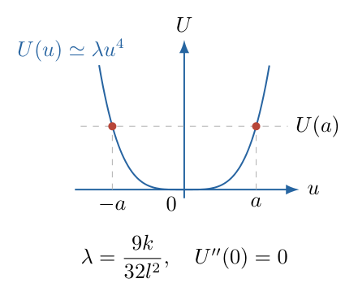

以 $u$ 为沿杆弧长坐标，环的动能为 $m\dot u^2/2$，所以运动方程为

$$\begin{aligned}
m\ddot u&=-\frac{dU}{du}\\
&=-\frac{9k}{8l^2}u^3-\frac{27k}{128l^4}u^5
+O(ku^7/l^6).
\end{aligned}$$

也可从绳张力的投影核对。令 $L_\pm=\sqrt{l^2\pm lu+u^2}$，两段绳在 $C$ 处拉力的沿杆合力为

$$F_u=-T\left[\frac{u+l/2}{L_+}
+\frac{u-l/2}{L_-}\right].$$

另一方面，

$$P'(u)=\frac{2u+l}{2L_+}+\frac{2u-l}{2L_-}
=\frac{u+l/2}{L_+}+\frac{u-l/2}{L_-}.$$

故 $F_u=-TP'(u)=-dU/du$。这说明势能法中的广义力确实就是图 3-3 两段绳力的沿杆投影，没有漏掉几何因子。

（10）先判断是否存在非零线性振动频率。

线性化保留恢复力的一次项，而本题

$$F_u=-\frac{9k}{8l^2}u^3+\cdots$$

没有一次项。因此线性化方程是

$$m\ddot u=0,\qquad \omega_{\mathrm{lin}}^2=\frac{U''(0)}m=0.$$

不能由此说“有限扰动后完全不振动”。它表示线性近似不能给出有限非零频率；实际有限小振幅运动由三次恢复力决定，频率随振幅趋零也趋零。必须使用非线性周期积分。

（11）由精确能量写周期积分。

设在 $u=a$ 处静止释放，$0<a\ll l$。转折点为 $\pm a$，总能量为 $E=U(a)$。在从 $0$ 向 $a$ 运动的四分之一周期中，

$$\frac12m\dot u^2+U(u)=U(a).$$

解出正的速率：

$$\dot u=\sqrt{\frac{2[U(a)-U(u)]}{m}},\qquad
dt=\sqrt{\frac m2}\frac{du}{\sqrt{U(a)-U(u)}}.$$

势能为偶函数，四段往返时间相同，所以精确周期为

$$\boxed{T(a)=4\sqrt{\frac m2}
\int_0^a\frac{du}{\sqrt{U(a)-U(u)}}.}$$

其中 $U(u)$ 应代入第（9）步的精确式 $\frac12k[P(u)-3l]^2$；这个积分已经完全确定了给定振幅的周期。若初态不是从静止位移释放，则先由初始能量求转折幅值 $a$，再用同一公式。

（12）求小振幅的主导周期，展开积分的尺度。

令

$$\lambda=\frac{9k}{32l^2},\qquad U(u)=\lambda u^4[1+O(u^2/l^2)].$$

在 $a/l\to0$ 的极限，使用主导四次势能：

$$\begin{aligned}
T(a)
&\sim4\sqrt{\frac{m}{2\lambda}}
\int_0^a\frac{du}{\sqrt{a^4-u^4}}\\
&=\frac4a\sqrt{\frac{m}{2\lambda}}
\int_0^1\frac{dz}{\sqrt{1-z^4}}.
\end{aligned}$$

第二行使用尺度代换 $u=az$，所以 $du=a\,dz$、$\sqrt{a^4-u^4}=a^2\sqrt{1-z^4}$，净尺度为 $1/a$。这是周期振幅依赖的来源，不是积分过程中额外引入的经验修正。

代入 $\lambda$ 并化简：

$$\sqrt{\frac m{2\lambda}}
=\sqrt{\frac{16ml^2}{9k}}
=\frac{4l}{3}\sqrt{\frac mk}.$$

因此

$$\boxed{
T(a)\sim\frac{16l}{3a}\sqrt{\frac mk}\,
I,\qquad I=\int_0^1\frac{dz}{\sqrt{1-z^4}}.
}$$

积分在 $z=1$ 处有可积的平方根奇性。为方便稳定数值计算，可再令 $z=\sin\psi$，则

$$\begin{aligned}
1-z^4&=(1-\sin^2\psi)(1+\sin^2\psi)
=\cos^2\psi(1+\sin^2\psi),\\
I&=\int_0^{\pi/2}\frac{d\psi}{\sqrt{1+\sin^2\psi}}
\approx1.31102878.
\end{aligned}$$

最终为

$$\boxed{T(a)\sim6.99215\,\frac la\sqrt{\frac mk}.}$$

相应的非线性振动角频率为

$$\omega(a)=\frac{2\pi}{T(a)}
\sim0.89861\,\frac al\sqrt{\frac km}.$$

这里的角频率只是按周期定义，位移曲线并非正弦，不能进一步写成精确的 $u=a\cos[\omega(a)t]$。

（13）回答原题，并做稳定性与量纲检查。

题目没有指定有限扰动的振幅或能量，因此第二问不能给一个与振幅无关的有限周期。原题条件下的完整结论为

$$\boxed{\omega_{\mathrm{lin}}=0,\qquad
T(a)\propto a^{-1},\qquad \lim_{a\to0}T(a)=+\infty.}$$

给定 $a$ 时，精确值用第（11）步积分求，渐近值用第（12）步求。对有限小振幅，$u$ 正时恢复力为负，$u$ 负时恢复力为正，方向正确；势能非负且在原点取最小值，稳定性正确。

$k$ 的量纲为 $\mathrm{kg\,s^{-2}}$，$\sqrt{m/k}$ 是时间，$l/a$ 无量纲，周期量纲正确。三次恢复力的系数 $k/l^2$ 乘 $u^3$ 后是力，与牛顿方程一致。若把 $T$ 写成仅含 $\sqrt{m/k}$ 的固定倍数，会遗漏本题最重要的振幅尺度。

## 六、关键洞察

最短周长与最小弹性能之间需要正张力建立单调联系。第一问中“反射后路径的点序”是不能省略的几何条件；钝角时下界可能无法由内部环的位置实现。零张力还会让平衡条件 $T\,\partial P/\partial u_i=0$ 失去对周长驻点的约束。

对原正三角形，几何给出 $\Delta L\sim u^2$，弹性势能是伸长平方，所以 $U\sim u^4$，恢复力再求导得到 $F\sim-u^3$。几何、材料关系、动力学三个层次的阶数变化必须分别跟踪。稳定而线性频率为零的平衡并不是矛盾，也不是无恢复力。

精确周长的单调性可直接检验。两根式的二阶导数为

$$P''(u)=\frac{3l^2}{4L_+^3}+\frac{3l^2}{4L_-^3}>0.$$

因此 $P'(0)=0$，$u>0$ 时 $P'(u)>0$，$u<0$ 时 $P'(u)<0$。这证明两侧势能单调上升，给定小幅能量恰有两个转折点，周期积分的往返解释成立，并不是仅从画出的四次曲线猜测精确势能。

## 七、易错点

平衡长度等于自然长度时，不能凭“有弹簧”就给出 $2\pi\sqrt{m/k}$。本题绳长的线性变化为零，而张力的平衡值也为零；将这两处零漏掉任何一处，都可能错误制造线性恢复力。

不能只取绳长到一阶后因结果为零就说“绳长不变”。必须继续到二阶，求势能时还要平方。数值计算 $P(u)-3l$ 时，极小位移会造成近数相减的精度损失，宜用展开式检查极限，而精确周期宜通过去除端点奇性的变量代换计算。

第一问证明中，一次反射只能展开与该边相接的绳段；必须标清 $B_1,B_2$ 各自的反射轴。平衡环在对边哪一条杆上也不能互换。第二问的 $u$ 是沿 $DE$ 的位移，不是水平位移，动能因而是 $m\dot u^2/2$，不需要再乘一个投影平方。

## 八、课堂讲解建议

先让学生在图3-1上算中点三角形的周长，并与自然长度比较。板书不要先写周期，先写“平衡张力是多少”。由零张力再引导学生判断位移后总绳长的一阶项是否抵消。

讲反射证明时，在图3-2上用一条连续路径连出 $B_1,A,C,B_2$，要求学生说出三角不等式等号的全部条件。坐标核验可分为“投影得到垂足”和“比例系数证明点序”两段，避免将大段代数当作未经解释的公式堆积。

讲周期时，先从能量画出速率随位置变化，再解释四分之一周期积分。让学生检查代换 $u=az$ 后为什么留下 $1/a$，以此把振幅依赖与恢复力阶数联系起来。最后区分“线性频率为零”和“有限振幅没有周期”，避免形成新的误解。

## 九、变式训练

变式一：几何和固定环位置不变，但绳的自然长度改为 $L_0<3l$。求 $C$ 的线性小振动周期，并说明为何与原题不同。

令平衡伸长为 $\Delta_0=3l-L_0>0$，预张力为 $T_0=k\Delta_0$。用原来的周长展开，

$$P(u)-L_0=\Delta_0+\frac{3u^2}{4l}
+\frac{3u^4}{64l^3}+\cdots.$$

以平衡势能为零点，

$$\begin{aligned}
U(u)-U(0)
&=\frac12k\left[(P-L_0)^2-\Delta_0^2\right]\\
&=\frac{3T_0}{4l}u^2+
\left(\frac{9k}{32l^2}+\frac{3T_0}{64l^3}\right)u^4+\cdots.
\end{aligned}$$

将二次项与 $\kappa u^2/2$ 对照，

$$\kappa=\frac{3T_0}{2l},\qquad
\omega_0=\sqrt{\frac{3T_0}{2ml}},$$

故

$$\boxed{T_{\mathrm{lin}}=2\pi\sqrt{\frac{2ml}{3T_0}}.}$$

预张力使 $C$ 偏离时两段已有张力的方向变化产生线性恢复力。原题 $T_0=0$ 时这项消失，周期趋于无穷，剩下的是有限振幅决定的非线性振动。

还需检查何时允许忽略三次恢复力。记四次势能系数为

$$\lambda_4=\frac{9k}{32l^2}+\frac{3T_0}{64l^3}.$$

在位移尺度 $a$ 上，要求 $4\lambda_4a^3\ll\kappa a$，即

$$a^2\ll\frac{\kappa}{4\lambda_4}.$$

若 $T_0$ 极小但振幅不同时趋得更小，这个条件就可能失效。不能把有预张力的简谐周期强行用于 $T_0\to0$、$a$ 固定的情形。

<!-- KEEP_TOGETHER_START -->

变式二：原题零预张力，两个振动的振幅分别为 $a$ 与 $a/2$，两者都满足 $a/l\ll1$。比较其周期和最大速率。

主导周期由 $T\propto1/a$ 得

$$T(a/2)\sim2T(a).$$

最大速率发生在 $u=0$。先用能量方程，乘以 $2/m$ 再开正根，最后将 $a$ 换成 $a/2$：

$$\begin{aligned}
\frac12mv_{\max}^2&=U(a)\sim\frac{9ka^4}{32l^2},\\
v_{\max}^2(a)&\sim\frac{9ka^4}{16ml^2},\\
v_{\max}(a)&\sim\frac{3a^2}{4l}\sqrt{\frac km},\\
v_{\max}(a/2)&\sim\frac14v_{\max}(a).
\end{aligned}$$

振幅减半时最大速率变成四分之一，周期却变为两倍。两者结合说明，不能用普通简谐振子中“速率正比振幅、周期不变”的关系处理本题。

<!-- KEEP_TOGETHER_END -->

\newpage

# 第 4 题

如图，三角形外边分成六个电阻段，三边中点各通过一个电阻段与中心节点连接。九个电阻段的电阻均为 $r$。求图中 $A$、$B$ 两端之间的等效电阻 $R_{AB}$。

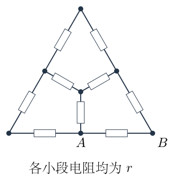

## 一、题型定位

含内部节点的平面电阻网络。由于端口一个在边中点、另一个在顶点，端口边界条件破坏了三角形外观上的旋转对称。需要先证明内部节点等势，才能删除无电流支路并做串并联化简。

## 二、知识点

等效电阻的端口定义；基尔霍夫电流定律；欧姆定律；节点电势法；有负载节点与可串联节点的区别；零电流支路；串并联等效；电功率守恒和无源网络解的唯一性。

## 三、物理图像

在 $A$ 接高电势、$B$ 接低电势后，电流可以沿直接的底边支路，也可以绕三角形边缘或穿过中心。中心到某个中点的电流是否为零，取决于两个节点实际电势，而不是取决于画线长短。图中的全部小段电阻相同，即使绘图中有长有短，也不能据此改变题设电阻。

## 四、解题入口

先给七个实际连接节点命名，对两端施加试探电压 $U_0$。将所有未知电势除以 $U_0$，列五个无量纲节点方程。解出电势后，从 $A$ 流出的总电流求 $R_{AB}$。再将计算证明无电流的支路开路，得到可直观看懂的串并联网络，作为第二条核对路线。

## 五、解析

（1）识别节点与支路，不把交点或顶点漏掉。

图 4-2 采用以下节点名：左下顶点为 $L$，左边中点为 $U$，上顶点为 $T$，右边中点为 $V$，右下顶点为 $B$，底边中点为 $A$，中心为 $O$。外边依次为

$$L\!-\!U,\quad U\!-\!T,\quad T\!-\!V,\quad
V\!-\!B,\quad B\!-\!A,\quad A\!-\!L,$$

中心三支路为

$$O\!-\!U,\quad O\!-\!V,\quad O\!-\!A.$$

共七个节点、九条电阻支路，每条电阻为 $r$。一根连续线在节点处若又连出第三支路，就不能把两段电阻直接当成串联，因为节点可能向第三支路分流。

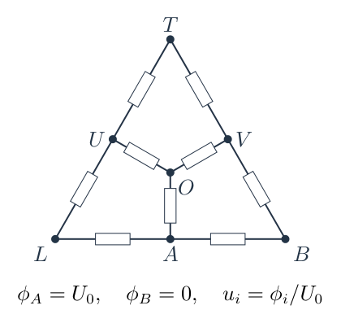

施加试探电压 $U_0>0$，取

$$\phi_A=U_0,\qquad \phi_B=0.$$

对其余节点定义无量纲电势

$$u_i=\frac{\phi_i}{U_0},\qquad u_A=1,\quad u_B=0.$$

计算过程中 $U_0$ 可任意选取，最终 $U_0/I_A$ 应与其数值无关，这是线性电阻网络的特征。

（2）逐个节点写电流守恒。

从节点 $i$ 流向相邻节点 $j$ 的有符号电流为

$$I_{i\to j}=\frac{\phi_i-\phi_j}{r}
=\frac{U_0}{r}(u_i-u_j).$$

内部节点没有外部电源注入，流出电流之和为零。约去公共因子 $U_0/r$ 后，五个方程为

$$\begin{aligned}
L:\quad &(u_L-1)+(u_L-u_U)=0,\\
T:\quad &(u_T-u_U)+(u_T-u_V)=0,\\
U:\quad &(u_U-u_L)+(u_U-u_T)+(u_U-u_O)=0,\\
V:\quad &(u_V-u_T)+(u_V-0)+(u_V-u_O)=0,\\
O:\quad &(u_O-u_U)+(u_O-u_V)+(u_O-1)=0.
\end{aligned}$$

按节点连接数整理，得到

$$\begin{aligned}
2u_L-u_U&=1,\\
2u_T-u_U-u_V&=0,\\
3u_U-u_L-u_T-u_O&=0,\\
3u_V-u_T-u_O&=0,\\
3u_O-u_U-u_V&=1.
\end{aligned}$$

例如 $V$ 接三个节点 $T,B,O$，因此系数是 $3$；如果少写它与端口 $B$ 的支路，会把系数错写成 $2$ 并改变整个网络。

（3）先消去两个二度节点和中心电势。

由第一、第二、第五个方程，直接得到

$$u_L=\frac{1+u_U}{2},\qquad
u_T=\frac{u_U+u_V}{2},\qquad
u_O=\frac{1+u_U+u_V}{3}.$$

将它们代入 $U$ 节点方程：

$$3u_U-\frac{1+u_U}{2}
-\frac{u_U+u_V}{2}
-\frac{1+u_U+u_V}{3}=0.$$

乘以分母最小公倍数 $6$，并完整收集同类项：

$$\begin{aligned}
0&=18u_U-3(1+u_U)-3(u_U+u_V)
-2(1+u_U+u_V)\\
&=(18-3-3-2)u_U-(3+2)u_V-(3+2)\\
&=10u_U-5u_V-5.
\end{aligned}$$

因此

$$2u_U-u_V=1.$$

再代入 $V$ 节点方程：

$$3u_V-\frac{u_U+u_V}{2}
-\frac{1+u_U+u_V}{3}=0.$$

同样乘以 $6$：

$$\begin{aligned}
0&=18u_V-3(u_U+u_V)-2(1+u_U+u_V)\\
&=13u_V-5u_U-2.
\end{aligned}$$

故只剩两个未知量：

$$2u_U-u_V=1,\qquad 13u_V-5u_U=2.$$

（4）解出全部内部电势。

从第一式解出 $u_V=2u_U-1$，代入第二式：

$$\begin{aligned}
13(2u_U-1)-5u_U&=2,\\
26u_U-13-5u_U&=2,\\
21u_U&=15.
\end{aligned}$$

于是

$$u_U=\frac57,\qquad u_V=\frac37.$$

回代其余三式：

$$\begin{aligned}
u_L&=\frac{1+5/7}{2}=\frac67,\\
u_T&=\frac{5/7+3/7}{2}=\frac47,\\
u_O&=\frac{1+5/7+3/7}{3}=\frac57.
\end{aligned}$$

结果全部位于 $0$ 与 $1$ 之间，符合无源电阻网络内部电势不能超过两端极值的性质。特别是

$$\boxed{\phi_O=\phi_U=\frac57U_0.}$$

这是一条从完整节点方程得到的等势结论，不是未经验证的外观对称假设。

（5）从端口电流求等效电阻。

端口 $A$ 有三条出线，分别到 $L,B,O$。从高电势端口流出的总电流为

$$\begin{aligned}
I_A
&=\frac{\phi_A-\phi_L}{r}
+\frac{\phi_A-\phi_B}{r}
+\frac{\phi_A-\phi_O}{r}\\
&=\frac{U_0}{r}\left[
1-\frac67+1-0+1-\frac57\right]\\
&=\frac{U_0}{r}\left(\frac17+1+\frac27\right)\\
&=\frac{10U_0}{7r}.
\end{aligned}$$

按等效电阻定义，

$$\boxed{R_{AB}=\frac{U_0}{I_A}=\frac7{10}r.}$$

$U_0$ 完全约去，量纲为电阻。不能只取 $A$ 到中心的电流作为端口总电流，必须把 $A$ 的三条支路全部计入。

（6）检查九条支路的方向及每个节点的收支。

图 4-3 的箭头按已求出的高、低电势方向画出。电流单位统一为 $U_0/(7r)$，并非每支路电流都相同。

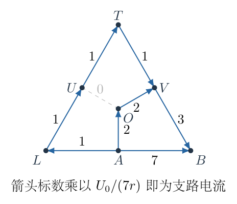

各支路电流为

$$\begin{aligned}
I_{A\to B}&=\frac{U_0}{r},\\
I_{A\to L}=I_{L\to U}=I_{U\to T}=I_{T\to V}
&=\frac{U_0}{7r},\\
I_{A\to O}=I_{O\to V}&=\frac{2U_0}{7r},\\
I_{V\to B}&=\frac{3U_0}{7r},\\
I_{O\to U}&=0.
\end{aligned}$$

在 $U$ 处，从 $L$ 流入 $1$ 个电流单位，向 $T$ 流出 $1$ 个，中心支路为零；在 $O$ 处，从 $A$ 流入 $2$ 个单位，向 $V$ 流出 $2$ 个；在 $V$ 处，来自 $T,O$ 的 $1+2$ 个单位刚好汇成流向 $B$ 的 $3$ 个单位。

低电势端口吸收的电流为

$$I_B=I_{A\to B}+I_{V\to B}
=\frac{U_0}{r}+\frac{3U_0}{7r}
=\frac{10U_0}{7r}=I_A.$$

这同时核对了电流方向、连接关系和端口定义。

（7）删除已证明无电流的支路，构造串并联解。

因为 $\phi_O=\phi_U$，电阻 $OU$ 两端电压为零，电流为零。将其开路后，原来的节点电势仍满足所有节点方程，所以该端口条件下的总电流不变。删除一条零电流支路不是“删除一个零电阻”，也不是将 $O,U$ 直接短接。

开路 $OU$ 后，$A$ 到 $V$ 有两条内部路径：

$$A-L-U-T-V:\quad 4r,$$

$$A-O-V:\quad 2r.$$

此时两路径的内部节点都只有两条非零电流支路，可以真正串联。两条路径仅在 $A,V$ 两端相接，所以并联：

$$R_{AV}=\frac{4r\cdot2r}{4r+2r}=\frac43r.$$

图 4-4 表示这一等效结构：$A$ 到 $B$ 一条直接支路为 $r$，另一条经 $V$ 的支路为 $R_{AV}+r$。

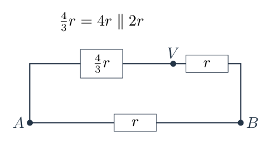

因此

$$\begin{aligned}
R_{AVB}&=\frac43r+r=\frac73r,\\
R_{AB}&=r\parallel\frac73r
=\frac{r(7r/3)}{r+7r/3}\\
&=\frac{(7/3)r^2}{(10/3)r}
=\frac7{10}r.
\end{aligned}$$

这一结果与节点法一致，也解释了为什么最终电阻小于底边直接连接的 $r$：另外一条有限电阻支路与其并联，使总导电能力增加。

（8）用总耗散功率核验，防止漏支路。

把第（6）步的全部支路电流代入 $\mathcal P=\sum I_i^2r$。直接支路贡献 $U_0^2/r$；四条电流为 $U_0/(7r)$ 的外沿支路贡献 $4U_0^2/(49r)$；$VB$ 贡献 $9U_0^2/(49r)$；两条电流为 $2U_0/(7r)$ 的中心支路贡献 $8U_0^2/(49r)$。因此

$$\begin{aligned}
\mathcal P
&=\frac{U_0^2}{r}\left[
1+\frac4{49}+\frac9{49}+\frac8{49}\right]\\
&=\frac{U_0^2}{r}\frac{70}{49}
=\frac{10U_0^2}{7r}.
\end{aligned}$$

电源输入功率为

$$U_0I_A=\frac{10U_0^2}{7r},$$

等效电阻耗散功率为

$$\frac{U_0^2}{R_{AB}}=\frac{10U_0^2}{7r}.$$

三者相同。若将中心三支路少画一条，或把外边某段误当导线，通常不能同时通过节点收支和功率检验。

## 六、关键洞察

所谓等势支路可以删去，依据是节点方程的唯一解，不是图形看着相像。具体地，将一组内部电势与另一组相减，固定端口处差为零。把差值节点方程乘相应差值再求和，得到所有支路上电势差平方除电阻的总和为零，故连通网络各节点差值均为零，解唯一。因此删除原来无电流的 $OU$ 后，已知电势仍满足方程，就足以证明端口电流不变。

还可用星形—三角形变换独立化简中心。中心 $O$ 与 $A,U,V$ 构成三臂均为 $r$ 的星形。等效三角形每条边为 $3r$，可由端口间电阻核对：星形两端之间为 $2r$，等边三角形两端之间为 $R_\Delta\parallel2R_\Delta=2R_\Delta/3$，故 $R_\Delta=3r$。

消去星形后，$A-U$ 与 $U-V$ 各有一条经外顶点的 $2r$ 路径，并与三角形的 $3r$ 边并联，得到

$$R_{AU}=R_{UV}=2r\parallel3r=\frac65r.$$

节点 $U$ 这时仅连接 $A,V$，两段串联为 $12r/5$，再与直接的 $A-V$ 三角形边 $3r$ 并联：

$$R_{AV}=\frac{(12r/5)(3r)}{12r/5+3r}=\frac43r.$$

剩余 $V-B$ 和 $A-B$ 均为 $r$，再按第（7）步得到 $7r/10$。这条路线没有先使用 $O,U$ 等势，因而适合与节点法交叉核验。

## 七、易错点

外观上的三重旋转对称不是该端口条件下的电势对称。$A$ 是边中点、$B$ 是顶点，旋转图形时端口条件也随之改变。不能直接把三个边中点合并成等势节点。

串联的条件是中间节点没有分流，不是两电阻画在同一条直线上。$OU$ 还未证明为零电流时，$LU$ 与 $UT$ 在 $U$ 处存在第三支路，不能直接串联。开路一个电阻与短接其两端也不同：前者要求原支路无电流，后者要求两端等势，并且要证明其余电路仍相容。

各电阻均为 $r$ 是题设，不是几何线段长度比例的结果。图中中心支路线段比外边半段短，不应改成另一电阻值。输入电流要从端口三条支路求和，而不能只沿“看起来最短”的那一条路径计算。

## 八、课堂讲解建议

先让学生列出七个节点和九条边，再开始任何串并联化简。板书将“端口边界”和“内部节点方程”分开，让学生对照图4-2解释每个系数为什么是 $2$ 或 $3$。

解出电势后，让学生按图4-3逐节点核对流入与流出，再讨论删除 $OU$ 的理由。最后将图4-4与原网络一一对应，要求学生指出 $4r$ 路径具体包含哪四条支路、$2r$ 路径包含哪两条。这样可避免得到正确数值却没有理解拓扑变化。

星形—三角形路线可作为第二次讲解，重点不是背变换公式，而是用对称星形的两端口电阻推出 $3r$，再逐步对应等效支路。

## 九、变式训练

变式一：仅将 $OU$ 支路电阻从 $r$ 改成任意正数 $r_0$，其余电阻保持 $r$。求 $R_{AB}$ 是否变化。

原解中 $\phi_O=\phi_U$，所以改动后该支路电流仍为

$$I_{OU}=\frac{\phi_O-\phi_U}{r_0}=0.$$

其余八条支路的电流与节点收支均未改变，因此原电势组仍满足新网络的全部方程。正电阻网络解唯一，故

$$\boxed{R_{AB}=\frac7{10}r\quad(r_0>0).}$$

取 $r_0\to\infty$ 即为开路；取 $r_0\to0^+$ 时两节点本来已等势，短接极限也不改变端口电阻。这一不敏感性只针对 $OU$，不能推广到其余支路。

<!-- KEEP_TOGETHER_START -->

变式二：在 $A,B$ 端口间接入总电流为 $I$ 的理想电流源，求中心支路 $AO$ 的电流及总耗散功率。

由端口电阻，电压为

$$U_0=IR_{AB}=\frac7{10}Ir.$$

根据已求电流分配，代入 $U_0=7Ir/10$，中心支路、直接支路和外沿长路径入口的电流依次为

$$\begin{aligned}
I_{AO}&=\frac{2U_0}{7r}=\frac{2(7Ir/10)}{7r}=\frac I5,\\
I_{AB}&=\frac{U_0}{r}=\frac{7Ir/10}{r}=\frac7{10}I,\\
I_{AL}&=\frac{U_0}{7r}=\frac{7Ir/10}{7r}=\frac I{10}.
\end{aligned}$$

端口分流比例 $7/10+1/5+1/10=1$，检验正确。总功率为

$$\boxed{\mathcal P=I^2R_{AB}=\frac7{10}I^2r.}$$

若只将 $AO$ 电流错取成 $I/3$，就是误以为端口三支路对称；实际三支路后面所接网络并不相同。

<!-- KEEP_TOGETHER_END -->

\newpage

# 第 5 题

一个等腰直角三角形玻璃砖的锐角为 $45^\circ$，边长记为 $l$，折射率为 $n$。玻璃砖与点光源的位置如图：玻璃砖占据正方形的左下半部，点光源在右上顶点。忽略经历两次及两次以上反射的光。从玻璃砖外观察，求可能的像与点光源之间的距离。

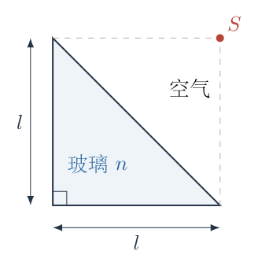

## 一、题型定位

多界面的反射与折射成像。平面反射具有严格共点虚像，折射穿过两条法向不同的边界一般不具有全孔径严格共点像。需要分清严格像、指定观察方向的小光束局部视像，以及直接看见光源的位置，不能把三者当成同一种成像结果。

## 二、知识点

平面反射的镜像关系；斯涅尔折射定律；切向光学分量守恒；单位方向矢量；全反射条件；射线与边界的交点；出射光线反向延长；光线族的局部交会；近轴近似必须指定中心光线与展开范围。

## 三、物理图像

斜面一侧是空气，另一侧是玻璃。一部分光在斜面反射后仍留在空气中，其反向延长线汇于斜面的镜像点。另一部分进入玻璃，再从直角边射出；不同入射位置经历不同的两次折射，出射线反向延长通常交在不同点。忽略多次反射只是删去部分光路，不会自动让保留的折射光线共点。

## 四、解题入口

先建立截面坐标，严格求斜面反射像。再选择一族“斜面入射、左直角边出射、内部不反射”的光线，按斯涅尔定律逐线计算，检验是否共点。若不共点，就必须明确题设缺少观察方向或近轴约定，而不能给出未经条件限定的固定折射像距清单。最后给出指定中心光线后的局部视像计算方法。

## 五、解析

（1）建立坐标并说明长度约定。

以下以图示正方形边长、即玻璃砖的直角边长为 $l$，取左下顶点为原点，水平向右为 $x$，竖直向上为 $y$。玻璃区域为

$$x\ge0,\quad y\ge0,\quad x+y\le l,$$

斜面为 $x+y=l$，光源为

$$S=(l,l).$$

若“边长 $l$”意指斜边长度，应把以下全部长度中的直角边长换成 $l/\sqrt2$；这只是长度尺度变化，不会解决观察方向未给定的问题。这里按图示直角边约定计算，并把这一约定明确写出。

严格点像的含义是：同一条光路类型的一族出射光线，或其反向延长线，经过同一个点。取两条光线得到一个交点还不够，因为任意不平行的两条直线都有交点；需要再用第三条乃至整个光线族核验。

（2）求斜面一次反射的严格虚像。

斜面单位法向量可取

$$\boldsymbol N=\frac{(1,1)}{\sqrt2}.$$

光源到斜面的有符号法向距离为

$$d=\frac{x_S+y_S-l}{\sqrt2}=\frac l{\sqrt2}.$$

平面镜像点位于法向另一侧同样距离处，所以

$$\begin{aligned}
S'
&=S-2d\boldsymbol N\\
&=(l,l)-2\frac l{\sqrt2}\frac{(1,1)}{\sqrt2}\\
&=(0,0).
\end{aligned}$$

图 5-2 的实线为斜面反射的出射光，虚线为其反向延长。不同斜面入射点对应的延长线都经过 $S'$。

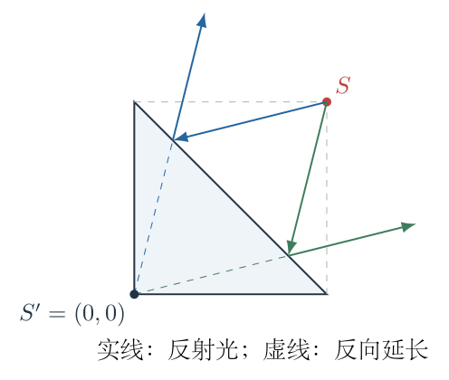

于是一次反射像与光源的距离为

$$\boxed{SS'=\sqrt{l^2+l^2}=\sqrt2\,l.}$$

这一几何结果不依赖 $n$。反射光的强弱依赖界面性质，但只要保留该反射分支，镜像位置就由平面几何确定。对于实际玻璃 $n>1$，普通空气—玻璃界面存在反射；若形式上令 $n=1$，介质无折射率差，这一分支的强度趋零，不能把不存在的反射信号仍当成可见像。

（3）区分直接视线与玻璃产生的像。

位于玻璃外的观察者也可能沿完全不进入玻璃的光路直接看见 $S$。这种光路所指示的位置就是光源本身，位置差为零。如果将直接视见的位置也计入“像的位置”，则可列 $0$；若只统计玻璃产生的反射或折射像，直接视线不应另算一个成像分支。

因此，严格可确定的玻璃反射像距是 $\sqrt2l$；“直接位置的距离为零”要单独说明其计数约定。真正需要进一步核验的是折射出射分支。

（4）参数化斜面上的入射点。

令一条光线在斜面的入射点为

$$H=(al,(1-a)l),\qquad 0<a<1.$$

从光源到 $H$ 的单位入射方向为

$$\boldsymbol d_{\mathrm{in}}
=\frac{(a-1,-a)}{D},\qquad
D=\sqrt{(1-a)^2+a^2}.$$

斜面指向玻璃内部的单位法向和一个切向单位矢量为

$$\boldsymbol N_{\mathrm{in}}=\frac{(-1,-1)}{\sqrt2},\qquad
\boldsymbol t=\frac{(1,-1)}{\sqrt2}.$$

入射方向的切向分量为

$$\boldsymbol d_{\mathrm{in}}\cdot\boldsymbol t
=\frac{(a-1)+a}{\sqrt2D}
=\frac{2a-1}{\sqrt2D}.$$

这一分量带正负号，表示光线位于法线的哪一侧。斯涅尔定律对切向分量给出

$$n_{\mathrm{air}}\sin i=n\sin r,$$

在空气折射率取 $1$ 时，玻璃内方向的切向分量为

$$t(a)=\frac{2a-1}{\sqrt2\,nD}.$$

这里小写 $t(a)$ 是一个无量纲方向分量，不是时间。

（5）确定玻璃内部的单位方向。

为使光线真正进入玻璃，法向分量取向内的正根：

$$w(a)=\sqrt{1-t(a)^2},\qquad
\boldsymbol d_g=w\boldsymbol N_{\mathrm{in}}+t\boldsymbol t.$$

展开为直角坐标，

$$\boxed{
d_{gx}=\frac{-w+t}{\sqrt2},\qquad
d_{gy}=\frac{-w-t}{\sqrt2}.
}$$

因为 $w^2+t^2=1$，可检验

$$d_{gx}^2+d_{gy}^2=1.$$

取 $n>1$ 时，斜面从空气入射不会发生由空气向玻璃的全反射；但这不保证从玻璃向直角边出射时也一定能够透射。第二个界面的临界条件需另行检查。

（6）计算光线与左边界的交点。

光线在玻璃内的位置可写为

$$\boldsymbol r(\lambda)=H+\lambda\boldsymbol d_g,\qquad \lambda\ge0.$$

若它先到达左边界 $x=0$，则

$$0=al+\lambda d_{gx},\qquad
\lambda=-\frac{al}{d_{gx}}.$$

于是左边界交点 $Q$ 为

$$Q=\left(0,l\,q(a)\right),\qquad
q(a)=1-a-a\frac{d_{gy}}{d_{gx}}.$$

这一光路需要 $d_{gx}<0$、$0<q(a)<1$，并且左边界的交点早于其他边界交点。若光线先到达下边界，应改用 $y=0$ 的交点；不能在光已经从另一边出去后仍使用 $Q$。

图 5-3 采用 $n=1.5$ 的三条符合这一条件的光线，全部没有内部反射，因此也完全满足“忽略两次及以上反射”的限制。

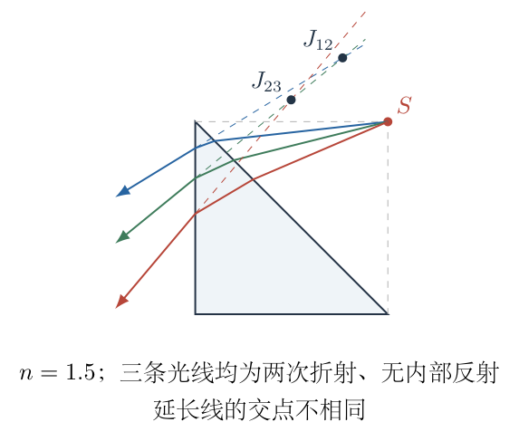

（7）在左边界再次用斯涅尔定律。

左边界指向空气的法向为 $(-1,0)$，切向为 $(0,1)$。玻璃内光线的切向分量为 $d_{gy}$，出射方向的切向分量应为 $nd_{gy}$。因此透射需要

$$|nd_{gy}|\le1.$$

若严格小于 $1$，取向左出射的法向根，

$$\boxed{\boldsymbol d_{\mathrm{out}}
=\left(-\sqrt{1-n^2d_{gy}^2},\ nd_{gy}\right).}$$

其斜率为

$$b(a)=\frac{d_{\mathrm{out},y}}{d_{\mathrm{out},x}}
=-\frac{nd_{gy}}{\sqrt{1-n^2d_{gy}^2}}.$$

出射光线及其反向延长的直线方程为

$$\boxed{y=lq(a)+b(a)x.}$$

若 $|nd_{gy}|>1$，左边界发生全反射，应改走一次内部反射的光路，而不能把负根号继续当成透射方向。

（8）用三条光线检查严格共点条件。

取 $n=1.5$、$a=0.1,0.2,0.3$，按上面的两次斯涅尔变换逐条计算，得

|$a$|$Q_y/l$|$d_{\mathrm{out},x}$|$d_{\mathrm{out},y}$|
|---|---:|---:|---:|
|$0.1$|$0.862833$|$-0.852593$|$-0.522576$|
|$0.2$|$0.706992$|$-0.774549$|$-0.632513$|
|$0.3$|$0.522122$|$-0.644004$|$-0.765023$|

两条出射直线 $i,j$ 的交点由

$$lq_i+b_ix=lq_j+b_jx$$

解出：

$$x_{ij}=l\frac{q_j-q_i}{b_i-b_j},\qquad
y_{ij}=lq_i+b_ix_{ij}.$$

第一、第二条的交点为

$$J_{12}\approx(0.765071l,\ 1.331765l),$$

第二、第三条的交点为

$$J_{23}\approx(0.497904l,\ 1.113590l).$$

两点明显不同。它们都是同一族允许光路的反向延长线交点，因此已经足以反证这一折射分支具有严格共点像。不能从其中任意一个交点选取“像距”，再声称它代表整族光线。

这一反例使用一个合法折射率和完全允许的光路，说明仅凭原题条件不能列出普遍适用的固定折射像距清单。加入一次内部反射分支也不能消除已存在折射分支的不共点性。

（9）说明指定观察方向后如何定义局部视像。

实际小孔径观察通常只接收中心光线附近的一小束光。若指定中心入射参数 $a_0$，可以把相邻两条光线的交点在参数间隔趋零时的极限定义为本截面内的局部视像 $I_{\mathrm{loc}}$。图 5-4 只画窄光束，而不是把全斜面的光都当成一束近轴光。

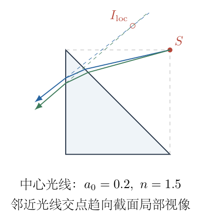

光线族满足

$$F(x,y,a)=y-lq(a)-b(a)x=0.$$

对光线参数变化的一阶差分取极限，要求

$$\frac{\partial F}{\partial a}
=-lq'(a)-b'(a)x=0.$$

故当 $b'(a_0)\ne0$ 时，

$$\boxed{
x_{\mathrm{loc}}=-l\frac{q'(a_0)}{b'(a_0)},\qquad
y_{\mathrm{loc}}=lq(a_0)+b(a_0)x_{\mathrm{loc}}.
}$$

对应的源—局部像距离为

$$d_{\mathrm{loc}}=
\sqrt{(x_{\mathrm{loc}}-l)^2+(y_{\mathrm{loc}}-l)^2}.$$

它是 $a_0,n$ 的函数。中心方向未给，$a_0$ 未定，局部像距也未定。此定义只处理所画截面内的邻近光线，不自动证明三维光束各方向都汇于同一点。

（10）补全局部像的微分计算。

为使上述方法可直接使用，继续对方向分量求导。由

$$D^2=2a^2-2a+1,\qquad D'=\frac{2a-1}{D},$$

得到

$$\begin{aligned}
t'
&=\frac{2D-(2a-1)D'}{\sqrt2\,nD^2}\\
&=\frac{2D^2-(2a-1)^2}{\sqrt2\,nD^3}\\
&=\frac1{\sqrt2\,nD^3}.
\end{aligned}$$

其中 $2D^2-(2a-1)^2=1$。再由 $w=\sqrt{1-t^2}$，

$$w'=-\frac{tt'}{w}.$$

所以

$$d_{gx}'=\frac{t'}{\sqrt2}\left(1+\frac tw\right),\qquad
d_{gy}'=\frac{t'}{\sqrt2}\left(\frac tw-1\right).$$

对交点函数用乘积法则与商法则：

$$q'=-1-\frac{d_{gy}}{d_{gx}}
-a\frac{d_{gy}'d_{gx}-d_{gy}d_{gx}'}{d_{gx}^2}.$$

对出射斜率求导，设 $v=d_{gy}$，

$$\begin{aligned}
b'&=\frac{d}{da}\left[-nv(1-n^2v^2)^{-1/2}\right]\\
&=-nv'(1-n^2v^2)^{-1/2}
-n^3v^2v'(1-n^2v^2)^{-3/2}\\
&=-\frac{nv'}{(1-n^2v^2)^{3/2}}.
\end{aligned}$$

两项通分后，括号中的 $(1-n^2v^2)+n^2v^2$ 等于 $1$，因此最后一式的分子很简单。这些导数都在光路仍属于同一分支、没有跨过临界折射或边界切换的区间使用。

（11）给出一个有明确条件的局部像数值。

仅作条件明确的计算示例，取 $n=1.5,a_0=0.2$。逐步代入：

$$\begin{aligned}
D&=\sqrt{0.8^2+0.2^2}=0.824621,\\
t&=-0.342997,\qquad t'=0.840679,\\
d_{gx}&=-0.906747,\qquad d_{gy}=-0.421676,\\
q&=0.706992,\qquad q'=-1.682747,\\
b&=0.816621,\qquad b'=2.619624.
\end{aligned}$$

所以

$$\begin{aligned}
x_{\mathrm{loc}}/l&=-q'/b'=0.642362,\\
y_{\mathrm{loc}}/l&=q+b(x_{\mathrm{loc}}/l)=1.231558,\\
d_{\mathrm{loc}}/l
&=\sqrt{(0.642362-1)^2+(1.231558-1)^2}\\
&=0.426056.
\end{aligned}$$

这不是原题无条件答案，而是明确指定中心光路后得到的截面局部视像。它与第（8）步有限间隔的两两交点不同，原因是取用了不同的光束范围，恰好说明定义近轴像之前必须指定条件。

（12）处理一次内部反射分支的原则。

若透射光先到达某条直角边并发生反射，反射后的单位方向由

$$\boldsymbol d_{\mathrm{ref}}
=\boldsymbol d_g-2(\boldsymbol d_g\cdot\boldsymbol N_b)\boldsymbol N_b$$

确定，其中 $\boldsymbol N_b$ 为该边界的单位法向。随后按新的方向求与下一边的最早正向交点，并再用该边的切向斯涅尔关系判断是否能出射。

每个边界都应先检查入射点在实际边段内，再检查法向方向、透射实根及累计反射次数。达到第二次反射的分支按题设舍去。一反射分支若要给局部像，也必须像前面一样指定中心光线再求邻近线交会，而不能把某个平面镜像点经过两个不同法向界面后仅用 $h/n$ 连续缩放。

（13）归纳原题能够严格确定的结果。

在直角边长取 $l$ 的约定下，斜面一次反射的严格像距为

$$\boxed{d_{\mathrm{mirror}}=\sqrt2l.}$$

若把直视光源位置也计入，另有位置差 $0$。对折射及折射后一次内部反射的观察，原题未指定观察方向、光束孔径或近轴成像约定，通常不存在全孔径严格点像，不能给出唯一固定像距集合。要得到局部像距，应补充中心光线并使用第（9）—（11）步的计算，而不是猜造缺失条件。

## 六、关键洞察

“有光线从一个物体进入眼睛”不等于“所有光线形成同一个几何点像”。平面反射的镜像具有严格共点性，折射在有限孔径下则通常有像差。对于两个法向不同的折射面，法向视深公式不满足连续套用的前提。

局部视像公式是光线族包络的计算：同时解 $F=0$ 与 $\partial F/\partial a=0$。它有明确数学含义，但定义依赖选定的中心光线。在不同观察方向上得到不同局部交会点，是光学系统本身的性质，不是数值程序误差。

几何检查应先于像距运算。一个代数根对应的交点若位于玻璃边段延长线上，或光线应先碰到另一条边，就不是题设允许的光路。全反射阈值处出射斜率的导数可能变得很大，局部展开也须相应缩小参数范围。

## 七、易错点

不能将 $h/n$ 当成任意入射角、任意观察方向下的普适视深公式。该式有平面界面、近法线小光束等前提，本题两界面的法向不同，需要先确定实际光路。

反向延长线不是光在玻璃中继续前进的实际路径，图5-2和图5-3中的虚线不能计入新的反射次数。选择左面出射根时，$x$ 方向必须向左，即负平方根；漏掉这一方向条件会把线画回玻璃内部。

三条光线都满足题设仍不共点，就不能用“只忽略多次反射”解释成严格成像。对直接光源位置是否计作一个像，也应明确约定，不能在同一清单里悄悄混换定义。

## 八、课堂讲解建议

先让学生用垂足和镜面对称求图5-2中的 $S'$，确认这是完全严格的几何结果。再给图5-3的三条出射线，让学生先判断反向延长是否共点，再计算两两交点，培养对成像假设的主动核验。

斯涅尔定律可从“切向分量乘折射率保持相同”讲起，让学生用一个带符号分量描述法线两侧方向。板书将每个界面分成“交点、法向、切向、方向根、全反射条件”五项，防止只代一个角度公式。

局部像放在后段讲解，先说明只接收窄光束，再由相邻直线方程相减推出导数条件。无需把原题缺少的条件装成已知，但应让学生理解补充条件后如何继续计算。

## 九、变式训练

变式一：点光源改为 $S=(s_x,s_y)$，仍在斜面 $x+y=l$ 的空气一侧。只考虑斜面一次反射，求像点与源像距离。

有符号法向距离为

$$d=\frac{s_x+s_y-l}{\sqrt2}>0.$$

反射点为

$$\begin{aligned}
S'
&=(s_x,s_y)-(s_x+s_y-l)(1,1)\\
&=(l-s_y,l-s_x).
\end{aligned}$$

所以

$$\boxed{|SS'|=\sqrt2\,|s_x+s_y-l|.}$$

当 $S=(l,l)$ 恢复 $\sqrt2l$。沿平行斜面的方向移动光源，$s_x+s_y$ 不变，源像距离不变，但像点随光源平移；沿法向移动则距离成倍改变。这是平面镜像几何的直接检验。

变式二：在左面出射的光线族中，如何用数值追迹核验局部像公式，而不重复使用同一个导数表达式？

给定 $a_0$，分别追迹 $a_0-\varepsilon$ 和 $a_0+\varepsilon$，得到 $q_-,b_-$ 与 $q_+,b_+$。两条直线的交点为

$$x_\varepsilon=l\frac{q_+-q_-}{b_--b_+},\qquad
y_\varepsilon=lq_-+b_-x_\varepsilon.$$

当 $\varepsilon\to0$，

$$q_+-q_-=2\varepsilon q'(a_0)+O(\varepsilon^3),$$

$$b_--b_+=-2\varepsilon b'(a_0)+O(\varepsilon^3).$$

因此

$$x_\varepsilon=-l\frac{q'}{b'}+O(\varepsilon^2),$$

与局部像公式一致。对 $n=1.5,a_0=0.2$，使用逐线斯涅尔追迹，缩小 $\varepsilon$ 后应收敛到 $(0.642362l,1.231558l)$。如果光线分支在区间内发生切换，不能继续应用此极限；应先限制两条光线均从同一边出射且未跨过全反射边界。

\newpage

# 第 6 题

超声加湿器利用高频振动将水分散成微米级雾滴。已知室温为 $17^\circ\mathrm C$，水的密度为 $\rho=1\,\mathrm{g\,cm^{-3}}$，表面张力系数为 $\sigma=7.28\times10^{-2}\,\mathrm{N\,m^{-1}}$。各结果取三位有效数字。

（1）雾滴半径为 $r=2\,\mathrm{\mu m}$，大气压强为 $P_0=1.01\times10^5\,\mathrm{Pa}$，求雾滴内部压强 $P_1$。

（2）若雾化所需能量主要用于增加雾滴表面能，估算将 $1\,\mathrm L$ 水雾化所需的能量 $E_1$。

（3）加湿器额定功率为 $20\,\mathrm W$，雾化能量转换率为 $\eta=5\times10^{-4}$，求每小时雾化的水体积 $V_1$，单位为 $\mathrm L$。

（4）题设采用 $\frac12m_w\bar v^2=\frac32(R/N_A)T$ 估计水蒸气分子平动速度，暂不区分平均速率与均方根速率。$m_w$ 为水分子质量，$R=8.31\,\mathrm{J\,mol^{-1}\,K^{-1}}$，给出的阿伏伽德罗常数为 $N_A=6.02\times10^{-23}\,\mathrm{mol^{-1}}$，水的摩尔质量为 $M=18\,\mathrm{g\,mol^{-1}}$。求 $\bar v$。

（5）题设给出的该温度下饱和蒸汽压为 $1.94\,\mathrm{Pa}$，求饱和水蒸气分子数密度 $n_0$。

（6）被喷出的雾滴转变为水蒸气的比例为 $\eta_2=3\times10^{-3}$，其余水重新凝结或被物品吸收。室内与室外通过面积 $S=20\,\mathrm{cm^2}$ 的孔连通，室外相对湿度近似为零。将水蒸气分子简化为以相同速率 $\bar v$ 沿上下、左右、前后六方向等概率运动，分子穿孔到室外后不再返回。求稳定后的室内相对湿度。

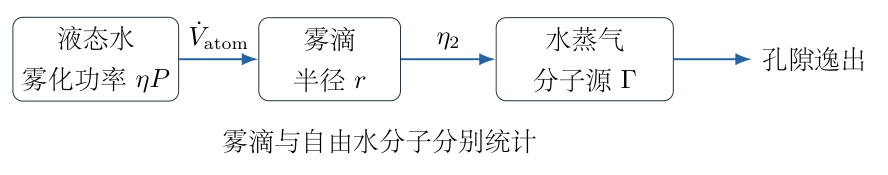

## 一、题型定位

表面张力、气体分子运动和开放系统稳态的综合题。能量转换决定雾滴产量，蒸发比例决定水蒸气分子源强，孔隙逸出决定稳态分子数密度，饱和压强最后将实际密度转换为相对湿度。液态雾滴与气态水分子必须分开统计。

## 二、知识点

球形单界面的拉普拉斯附加压强；表面能；体积守恒；功率与效率；摩尔质量和单分子质量；平动能均分；理想气体状态方程；分子数通量；源汇平衡；有效数字和量纲检查。

## 三、物理图像

同体积的水被分成很多小球后，表面积显著增大，需要供给表面能。雾滴受到表面张力压缩，内部压强高于外界。只有雾化水的一小部分成为自由水蒸气分子，才能参与气体运动和相对湿度计算。稳定时每秒生成的水分子数等于每秒逸出的分子数，并不意味着加湿器停止工作。

## 四、解题入口

先把温度、体积、密度、半径、摩尔质量和孔面积全部换成一致单位，校正常数指数。由半球受力求附加压强，由总滴数求表面积和单位体积雾化能，再把功率转换成质量流量与分子流量。最后在题设六方向模型中求逸出率，并同时列出 $1.94\,\mathrm{Pa}$ 和物理修正值 $1.94\,\mathrm{kPa}$ 的湿度结果。

## 五、解析

（1）统一单位，明确两处题设数值的处理。

使用国际单位制：

$$\begin{aligned}
T&=273.15+17=290.15\,\mathrm K,\\
\rho&=1\,\mathrm{g\,cm^{-3}}=10^3\,\mathrm{kg\,m^{-3}},\\
r&=2.00\times10^{-6}\,\mathrm m,\\
V_0&=1.00\,\mathrm L=10^{-3}\,\mathrm{m^3},\\
M&=18.0\,\mathrm{g\,mol^{-1}}=1.80\times10^{-2}\,\mathrm{kg\,mol^{-1}},\\
S&=20.0\,\mathrm{cm^2}=2.00\times10^{-3}\,\mathrm{m^2}.
\end{aligned}$$

温度必须取绝对温度，不能将 $17$ 直接代入能均分或气体方程。面积单位换算为平方因子：$1\,\mathrm{cm^2}=10^{-4}\,\mathrm{m^2}$，而不是 $10^{-2}\,\mathrm{m^2}$。

阿伏伽德罗常数的题设指数有误，应为正 $23$。本解采用三位有效数字的正确常数

$$N_A=6.02\times10^{23}\,\mathrm{mol^{-1}}.$$

单分子质量由摩尔质量除以每摩尔分子数给出：

$$m_w=\frac{M}{N_A}
=\frac{1.80\times10^{-2}}{6.02\times10^{23}}
=2.99\times10^{-26}\,\mathrm{kg}.$$

若使用负指数，会得到远大于宏观物体的“单分子质量”，不符合该常数的物理含义。

题设饱和压强保留为 $1.94\,\mathrm{Pa}$ 进行一支计算；$17^\circ\mathrm C$ 水的实际饱和蒸汽压约为 $1.94\,\mathrm{kPa}$，再进行修正支计算。两支差一个 $10^3$ 因子，必须从头标清，不能在中途换值。

（2）对半个雾滴受力，求附加压强。

球形水滴只有一个水—空气界面，不是有内外两个界面的肥皂泡。沿过球心平面截取上半滴，内部与外部压强的合力沿截面法线，大小为

$$F_p=(P_1-P_0)\pi r^2.$$

图 6-2 中，表面张力沿截口周边作用。赤道处球面的切平面沿竖直方向，周长 $2\pi r$ 上的张力合力指向下方，大小为 $2\pi r\sigma$。

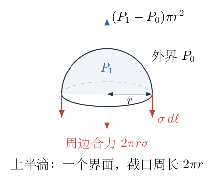

平衡要求

$$\begin{aligned}
(P_1-P_0)\pi r^2&=2\pi r\sigma,\\
P_1-P_0&=\frac{2\sigma}{r}.
\end{aligned}$$

代入数值：

$$\begin{aligned}
\Delta P
&=\frac{2(7.28\times10^{-2})}{2.00\times10^{-6}}
=7.28\times10^4\,\mathrm{Pa},\\
P_1&=1.01\times10^5+7.28\times10^4
=1.738\times10^5\,\mathrm{Pa}.
\end{aligned}$$

所以第一问为

$$\boxed{P_1=1.74\times10^5\,\mathrm{Pa}.}$$

附加压强与 $r$ 成反比，小滴内部压强更高，方向和尺度均合理。不能将肥皂泡的 $4\sigma/r$ 用于单界面水滴。

（3）由总体积计算雾滴数与新增表面积。

每个水滴的体积和面积分别为

$$v_d=\frac43\pi r^3,\qquad a_d=4\pi r^2.$$

把 $V_0$ 的水全部分成半径相同的雾滴，液态水总体积守恒，所以滴数为

$$N_d=\frac{V_0}{v_d}=\frac{3V_0}{4\pi r^3}.$$

总面积为

$$\begin{aligned}
A_d&=N_d a_d\\
&=\frac{3V_0}{4\pi r^3}(4\pi r^2)\\
&=\frac{3V_0}{r}.
\end{aligned}$$

图 6-3 只表示总体积守恒，不按实际滴数绘画；后续能量使用的是全部 $N_d$ 个雾滴的表面积。

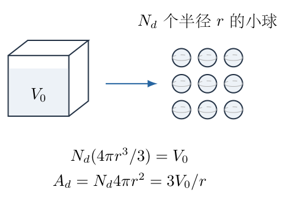

代入，

$$N_d=2.98\times10^{13},\qquad
A_d=\frac{3\times10^{-3}}{2.00\times10^{-6}}
=1.50\times10^3\,\mathrm{m^2}.$$

题设为粗略雾化估计，忽略雾化前宏观水面的初始面积及其他能量损失。若初始面积为 $A_0$，严格的表面能增加是 $\sigma(A_d-A_0)$；在 $A_0\ll A_d$ 时近似为 $\sigma A_d$。于是

$$E_1\simeq\sigma A_d
=(7.28\times10^{-2})(1.50\times10^3)
=109.2\,\mathrm J.$$

第二问为

$$\boxed{E_1=1.09\times10^2\,\mathrm J.}$$

表面能量纲为 $(\mathrm{N/m})\mathrm{m^2}=\mathrm{N\,m}=\mathrm J$。这只统计新增界面的能量，不包含把全部水汽化所需的汽化能；雾化并不等于汽化。

（4）把输入功率转成每小时雾化体积。

设额定功率为 $P=20.0\,\mathrm W$。有效雾化功率为

$$P_{\mathrm{atom}}=\eta P
=(5.00\times10^{-4})(20.0)=1.00\times10^{-2}\,\mathrm W.$$

一小时的有效能量为

$$E_{\mathrm h}=P_{\mathrm{atom}}(3600\,\mathrm s)=36.0\,\mathrm J.$$

每升水需要的未取整能量为 $109.2\,\mathrm{J/L}$。在中间计算保留额外数字，最后才取三位有效数字：

$$V_1=\frac{36.0}{109.2}\,\mathrm L=0.329670\,\mathrm L.$$

因此第三问为

$$\boxed{V_1=0.330\,\mathrm L\text{（每小时）}.}$$

后续更方便使用体积流量。由 $E/V=3\sigma/r$，

$$\begin{aligned}
\dot V_{\mathrm{atom}}
&=\frac{\eta P}{3\sigma/r}
=\frac{\eta Pr}{3\sigma}\\
&=\frac{(5.00\times10^{-4})(20.0)(2.00\times10^{-6})}
{3(7.28\times10^{-2})}\\
&=9.15751\times10^{-8}\,\mathrm{m^3\,s^{-1}}.
\end{aligned}$$

将其乘 $3600$ 再乘 $10^3\,\mathrm{L/m^3}$，会回到 $0.329670\,\mathrm{L/h}$，换算一致。

（5）用能均分求题设等速模型中的速度。

题设使用三个平动自由度，能量式为

$$\frac12m_w\bar v^2=\frac32\frac{R}{N_A}T.$$

代入 $m_w=M/N_A$：

$$\frac12\frac{M}{N_A}\bar v^2
=\frac32\frac{R}{N_A}T.$$

两边乘 $2N_A$，得到

$$M\bar v^2=3RT,\qquad
\bar v=\sqrt{\frac{3RT}{M}}.$$

所以阿伏伽德罗常数在速度式中约去。数值为

$$\begin{aligned}
\bar v^2
&=\frac{3(8.31)(290.15)}{1.80\times10^{-2}}
=4.01858\times10^5\,\mathrm{m^2\,s^{-2}},\\
\bar v&=633.923\,\mathrm{m\,s^{-1}}.
\end{aligned}$$

第四问为

$$\boxed{\bar v=634\,\mathrm{m\,s^{-1}}.}$$

严格的能均分式确定的是均方根速率 $\sqrt{\langle v^2\rangle}$，不是 $\langle v\rangle$。本题已经约定忽略这个区别，后面的六方向等速模型一致使用上述 $\bar v$，不再混入另一个平均速率。

（6）由理想气体方程求两支饱和分子数密度。

若体积 $V$ 内有分子数 $N$，物质的量为 $N/N_A$。理想气体方程为

$$pV=\frac{N}{N_A}RT.$$

定义分子数密度 $n=N/V$，则

$$\boxed{n=\frac{pN_A}{RT}.}$$

此式中的 $n$ 是每立方米分子数，不是摩尔数密度 $p/(RT)$。二者相差 $N_A$。

按题设的 $p_{\mathrm{sat}}=1.94\,\mathrm{Pa}$，

$$\begin{aligned}
n_0^{(\mathrm{Pa})}
&=\frac{(1.94)(6.02\times10^{23})}{(8.31)(290.15)}\\
&=4.84367\times10^{20}\,\mathrm{m^{-3}},
\end{aligned}$$

所以第五问题设支为

$$\boxed{n_0^{(\mathrm{Pa})}=4.84\times10^{20}\,\mathrm{m^{-3}}.}$$

若采用该温度的物理修正值 $p_{\mathrm{sat}}=1.94\,\mathrm{kPa}=1.94\times10^3\,\mathrm{Pa}$，则

$$\boxed{n_0^{(\mathrm{kPa})}=4.84\times10^{23}\,\mathrm{m^{-3}}.}$$

这一分问的两支相差正好 $10^3$。修正温度下的饱和压强，并不改变前面由表面能得到的雾化产量或由温度得到的分子速度。

（7）将液态雾化体积流量转成气态分子源强。

只有 $\eta_2=3.00\times10^{-3}$ 的雾化水变为水蒸气。假定这一比例指进入室内气相的净水量比例，其余水不计入气相源。气相水的质量流量为

$$\dot m_{\mathrm{vap}}=\eta_2\rho\dot V_{\mathrm{atom}}.$$

代入未取整流量：

$$\begin{aligned}
\dot m_{\mathrm{vap}}
&=(3.00\times10^{-3})(1.00\times10^3)
(9.15751\times10^{-8})\\
&=2.74725\times10^{-7}\,\mathrm{kg\,s^{-1}}.
\end{aligned}$$

除以摩尔质量，得到摩尔流量，再乘 $N_A$ 得到每秒生成分子数 $\Gamma$：

$$\begin{aligned}
\Gamma
&=\frac{\dot m_{\mathrm{vap}}}{M}N_A\\
&=\frac{2.74725\times10^{-7}}{1.80\times10^{-2}}
(6.02\times10^{23})\\
&=9.18803\times10^{18}\,\mathrm{s^{-1}}.
\end{aligned}$$

也可合并写为

$$\boxed{\Gamma=\frac{\eta_2\rho N_A}{M}
\frac{\eta Pr}{3\sigma}.}$$

这里 $\rho\dot V_{\mathrm{atom}}$ 是液态水质量流量，不是水蒸气占据室内空间的体积流量。不能把 $0.330\,\mathrm L$ 雾化液水直接当成同体积的气体。

（8）在六方向模型中计算孔隙逸出率。

把孔取为垂直其中一个运动方向的平面，例如法线向室外为 $+x$。六个等概率方向中，只有 $+x$ 方向的分子能穿孔逸出，该类分子数密度为 $n/6$。在时间 $dt$ 内，能到达孔面的分子来自一个底面积 $S$、厚度 $\bar v\,dt$ 的薄柱。

图 6-4 中的薄柱体积为 $S\bar v\,dt$，所以逸出数为

$$dN_{\mathrm{out}}=\frac n6S\bar v\,dt,$$

即

$$\boxed{\dot N_{\mathrm{out}}=\frac16nS\bar v.}$$

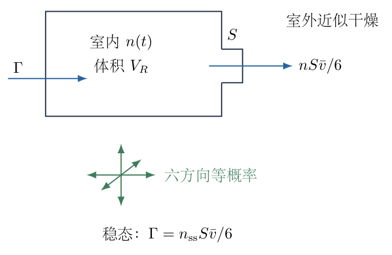

其余五个方向不向外穿过这个孔面。这里的 $1/6$ 来自题设离散六方向模型，不是连续各向同性气体常见的 $1/4$。两种模型不能在同一次计算中混用。

室外近似干燥，反向流入的水分子源可以忽略。稳态要求生成率等于逸出率：

$$\Gamma=\frac16n_{\mathrm{ss}}S\bar v.$$

由此

$$\begin{aligned}
n_{\mathrm{ss}}
&=\frac{6\Gamma}{S\bar v}\\
&=\frac{6(9.18803\times10^{18})}
{(2.00\times10^{-3})(633.923)}\\
&=4.34818\times10^{19}\,\mathrm{m^{-3}}.
\end{aligned}$$

即

$$\boxed{n_{\mathrm{ss}}=4.35\times10^{19}\,\mathrm{m^{-3}}.}$$

这是两种饱和压强分支共同的实际稳态密度，因为源强、孔面积及速度均没有改变。

（9）转换为相对湿度，明确百分数。

同温度下，水蒸气压与分子数密度成正比。因此相对湿度的无量纲比值为

$$\varphi=\frac{p_{\mathrm{vap}}}{p_{\mathrm{sat}}}
=\frac{n_{\mathrm{ss}}}{n_0}.$$

以百分数报告时，需要乘 $100\%$。按题设 $1.94\,\mathrm{Pa}$，

$$\begin{aligned}
\varphi_{\mathrm{Pa}}
&=\frac{4.34818\times10^{19}}{4.84367\times10^{20}}
=0.0897704,\\
100\varphi_{\mathrm{Pa}}\%
&=8.97704\%.
\end{aligned}$$

故第六问题设支为

$$\boxed{\mathrm{RH}_{\mathrm{Pa}}=8.98\%.}$$

按 $1.94\,\mathrm{kPa}$ 修正支，

$$\varphi_{\mathrm{kPa}}=8.97704\times10^{-5},$$

故

$$\boxed{\mathrm{RH}_{\mathrm{kPa}}=0.00898\%.}$$

二者相差 $10^3$，且修正饱和密度更高，所得相对湿度更低，比例方向正确。不能把 $8.98\times10^{-5}$ 当成百分数直接写入答案，它是尚未乘 $100$ 的无量纲比值。

（10）检查稳态如何达到，不擅自补充房间体积数值。

令房间气体体积为符号 $V_R$，室内密度近似均匀。分子数收支为

$$V_R\frac{dn}{dt}=\Gamma-\frac{S\bar v}{6}n.$$

移项并以 $n_{\mathrm{ss}}=6\Gamma/(S\bar v)$ 表示：

$$\frac{d(n-n_{\mathrm{ss}})}{dt}
=-\frac{S\bar v}{6V_R}(n-n_{\mathrm{ss}}).$$

分离变量积分，

$$\int\frac{d(n-n_{\mathrm{ss}})}{n-n_{\mathrm{ss}}}
=-\int\frac{S\bar v}{6V_R}\,dt,$$

得到

$$\boxed{
n(t)=n_{\mathrm{ss}}+[n(0)-n_{\mathrm{ss}}]e^{-t/\tau},
\qquad \tau=\frac{6V_R}{S\bar v}.
}$$

因 $\tau>0$，稳态稳定。若初始干燥，则 $n(t)=n_{\mathrm{ss}}(1-e^{-t/\tau})$，从下方接近稳态。原题未给 $V_R$，无法确定数值的达到时间，但稳态密度与 $V_R$ 无关，所以不妨碍第六问计算。

<!-- KEEP_TOGETHER_START -->

（11）汇总六问并核对物理量层级。

题设压强支与修正支的结果分别为：

|分问|结果|
|---|---|
|（1）雾滴内部压强|$1.74\times10^5\,\mathrm{Pa}$|
|（2）$1\,\mathrm L$ 雾化表面能|$1.09\times10^2\,\mathrm J$|
|（3）每小时雾化液水量|$0.330\,\mathrm L$|
|（4）题设等速模型速度|$634\,\mathrm{m\,s^{-1}}$|
|（5）饱和密度，$1.94\,\mathrm{Pa}$ 支|$4.84\times10^{20}\,\mathrm{m^{-3}}$|
|（5）饱和密度，$1.94\,\mathrm{kPa}$ 支|$4.84\times10^{23}\,\mathrm{m^{-3}}$|
|（6）湿度，$1.94\,\mathrm{Pa}$ 支|$8.98\%$|
|（6）湿度，$1.94\,\mathrm{kPa}$ 支|$0.00898\%$|

雾滴数 $N_d$ 与气体分子数不可互换，表面能与汽化能不可互换，雾化体积流量与气相空间体积不可互换。每个计算层级都使用不同的物理对象，保持这种区分才能让六问正确衔接。

<!-- KEEP_TOGETHER_END -->

## 六、关键洞察

主计算链条是

$$\eta P\longrightarrow\dot V_{\mathrm{atom}}
\longrightarrow\dot m_{\mathrm{vap}}
\longrightarrow\Gamma
\longrightarrow n_{\mathrm{ss}}
\longrightarrow\varphi.$$

每个箭头都有一个物理换算，不能仅靠单位拼出最终公式。消去中间量后，

$$\varphi=
\frac{2\eta\eta_2P\rho rRT}
{\sigma M S\bar v\,p_{\mathrm{sat}}}.$$

$N_A$ 从实际密度与饱和密度之比中约去，但这不意味着原指数可以不纠正：分别报告两种数密度时仍需要正确的常数。

如果改用连续各向同性运动模型，孔面通量系数不是 $1/6$。固定速率 $v$，方向均匀分布，向外半球上的通量为

$$\begin{aligned}
\dot N_{\mathrm{out}}
&=\frac{nSv}{4\pi}
\int_0^{2\pi}d\phi\int_0^{\pi/2}
\cos\vartheta\sin\vartheta\,d\vartheta\\
&=\frac{nSv}{4}.
\end{aligned}$$

角积分中的 $\cos\vartheta$ 是沿孔法线的速度分量。若再采用热平衡平均速率，其表达式为

$$\langle v\rangle=\sqrt{\frac{8RT}{\pi M}}.$$

此时需要同步更改通量速度；它是另一个模型，不替换本题已经约定的答案。

## 七、易错点

半径是 $2\,\mathrm{\mu m}$ 而不是直径，表面积和体积中的幂次不能混淆。雾化初始表面可忽略是粗估计的近似，不是表面能凭空为零。功率要先乘雾化效率，再乘秒数；效率不是百分号写法，$5\times10^{-4}$ 不是 $5\times10^{-4}\%$。

摩尔质量代入速度时必须用 $\mathrm{kg/mol}$。理想气体的摩尔密度与分子数密度相差 $N_A$。第（6）问只有成为蒸气的比例 $\eta_2$ 进入分子源，不能让所有雾滴都按热运动速度穿孔。

相对湿度是同温度实际蒸气压与饱和压之比，不是雾滴体积占房间体积的比例。题设 $1.94\,\mathrm{Pa}$ 与修正 $1.94\,\mathrm{kPa}$ 要全程分支，不能计算 $n_0$ 时用一支、最后湿度却用另一支。

## 八、课堂讲解建议

先让学生将六问对应的研究对象写在一行：水滴、界面、液态流量、分子、饱和气体、开放室内气体。板书每一步都保留单位，尤其要求解释 $\mathrm{g/cm^3}$、$\mathrm{cm^2}$ 与 $\mathrm{g/mol}$ 的转换。

用图6-2推一次拉普拉斯压强，避免学生背错泡与滴的系数。讲图6-4时，让学生从薄柱体积 $S\bar v\,dt$ 数分子，亲自得到 $1/6$，再指出换成连续方向模型为何不是同一系数。

在最后的答案表中并列两种饱和压强，要求学生只靠比例先预测湿度差多少倍，再核对数值。常数勘误和模型近似要写在计算之前，让学生知道哪个结论来自题设，哪个属于物理修正。

## 九、变式训练

变式一：仅将雾滴半径减半，其他参数及题设六方向模型保持不变。比较内部附加压强、每升雾化能、每小时雾化量和稳态湿度。

由 $\Delta P=2\sigma/r$，

$$\Delta P_{\mathrm{new}}=2\Delta P.$$

由 $E/V=3\sigma/r$，

$$(E/V)_{\mathrm{new}}=2(E/V).$$

固定有效功率下，$\dot V_{\mathrm{atom}}=\eta Pr/(3\sigma)$，故

$$\dot V_{\mathrm{new}}=\frac12\dot V_{\mathrm{atom}}.$$

分子源强 $\Gamma$ 也减半，速度和孔面积不变，所以

$$n_{\mathrm{ss,new}}=\frac12n_{\mathrm{ss}},\qquad
\varphi_{\mathrm{new}}=\frac12\varphi.$$

半径更小并不一定给出更高稳态湿度；在固定功率、固定转化率的模型中，制造更大表面积消耗更多能量，液态产量反而降低。两支湿度分别变为约 $4.49\%$ 和 $0.00449\%$。

<!-- KEEP_TOGETHER_START -->

变式二：房间体积为 $40\,\mathrm{m^3}$，初始干燥，仍按本题六方向模型。求达到稳态密度 $90\%$ 所需时间。

时间常数为

$$\tau=\frac{6(40)}{(2.00\times10^{-3})(633.923)}
=189.3\,\mathrm s.$$

由 $n(t)/n_{\mathrm{ss}}=1-e^{-t/\tau}$，

$$0.9=1-e^{-t_{90}/\tau},\qquad
e^{-t_{90}/\tau}=0.1.$$

取自然对数：

$$\boxed{t_{90}=\tau\ln10=436\,\mathrm s\approx7.26\,\mathrm{min}.}$$

这个达到比例的时间在两种饱和压强分支中相同，因为实际气相密度演化没有改变；不同的是同一密度转换成相对湿度时所用的饱和基准。

<!-- KEEP_TOGETHER_END -->

\newpage

# 第 7 题

运动者 $F$ 的静质量为 $m_0=89\,\mathrm{kg}$，初速度为 $0.8c$，其中 $c$ 为光速。第一次攻击时，$F$ 损失自身原有动量的一半，之后仍沿原方向运动；再次攻击时，又损失攻击前动量的一半。后续攻击按相同规则进行，且不额外获得能量。

（1）求前两次攻击释放的能量之比 $E_1/E_2$。

（2）若可以进行无限次攻击并释放相应能量，求释放的总能量 $E$。

（3）目标 $C$ 初始静止，静质量也为 $m_0$。每次受攻击后，释放能量的一半以热的形式散去，另一半使目标运动。求经过多少次攻击后，$F$ 就无法再追上 $C$。

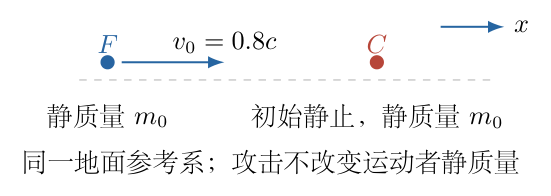

## 一、题型定位

相对论动量逐次递减、总能量差与追及条件的组合题。动量减半不等于动能减半，速度与动量也不是经典线性关系。能量分配必须说明所用参考系及静质量是否保持不变，再计算目标速度。

## 二、知识点

相对论因子；$p=\gamma mv$；$E^2=p^2c^2+m^2c^4$；静能与动能；望远镜求和；速度关于相对论因子的单调性；质量不变的能量分配模型；辐射的能量与动量限制。

## 三、物理图像

每次攻击后运动者的动量减半，因此最终速度趋零，但其静能仍然保留。释放能量是相邻状态的总能量差，也等于动能差，而不是把剩余静能继续释放。目标得到动能后向同方向运动，判断能否追上要比较两者在攻击后的速度。将一半能量散热不是普通等质量弹性碰撞，需要检查热量如何携带动量。

## 四、解题入口

用无量纲动量 $u=p/(m_0c)$ 描述全部攻击状态，通过 $\gamma=\sqrt{1+u^2}$ 求能量。前两次用相邻 $\gamma$ 的差求比值，总量用有限次望远镜和后再取极限。第三问先按地面系能量、目标静质量不变且剩余能量全变为动能的模型求速度，再核验辐射动量是否能够使第一次事件满足总动量守恒。

## 五、解析

（1）明确地面系与能量分配的解释。

所有速度、动量和攻击释放能量均在同一个地面参考系中计算。运动者和目标的静质量取恒定 $m_0$。第三问把散热比例理解为地面系释放能量的一半，剩余一半全部变为目标动能。

如果“热的一半”是在目标瞬时静止系定义，或目标吸收能量后静质量增加，目标速度公式会不同。原题没有给出这些额外动力学条件，所以以下采用上述明确的能量分配模型，并在后面检验它是否能与动量守恒相容。不把该模型冒称为普通的弹性碰撞。

（2）由初速度求初始相对论因子与动量。

定义

$$\beta_v=\frac vc,\qquad
\gamma=\frac1{\sqrt{1-\beta_v^2}}.$$

初始 $\beta_{v0}=0.8=4/5$，因此

$$\begin{aligned}
\gamma_0
&=\frac1{\sqrt{1-16/25}}
=\frac1{3/5}=\frac53,\\
p_0&=\gamma_0m_0v_0
=\frac53m_0\frac45c
=\frac43m_0c.
\end{aligned}$$

引入无量纲动量

$$u=\frac p{m_0c}.$$

由能量—动量关系，

$$\frac{E_{\mathrm{tot}}^2}{m_0^2c^4}=1+u^2,$$

所以

$$\gamma=\sqrt{1+u^2},\qquad
E_{\mathrm{tot}}=\gamma m_0c^2,\qquad
K=(\gamma-1)m_0c^2.$$

由 $p=\gamma m_0v$ 还可得

$$\boxed{\frac vc=\frac{u}{\sqrt{1+u^2}}.}$$

此式单调递增，但并非 $v\propto p$。在 $u\ll1$ 的低速极限，才有 $v/c\simeq u$。

（3）写出每次攻击后的状态序列。

令下标 $j$ 表示已完成 $j$ 次攻击。每次损失当时动量的一半，则

$$p_j=\frac12p_{j-1}=\frac{p_0}{2^j},\qquad
u_j=\frac{4}{3\cdot2^j}.$$

图 7-2 中，各状态的动量按几何数列递减，能量必须再通过非线性的平方根关系换算。

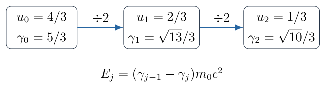

前三个相对论因子为

$$\gamma_0=\frac53,\qquad
\gamma_1=\sqrt{1+\frac49}=\frac{\sqrt{13}}3,\qquad
\gamma_2=\sqrt{1+\frac19}=\frac{\sqrt{10}}3.$$

攻击前后静质量不变，所以释放能量为

$$\boxed{E_j=m_0c^2(\gamma_{j-1}-\gamma_j).}$$

静能 $m_0c^2$ 在差值中抵消，因此该释放量也就是动能减少量。不能将 $\gamma_{j-1}m_0c^2$ 的一半作为释放量。

（4）求前两次释放能量与比值。

分别代入两相邻状态：

$$\begin{aligned}
E_1&=\frac{5-\sqrt{13}}3m_0c^2
=0.464816\,m_0c^2,\\
E_2&=\frac{\sqrt{13}-\sqrt{10}}3m_0c^2
=0.147758\,m_0c^2.
\end{aligned}$$

于是

$$\boxed{
\frac{E_1}{E_2}
=\frac{5-\sqrt{13}}{\sqrt{13}-\sqrt{10}}
=3.14579681\approx3.15.
}$$

两个能量均为正，因为动量递减使总能量递减。比值小于 $4$，反映初态仍在相对论区间，不能使用 $K=p^2/(2m_0)$ 得到经典固定比值。

（5）用有理化独立整理比值。

为减少相邻平方根相减造成的精度损失，可使用

$$\gamma_{j-1}-\gamma_j
=\frac{\gamma_{j-1}^2-\gamma_j^2}
{\gamma_{j-1}+\gamma_j}
=\frac{u_{j-1}^2-u_j^2}
{\gamma_{j-1}+\gamma_j}.$$

由于 $u_j=u_{j-1}/2$，

$$E_j=\frac{3m_0c^2u_{j-1}^2}
{4(\gamma_{j-1}+\gamma_j)}.$$

所以

$$\begin{aligned}
\frac{E_1}{E_2}
&=\frac{u_0^2}{u_1^2}
\frac{\gamma_1+\gamma_2}{\gamma_0+\gamma_1}\\
&=4\frac{\sqrt{13}+\sqrt{10}}{5+\sqrt{13}}.
\end{aligned}$$

该表达式与第（4）步完全等价。后期 $u_j\to0$ 时，各 $\gamma$ 接近 $1$，后期相邻释放能量之比趋于 $4$；早期不能直接用这个极限替代精确比值。

（6）先求有限次总量，再取无限次极限。

前 $N$ 次释放总能量为

$$\begin{aligned}
E^{(N)}
&=\sum_{j=1}^NE_j\\
&=m_0c^2[(\gamma_0-\gamma_1)+(\gamma_1-\gamma_2)
+\cdots+(\gamma_{N-1}-\gamma_N)]\\
&=m_0c^2(\gamma_0-\gamma_N).
\end{aligned}$$

这一步是望远镜求和，中间所有状态的能量正负抵消。随着 $N\to\infty$，

$$u_N\to0,\qquad\gamma_N=\sqrt{1+u_N^2}\to1.$$

因此

$$\boxed{
E=\left(\frac53-1\right)m_0c^2
=\frac23m_0c^2.
}$$

无限次攻击只耗尽初始动能，并不耗尽静能。若取 $c\simeq3.00\times10^8\,\mathrm{m/s}$，

$$E\simeq\frac23(89)(3.00\times10^8)^2
=5.34\times10^{18}\,\mathrm J.$$

若使用光速精确值 $299792458\,\mathrm{m/s}$，则

$$E=5.33261406\times10^{18}\,\mathrm J.$$

两种数值来自光速取值的精度差别，核心精确结论始终是 $(2/3)m_0c^2$。

（7）把累计能量分配给目标动能。

第三问目标初始静止，初始总能量为 $m_0c^2$。完成 $j$ 次攻击后，按题设一半释放能量成为其动能：

$$K_{C,j}=\frac12E^{(j)}
=\frac12m_0c^2(\gamma_0-\gamma_j).$$

因为目标静质量保持 $m_0$，

$$K_{C,j}=(\gamma_{C,j}-1)m_0c^2.$$

两式相等并约去 $m_0c^2$，得

$$\boxed{
\gamma_{C,j}=1+\frac12(\gamma_0-\gamma_j)
=\frac{11}{6}-\frac12\gamma_j.
}$$

这里目标 $\gamma_{C,j}$ 由累计动能决定，不能让目标“每次增加一半速度”，也不能用经典 $mv^2/2$ 来处理约 $0.6c$ 的运动。

（8）用相对论因子的单调性判定追及。

两者均沿正方向运动。速度与 $\gamma$ 的关系为

$$\frac vc=\sqrt{1-\frac1{\gamma^2}}.$$

对 $\gamma\ge1$，该函数单调递增。因此 $F$ 的速度不大于目标速度，等价于

$$\gamma_j\le\gamma_{C,j}.$$

代入目标表达式：

$$\begin{aligned}
\gamma_j&\le\frac{11}{6}-\frac12\gamma_j,\\
\frac32\gamma_j&\le\frac{11}{6},\\
\gamma_j&\le\frac{11}{9}.
\end{aligned}$$

也可转换为动量阈值：

$$1+u_j^2\le\left(\frac{11}{9}\right)^2,\qquad
u_j^2\le\frac{40}{81}.$$

但只需要先检查第一次，因为初始目标静止，尚未攻击时必可接近目标。

（9）代入第一次攻击后的两个速度。

第一次后运动者

$$\gamma_1=\frac{\sqrt{13}}3=1.201850
<\frac{11}{9}=1.222222,$$

所以已经满足不能追及的条件。直接计算速度作核验：

$$\frac{v_{F,1}}c
=\frac{u_1}{\gamma_1}
=\frac{2/3}{\sqrt{13}/3}
=\frac2{\sqrt{13}}
=0.554700.$$

目标第一次后

$$\gamma_{C,1}=\frac{11-\sqrt{13}}6=1.232408,$$

于是

$$\frac{v_{C,1}}c
=\sqrt{1-\frac1{\gamma_{C,1}^2}}
=0.584464.$$

因此

$$\boxed{\text{第一次攻击后，}F\text{ 已无法再次追上 }C.}$$

追及的判断采用攻击后的速度：目标已更快，继续沿同一方向奔跑不会缩小其领先距离。假定绕行过程不另获能量，也不能因“跑了一圈”就把速度恢复到 $0.8c$。

第二问是按可无限次攻击的假设序列求能量上界，第三问加入实际追及约束后只有第一次可发生。不能把第二问的形式求和当成第三问中实际已经完成无限次攻击。

（10）核验第一次事件的总动量能否守恒。

图 7-3 将释放能量分成目标动能与热辐射，两者不能只记能量而忘记动量。以 $m_0c^2$ 为能量单位、$m_0c$ 为动量单位，第一次释放量为

$$e=\frac{E_1}{m_0c^2}=0.464816.$$

目标动能与散热能量各为

$$k_C=e_{\mathrm{rad}}=\frac e2=0.232408.$$

目标相对论因子为 $1+k_C$，其动量为

$$\frac{p_C}{m_0c}
=\sqrt{(1+k_C)^2-1}
=0.720298.$$

运动者损失的动量为

$$\frac{\Delta p_F}{m_0c}
=u_0-u_1=\frac23=0.666667.$$

目标得到的动量略大于运动者减少的动量，因此若无外界冲量，辐射必须携带反方向的净动量：

$$\frac{p_{\mathrm{rad}}}{m_0c}
=\frac23-0.720298=-0.0536317.$$

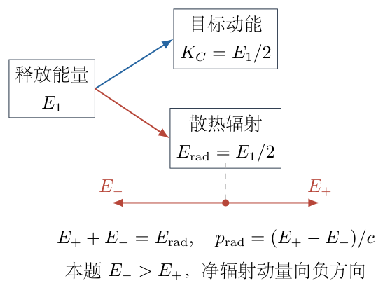

（11）构造满足能量和动量收支的辐射分配。

光子辐射总能量为 $E_{\mathrm{rad}}$ 时，其净动量必须满足

$$|p_{\mathrm{rad}}|c\le E_{\mathrm{rad}}.$$

本题所需

$$0.0536317<0.232408,$$

所以这一分配在运动学上可以实现。取沿正方向和负方向的两束辐射，其能量为 $E_+,E_-$，则

$$E_++E_-=E_{\mathrm{rad}},\qquad
\frac{E_+-E_-}{c}=p_{\mathrm{rad}}.$$

解两元方程：

$$E_\pm=\frac{E_{\mathrm{rad}}\pm cp_{\mathrm{rad}}}{2}.$$

代入，

$$\begin{aligned}
E_+&=0.0893882\,m_0c^2,\\
E_-&=0.143020\,m_0c^2.
\end{aligned}$$

两束能量都为正，反向束较强，净辐射动量为负。逐项收支为

$$\begin{aligned}
\text{能量：}\quad
\gamma_0+1
&=\gamma_1+\gamma_{C,1}+e_{\mathrm{rad}},\\
\text{动量：}\quad
\frac43
&=\frac23+0.720298-0.0536317.
\end{aligned}$$

这证明明确的能量分配模型与首次事件的四动量收支可以相容；不证明实际过程必自动产生上述辐射图样。若另加“地面系各向同性散热、净辐射动量为零”，则目标应只得到 $2m_0c/3$，与给定动能所要求的动量不一致，两个附加条件不能同时满足。

（12）检查低速、无限次和质量尺度。

释放能量及累计能量都正比于 $m_0c^2$，所以前两次能量比不依赖质量。追及次数也不依赖共同静质量，因为两者相同的能量尺度在 $\gamma$ 方程中约去。

低速时

$$\sqrt{1+u^2}=1+\frac12u^2+O(u^4),$$

释放能量约为

$$E_j\simeq\frac12m_0c^2(u_{j-1}^2-u_j^2)
=\frac{3}{8}m_0c^2u_{j-1}^2,$$

才恢复经典动能关系。无限次极限 $\gamma_N\to1$ 保留静能；若误写 $\gamma_N\to0$，就会多释放一个 $m_0c^2$，违反质量不变的能量—动量关系。

## 六、关键洞察

能量与动量的非线性关系是整题的核心，而不是复杂的碰撞受力。用 $u=p/(mc)$ 后，每次减半直接写成 $u_j=u_0/2^j$，再通过一个平方根得到所有能量状态，避免逐次求速度再代回多层公式。

判断追及不必先求两个带根式的速度。静质量相同且均同方向时，$\gamma$ 大小就能比较速度；将目标能量表达式与运动者 $\gamma_j$ 直接比较，会得到简单阈值 $11/9$。

散热比例只有指定参考系才有意义。辐射既有能量也有动量，不能把热量当成只会在能量账本中出现的无动量“损失”。首次事件的双向光子构造给出一个明确可行性核对，比仅说“热带走多余量”更严格。

## 七、易错点

经典 $p=mv$ 在 $0.8c$ 不成立。动量减半之后速度是 $2c/\sqrt{13}$，不是 $0.4c$。总能量包括静能，攻击释放应取相邻总能量的差，不能把每次总能量减半。

目标的总能量不是释放能量的一半，而是原有静能加上累计获得的动能。比较速度时也不能把能量比直接当速度比。第二问形式上可求无限和，但第三问首次后已无法追及，两个问的附加情景不同。

如果把“碰撞”自动理解为普通等质量弹性碰撞，既规定运动者动量减半又规定目标获得一半释放能量，可能与动量守恒冲突。必须区分原题的规定能量转移模型、热辐射所需动量，以及任何额外的各向同性假设。

## 八、课堂讲解建议

先让学生用 $0.8c$ 算 $\gamma_0$ 与 $u_0$，再画图7-2的动量数列。板书只保留 $u_j,\gamma_j,E_j$ 三列，强调“减半”发生在第一列，不发生在后两列。

求总量时让学生写出前三项，看清望远镜抵消，再讨论剩余的 $\gamma_N$ 趋向多少。第三问先做 $\gamma$ 阈值比较，之后才算速度，展示如何减少没有必要的繁重代数。

动量核对放在速度答案后，使用图7-3的正、反向辐射。让学生亲自解 $E_++E_-$ 与 $E_+-E_-$ 两个式子，理解“能量账本正确”不必然等于“动量账本正确”。

## 九、变式训练

变式一：初始无量纲动量改为任意 $u_0>0$，每次仍减半。求前两次能量比，并求低速极限。

依次有

$$\gamma_0=\sqrt{1+u_0^2},\quad
\gamma_1=\sqrt{1+u_0^2/4},\quad
\gamma_2=\sqrt{1+u_0^2/16}.$$

用有理化后的释放量，

$$\boxed{\frac{E_1}{E_2}
=4\frac{\gamma_1+\gamma_2}{\gamma_0+\gamma_1}.}$$

当 $u_0\to0$，三者均趋 $1$，所以比值趋 $4$。当 $u_0\to\infty$，三者主导项为 $u_0,u_0/2,u_0/4$，因此

$$\frac{E_1}{E_2}\to4\frac{1/2+1/4}{1+1/2}=2.$$

相对论区间比值从经典极限 $4$ 向超相对论极限 $2$ 变化。本题的 $3.1458$ 落在两者之间，给出有意义的极限检查。

变式二：只考察本题第一次攻击，地面系散热比例改为 $h$。保持两者静质量不变，无外界冲量，散热可由任意正、反向光子束承担。求允许的 $h$ 范围，以及其中第一次后不能追及的范围。

令 $e=(5-\sqrt{13})/3$、$d=2/3$。目标获得动能 $(1-h)e\,m_0c^2$，因此

$$\gamma_C=1+(1-h)e,\qquad
\frac{p_C}{m_0c}=\sqrt{[1+(1-h)e]^2-1}.$$

辐射必须满足

$$\left|d-\sqrt{[1+(1-h)e]^2-1}\right|\le he.$$

其边界对应辐射全部向前或全部向后。分别令目标动量为 $d+he$ 与 $d-he$。两边平方，目标动量平方展开为

$$[1+(1-h)e]^2-1
=2e+e^2-2he(1+e)+h^2e^2.$$

右边分别为

$$(d\pm he)^2=d^2\pm2dhe+h^2e^2.$$

相等后消去公共的 $h^2e^2$，把含 $h$ 的项移到右边：

$$2e+e^2-d^2=2he(1+e\pm d).$$

所以两边界分别得到

$$\begin{aligned}
h_{\min}
&=\frac{2e+e^2-d^2}{2e(1+e+d)}
=0.353895,\\
h_{\max}
&=\frac{2e+e^2-d^2}{2e(1+e-d)}
=0.945088.
\end{aligned}$$

这里 $d-h_{\max}e>0$，平方没有引入负动量分支。所以首次事件的能量与光子动量可同时满足，当且仅当

$$\boxed{0.353895\le h\le0.945088.}$$

<!-- KEEP_TOGETHER_START -->

第一次后不能追及要求 $\gamma_C\ge\gamma_1$。因 $e>0$，逐步整理且不改变不等号方向：

$$\begin{aligned}
1+(1-h)e&\ge\frac{\sqrt{13}}3,\\
1-h&\ge\frac{\gamma_1-1}{e},\\
h&\le1-\frac{\gamma_1-1}{e}=0.565741.
\end{aligned}$$

结合可行区间，

$$\boxed{0.353895\le h\le0.565741}
$$

是既能满足首次能量—动量收支、又能使运动者首次后不能追及的范围。本题 $h=1/2$ 落在其中。仅修改一个散热比例后，不能只算目标速度而跳过动量可行性；变式中的两类条件各自独立，必须取交集。

<!-- KEEP_TOGETHER_END -->

\newpage

# 第 8 题

用同一种均匀电阻线构成圆形与其内接正方形。圆与正方形接触的位置均电连接，外圆左右两端分别通过理想导线引出端口 $A$、$B$。长度等于外圆半径的一段电阻线，其电阻为 $r$。

（a）仅有外圆及其内接正方形时，求端口间等效电阻 $R_1$。

（b）在正方形内继续内接同种电阻线构成的圆，再在该圆内接正方形，按同样方式无限嵌套，所有接触点均电连接。求端口间等效电阻 $R_2$，数值取三位有效数字。

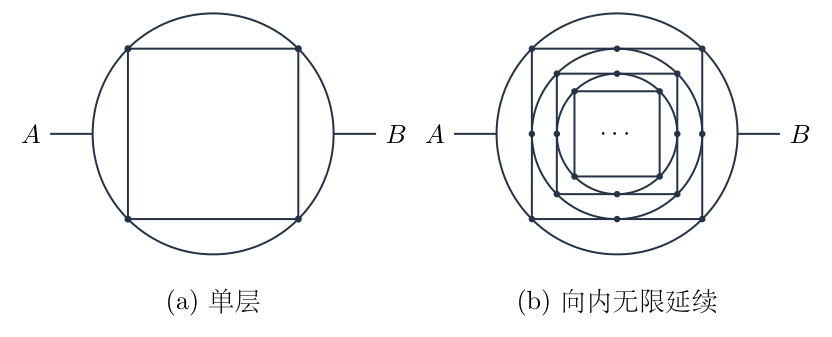

## 一、题型定位

几何长度决定电阻的对称网络，以及含尺度变化的自相似无限电路。第一问利用端口条件下的等势节点合并，第二问必须同时保留内层输入电阻及通往内层的连接线电阻，不能把一个相似小网络误当成与外层同样阻值的支路。

## 二、知识点

均匀电阻线的电阻与长度成正比；圆弧长度；内接正方形及内切圆的尺寸比例；端口对称下的电势关系；等势节点合并；有分流节点的非串联结构；串并联；有限层递推、极限与正根筛选；实际节点网络数值验证。

## 三、物理图像

外圆与第一层正方形在四个顶点连接；下一层圆与该正方形在四条边的中点连接。两类接点不同。单层时，正方形左、右竖边各连接两个等势端点且没有中间分流，所以可无电流；加上内圆后，中点接出新支路，竖边两端虽仍等势，两半段却可以向内圆供电，不能再整边删除。

## 四、解题入口

先施加试探电压，依据横、纵反射对称证明哪些节点等势，再按圆弧与直线长度计算支路电阻。单层先得到有限网络结果。无限层时画清楚内圆与外正方形边中点的连接，识别内层半径缩小为 $1/\sqrt2$，写出包含连接线的自相似方程，最后用有限层实际网络核验收敛。

## 五、解析

（1）定义长度尺度和单位长度电阻。

令外圆半径为 $a$。为避免与所求电阻 $R_1,R_2$ 混淆，半径不再记为大写 $R$。题设长度 $a$ 的线电阻为 $r$，故单位长度电阻为

$$\lambda_r=\frac ra.$$

这里采用题意中的同一种均匀电阻线，即各处材料和横截面相同，线的电阻由长度决定。若另给不同截面积，就须分别重算单位长度电阻，不能仅凭电阻率相同使用本题比例。

外圆上相邻正方形顶点相差 $90^\circ$，正方形边长为

$$s_\square=\sqrt2a.$$

外圆左右端口到相邻顶点的圆心角为 $45^\circ$，该段弧长为 $\pi a/4$。第一层正方形内切圆半径为

$$a_{\mathrm{in}}=\frac{s_\square}{2}=\frac a{\sqrt2}.$$

下一层所有长度都缩小 $1/\sqrt2$，因此每条相似线段或圆弧的电阻也缩小同一因子。缩小的是电阻，不是电阻率。

（2）施加端口边界并证明电势对称。

取 $\phi_A=U_0$、$\phi_B=0$，$U_0>0$。水平轴反射 $y\mapsto-y$ 不交换端口，网络及边界条件相同。由无源正电阻网络解的唯一性，

$$\phi(x,y)=\phi(x,-y).$$

因此左上、左下两个正方形顶点等势，记作 $\phi_L$；右上、右下两个顶点等势，记作 $\phi_R$。

竖直轴反射 $x\mapsto-x$ 交换两个端口。若同时把电势改为 $U_0-\phi$，端口条件恢复原样，所以

$$\phi(-x,y)=U_0-\phi(x,y).$$

于是

$$\phi_R=U_0-\phi_L,$$

并且竖直轴上的所有节点满足

$$\phi(0,y)=\frac{U_0}{2}.$$

图 8-2 显示两对可合并的角点，以及位于竖直轴上的中点。这里的“合并”是电势相同的网络化简，不是改变原图中的接触位置。

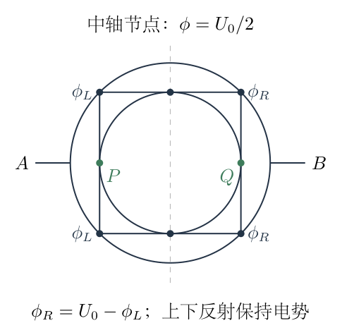

（3）求端口进入角点的等效电阻。

从 $A$ 到两个左角点有上、下两段圆弧，每段弧长 $\pi a/4$，电阻为

$$r_e=\lambda_r\frac{\pi a}{4}=\frac\pi4r.$$

两个角点等势，可合并为节点 $L$。这两段弧连接同一对端点 $A,L$，所以并联，得到

$$R_{AL}=\frac{r_e}{2}=\frac\pi8r.$$

右侧两段端口弧也并联，得

$$R_{RB}=\frac\pi8r.$$

左右入口电阻在整体结构中分别位于所有中间分流支路之外，最后相加为 $\pi r/4$。不能把一条弧的 $\pi r/4$ 直接当成已并联后的单侧入口电阻。

（4）计算单层的中间并联支路。

合并角点后，从 $L$ 到 $R$ 有两条外圆路径：上方从左上角到右上角、下方从左下角到右下角。每条圆心角为 $90^\circ$，电阻为

$$r_{\mathrm{arc}}=\lambda_r\frac{\pi a}{2}=\frac\pi2r.$$

上下并联，等效为

$$R_{\mathrm{arc}}=\frac\pi4r.$$

第一层正方形的上边和下边，各长 $\sqrt2a$，电阻各为 $\sqrt2r$，两条也并联：

$$R_{\mathrm{square}}=\frac{\sqrt2r}{2}=\frac r{\sqrt2}.$$

单层时，正方形左边的两个端点均为 $\phi_L$，右边两个端点均为 $\phi_R$，边中点没有其他连接，所以两条竖边各自电流为零。这一条件允许它们不参与单层端口导电计算。

图 8-3 的两条中间分流支路分别对应上述外圆弧和方形横边，不含被删去的单层无电流竖边。

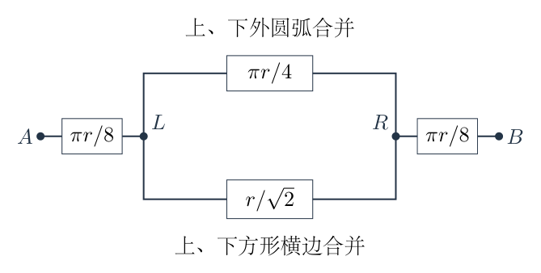

于是

$$\begin{aligned}
R_{\mathrm{mid}}
&=\left(\frac1{\pi r/4}+\frac1{r/\sqrt2}\right)^{-1}\\
&=\frac{r}{4/\pi+\sqrt2}.
\end{aligned}$$

（5）合并单层结果并检查上下界。

两侧入口与中间网络串联，故

$$\boxed{
R_1=\frac\pi4r+\frac{r}{4/\pi+\sqrt2}
=\left(\frac\pi4+\frac{\pi}{4+\pi\sqrt2}\right)r.
}$$

数值为

$$\frac{R_1}{r}=1.15749768.$$

若完全没有方形，只剩外圆，两条半圆电阻各为 $\pi r$，并联为 $\pi r/2$。添加方形增加导电路径，理应减小端口电阻：

$$R_1<\frac\pi2r.$$

同时中间网络是正电阻，不可能使两侧入口消失，所以

$$R_1>\frac\pi4r.$$

数值 $1.15750r$ 位于 $0.785398r$ 与 $1.57080r$ 之间，符合物理界限。

（6）加入内圆后，重新审查竖边的电流。

内圆与第一层正方形在左、右、上、下四个边中点接触。将左边中点记为 $P$，右边中点记为 $Q$。左上、左下角点仍然等势为 $\phi_L$，但 $P$ 可以经内圆向右侧网络供电，因此 $\phi_P$ 不必等于 $\phi_L$。

左边由两段长度 $a/\sqrt2$ 的半边组成，每段电阻为

$$r_h=\frac r{\sqrt2}.$$

两段都连接等势合并后的角点 $L$ 与边中点 $P$，所以它们并联而不是串联：

$$R_{LP}=\frac{r_h}{2}=\frac r{2\sqrt2}.$$

同理，

$$R_{QR}=\frac r{2\sqrt2}.$$

这两段连接电阻是无限网络自相似式中最容易遗漏的部分。即使左竖边两端等势，中点发生分流后，两半段都可以有电流。单层时删除整边的依据已经不再成立。

（7）解释内层上、下接点为什么不破坏两端口化简。

第一层上、下横边的中点均在 $y$ 轴上，电势为 $U_0/2$，内圆上、下接点也是同一位置和同一电势。不能据此说经过这些点的每条支路电流都为零。

需要检查的是内、外子网络在该点的净交换电流。每个子网络都关于 $x\mapsto-x$ 对称，其在轴上节点的左、右相邻电阻相同，相邻电势之和为 $U_0$。故该子网络在此点的两条电流之和为

$$\frac{U_0/2-\phi_-}{R_e}
+\frac{U_0/2-\phi_+}{R_e}
=\frac{U_0-\phi_--\phi_+}{R_e}=0.$$

因此内、外网络分别在上、下接点满足零净注入，连接后不用从对方取得额外电流。内层可以按左、右端口 $P,Q$ 的输入电阻处理；上、下接点仍保留其正确电势和内部电流，不是随意删除两条实际连接。

（8）识别内层的阻值缩放。

无限网络从内圆向内看，圆—方形的拓扑与整体完全相同，但半径为 $a/\sqrt2$。单位长度电阻仍为 $r/a$，所以内层输入电阻为

$$R_{\mathrm{inner}}=\frac{R_2}{\sqrt2}.$$

不是 $R_2$，因为缩小的同种线更短；也不是 $R_2/2$，因为长度按 $1/\sqrt2$ 缩放而非面积按 $1/2$ 缩放。

图 8-4 的下方支路从 $L$ 到 $R$ 依次经过左连接线、相似内层、右连接线。其三项真实来源在图中分别列出。

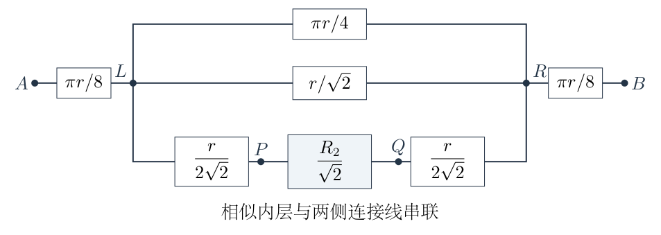

该支路电阻为

$$\begin{aligned}
R_{\mathrm{deep}}
&=R_{LP}+R_{\mathrm{inner}}+R_{QR}\\
&=\frac r{2\sqrt2}+\frac{R_2}{\sqrt2}
+\frac r{2\sqrt2}\\
&=\frac{r+R_2}{\sqrt2}.
\end{aligned}$$

连接线不能省略，也不能与内层再并联，因为它们位于进入、离开内层的必经路径上。

（9）建立无限网络自相似方程。

两侧入口仍分别为 $\pi r/8$。中间现在有三条并联支路：

$$R_{\mathrm{arc}}=\frac\pi4r,\quad
R_{\mathrm{square}}=\frac r{\sqrt2},\quad
R_{\mathrm{deep}}=\frac{r+R_2}{\sqrt2}.$$

所以

$$R_2=\frac\pi4r+
\left[\frac4{\pi r}+\frac{\sqrt2}{r}
+\frac{\sqrt2}{r+R_2}\right]^{-1}.$$

令无量纲输入电阻为

$$z=\frac{R_2}{r},$$

约去 $r$ 得

$$\boxed{
z=\frac\pi4+
\frac1{4/\pi+\sqrt2+\sqrt2/(1+z)}.
}$$

$1+z$ 中的 $1$ 代表两侧连接电阻之和经缩放后贡献的 $r$，不是一个为了数值计算加入的常数。此式每一项都与图 8-4 的实际支路对应。

（10）化为二次方程，筛选物理解。

记

$$b_0=\frac\pi4,\qquad A_0=\frac4\pi+\sqrt2,\qquad w=z-b_0.$$

中间等效电阻为正，因此 $w>0$。方程成为

$$w=\frac1{A_0+\sqrt2/(1+b_0+w)}.$$

正分母通分并相乘：

$$w\left[A_0(1+b_0+w)+\sqrt2\right]=1+b_0+w.$$

收集各次幂：

$$\boxed{
A_0w^2+\left[A_0(1+b_0)+\sqrt2-1\right]w
-(1+b_0)=0.
}$$

令 $B_0=A_0(1+b_0)+\sqrt2-1$，则常数项为负、二次系数为正，两根异号。正根为

$$w=\frac{-B_0+\sqrt{B_0^2+4A_0(1+b_0)}}{2A_0}.$$

负根会要求中间正电阻网络具有负输入电阻，应舍去。数值计算可以有理化正根：

$$w=\frac{2(1+b_0)}
{B_0+\sqrt{B_0^2+4A_0(1+b_0)}}.$$

这避免两个接近正数相减带来的精度损失。最后 $z=b_0+w$。

（11）计算数值，回代原方程检查。

使用

$$b_0=0.7853981634,\qquad A_0=2.6874531071,$$

得到

$$z=1.0824365772.$$

回代并联部分，

$$z-b_0=0.2970384138,$$

并且

$$\frac1{A_0+\sqrt2/(1+z)}=0.2970384138.$$

两边一致。三位有效数字结果为

$$\boxed{R_2=1.08r.}$$

应在求根时保留更多中间位数，再对最终阻值取三位有效数字，不能把 $b_0,A_0$ 先粗略取整而改变最终尾数。

（12）用有限层递推证明该根对应真实无限极限。

令 $R^{[N]}$ 表示含 $N$ 个“圆及其内接方形”的有限网络输入电阻，$z_N=R^{[N]}/r$。原题单层为 $z_1=R_1/r$，原题无限 $R_2$ 不要与有限两层 $R^{[2]}$ 混淆。

有限网络最外层看进去，内部 $N-1$ 层按 $1/\sqrt2$ 缩放，所以同样得到

$$z_N=f(z_{N-1}),\qquad
f(x)=b_0+\frac1{A_0+\sqrt2/(1+x)}.$$

从 $z_1=1.1574976792$ 开始：

$$z_2=1.0845359604,\qquad
z_5=1.0824366272.$$

$f'(x)>0$，且 $f(z_1)<z_1$。于是如果 $z_{N-1}<z_{N-2}$，则

$$z_N=f(z_{N-1})<f(z_{N-2})=z_{N-1}.$$

归纳得到序列单调下降。每一层的中间阻值仍为正，所以

$$z_N>b_0.$$

单调有界序列存在极限，取极限后满足 $z=f(z)$；正中间阻值只对应第（10）步的一条正根，因此有限网络的真实极限就是前面求得的 $1.0824365772$。

（13）用真实节点网络交叉验证，而非只重复递推。

另一路核验按实际几何组装：第 $j$ 层圆半径为 $a\,2^{-(j-1)/2}$，圆按八段 $45^\circ$ 弧划分；每条方形边按中点分为两段，所有实际相同坐标的接点合为同一节点。对每段使用其真实长度乘 $r/a$ 得到电阻，再求端口电流。

这种节点法没有预先合并角点，也没有把内层直接当作一个已知电阻。独立得到：

|有限层数 $N$|实际节点网络 $R^{[N]}/r$|递推值|
|---|---:|---:|
|$1$|$1.1574976792$|$1.1574976792$|
|$2$|$1.0845359604$|$1.0845359604$|
|$5$|$1.0824366272$|$1.0824366272$|
|$10$|$1.0824365772$|$1.0824365772$|

一致性同时核验了圆弧电阻、方形半边电阻、接点位置和尺度因子。无限结果小于单层结果，但仍大于入口下界：

$$\frac\pi4r<R_2<R_1<\frac\pi2r.$$

添加内层导电支路只会降低等效电阻；入口弧仍然必经，所以电阻不会因“无限层”而变成零。

## 六、关键洞察

自相似题的未知量不仅出现在内层电阻中，还与进入内层的实际连接线串联。本题两连接线各为 $r/(2\sqrt2)$，正是分母 $1+z$ 的来源。丢掉它们会得到另一条看似漂亮、实则拓扑错误的二次方程。

等势端点之间的整条导线能否删除，必须看中间有无分流。单层方形竖边没有第三连接，无电流；无限层在中点接入内圆，两半边成为并联馈线。这一点不能仅凭两端电势相同判断。

递推还给出误差控制。求导并化简，

$$f'(x)=\frac{\sqrt2}
{[A_0(1+x)+\sqrt2]^2}.$$

在 $x\ge b_0$ 上，

$$0<f'(x)\le q_0
=\frac{\sqrt2}{[A_0(1+b_0)+\sqrt2]^2}<0.037.$$

因此迭代具有严格收缩性。若已算到 $z_N$，可用相邻差估计剩余误差：

$$|z_N-z_*|
\le\frac{q_0}{1-q_0}|z_N-z_{N-1}|.$$

这不是凭“数字看起来不变”停止计算，而是用明确界限保证三位有效数字稳定。实际节点组装的交叉检查则用于防止整条递推模型从一开始就画错连接。

## 七、易错点

内接正方形顶点与外圆连接，内切圆在方形边中点连接，不能把内圆画成与方形四个角连接。下一层半径是 $a/\sqrt2$，不是 $a/2$；电阻按长度缩放，而不是按面积缩放。

$45^\circ$ 弧电阻为 $\pi r/4$，两条入口弧并联后才是 $\pi r/8$。从两个左角点到两个右角点的上、下外圆弧各为 $\pi r/2$，再并联成 $\pi r/4$。不同位置的同一个 $\pi r/4$ 数值来自不同组合，不能混在一起。

轴上节点电势为 $U_0/2$，不表示该节点附近每条电阻电流都为零。有限两层结果 $R^{[2]}$ 也不等于题目记号中的无限网络 $R_2$。求二次方程必须筛正中间阻值根，不能因为负根也满足代数式就接受。

## 八、课堂讲解建议

先让学生在图8-1标出四个角接点和四个边中点，区分“下一圆接在哪里”。板书几何长度表，把圆弧、方形边、半边分别换成电阻，再进行任何等势合并。

讲单层时使用图8-3，让学生逐条指出等效支路来自原网络哪一段。讲无限层之前重新问“左竖边两端等势，还能删掉吗”，要求结合中点分流作答，而不是背上一次结论。

图8-4应与自相似方程同步写，每写一个电阻项就在图上找到对应支路。数值部分先求正根，后用有限层递推核验，再展示实际节点网络结果，区分代数自洽与模型独立核验。

## 九、变式训练

变式一：仅保留两层圆—方形，最内层方形内部不再加圆，求输入电阻并比较单层和无限层。

最内一层按比例缩小，输入电阻为 $R_1/\sqrt2$，所以最外层中间第三支路为

$$\frac r{2\sqrt2}+\frac{R_1}{\sqrt2}
+\frac r{2\sqrt2}
=\frac{r+R_1}{\sqrt2}.$$

因此

$$\begin{aligned}
\frac{R^{[2]}}r
&=b_0+\frac1{A_0+\sqrt2/(1+R_1/r)}\\
&=0.7853981634+
\frac1{2.6874531071+\sqrt2/2.1574976792}\\
&=1.0845359604.
\end{aligned}$$

所以

$$R_2<R^{[2]}<R_1.$$

有限两层已接近无限值，但两者不是严格相等。三位有效数字恰巧都约为 $1.08r$，不能用这一取整结果反过来宣称两层与无穷层没有区别。

变式二：使用同一种电阻线，将整个单层或无限网络的所有长度放大 $\alpha>0$ 倍，原来的单位长度电阻不变，求输入电阻的变化。

每条边或弧的电阻都乘 $\alpha$。节点电流方程中所有电导同乘 $1/\alpha$，在固定端口电压下内部电势比例不变，总电流变为原来的 $1/\alpha$。因此

$$\boxed{R_{1,\mathrm{new}}=\alpha R_1,\qquad
R_{2,\mathrm{new}}=\alpha R_2.}$$

若重新把长度等于新外圆半径的线电阻定义为 $r_{\mathrm{new}}$，则 $r_{\mathrm{new}}=\alpha r$，两个无量纲比值仍是

$$\frac{R_{1,\mathrm{new}}}{r_{\mathrm{new}}}=1.1574976792,\qquad
\frac{R_{2,\mathrm{new}}}{r_{\mathrm{new}}}=1.0824365772.$$

这说明自相似系数是拓扑与几何比例的性质，不依赖整体尺寸；但有单位的电阻随线长改变，不能把“无量纲比不变”误解为“实际电阻不变”。
