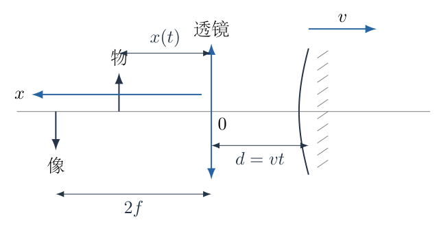
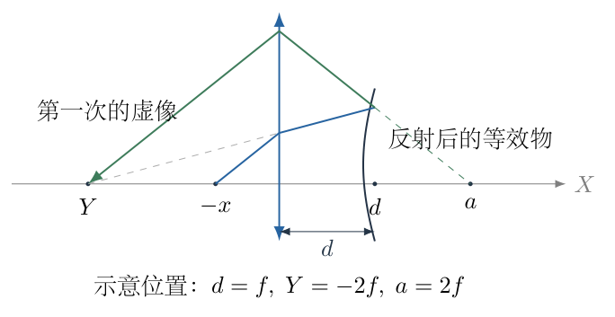
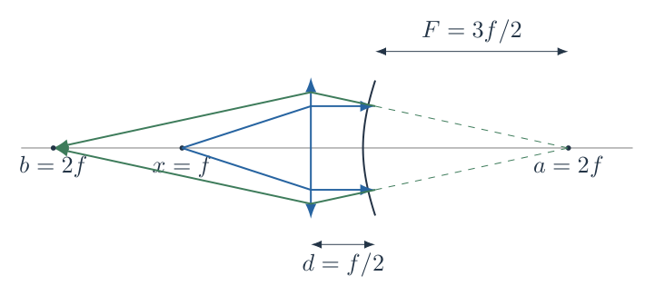
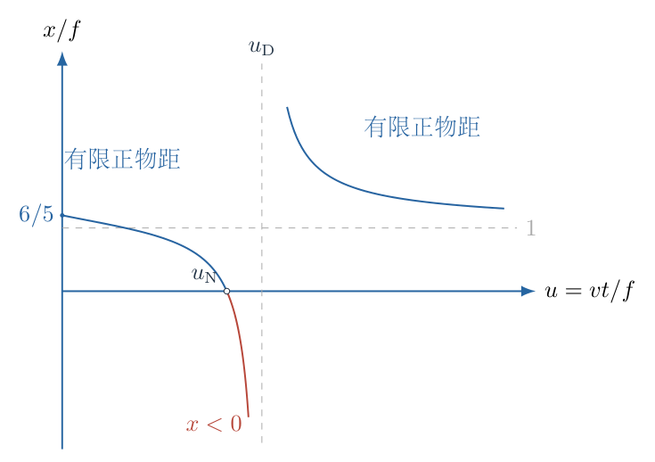

# 第 1 题

在近轴光学条件下，一薄凸透镜的焦距为 $f>0$，固定在主光轴原点。透镜右侧有一凸面镜，曲率半径为 $3f$。在 $t=0$ 时，透镜与凸面镜相接触；随后凸面镜沿主光轴向右以恒定速率 $v$ 运动。题设的物方坐标 $x$ 以向左为正，物体位于透镜左侧，位置为 $x(t)$。

（1）光依次透过凸透镜、经凸面镜反射、再次透过凸透镜后，在透镜左侧成像。要求最终像固定在距透镜 $2f$ 处，求物体位置 $x(t)$。

（2）取 $f=20\,\mathrm{cm}$、$v=1\,\mathrm{m/s}$，给出 $x(t)$ 的表达式，并讨论在 $t\geq0$、物体必须位于透镜左侧的条件下，哪些时间不能实现上述要求。

## 一、题型定位

往返光路的多次成像与物距函数的可实现性。必须将第一次折射、镜面反射和第二次折射依次联系；反射使光的传播方向改变，成像公式中的实、虚物像符号也随各阶段重新定义。

## 二、知识点

薄透镜成像公式；球面镜焦距为曲率半径的一半；凸面镜的带符号焦距为负；实物与虚物、实像与虚像的区别；逆向确定中间像；有理函数的零点、极点和符号区间；近轴光线传递矩阵。

## 三、物理图像

物体发出的光首次穿过透镜后，形成会聚或发散光束。凸面镜在不同位置截取该光束，使反射后的光看起来来自或会聚于一个中间位置。为了使最终像始终位于左侧 $2f$，第二次穿过透镜的入射光束必须始终等效于来自右侧 $2f$ 的物体。镜面移动时，为保持这个等效位置，真正的左侧物体必须调整。

## 四、解题入口

从最终像倒推第二次入射的等效物距，比从物体开始逐次猜实像、虚像更稳妥。引入向右为正的辅助坐标 $X$，只用它描述中间像的空间位置；题设物距 $x$ 仍为正向左的距离。二者满足物体坐标 $X_{\mathrm o}=-x$，镜面坐标 $X_{\mathrm m}=d=vt$。

## 五、解析

（1）先统一距离与符号，而不统一所有物像的名称。

取最终像距为一般的 $b>0$，稍后代入 $b=2f$。凸面镜的焦距大小记为

$$F=\frac{3f}{2}>0,$$

在球面镜成像公式中，其带符号焦距为 $-F$。$d=vt$ 是透镜到镜面的实际距离，不能写成题设左正坐标中的 $+d$；镜面在题设坐标中的位置实际为 $-d$。

图 1-2 表示三次成像关系。$Y$ 为第一次透镜成像的辅助坐标，$a$ 为镜面反射之后、第二次透镜入射光束的等效物体坐标。虚物或虚像用光线的延长线解释，不表示空间中真的存在一个发光物体。

（2）由最终像确定第二次透镜的等效物距。

第二次光从右向左入射。最终像位于透镜左侧，沿出射方向是实像，像距为 $b$；若等效物位于透镜右侧且入射光发散，物距为 $a$。薄透镜公式是

$$\frac1a+\frac1b=\frac1f.$$

逐步解出 $a$：

$$\begin{aligned}
\frac1a&=\frac1f-\frac1b
=\frac{b-f}{fb},\\
a&=\frac{fb}{b-f}.
\end{aligned}$$

本题 $b=2f$，所以

$$a=2f.$$

这是固定不变的目标中间位置，不随镜面移动。接下来不是要求第一次透镜也成像于 $2f$，而是要求镜面反射后的等效位置为 $2f$。

（3）给球面镜定义物距与像距。

第一次透镜成像坐标为 $Y$。入射到镜面的光从左向右传播，镜面的实物一侧在左边，所以镜面物距为

$$s=d-Y.$$

若 $Y<d$，入射光相当于从镜面左侧的实物发出，$s>0$；若 $Y>d$，光本来将会聚于镜面后方，镜面对其看到的是虚物，$s<0$。

反射光从右向左传播。镜面所成像的位置要求为 $X=a$，实像距以向左为正，因此

$$s'=d-a.$$

当 $a>d$ 时，$s'<0$，意味着反射光发散，其反向延长线交于镜面右侧。该等效像可成为第二次透镜的入射物。

（4）用凸面镜成像公式倒推 $Y$。

球面镜公式为

$$\frac1s+\frac1{s'}=\frac1{-F}=-\frac1F.$$

代入 $s'=d-a$：

$$\begin{aligned}
\frac1s&=-\frac1F-\frac1{d-a}
=-\frac{d-a+F}{F(d-a)},\\
s&=-\frac{F(d-a)}{d-a+F}
=\frac{F(a-d)}{d+F-a}.
\end{aligned}$$

由于 $Y=d-s$，得到

$$\begin{aligned}
Y&=d-\frac{F(a-d)}{d+F-a}\\
&=\frac{d(d+F-a)-F(a-d)}{d+F-a}\\
&=\frac{d^2+(2F-a)d-Fa}{d+F-a}.
\end{aligned}$$

最后一步使用通分及合并同类项，特别是 $-F(a-d)=-Fa+Fd$，此处漏掉 $Fd$ 会使一次项系数错误。

代入 $F=3f/2$、$a=2f$：

$$\boxed{Y=\frac{d^2+fd-3f^2}{d-f/2}}.$$

中间的 $Y$ 可以为正、负或无穷远，不能因它出现负值就断言最终成像不可能。

（5）由第一次透镜公式确定真正物距。

第一次光向右传播，真正物体在左侧，实物距为 $x>0$；像的带符号距离为 $Y$。因此

$$\frac1x+\frac1Y=\frac1f.$$

整理：

$$\begin{aligned}
\frac1x&=\frac{Y-f}{fY},\\
x&=\frac{fY}{Y-f}.
\end{aligned}$$

把前一步的 $Y$ 代入，保留通分过程：

$$\begin{aligned}
Y-f
&=\frac{d^2+fd-3f^2-f(d-f/2)}{d-f/2}\\
&=\frac{d^2-\frac52f^2}{d-f/2},\\
x&=
f\,\frac{d^2+fd-3f^2}{d^2-\frac52f^2}.
\end{aligned}$$

故所求函数为

$$\boxed{x(t)=f\,
\frac{v^2t^2+fvt-3f^2}{v^2t^2-\frac52f^2}}.$$

分子和分母都是长度平方，因此比值无量纲，外面的 $f$ 使结果具有长度量纲。

（6）第一次中间像在无穷远时，最终物距仍可有限。

前面推导 $Y$ 时除以了 $d-f/2$，但最终表达式已消去这个因子。不能因此把 $d=f/2$ 当成最终函数的禁点。

图 1-3 中，当 $d=f/2$，真正物体位于第一次透镜的左焦点；透镜后的光是平行光，$Y$ 应理解为无穷远。凸面镜把平行光反射成发散光，其虚像在镜后 $F$ 处：

$$\begin{aligned}
a&=d+F=\frac f2+\frac{3f}{2}=2f,\\
x&=f.
\end{aligned}$$

第二次透镜仍将来自右侧 $2f$ 的光成像于左侧 $2f$。所以该时刻是中间计算的表观奇点，物距函数实际连续且有物理意义。

（7）改为无量纲变量以分析定义域。

令

$$u=\frac{vt}{f}\geq0.$$

则

$$\frac{x}{f}=\frac{u^2+u-3}{u^2-5/2}.$$

分子的正根为

$$\begin{aligned}
u^2+u-3&=0,\\
u_{\mathrm N}&=\frac{-1+\sqrt{1+12}}2
=\frac{\sqrt{13}-1}{2}.
\end{aligned}$$

另一个根 $(-1-\sqrt{13})/2<0$，不属于 $t\geq0$ 的范围。分母的正根为

$$u_{\mathrm D}=\sqrt{\frac52}.$$

比较大小：

$$u_{\mathrm N}\approx1.30278<u_{\mathrm D}\approx1.58114.$$

图 1-4 把两个根的顺序、符号区间和竖直渐近线同时显示。后面的可实现性判断必须对应这两个不同的边界。

（8）逐段筛选真正位于左侧的有限物体。

当 $0\leq u<u_{\mathrm N}$，分子与分母均为负，故 $x>0$，左侧实物可以实现。$u=u_{\mathrm N}$ 时 $x=0$，这只是物体落在薄透镜平面上的退化边界；常规有限物距近轴成像模型要求 $x>0$，实际不能将有尺寸的物体与透镜重合。

当 $u_{\mathrm N}<u<u_{\mathrm D}$，分子为正、分母为负，故 $x<0$。这要求第一次透镜的入射光来自右側虚物，而不再是题设的左侧真实物体。因此该区间不能按题设实现。

当 $u=u_{\mathrm D}$，分母为零，而分子不为零，有限 $x$ 不存在。其含义是物体需置于无穷远，第一次透镜的像位于后焦点。可用入射平行光模拟这个极限，但不能称为有限位置的实物。

当 $u>u_{\mathrm D}$，分子、分母均为正，$x>0$，重新存在左侧实物解。因此严格可实现的有限物体时间区间为

$$\boxed{0\leq t<\frac f{2v}(\sqrt{13}-1)
\quad\text{或}\quad
t>\frac fv\sqrt{\frac52}}.$$

这两个区间属于两个分离的运动分支。要求物体从 $t=0$ 开始连续运动且始终有限时，只能在第一分支工作，不能穿过不允许区间再无缝进入第二分支。

（9）代入数值，保持单位一致。

$f=20\,\mathrm{cm}=0.20\,\mathrm m$，$v=1.00\,\mathrm{m/s}$。若 $t$ 的数值按秒代入，$x$ 的数值按米读出，

$$\boxed{\frac{x}{\mathrm m}
=0.20\,
\frac{(t/\mathrm s)^2+0.20(t/\mathrm s)-0.12}
{(t/\mathrm s)^2-0.10}}.$$

不能直接把 $f=20$、$v=1$ 混入同一表达式，因为一个按厘米、一个按米每秒，会使所有时间阈值错一百倍。

两个重要时间为

$$\begin{aligned}
t_{\mathrm N}
&=0.10(\sqrt{13}-1)\,\mathrm s
\approx0.260555\,\mathrm s,\\
t_{\mathrm D}
&=\sqrt{0.10}\,\mathrm s
\approx0.316228\,\mathrm s.
\end{aligned}$$

故 $0.260555\,\mathrm s<t<0.316228\,\mathrm s$ 需要负物距；$t=t_{\mathrm D}$ 需要无穷物距；$t=t_{\mathrm N}$ 是零物距退化点。若仅讨论题设写出的非负坐标集合，$x=0$ 可作为代数端点列出，但它不属于实际可摆放的有限尺寸物体模型。

（10）用初始值、远距极限和单调性检查结果。

$t=0$ 时，

$$x(0)=f\frac{-3f^2}{-\frac52f^2}
=\frac65f=0.24\,\mathrm m.$$

透镜与镜面贴合时，光两次穿过透镜，不能将系统当成“一次凸透镜”。折射总光焦度为 $2/f$，凸面镜的负光焦度为 $-1/F$，等效总光焦度为 $4/(3f)$。$x=6f/5$、$b=2f$ 恰好满足

$$\frac1x+\frac1b=\frac{5}{6f}+\frac1{2f}
=\frac4{3f}.$$

远处镜面极限由最高次项给出

$$\lim_{t\to\infty}x(t)=f.$$

进一步求导可检验各连续分支的变化方向：

$$\begin{aligned}
\frac{\mathrm d}{\mathrm du}\left(\frac{x}{f}\right)
&=\frac{(2u+1)(u^2-\frac52)
-2u(u^2+u-3)}{(u^2-\frac52)^2}\\
&=\frac{-u^2+u-\frac52}{(u^2-\frac52)^2}\\
&=-\frac{(u-\frac12)^2+\frac94}{(u^2-\frac52)^2}<0.
\end{aligned}$$

第一分支由 $6f/5$ 递减到零，第二分支由正无穷递减到 $f$，均与图 1-4 相符。函数只给出位置要求，并没有保证任意时刻所需物体速度、加速度都有限。

（11）适用条件的最后说明。

成像采用近轴、理想薄透镜与球面镜模型，每一时刻把镜面视为静止的位置参数，忽略光往返传播期间镜面位移。$v=1\,\mathrm{m/s}$ 相比光速极小，这一准静态光学近似合理。镜面实际运动的多普勒频移、有限口径遮挡和像差不属于此模型，不能由该物距函数判断。

## 六、关键洞察

保持最终像不动，等价于保持第二次透镜入射光束的等效物体位置不变。这个固定目标使三次成像问题可倒着求解。真正物距在 $d=f/2$ 仍连续，而第一次中间像经过无穷远，说明“中间变量发散”与“物理要求不可实现”是不同概念。

另一种独立解法是展开往返光路，用光线高度与倾角构成二分量矢量。传播矩阵、透镜矩阵和凸面镜矩阵分别为

$$P(d)=\begin{pmatrix}1&d\\0&1\end{pmatrix},\quad
L_f=\begin{pmatrix}1&0\\-1/f&1\end{pmatrix},\quad
K_F=\begin{pmatrix}1&0\\1/F&1\end{pmatrix}.$$

反射后采用展开后的传播坐标，所以凸面镜的发散作用对应正的下左元 $1/F$。令 $M=L_fP(d)K_FP(d)L_f$，其元为

$$\begin{aligned}
A=D&=1+\frac dF-\frac{2d+d^2/F}{f},\\
B&=2d+\frac{d^2}{F},\\
C&=\frac1F-\frac2f\left(1+\frac dF\right)
+\frac{2d+d^2/F}{f^2}.
\end{aligned}$$

由物面到最终像面的矩阵为 $P(b)MP(x)$。所有不同倾角、同一物点的光必须到同一像点，故其上右元为零：

$$\begin{aligned}
(A+bC)x+B+bD&=0,\\
x&=-\frac{B+bA}{A+bC}.
\end{aligned}$$

代入 $F=3f/2$、$b=2f$，恢复主解析的有理函数。该方法直接覆盖 $x=f$ 的平行光情形，不需对无穷中间像单独代入。

## 七、易错点

题设 $x$ 正向左，而镜面位移实际向右；把镜面坐标写成 $+vt$ 再混入左正坐标，会导致一次项符号错误。凸面镜焦距应为 $-3f/2$，不是 $+3f$。镜面物距与像距均应相对于镜面本身，而不是透镜。

只查分母为零，无法发现需要负物距的整个禁区；只看 $Y$ 的分母，又会错删 $d=f/2$ 的有效解。最终像距 $2f$ 不是第一次透镜像距。第二个可实现分支并不意味着真实物体能够从第一个分支连续穿越过去。

## 八、课堂讲解建议

先在板书上并列画出原题的左正坐标与计算所用的右正辅助坐标，明确 $x$ 是正的物距而 $X_{\mathrm o}=-x$。让学生从最后一次折射开始，独立算出固定的 $a=2f$，再解释凸面镜看到实物或虚物时的光束形态。

讲解定义域时先做分子、分母的符号表，再回到真实物体的摆放条件。可比较“中间像无穷远”和“真正物距无穷远”两种图像，强调只有后一种排除有限物体。最后用 $d=0$ 的等效光焦度检验，避免把完整计算变成单纯符号操练。

## 九、变式训练

变式：保持曲率半径 $3f$ 不变，改要求最终像位于左侧 $3f$，求 $x(d)$ 及其正物距区间。

解：先由第二次透镜得 $a=3f/2=F$。镜面倒推关系为

$$Y=d+F-\frac{F^2}{d},\qquad d>0.$$

令 $u=d/f$，代入第一次透镜公式并通分：

$$\boxed{\frac{x}{f}
=\frac{u^2+\frac32u-\frac94}
{u^2+\frac12u-\frac94}}.$$

当 $d=0$，上式的连续极限为 $x=f$；这是第一次出射为平行光的情形。分子和分母的正根分别为

$$u_{\mathrm N}=\frac{3(\sqrt5-1)}4,\qquad
u_{\mathrm D}=\frac{\sqrt{37}-1}{4}.$$

由二次函数开口向上及 $u_{\mathrm N}<u_{\mathrm D}$，有限正物距区间为

$$0\leq u<u_{\mathrm N}\quad\text{或}\quad u>u_{\mathrm D}.$$

中间区间为虚物要求，$u=u_{\mathrm D}$ 为无穷物距，$u=u_{\mathrm N}$ 为零物距退化点。$d=0$ 还可直接以总光焦度检验：
$1/f+1/(3f)=4/(3f)$，与等效系统一致。

