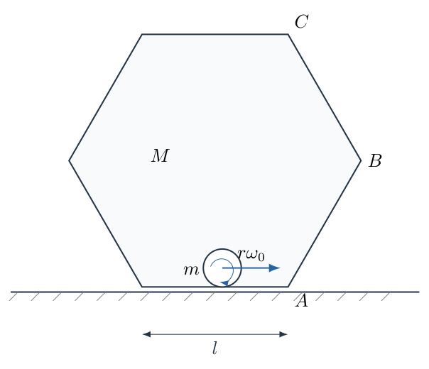
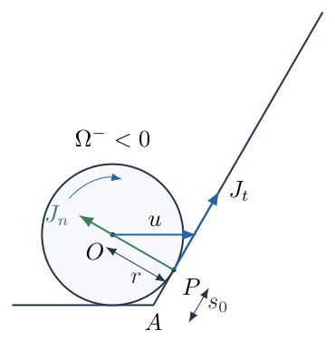
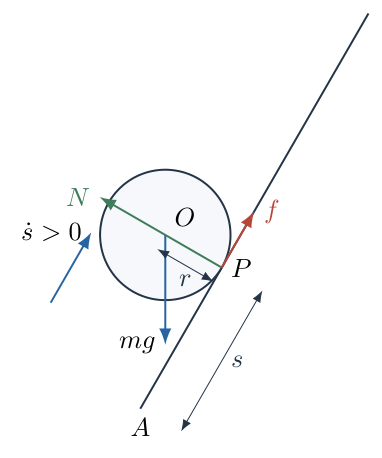
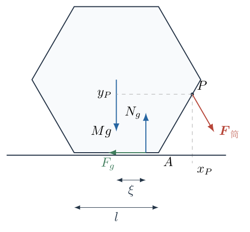

# 第 2 题

质量为 $M$、截面边长为 $l$ 的正六边形均匀薄壁筒内，放有质量为 $m$、半径为 $r<l/4$ 的均匀实心圆柱。初始时薄壁筒固定在摩擦足够大的水平地面上，圆柱在筒的水平底面上以角速度大小 $\omega_0$ 向右纯滚动，随后与侧面 $AB$ 碰撞，碰撞时间很短。

（1）若碰撞中圆柱不脱离 $AB$ 面，且碰撞结束瞬间与 $AB$ 面无相对滑动，求圆柱与筒壁间摩擦因数的最小值 $\mu_0$。

（2）求碰撞结束瞬间圆柱的角速度。

（3）选取足够大的摩擦因数，使圆柱在 $AB$ 面上继续纯滚动。碰撞结束后立即解除薄壁筒的固定。要求圆柱刚好不能接触 $BC$ 侧面，且薄壁筒保持静止，求 $\omega_0$ 满足的临界关系及 $M$ 的最小值。重力加速度为 $g$。

## 一、题型定位

刚体斜向碰撞、冲量与角冲量、滚动约束及支持域判定。碰撞阶段筒被固定，地面可通过固定装置提供冲量；之后固定解除，才需检查筒的静力平衡与倾覆条件。两个阶段不能共用“筒自由运动”的假设。

## 二、知识点

均匀实心圆柱转动惯量 $I=mr^2/2$；接触点速度为质心平动速度与转动速度之和；碰撞中切向冲量受摩擦锥限制；纯滚动的平动与转动方程；机械能守恒；有限支撑区间内合支持力作用点的可行性。

## 三、物理图像

圆柱先在水平面上顺时针滚动。撞到向右上倾斜的 $AB$ 后，法向速度被消除，切向摩擦冲量使顺时针转速减小，并使质心沿 $AB$ 向上运动。之后圆柱把动能转化为重力势能，达到最高位置时速度与角速度同时为零，再沿同一面滚回。筒壁受到向右下方的接触力，其力矩随接触点升高而增大，最易倾覆的时刻在最高位置。

## 四、解题入口

取 $AB$ 的切向单位矢量 $\boldsymbol t$ 指向右上方，法向单位矢量 $\boldsymbol n$ 指向筒内。先分别消除接触点的法向和切向相对速度，得到碰撞冲量。再用沿壁坐标 $s=AP$ 描述接触点位置，求圆柱同时接触 $BC$ 的几何上限，最后用地面合支持力必须落在底边内这一条件求 $M$。

## 五、解析

（1）坐标、转动正向与碰撞前状态。

以筒的底边中点为水平坐标原点，取向右为 $x$ 正向、向上为 $y$ 正向，逆时针为角速度正向。于是

$$\begin{aligned}
A&=\left(\frac l2,0\right),\\
B&=\left(l,\frac{\sqrt3\,l}{2}\right),\\
C&=\left(\frac l2,\sqrt3\,l\right),\\
\boldsymbol t&=\left(\frac12,\frac{\sqrt3}{2}\right),\\
\boldsymbol n&=\left(-\frac{\sqrt3}{2},\frac12\right).
\end{aligned}$$

两矢量相互垂直且模长均为 $1$。设碰撞前质心速率为 $u$，纯滚动给出

$$u=r\omega_0,\qquad \boldsymbol v^- =u\boldsymbol e_x,\qquad
\Omega^-=-\omega_0=-\frac ur.$$

这里 $\omega_0$ 是非负的大小，而 $\Omega$ 是带正负号的角速度，不能在角冲量方程中把二者混用。

图 2-2 中，$P$ 为 $AB$ 上的接触点，质心 $O$ 满足 $\overrightarrow{PO}=r\boldsymbol n$。沿壁的切向冲量 $J_t$ 取向右上为正，法向冲量 $J_n$ 取向筒内为正。

（2）先求接触点的碰前速度，确定摩擦冲量方向。

圆柱上与筒壁相接触的物质点相对于质心的位置为

$$\overrightarrow{OP}=-r\boldsymbol n.$$

利用刚体速度公式，

$$\begin{aligned}
\boldsymbol v_P^-
&=\boldsymbol v^-+\Omega^-\boldsymbol e_z\times(-r\boldsymbol n),\\
\boldsymbol e_z\times\boldsymbol n&=-\boldsymbol t,\\
\boldsymbol v_P^-&=u\boldsymbol e_x-u\boldsymbol t.
\end{aligned}$$

将该式分别投影到 $\boldsymbol n$ 和 $\boldsymbol t$：

$$\begin{aligned}
v_{Pn}^-&=u\boldsymbol e_x\cdot\boldsymbol n
=-\frac{\sqrt3}{2}u,\\
v_{Pt}^-&=u\boldsymbol e_x\cdot\boldsymbol t-u
=-\frac12u.
\end{aligned}$$

负法向速度表示接近筒壁；负切向速度表示接触点沿壁向左下滑。因此摩擦冲量应沿 $+\boldsymbol t$，而不是简单地“与质心向右运动相反”。摩擦判断使用的是接触点相对壁面的速度。

（3）平动冲量方程与法向冲量。

碰撞时间很短，重力冲量与接触冲量相比可忽略。设碰后质心沿壁速度为 $w\boldsymbol t$，其中 $w>0$。不脱离壁面且碰后无穿透要求质心的法向速度为零，所以

$$m(\boldsymbol v^+-\boldsymbol v^-)=J_n\boldsymbol n+J_t\boldsymbol t.$$

投影到法向：

$$\begin{aligned}
m\left(0+\frac{\sqrt3}{2}u\right)&=J_n,\\
J_n&=\frac{\sqrt3}{2}mu.
\end{aligned}$$

投影到切向：

$$\begin{aligned}
m\left(w-\frac u2\right)&=J_t,\\
w&=\frac u2+\frac{J_t}{m}.
\end{aligned}$$

碰后 $v_y^+=\sqrt3 w/2>0$，圆柱离开水平底面。底面不能向下拉圆柱，也不需要提供维持底面接触的冲量；碰撞后再沿底面滚动的模型不适用。

（4）角冲量方程与碰后无滑动约束。

法向冲量的作用线经过圆柱质心，不产生质心角冲量。切向冲量产生的角冲量为

$$\begin{aligned}
\Delta L_O
&=(-r\boldsymbol n)\times(J_t\boldsymbol t),\\
(\boldsymbol n\times\boldsymbol t)\cdot\boldsymbol e_z&=-1,\\
I(\Omega^+-\Omega^-)&=rJ_t.
\end{aligned}$$

代入 $I=mr^2/2$，得到

$$\Omega^+=-\frac ur+\frac{2J_t}{mr}.$$

碰后接触点无相对滑动意味着

$$w+r\Omega^+=0.$$

把上式中的 $\Omega^+$ 和前一步的 $w$ 同时代入，而不是只对质心速度作投影：

$$\begin{aligned}
\left(\frac u2+\frac{J_t}{m}\right)
+\left(-u+\frac{2J_t}{m}\right)&=0,\\
-\frac u2+\frac{3J_t}{m}&=0,\\
J_t&=\frac16mu,\\
w&=\frac23u.
\end{aligned}$$

因此有符号的角速度及其大小分别为

$$\boxed{\Omega^+=-\frac23\omega_0},\qquad
\boxed{\omega^+=\frac23\omega_0}.$$

转动仍为顺时针，只是大小减小。

（5）碰撞阶段的摩擦因数下限。

在接触法向冲量非负的条件下，摩擦锥约束为

$$|J_t|\leq\mu J_n.$$

代入前两步求得的冲量：

$$\begin{aligned}
\mu&\geq\frac{mu/6}{\sqrt3\,mu/2}
=\frac1{3\sqrt3},\\
\mu_0&=\frac1{3\sqrt3}.
\end{aligned}$$

该结果是理想单次接触冲量模型下，实现碰后恰好无滑动的阈值。它不是后来在斜面上维持纯滚动所需的摩擦因数；两者对应不同的方程与运动阶段。

（6）用固定接触点角动量作独立核对。

在冲量阶段对空间固定的点 $P$ 取角动量，接触冲量对 $P$ 的力矩为零。碰前质心相对 $P$ 的位置为 $r\boldsymbol n$，所以

$$\begin{aligned}
L_P^-&=I\Omega^-+(r\boldsymbol n\times mu\boldsymbol e_x)_z\\
&=-\frac12mru-\frac12mru=-mru.
\end{aligned}$$

碰后

$$\begin{aligned}
L_P^+&=I\left(-\frac wr\right)
+(r\boldsymbol n\times mw\boldsymbol t)_z\\
&=-\frac12mrw-mrw=-\frac32mrw.
\end{aligned}$$

令 $L_P^+=L_P^-$，再次得到 $w=2u/3$。这一核对使用了不同的取矩点，能直接检查前面角冲量的符号是否正确。

不能把碰撞看成机械能守恒。碰前、碰后的动能为

$$\begin{aligned}
K^-&=\frac12mu^2+\frac12\frac{mr^2}{2}\frac{u^2}{r^2}
=\frac34mu^2,\\
K^+&=\frac34m\left(\frac{2u}{3}\right)^2
=\frac13mu^2,\\
K^--K^+&=\frac5{12}mu^2>0.
\end{aligned}$$

（7）碰后沿 $AB$ 滚动的受力与加速度。

固定装置已解除，但先研究“筒确实保持静止”的候选运动，之后检验其可行性。图 2-3 中，圆柱受到重力、沿 $\boldsymbol n$ 的支持力 $N$ 和沿 $+\boldsymbol t$ 的静摩擦力 $f$。令沿壁坐标为 $s=AP$，质心也沿与壁平行的直线运动。

直线轨道没有法向加速度，因此

$$N=mg\cos60^\circ=\frac12mg.$$

切向牛顿方程、质心转动方程及滚动约束为

$$\begin{aligned}
m\ddot s&=f-mg\sin60^\circ,\\
I\dot\Omega&=rf,\\
\Omega&=-\frac{\dot s}{r}.
\end{aligned}$$

先对滚动约束求时间导数，再代入转动方程：

$$\begin{aligned}
\dot\Omega&=-\frac{\ddot s}{r},\\
f&=-\frac{I}{r^2}\ddot s=-\frac m2\ddot s,\\
m\ddot s&=-\frac m2\ddot s-\frac{\sqrt3}{2}mg,\\
\ddot s&=-\frac g{\sqrt3},\\
f&=\frac{mg}{2\sqrt3}.
\end{aligned}$$

所以持续纯滚动至少要求

$$\mu\geq\frac fN=\frac1{\sqrt3}>\mu_0.$$

圆柱上行与下行时 $\ddot s$ 的符号相同，静摩擦方向均沿壁向上。速度经过零点时不应凭速度方向翻转摩擦，受力方程已决定了摩擦方向。

（8）确定碰撞结束时的初始接触位置。

由 $O=A+s\boldsymbol t+r\boldsymbol n$，质心高度为

$$y_O=\frac{\sqrt3}{2}s+\frac r2.$$

刚碰到 $AB$ 时仍与底面相切，质心高度为 $r$，故

$$\begin{aligned}
r&=\frac{\sqrt3}{2}s_0+\frac r2,\\
s_0&=\frac r{\sqrt3}.
\end{aligned}$$

初始接触点不是顶点 $A$。忽略圆柱半径，直接把沿壁行程写成 $l$，会同时改变角速度临界值和筒质量临界值。

（9）确定与 $BC$ 接触的几何上限。

$BC$ 面指向筒内的单位法向为

$$\boldsymbol n_2=\left(-\frac{\sqrt3}{2},-\frac12\right).$$

圆柱还未接触 $BC$ 时，质心到 $BC$ 直线的距离大于 $r$。恰好相切时，该距离等于 $r$。因 $B=A+l\boldsymbol t$，有

$$\begin{aligned}
\overrightarrow{BO}&=(s-l)\boldsymbol t+r\boldsymbol n,\\
\boldsymbol n_2\cdot\boldsymbol t&=-\frac{\sqrt3}{2},\\
\boldsymbol n_2\cdot\boldsymbol n&=\frac12,\\
\boldsymbol n_2\cdot\overrightarrow{BO}
&=\frac{\sqrt3}{2}(l-s)+\frac r2.
\end{aligned}$$

令最后一式等于 $r$：

$$\begin{aligned}
\frac{\sqrt3}{2}(l-s_*)+\frac r2&=r,\\
s_*&=l-\frac r{\sqrt3},\\
\Delta s_{\max}=s_*-s_0&=l-\frac{2r}{\sqrt3}.
\end{aligned}$$

相应质心上升高度是

$$\begin{aligned}
H&=\Delta s_{\max}\sin60^\circ\\
&=\frac{\sqrt3 l}{2}-r.
\end{aligned}$$

这里两次减去的 $r/\sqrt3$ 分别来自下端底面接触和上端邻面接触，不能只保留其中一次。

（10）利用能量求初始角速度临界值。

碰撞之后的纯滚动阶段，静止筒壁上的接触点瞬时速度为零，静摩擦不作功。重力势能增加来自平动与转动动能共同减少：

$$\begin{aligned}
K^+&=\frac34mw^2
=\frac34m\left(\frac{2r\omega_0}{3}\right)^2
=\frac13mr^2\omega_0^2,\\
mgH&=\frac13mr^2\omega_0^2.
\end{aligned}$$

得到

$$\boxed{\omega_{0,\mathrm c}^2
=\frac{3g}{r^2}\left(\frac{\sqrt3 l}{2}-r\right)},$$

或

$$\boxed{\omega_{0,\mathrm c}
=\frac1r\sqrt{3g\left(\frac{\sqrt3 l}{2}-r\right)}}.$$

这表示到达 $BC$ 的几何接触边界时速度恰为零的临界极限。若严格要求整个运动过程中从不接触 $BC$，需取 $\omega_0<\omega_{0,\mathrm c}$；“刚好不能接触”采用的是该不等式的上确界，而不是以非零速度碰上 $BC$。

由匀减速公式也可验证：

$$\begin{aligned}
0-w^2&=2\left(-\frac g{\sqrt3}\right)(s_*-s_0),\\
\frac{4r^2\omega_0^2}{9}
&=\frac{2g}{\sqrt3}\left(l-\frac{2r}{\sqrt3}\right),
\end{aligned}$$

化简后得到同一临界关系。

（11）筒受到的作用力必须放在壁面接触点。

由作用反作用，圆柱对筒的力为

$$\begin{aligned}
\boldsymbol F_{\text{筒}}
&=-N\boldsymbol n-f\boldsymbol t,\\
F_x&=\frac{\sqrt3}{2}N-\frac12f
=\frac{mg}{2\sqrt3},\\
F_y&=-\frac12N-\frac{\sqrt3}{2}f
=-\frac12mg.
\end{aligned}$$

该力作用于 $P$，不是圆柱质心 $O$。图 2-4 将 $P$ 的位置、筒重力和地面合支持力分开表示；筒的重心在底边中点正上方，因此其重力对底边中点的力矩为零。

以底边中点为取矩点。接触点坐标为

$$x_P=\frac l2+\frac s2,\qquad y_P=\frac{\sqrt3}{2}s.$$

接触力的逆时针力矩为

$$\begin{aligned}
\tau_P&=x_PF_y-y_PF_x\\
&=-\left(\frac l2+\frac s2\right)\frac{mg}{2}
-\frac{\sqrt3 s}{2}\frac{mg}{2\sqrt3}\\
&=-mg\left(\frac l4+\frac s2\right).
\end{aligned}$$

注意向右的水平力由于作用点高于地面，也产生顺时针力矩，不能漏掉第二项。

（12）支持力作用点与质量下限。

设地面对筒的竖直合支持力为 $N_g$，作用点的横坐标为 $\xi$。水平平衡和竖直平衡先给出

$$F_g=-\frac{mg}{2\sqrt3},\qquad
N_g=Mg+\frac12mg.$$

地面水平摩擦在地面高度上，对底边中点没有力矩。力矩平衡为

$$\begin{aligned}
\xi N_g&=mg\left(\frac l4+\frac s2\right),\\
\xi&=\frac{m(l/4+s/2)}{M+m/2}.
\end{aligned}$$

底边的支持域为 $-l/2\leq\xi\leq l/2$。本题 $\xi>0$，只需检查右端边界：

$$\begin{aligned}
\frac{m(l/4+s/2)}{M+m/2}&\leq\frac l2,\\
m\left(\frac l2+s\right)&\leq Ml+\frac{ml}{2},\\
M&\geq\frac{ms}{l}.
\end{aligned}$$

<!-- KEEP_STUDENT_START -->

$\xi$ 随 $s$ 单调增加，因此临界上升运动在 $s=s_*$ 最危险。于是

$$\boxed{M_{\min}=m\left(1-\frac{r}{\sqrt3\,l}\right)}.$$

等号对应地面合支持力恰好落在底边右端。若希望保留严格的抗倾覆裕度，实际应取 $M>M_{\min}$。

（13）最后检查各模型的相容性。

地面保持静止还要求其摩擦承载足够。所需摩擦因数满足

$$\mu_g\geq
\frac{|F_g|}{N_g}
=\frac{m}{\sqrt3(2M+m)}.$$

题设已说明地面摩擦足够大，因此不再将该条件作为额外未知量。筒保持静止时，碰后能量计算不需加入筒的动能；若质量小于上述界限，筒发生倾覆，原来的固定斜面解也随之失效，不能继续沿用。

角速度平方的量纲为 $gH/r^2$，即 $\mathrm{s}^{-2}$；质量下限为质量 $m$ 乘无量纲因子。$r<l/4$ 保证 $H>0$、$\Delta s_{\max}>0$。当 $r/l$ 趋于零时，$M_{\min}$ 趋近 $m$，圆柱最高接触点越靠近顶点 $B$，筒的抗倾覆要求越高，符合力矩图像。

<!-- KEEP_STUDENT_END -->

## 六、关键洞察

碰撞冲量问题的约束是“接触点瞬时无滑动”，后续滚动动力学的约束是“随时间保持无滑动”。前者需要的切向冲量与法向冲量之比为 $1/(3\sqrt3)$，后者需要的静摩擦与支持力之比为 $1/\sqrt3$。两者差一个因子 $3$，不是计算误差，而是物理任务不同。

对筒的倾覆判定不必先猜哪个顶点即将抬起。先求合支持力作用点 $\xi(s)$，再让它留在支撑区间内，能统一处理一整段运动。力矩的作用点若错放到圆柱质心，就漏掉接触力的转动效应，所得质量阈值会错误。

## 七、易错点

把碰撞中的机械能也守恒，会误得过大的碰后速率。把角速度大小直接代入逆时针正向的方程，会错判摩擦冲量的转动方向。圆柱的“无滑动”不是质心速度沿壁这一条件，还包括 $w+r\Omega=0$。

最高位置不是 $P=B$，圆柱先与 $BC$ 相切；初始接触点也不是 $P=A$。倾覆计算必须包括水平力的高处力臂。达到几何边界时没有非零速度碰撞，不等于已经证明从不相切，应区别临界等号与严格不接触的不等号。

## 八、课堂讲解建议

先让学生只计算接触点的两个速度分量，不急于列冲量方程；画出 $\boldsymbol t$、$\boldsymbol n$ 和顺时针转动方向后，逐项解释负切向速度为何要求正切向冲量。板书把碰撞阶段、沿壁滚动阶段、筒的静力平衡分成三个并列方程组，每个方程旁标清研究对象。

讲解几何行程时，用两次相切条件分别确定 $s_0$ 和 $s_*$，避免直接背出修正长度。最后让学生比较“对圆柱质心取矩”与“对筒底边中点取矩”，检查两个模型的作用点是否被混同。

## 九、变式训练

变式：把实心圆柱改为转动惯量 $I=\kappa mr^2$ 的轴对称滚动物体，其他条件不变，求碰后速率、碰撞摩擦阈值、持续滚动摩擦阈值、临界 $\omega_0$ 及质量下限，其中 $\kappa>0$。

解：法向冲量仍为 $J_n=\sqrt3\,mu/2$。切向速度和角速度为

$$w=\frac u2+\frac{J_t}{m},\qquad
\Omega^+=-\frac ur+\frac{J_t}{\kappa mr}.$$

代入 $w+r\Omega^+=0$：

$$\begin{aligned}
-\frac u2+\left(1+\frac1\kappa\right)\frac{J_t}{m}&=0,\\
J_t&=\frac{\kappa mu}{2(1+\kappa)},\\
w&=\frac{1+2\kappa}{2(1+\kappa)}u,\\
\mu_{0,\kappa}&=\frac{\kappa}{\sqrt3(1+\kappa)}.
\end{aligned}$$

持续滚动阶段由 $f=-\kappa m\ddot s$ 得到

$$\ddot s=-\frac{g\sin60^\circ}{1+\kappa},\qquad
f=\frac{\kappa}{1+\kappa}mg\sin60^\circ,$$

因此

$$\mu_{\mathrm{roll},\kappa}
=\frac{\sqrt3\,\kappa}{1+\kappa}.$$

将碰后总动能 $\frac12m(1+\kappa)w^2$ 与 $mgH$ 相等：

$$\boxed{\omega_{0,\mathrm c}^2
=\frac{8(1+\kappa)gH}{(1+2\kappa)^2r^2}}.$$

对筒的接触载荷计算，若仍以 $s=AP$ 表示接触点，

$$F_x=\frac{\sqrt3\,mg}{4(1+\kappa)},\qquad
F_y=-\frac{mg(1+4\kappa)}{4(1+\kappa)}.$$

在右底角 $A$ 取矩，接触力产生顺时针力矩大小

$$\begin{aligned}
-\tau_A
&=\frac s2\,\frac{mg(1+4\kappa)}{4(1+\kappa)}
+\frac{\sqrt3 s}{2}\,\frac{\sqrt3 mg}{4(1+\kappa)}\\
&=\frac12mgs.
\end{aligned}$$

筒重力相对于 $A$ 的逆时针力矩为 $Mgl/2$。故仍有

$$M\geq\frac{ms}{l},\qquad
\boxed{M_{\min}=m\left(1-\frac r{\sqrt3l}\right)}.$$

质量阈值与 $\kappa$ 无关，而临界初始角速度和摩擦阈值随 $\kappa$ 改变。代入 $\kappa=1/2$，所有结果逐项恢复本题。
