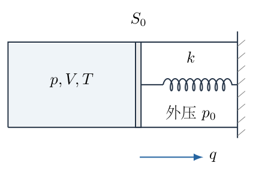
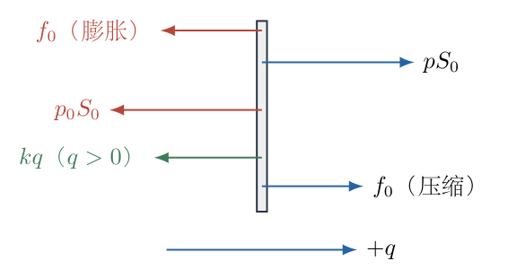
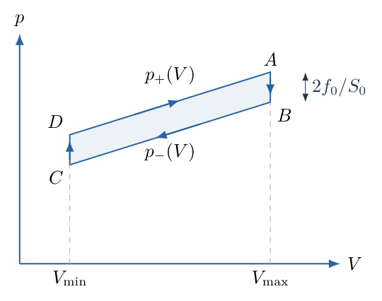

# 第 4 题

一摩尔理想气体封闭在初始体积为 $V_0$ 的气缸内。初始温度为 $T_0$，气体初始压强与恒定的外界压强均为 $p_0$。活塞面积为 $S_0$，活塞与气缸间的最大静摩擦力为

$$f_0=0.1p_0S_0.$$

活塞右侧通过劲度系数为 $k$ 的弹簧连接固定墙面，初始弹簧处于原长。缓慢地反复加热和冷却气体，使温度在 $0.5T_0$ 与 $1.5T_0$ 之间变化。

（1）求稳定循环中的最大、最小体积。

（2）在 $p$—$V$ 图中表示循环，并求一循环内气体对外做功。

## 一、题型定位

带弹簧和摩擦的准静态热力学循环。活塞运动方向不同，摩擦方向不同，膨胀线与压缩线不重合；在温度转向后，活塞可能先保持不动，形成等容过程。循环功等于 $p$—$V$ 图中的有向面积。

## 二、知识点

理想气体状态方程；活塞力平衡；静摩擦范围与滑动方向；弹簧形变量和体积变化的关系；二次方程物理解；等容换向；循环功积分；弹簧势能、外压功与摩擦耗散的区别。

## 三、物理图像

加热使压强上升，但最初可以由静摩擦抵消增加的推力，体积不必立即改变。向右膨胀时，气体需要克服外压、弹簧回复力和左向摩擦；向左压缩时，摩擦改为向右，同一体积处所需气体压强比膨胀时低。两条运动直线由两个等容换向段连接成闭合回线。

## 四、解题入口

用活塞向右位移 $q=(V-V_0)/S_0$ 表示弹簧变形，先建立膨胀与压缩的压强线，再分别与最高、最低温度的等温条件联立。特别注意：题干仅给最大静摩擦，未给滑动摩擦定律。以下计算采用常见的理想准静态库仑模型——滑动摩擦大小也取 $f_0$，忽略活塞惯性。若不采用这一补充模型，原有条件不足以唯一决定运动支线和循环功。

## 五、解析

（1）初态关系与模型范围。

一摩尔理想气体满足

$$p_0V_0=RT_0.$$

弹簧初始无形变，内外压强相等，静摩擦初始可以为零，不应在初态额外加上一个大小固定的 $f_0$。静摩擦大小由平衡所需决定，只要不超过上限即可。

设活塞质量带来的惯性效应可忽略，外界压强恒为 $p_0$。为使缓慢运动可用连续平衡支线描述，取滑动摩擦与最大静摩擦同为 $f_0$。这一假设不仅是一个符号约定，而是决定答案是否唯一的必要模型信息。

（2）把弹簧力改写成体积的函数。

活塞位移与体积变化关系为

$$V=V_0+S_0q,\qquad q=\frac{V-V_0}{S_0}.$$

向右为正时，弹簧对活塞的力为

$$F_{\mathrm s}=-kq.$$

当 $V>V_0$，弹簧受到压缩，推活塞向左；当 $V<V_0$，弹簧伸长，拉活塞向右，二者均由 $-kq$ 统一表示。不能在整个循环中把弹簧力固定取左向。

图 4-2 中，气体压力的合力向右，外压合力向左。摩擦箭头分运动方向列出，后面方程实际采用同一向右正方向。

（3）膨胀支线的压强方程。

当活塞向右运动，摩擦为 $-f_0$。平衡方程为

$$pS_0-p_0S_0-kq-f_0=0.$$

代入 $q=(V-V_0)/S_0$ 后，逐项除以 $S_0$：

$$\boxed{p_+(V)=p_0+\frac{k}{S_0^2}(V-V_0)+\frac{f_0}{S_0}}.$$

$k(V-V_0)/S_0^2$ 具有压强量纲：$k$ 为力每长度，体积除以面积平方为长度的倒数。若误写 $k(V-V_0)/S_0$，量纲将变为力，不是压强。

（4）压缩支线与静止范围。

当活塞向左运动，摩擦向右：

$$pS_0-p_0S_0-kq+f_0=0.$$

得到

$$\boxed{p_-(V)=p_0+\frac{k}{S_0^2}(V-V_0)-\frac{f_0}{S_0}}.$$

同一体积处，两条支线相距

$$p_+(V)-p_-(V)=\frac{2f_0}{S_0}.$$

活塞静止时，静摩擦需抵消除摩擦之外的合力，所以

$$\left|S_0(p-p_0)-\frac{k}{S_0}(V-V_0)\right|\leq f_0.$$

除以 $S_0$：

$$p_-(V)\leq p\leq p_+(V).$$

因此两条运动线之间的区域是可由静摩擦维持固定体积的区域，不是一条缺少信息的“第三运动线”。

（5）建立无量纲状态方程。

定义

$$u=\frac V{V_0},\qquad
\theta=\frac T{T_0},\qquad
\alpha=\frac{kV_0}{p_0S_0^2},\qquad
\eta=\frac{f_0}{p_0S_0}=0.1.$$

$\alpha$ 表示体积变化为 $V_0$ 所产生的弹簧压力与外压之比，$\eta$ 表示摩擦压力与外压之比。状态方程化为

$$\frac p{p_0}=\frac{\theta}{u}.$$

膨胀、压缩支线为

$$\frac{p_\pm}{p_0}=1\pm\eta+\alpha(u-1).$$

联立得到

$$\boxed{\theta=\alpha u^2+(1\pm\eta-\alpha)u}.$$

正号用于膨胀，负号用于压缩，不能根据温度升降以外的任意符号猜测。

（6）最高温度处的最大体积。

最高温度为 $\theta=1.5$，此时位于膨胀支线：

$$\alpha u_{\max}^2+(1.1-\alpha)u_{\max}-1.5=0.$$

若 $\alpha>0$，二次方程的两根乘积为 $-1.5/\alpha<0$，一正一负。体积必须为正，保留正根：

$$\boxed{u_{\max}
=\frac{\alpha-1.1+
\sqrt{(1.1-\alpha)^2+6\alpha}}{2\alpha}}.$$

为避免小 $\alpha$ 时两个接近数相减，也可把分子有理化。令 $\beta=1.1-\alpha$，则

$$\begin{aligned}
u_{\max}
&=\frac{-\beta+\sqrt{\beta^2+6\alpha}}{2\alpha}\\
&=\frac{(-\beta+\sqrt{\beta^2+6\alpha})
(\beta+\sqrt{\beta^2+6\alpha})}
{2\alpha(\beta+\sqrt{\beta^2+6\alpha})}\\
&=\frac{3}{\beta+\sqrt{\beta^2+6\alpha}}.
\end{aligned}$$

两种写法等价，后一种数值稳定。最终 $V_{\max}=V_0u_{\max}$。

（7）最低温度处的最小体积。

最低温度为 $\theta=0.5$，位于压缩支线：

$$\alpha u_{\min}^2+(0.9-\alpha)u_{\min}-0.5=0.$$

同样舍弃负根：

$$\boxed{u_{\min}
=\frac{\alpha-0.9+
\sqrt{(0.9-\alpha)^2+2\alpha}}{2\alpha}},$$

或

$$\boxed{u_{\min}
=\frac{1}{0.9-\alpha+\sqrt{(0.9-\alpha)^2+2\alpha}}}.$$

最终 $V_{\min}=V_0u_{\min}$。在 $u=1$ 时，膨胀支线对应 $\theta=1.1$，小于最高温度；压缩支线对应 $\theta=0.9$，大于最低温度。故必有

$$u_{\max}>1,\qquad 0<u_{\min}<1.$$

这也是所选根的物理核对，不仅是代数要求。

（8）换向并不立即变成另一条运动线。

以最大体积处的状态 $A$ 为起点。其温度为 $1.5T_0$，压强为 $p_+(V_{\max})$。开始冷却后，活塞先静止，温度与压强下降，静摩擦逐渐由左向变为右向。直到压强降到 $p_-(V_{\max})$，才开始压缩，记此点为 $B$。

由等容过程 $\theta=(p/p_0)u$，有

$$\theta_B=1.5-2\eta u_{\max}.$$

同理，最低温度状态 $C$ 的体积为 $V_{\min}$。开始加热后先等容，直至进入膨胀支线的 $D$ 点：

$$\theta_D=0.5+2\eta u_{\min}.$$

这些温度都在题设范围内。由于弹簧只会限制膨胀，$u_{\max}\leq1.5/1.1$；又有 $u_{\min}<1$，所以

$$\theta_B\geq1.5-0.2\frac{1.5}{1.1}>0.5,\qquad
\theta_D<0.7<1.5.$$

因此四段循环确实可以在给定温度区间内完整闭合。

（9）绘制并读取循环路径。

图 4-3 中，$D\to A$ 沿较高压强线膨胀，$A\to B$ 等容冷却，$B\to C$ 沿较低压强线压缩，$C\to D$ 等容加热。

两个斜边平行，间距为 $2f_0/S_0$；两个竖边的体积分别为 $V_{\min}$、$V_{\max}$。图是结构示意，不将未给数值的弹簧参数伪装成唯一数值图。

（10）逐段积分循环功，而不是只背面积结论。

气体对外功的符号取膨胀为正：

$$W=\oint p\,\mathrm dV.$$

两个等容段 $\mathrm dV=0$，不作体积功。膨胀段：

$$\begin{aligned}
W_{DA}
&=\int_{V_{\min}}^{V_{\max}}
\left[p_0+\frac{k}{S_0^2}(V-V_0)+\frac{f_0}{S_0}\right]\mathrm dV\\
&=\left(p_0+\frac{f_0}{S_0}\right)(V_{\max}-V_{\min})\\
&\quad+\frac{k}{2S_0^2}
\left[(V_{\max}-V_0)^2-(V_{\min}-V_0)^2\right].
\end{aligned}$$

压缩段积分上限小于下限：

$$\begin{aligned}
W_{BC}
&=\int_{V_{\max}}^{V_{\min}}
\left[p_0+\frac{k}{S_0^2}(V-V_0)-\frac{f_0}{S_0}\right]\mathrm dV\\
&=-\left(p_0-\frac{f_0}{S_0}\right)(V_{\max}-V_{\min})\\
&\quad-\frac{k}{2S_0^2}
\left[(V_{\max}-V_0)^2-(V_{\min}-V_0)^2\right].
\end{aligned}$$

相加后，恒定外压功和弹簧势能变化各自相消，只留下摩擦贡献：

$$\boxed{W=\frac{2f_0}{S_0}(V_{\max}-V_{\min})
=0.2p_0V_0(u_{\max}-u_{\min})}.$$

又因 $p_0V_0=RT_0$，

$$\boxed{W=0.2RT_0(u_{\max}-u_{\min})}.$$

循环顺时针、面积为正，与气体净对外作功的符号一致。

（11）摩擦耗散、外压功与弹簧势能分别核对。

一循环活塞往返路程为 $2(V_{\max}-V_{\min})/S_0$，滑动摩擦耗散为

$$E_{\mathrm f}
=f_0\frac{2(V_{\max}-V_{\min})}{S_0}=W.$$

恒定外界压强的循环净功为 $p_0\oint\mathrm dV=0$。弹簧势能为 $kq^2/2$，循环回到同一体积、同一形变量，净变化也为零。因此气体循环功等于摩擦耗散，并非“弹簧没有储能”，而是它的储能在闭合循环中净变化为零。

气体内能是状态函数，闭合循环 $\Delta U=0$，第一定律给出净吸热等于 $W$。不需额外假设气体为单原子气体；若求每段热量，才需要其摩尔定容热容。

（12）弹簧消失与很硬时的极限。

$k=0$ 即 $\alpha=0$ 时，不应直接代入含 $2\alpha$ 的二次根式。回到一次方程：

$$u_{\max}=\frac{1.5}{1.1}=\frac{15}{11},\qquad
u_{\min}=\frac{0.5}{0.9}=\frac59.$$

于是

$$\begin{aligned}
u_{\max}-u_{\min}&=\frac{80}{99},\\
W&=\frac{16}{99}p_0V_0.
\end{aligned}$$

当 $\alpha\gg1$，令 $u=1+\delta$，忽略二阶小量 $\alpha\delta^2$ 相对于一阶主量：

$$\begin{aligned}
1.5&=1.1+(\alpha+1.1)\delta_{\max}+O(\alpha\delta_{\max}^2),\\
0.5&=0.9+(\alpha+0.9)\delta_{\min}+O(\alpha\delta_{\min}^2).
\end{aligned}$$

所以 $u_{\max}-u_{\min}\sim0.8/\alpha$，循环功趋近零。弹簧越硬，活塞位移越小，与几何面积图一致。

（13）初始过程与稳定循环，以及答案的条件性。

从题给初态出发若先加热，体积保持 $V_0$ 到 $T=1.1T_0$ 才开始膨胀；若先冷却，则到 $0.9T_0$ 才开始压缩。这是进入稳定回线前的起始过程。最高和最低温度均越过各自的起动阈值，所以后续稳定循环的两个极端体积仍由上述根式确定。

仅给最大静摩擦时，若实际滑动摩擦小于 $f_0$ 或依赖速度，活塞起动后可能经历非准静态的跃迁，运动支线与耗散就会改变。不能仅凭“缓慢加热”推出滑动摩擦等于最大静摩擦。上述盒中答案均以本题明确声明的等摩擦、无惯性准静态模型为前提；这一限制应与结果一同保留。

## 六、关键洞察

摩擦使同一体积对应不同的运动压强，产生热力学回线。温度反向不等于活塞速度立刻反向，必须先穿过静摩擦可维持的压力区间。这两个等容段决定循环能否闭合，也解释为何循环面积不会因加热无限缓慢而消失。

可不先算每段功，直接写

$$W=\int_{V_{\min}}^{V_{\max}}
[p_+(V)-p_-(V)]\,\mathrm dV,$$

但完整推导仍应证明等容段不作功、反向积分符号相反。面积法与能量耗散法相互独立地给出同一结果，是检验循环方向的有效工具。

## 七、易错点

将 $f_0$ 当成初态已经存在的摩擦，会把 $p_0V_0=RT_0$ 改错。弹簧位移不是 $V-V_0$，需要除以活塞面积；弹簧压力又需再除以一次面积。压缩时摩擦方向反转，但弹簧回复力仍按实际形变量决定。

把升温、降温全程当作同一条可逆路径，会得到零功；把两端换向直接接起来而漏等容段，则路径不闭合。静摩擦上限不自动等于滑动摩擦定律，不能把条件性计算写成不依赖模型的唯一答案。

## 八、课堂讲解建议

先让学生在 $V=V_0$ 时回答“静摩擦是零还是 $f_0$”，建立静摩擦自适应的观念，再画活塞受力。板书用同一正方向分别写膨胀和压缩方程，检查每一项的单位，尤其是 $S_0^2$。

在 $p$—$V$ 图上标出四个转向状态，再逐段讨论温度变化和体积是否变化。课堂最后比较积分、回线面积和摩擦路程三种求功方法；同时提醒题目补充模型的必要性，不用未经给出的滑动摩擦性质掩盖条件不足。

## 九、变式训练

变式：温度上下限改为 $(1+\Delta)T_0$ 与 $(1-\Delta)T_0$，其中 $0<\Delta<1$，等摩擦模型的 $\eta=f_0/(p_0S_0)$ 满足 $0<\eta<1$。求发生循环位移的条件，并在 $k=0$ 时求净功。

解：初始 $u=1$ 时，静止范围对应 $1-\eta\leq\theta\leq1+\eta$。若 $\Delta\leq\eta$，整个温度范围均可由静摩擦保持固定体积，$W=0$。临界等号只是达到起动边界，尚无有限行程。

若 $\Delta>\eta$，两端均越过阈值。$k=0$ 时

$$u_{\max}=\frac{1+\Delta}{1+\eta},\qquad
u_{\min}=\frac{1-\Delta}{1-\eta}.$$

相减并通分：

$$\begin{aligned}
u_{\max}-u_{\min}
&=\frac{(1+\Delta)(1-\eta)-(1-\Delta)(1+\eta)}
{1-\eta^2}\\
&=\frac{2(\Delta-\eta)}{1-\eta^2}.
\end{aligned}$$

因此

$$\boxed{W=
\frac{4\eta(\Delta-\eta)}{1-\eta^2}p_0V_0,\qquad\Delta>\eta}.$$

当 $\Delta\to\eta^+$，循环行程和功连续趋于零；当 $\eta\to0^+$，回线宽度趋零，即使行程非零，净功仍趋零。

