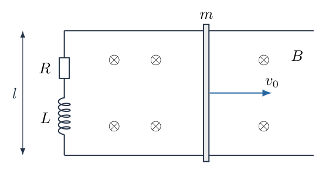
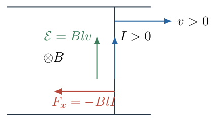
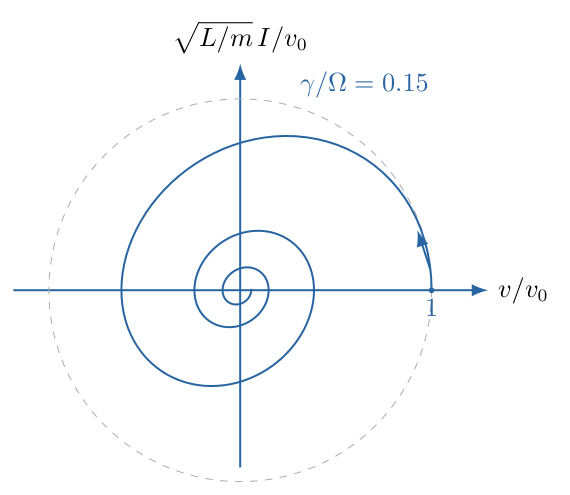
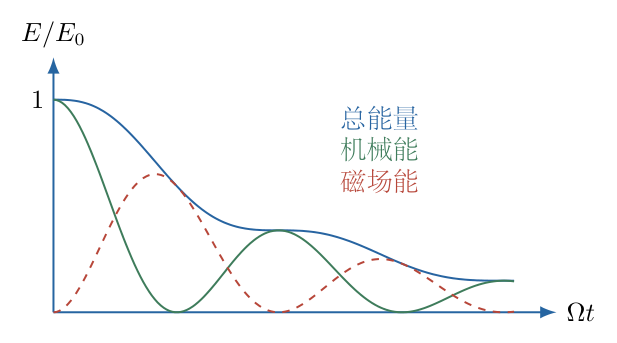

# 第 5 题

两条平行导轨相距 $l$，由电阻 $R$ 和电感 $L$ 串联连接。一根质量为 $m$ 的导体棒跨接导轨并可无摩擦滑动。均匀磁场大小为 $B$，方向垂直导轨平面向内；电阻较小，导轨和棒的其他电阻忽略。初始电流为零，棒原先静止，随后获得沿导轨向右的初速度 $v_0$。以获得初速度后的时刻为 $t=0$，求棒的速度 $v(t)$。

## 一、题型定位

电磁感应与力学耦合的阻尼振动。电感使电流不能瞬时建立，故磁阻力不是始终正比于棒速的单一阻力。机械能与磁场能互相转化，电阻逐渐耗散二者总能量。

## 二、知识点

动生电动势；法拉第电磁感应定律与楞次定律；电感电压；安培力；耦合的一阶方程和二阶常系数方程；欠阻尼、临界阻尼、过阻尼；初值；电磁与机械能的统一收支。

## 三、物理图像

最初 $I=0$，棒虽然有速度，却暂时不受磁力。电流随后增大，向左的磁力使棒减速。若电阻很小，电感储存的能量来得及返还给棒，棒可向左运动，电流也会周期性改变方向。因此“楞次定律阻碍变化”并不意味着棒的速度永远为正，或安培力永远与瞬时速度相反。

## 四、解题入口

取棒向右速度为正，电流在棒中向上为正。先写电路方程 $L\dot I+RI=Blv$，再写棒的方程 $m\dot v=-BlI$。消去 $I$ 得二阶速度方程，必须保留由初始电流为零带来的 $\dot v(0)=0$。

## 五、解析

（1）电流、磁场和力的方向。

图 5-2 中，磁场 $\boldsymbol B=-B\boldsymbol e_z$，棒速 $\boldsymbol v=v\boldsymbol e_x$。正电荷的动生作用方向为

$$\boldsymbol v\times\boldsymbol B
=vB\boldsymbol e_y,$$

故 $v>0$ 时棒内的动生电动势向上。约定沿棒向上的电流为正，整个回路正向为逆时针，磁通量相应为负。

若棒位置为 $x$，回路磁通量为 $\Phi_B=-Blx$，由法拉第定律

$$\mathcal E=-\dot\Phi_B=Bl\dot x=Blv.$$

棒所受安培力为

$$\boldsymbol F=I(l\boldsymbol e_y)\times(-B\boldsymbol e_z)
=-BlI\boldsymbol e_x.$$

电流为负时力也反向。式中 $I$ 与 $v$ 都带符号，不在运动反向时重新改约定。

（2）建立两个互相耦合的一阶方程。

电动势用于电阻压降和电感的电流变化：

$$L\dot I+RI=Blv.$$

牛顿第二定律：

$$m\dot v=-BlI.$$

初值为

$$v(0)=v_0,\qquad I(0)=0.$$

立即得到 $\dot v(0)=0$。在初始瞬间不能把 $I$ 直接写成 $Blv_0/R$，因为电感阻止电流突变。

（3）消去电流，得到二阶方程。

对力学方程求时间导数：

$$m\ddot v=-Bl\dot I.$$

由电路方程

$$\dot I=\frac{Blv-RI}{L}.$$

代入并用 $I=-m\dot v/(Bl)$：

$$\begin{aligned}
m\ddot v
&=-\frac{B^2l^2}{L}v+\frac{BlR}{L}I\\
&=-\frac{B^2l^2}{L}v-\frac{mR}{L}\dot v.
\end{aligned}$$

除以 $m$，得到

$$\boxed{\ddot v+\frac RL\dot v+
\frac{B^2l^2}{mL}v=0}.$$

定义

$$\gamma=\frac R{2L},\qquad
\Omega=\frac{Bl}{\sqrt{mL}}.$$

两者均具有 $\mathrm{s}^{-1}$ 的量纲，方程写成

$$\ddot v+2\gamma\dot v+\Omega^2v=0.$$

注意这是速度本身的振子方程，不能把解误写成棒位移再忘记求导。

（4）电阻较小时的欠阻尼解。

严格的欠阻尼条件为

$$\gamma<\Omega
\quad\Longleftrightarrow\quad
R^2<\frac{4B^2l^2L}{m}.$$

仅说“电阻小”表达的是倾向，具体分支仍应由该不等式决定。令

$$\omega=\sqrt{\Omega^2-\gamma^2}
=\sqrt{\frac{B^2l^2}{mL}-\frac{R^2}{4L^2}}.$$

特征根为 $-\gamma\pm i\omega$，所以通解为

$$v=e^{-\gamma t}(A\cos\omega t+C\sin\omega t).$$

初始速度给出 $A=v_0$。再求导并代入 $t=0$：

$$\begin{aligned}
\dot v(0)&=-\gamma A+\omega C=0,\\
C&=\frac{\gamma v_0}{\omega}.
\end{aligned}$$

得到

$$\boxed{v(t)=v_0e^{-\gamma t}
\left(\cos\omega t+\frac{\gamma}{\omega}\sin\omega t\right)}.$$

正弦项虽然在 $t=0$ 为零，却对初始加速度条件不可缺少。仅保留衰减余弦会错误地使 $\dot v(0)=-\gamma v_0$。

（5）求电流并代回两个方程核验。

对速度解求导：

$$\begin{aligned}
\dot v
&=v_0e^{-\gamma t}
\left[-\gamma\cos\omega t
-\frac{\gamma^2}{\omega}\sin\omega t
-\omega\sin\omega t+\gamma\cos\omega t\right]\\
&=-v_0e^{-\gamma t}\frac{\gamma^2+\omega^2}{\omega}\sin\omega t\\
&=-v_0e^{-\gamma t}\frac{\Omega^2}{\omega}\sin\omega t.
\end{aligned}$$

因此

$$\boxed{I(t)=\frac{Blv_0}{L\omega}
e^{-\gamma t}\sin\omega t}.$$

初始电流为零，初始变化率为

$$\dot I(0)=\frac{Blv_0}{L},$$

与电路方程一致。速度的初始展开为

$$v(t)=v_0-\frac12\Omega^2v_0t^2+O(t^3),$$

没有一次项，符合最初无磁力、随后电流逐渐建立的物理图像。

（6）速度反向时电流不必同时反向。

图 5-3 用 $v/v_0$ 与 $\sqrt{L/m}\,I/v_0$ 表示电磁状态。初态在速度轴正端，电流先增大；速度可以到零而电流仍为正，故安培力继续向左使棒越过零速状态。

对于 $\gamma>0$，第一次零速满足

$$\cos\omega t+\frac{\gamma}{\omega}\sin\omega t=0.$$

第一象限内两项均为正，第一次根在第二象限，因此

$$t_1=\frac{\pi-\arctan(\omega/\gamma)}{\omega}.$$

不能直接使用主值 $\arctan(-\omega/\gamma)/\omega$，否则得到负时间。此时 $\sin\omega t_1>0$，所以 $I(t_1)>0$、$\dot v(t_1)<0$。棒不会停在零速点，而会反向运动。

（7）临界阻尼解。

若 $\gamma=\Omega$，特征根重合为 $-\gamma$，通解为

$$v=(A+Ct)e^{-\gamma t}.$$

由 $A=v_0$ 和 $\dot v(0)=C-\gamma A=0$，

$$\boxed{v(t)=v_0(1+\gamma t)e^{-\gamma t}}.$$

电流为

$$\boxed{I(t)=\frac{Blv_0}{L}\,t\,e^{-\gamma t}}.$$

也可从欠阻尼解取 $\omega\to0$，利用 $\sin\omega t/\omega\to t$、$\cos\omega t\to1$，得到同一结果。

（8）过阻尼解。

若 $\gamma>\Omega$，定义

$$\sigma=\sqrt{\gamma^2-\Omega^2}>0.$$

两个实根为 $-\gamma+\sigma$ 和 $-\gamma-\sigma$。由两初值求常数，可写成双曲函数形式：

$$\boxed{v(t)=v_0e^{-\gamma t}
\left(\cosh\sigma t+\frac{\gamma}{\sigma}\sinh\sigma t\right)},$$

$$\boxed{I(t)=\frac{Blv_0}{L\sigma}
e^{-\gamma t}\sinh\sigma t}.$$

由于 $\sigma<\gamma$，两个指数都衰减；括号对 $t\geq0$ 为正，速度不反向。临界与过阻尼都不是“把振动频率取成负数”，而是特征根类型改变。

（9）电阻为零时的能量交换。

$R=0$ 时，$\gamma=0$、$\omega=\Omega$，解退化为

$$v=v_0\cos\Omega t,\qquad
I=\frac{Blv_0}{L\Omega}\sin\Omega t.$$

利用 $\Omega=Bl/\sqrt{mL}$，电流振幅为 $v_0\sqrt{m/L}$。机械动能与磁场能分别为

$$\frac12mv^2=\frac12mv_0^2\cos^2\Omega t,\qquad
\frac12LI^2=\frac12mv_0^2\sin^2\Omega t.$$

两者之和恒为初始动能。不存在电阻热，却仍可周期减速和反向，说明磁力不应被等同于不可逆耗散阻力。

（10）任意电阻下的能量方程。

将力学方程乘以 $v$，电路方程乘以 $I$：

$$\begin{aligned}
mv\dot v&=-BlIv,\\
LI\dot I+RI^2&=BlIv.
\end{aligned}$$

相加时，电磁能量交换项抵消：

$$\boxed{\frac{\mathrm d}{\mathrm dt}
\left(\frac12mv^2+\frac12LI^2\right)=-RI^2\leq0}.$$

图 5-4 示意总能量单调衰减，但机械能与磁场能可以此消彼长；不能用机械能曲线暂时增加来判定“能量不守恒”。

若 $R>0$，三个阻尼分支均趋于 $v=I=0$，故

$$\int_0^\infty RI^2\,\mathrm dt=\frac12mv_0^2.$$

全部初始机械能最终转化为电阻热，而不是始终直接以机械功率形式即时耗散。

（11）由积分方程求总位移，作另一条核对。

对力学方程从零积分至无穷，利用 $v(\infty)=0$：

$$\begin{aligned}
m(0-v_0)&=-Bl\int_0^\infty I\,\mathrm dt,\\
\int_0^\infty I\,\mathrm dt&=\frac{mv_0}{Bl}.
\end{aligned}$$

再积分电路方程，利用 $I(0)=I(\infty)=0$：

$$\begin{aligned}
L[I(\infty)-I(0)]+R\int_0^\infty I\,\mathrm dt
&=Bl\int_0^\infty v\,\mathrm dt,\\
\Delta x&=\frac{mRv_0}{B^2l^2}.
\end{aligned}$$

这是带方向的净位移，不是所有往返路程之和。其形式不含 $L$，但时间曲线强烈依赖 $L$；积分结果不能替代完整的速度解。

（12）无电感近似的适用范围。

若电路响应时间 $L/R$ 远小于机械减速时间 $mR/(B^2l^2)$，且已离开最初的电流建立阶段，可近似 $L\dot I\ll RI$，得到

$$I\approx\frac{Bl}{R}v,\qquad
\dot v\approx-\frac{B^2l^2}{mR}v.$$

于是近似指数减速时间常数为 $mR/(B^2l^2)$。这并非小电阻题目的通用解；电阻越小，该时间尺度比较越可能失效。尤其 $t=0$ 的 $I=0$ 初值不能被准稳态欧姆式覆盖。

## 六、关键洞察

电感为电流增加一个独立状态变量，棒的速度不能单独用瞬时欧姆定律决定。二阶振子来源于两个一阶能量交换方程，不是凭形式把“阻尼振动公式”套上去。

可将变量换为 $u=\sqrt m\,v$、$j=\sqrt L\,I$，得到

$$\dot u=-\Omega j,\qquad
\dot j=\Omega u-2\gamma j.$$

无电阻时状态矢量在 $(u,j)$ 平面以角速度 $\Omega$ 转动；有电阻时仅 $j$ 分量直接受到耗散，但耦合使总能量衰减。这也解释了相图中的螺旋结构。

## 七、易错点

把电感电压写成 $LI$ 而不是 $L\dot I$，会同时破坏量纲和初值。由 $I(0)=0$ 得到的是 $\dot v(0)=0$，不是 $v(0)=0$。忽略欠阻尼解的正弦项会违背这个初始加速度条件。

楞次定律约束感应作用对磁通变化的反馈，不要求安培力在含储能电感的每个时刻都消耗机械能。$R\to0^+$ 时衰减时间趋于无穷，不能把 $R>0$ 的最终静止结论直接套在 $R=0$ 的永恒振动上。

## 八、课堂讲解建议

先用右手规则明确棒中正电流和磁力方向，再写两个一阶方程。板书消元时保留 $I=-m\dot v/(Bl)$ 这一中间式，让学生检查电阻项为何最终是正阻尼项。

课堂比较电流零、速度零和总能量极值三种时刻，说明它们不重合。用状态图解释小电阻反向运动，再用能量方程确认耗散非负；最后检查初值和无电阻极限，避免只用“减速”的直觉限制解的符号。

<!-- KEEP_TOGETHER_START -->

## 九、变式训练

变式：导体棒初速度仍为 $v_0$，电感初始电流为 $I_a$，其正向沿棒向上。在欠阻尼条件下求 $v(t)$，并求 $R>0$ 时净位移。

解：二阶方程不变，初始加速度改为 $\dot v(0)=-BlI_a/m$。若 $v=e^{-\gamma t}(v_0\cos\omega t+C\sin\omega t)$，则

$$-\gamma v_0+\omega C=-\frac{BlI_a}{m},$$

所以

$$\boxed{v=e^{-\gamma t}\left[
v_0\cos\omega t+
\frac{\gamma v_0-BlI_a/m}{\omega}\sin\omega t\right]}.$$

积分力学方程仍得 $\int I\,\mathrm dt=mv_0/(Bl)$。积分电路方程时，电感端点项变为 $-LI_a$：

$$\boxed{\Delta x=\frac{mRv_0}{B^2l^2}-\frac{LI_a}{Bl}}.$$

初始电流为正时，储存的磁场能先推动棒向左，净位移可减小甚至变负；结果不与能量守恒冲突，因为初始总能量还包括 $LI_a^2/2$。

<!-- KEEP_TOGETHER_END -->
