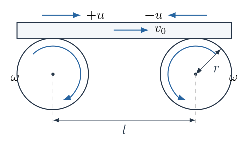
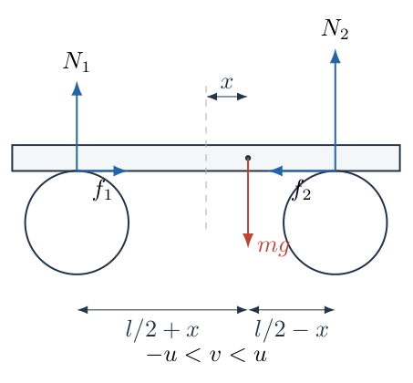
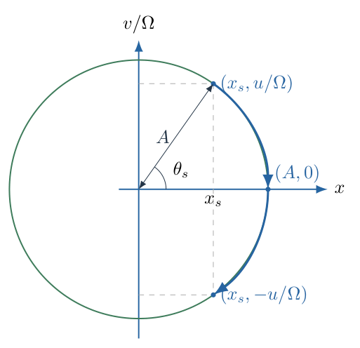
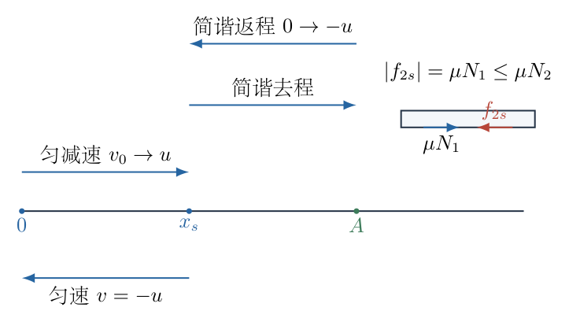

# 第 1 题

两个半径均为 $r$ 的圆柱绕固定轴以恒定角速度 $\omega$ 转动，两轴间距为 $l$。圆柱上方与木板接触的表面分别向内运动。将质量为 $m$ 的均匀长木板水平放在两圆柱上，木板足够长，与两圆柱之间的摩擦因数均为 $\mu$，重力加速度为 $g$。初始时木板质心在两轴的正中间。

（a）给木板一个沿水平方向的小初速度 $v_0$，求木板振动的周期 $T$。

（b）增大 $v_0$，木板可能离开左侧圆柱。要求木板始终不离开圆柱，分别求 $l$ 较小和较大时 $v_0$ 的最大值，并给出两种情况的分界。

（c）在（b）的第二种情况中，取 $v_0$ 小于对应的最大值，求木板质心第一次回到初始位置的时间 $t$。

## 一、题型定位

接触约束与分段摩擦动力学。小速度时两侧滑动摩擦合成线性回复力；速度超过辊面速度后，摩擦方向改变，运动不再始终服从同一个简谐方程。大速度运动必须在不同接触状态之间连续拼接。

## 二、知识点

摩擦方向由相对速度确定；竖直平衡与力矩平衡给出支持力；单侧接触要求支持力非负；线性回复力、简谐运动和相平面；匀减速运动的位移—速度关系；静摩擦的可行性与运动状态切换。

## 三、物理图像

板的质心向右偏移时，右侧支持力增加，左侧支持力减少。在板速小于两个辊面的线速度时，左侧摩擦向右、右侧摩擦向左，合力指向中心。板向右运动得过快时，两个接触处都阻碍板向右滑动，合力变为大小恒定的左向摩擦力。返程板速到达右辊面速度后，板可以暂时随右辊以恒速向左运动，而不是无限制地继续增大左向速率。

## 四、解题入口

先定义辊面速度 $u=\omega r$，再比较板速 $v$ 与 $+u$、$-u$。支持力与位置有关，摩擦方向与速度有关，因此不能只看位置或只看速度。以 $x$ 表示质心离两轴中点的水平位移，以向右为正，先求 $N_1(x)$、$N_2(x)$，再分速度区间求合力。

## 五、解析

（1）明确模型与两种正方向。

圆柱接触点的高度相同。采用长板保持水平的理想模型，竖直加速度和角加速度都为零；接触切向力在板下表面引起的有限厚度转动力矩忽略不计。这里的 $r$ 只通过辊面速度 $u=\omega r$ 影响状态切换，并不进入小振动的回复力系数。

图 1-2 中，左接触点到质心的水平距离为 $l/2+x$，右接触点到质心的距离为 $l/2-x$。注意这两个力臂与支持力的编号不能交换。

沿竖直方向列平衡方程：

$$N_1+N_2=mg.$$

对质心取矩，左侧支持力与右侧支持力的转动效应相反，因此

$$N_1\left(\frac l2+x\right)=N_2\left(\frac l2-x\right).$$

将第二式展开，并把第一式代入：

$$\begin{aligned}
\frac l2(N_1-N_2)+x(N_1+N_2)&=0,\\
N_1-N_2&=-\frac{2mg}{l}x,\\
N_1&=mg\left(\frac12-\frac{x}{l}\right),\\
N_2&=mg\left(\frac12+\frac{x}{l}\right).
\end{aligned}$$

这一步是联立“和”与“差”求两个未知量。右移后 $N_1$ 减少、$N_2$ 增加，与力矩直觉一致。

（2）接触条件应写成不等式。

圆柱可以向上支持木板，却不能向下拉木板。因而接触成立的条件为

$$N_1\geq0,\qquad N_2\geq0,$$

即

$$-\frac l2\leq x\leq\frac l2.$$

若 $x>l/2$，计算得到 $N_1<0$，并不是左圆柱提供了“负支持力”，而是水平双接触模型已经失效。临界位置 $x=l/2$ 对应 $N_1=0$，是将要脱离左支点的边界。若要求支持力始终严格为正，下面的“最大值”应理解为可取初速度的上确界，实际取值须略小于它。

（3）由相对速度决定滑动摩擦。

左辊面向右速度为 $+u$，右辊面向左速度为 $-u$。木板相对两个辊面的速度分别为

$$v-u,\qquad v+u.$$

当 $-u<v<u$ 时，左接触处板相对辊面向左滑，摩擦向右；右接触处板相对辊面向右滑，摩擦向左。于是

$$\begin{aligned}
f_1&=+\mu N_1,\\
f_2&=-\mu N_2,\\
F_x&=\mu(N_1-N_2)=-\frac{2\mu mg}{l}x.
\end{aligned}$$

当 $v>u$ 时，两个相对速度都为正，两侧摩擦都向左：

$$F_x=-\mu(N_1+N_2)=-\mu mg.$$

当 $v<-u$ 时，两侧摩擦都向右：

$$F_x=+\mu mg.$$

这些式子适用于滑动区间。恰好 $v=\pm u$ 时，一个接触点相对静止，必须另检验静摩擦能否维持相应状态，不能直接把它看成又一个滑动区间。

（4）低速区间的简谐方程与周期。

在 $|v|<u$ 内，由牛顿第二定律得到

$$m\ddot x=-\frac{2\mu mg}{l}x.$$

定义

$$\Omega=\sqrt{\frac{2\mu g}{l}},\qquad k=m\Omega^2=\frac{2\mu mg}{l},$$

则方程化为

$$\ddot x+\Omega^2x=0.$$

根据 $x(0)=0$、$\dot x(0)=v_0$，先写通解 $x=C_1\cos\Omega t+C_2\sin\Omega t$。初始位置给出 $C_1=0$，初始速度给出 $C_2=v_0/\Omega$，所以

$$\begin{aligned}
x(t)&=\frac{v_0}{\Omega}\sin\Omega t,\\
v(t)&=v_0\cos\Omega t,\\
A&=\frac{v_0}{\Omega}.
\end{aligned}$$

一个完整周期对应相位增加 $2\pi$，故（a）的答案是

$$\boxed{T=\frac{2\pi}{\Omega}=2\pi\sqrt{\frac{l}{2\mu g}}.}$$

适用条件要同时满足 $v_0<u$ 和 $A<l/2$。周期中没有 $m$，因为支持力、摩擦力和惯性均与板的质量成正比，列动力学方程后质量消去。这种简谐运动虽由摩擦力产生，却不是“静止支承面上摩擦耗尽后停下”的情形：两个持续驱动的辊在不同阶段向板输入和取出能量。

（5）先确定最大初速度是否会超过 $u$。

如果整个运动都在低速区间，板刚好到达 $x=l/2$ 时速度为零。由振幅公式，临界初速度为

$$v_{0,\max}=\Omega\frac l2=\sqrt{\frac{\mu gl}{2}}.$$

这个结论自洽的条件是临界速度不超过辊面速度：

$$\begin{aligned}
\sqrt{\frac{\mu gl}{2}}&\leq u,\\
l&\leq\frac{2u^2}{\mu g}.
\end{aligned}$$

因此第一种情况为

$$\boxed{l<\frac{2\omega^2r^2}{\mu g},\qquad
v_{0,\max}=\sqrt{\frac{\mu gl}{2}}.}$$

不能把这个式子不加检验地用于任意 $l$。当 $l$ 很大时，它会给出 $v_0>u$，而这已经改变了最初阶段的摩擦方向。

（6）第二种情况的第一个阶段：两侧均向左滑动摩擦。

现设

$$l>\frac{2u^2}{\mu g},\qquad v_0>u.$$

板从中心向右运动，起初加速度为 $-\mu g$。记板速降到 $u$ 的时刻为 $t_1$，相应位移为 $x_s$。由速度公式

$$u=v_0-\mu gt_1,$$

得

$$t_1=\frac{v_0-u}{\mu g}.$$

将其代入位移，或直接用速度—位移关系，可得到

$$\begin{aligned}
x_s&=v_0t_1-\frac12\mu gt_1^2\\
&=\frac{v_0(v_0-u)}{\mu g}-\frac{(v_0-u)^2}{2\mu g}\\
&=\frac{(v_0-u)(v_0+u)}{2\mu g}\\
&=\frac{v_0^2-u^2}{2\mu g}.
\end{aligned}$$

因 $v_0>u$，有 $x_s>0$。在此时刻之后，板速继续下降，进入 $-u<v<u$ 的简谐区间。

（7）简谐段并非从 $x=0$ 开始。

以这一段的起点为局部时间 $\tau=0$，其初值是 $x=x_s$、$v=u$。解为

$$\begin{aligned}
x(\tau)&=x_s\cos\Omega\tau+\frac{u}{\Omega}\sin\Omega\tau,\\
v(\tau)&=-\Omega x_s\sin\Omega\tau+u\cos\Omega\tau.
\end{aligned}$$

为求最右位置，把两个同频正弦项合成为一个振幅：

$$A=\sqrt{x_s^2+\frac{u^2}{\Omega^2}}.$$

等价地，将简谐方程乘以 $\dot x$ 并积分：

$$\frac{d}{dt}\left(\frac12mv^2+\frac12kx^2\right)=0.$$

因此在此运动段内

$$\frac12mu^2+\frac12kx_s^2=\frac12kA^2.$$

这个“等效弹簧能量”只是积分常量，并不表示木板与圆柱之间真的存在弹簧，也不允许跨越摩擦状态变化后仍使用同一个守恒式。

（8）由 $A=l/2$ 求第二种情况下的临界速度。

图 1-3 用 $x$ 与 $v/\Omega$ 作相平面坐标。简谐段位于半径 $A$ 的圆上；从 $(x_s,u/\Omega)$ 到最右点 $(A,0)$，位移继续增大，速度降到零。因此不脱离左支点要求的是 $A\leq l/2$，而不是只要求 $x_s\leq l/2$。

临界情况满足

$$\begin{aligned}
x_s^2+\frac{u^2}{\Omega^2}&=\frac{l^2}{4},\\
x_s&=\sqrt{\frac{l^2}{4}-\frac{lu^2}{2\mu g}},\\
v_{0,\max}^2-u^2&=2\mu g\sqrt{\frac{l^2}{4}-\frac{lu^2}{2\mu g}}.
\end{aligned}$$

这里选择正平方根，是因为这一分支的 $x_s$ 必须为正。最后得到

$$\boxed{v_{0,\max}=\left[u^2+2\mu g\sqrt{\frac{l^2}{4}-\frac{lu^2}{2\mu g}}\right]^{1/2},
\quad l>\frac{2u^2}{\mu g}.}$$

若全部换回题目中的量，也可写成

$$\boxed{v_{0,\max}=\sqrt{\omega^2r^2+\sqrt{\mu^2g^2l^2-2\mu gl\omega^2r^2}}.}$$

两式等价。注意内根号中最后一项含 $r^2$，不是 $r$；内根号的量纲是速度的四次方，外根号才给出速度。

（9）首次回到中心要再分 $v_0\leq u$ 与 $v_0>u$。

（c）只说 $v_0$ 小于最大值，并没有保证 $v_0>u$。在第二种几何情况下，如果仍取 $0<v_0\leq u$，运动不经历第一个匀减速阶段，首次回到中心就是简谐运动的半个周期：

$$\boxed{t=\frac{\pi}{\Omega},\qquad 0<v_0\leq u.}$$

以下才讨论 $u<v_0<v_{0,\max}$。若 $v_0=0$，板始终停在中心，“离开后第一次返回”的事件不存在。

（10）求简谐段持续时间。

定义锐角 $\theta_s$：

$$\cos\theta_s=\frac{x_s}{A},\qquad
\sin\theta_s=\frac{u}{\Omega A},\qquad 0<\theta_s<\frac\pi2.$$

于是刚进入简谐段时

$$x=A\cos(-\theta_s),\qquad v=-\Omega A\sin(-\theta_s)=u.$$

板到达最右点时相位为零，返回到 $x=x_s$ 时相位为 $+\theta_s$，速度恰为 $-u$。相位共增加 $2\theta_s$，所以

$$t_2=\frac{2\theta_s}{\Omega}
=\frac2\Omega\arccos\frac{x_s}{A}.$$

这里的三角反函数取主值，单位为弧度。用 $\arctan$ 也可写为

$$t_2=\frac2\Omega\arctan\frac{u}{\Omega x_s}.$$

在 $x_s\to0^+$ 的边界，后一式应按极限理解，前一式可以直接使用。

（11）返程为什么出现匀速段。

图 1-4 中，板在 $x=x_s>0$ 处达到 $v=-u$。此时板与右辊面相对静止，左接触点仍在滑动，左侧摩擦为 $+\mu N_1$。若板随右辊保持 $v=-u$，需要右侧静摩擦为 $-\mu N_1$，使合力为零。

静摩擦的允许范围为 $|f_{2s}|\leq\mu N_2$。在 $x\geq0$ 内，$N_2\geq N_1$，故

$$|f_{2s}|=\mu N_1\leq\mu N_2.$$

所以这段匀速运动确实能够实现。这里按照题目给出的单一摩擦因数采用静摩擦上限不小于相应滑动摩擦的常见模型；若两者分别给定，应使用实际静摩擦上限重新检验。

也可从两侧的速度趋势判断：若板稍快于 $-u$，在 $x>0$ 处的回复力会使它进一步向左加速；若板稍慢于 $-u$，两侧滑动摩擦都向右，会使左向速率降低。两种趋势都把速度推向 $-u$，而静摩擦能够将其保持在这一值。

从 $x_s$ 回到中心的路程为 $x_s$，速率为 $u$，因此

$$t_3=\frac{x_s}{u}=\frac{v_0^2-u^2}{2\mu gu}.$$

到中心时两侧支持力相等，维持匀速所需的右侧静摩擦达到临界值；若继续进入 $x<0$，该匀速状态不再可行。但题目只问首次回到中心，到此即止。

（12）合并时间并检验边界。

将 $t_1$、$t_2$、$t_3$ 相加，得

$$\boxed{t=\frac{v_0-u}{\mu g}
+\frac2\Omega\arccos\frac{x_s}{\sqrt{x_s^2+u^2/\Omega^2}}
+\frac{x_s}{u},\quad u<v_0<v_{0,\max},}$$

其中

$$u=\omega r,\qquad \Omega=\sqrt{\frac{2\mu g}{l}},\qquad
x_s=\frac{v_0^2-u^2}{2\mu g}.$$

为了直接用题目参数，可把反余弦的自变量化为

$$\frac{x_s}{A}
=\frac{v_0^2-u^2}{\sqrt{(v_0^2-u^2)^2+2\mu glu^2}}.$$

当 $v_0\to u^+$ 时，$x_s\to0$，$t_1,t_3\to0$，$t_2\to\pi/\Omega$，与低速分支连续。两种最大速度在 $l=2u^2/(\mu g)$ 处也都趋于 $u$，因此没有人为造成的答案断裂。

例如取 $\mu=0.25$、$g=10\,\mathrm{m/s^2}$、$u=1\,\mathrm{m/s}$、$l=2\,\mathrm m$，有 $\Omega=\sqrt{2.5}\,\mathrm{s^{-1}}$，分界距离为 $0.8\,\mathrm m$，属于第二种情况。取 $v_0=1.5\,\mathrm{m/s}$，可得 $x_s=0.25\,\mathrm m$、$A\approx0.6801\,\mathrm m<l/2$，故保持接触；时间分别为 $0.2\,\mathrm s$、约 $1.5108\,\mathrm s$、$0.25\,\mathrm s$，总计约 $1.9608\,\mathrm s$。这一计算也展示了为什么不能只把返回时间写成 $T/2$。

## 六、关键洞察

同一装置中存在“位置决定支持力、相对速度决定摩擦方向”两层逻辑。先把这两层分开，才会自然出现常加速度、线性回复力和静摩擦维持的恒速三个状态。

相圆是对某一简谐段的表示，不是整条运动轨迹。第一段进入相圆的点不是纵轴上的点；返程也在 $v=-u$ 处提前离开相圆，不能把圆上的剩余部分照搬为真实运动。

临界初速度本质上是“质心最大偏移不超过支点间半距”。它不是初始动能等于某个全程势能，也不是板速永远小于辊面速度。

## 七、易错点

把 $\omega$ 当成木板振动角频率会把转速与回复力混淆；应分开使用 $\omega$ 与 $\Omega$。把右侧支持力写成随右移减小会使合力变成离心式而不是回复式。把摩擦都写成与绝对速度反向，会在小振动时得到错误的恒定阻力。

超过 $u$ 后若仍写 $m\ddot x=-kx$，第二问的临界速度必然错误。返程达到 $-u$ 后若继续简谐运动而不检验静摩擦，则第三问缺少匀速阶段。在 $v_0\leq u$ 的子区间却套用含负 $t_1$ 的大速度式，同样不成立。

## 八、课堂讲解建议

先让学生给两个辊面画速度箭头，再给木板试设三个速度：$0$、$u/2$、$2u$，分别判断两处相对滑动。随后用质心右移的力矩平衡说明支持力变化，最后才合成回复力。

板书分成“位置约束”和“速度状态”两列。第三问先展示 $v=-u$ 的返程状态，让学生计算维持匀速所需的静摩擦，再检查它是否小于上限。这样匀速段由约束推出，不依赖记忆结论。

## 九、变式训练

变式一：两个接触面的摩擦因数分别为 $\mu_1$、$\mu_2$，且板速保持在两个辊面速度之间，求平衡位置与小振动周期。

仍有 $N_1=mg(1/2-x/l)$、$N_2=mg(1/2+x/l)$，所以

$$\begin{aligned}
F_x&=\mu_1N_1-\mu_2N_2\\
&=\frac{mg}{2}(\mu_1-\mu_2)-\frac{mg}{l}(\mu_1+\mu_2)x\\
&=-\frac{mg}{l}(\mu_1+\mu_2)(x-x_e),\\
x_e&=\frac{l(\mu_1-\mu_2)}{2(\mu_1+\mu_2)}.
\end{aligned}$$

于是

$$T'=2\pi\sqrt{\frac{l}{g(\mu_1+\mu_2)}}.$$

只要两摩擦因数为正，$|x_e|<l/2$，平衡位置位于两支点之间。小振幅还须不越过任何支点，并满足辊面相对滑动方向不变。令 $\mu_1=\mu_2=\mu$ 后回到本题周期。

变式二：把两辊转向都反过来，仍保持 $|v|<u$。此时 $f_1=-\mu N_1$、$f_2=+\mu N_2$，所以 $\ddot x-\Omega^2x=0$。由 $x(0)=0$、$v(0)=v_0$ 得

$$x(t)=\frac{v_0}{\Omega}\sinh\Omega t.$$

位移随时间增大，中点是不稳定平衡。这个结论只在 $v_0\cosh\Omega t<u$ 和 $|x|<l/2$ 的阶段有效；达到任一边界后必须重新分段，不能把双曲函数解无限延续。
