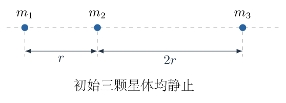
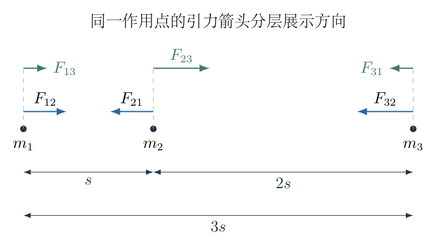
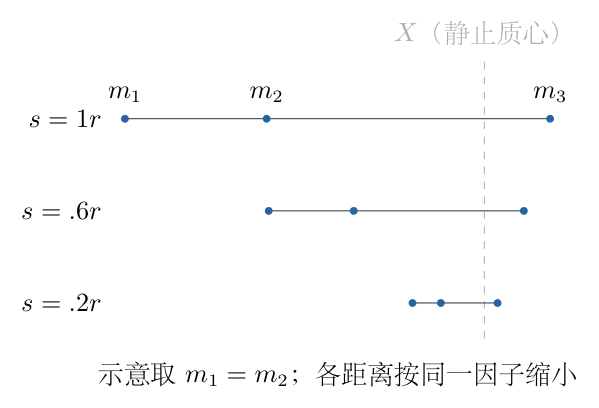
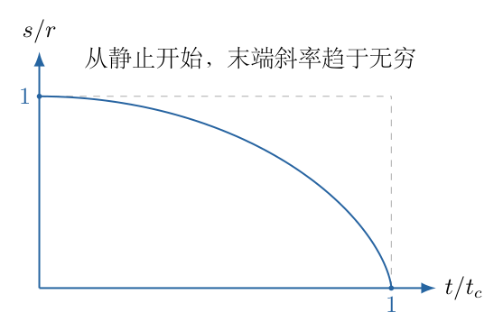

# 第 2 题

在广阔的宇宙中，三颗较小的行星位于同一直线上，初始相对恒星静止，仅在彼此的万有引力作用下相互靠近，直至同时碰撞。三颗行星从左到右的质量分别为 $m_1$、$m_2$、$m_3$。在运动过程中，中间行星到右侧行星的距离始终是它到左侧行星距离的 $n=2$ 倍。初始时左侧两颗行星之间的距离为 $r$。

（1）用 $m_1$、$m_2$ 表示 $m_3$。

（2）用 $m_1$、$m_2$、万有引力常数 $G$ 和初始距离 $r$ 表示三颗行星的相遇时间 $t$。

## 一、题型定位

牛顿引力三体系统的同形收缩解。题设不是任意三体初值问题，而是额外规定三颗星体的形状比例始终不变；这一约束选出特定质量关系，并将运动化为一个反平方吸引的标度变量。

## 二、知识点

万有引力的矢量方向；相对位置的二阶导数；质量关系与同形运动的一致性；质心运动与动量守恒；一维反平方引力的能量积分；代换积分与碰撞时间；退化椭圆轨道的周期类比。

## 三、物理图像

三颗行星保持先后顺序，两个间距按同一个因子缩小。中间行星不一定在某个固定位置不动，左、右外侧行星也不必以相同速率靠近；真正不变的是两个间距的比值。整个系统的质心由于没有外力而静止，但一般不与中间行星重合。

## 四、解题入口

用 $s(t)$ 表示左侧两星的瞬时间距，则右侧间距为 $2s(t)$，最外侧间距为 $3s(t)$。对三颗星分别写带正负号的加速度，再把几何约束二次求导，得到它们加速度之间必须满足的关系。质量确定后，直接求 $\ddot s$，不要把某颗星的加速度误当作相对加速度。

## 五、解析

（1）先把固定形状写成坐标关系。

取向右为正，三颗星的位置记为 $x_1,x_2,x_3$。在碰撞前 $x_1<x_2<x_3$，设

$$s=x_2-x_1>0.$$

题设规定

$$x_3-x_2=2s,\qquad x_3-x_1=3s.$$

因而有一个直接的线性约束：

$$x_3-3x_2+2x_1=0.$$

对时间求一次导数得到 $v_3-3v_2+2v_1=0$，再求一次导数得到

$$\boxed{a_3-3a_2+2a_1=0.}$$

这是把固定距离比转为动力学条件的关键。它并不要求 $a_3=2a_1$，也不要求任意两颗星的加速度大小相等。

（2）逐颗星画出引力方向。

图 2-2 中的每个箭头都朝向施力星体。左侧星体受到两股向右引力；右侧星体受到两股向左引力；中间星体受到一左一右两股引力。

对 $m_1$，除以被加速星体的质量 $m_1$，得

$$\begin{aligned}
m_1a_1&=\frac{Gm_1m_2}{s^2}+\frac{Gm_1m_3}{(3s)^2},\\
a_1&=\frac{G}{s^2}\left(m_2+\frac{m_3}{9}\right).
\end{aligned}$$

对 $m_2$，向右引力为正、向左引力为负，故

$$\begin{aligned}
m_2a_2&=\frac{Gm_2m_3}{(2s)^2}-\frac{Gm_1m_2}{s^2},\\
a_2&=\frac{G}{s^2}\left(\frac{m_3}{4}-m_1\right).
\end{aligned}$$

对 $m_3$，两股引力都向左：

$$\begin{aligned}
m_3a_3&=-\frac{Gm_1m_3}{(3s)^2}-\frac{Gm_2m_3}{(2s)^2},\\
a_3&=-\frac{G}{s^2}\left(\frac{m_1}{9}+\frac{m_2}{4}\right).
\end{aligned}$$

三个式子中的分母 $9$、$4$ 来自距离平方，不是来自质量或距离本身。

（3）代入约束并逐项合并。

将三式代入 $a_3-3a_2+2a_1=0$，约去共同的正因子 $G/s^2$：

$$-\frac{m_1}{9}-\frac{m_2}{4}
-3\left(\frac{m_3}{4}-m_1\right)
+2\left(m_2+\frac{m_3}{9}\right)=0.$$

按同类质量项合并：

$$\begin{aligned}
\left(3-\frac19\right)m_1
+\left(2-\frac14\right)m_2
+\left(\frac29-\frac34\right)m_3&=0,\\
\frac{26}{9}m_1+\frac74m_2-\frac{19}{36}m_3&=0,\\
104m_1+63m_2-19m_3&=0.
\end{aligned}$$

最后一行由上一行乘以 $36$ 得到。因此（1）的答案是

$$\boxed{m_3=\frac{104m_1+63m_2}{19}.}$$

这里 $m_1$ 前的系数是 $104$。若写成 $106$，代回加速度约束将不再为零；后面的碰撞时间系数也会随之改变。

（4）必要条件是否足以保证距离比始终不变。

仅在某一个时刻发现约束成立，并不能保证任意运动都保持该比例。本题之所以可以，是因为引力随共同距离标度以同一个 $s^{-2}$ 因子变化。质量满足刚得到的关系后，对任意 $s>0$，三颗星的加速度都自动满足同一个线性约束。

此外初始位置满足 $x_3-3x_2+2x_1=0$，初始速度均为零，也满足一阶约束。因而可以构造一个保持距离比的解，它符合所有初始条件。碰撞前右端光滑，运动方程的解由初值唯一确定，所以实际解就是这一同形收缩解。这里唯一性只用于 $s>0$ 区间；碰撞点的奇异性另作理想模型的终点处理。

（5）相对加速度包含两颗星各自的加速度。

根据 $s=x_2-x_1$，有

$$\ddot s=a_2-a_1.$$

代入已得的加速度：

$$\begin{aligned}
\ddot s
&=\frac{G}{s^2}\left(\frac{m_3}{4}-m_1-m_2-\frac{m_3}{9}\right)\\
&=-\frac{G}{s^2}\left(m_1+m_2-\frac{5m_3}{36}\right).
\end{aligned}$$

定义有效引力参数

$$\kappa=G\left(m_1+m_2-\frac{5m_3}{36}\right).$$

注意 $\kappa$ 是一个参数，不是单独某颗星的质量。将 $m_3$ 代入并通分：

$$\begin{aligned}
\frac{\kappa}{G}
&=m_1+m_2-\frac{5(104m_1+63m_2)}{36\times19}\\
&=\frac{(684-520)m_1+(684-315)m_2}{684}\\
&=\frac{164m_1+369m_2}{684}\\
&=\frac{41}{171}m_1+\frac{41}{76}m_2.
\end{aligned}$$

由于两质量为正，$\kappa>0$，所以

$$\boxed{\ddot s=-\frac{\kappa}{s^2}}$$

确实描述间距向零缩小。若代数结果给出 $\kappa<0$，则与初始静止后相互靠近矛盾，必须回查符号或质量关系。

（6）质心坐标说明三颗星的共同收缩。

设 $M=m_1+m_2+m_3$，质心位置为 $X$。可先写 $x_2=x_1+s$、$x_3=x_1+3s$，再代入质心定义：

$$X=\frac{m_1x_1+m_2(x_1+s)+m_3(x_1+3s)}{M}
=x_1+\frac{m_2+3m_3}{M}s.$$

于是图 2-3 所示的三个坐标可写成

$$\begin{aligned}
x_1&=X-\frac{m_2+3m_3}{M}s,\\
x_2&=X+\frac{m_1-2m_3}{M}s,\\
x_3&=X+\frac{3m_1+2m_2}{M}s.
\end{aligned}$$

没有外力，初始总动量为零，所以 $X$ 不随时间改变。三个坐标与质心的距离都正比于 $s$，在 $s\to0$ 时共同趋于 $X$，因此确实同时相遇，而不是两颗先相撞后再追上第三颗。

（7）用链式法则将二阶方程积分一次。

初始条件为 $s(0)=r$、$\dot s(0)=0$。令 $w=\dot s$，在收缩过程中 $w<0$。使用

$$\ddot s=\frac{dw}{dt}=\frac{dw}{ds}\frac{ds}{dt}=w\frac{dw}{ds},$$

原方程变成

$$w\,dw=-\frac{\kappa}{s^2}\,ds.$$

从初态 $(r,0)$ 积分到当前 $(s,w)$：

$$\begin{aligned}
\int_0^w w'\,dw'&=-\kappa\int_r^s\frac{ds'}{s'^2},\\
\frac12w^2&=\kappa\left(\frac1s-\frac1r\right).
\end{aligned}$$

左边为非负量，右边在 $s<r$ 时也非负，符号一致。求平方根时根据正在靠近的物理分支选择负号：

$$\boxed{\dot s=-\sqrt{2\kappa\left(\frac1s-\frac1r\right)}.}$$

若取正号，会描述从碰撞点向外扩张的时间反演过程，而不是本题初始静止后的收缩。

（8）将速度关系化为时间积分。

由 $dt=ds/\dot s$，从 $s=r$ 到 $s=0$ 的时间为

$$\begin{aligned}
t&=\int_r^0\frac{ds}{-\sqrt{2\kappa(1/s-1/r)}}\\
&=\int_0^r\frac{ds}{\sqrt{2\kappa(1/s-1/r)}}\\
&=\sqrt{\frac{r}{2\kappa}}\int_0^r\sqrt{\frac{s}{r-s}}\,ds.
\end{aligned}$$

初态附近分母趋零，使时间积分的被积函数发散，但这种发散是 $1/\sqrt{r-s}$ 型，可以积分。不能因初始速度为零就认为碰撞需要无限时间。

（9）完成三角代换，不省略积分上下限。

取

$$s=r\sin^2\theta,\qquad 0\leq\theta\leq\frac\pi2.$$

这样 $s=0$ 对应 $\theta=0$，$s=r$ 对应 $\theta=\pi/2$。同时

$$ds=2r\sin\theta\cos\theta\,d\theta,
\qquad \sqrt{\frac{s}{r-s}}=\tan\theta.$$

代回积分：

$$\begin{aligned}
t&=\sqrt{\frac{r}{2\kappa}}\int_0^{\pi/2}
2r\sin^2\theta\,d\theta\\
&=2r\sqrt{\frac{r}{2\kappa}}\int_0^{\pi/2}
\frac{1-\cos2\theta}{2}\,d\theta\\
&=2r\sqrt{\frac{r}{2\kappa}}
\left[\frac\theta2-\frac{\sin2\theta}{4}\right]_0^{\pi/2}\\
&=\frac\pi2r\sqrt{\frac{r}{2\kappa}}\\
&=\pi\sqrt{\frac{r^3}{8\kappa}}.
\end{aligned}$$

因此（2）的答案为

$$\boxed{t=\pi\sqrt{\frac{r^3}
{8G\left(\dfrac{41}{171}m_1+\dfrac{41}{76}m_2\right)}}.}$$

（10）用运动过程的参数式检验积分。

为了得到从静止开始的时间表达式，可以改用 $s=r\cos^2\phi$，令 $\phi$ 从 $0$ 增加到 $\pi/2$。积分相应给出

$$\begin{aligned}
s(\phi)&=r\cos^2\phi,\\
t(\phi)&=\sqrt{\frac{r^3}{2\kappa}}
\left(\phi+\frac12\sin2\phi\right).
\end{aligned}$$

图 2-4 表示 $s/r$ 随 $t/t_c$ 的变化，其中 $t_c$ 是刚得到的碰撞时间。曲线开始斜率为零，随后越来越陡，符合吸引力随间距缩小而增强的直觉。

直接求导检验：

$$\frac{ds}{d\phi}=-2r\sin\phi\cos\phi,
\qquad \frac{dt}{d\phi}=2\sqrt{\frac{r^3}{2\kappa}}\cos^2\phi.$$

于是

$$\dot s=-\sqrt{\frac{2\kappa}{r}}\tan\phi,$$

与 $1/s-1/r=\tan^2\phi/r$ 代入能量积分后的结果一致。当 $\phi=\pi/2$，参数时间变成 $\pi\sqrt{r^3/(8\kappa)}$，再次得到最终答案。

（11）碰撞终点的奇异性与有限时间。

当 $s\to0$ 时，点质点引力模型给出 $|\dot s|\to\infty$。这是把天体半径忽略后的数学奇异点，不应解释为真实行星获得无限速率。真实行星在中心距离等于相应半径之和时就接触，通常还会发生形变、潮汐和碰撞。

然而在本题理想点质量模型中，碰撞时间仍然有限。因为小 $s$ 时

$$dt\approx\sqrt{\frac{s}{2\kappa}}\,ds,$$

其从 $0$ 到小正数的积分正比于 $s^{3/2}$。速度发散与到达时间发散是两件不同的事。本题计算的是这个理想模型的首次共同相遇时间，不计算相遇后的运动。

（12）量纲、缩放和一个数值检验。

$[G]=\mathrm{m^3\,kg^{-1}\,s^{-2}}$，故 $[\kappa]=\mathrm{m^3\,s^{-2}}$，而 $[r^3/\kappa]=\mathrm{s^2}$，最终式确为时间。

若保持质量比例，将三个质量同时乘以 $a>0$，则 $\kappa$ 乘以 $a$，碰撞时间变为原来的 $a^{-1/2}$；若初始距离乘以 $b$，碰撞时间乘以 $b^{3/2}$。这是反平方引力特有的缩放关系，不是匀加速下落的平方根距离关系。

例如令 $m_1=m_2=m$，则

$$m_3=\frac{167}{19}m,\qquad
\kappa=\frac{533}{684}Gm.$$

在 $Gm=1$、$r=1$ 的一致单位下，碰撞时间约为 $1.2583$。这个值可以通过同时积分三颗星的牛顿方程核验；在碰撞前任意时刻，两间距比应始终为 $2$，且质心不移动。这一检验同时检查质量关系、相对加速度和时间积分，不只是重复代入最终公式。

## 六、关键洞察

三体问题并不是一律不能解析。本题在一个受限初值族上，几何形状固定，只有总体大小变化，因而真正的自由变量只有 $s(t)$。质量条件首先保证“形状方向的加速度”为零，之后才讨论“大小方向的加速度”。

由引力的齐次性，所有加速度都正比于 $s^{-2}$，同一个质量条件可以在全过程成立。对不具有这一共同齐次结构的相互作用，仅在初态满足加速度比例通常不够。

另一个解法是把 $\ddot s=-\kappa/s^2$ 看成单位质量粒子在中心参数 $\kappa$ 下的径向运动。由静止的最远点 $r$ 出发对应退化椭圆的长轴端点，半长轴为 $a=r/2$。开普勒周期为 $2\pi\sqrt{a^3/\kappa}$，从远点到碰撞点是半周期，仍得 $t=\pi\sqrt{r^3/(8\kappa)}$。该类比必须先证明有效参数是 $\kappa$，不能直接把真实总质量填入周期公式。

## 七、易错点

相对坐标 $s$ 的加速度是 $a_2-a_1$，不是 $a_1$；距离比约束是 $a_3-a_2=2(a_2-a_1)$，不是 $a_3=2a_1$。中间星体受到的左右引力应带相反符号。初始间距 $r$ 只属于左侧一段，外侧两星距离为 $3r$。

碰撞时间积分先交换上下限再去掉负号，不能同时保留原上下限和正被积函数。退化椭圆半长轴为 $r/2$，把它误写成 $r$ 会使时间差 $2\sqrt2$ 倍。

## 八、课堂讲解建议

先让学生独立写出三个带方向的加速度，再通过对距离约束求导得到线性关系。板书保留通分的 $36$ 与 $684$，用代回检验识别质量系数是否准确。

时间积分先采用直接能量法，完整演示 $s=r\sin^2\theta$ 的上下限变化。最后展示退化椭圆的半周期解释，帮助学生把一维自由落下与开普勒轨道联系起来，而不是用周期公式替代相对运动建模。

## 九、变式训练

把固定距离比改为一般 $n>0$。设 $x_3-x_2=ns$，则三颗星的加速度为

$$\begin{aligned}
a_1&=\frac{G}{s^2}\left(m_2+\frac{m_3}{(n+1)^2}\right),\\
a_2&=\frac{G}{s^2}\left(\frac{m_3}{n^2}-m_1\right),\\
a_3&=-\frac{G}{s^2}\left(\frac{m_1}{(n+1)^2}+\frac{m_2}{n^2}\right).
\end{aligned}$$

固定比值要求 $a_3-(n+1)a_2+na_1=0$。整理可得

$$m_3=
\frac{\left(n+1-\dfrac1{(n+1)^2}\right)m_1
+\left(n-\dfrac1{n^2}\right)m_2}
{\dfrac{n+1}{n^2}-\dfrac{n}{(n+1)^2}}.$$

分母为正，分子则须根据给定 $n,m_1,m_2$ 检查是否给出正质量。有效参数为

$$\kappa_n=G\left[m_1+m_2-\left(\frac1{n^2}-\frac1{(n+1)^2}\right)m_3\right].$$

若 $m_3>0$ 且 $\kappa_n>0$，由静止开始的碰撞时间仍为 $\pi\sqrt{r^3/(8\kappa_n)}$。令 $n=2$，得到本题；令 $n=1$，质量条件变为 $m_3=m_1$，中间星体处于对称位置不动，且 $\kappa_1=G(m_2+m_1/4)$，也符合直接对称分析。
