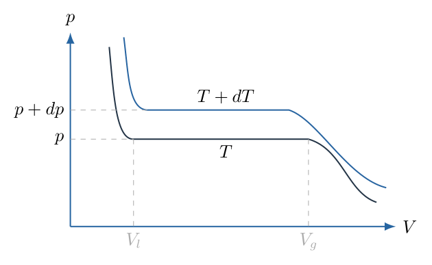
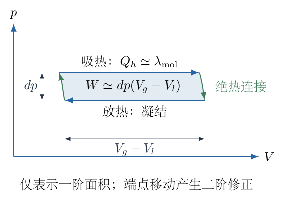
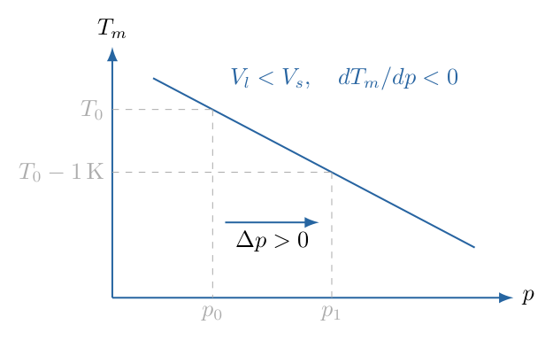

# 第 4 题

在人体中，红细胞的截面可能大于毛细血管的管径，却仍能通过毛细血管。考虑一种简化模型：红细胞的细胞骨架在常态下为固态，通过狭窄血管时由于压强变化而发生固—液相变。先从水的气—液相变讨论相平衡的压强与温度关系。

（1）考虑相邻温度 $T$ 与 $T+dT$ 下的等温曲线，对应的饱和蒸气压分别为 $p$ 与 $p+dp$，液相和气相的摩尔体积为 $V_l$、$V_g$。已知在这两个温度间工作的热机最大效率为 $\eta_m=dT/T$。用摩尔汽化热 $\lambda_{\mathrm{mol}}$、$T$、$V_l$、$V_g$ 表示 $dp/dT$，并在 $V_l\ll V_g$、$\lambda_{\mathrm{mol}}$ 为常量的条件下，采用理想气体近似求饱和蒸气压与温度的关系。

（2）在人体温度附近，若增大压强能使细胞骨架由固态转变为液态，比较液态体积 $V_l$ 与固态体积 $V_s$ 的大小。

（3）取液态密度 $\rho_l=1.0\times10^3\,\mathrm{kg/m^3}$，固态密度 $\rho_s=0.9\times10^3\,\mathrm{kg/m^3}$，熔化热 $\lambda=2.4\times10^4\,\mathrm{J/kg}$，骨架总质量 $m=9\,\mathrm{kg}$。人体温度降低 $1\,\mathrm K$ 时，通过血管所需的附加压强约增加多少？人体温度可取 $T_0\approx310\,\mathrm K$。

## 一、题型定位

用可逆微小热机推导克拉珀龙方程，再将同一相平衡关系用于固—液相变。题目主要考查热力学建模，不是要求给出真实红细胞力学的完整解释。

## 二、知识点

卡诺效率与温度的绝对标度；可逆相变中的潜热；微小循环的面积与机械功；摩尔量与总量的区别；克拉珀龙方程；理想气体代入和分离变量积分；压强促进较小体积相；密度到体积的转换。

## 三、物理图像

气—液相变时，升高温度会提高共存压强，因为汽化需要吸热且使体积增大。固—液相变若熔化使体积减小，增压就偏向液相；此时熔点随压强升高而降低。因此温度较低时，需要更高的压强才能达到同一个熔化条件。

## 四、解题入口

先构造一个在两条相邻共存等温线间运行的可逆小循环，用 $W/Q_h=dT/T$ 把热量和功联系起来。循环宽度是相变体积差，高度是共存压强差。第二问只需看体积差的符号；第三问再把密度转换成总体积，并代入固—液版本的相平衡斜率。

## 五、解析

（1）相变潜热为什么是这个小循环的主要吸热量。

考虑物质在温度 $T+dT$ 的共存压强下从液态变成气态。下文 $Q_h$、$W$ 均按每摩尔计，单位为 $\mathrm{J/mol}$；$V_l$、$V_g$ 也均为摩尔体积。每摩尔可逆汽化吸热为 $\lambda_{\mathrm{mol}}$。在微小温差极限下，循环的高温吸热满足

$$Q_h=\lambda_{\mathrm{mol}}+O(dT).$$

低温下发生反向凝结，另由两条很短的可逆绝热过程连接高、低温状态，从而形成卡诺循环。不能简单用两条等温线和两条任意竖直线来代替可逆绝热连接；那样虽也有几何面积，却不一定具有卡诺效率。

（2）用 $p$—$V$ 面积求一阶做功。

图 4-2 放大了相邻共存线之间的循环。其上下共存压强差为 $dp$，横向宽度的一阶主量为 $V_g-V_l$。

因此循环做功到一阶为

$$W=dp\,(V_g-V_l)+O(dT^2).$$

端点体积会随温度改变，但这只使宽度产生 $O(dT)$ 的修正；再乘压强差 $dp=O(dT)$，影响为二阶。推导微分方程时舍去这些二阶乘积，保留一阶主量。这是微小循环能用近似平行四边形面积计算的原因。

（3）由卡诺效率得到克拉珀龙方程。

精确卡诺效率为 $1-T/(T+dT)$。对小温差展开：

$$\begin{aligned}
\eta_m&=1-\frac{T}{T+dT}
=\frac{dT}{T+dT}\\
&=\frac{dT}{T}+O(dT^2).
\end{aligned}$$

另一方面，效率是净功与高温吸热之比，于是一阶满足

$$\frac{dp\,(V_g-V_l)}{\lambda_{\mathrm{mol}}}=\frac{dT}{T}.$$

把 $dT$ 移到分母，得到

$$\boxed{\frac{dp}{dT}=\frac{\lambda_{\mathrm{mol}}}{T(V_g-V_l)}.}$$

对汽化而言，潜热为正且 $V_g>V_l$，因此共存曲线斜率为正。温度必须是开尔文温度，不能把摄氏温度直接代入效率或方程。

（4）摩尔体积不是常量，必须随状态代入。

当 $V_l\ll V_g$ 时，可忽略液相体积，方程近似为

$$\frac{dp}{dT}\approx\frac{\lambda_{\mathrm{mol}}}{TV_g}.$$

若蒸气为理想气体，$1\,\mathrm{mol}$ 满足

$$pV_g=\mathcal RT,$$

其中 $\mathcal R$ 是摩尔气体常数。于是 $V_g=\mathcal RT/p$，代回得

$$\begin{aligned}
\frac{dp}{dT}
&=\frac{\lambda_{\mathrm{mol}}p}{\mathcal RT^2},\\
\frac{dp}{p}
&=\frac{\lambda_{\mathrm{mol}}}{\mathcal R}\frac{dT}{T^2}.
\end{aligned}$$

这里出现 $T^2$，是因为相平衡方程已有一个 $T$，理想气体摩尔体积又正比于 $T/p$。如果把 $V_g$ 错当成固定体积进行积分，会得到不适用于理想蒸气共存曲线的对数型表达式。

（5）完成饱和蒸气压积分并保留基准状态。

设已知温度 $T_*$ 时饱和蒸气压为 $p_*$。在 $\lambda_{\mathrm{mol}}$ 近似恒定的区间内积分：

$$\begin{aligned}
\int_{p_*}^{p}\frac{dp'}{p'}
&=\frac{\lambda_{\mathrm{mol}}}{\mathcal R}
\int_{T_*}^{T}\frac{dT'}{T'^2},\\
\ln\frac{p}{p_*}
&=\frac{\lambda_{\mathrm{mol}}}{\mathcal R}
\left[-\frac1{T'}\right]_{T_*}^{T}\\
&=\frac{\lambda_{\mathrm{mol}}}{\mathcal R}
\left(\frac1{T_*}-\frac1T\right).
\end{aligned}$$

所以（1）的积分答案为

$$\boxed{p(T)=p_*\exp\left[\frac{\lambda_{\mathrm{mol}}}{\mathcal R}
\left(\frac1{T_*}-\frac1T\right)\right].}$$

等价写法是 $\ln p=C-\lambda_{\mathrm{mol}}/(\mathcal RT)$，但带基准状态的写法避免对带单位的 $p$ 直接取对数。指数必须无量纲：$[\lambda_{\mathrm{mol}}/\mathcal R]=\mathrm K$，与括号中的 $\mathrm{K^{-1}}$ 相消。

当 $T>T_*$，指数为正，$p>p_*$，与升温使饱和蒸气压升高相符；当 $T=T_*$，结果严格返回 $p_*$。若倒数温度的顺序写反，会出现错误的下降趋势。

（6）小温差近似与全区间公式的区别。

令 $T=T_*+\Delta T$，且 $|\Delta T|\ll T_*$。利用一阶展开

$$\frac1{T_*+\Delta T}\approx\frac1{T_*}-\frac{\Delta T}{T_*^2},$$

得

$$\ln\frac{p}{p_*}\approx
\frac{\lambda_{\mathrm{mol}}}{\mathcal RT_*^2}\Delta T.$$

若该指数本身也很小，还可继续展开指数：

$$p-p_*\approx
\frac{\lambda_{\mathrm{mol}}p_*}{\mathcal RT_*^2}\Delta T.$$

最后这一式就是在基准状态处用斜率作线性估算。必须分清两层近似：温差相对温度小，并不自动保证压强的相对变化很小，因为潜热与气体常数之比可能较大。

（7）将同一方程用于固—液相变。

从固态变液态的可逆吸热为熔化热。对同一批质量为 $m$ 的物质，总熔化热为

$$L=m\lambda.$$

这里 $\lambda$ 的单位为 $\mathrm{J/kg}$，与第一问的摩尔汽化热是不同量。采用总量时，体积也应使用这批物质的总体积。固—液相平衡满足

$$\boxed{\frac{dp}{dT}=\frac{m\lambda}{T(V_l-V_s)}.}$$

如果使用每千克比体积 $v_l=1/\rho_l$、$v_s=1/\rho_s$，也可以写成 $dp/dT=\lambda/[T(v_l-v_s)]$。不能将每千克潜热与总体积直接混用，否则结果会差一个质量因子。

（8）压强诱发熔化意味着哪种体积关系。

图 4-3 中，对本题假设的熔化，压强越高，熔化所需温度越低，即固—液共存曲线上

$$\frac{dT}{dp}<0.$$

由 $m\lambda>0$、$T>0$，克拉珀龙方程的符号只能来自体积差，因此

$$\boxed{V_l-V_s<0,\qquad V_l<V_s.}$$

也就是液态比固态更紧密，密度更大。较高压强倾向于体积较小的一相，这与方程的符号判断一致。不能先入为主地认为所有物质熔化都体积增大；本题假设恰好要求相反的体积变化。

（9）把密度换算成体积。

对第三问的同一批质量 $m=9\,\mathrm{kg}$，有

$$\begin{aligned}
V_l&=\frac{m}{\rho_l}=\frac9{1000}
=9.0\times10^{-3}\,\mathrm{m^3},\\
V_s&=\frac{m}{\rho_s}=\frac9{900}
=1.0\times10^{-2}\,\mathrm{m^3},\\
\Delta V&=V_l-V_s=-1.0\times10^{-3}\,\mathrm{m^3},\\
L&=m\lambda=9\times2.4\times10^4
=2.16\times10^5\,\mathrm J.
\end{aligned}$$

液体的体积小于固体，且单位为立方米。密度 $1.0\times10^3$ 与 $0.9\times10^3\,\mathrm{kg/m^3}$ 属于此模型的数值条件；若漏掉 $10^3$，体积和压强将分别错三个数量级。

（10）计算降温 $1\,\mathrm K$ 引起的压强增量。

在 $T_0=310\,\mathrm K$ 附近，一阶近似为

$$\Delta p\approx\frac{L}{T_0\Delta V}\Delta T.$$

代入 $\Delta T=-1\,\mathrm K$：

$$\begin{aligned}
\Delta p
&\approx\frac{2.16\times10^5}
{310\times(-1.0\times10^{-3})}\times(-1)\,\mathrm{Pa}\\
&=6.9677\times10^5\,\mathrm{Pa}\\
&\approx0.70\,\mathrm{MPa}.
\end{aligned}$$

因此答案为

$$\boxed{\text{附加压强约增加 }7.0\times10^5\,\mathrm{Pa}.}$$

负温差与负共存斜率相乘，得到正压强增量。这是全题重要的符号核验。结果表示为了在更低温度下维持相同的熔化条件，压强阈值应增加多少，不是某段血管内所有压强的绝对值。

（11）质量为什么最后会消去。

将 $V_l-V_s=m(1/\rho_l-1/\rho_s)$ 代入，得

$$\Delta p\approx
\frac{\lambda\Delta T}
{T_0(1/\rho_l-1/\rho_s)}.$$

分子和分母的质量 $m$ 消去，说明共存曲线斜率是物质本身的性质，不随取样总量改变。给出的 $9\,\mathrm{kg}$ 可以用于展示总量核算，但不会决定最终斜率；若计算结果仍与 $m$ 成正比，应检查潜热与体积的口径是否一致。

<!-- KEEP_STUDENT_START -->

（12）用有限温差积分检查线性近似。

若在这 $1\,\mathrm K$ 范围内将 $L$ 与 $\Delta V$ 视为常量，方程可直接积分：

$$\begin{aligned}
p_1-p_0&=\frac{L}{\Delta V}\int_{T_0}^{T_1}\frac{dT}{T}\\
&=\frac{L}{\Delta V}\ln\frac{T_1}{T_0}.
\end{aligned}$$

这里出现对数是正确的，因为固、液总体积差按本步假设近似恒定；它与第（4）步理想蒸气的 $V_g\propto T/p$ 不是同一个积分条件。

取 $T_1=309\,\mathrm K$，得

$$\Delta p=-2.16\times10^8\ln\frac{309}{310}\,\mathrm{Pa}
\approx6.9790\times10^5\,\mathrm{Pa}.$$

与一阶值的差约为 $0.16\%$，所以本题使用线性近似充分。若温度下降很多或密度、潜热随压强显著改变，就不能把这个常量积分无限延伸。

（13）说明这一模型能回答什么。

以上计算依据题设的相变模型，回答的是共存压强对温度的敏感度。真实红细胞变形还涉及膜、细胞骨架网络、流体剪切和生物状态，本题没有给出足够信息将这些效应纳入。因而不能将模型中的“熔化”当成真实红细胞通过血管的普遍机制，也不能据此推算临床血压。区分理想模型的结论与真实系统的结论，是使用热力学公式的一部分。

<!-- KEEP_STUDENT_END -->

## 六、关键洞察

克拉珀龙方程的核心不是记忆形式，而是“相变吸热—体积差—共存斜率”三者的联系。潜热和体积差采用同一计量口径，摩尔量、总量、单位质量量都能给出相同的斜率。

可另用相平衡条件核验：两相每摩尔吉布斯自由能相等，且 $dg=-s\,dT+V\,dp$。沿共存曲线两相的微分相等，故 $(V_g-V_l)dp=(s_g-s_l)dT$；可逆相变满足 $\lambda_{\mathrm{mol}}=T(s_g-s_l)$，再次得到克拉珀龙方程。这个替代路线把微小热机的功热关系转化为平衡条件，结论相同。

## 七、易错点

把蒸气摩尔体积当常量后积分，会漏掉理想气体带来的压强因子；把总潜热和摩尔体积混用，会漏掉物质的量；摄氏温度用于卡诺效率，会造成根本错误。

第三问必须同时保留 $V_l-V_s<0$ 与 $\Delta T<0$，不能只报告一个负的压强变化。密度单位换算应先写出 $1000$ 与 $900\,\mathrm{kg/m^3}$，再求体积。温度降低一摄氏度与降低一开尔文的差值相同，但基准温度仍必须是开尔文。

## 八、课堂讲解建议

从微小循环的长宽开始，让学生分别说明宽度为何是相变体积差、净功为何是一阶小量，再代入卡诺效率。板书在汽化积分与固液积分之间画出模型条件对照，强调“是否把体积视为常量”决定了积分形式。

计算压强前先预测符号，再作数值代入。最后让学生将总量方程改写成比体积方程，发现总质量消去，并讨论理想模型与真实红细胞形变的界限。

## 九、变式训练

变式一：若摩尔汽化热随温度为 $\lambda_{\mathrm{mol}}(T)=\lambda_*+a(T-T_*)$，仍忽略液体体积并将蒸气视为理想气体，求饱和蒸气压。

由分离变量式，

$$\ln\frac{p}{p_*}=\frac1{\mathcal R}
\int_{T_*}^{T}\frac{\lambda_*+a(T'-T_*)}{T'^2}\,dT'.$$

把分子拆成 $(\lambda_*-aT_*)+aT'$，逐项积分，得

$$\boxed{\ln\frac{p}{p_*}=\frac{\lambda_*-aT_*}{\mathcal R}
\left(\frac1{T_*}-\frac1T\right)
+\frac a{\mathcal R}\ln\frac{T}{T_*}.}$$

当 $a=0$ 时回到恒定潜热公式。

变式二：如果某种物质满足 $\rho_l<\rho_s$，且熔化热仍为正，增压能否促使其在低于原熔点的温度下熔化？此时 $V_l>V_s$，所以 $dT/dp>0$，增压提高熔点，反而使固态更稳定。若要降低熔点，应减压。判断仍只依赖熔化潜热与体积差的符号，不依赖该物质的名称。
