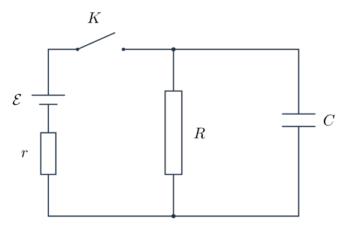
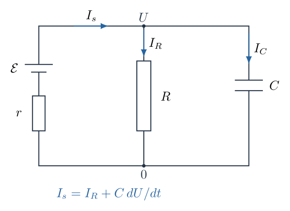
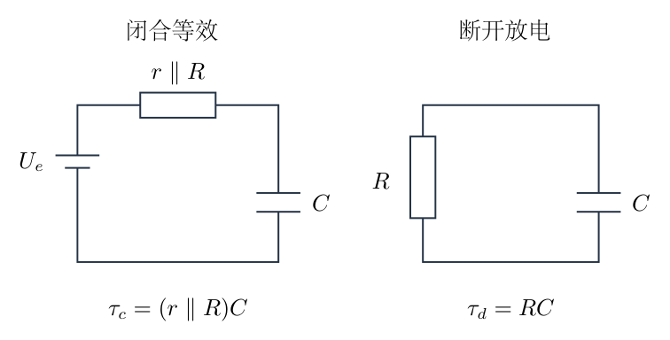
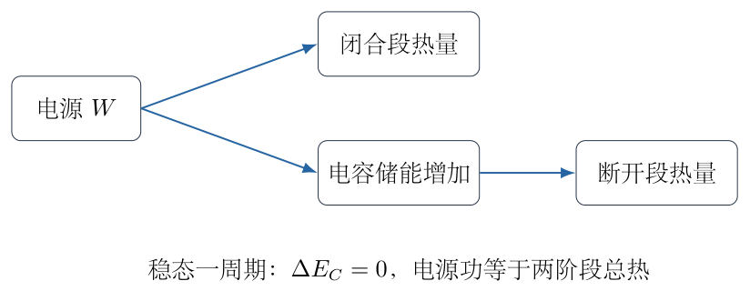

# 第 5 题

电路中有一个理想电源，电动势 $\mathcal E=4.0\,\mathrm V$；电阻 $r=50\,\mathrm{k}\Omega$、$R=150\,\mathrm{k}\Omega$，电容 $C=2.0\,\mathrm{mF}$。开关闭合前，电路中没有电流，电容未充电。电源、开关和电阻 $r$ 串联组成一支路，与电阻 $R$、电容 $C$ 两支路连接。

将开关闭合一段时间，再断开。闭合期间电路产生的总热量为 $H_1=7.43\,\mathrm{mJ}$；断开后直到放电结束，产生的总热量为 $H_2=1.00\,\mathrm{mJ}$。求闭合期间流过电阻 $R$ 的总电荷量。

随后周期性地闭合、断开开关，每次闭合 $\Delta t_1=0.1\,\mathrm s$，断开 $\Delta t_2=0.2\,\mathrm s$。求一个周期内电源释放的总能量。

## 一、题型定位

电容充放电与能量、电荷两种守恒的结合。第一部分不必先求开关闭合时间，用完整放电热量确定电容电荷，再用全过程能量确定电源送出电荷；第二部分用充放电微分方程建立周期递推，并在时间尺度分离下得到简洁近似。

## 二、知识点

电容电荷与电压关系；储能 $CU^2/2$；电源功 $\mathcal E q$；节点电流与支路电荷守恒；一阶线性微分方程；戴维南等效与充电时间常数；几何递推的稳定不动点；周期稳态的平均电荷平衡。

## 三、物理图像

闭合时电源通过 $r$ 向节点供电，电流一部分流过 $R$，另一部分增加电容电荷。断开时电源支路没有闭合回路，电容只通过 $R$ 放电。短周期切换时电容电压变化很小，但其平均值由一个周期内充入和流出电荷相等决定，不等于单次无限长闭合后的电压。

## 四、解题入口

第一部分把“闭合直到完全放电”作为一个总过程，初末电容储能都为零，因此电源功等于两阶段总热。另将断开后的热量看成断开瞬间电容的全部储能。第二部分先求 $U(t)$ 的两个阶段方程，再决定采用精确递推还是小波纹近似。

## 五、解析

（1）用不同字母区分热量与电荷。

题目给出的 $H_1,H_2$ 是热量，单位为焦耳；下面用 $q_s$ 表示电源送出的总电荷，$q_C$ 表示断开瞬间电容正极板上的电荷，$q_R$ 表示闭合期间流过 $R$ 的总电荷。三者单位均为库仑，但物理对象不同。

取电容上节点相对下节点的电压为 $U$。电源极性使 $U\geq0$，流过 $R$ 的电流从上节点流向下节点。图 5-2 表示闭合状态中的电流分流。

节点电流方程为

$$I_s=I_R+I_C,$$

其中 $I_C=dq_C/dt=C\,dU/dt$。这是电荷守恒，不是三条支路电流相等。

（2）先看断开后能够释放多少电容能量。

断开后电源支路被开关切断，电容通过 $R$ 完全放电。最终 $U=0$，储能为零；于是断开瞬间的电容储能全部转为 $R$ 中的热：

$$H_2=\frac{q_C^2}{2C}=\frac12CU_f^2.$$

代入 $C=2.0\times10^{-3}\,\mathrm F$、$H_2=1.00\times10^{-3}\,\mathrm J$，得

$$\begin{aligned}
q_C&=\sqrt{2CH_2}\\
&=\sqrt{2\times2.0\times10^{-3}\times1.00\times10^{-3}}\,\mathrm C\\
&=2.00\times10^{-3}\,\mathrm C,\\
U_f&=\frac{q_C}{C}=1.00\,\mathrm V.
\end{aligned}$$

取正根是因为上极板被电源充成正电荷。这个 $q_C$ 不是电源送出电荷的全部，因为闭合时电阻 $R$ 同时持续分流。

（3）全过程能量守恒给出电源送出电荷。

从最初未充电到最终完全放电，电容储能变化为零。电源释放的总能量等于总焦耳热：

$$\mathcal E q_s=H_1+H_2.$$

因此

$$\begin{aligned}
q_s&=\frac{7.43+1.00}{4.0}\times10^{-3}\,\mathrm C\\
&=2.1075\times10^{-3}\,\mathrm C.
\end{aligned}$$

也可以只对闭合阶段列能量式 $\mathcal E q_s=H_1+CU_f^2/2$；把 $CU_f^2/2=H_2$ 代入后得到同一结论。断开后电源不释放能量，因此不存在“断开期间再加一次电源功”。

（4）积分节点电流方程得到所求电荷。

对闭合阶段从开始到断开积分：

$$\int I_s\,dt=\int I_R\,dt+\int I_C\,dt.$$

电容初始电荷为零，故

$$q_s=q_R+q_C.$$

所以

$$\begin{aligned}
q_R&=q_s-q_C\\
&=(2.1075-2.0000)\times10^{-3}\,\mathrm C\\
&=1.075\times10^{-4}\,\mathrm C.
\end{aligned}$$

按题给数据的有效数字报告为

$$\boxed{q_R\approx1.08\times10^{-4}\,\mathrm C=0.108\,\mathrm{mC}.}$$

这里 $r$ 的值没有进入最简求解，是因为所给热量已经包含了充电过程的结果；并不表示电阻 $r$ 对真实充电时间和热量无影响。

（5）建立闭合时的电压微分方程。

为了处理周期切换，不能只使用第一部分的终态能量，必须知道任意初电压下的演化。闭合时，由欧姆定律

$$I_s=\frac{\mathcal E-U}{r},\qquad I_R=\frac{U}{R}.$$

代入节点式：

$$C\frac{dU}{dt}=\frac{\mathcal E-U}{r}-\frac{U}{R}.$$

整理为

$$\frac{dU}{dt}+\frac{R+r}{rRC}U=\frac{\mathcal E}{rC}.$$

先求长时间闭合后的固定电压，使 $dU/dt=0$：

$$U_e=\frac{\mathcal E R}{R+r}=3.0\,\mathrm V.$$

定义闭合时间常数

$$\tau_c=\frac{rR}{r+R}C=75\,\mathrm s.$$

注意它是并联等效电阻 $rR/(r+R)$ 乘以 $C$，而不是简单的 $rC=100\,\mathrm s$。求电容看到的等效电阻时，理想电压源应短路，开关仍保持闭合，因此两个电阻对电容是并联。

（6）用平移变量解一阶方程。

令 $z=U-U_e$，则

$$\frac{dz}{dt}=-\frac z{\tau_c}.$$

分离变量并积分，得 $z=z(0)e^{-t/\tau_c}$。故从初始电压 $U_a$ 开始闭合，有

$$\boxed{U(t)=U_e+(U_a-U_e)e^{-t/\tau_c}.}$$

如果 $U_a=0$，则 $U(t)=U_e(1-e^{-t/\tau_c})$；刚开始电容像一个零电压节点，电源电流为 $\mathcal E/r$、$R$ 中电流为零，之后 $R$ 中电流逐渐增加。

对第一部分的 $U_f=1\,\mathrm V$，闭合时间由 $1=3(1-e^{-t_c/75})$ 得

$$t_c=-75\ln\frac23\approx30.41\,\mathrm s.$$

直接积分闭合期间的 $I_R$：

$$\begin{aligned}
q_R&=\frac{U_e}{R}\int_0^{t_c}(1-e^{-t/\tau_c})\,dt\\
&=\frac{U_e}{R}\left[t_c-\tau_c(1-e^{-t_c/\tau_c})\right]\\
&\approx1.0820\times10^{-4}\,\mathrm C.
\end{aligned}$$

它与用三位有效数字热量得到的 $1.075\times10^{-4}\,\mathrm C$ 有轻微差异：给定的 $H_1=7.43\,\mathrm{mJ}$ 是舍入值，完整暂态预测为约 $7.43279\,\mathrm{mJ}$。两种路线按有效数字均给出约 $0.108\,\mathrm{mC}$，不应把舍入差异解释为能量不守恒。

（7）断开阶段的方程与时间常数。

图 5-3 的右侧只有 $R$ 与 $C$ 形成闭合回路。由电容放电流向 $R$，有

$$C\frac{dU}{dt}=-\frac U R.$$

定义

$$\tau_d=RC=300\,\mathrm s,$$

则从断开时电压 $U_b$ 开始，局部时间 $t$ 下有

$$\boxed{U(t)=U_b e^{-t/\tau_d}.}$$

两个时间常数都远大于切换持续时间 $0.1\,\mathrm s$、$0.2\,\mathrm s$。这说明每个阶段的电压变化较小，但并不意味着可以忽略所有周期后的累计充电：系统仍会逐渐接近一个非零平均电压。

（8）先写任意周期递推，明确稳态条件。

令 $U_n$ 为第 $n$ 个周期开始、开关刚要闭合时的电压。定义

$$a=e^{-\Delta t_1/\tau_c},\qquad b=e^{-\Delta t_2/\tau_d}.$$

一个闭合阶段结束后电压为 $U_e+(U_n-U_e)a$，再经断开阶段乘以 $b$。于是

$$\boxed{U_{n+1}=abU_n+bU_e(1-a).}$$

稳态意味着每个周期开始电压不再改变，设为 $U_-$，则

$$U_-=abU_-+bU_e(1-a).$$

移项得

$$\boxed{U_-=\frac{bU_e(1-a)}{1-ab},\qquad
U_+=\frac{U_e(1-a)}{1-ab},}$$

其中 $U_+$ 是闭合结束电压，且 $U_-=bU_+$。因为 $0<ab<1$，递推对初值具有收敛性，任意有限初电压都趋向同一稳态。

（9）计算稳态电压和波纹。

代入 $\Delta t_1/\tau_c=1/750$、$\Delta t_2/\tau_d=1/1500$，得到

$$a\approx0.998667555,\qquad b\approx0.999333555.$$

于是

$$U_-\approx1.9993333\,\mathrm V,\qquad U_+\approx2.0006666\,\mathrm V.$$

一周期电压波纹约 $1.3333\,\mathrm{mV}$，远小于平均约 $2\,\mathrm V$。图 5-4 展示的能量流中，闭合阶段电源输入，两个电阻发热且电容储能略增；断开阶段电容释放同样的储能给 $R$。

一整周期电容能量净变化为零，因此电源输入等于两阶段总焦耳热。它不等于仅仅那一点电容波纹储能的变化。

（10）完整积分电源功。

在闭合阶段 $U(t)=U_e+(U_--U_e)e^{-t/\tau_c}$，电源电流为 $(\mathcal E-U)/r$。电源功为

$$W=\mathcal E\int_0^{\Delta t_1}\frac{\mathcal E-U(t)}r\,dt.$$

将常数项与指数项分开：

$$\begin{aligned}
W&=\frac{\mathcal E}{r}\int_0^{\Delta t_1}
\left[\mathcal E-U_e+(U_e-U_-)e^{-t/\tau_c}\right]dt\\
&=\frac{\mathcal E}{r}\left[(\mathcal E-U_e)\Delta t_1
+(U_e-U_-)\tau_c(1-a)\right].
\end{aligned}$$

代入数值可得

$$W\approx1.59999994\times10^{-5}\,\mathrm J
\approx0.0160\,\mathrm{mJ}.$$

因此周期稳态的答案为

$$\boxed{W\approx1.6\times10^{-5}\,\mathrm J=0.016\,\mathrm{mJ}.}$$

电源只在闭合的 $0.1\,\mathrm s$ 中做功，不能把闭合电流再乘整个周期 $0.3\,\mathrm s$。

（11）小波纹近似如何得到同样的答案。

令电容电压在一周期内近似恒为 $\bar U$。闭合时电容净充电电流为

$$\frac{\mathcal E-\bar U}{r}-\frac{\bar U}{R},$$

断开时流出电容的电流为 $\bar U/R$。周期电荷平衡给出

$$\left(\frac{\mathcal E-\bar U}{r}-\frac{\bar U}{R}\right)\Delta t_1
=\frac{\bar U}{R}\Delta t_2.$$

整理：

$$\begin{aligned}
R\Delta t_1(\mathcal E-\bar U)&=r\bar U(\Delta t_1+\Delta t_2),\\
\bar U&=\frac{\mathcal E R\Delta t_1}
{R\Delta t_1+r(\Delta t_1+\Delta t_2)}=2.0\,\mathrm V.
\end{aligned}$$

于是闭合阶段电源电流约 $40\,\mu\mathrm A$，送出电荷为 $4.0\,\mu\mathrm C$，电源功为 $4.0\,\mathrm V\times4.0\,\mu\mathrm C=16\,\mu\mathrm J$。精确值与近似值相对差约 $3.7\times10^{-8}$，远小于题给精度。

（12）从零电压开始时不能把第一周期当作稳态。

若周期切换从未充电状态开始，则 $U_0=0$。由递推求解：

$$U_n=U_-[1-(ab)^n].$$

第 $n$ 周期电源功仍由第（10）步的积分式得到，只需把 $U_-$ 换为 $U_n$。第一周期为

$$W_0=\frac{\mathcal E}{r}\left[(\mathcal E-U_e)\Delta t_1
+U_e\tau_c(1-a)\right]
\approx0.031984\,\mathrm{mJ}.$$

它约为稳态值的两倍，因为最初电容电压接近零，电源电流接近 $\mathcal E/r=80\,\mu\mathrm A$。此时一整周期电容储能在增加，不能用周期恢复条件求平均电压。

递推偏离稳态的因子为 $(ab)^n=e^{-0.002n}$。达到稳态是渐近过程，不是在一个周期内完成。原题通常所取 $0.016\,\mathrm{mJ}$ 对应长期周期稳态；若未指定稳态又问任意周期，应保留以上含 $n$ 的表达式。

## 六、关键洞察

第一部分通过“总过程能量”和“闭合阶段电荷”两条互补关系求解，比先解全部暂态更直接；暂态积分又能独立校验给定热量和电荷的舍入一致性。

第二部分的平均电压不是 $U_e=3\,\mathrm V$。$U_e$ 属于开关永久闭合的固定点，而 $2\,\mathrm V$ 属于开关按给定占空比周期切换的稳定周期。改变约束，就会改变平衡值。

周期稳态的完整指数解还可视为两个仿射映射的复合。一个阶段将电压拉向 $U_e$，另一个阶段将电压拉向零；复合映射的斜率小于一，因此固定点稳定。

## 七、易错点

断开后 $r$ 不在放电闭合回路中，不能写 $\tau_d=(R+r)C$。第一部分 $q_R$ 只计算闭合阶段，不能把断开期间流过 $R$ 的 $q_C$ 再加进去。题中电容为毫法，若误读成微法，时间常数和周期近似都会改变一千倍。

把电源电流与电容净电流混淆，会漏掉闭合时 $R$ 的分流。把周期净电荷为零理解成每个阶段电容电流为零，会丢掉充放电波纹。未经说明把初始周期和稳态周期合为一个答案，则掩盖了真实的能量存储变化。

## 八、课堂讲解建议

先让学生为第一部分画能量账与电荷账，分别标清全过程、闭合段、断开段。板书把 $H$ 与 $q$ 的单位分列，避免使用同一个字母代表两个量。

第二部分先写一个周期的两次映射，再求固定点。最后利用时间常数比较推出小波纹近似，使近似成为精确解的自然简化，而不是一开始就猜电容电压为常量。

## 九、变式训练

若闭合占空比为 $D=\Delta t_1/(\Delta t_1+\Delta t_2)$，周期足够短，求平均电压和单位时间电源功率。

用一周期平均电荷平衡，闭合时电源平均供电电流为 $D(\mathcal E-\bar U)/r$，电阻 $R$ 在整个周期持续消耗电流 $\bar U/R$，因此

$$D\frac{\mathcal E-\bar U}{r}=\frac{\bar U}{R}.$$

解得

$$\boxed{\bar U=\frac{D\mathcal E R}{r+DR},\qquad
\bar P=\frac{D\mathcal E^2}{r+DR}.}$$

当 $D=1$，回到永久闭合电路的 $U_e$ 与功率 $\mathcal E^2/(r+R)$；当 $D\to0$，平均电压和平均功率趋于零。此结果只在每段持续时间远小于各自时间常数时适用。若周期不够短，应将 $a=e^{-DP/\tau_c}$、$b=e^{-(1-D)P/\tau_d}$ 代入完整固定点和功积分，而不是扩大本近似的使用范围。
