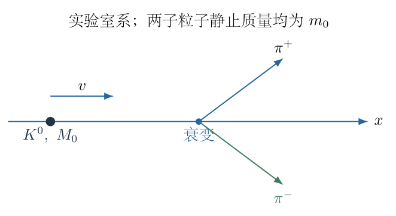
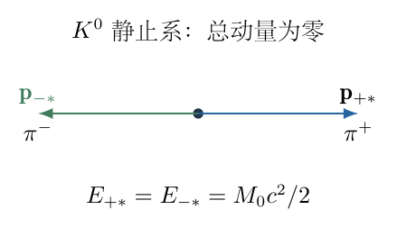
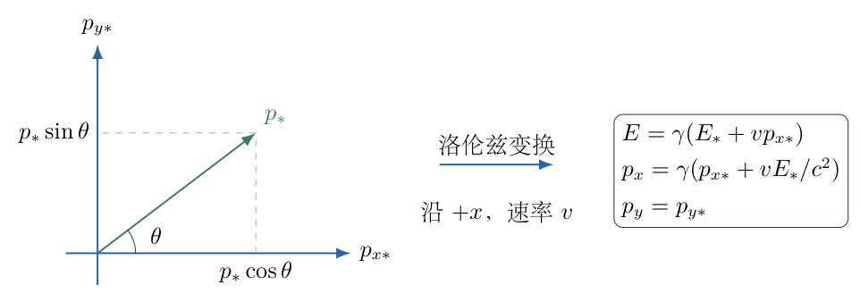
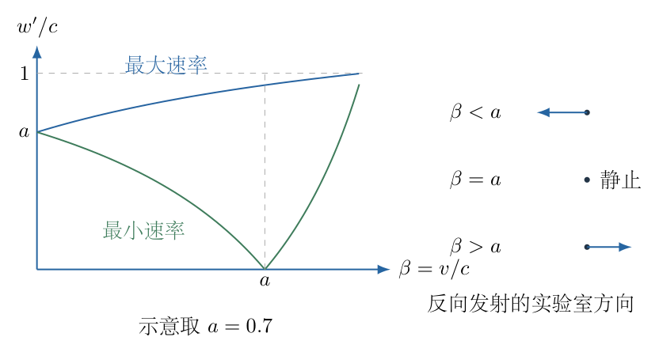

# 第 7 题

静止质量为 $M_0$ 的 $K^0$ 介子能衰变为一个 $\pi^+$ 介子和一个 $\pi^-$ 介子，两种 $\pi$ 介子的静止质量均为 $m_0$。实验室中，一个速率为 $v$ 的 $K^0$ 介子发生上述衰变。求实验室系中 $\pi^+$ 介子速率 $w'$ 的最大值和最小值。

## 一、题型定位

相对论两体衰变与全角度速率极值。母粒子静止系中两个子粒子的能量和动量大小由守恒唯一确定，方向仍可改变；实验室系的速率范围由洛伦兹变换和发射角决定。

## 二、知识点

总能量与静止能的区别；相对论动量和质能关系；两体衰变的能量、动量守恒；洛伦兹能量—动量变换；纵向与横向速度变换；固定质量粒子速率对能量的单调性；绝对值与方向反转。

## 三、物理图像

在母粒子静止系中，两子粒子以相同速率背靠背飞出。在实验室中，顺着母粒子原运动方向发射的子粒子能量最高、速率最大，反向发射的子粒子能量最低、速率最小。反向发射不一定仍在实验室向后运动：如果母粒子前进得足够快，它会被洛伦兹变换“带向前”。因此最小速率必须非负，而对应的有符号速度可以改变正负。

## 四、解题入口

不要直接从实验室中分配两个子粒子的动能。先到 $K^0$ 静止系求出每个 $\pi$ 的固定能量 $E_*$、动量大小 $p_*$ 与速率 $u_*$。再对任意发射角进行变换，证明速率极值对应哪两个方向，最后使用一维速度叠加求端点。

## 五、解析

（1）定义两个参考系与符号。

实验室参考系记为 $S$，母粒子静止参考系记为 $S_*$。取实验室 $x$ 轴沿母粒子的速度方向，母粒子速度为 $+v$，其中 $0\leq v<c$。定义

$$\beta=\frac vc,\qquad \gamma=\frac1{\sqrt{1-\beta^2}}.$$

下标 $*$ 表示在母粒子静止系测量的量。题目最后所求 $w'$ 是实验室中的速率，撇号只是沿用题目记法，不能据此误认它属于静止系。

（2）静止系的动量守恒决定背靠背发射。

衰变前母粒子在 $S_*$ 中动量为零。衰变后只有两个子粒子，因此

$$\mathbf p_{+*}+\mathbf p_{-*}=0.$$

故它们动量方向相反，大小相等，记为 $p_*$。图 7-2 画出这一静止系的动量关系，箭头长度相同并非因为两者电荷相反，而是因为总动量必须为零。

两个子粒子的静止质量同为 $m_0$，满足相同的能量—动量关系

$$E_{+*}^2=m_0^2c^4+p_*^2c^2,\qquad
E_{-*}^2=m_0^2c^4+p_*^2c^2.$$

总能量均取正值，所以 $E_{+*}=E_{-*}$。

（3）能量守恒给出每个子粒子的总能量。

静止系中母粒子总能量为 $M_0c^2$，于是

$$M_0c^2=E_{+*}+E_{-*}=2E_*.$$

因此

$$\boxed{E_*=\frac12M_0c^2.}$$

这不是说每个子粒子的静止质量变成 $M_0/2$。子粒子的静止质量仍是 $m_0$；多出来的能量表现为动能，其大小为

$$K_*=E_*-m_0c^2=\left(\frac{M_0}{2}-m_0\right)c^2.$$

两体衰变能够发生的质量阈值为 $M_0\geq2m_0$。严格大于时子粒子有非零动量；等于阈值时两者在静止系中没有动能。

（4）求固定动量与固定速率。

将 $E_*=\frac12M_0c^2$ 代入质能关系：

$$\begin{aligned}
p_*^2c^2&=E_*^2-m_0^2c^4\\
&=\left(\frac14M_0^2-m_0^2\right)c^4,\\
p_*&=c\sqrt{\frac14M_0^2-m_0^2}.
\end{aligned}$$

对相对论粒子，动量和能量为 $p=\gamma_u m_0u$、$E=\gamma_u m_0c^2$，二者相除得 $u=pc^2/E$。所以

$$\begin{aligned}
u_*&=\frac{p_*c^2}{E_*}\\
&=\frac{2c}{M_0}\sqrt{\frac14M_0^2-m_0^2}\\
&=c\sqrt{1-\frac{4m_0^2}{M_0^2}}.
\end{aligned}$$

记

$$a=\frac{u_*}{c}=\sqrt{1-\frac{4m_0^2}{M_0^2}},\qquad 0\leq a<1,$$

则 $u_*=ac$。静止系速率不随发射方向改变，变化的只有动量的方向。

（5）保留任意发射角，而不是先猜两个端点。

令 $\pi^+$ 在静止系中的动量与 $+x$ 轴夹角为 $\theta$，取其运动平面为 $x$—$y$ 平面，则

$$p_{x*}=p_*\cos\theta,\qquad
p_{y*}=p_*\sin\theta.$$

图 7-3 表示这一任意角度的动量与沿 $+x$ 的参考系变换。由于旋转对称，任意三维方向都可通过选择 $y$ 轴放到此平面，不会遗漏极值。

从母粒子静止系变换到母粒子向右运动的实验室系：

$$\begin{aligned}
E&=\gamma(E_*+vp_{x*}),\\
p_x&=\gamma\left(p_{x*}+\frac{vE_*}{c^2}\right),\\
p_y&=p_{y*}.
\end{aligned}$$

能量中的交叉项是正号：顺向发射的粒子在实验室中能量增大。若把参考系变换方向反了，极值方向也会被错误交换。

（6）为什么能量极值等于速率极值。

实验室中的子粒子静止质量仍为 $m_0$，总能量满足

$$E=\frac{m_0c^2}{\sqrt{1-w'^2/c^2}}.$$

反解速率：

$$w'=c\sqrt{1-\frac{m_0^2c^4}{E^2}}.$$

在 $E\geq m_0c^2$ 的物理范围内，它随 $E$ 单调增加。只要 $w'>0$，求导可得

$$\frac{dw'}{dE}=
\frac{m_0^2c^5}{E^3\sqrt{1-m_0^2c^4/E^2}}>0.$$

在零速端点也保持非减的连续性。所以无需对较复杂的横、纵速度合成式直接做极值，只要比较能量即可。

（7）找出全角度能量端点。

将任意角度代入能量变换：

$$E(\theta)=\gamma(E_*+vp_*\cos\theta).$$

因 $\gamma>0$、$v\geq0$、$p_*\geq0$，它随 $\cos\theta$ 非减。由于 $-1\leq\cos\theta\leq1$，

$$\boxed{E_{\max}=\gamma(E_*+vp_*),\qquad
E_{\min}=\gamma(E_*-vp_*).}$$

最大值对应顺向发射 $\theta=0$，最小值对应反向发射 $\theta=\pi$。这里证明了所有斜向发射都不可能给出比这两个方向更大的或更小的速率。

能量式的第二项虽有负号，但 $E_*-vp_*>0$：因为 $p_*c/E_*=a<1$、$v/c=\beta<1$，故 $E_*-vp_*=E_*(1-\beta a)>0$。

（8）由动量与能量之比求端点速度。

对顺向发射，实验室横向动量为零，纵向动量为 $\gamma(p_*+vE_*/c^2)>0$。利用 $w=pc^2/E$，得

$$\begin{aligned}
w'_{\max}
&=\frac{c^2(p_*+vE_*/c^2)}{E_*+vp_*}\\
&=\frac{u_*+v}{1+vu_*/c^2}.
\end{aligned}$$

对反向发射，纵向动量为 $\gamma(-p_*+vE_*/c^2)$，故有符号速度为

$$w_{x,\mathrm{back}}=\frac{v-u_*}{1-vu_*/c^2}.$$

分母为正，分子可正可负；题目求速率，所以必须取绝对值：

$$\boxed{w'_{\min}=\frac{|v-u_*|}{1-vu_*/c^2}.}$$

合并质量表达式，最终答案为

$$\boxed{
w'_{\max}=
\frac{v+c\sqrt{1-4m_0^2/M_0^2}}
{1+(v/c)\sqrt{1-4m_0^2/M_0^2}} ,
}$$

$$\boxed{
w'_{\min}=
\frac{\left|v-c\sqrt{1-4m_0^2/M_0^2}\right|}
{1-(v/c)\sqrt{1-4m_0^2/M_0^2}} .
}$$

（9）分别说明最小速率的三个物理分支。

如果 $v<u_*$，反向发射粒子在实验室中仍向后，最小速率为 $(u_*-v)/(1-vu_*/c^2)$。

如果 $v=u_*$，反向发射粒子在实验室中静止，因此最小速率为零。此时所有初始向后动量恰好被参考系变换抵消。

如果 $v>u_*$，反向发射粒子也在实验室中向前，最小速率为 $(v-u_*)/(1-vu_*/c^2)$。它虽是实验室中向前运动的粒子，仍对应静止系中的反向发射。

图 7-4 展示这三个情形，并以 $a=u_*/c$ 为固定值画出最小、最大速率随 $\beta$ 的变化。最小速率在 $\beta=a$ 处为零，两侧连续，不能把负的有符号速度直接标成负速率。

（10）用全角度速度变换交叉核验。

对任意 $\theta$，由动量除以能量，得到

$$\begin{aligned}
w_x&=\frac{u_*\cos\theta+v}
{1+(vu_*/c^2)\cos\theta},\\
w_y&=\frac{u_*\sin\theta}
{\gamma[1+(vu_*/c^2)\cos\theta]}.
\end{aligned}$$

以 $a=u_*/c$、$\beta=v/c$、$z=\cos\theta$ 表示，速率平方为

$$\frac{w'^2}{c^2}
=\frac{(az+\beta)^2+a^2(1-z^2)(1-\beta^2)}
{(1+\beta az)^2}.$$

展开分子再与分母相减：

$$\begin{aligned}
&(1+\beta az)^2-
\left[(az+\beta)^2+a^2(1-z^2)(1-\beta^2)\right]\\
&\qquad=(1-\beta^2)(1-a^2).
\end{aligned}$$

于是

$$\boxed{\frac{w'^2}{c^2}
=1-\frac{(1-\beta^2)(1-a^2)}{(1+\beta a\cos\theta)^2}.}$$

分母随 $\cos\theta$ 增加，故被减项减小，速率增大，与能量单调证明一致。该表达式还保证 $w'<c$，无需额外筛去超光速分支。

（11）端点是否真的小于光速。

对最大值，

$$1-\frac{w'_{\max}}c
=1-\frac{\beta+a}{1+\beta a}
=\frac{(1-\beta)(1-a)}{1+\beta a}>0.$$

最小值因 $|\beta-a|<1-\beta a$ 而小于光速。分别在 $\beta\geq a$、$\beta<a$ 两侧可化为 $(1-\beta)(1+a)>0$ 与 $(1-a)(1+\beta)>0$。因此两个答案都符合相对论速度上限。

若误用伽利略叠加写成 $v+u_*$，当两者都较大时就会超过 $c$；分母的存在不是小修正，而是维持物理一致性的关键。

（12）检验静止母粒子、阈值和高能极限。

当 $v=0$，两个速率端点都变成 $u_*$，因为静止系与实验室系相同，发射方向不影响速率。

当 $M_0=2m_0$，有 $u_*=0$，两个端点都为 $v$。这是阈值衰变没有相对运动的退化情形，不能再讨论具有有限动量的发射角。

对固定 $m_0>0$ 与有限 $M_0>2m_0$，当 $v\to c^-$ 时，最大和最小速率都趋于 $c$，但任意有限 $v$ 下仍严格小于 $c$。若将质量极限 $m_0/M_0\to0$，子粒子趋近无质量，速率均趋于 $c$；此极限应与固定有质量粒子的速度判断分开。

（13）一个数值例子与守恒检查。

取 $M_0=5m_0$、$v=0.6c$，则

$$a=\sqrt{1-\frac4{25}}=\sqrt{0.84}\approx0.916515.$$

因此

$$w'_{\max}\approx0.978454c,\qquad
w'_{\min}\approx0.703225c.$$

最小端点对应实验室向后的有符号速度 $-0.703225c$。如果换成 $v=0.95c>u_*$，最小端点应向前，绝对值确保速率仍为正。

对任意发射角，两个子粒子的静止系动量相反，能量相等。分别变换后，它们的实验室总能量为

$$E_++E_-=2\gamma E_*=\gamma M_0c^2,$$

总纵向动量为

$$p_{x+}+p_{x-}=2\gamma\frac{vE_*}{c^2}
=\gamma M_0v,$$

总横向动量为零。以上正是衰变前母粒子的实验室能量和动量，所以每一个允许发射角都满足守恒；极值只是在守恒允许族中选取两个端点。

## 六、关键洞察

固定静止质量的粒子，速率随总能量单调增加，因此“速率全角度极值”可以转化为“线性依赖发射角余弦的能量极值”。这比对两分量的合成速率反复求导更本质，也更容易避免遗漏斜向方向。

最小速率的绝对值不是排版细节，而是反向发射在实验室中可能改变方向的必然结果。能量极小始终在静止系反向发射，但实验室中的运动方向由 $v-u_*$ 的符号决定。

还可用快度核验一维端点：令 $\beta=\tanh\eta$、$a=\tanh\xi$，则最大速率为 $c\tanh(\eta+\xi)$，最小速率为 $c|\tanh(\eta-\xi)|$。快度将速度叠加中的分式化为加减法，但它是对已经明确参考系后的替代表示。

## 七、易错点

把 $M_0c^2/2$ 当成每个子粒子的动能会漏掉静止能。背靠背动量相等源于初始总动量为零，不是正负电荷互相抵消。母粒子的实验室动能不能直接平均分给两个子粒子。

只写最大端点而猜最小端点为零，会忽略只有 $v=u_*$ 时才能完全抵消。将 $(v-u_*)/(1-vu_*/c^2)$ 作为速率而不取绝对值，则在常见 $v<u_*$ 情形给出负答案。

## 八、课堂讲解建议

先在母粒子静止系板书能量和动量两条守恒，再让学生区分总能量、静止能和动能。完成任意角度的能量变换后，先用单调性找方向，再使用速度叠加求端点。

用 $v<u_*$、$v=u_*$、$v>u_*$ 三幅方向草图讲清最小速率的绝对值。最后让学生将两个子粒子的实验室四动量相加，核对母粒子初态，形成守恒自检习惯。

<!-- KEEP_TOGETHER_START -->

## 九、变式训练

若两个子粒子的静止质量分别为 $m_a,m_b$，求子粒子 $a$ 的静止系能量及实验室速率范围。

静止系中仍有等大反向动量 $p_*$，但两能量不再相等。记 $E_a+E_b=M_0c^2$，并用

$$E_a^2-E_b^2=(m_a^2-m_b^2)c^4.$$

因 $E_a^2-E_b^2=(E_a-E_b)M_0c^2$，解得

$$E_a=\frac{M_0^2+m_a^2-m_b^2}{2M_0}c^2,\qquad
E_b=\frac{M_0^2+m_b^2-m_a^2}{2M_0}c^2.$$

再求 $p_*=\sqrt{E_a^2/c^2-m_a^2c^2}$、$u_a=p_*c^2/E_a$。对子粒子 $a$，角度能量单调证明保持不变，因此

$$w_{a,\max}=\frac{v+u_a}{1+vu_a/c^2},\qquad
w_{a,\min}=\frac{|v-u_a|}{1-vu_a/c^2}.$$

阈值为 $M_0\geq m_a+m_b$。令 $m_a=m_b=m_0$，静止系能量重新相等并回到本题全部结果。

<!-- KEEP_TOGETHER_END -->
