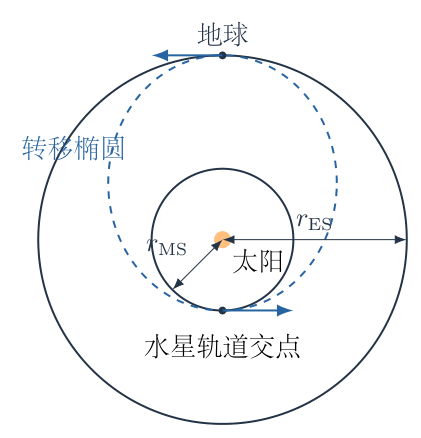
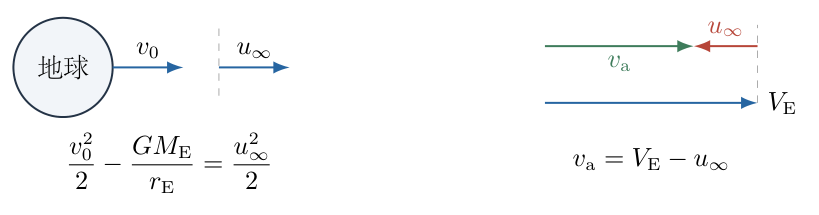
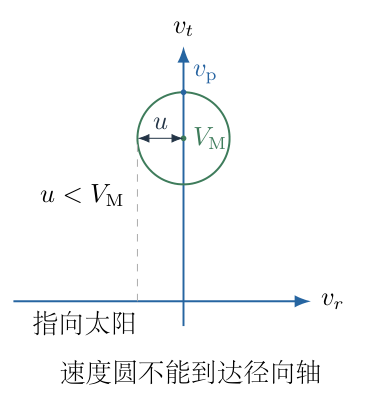

# 第 1 题

已知地球到太阳的距离为 $r_{\mathrm{ES}}$，地球半径为 $r_{\mathrm E}$，水星到太阳的距离为 $r_{\mathrm{MS}}$，万有引力常数为 $G$，太阳质量为 $M_{\mathrm S}$，地球质量为 $M_{\mathrm E}$。地球和水星均沿圆轨道绕太阳运动。

（1）忽略地球自转。航天器只在地面附近点火，此后不再主动推进。为使航天器到达水星轨道，地面附近至少应使它获得多大的相对地球速度 $v_0$？

（2）采用上一问的最小发射速度，从地球轨道到水星轨道至少需要多长时间？

（3）采用同一转移轨道。航天器经过水星引力偏转后，是否可能立即沿正对太阳的方向飞行？若可能，说明条件；若不可能，说明理由。讨论采用水星参考系中的理想引力散射近似。

{width=70%}

## 一、题型定位

本题把一次发射分成三个不同的动力学阶段：克服地球引力、在太阳引力场中沿椭圆转移、进入水星邻域后发生引力散射。三段中守恒的能量不是同一个表达式，速度的参考系也不同。破题关键是先求离开地球后相对地球的剩余速度，再用地球引力井反推地面速度。

“到达水星轨道”不等于“以水星的速度并入水星轨道”。航天器与水星在交会位置仍有相对速度，第三问正是利用这一点。以下使用通常的拼接圆锥近似：地球和水星邻域分别保留行星引力，行星间飞行主要保留太阳引力；点火时间短，航天器质量不影响行星运动。

## 二、知识点

- 圆轨道速度由万有引力提供向心力得到。
- 太阳引力场中的单位质量机械能为 $\varepsilon=v^2/2-GM_{\mathrm S}/r$；椭圆轨道满足 $\varepsilon=-GM_{\mathrm S}/(2a)$。
- 椭圆长轴的两个端点速度与半径垂直，可以使用角动量守恒。
- 地球逃逸后的渐近相对速度不等于地面速度，二者由地球引力势能差联系。
- 圆轨道间的最小一次冲量转移为与两圆相切的椭圆；转移时间为半个轨道周期。
- 理想行星引力散射在行星瞬时静止系中保持远处相对速率，只转动速度方向。
- 日心速度通过矢量相加得到，不能只对速率相加减。

## 三、物理图像

航天器在地球轨道处沿地球运动的反方向施加速度改变量。它的日心切向速度减小，原来的地球轨道半径成为转移椭圆的远日点；继续飞行时，航天器靠近太阳，速度增大，水星轨道半径成为近日点。

地面发射虽然最终要求“相对地球向后”，但速度不能直接取地球与转移轨道速度之差。航天器首先要爬出地球的引力井，地面动能的一部分转为地球引力势能，剩下的才是行星间转移所需的相对动能。

到达水星轨道时，航天器在同一位置比水星更快，二者的速度均沿圆轨道切线同向。水星散射只能转动这段相对速度。如果其长度不足以抵消水星本身的切向速度，则散射后的航天器日心切向分量不可能为零。

## 四、解题入口

为减少下标混淆，暂记
$$
R=r_{\mathrm{ES}},\qquad b=r_{\mathrm{MS}},\qquad
\mu=GM_{\mathrm S},\qquad 0<b<R.
$$
先从转移椭圆几何得到 $a=(R+b)/2$。随后分别计算地球圆轨道速度 $V_{\mathrm E}$、椭圆远日点速度 $v_{\mathrm a}$、椭圆近日点速度 $v_{\mathrm p}$，再处理两个行星参考系的速度关系。地面所求 $v_0$ 最后代入地球引力能量式，不与日心速度混用。

## 五、解析

（1）建立地球圆轨道速度和转移椭圆半长轴。

对地球作日心圆周运动，有
$$
\frac{GM_{\mathrm S}M_{\mathrm E}}{R^2}
=\frac{M_{\mathrm E}V_{\mathrm E}^2}{R}.
$$
两边约去 $M_{\mathrm E}$ 并乘以 $R$：
$$
V_{\mathrm E}^2=\frac{\mu}{R},
\qquad
V_{\mathrm E}=\sqrt{\frac{\mu}{R}}.
\tag{1}
$$
转移椭圆的远日点距离为 $R$、近日点距离为 $b$，故长轴长度为 $R+b$，而不是 $R-b$：
$$
a=\frac{R+b}{2},
\qquad
e=\frac{R-b}{R+b}.
\tag{2}
$$
这里太阳位于椭圆焦点。圆轨道的圆心与椭圆的几何中心不是同一点；图1-1中的两圆同心不意味着椭圆也以太阳为中心。

（2）由机械能守恒求转移轨道在地球处的速度。

椭圆单位质量总能量为 $-\mu/(2a)$，在远日点写成
$$
\begin{aligned}
\frac{v_{\mathrm a}^2}{2}-\frac{\mu}{R}
&=-\frac{\mu}{R+b},\\
\frac{v_{\mathrm a}^2}{2}
&=\frac{\mu}{R}-\frac{\mu}{R+b}\\
&=\mu\frac{R+b-R}{R(R+b)}
=\frac{\mu b}{R(R+b)},\\
v_{\mathrm a}
&=\sqrt{\frac{2\mu b}{R(R+b)}}.
\end{aligned}
\tag{3}
$$
因 $2b/(R+b)<1$，式（3）确实小于式（1）的 $V_{\mathrm E}$。这与“降低切向速度后向内飞行”的物理图像一致。

设航天器离开地球引力影响区后的相对地球渐近速率为 $u_\infty$。图1-2将两种速度画在同一切线上：地球速度向前，航天器相对地球速度向后。日心矢量关系为 $\boldsymbol v_{\mathrm a}=\boldsymbol V_{\mathrm E}+\boldsymbol u_\infty$。

{width=78%}

因此所需最小剩余速率为
$$
\begin{aligned}
u_\infty
&=V_{\mathrm E}-v_{\mathrm a}\\
&=\sqrt{\frac{\mu}{R}}
\left(1-\sqrt{\frac{2b}{R+b}}\right)>0.
\end{aligned}
\tag{4}
$$
若允许相对速度与地球运动方向夹角为 $\psi$，要得到给定日心速率 $v_{\mathrm a}$，则
$$
u_\infty^2=V_{\mathrm E}^2+v_{\mathrm a}^2
-2V_{\mathrm E}v_{\mathrm a}\cos\psi.
$$
当两日心速度同向时 $\cos\psi=1$，上述差的平方最小。故反向施加切向速度改变量是该相切转移所需的最小冲量方向，不是任意选定的图示方向。

（3）从渐近相对速率反推地面点火速度。

在地球近旁采用地心机械能守恒。单位质量航天器在地面与地球引力影响区之外的能量分别为
$$
\frac{v_0^2}{2}-\frac{GM_{\mathrm E}}{r_{\mathrm E}},
\qquad
\frac{u_\infty^2}{2}.
$$
将地球引力势能零点取在远处，有
$$
\begin{aligned}
\frac{v_0^2}{2}-\frac{GM_{\mathrm E}}{r_{\mathrm E}}
&=\frac{u_\infty^2}{2},\\
v_0^2
&=\frac{2GM_{\mathrm E}}{r_{\mathrm E}}+u_\infty^2.
\end{aligned}
\tag{5}
$$
再代入式（4）：
$$
\boxed{
v_0=
\left[
\frac{2GM_{\mathrm E}}{r_{\mathrm E}}
+\frac{GM_{\mathrm S}}{r_{\mathrm{ES}}}
\left(1-\sqrt{\frac{2r_{\mathrm{MS}}}
{r_{\mathrm{ES}}+r_{\mathrm{MS}}}}\right)^2
\right]^{1/2}}.
\tag{6}
$$
根号取正，因为题目求速率。地球自转未计入，不能额外减去赤道线速度。题目所给地球半径只在地球逃逸能量项中出现，太阳转移椭圆的远日点使用 $r_{\mathrm{ES}}$，不能把两种半径互换。

将式（6）完全展开，也可得到
$$
\begin{aligned}
v_0^2={}&\frac{2GM_{\mathrm E}}{r_{\mathrm E}}
+\frac{\mu}{R}
+\frac{2\mu b}{R(R+b)}
-\frac{2\mu}{R}\sqrt{\frac{2b}{R+b}}.
\end{aligned}
\tag{7}
$$
注意交叉项为负：航天器需要的是两个同向日心速度的差，而不是它们的和。式（6）更便于检查正定性，式（7）更便于与逐项代数运算核对。

（4）说明为什么这一轨道给出最小一次发射速度。

取地球轨道处的切向远日点发射。若希望近日点不大于 $b$，相切边界恰为近日点等于 $b$。远日点半径固定为 $R$ 时，由式（3）可知
$$
v_{\mathrm a}^2=\frac{2\mu b}{R(R+b)}
$$
随近日点半径 $b$ 增大而增大。要进入水星轨道范围，允许的最大 $v_{\mathrm a}$ 正好对应 $b=r_{\mathrm{MS}}$；由于 $u_\infty=V_{\mathrm E}-v_{\mathrm a}$，它给出最小速度改变量。再深入太阳附近会要求更大反向速度改变量。

也可不预先假定相切，直接检验径向速度是否可能更省。设起点日心切向、径向速度为 $w,z$。由太阳系能量及角动量，到达半径 $b$ 时径向动能非负要求
$$
z^2\ge \left(\frac{R^2}{b^2}-1\right)w^2
-2\mu\left(\frac1b-\frac1R\right).
$$
设 $A=R^2/b^2-1$、$C=2\mu(1/b-1/R)$，则 $C/A=v_{\mathrm a}^2$。待最小化的相对速度平方为 $u_\infty^2=z^2+(w-V_{\mathrm E})^2$。当 $0\le w\le v_{\mathrm a}$ 时，可取 $z=0$，最小值在最大的 $w=v_{\mathrm a}$ 处取得。当 $w\ge v_{\mathrm a}$ 时，至少应取 $z^2=Aw^2-C$，从而
$$
u_\infty^2\ge(A+1)w^2-2V_{\mathrm E}w+V_{\mathrm E}^2-C.
$$
这个二次式的顶点是 $w_*=V_{\mathrm E}b^2/R^2$，严格小于 $v_{\mathrm a}$，所以在 $w\ge v_{\mathrm a}$ 的允许区间单调增加。负的切向速度与地球速度方向相反，只会进一步增大相对速度。两支合起来的最小点就是 $z=0,w=v_{\mathrm a}$，严格恢复相切转移结论。

这里不讨论月球或其他行星多次引力辅助，也不把低推力长时间推进轨迹纳入“只在地面附近点火”的模型。

（5）计算飞行时间，并明确“至少”的范围。

在最小速度轨道上，从远日点到近日点所扫过的是半个椭圆。开普勒第三定律给出整个椭圆的周期
$$
P=2\pi\sqrt{\frac{a^3}{\mu}}.
$$
将式（2）代入，并除以二：
$$
\begin{aligned}
t_{\mathrm{tr}}
&=\frac P2
=\pi\sqrt{\frac{[(R+b)/2]^3}{\mu}}\\
&=\pi\sqrt{\frac{(R+b)^3}{8\mu}}.
\end{aligned}
\tag{8}
$$
因此
$$
\boxed{t_{\mathrm{tr}}
=\pi\sqrt{\frac{(r_{\mathrm{ES}}+r_{\mathrm{MS}})^3}
{8GM_{\mathrm S}}}}.
\tag{9}
$$
这不是“允许任意增大发射速度时的全球最短时间”，而是采用第一问最小发射速度、沿相切椭圆转移时的飞行时间。近地球逃逸阶段所需的细节时间在拼接模型中不计；地面到行星引力影响区边界的精确时间需要更多发射方向和边界资料。

要真正遇到水星，还需选择发射时刻。取航天器从角度零处出发，近日点角度为 $\pi$，水星角速度为
$$
\Omega_{\mathrm M}=\sqrt{\frac{\mu}{b^3}}.
$$
水星发射时的角位置应满足
$$
\phi_{\mathrm M}(0)+\Omega_{\mathrm M}t_{\mathrm{tr}}
=\pi\pmod{2\pi}.
\tag{10}
$$
若发射相位不满足式（10），航天器仍能到达水星轨道，却未必遇到水星本体；两种说法必须区分。

（6）求航天器到达水星轨道时的日心速度。

近日点能量式为
$$
\begin{aligned}
\frac{v_{\mathrm p}^2}{2}-\frac{\mu}{b}
&=-\frac{\mu}{R+b},\\
v_{\mathrm p}^2
&=2\mu\left(\frac1b-\frac1{R+b}\right)
=\frac{2\mu R}{b(R+b)}.
\end{aligned}
\tag{11}
$$
水星圆轨道速率为
$$
V_{\mathrm M}=\sqrt{\frac{\mu}{b}},
\qquad
\frac{v_{\mathrm p}}{V_{\mathrm M}}
=\sqrt{\frac{2R}{R+b}}.
\tag{12}
$$
因为 $R>b>0$，此比值大于1，但严格小于 $\sqrt2$。故转移航天器确实比水星快，却不可能快到水星圆轨道速度的两倍。

另用角动量复核：在长轴端点速度均与半径垂直，所以
$$
Rv_{\mathrm a}=bv_{\mathrm p}.
$$
代入式（3）并解出 $v_{\mathrm p}$，恰好恢复式（11）；这为能量式提供独立检查。

（7）在水星系中作速度圆，判断能否转为日心径向飞行。

在交会点取 $\boldsymbol e_t$ 沿水星公转切线正向，$\boldsymbol e_r$ 沿径向外侧。进入水星邻域之前的相对速度为
$$
\boldsymbol u_{\mathrm{in}}
=(v_{\mathrm p}-V_{\mathrm M})\boldsymbol e_t,
\qquad
u=v_{\mathrm p}-V_{\mathrm M}>0.
\tag{13}
$$
理想散射忽略行星运动期间的轨道弯曲和太阳潮汐。在水星静止系中，航天器进入、离开时距离水星足够远，水星引力势能恢复原值，因此相对速率不变：
$$
|\boldsymbol u_{\mathrm{out}}|=u.
\tag{14}
$$
回到日心系，
$$
\boldsymbol v_{\mathrm{out}}
=V_{\mathrm M}\boldsymbol e_t+\boldsymbol u_{\mathrm{out}}.
\tag{15}
$$
图1-3以水星速度矢量端点为圆心、$u$ 为半径，表示所有理想可能的出射日心速度端点。正对太阳要求切向分量为零、径向分量向内；只有速度圆能与径向轴相交才可能实现。

{width=70%}

即使任意允许散射角，式（15）的最小切向分量仍为
$$
v_{\mathrm{out},t}\ge V_{\mathrm M}-u
=2V_{\mathrm M}-v_{\mathrm p}.
\tag{16}
$$
要有非零的日心径向飞行，必要条件是
$$
u>V_{\mathrm M}
\quad\Longleftrightarrow\quad
v_{\mathrm p}>2V_{\mathrm M}.
\tag{17}
$$
若仅有 $u=V_{\mathrm M}$，圆与径向轴相切于零速度端点，不能形成“立即沿径向向太阳飞行”的非零速度。式（17）已采用最宽松的任意转向假设；真实水星能够达到的最大偏转角只会进一步限制可达性。

由式（12），
$$
1<\frac{v_{\mathrm p}}{V_{\mathrm M}}<\sqrt2<2,
$$
所以式（17）不成立：
$$
\boxed{\text{该最小速度转移轨道经一次水星散射，不能立即变为指向太阳的径向飞行。}}
\tag{18}
$$
这个结论不需要水星质量和半径。它来自相对速度圆连最宽松的径向方向都够不到；水星质量只决定圆上哪些转向角实际能实现，不能把圆半径凭空增大。

（8）检验量纲和两个边界，并作无量纲计算例。

式（6）的每一项均具有速度平方量纲：$GM/r$ 的单位为 $\mathrm{m^2s^{-2}}$。式（9）中距离三次方除以 $GM$ 的单位为时间平方，开方后为时间。式（12）、（17）只比较速度比，均无量纲。

当 $b\to R$ 时，转移椭圆趋于地球圆轨道，$u_\infty\to0$，式（6）趋于地球逃逸速率。式（9）趋于地球圆轨道的半周期。此时两轨道事实上重合，半周期对应本题选择的对径交会点，不是“进入同一半径圆轨道”本身所必需的时间，退化端点应按几何重新解释。

当 $b\to0^+$ 时，$v_{\mathrm a}\to0$、$u_\infty\to V_{\mathrm E}$。到更内侧轨道所需的反向速度改变量增大，但 $v_{\mathrm p}/V_{\mathrm M}\to\sqrt2$，第三问的否定结论仍保持。太阳有限半径未包含在这一理想点质量极限中，不能把 $b=0$ 当作实际可飞行轨道。

例如只为检验比例，取 $\mu=R=1$、$b=0.4$。由式（3）、（4）、（11），
$$
\begin{aligned}
V_{\mathrm E}&=1,\\
v_{\mathrm a}&=\sqrt{\frac{0.8}{1.4}}
=\sqrt{\frac47}\approx0.75593,\\
u_\infty&\approx0.24407,\\
V_{\mathrm M}&=\frac1{\sqrt{0.4}}\approx1.58114,\\
v_{\mathrm p}&=\sqrt{\frac2{0.4\times1.4}}
\approx1.88982,\\
u&\approx0.30868<V_{\mathrm M}.
\end{aligned}
$$
这些量是归一化计算，不是额外指定实际天文常数。它直观显示：到水星处日心速度变大，并不意味着相对水星的速度也足够大。

## 六、关键洞察

速度要先说明“相对谁”。本题至少出现地面相对地球速度、地球邻域之外相对地球速度、日心转移速度和水星邻域相对水星速度。只有同一参考系中的矢量才能直接相加，速率差只在两速度共线同向时成立。

引力辅助的“增速”不是行星系中增加机械能。在行星系中相对速率不变；回到太阳系后，因为叠加了行星速度，日心速率可以改变。这不等于日心速度可以任意转向，速度端点圆是同时描述增速与方向限制的本质工具。

也可用日心角动量判断第三问。若日心速度完全径向，则对太阳的单位质量角动量为零。水星散射所能提供的切向改变量最多为 $u$，而要消去原有水星平移速度需要至少 $V_{\mathrm M}$；两者比较与速度圆相交条件完全等价。行星不能在保留相对速率的同时随意消除所有日心角动量。

## 七、易错点

- 把 $V_{\mathrm E}-v_{\mathrm a}$ 当作地面发射速率，遗漏地球逃逸能。
- 在地心能量式中使用太阳质量，或把 $r_{\mathrm E}$ 与 $r_{\mathrm{ES}}$ 混淆。
- 将转移半长轴误取为两圆半径之差的一半。
- 把半周期称为允许任意发射速度时的最短转移时间。
- 忽略水星交会的发射相位，以为进入水星轨道必定受到水星引力辅助。
- 认为水星能任意增加行星系相对速率，或者把引力辅助当作任意转角装置。
- 只检查径向向内分量，不同时检查切向分量是否为零。
- 在退化情形 $b=R$ 或 $b\to0$ 时不区分理想数学边界与实际轨道。

## 八、课堂讲解建议

先在同一张板书中列四个速度名称，不急于代数运算。让学生分别指出各速度相对哪个参考系，再用反向箭头解释“向内转移为何要在地球处减速”。

教师可让学生先推导远日点速度与近日点速度，并用角动量检验两式；再补上地球引力井的能量关系。这样能避免把三个阶段的势能写进一条未经定义的总式。

第三问先画水星系的定速圆，再平移成日心速度端点圆。要求学生指出径向轴和圆的相交条件，最后才代入速度比。结论来自几何不可达，不是因为水星质量小而作定性猜测。

## 九、变式训练

变式：从半径 $R_1$ 的圆轨道转移到更外侧的半径 $R_2$ 圆轨道，$R_2>R_1$。在内轨道处只施加一次切向冲量，求转移时间和所需日心速度改变量；判断到达外轨道后是否已与外行星等速。

椭圆近日点、远日点分别为 $R_1,R_2$，半长轴 $a=(R_1+R_2)/2$。内轨道圆周速率及椭圆近日点速率为
$$
V_1=\sqrt{\frac{\mu}{R_1}},
\qquad
v_1=\sqrt{\frac{2\mu R_2}{R_1(R_1+R_2)}}.
$$
比值 $\sqrt{2R_2/(R_1+R_2)}>1$，所以第一次冲量顺着公转方向：
$$
\boxed{\Delta v_1
=\sqrt{\frac{\mu}{R_1}}
\left(\sqrt{\frac{2R_2}{R_1+R_2}}-1\right)}.
$$
转移时间仍为
$$
\boxed{t_{12}=\pi\sqrt{\frac{(R_1+R_2)^3}{8\mu}}}.
$$
<!-- KEEP_TOGETHER_START -->

到达外轨道时，椭圆速度为
$$
v_2=\sqrt{\frac{2\mu R_1}{R_2(R_1+R_2)}}.
$$
外行星圆周速率 $V_2=\sqrt{\mu/R_2}$，且 $v_2/V_2=\sqrt{2R_1/(R_1+R_2)}<1$。因此第一次冲量只保证到达，不保证并轨。若随后主动圆化，需再次顺向加速
$$
\boxed{\Delta v_2
=\sqrt{\frac{\mu}{R_2}}
\left(1-\sqrt{\frac{2R_1}{R_1+R_2}}\right)}.
$$
取 $\mu=R_1=1,R_2=2$，则 $v_1=\sqrt{4/3}$、$\Delta v_1\approx0.15470$；$v_2=1/\sqrt3$、$V_2=1/\sqrt2$，故 $\Delta v_2\approx0.12976$。两次增速之和约为 $0.28446$。这不是向内转移式机械交换下标后取绝对值，而是分别在两个端点重新建立圆轨道和椭圆速度关系。

<!-- KEEP_TOGETHER_END -->
