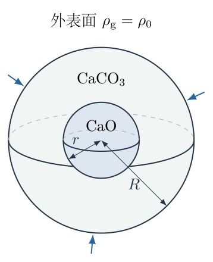
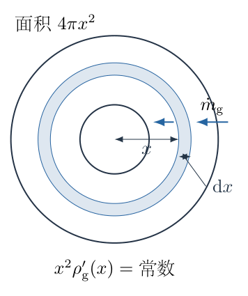
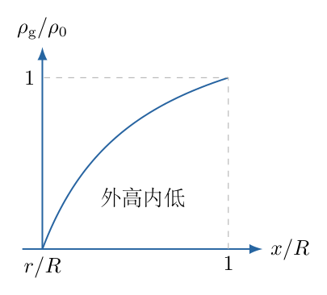
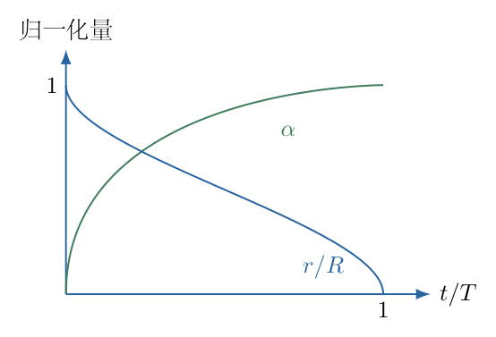

# 第 2 题

考虑反应 $\mathrm{CaO+CO_2\rightarrow CaCO_3}$。$\mathrm{CaO}$ 和 $\mathrm{CaCO_3}$ 均为固态，密度分别为 $\rho_1$ 和 $\rho$，且 $\rho_1=0.56\rho$。初始 $\mathrm{CaO}$ 是半径为 $R$ 的球。$\mathrm{CO_2}$ 为气态，能在致密的 $\mathrm{CaCO_3}$ 层中扩散，一旦到达未反应的 $\mathrm{CaO}$ 即立即反应。化学反应远快于扩散，反应界面移动缓慢，可将每个瞬时的浓度分布视为稳态。

固体外表面处 $\mathrm{CO_2}$ 的质量密度保持为 $\rho_0$，扩散系数为 $D$。对面积为 $\Delta S$、厚度为 $\Delta h$ 的薄柱，若两端分子数密度之差为 $\Delta n$，单位时间通过的分子数大小为 $D\Delta n\Delta S/\Delta h$。定义转化率 $\alpha$ 为已生成 $\mathrm{CaCO_3}$ 的物质的量与初始 $\mathrm{CaO}$ 的物质的量之比。碳、氧、钙的相对原子质量分别为 $12,16,40$。

（1）未反应 $\mathrm{CaO}$ 球半径为 $r$ 时，写出 $\mathrm{CO_2}$ 质量密度分布 $\rho_{\mathrm g}(x)$ 所满足的方程及边界条件。

（2）求此时单位时间发生反应的 $\mathrm{CO_2}$ 物质的量。

（3）建立转化率变化率 $\mathrm d\alpha/\mathrm dt$ 的方程。

另求反应从开始到完全反应的总时间 $T$。

{width=62%}

## 一、题型定位

本题属于球对称稳态扩散与移动反应界面耦合的收缩核模型。快反应给出内界面浓度近似为零，慢界面运动允许先解某一固定 $r$ 的稳态空间分布，再由化学计量把扩散通量转换为 $r(t)$ 或 $\alpha(t)$。

不能一开始就把产物外半径固定为 $R$：固态反应会改变物质的量和密度，必须先核算每摩尔固体体积。题目给出的 $0.56$ 正好与两种固体摩尔质量之比匹配，这是后续球壳边界固定的依据。

## 二、知识点

- 相对原子质量给出摩尔质量比：$\mathcal M_{\mathrm A}:\mathcal M_{\mathrm C}:\mathcal M_{\mathrm B}=56:44:100$，分别对应 $\mathrm{CaO}$、$\mathrm{CO_2}$、$\mathrm{CaCO_3}$。
- 同一种气体的分子数密度与质量密度成正比：$n=N_{\mathrm A}\rho_{\mathrm g}/\mathcal M_{\mathrm C}$。
- 扩散通量满足菲克定律 $\boldsymbol j=-D\nabla n$，负号表示由高浓度流向低浓度。
- 球对称稳态壳层中，无生成或消耗时，穿过任意同心球面的总通量相同。
- 反应的摩尔配比为 $1:1:1$，不能按三种物质质量相等处理。
- 转化率由未反应体积比确定；时间积分需要使用随 $r$ 变化的球壳阻力。
- 薄壳扩散模型在初始零厚度处为奇异极限，不能把该瞬时无限速率理解为真实无限反应能力。

## 三、物理图像

由外向内依次是气体环境、产物 $\mathrm{CaCO_3}$ 壳层和未反应 $\mathrm{CaO}$ 球核。界面半径 $r$ 随时间减小。外表面气体浓度恒定，内界面立即消耗到达的气体，因此外高内低，气体流向球心。

同一总流量通过外侧较大的球面时，单位面积通量较小；通过内侧较小的球面时，单位面积通量较大。浓度梯度因此不是常数，分布也不是平板中的线性函数。球壳稳态解含 $1/x$，这来自球面积 $4\pi x^2$ 的变化。

## 四、解题入口

用 $\mathcal M_{\mathrm A}$、$\mathcal M_{\mathrm C}$、$\mathcal M_{\mathrm B}$ 区分三种摩尔质量；令 $x$ 表示空间位置半径，$r$ 表示当前反应界面半径，$R$ 表示初始及外边界半径。求解顺序为固体体积关系、稳态壳层分布、反应摩尔流量、转化率方程、总时间。

总通量使用符号 $\dot N$ 表示每秒分子数，反应物质的量速率使用 $\dot\nu$ 表示每秒摩尔数。两者相差 $N_{\mathrm A}$，不在同一式中混用。

## 五、解析

（1）先证明产物形成时外半径保持为 $R$。

三种摩尔质量可写成同一单位下的
$$
\mathcal M_{\mathrm A}=56,\qquad
\mathcal M_{\mathrm C}=44,\qquad
\mathcal M_{\mathrm B}=100.
\tag{1}
$$
这些数只用于比值；实际SI计算应分别使用 $\mathrm{kg\,mol^{-1}}$ 或统一使用 $\mathrm{g\,mol^{-1}}$，不能把56与SI质量密度混合。

消耗一摩尔 $\mathrm{CaO}$ 时，其原有体积为 $\mathcal M_{\mathrm A}/\rho_1$；生成一摩尔 $\mathrm{CaCO_3}$ 后，产物体积为 $\mathcal M_{\mathrm B}/\rho$。给定关系为
$$
\frac{\rho_1}{\rho}=0.56
=\frac{\mathcal M_{\mathrm A}}{\mathcal M_{\mathrm B}},
$$
所以
$$
\frac{\mathcal M_{\mathrm A}}{\rho_1}
=\frac{\mathcal M_{\mathrm B}}{\rho}.
\tag{2}
$$
即每消耗一单位固体体积，恰生成相同体积的致密产物。更完整地，初始总摩尔数为
$$
\nu_{\mathrm{init}}
=\frac{4\pi R^3\rho_1}{3\mathcal M_{\mathrm A}},
$$
当前未反应摩尔数为
$$
\nu_{\mathrm{un}}
=\frac{4\pi r^3\rho_1}{3\mathcal M_{\mathrm A}}.
$$
设当前外半径为 $R_{\mathrm{out}}$，产物摩尔数为
$$
\nu_{\mathrm{prod}}
=\frac{4\pi(R_{\mathrm{out}}^3-r^3)\rho}
{3\mathcal M_{\mathrm B}}.
$$
由 $\nu_{\mathrm{prod}}=\nu_{\mathrm{init}}-\nu_{\mathrm{un}}$：
$$
\begin{aligned}
(R_{\mathrm{out}}^3-r^3)\frac{\rho}{\mathcal M_{\mathrm B}}
&=(R^3-r^3)\frac{\rho_1}{\mathcal M_{\mathrm A}},\\
R_{\mathrm{out}}^3-r^3&=R^3-r^3,\\
R_{\mathrm{out}}&=R.
\end{aligned}
\tag{3}
$$
因此可把球壳求解域定为 $r<x<R$。这一步依赖给定密度比，不是一般固体反应都可以假设的结论。

（2）建立球对称稳态扩散方程与边界。

设 $\boldsymbol e_x$ 沿半径向外，$\rho_{\mathrm g}(x)$ 是壳层中的气体质量密度。气体的质量通量矢量为
$$
\boldsymbol j_{\mathrm m}
=-D\frac{\mathrm d\rho_{\mathrm g}}{\mathrm dx}
\boldsymbol e_x.
\tag{4}
$$
内侧浓度低、外侧浓度高，故 $\mathrm d\rho_{\mathrm g}/\mathrm dx>0$，矢量式（4）向内。把向内的总质量流量定义为正：
$$
\dot m_{\mathrm g}
=4\pi x^2D\frac{\mathrm d\rho_{\mathrm g}}{\mathrm dx}.
\tag{5}
$$
图2-2的两个同心球面之间没有化学反应，稳态时也不积存气体；流入内球面的量与流出外球面的量相同。因此式（5）与 $x$ 无关。

{width=68%}

将式（5）对 $x$ 求导，得到
$$
\boxed{
\frac1{x^2}\frac{\mathrm d}{\mathrm dx}
\left(x^2\frac{\mathrm d\rho_{\mathrm g}}{\mathrm dx}\right)=0,
\qquad r<x<R.}
\tag{6}
$$
亦可展开成
$$
\frac{\mathrm d^2\rho_{\mathrm g}}{\mathrm dx^2}
+\frac2x\frac{\mathrm d\rho_{\mathrm g}}{\mathrm dx}=0.
\tag{7}
$$
边界条件为
$$
\boxed{\rho_{\mathrm g}(r)=0,\qquad
\rho_{\mathrm g}(R)=\rho_0.}
\tag{8}
$$
第一个零值是“反应远快于扩散”的理想极限，并非 $\mathrm{CO_2}$ 不能存在于产物中；第二个是外部供气维持恒浓度。未反应球核内部不是式（6）的求解域。

（3）逐步积分空间方程，求密度分布。

将式（6）先积分一次：
$$
x^2\frac{\mathrm d\rho_{\mathrm g}}{\mathrm dx}=C_1,
\qquad
\frac{\mathrm d\rho_{\mathrm g}}{\mathrm dx}
=\frac{C_1}{x^2}.
$$
再对 $x$ 积分；使用 $\int x^{-2}\mathrm dx=-x^{-1}$：
$$
\rho_{\mathrm g}(x)=-\frac{C_1}{x}+C_2.
\tag{9}
$$
内界面条件给出
$$
0=-\frac{C_1}{r}+C_2
\quad\Longrightarrow\quad C_2=\frac{C_1}{r}.
$$
外表面条件给出
$$
\rho_0=C_1\left(\frac1r-\frac1R\right)
\quad\Longrightarrow\quad
C_1=\frac{\rho_0}{1/r-1/R}>0.
$$
故
$$
\boxed{
\rho_{\mathrm g}(x)
=\rho_0\frac{1/r-1/x}{1/r-1/R},
\qquad r\le x\le R.}
\tag{10}
$$
为核对符号，分别代入两个端点：$x=r$ 时分子为零；$x=R$ 时分子等于分母，结果为 $\rho_0$。导数为 $C_1/x^2>0$，与向内扩散一致。

图2-3给出这一分布，横轴为球壳位置 $x$，不是随时间变化的界面半径。曲线在靠近内界面处较陡，反映相同总流量通过较小球面需要较大局部梯度。

{width=72%}

（4）由质量流量转换为每秒反应的摩尔数。

将式（10）的导数代入式（5）：
$$
\begin{aligned}
\dot m_{\mathrm g}
&=4\pi x^2D
\frac{\rho_0}{(1/r-1/R)x^2}\\
&=\frac{4\pi D\rho_0}{1/r-1/R}.
\end{aligned}
\tag{11}
$$
气体质量除以气体自身摩尔质量，得到
$$
\boxed{
\dot\nu
=\frac{4\pi D\rho_0}
{\mathcal M_{\mathrm C}(1/r-1/R)}
=\frac{4\pi D\rho_0\,rR}
{\mathcal M_{\mathrm C}(R-r)}.}
\tag{12}
$$
$\dot\nu$ 的单位是 $\mathrm{mol\,s^{-1}}$。这里使用的是 $\mathrm{CO_2}$ 的44，而不是固体的56或100；反应为一摩尔对一摩尔，故式（12）同时等于 $\mathrm{CaO}$ 消耗的摩尔速率和 $\mathrm{CaCO_3}$ 生成的摩尔速率。

若使用分子数密度路线，外边界有 $n_0=N_{\mathrm A}\rho_0/\mathcal M_{\mathrm C}$，分子流量为
$$
\dot N=\frac{4\pi D n_0}{1/r-1/R}.
$$
再除以 $N_{\mathrm A}$，恰好得到式（12）。两条路线说明：阿伏伽德罗常数只在分子数与摩尔数转换时出现，最终用质量密度写出的摩尔流量不需要额外乘或除一次 $N_{\mathrm A}$。

（5）从固体化学计量建立转化率方程。

根据式（3），生成产物的摩尔数与已消耗的球核摩尔数相同，所以
$$
\begin{aligned}
\alpha
&=\frac{\nu_{\mathrm{init}}-\nu_{\mathrm{un}}}{\nu_{\mathrm{init}}}\\
&=\frac{R^3-r^3}{R^3}
=1-\left(\frac rR\right)^3.
\end{aligned}
\tag{13}
$$
因 $\nu_{\mathrm{init}}$ 恒定，
$$
\frac{\mathrm d\alpha}{\mathrm dt}
=\frac{\dot\nu}{\nu_{\mathrm{init}}}.
$$
逐项代入式（12）及初始固体摩尔数：
$$
\begin{aligned}
\frac{\mathrm d\alpha}{\mathrm dt}
&=\frac{4\pi D\rho_0}
{\mathcal M_{\mathrm C}(1/r-1/R)}
\frac{3\mathcal M_{\mathrm A}}{4\pi R^3\rho_1}\\
&=\frac{3D\rho_0\mathcal M_{\mathrm A}}
{\rho_1\mathcal M_{\mathrm C}R^3}
\frac1{1/r-1/R}.
\end{aligned}
\tag{14}
$$
令 $y=r/R=(1-\alpha)^{1/3}$，则
$$
\frac1r-\frac1R=\frac{1-y}{Ry}.
$$
定义具有逆时间量纲的常数
$$
K=\frac{3D\rho_0\mathcal M_{\mathrm A}}
{\rho_1\mathcal M_{\mathrm C}R^2}.
\tag{15}
$$
于是
$$
\boxed{
\frac{\mathrm d\alpha}{\mathrm dt}
=K\frac{(1-\alpha)^{1/3}}
{1-(1-\alpha)^{1/3}},
\qquad 0<\alpha<1.}
\tag{16}
$$
也可利用 $\rho_1/\mathcal M_{\mathrm A}=\rho/\mathcal M_{\mathrm B}$，改写
$$
K=\frac{3D\rho_0\mathcal M_{\mathrm B}}
{\rho\mathcal M_{\mathrm C}R^2}.
$$
两式相等。若使用产物密度 $\rho$ 却保留 $\mathcal M_{\mathrm A}$，就会漏掉 $100/56$ 的比例。

（6）先建立界面速度，再求总反应时间。

对式（13）求导时必须使用链式法则：
$$
\frac{\mathrm d\alpha}{\mathrm dt}
=-\frac{3r^2}{R^3}\frac{\mathrm dr}{\mathrm dt}.
\tag{17}
$$
右侧应为正，所以 $\mathrm dr/\mathrm dt<0$。将式（14）与式（17）相等，先约去 $3/R^3$：
$$
-r^2\frac{\mathrm dr}{\mathrm dt}
=\frac{D\rho_0\mathcal M_{\mathrm A}}
{\rho_1\mathcal M_{\mathrm C}}
\frac1{1/r-1/R}.
$$
再把 $1/r-1/R=(R-r)/(rR)$ 代入：
$$
\boxed{
\frac{\mathrm dr}{\mathrm dt}
=-\frac{D\rho_0\mathcal M_{\mathrm A}R}
{\rho_1\mathcal M_{\mathrm C}\,r(R-r)}.}
\tag{18}
$$
这是界面速度，不是气体分子运动速度；它由到达界面的摩尔数转化为固体体积缩减率而来。

为积分总时间，将式（18）分离变量：
$$
\mathrm dt
=-\frac{\rho_1\mathcal M_{\mathrm C}}
{D\rho_0\mathcal M_{\mathrm A}R}\,
r(R-r)\,\mathrm dr.
\tag{19}
$$
初始 $r=R$、完全反应 $r=0$，积分上下限与负号共同保证时间为正：
$$
\begin{aligned}
T
&=-\frac{\rho_1\mathcal M_{\mathrm C}}
{D\rho_0\mathcal M_{\mathrm A}R}
\int_R^0(Rr-r^2)\,\mathrm dr\\
&=\frac{\rho_1\mathcal M_{\mathrm C}}
{D\rho_0\mathcal M_{\mathrm A}R}
\left[\frac{Rr^2}{2}-\frac{r^3}{3}\right]_0^R\\
&=\frac{\rho_1\mathcal M_{\mathrm C}}
{D\rho_0\mathcal M_{\mathrm A}R}
\left(\frac{R^3}{2}-\frac{R^3}{3}\right).
\end{aligned}
$$
故
$$
\boxed{
T=\frac{\rho_1\mathcal M_{\mathrm C}R^2}
{6D\rho_0\mathcal M_{\mathrm A}}
=\frac{\rho\mathcal M_{\mathrm C}R^2}
{6D\rho_0\mathcal M_{\mathrm B}}
=\frac1{2K}.}
\tag{20}
$$
扩散系数越大、供气浓度越高，反应越快；球半径增加一倍，时间增加四倍。这是扩散过程的平方尺度规律。

（7）补出全过程的隐式时间关系，检查积分是否与终点一致。

积分式（19）至当前 $r$，除以式（20）得到
$$
\begin{aligned}
\frac tT
&=\frac{
R^3/6-Rr^2/2+r^3/3}{R^3/6}\\
&=1-3\left(\frac rR\right)^2
+2\left(\frac rR\right)^3.
\end{aligned}
\tag{21}
$$
结合式（13）：
$$
\boxed{
\frac tT
=1-3(1-\alpha)^{2/3}+2(1-\alpha).}
\tag{22}
$$
若用壳层相对厚度 $z=1-r/R$，则
$$
\frac tT=3z^2-2z^3,\qquad
\alpha=3z-3z^2+z^3.
\tag{23}
$$
该重写利用二项式展开，便于核对早期薄层行为。图2-4中的曲线从 $t/T=0$ 单调增至1，并且中途的转化率不是随时间线性增长。

{width=74%}

从式（21）再求导：
$$
\frac{\mathrm d(t/T)}{\mathrm dy}
=-6y+6y^2=-6y(1-y),
$$
从 $\alpha=1-y^3$ 得 $\mathrm d\alpha/\mathrm dy=-3y^2$，两式相除：
$$
\frac{\mathrm d\alpha}{\mathrm dt}
=\frac1T\frac{y}{2(1-y)}
=K\frac{y}{1-y}.
$$
这恢复式（16），说明时间积分、界面运动和摩尔守恒彼此一致。

<!-- KEEP_STUDENT_START -->

（8）检查两端奇异性与实际适用范围。

当 $\alpha\to0^+$ 时，$y\to1$，理想球壳厚度趋于零，式（16）的速率发散。但总时间积分式（19）在 $r=R$ 附近的被积函数趋于零，初始短时间仍然有限。由式（23），薄层时
$$
t/T\approx3z^2,\qquad \alpha\approx3z,
$$
故
$$
\alpha\approx\sqrt{3t/T}.
\tag{24}
$$
这不是有限化学反应速率的真实起点解，而是忽略外部传质和界面反应阻力后的扩散控制极限。真实最初瞬间应由这些未计入的阻力正则化，不把数学奇异点当成物理无限速率。

当 $\alpha\to1^-$ 时，$y\to0$，总摩尔速率趋于零；但界面速度式（18）因反应球面积同时趋于零而发散。这两种表现不矛盾：越来越小的球核可以在总耗气量趋零的同时快速消失。式（21）给出
$$
1-t/T\approx3y^2,
$$
终点时间依旧有限。分子连续介质近似到极小球核也会失效，题目模型求的是宏观扩散时间。

量纲方面，$D$ 为 $\mathrm{m^2s^{-1}}$，$\rho_0/\rho_1$ 及摩尔质量比无量纲，所以 $K$ 的单位为 $\mathrm{s^{-1}}$；式（20）是 $R^2/D$ 乘无量纲比例，单位为秒。空间式（10）的分子、分母均为逆长度，结果保持密度单位。

<!-- KEEP_STUDENT_END -->

## 六、关键洞察

球壳扩散可以写成“浓度差除以扩散阻力”。由式（12），单位摩尔流量的阻力为
$$
\mathcal R_{\mathrm{diff}}
=\frac{\mathcal M_{\mathrm C}}{4\pi D}
\left(\frac1r-\frac1R\right).
$$
它与球壳电阻的积分结构相同：微元截面积都是 $4\pi x^2$，因而出现 $\int\mathrm dx/x^2$。这种类比只能在稳态、常数扩散系数、无壳层内部反应时使用。

另一条等价路线直接从未反应固体质量变化入手：
$$
-\frac{\mathrm d}{\mathrm dt}\left(\frac{4\pi r^3\rho_1}{3}\right)
=\mathcal M_{\mathrm A}\dot\nu.
$$
左边是 $\mathrm{CaO}$ 的质量消耗率，右边用的是 $\mathcal M_{\mathrm A}$ 而不是气体的 $\mathcal M_{\mathrm C}$。代入式（12）即得式（18）。它独立显示为什么不能把气体质量流量直接当作固体质量流量。

## 七、易错点

- 未核算摩尔体积就把外半径固定，或把数值0.56当作无关条件。
- 在球壳中使用平板线性浓度分布，遗漏面积随半径改变。
- 以向外为正写菲克定律后又把负通量当成负反应量。
- 用44、56、100时不统一摩尔质量单位。
- 混淆空间半径 $x$ 与界面半径 $r(t)$。
- 把转化率取为 $1-r/R$，遗漏体积比的三次方。
- 对 $\alpha$ 求导漏掉链式法则的负号和 $3r^2/R^3$。
- 在时间积分中把上下限由 $R\to0$ 改为 $0\to R$ 却未同时改负号。
- 认为反应末期速率趋零意味着总反应时间必定无穷大。

## 八、课堂讲解建议

教师先让学生分别算一摩尔原料与一摩尔产物的体积，明确0.56的作用后再画同心球壳。板书时使用三个不同字母区分气体、原料、产物摩尔质量，防止把化学计量缩成一句话。

稳态方程先从两个球面的流量相等写出，不直接给拉普拉斯方程。让学生解释为什么越靠近球心梯度越大，然后由 $x^2\rho_{\mathrm g}'$ 恒定完成两次积分。

最后把同一结果用“初始摩尔数归一化”和“固体质量消耗”两条路线各推一遍。课堂讨论初始速率发散时，应指出被忽略的反应与供气阻力，不用无限速率掩盖模型边界。

## 九、变式训练

变式：外部供气仍维持质量密度 $\rho_0$，但内界面反应不再瞬时完成。设单位面积气体质量消耗率为 $k_{\mathrm s}\rho_{\mathrm i}$，其中 $k_{\mathrm s}>0$ 为界面速率系数，$\rho_{\mathrm i}$ 是内界面浓度；固体摩尔体积仍匹配。求反应摩尔流量和总完成时间。

稳态扩散与界面消耗给出同一质量流量：
$$
\dot m_{\mathrm g}
=\frac{4\pi D(\rho_0-\rho_{\mathrm i})}{1/r-1/R}
=4\pi r^2k_{\mathrm s}\rho_{\mathrm i}.
$$
解第二式得 $\rho_{\mathrm i}=\dot m_{\mathrm g}/(4\pi r^2k_{\mathrm s})$，代回第一式并把含流量的项移到同侧：
$$
\boxed{
\dot m_{\mathrm g}
=\frac{4\pi\rho_0}
{D^{-1}(1/r-1/R)+(k_{\mathrm s}r^2)^{-1}}},
\qquad
\dot\nu=\frac{\dot m_{\mathrm g}}{\mathcal M_{\mathrm C}}.
$$
这里两个正阻力相加，而不是把扩散系数与界面系数直接相加。将固体质量守恒写为
$$
-4\pi r^2\rho_1\frac{\mathrm dr}{\mathrm dt}
=\mathcal M_{\mathrm A}\dot\nu,
$$
代入流量后分离变量：
$$
\mathrm dt
=-\frac{\rho_1\mathcal M_{\mathrm C}}{\rho_0\mathcal M_{\mathrm A}}
\left[\frac{r-r^2/R}{D}+\frac1{k_{\mathrm s}}\right]\mathrm dr.
$$
从 $r=R$ 积分到0：
$$
\boxed{
T_{\mathrm{finite}}
=\frac{\rho_1\mathcal M_{\mathrm C}}{\rho_0\mathcal M_{\mathrm A}}
\left(\frac{R^2}{6D}+\frac R{k_{\mathrm s}}\right)}.
$$
在 $k_{\mathrm s}\to\infty$ 时恢复式（20）；在扩散极快 $D\to\infty$ 时得到界面控制时间 $\rho_1\mathcal M_{\mathrm C}R/(\rho_0\mathcal M_{\mathrm A}k_{\mathrm s})$。初始 $r=R$ 时扩散阻力为零、界面阻力有限，因此不再出现无限初始流量。这一带解变式为主模型的奇异起点提供具体修正，而不改变主问题要求的扩散控制结论。
