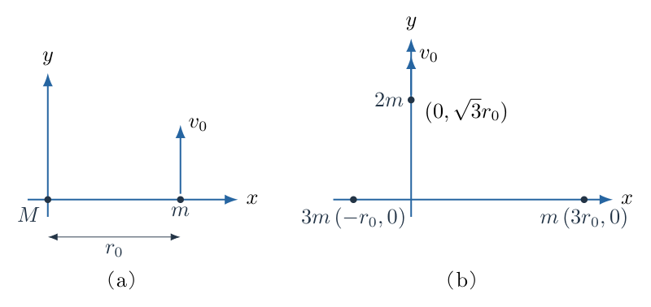
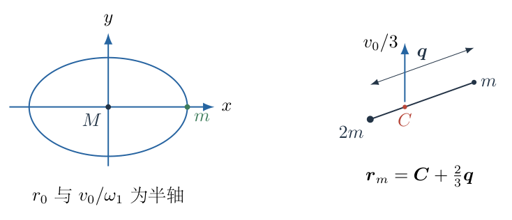
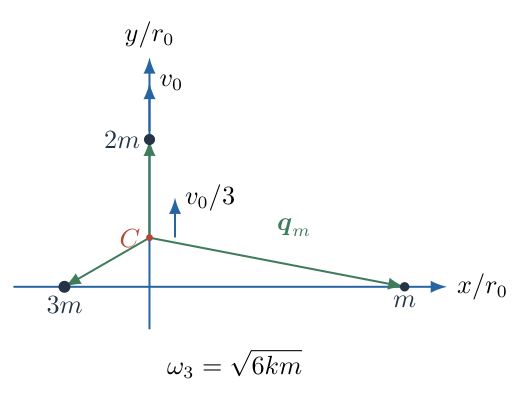
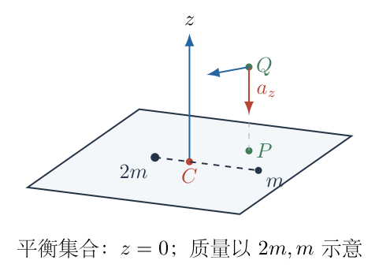
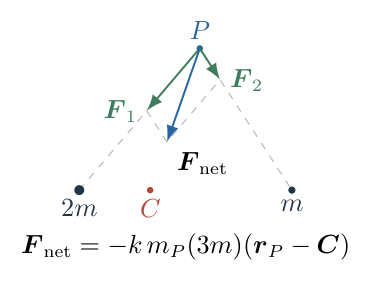

# 第 3 题

某宇宙中点状天体间的相互作用力为
$$
\boldsymbol F_{12}=-k m_1m_2\boldsymbol r,
$$
其中 $k>0$ 为常数，$\boldsymbol r$ 是由第二个天体指向第一个天体的相对位移矢量；负号表示吸引。牛顿运动定律仍成立。

（1）如图（a），质量为 $M$ 的天体位于原点，质量为 $m$ 的天体初始位于 $(r_0,0)$，初速度为 $v_0\boldsymbol e_y$。$M\gg m$，将质量为 $M$ 的天体近似视为静止，求质量为 $m$ 的天体的位置随时间的关系。

（2）仍取上述初始位置和速度，但令 $M=2m$，质量为 $M$ 的天体初始静止。求系统质心位置，以及质量为 $m$ 的天体的位置随时间的关系。

（3）如图（b），质量为 $m,2m,3m$ 的三个天体初始位置分别为 $(3r_0,0)$、$(0,\sqrt3r_0)$、$(-r_0,0)$。质量为 $2m$ 的天体具有初速度 $v_0\boldsymbol e_y$，另两天体初始静止。求质量为 $m$ 和 $2m$ 的天体位置随时间的关系，不考虑碰撞。

（4）两天体相互绕行做圆周运动。发射一个质量远小于任一天体的探测器，寻找探测器与两天体相对位置保持不变的点。求这些“拉格朗日点”的数量并描述其位置。

{width=88%}

## 一、题型定位

本题是线性中心力下的单体、二体、多体运动，以及共转参考系的相对平衡。相互作用力与位移矢量本身成正比，不是通常万有引力的 $1/r^2$ 定律。其特殊性是任一天体的合力都可以化为“指向共同质心的线性回复力”。

前三问用牛顿第二定律和质心运动分离来求解。第四问不是另行寻找有限个特殊位置，而是检验整个共转平面内的引力加速度能否恰好提供所需向心加速度。必须同时检查平面外方向，不能只说“任意点”而漏掉空间约束。

## 二、知识点

- 相对位移矢量的方向约定决定吸引力的符号。
- 简谐方程 $\ddot x+\omega^2x=0$ 的解由初始位置和速度唯一确定。
- 内力成对反向，系统总动量守恒，质心匀速直线运动。
- 二体相对坐标满足以总质量决定频率的简谐方程；质心重建位置时保留质量比例。
- 多体线性引力叠加可用质量加权和化简为共同质心。
- 平面各方向简谐运动叠加构成以力心为中心的椭圆，而非以力心为焦点的开普勒椭圆。
- 共转平衡需要实际引力与保持固定旋转坐标所需的惯性加速度逐分量一致。

## 三、物理图像

对固定重天体，运动天体的 $x$、$y$ 两个坐标独立作同频简谐运动：初始位置只给 $x$ 方向余弦项，初速度只给 $y$ 方向正弦项。它的轨迹一般为椭圆，重天体位于椭圆中心。

质量不能忽略时，力心不再固定在重天体原来的位置。两天体围绕匀速移动的质心运动。三体也一样：共同质心的直线运动叠加到各天体相对质心的同频椭圆运动上，得到实验室中的轨迹。

圆周双体的角速度正好是任何无质量探测器在其共同质心周围的线性振子的频率。因此，平面内任意位置都可以以这一角速度保持共转；离开轨道平面则会额外受到向平面的引力分量，无法保持固定高度。

## 四、解题入口

先把力写成坐标方程，不把 $\boldsymbol r$ 替换为单位矢量。单体用 $\omega_1=\sqrt{kM}$；二体用 $\omega_2=\sqrt{k(M+m)}$；三体用 $\omega_3=\sqrt{6km}$。下标用来提醒各问的总质量不同，不能全程共用一个未经说明的 $\omega$。

每次求简谐解都遵循相同次序：算质心初始位置与速度，减去质心运动，求相对坐标的初始位置与速度，最后把质心加回。第四问将双体质量记为 $M_1,M_2$，探测器质量忽略，不加入主系统总质量。

## 五、解析

（1）从固定重天体的力矢量得到两个简谐方程。

令运动天体的位置为
$$
\boldsymbol r_m=x\boldsymbol e_x+y\boldsymbol e_y.
$$
重天体在原点，相对位移就是 $\boldsymbol r_m$，故
$$
\boldsymbol F=-kMm(x\boldsymbol e_x+y\boldsymbol e_y).
$$
由 $m\ddot{\boldsymbol r}_m=\boldsymbol F$，约去 $m$：
$$
\ddot x=-kMx,\qquad \ddot y=-kMy.
\tag{1}
$$
定义
$$
\omega_1=\sqrt{kM}>0,
$$
两个方程的通解分别为
$$
x=A_x\cos\omega_1t+B_x\sin\omega_1t,
\qquad
y=A_y\cos\omega_1t+B_y\sin\omega_1t.
\tag{2}
$$
初始条件为
$$
x(0)=r_0,\quad y(0)=0,\quad
\dot x(0)=0,\quad\dot y(0)=v_0.
$$
在式（2）中令 $t=0$，先得 $A_x=r_0,A_y=0$。对式（2）求导并令 $t=0$：
$$
\dot x(0)=\omega_1B_x=0,\qquad
\dot y(0)=\omega_1B_y=v_0,
$$
故 $B_x=0,B_y=v_0/\omega_1$。所求为
$$
\boxed{
x(t)=r_0\cos\omega_1t,\qquad
y(t)=\frac{v_0}{\omega_1}\sin\omega_1t,
\qquad \omega_1=\sqrt{kM}.}
\tag{3}
$$
这里 $v_0/\omega_1$ 具有长度量纲，是 $y$ 方向振幅，不是另一个速度。

图3-2中的两条半轴分别为 $r_0$、$v_0/\omega_1$。当二者不相等时轨迹为椭圆；当 $v_0=\omega_1r_0$ 时变为圆。

{width=86%}

（2）验证第一问的轨迹、能量和力心位置。

将式（3）分别除以振幅再平方相加：
$$
\frac{x^2}{r_0^2}
+\frac{y^2}{(v_0/\omega_1)^2}
=\cos^2\omega_1t+\sin^2\omega_1t=1.
\tag{4}
$$
该椭圆中心是原点。对于线性吸引力，势能可取
$$
U=\frac12kMm(x^2+y^2),
$$
因为 $-\partial U/\partial x=-kMmx$。不能使用常规引力势能 $-GMm/r$。

对式（3）求导：
$$
\dot x=-r_0\omega_1\sin\omega_1t,\qquad
\dot y=v_0\cos\omega_1t.
$$
代入动能与势能之和：
$$
\begin{aligned}
E
&=\frac m2\left(r_0^2\omega_1^2\sin^2\omega_1t
+v_0^2\cos^2\omega_1t\right)\\
&\quad+\frac {m\omega_1^2}2
\left(r_0^2\cos^2\omega_1t
+\frac{v_0^2}{\omega_1^2}\sin^2\omega_1t\right)\\
&=\frac m2\left(\omega_1^2r_0^2+v_0^2\right).
\end{aligned}
\tag{5}
$$
时间项全部消掉，能量守恒。对原点的角动量为
$$
\begin{aligned}
L_z&=m(x\dot y-y\dot x)\\
&=mr_0v_0(\cos^2\omega_1t+\sin^2\omega_1t)
=mr_0v_0.
\end{aligned}
\tag{6}
$$
中心力矩为零，结果同样一致。若 $v_0=0$，轨迹退化为直线并穿过原点；点状模型允许这一数学延拓，有限半径天体若发生碰撞则需另处理。

（3）第二问先求质心，不把质量为 $2m$ 的天体继续固定。

初始总质量为 $3m$，位置分别为 $(0,0)$ 和 $(r_0,0)$。质心初始位置为
$$
\boldsymbol C(0)
=\frac{2m(0,0)+m(r_0,0)}{3m}
=\left(\frac{r_0}{3},0\right).
$$
总动量只有运动天体的 $mv_0\boldsymbol e_y$，所以
$$
\dot{\boldsymbol C}
=\frac{mv_0}{3m}\boldsymbol e_y
=\frac{v_0}{3}\boldsymbol e_y.
$$
内力相抵、无外力，$\ddot{\boldsymbol C}=0$，由此
$$
\boxed{
C_x(t)=\frac{r_0}{3},\qquad
C_y(t)=\frac{v_0t}{3}.}
\tag{7}
$$
质心不在最初重天体位置，也不是静止的。

（4）由两条牛顿方程相减求相对运动频率。

令 $\boldsymbol q=\boldsymbol r_m-\boldsymbol r_M$。两个天体受力分别为 $-kMm\boldsymbol q$ 和 $+kMm\boldsymbol q$，所以
$$
\ddot{\boldsymbol r}_m=-kM\boldsymbol q,\qquad
\ddot{\boldsymbol r}_M=+km\boldsymbol q.
$$
相减得
$$
\begin{aligned}
\ddot{\boldsymbol q}
&=-kM\boldsymbol q-km\boldsymbol q\\
&=-k(M+m)\boldsymbol q.
\end{aligned}
\tag{8}
$$
这里两个加速度相减后质量应相加，不能仍用 $\sqrt{kM}$。当 $M=2m$，
$$
\omega_2=\sqrt{3km}.
\tag{9}
$$
相对坐标初始位置为 $(r_0,0)$、相对速度为 $(0,v_0)$，按第一问同样代入简谐通解：
$$
q_x=r_0\cos\omega_2t,\qquad
q_y=\frac{v_0}{\omega_2}\sin\omega_2t.
\tag{10}
$$

（5）用质心和相对坐标重建两个天体的位置。

由质心定义和 $\boldsymbol r_m=\boldsymbol r_M+\boldsymbol q$：
$$
\begin{aligned}
\boldsymbol C
&=\frac{M\boldsymbol r_M+m(\boldsymbol r_M+\boldsymbol q)}{M+m}\\
&=\boldsymbol r_M+\frac m{M+m}\boldsymbol q.
\end{aligned}
$$
故
$$
\boldsymbol r_M=\boldsymbol C-\frac m{M+m}\boldsymbol q,
\qquad
\boldsymbol r_m=\boldsymbol C+\frac M{M+m}\boldsymbol q.
\tag{11}
$$
代入 $M=2m$、式（7）、（10）：
$$
\boxed{
\begin{aligned}
x_m(t)&=\frac{r_0}{3}
+\frac{2r_0}{3}\cos\omega_2t,\\
y_m(t)&=\frac{v_0t}{3}
+\frac{2v_0}{3\omega_2}\sin\omega_2t.
\end{aligned}}
\tag{12}
$$
为检验，也写出另一体：
$$
\begin{aligned}
x_M(t)&=\frac{r_0}{3}
-\frac{r_0}{3}\cos\omega_2t,\\
y_M(t)&=\frac{v_0t}{3}
-\frac{v_0}{3\omega_2}\sin\omega_2t.
\end{aligned}
\tag{13}
$$
令 $t=0$，式（12）给 $(r_0,0)$，式（13）给 $(0,0)$。对两式求导再令 $t=0$，分别得 $(0,v_0)$ 和零速度。这一步同时检验三分之一、三分之二系数与正负号。

（6）第三问先推导任意多体系统的合力形式。

设系统总质量为 $\mathcal M=\sum_jm_j$，质心为 $\boldsymbol C=\sum_jm_j\boldsymbol r_j/\mathcal M$。第 $i$ 个天体受其他所有天体的合力为
$$
\begin{aligned}
\boldsymbol F_i
&=-km_i\sum_{j\ne i}m_j(\boldsymbol r_i-\boldsymbol r_j)\\
&=-km_i\left[
(\mathcal M-m_i)\boldsymbol r_i
-\sum_{j\ne i}m_j\boldsymbol r_j\right].
\end{aligned}
$$
补回 $j=i$ 项，利用
$$
\sum_{j\ne i}m_j\boldsymbol r_j
=\mathcal M\boldsymbol C-m_i\boldsymbol r_i,
$$
得到
$$
\begin{aligned}
\boldsymbol F_i
&=-km_i\left[
(\mathcal M-m_i)\boldsymbol r_i
-\mathcal M\boldsymbol C+m_i\boldsymbol r_i\right]\\
&=-km_i\mathcal M(\boldsymbol r_i-\boldsymbol C).
\end{aligned}
\tag{14}
$$
于是
$$
\ddot{\boldsymbol r}_i=-k\mathcal M(\boldsymbol r_i-\boldsymbol C).
\tag{15}
$$
由于质心匀速，定义 $\boldsymbol q_i=\boldsymbol r_i-\boldsymbol C$ 后有
$$
\ddot{\boldsymbol q}_i+k\mathcal M\boldsymbol q_i=0.
\tag{16}
$$
各天体质量约掉，每个相对质心坐标都以同一个 $\sqrt{k\mathcal M}$ 频率振动。并非三个两体频率彼此独立，不能只取相邻一对天体的质量和。

图3-3同时标出初始质心和三条相对位置矢量。式（14）使用的是从共同质心指向各天体的矢量，不是任意选择的最近天体方向。

{width=77%}

（7）逐项计算三体质心与共同频率。

总质量为 $6m$，质心横坐标为
$$
C_x(0)=\frac{m(3r_0)+2m(0)+3m(-r_0)}{6m}=0.
$$
纵坐标为
$$
C_y(0)=\frac{m(0)+2m(\sqrt3r_0)+3m(0)}{6m}
=\frac{\sqrt3r_0}{3}.
$$
初始总动量为 $2mv_0\boldsymbol e_y$，故
$$
\dot C_x=0,\qquad\dot C_y=\frac{v_0}{3}.
$$
完整质心运动为
$$
\boldsymbol C(t)=
\left(0,\frac{\sqrt3r_0}{3}+\frac{v_0t}{3}\right),
\qquad
\omega_3=\sqrt{6km}.
\tag{17}
$$
不是将三个位置作算术平均，也不能把唯一有初速度的天体速度 $v_0$ 直接当成质心速度。

（8）求质量为 $m$ 的天体位置。

相对质心的初始位置为
$$
\boldsymbol q_m(0)=
\left(3r_0,-\frac{\sqrt3r_0}{3}\right).
$$
该天体实验室初速度为零，所以相对质心初速度为
$$
\dot{\boldsymbol q}_m(0)
=(0,0)-\left(0,\frac{v_0}{3}\right)
=\left(0,-\frac{v_0}{3}\right).
$$
由式（16）通解
$$
\boldsymbol q_i(t)=\boldsymbol q_i(0)\cos\omega_3t
+\frac{\dot{\boldsymbol q}_i(0)}{\omega_3}\sin\omega_3t
\tag{18}
$$
可得
$$
q_{m,x}=3r_0\cos\omega_3t,\qquad
q_{m,y}=-\frac{\sqrt3r_0}{3}\cos\omega_3t
-\frac{v_0}{3\omega_3}\sin\omega_3t.
$$
加回式（17）：
$$
\boxed{
\begin{aligned}
x_m(t)&=3r_0\cos\omega_3t,\\
y_m(t)&=\frac{\sqrt3r_0}{3}(1-\cos\omega_3t)
+\frac{v_0t}{3}
-\frac{v_0}{3\omega_3}\sin\omega_3t.
\end{aligned}}
\tag{19}
$$
式（19）中的线性项和正弦项初始导数互相抵消，因此该天体初速度仍为零，不会因加回质心运动而多出虚假的 $v_0/3$。

（9）求质量为 $2m$ 的天体位置。

其相对质心初始位置和速度分别为
$$
\begin{aligned}
\boldsymbol q_{2m}(0)
&=\left(0,\sqrt3r_0-\frac{\sqrt3r_0}{3}\right)
=\left(0,\frac{2\sqrt3r_0}{3}\right),\\
\dot{\boldsymbol q}_{2m}(0)
&=\left(0,v_0-\frac{v_0}{3}\right)
=\left(0,\frac{2v_0}{3}\right).
\end{aligned}
$$
代入式（18）再加回质心：
$$
\boxed{
\begin{aligned}
x_{2m}(t)&=0,\\
y_{2m}(t)&=\frac{\sqrt3r_0}{3}
+\frac{v_0t}{3}
+\frac{2\sqrt3r_0}{3}\cos\omega_3t
+\frac{2v_0}{3\omega_3}\sin\omega_3t.
\end{aligned}}
\tag{20}
$$
横坐标始终为零，这是共同质心的横坐标为零且其相对横坐标和速度均为零的结果，并非忽略了另外两个天体的横向引力。两侧天体的质量加权横向作用恰好抵消。

（10）用第三个天体补全守恒检查。

不额外求解方程，直接由其相对初始条件
$$
\boldsymbol q_{3m}(0)=
\left(-r_0,-\frac{\sqrt3r_0}{3}\right),
\qquad
\dot{\boldsymbol q}_{3m}(0)=\left(0,-\frac{v_0}{3}\right)
$$
得到
$$
\begin{aligned}
x_{3m}(t)&=-r_0\cos\omega_3t,\\
y_{3m}(t)&=\frac{\sqrt3r_0}{3}(1-\cos\omega_3t)
+\frac{v_0t}{3}
-\frac{v_0}{3\omega_3}\sin\omega_3t.
\end{aligned}
\tag{21}
$$
检查质量加权横坐标：
$$
mx_m+2mx_{2m}+3mx_{3m}
=m(3r_0\cos\omega_3t)+3m(-r_0\cos\omega_3t)=0.
$$
纵坐标中的所有余弦项和正弦项按质量加权后也相消，余下
$$
my_m+2my_{2m}+3my_{3m}
=6m\left(\frac{\sqrt3r_0}{3}+\frac{v_0t}{3}\right)
=6mC_y(t).
\tag{22}
$$
求一次导数得总动量 $2mv_0\boldsymbol e_y$，再求导为零。这样不只验证初始条件，也验证整个运动过程中质心关系始终成立。

（11）建立圆周双体的共同角速度。

令双体总质量为 $\mathcal M_{\mathrm b}=M_1+M_2$，共同质心记为 $C$，两体相对位移 $\boldsymbol d$。由二体相减路线，
$$
\ddot{\boldsymbol d}=-k\mathcal M_{\mathrm b}\boldsymbol d.
$$
圆周运动时 $\ddot{\boldsymbol d}=-\Omega^2\boldsymbol d$，因此
$$
\boxed{\Omega^2=k(M_1+M_2).}
\tag{23}
$$
无论两体间距多大，共同角速度都由总质量决定。这是线性力特有的结论，与通常开普勒频率随距离的三次方变化不同。

（12）检查探测器在共转平面内和外的固定点。

以双体质心为原点，令探测器位置为 $\boldsymbol q=(X,Y,Z)$，$Z$ 轴垂直双体轨道平面。忽略探测器对双体的影响，其引力加速度为
$$
\boldsymbol a_{\mathrm g}
=-k\left[M_1(\boldsymbol q-\boldsymbol q_1)
+M_2(\boldsymbol q-\boldsymbol q_2)\right].
$$
利用 $M_1\boldsymbol q_1+M_2\boldsymbol q_2=0$ 和式（23）：
$$
\boldsymbol a_{\mathrm g}=-\Omega^2(X,Y,Z).
\tag{24}
$$
若探测器在以 $\Omega$ 绕 $Z$ 轴旋转的坐标系内保持固定，其实验室运动是固定高度的圆周运动，所需加速度为
$$
\boldsymbol a_{\mathrm{req}}=(-\Omega^2X,-\Omega^2Y,0).
\tag{25}
$$
图3-4中任意平面点 $P$ 都有匹配的径向引力；空间点 $Q$ 则多出不能由同高度圆周运动提供的竖直分量。

{width=79%}

令式（24）、（25）逐分量相等，前两项自动满足，第三项要求
$$
-\Omega^2Z=0\quad\Longrightarrow\quad Z=0.
$$
因此
$$
\boxed{\text{相对平衡点有无穷多个，构成双体圆轨道所在的整个平面。}}
\tag{26}
$$
包括质心点，以及任何不与天体实际接触的平面位置；题目为点状模型，若另考虑实体大小，需排除碰撞或占据区域。结论不是通常的五个离散拉格朗日点，也不是整个三维空间任意位置。

图3-5把合力叠加化为质心回复力。后续计算只用到总质量和质心，不需要知道双体在圆周上的具体相位，这正是平面内连续可选位置的原因。

{width=75%}

以图3-5中的 $2m,m$ 双体和质量可忽略的探测器 $m_P$ 为例，两分力分别为
$$
\begin{aligned}
\boldsymbol F_1&=-2kmm_P(\boldsymbol r_P-\boldsymbol r_1),\\
\boldsymbol F_2&=-kmm_P(\boldsymbol r_P-\boldsymbol r_2).
\end{aligned}
$$
因 $2m\boldsymbol r_1+m\boldsymbol r_2=3m\boldsymbol C$，相加后得到
$$
\boldsymbol F_1+\boldsymbol F_2
=-3kmm_P(\boldsymbol r_P-\boldsymbol C).
$$
记 $\boldsymbol F_{\mathrm{net}}=\boldsymbol F_1+\boldsymbol F_2$，它与图中的合力方向及式（24）一致；探测器质量只乘在力上，约去后不影响共转频率。

<!-- KEEP_STUDENT_START -->

（13）用量纲、质量极限和动力学代回检查。

由 $F=km_1m_2r$ 得
$$
[k]=\mathrm{kg^{-1}s^{-2}},
$$
故 $\sqrt{kM}$、$\sqrt{3km}$、$\sqrt{6km}$ 均为逆时间，所有 $v_0/\omega$ 项均为长度。第二问在一般式（11）中取 $M\gg m$，质心速度 $mv_0/(M+m)$ 趋零、$M/(M+m)\to1$、$\sqrt{k(M+m)}\to\sqrt{kM}$，恰恢复第一问的固定力心解。

第三问取 $v_0=0$，质心静止，各相对坐标均随同一个余弦因子缩放；这意味着理想点状系统会在四分之一周期处汇聚，题目已允许忽略碰撞。若 $v_0\ne0$，不能只凭这一缩放图像判断是否发生碰撞，应使用各天体的位置差。

对任意解式（18）求二次导数即得 $-\omega_3^2\boldsymbol q_i$，与式（16）一致。对第四问的任意平面共转点求二次导数得到式（25），因此连续平衡结论不仅是旋转系“离心力抵消”的说法，也有完整惯性系运动验证。

<!-- KEEP_STUDENT_END -->

## 六、关键洞察

力的线性是整个多体问题可解的关键：
$$
\sum_jm_j(\boldsymbol r_i-\boldsymbol r_j)
=\mathcal M(\boldsymbol r_i-\boldsymbol C).
$$
它让所有两两相互作用的复杂几何归并成一个共同质心。若力依赖 $|\boldsymbol r_i-\boldsymbol r_j|^{-3}$ 等非线性因子，这个质量加权消元不再成立，不能沿用本题解法。

系统势能还有一个等价恒等式：
$$
U=\frac{k}{2}\sum_{i<j}m_im_j|\boldsymbol r_i-\boldsymbol r_j|^2
=\frac{k\mathcal M}{2}\sum_i m_i|\boldsymbol r_i-\boldsymbol C|^2.
$$
展开左侧平方、收集 $\sum m_i\boldsymbol r_i$ 即得右式。这说明相对质心运动是一组共享频率的线性振子，但各相对坐标仍受 $\sum m_i\boldsymbol q_i=0$ 的约束，不能把它们当成完全独立的任意自由度。

第四问的连续平衡不代表每个点都有严格吸引性的稳定性。稍微改变位置而保持共转初速度，可以停留在另一个平衡点；不存在把它拉回原点的平面回复力。具体速度扰动需要保留旋转系科里奥利项，不能仅凭“引力与离心力相等”下稳定性结论。

## 七、易错点

- 把位移矢量误读为单位矢量，导致频率和轨迹完全改变。
- 以通常万有引力势能或焦点椭圆套用本题线性力。
- 在 $M=2m$ 时仍固定重天体，漏掉质心漂移和总质量频率。
- 只减去质心位置、不减去质心速度。
- 三体质心使用算术平均，或者把初速度 $v_0$ 误取为质心速度。
- 将三体共同频率误取成某一对天体的二体频率。
- 加回质心时，遗漏 $\sqrt3r_0/3$ 常量或正弦项的负号。
- 不检查平面外分量，笼统说所有空间点都是平衡点。
- 把通常的五个拉格朗日点数量直接移植到本题。

## 八、课堂讲解建议

教师先用第一问建立“坐标各自简谐”的直觉，并让学生代入初始位置和初始速度，确认正弦振幅为何必须除以频率。不要直接把轨迹画成普通太阳系椭圆。

第二问在板书中并列实验室坐标与质心坐标，两条速度同样需要转换。第三问先写一般合力求和并完成质量加权消元，再代入具体数字；这样学生能看到三体题没有额外猜测受力方向。

第四问让学生自行写固定旋转坐标点的实验室加速度，与引力逐分量比较。课堂应特别追问平面外为何失败，使“无穷多个点”的结论成为计算结果而不是与常规知识反差很大的口号。

## 九、变式训练

变式：双体仍以角速度 $\Omega$ 做圆周运动。探测器初始位于某一平面相对平衡点，给它在共转坐标系中的小速度扰动 $(u_x,u_y,u_z)$，求相对原平衡点的线性运动。

设扰动坐标为 $(\xi,\eta,\zeta)$。由惯性系引力 $-\Omega^2\boldsymbol q$、旋转系离心项和平面科里奥利项：
$$
\ddot\xi-2\Omega\dot\eta=0,\qquad
\ddot\eta+2\Omega\dot\xi=0,\qquad
\ddot\zeta+\Omega^2\zeta=0.
$$
初始扰动位置为零。令 $p=\dot\xi,q=\dot\eta$，则 $\dot p=2\Omega q,\dot q=-2\Omega p$。满足初始速度的解为
$$
p=u_x\cos2\Omega t+u_y\sin2\Omega t,\qquad
q=u_y\cos2\Omega t-u_x\sin2\Omega t.
$$
从0到 $t$ 积分：
$$
\boxed{
\begin{aligned}
\xi&=\frac{u_x}{2\Omega}\sin2\Omega t
+\frac{u_y}{2\Omega}(1-\cos2\Omega t),\\
\eta&=\frac{u_y}{2\Omega}\sin2\Omega t
-\frac{u_x}{2\Omega}(1-\cos2\Omega t),\\
\zeta&=\frac{u_z}{\Omega}\sin\Omega t.
\end{aligned}}
$$
平面速度扰动形成有界振动，位置扰动则可以把系统带到另一个平衡点；竖直速度扰动形成频率 $\Omega$ 的简谐运动。该结果说明连续相对平衡集合是中性的，不是具有耗散吸引作用的稳定停泊点。若加入阻尼、外部天体或改变力律，仍须重新判定，不能从本理想解推出一般航天器停泊稳定性。
