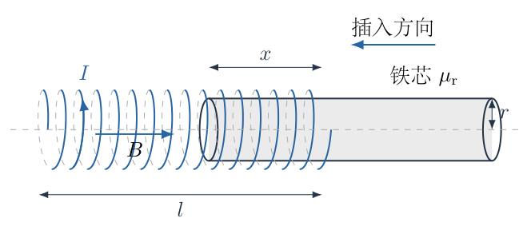
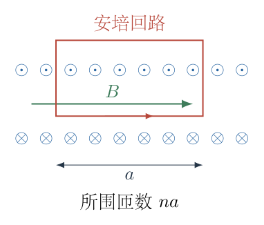
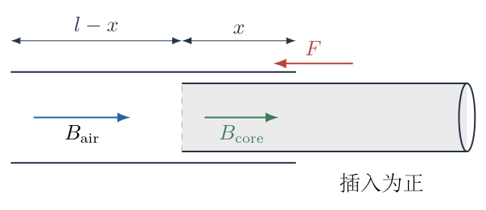
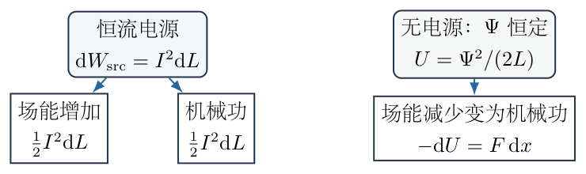
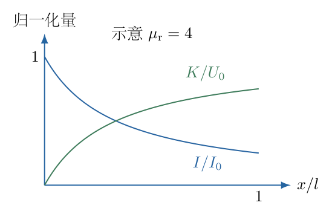

# 第 5 题

一根足够长的密绕圆柱形螺线管，长度为 $l$，半径为 $r$，满足 $r\ll l$；单位长度匝数为 $n$。真空磁导率为 $\mu_0$。

（1）通过电流 $I$ 时，求螺线管内部的磁感应强度 $B$。

（2）通过计算所有匝的磁通链 $\Psi$，求螺线管自感 $L$。

（3）将相对磁导率为 $\mu_{\mathrm r}$、半径为 $r$ 的铁芯沿轴向插入长度 $x$。线圈接恒流电源，电流 $I$ 保持不变。线性磁介质中的单位体积磁场能量为 $w_{\mathrm B}=B^2/(2\mu_0\mu_{\mathrm r})$。求铁芯受到的轴向力。

（4）线圈初始电流为 $I_0$，无其他电源，闭合回路电阻可忽略。上述铁芯质量为 $m$、长度为 $l$，从远处由静止开始被吸入，直至完全进入螺线管。忽略所有能量损耗，求此时铁芯速度。

各问使用长螺线管及线性磁介质近似，忽略端部场对电感的修正；铁芯填满管内横截面，取 $\mu_{\mathrm r}>1$。

{width=87%}

## 一、题型定位

本题由长螺线管磁场、自感定义，过渡到磁能与机械力耦合。最关键的区分是：第三问电流恒定且电源做功；第四问无电源、回路无电阻，恒定的是磁通链而非电流。同一铁芯、同一电感变化，在两种约束下不能使用相同的能量求导规则。

铁芯进入时电感增大。恒流时磁场能量增大，却仍有向内吸引力，因为电源供能超过磁场能量的增加；无电源时电流减小，磁场能量反而下降，差值转化为铁芯动能。先写约束，再谈能量，才能避免方向错误。

## 二、知识点

- 长密绕螺线管的安培环路定律给出 $H=nI$，真空中 $B=\mu_0H$。
- 匝数 $N=nl$，单匝磁通为 $BS$，所有匝磁通链为 $\Psi=NBS$。
- 自感定义为 $\Psi=LI$，不是把单匝磁通直接除以电流。
- 线性电感的场能为 $U_{\mathrm B}=LI^2/2$；恒流电源的电功为 $I\,\mathrm d\Psi$。
- 变化电感产生电动势 $-\mathrm d(LI)/\mathrm dt$，不能只写 $-L\,\mathrm dI/\mathrm dt$。
- 闭合无电阻、无电源回路保持 $\Psi$ 恒定。
- 定电流使用磁共能或包含电源的能量平衡；定磁链使用 $U_{\mathrm B}=\Psi^2/(2L)$ 的负梯度求力。
- 理想铁芯使用常量相对磁导率，忽略磁滞、涡流、饱和与端部漏磁。

## 三、物理图像

线圈匝数沿轴向均匀分布。铁芯进入长度 $x$ 后，该段内部介质由真空变为磁导率较大的材料。长段近似下 $H=nI$ 不变，铁芯段 $B$ 增大，因而所有匝的磁通链和电感增大。

铁芯真实受力集中在场与材料交界附近；不能因为管内轴向场近似均匀就说铁芯不受力。长螺线管公式忽略端部对总电感的相对小修正，但通过插入造成的电感变化保留了净机械作用。

在第四问，铁芯进入时感应电动势阻止磁链增加，电流随之下降。最终并不是“真空电流仍为 $I_0$、铁芯磁场放大 $\mu_{\mathrm r}$ 倍”，而是电流减少到 $I_0/\mu_{\mathrm r}$，使总磁链保持初值。

## 四、解题入口

记截面积
$$
S=\pi r^2,\qquad N=nl,\qquad L_0=\mu_0n^2Sl.
$$
先求空管 $L_0$，再由铁芯段与空管段的磁能相加求 $L(x)$。第三问在 $\mathrm dI=0$ 下写电源功、场能变化和机械功；第四问则先解 $L(x)I(x)=L_0I_0$，然后做系统能量守恒。

## 五、解析

（1）从安培环路定律求空螺线管磁场。

选取一条矩形安培回路：一条长边位于螺线管内部并与轴线平行，长度为 $a$；另一条长边在远离管壁的外部。长螺线管近似下，内部轴向场均匀，外部场可忽略，短边与内部场垂直。该回路所围线圈匝数为 $na$，总穿过电流为 $naI$。

图5-2标出有效内部长边和外部返回边。下面环路积分使用的长度是 $a$，不是整根管长 $l$；最终 $a$ 会约去。

{width=81%}

安培环路定律为
$$
\oint\boldsymbol B\cdot\mathrm d\boldsymbol s
=\mu_0I_{\mathrm{enc}}.
$$
代入上述近似：
$$
Ba=\mu_0naI.
$$
约去 $a$ 后
$$
\boxed{B=\mu_0nI.}
\tag{1}
$$
在磁介质段，可先用自由电流的 $\boldsymbol H$ 环路定律得到 $H=nI$，再用 $B=\mu_0\mu_{\mathrm r}H$，不能把安培右端的自由电流直接乘一个没有说明来源的介质系数。

（2）区分单匝磁通与所有匝磁通链。

单匝面积为 $S=\pi r^2$，内部场近似垂直匝平面，故单匝磁通
$$
\Phi_{\mathrm{one}}=BS=\mu_0nI\pi r^2.
$$
总匝数 $N=nl$，每匝在空管长段近似中链接相同磁通，因此
$$
\begin{aligned}
\Psi_0
&=N\Phi_{\mathrm{one}}\\
&=(nl)(\mu_0nI\pi r^2)\\
&=\mu_0n^2l\pi r^2I.
\end{aligned}
\tag{2}
$$
由自感定义 $\Psi_0=L_0I$：
$$
\boxed{L_0=\mu_0n^2\pi r^2l.}
\tag{3}
$$
当 $n$ 加倍而几何不变时，匝数和每匝磁通都加倍，因此 $L_0$ 变为四倍。若只乘一次 $n$，就只计算了其中一个作用。

另用给定磁能密度核对：
$$
U_0=\frac{B^2}{2\mu_0}Sl
=\frac12\mu_0n^2SlI^2
=\frac12L_0I^2,
\tag{4}
$$
与电感场能公式一致。

（3）建立部分插入时的电感函数。

当铁芯进入长度为 $x$，取 $0\le x\le l$，填满横截面。在忽略两段交界漏磁与端部修正的长段近似中，
$$
H=nI,\qquad
B_{\mathrm{air}}=\mu_0nI,\qquad
B_{\mathrm{core}}=\mu_0\mu_{\mathrm r}nI.
\tag{5}
$$
两段长度分别为 $l-x$、$x$。场能为
$$
\begin{aligned}
U_{\mathrm B}(x,I)
&=\frac{B_{\mathrm{air}}^2}{2\mu_0}S(l-x)
+\frac{B_{\mathrm{core}}^2}{2\mu_0\mu_{\mathrm r}}Sx\\
&=\frac12\mu_0n^2I^2S(l-x)
+\frac12\mu_0\mu_{\mathrm r}n^2I^2Sx\\
&=\frac12\mu_0n^2SI^2[l+(\mu_{\mathrm r}-1)x].
\end{aligned}
\tag{6}
$$
与 $U_{\mathrm B}=L(x)I^2/2$ 比较：
$$
\boxed{
L(x)=L_0\left[1+\frac{\mu_{\mathrm r}-1}{l}x\right]
=\mu_0n^2S[l+(\mu_{\mathrm r}-1)x].}
\tag{7}
$$
其导数和端点值为
$$
L'(x)=\mu_0n^2S(\mu_{\mathrm r}-1)>0,\quad
L(0)=L_0,\quad L(l)=\mu_{\mathrm r}L_0.
\tag{8}
$$
图5-3以插入方向为正，前端进入后替换的是管内长度 $x$，不是把铁芯在管外的体积也加入式（6）。

{width=85%}

式（7）是本题理想模型中的分段体积近似，不能用于极短铁芯、强漏磁或非线性饱和材料的精确计算。尤其实际交界处磁场需连续调整，近似场分段并不宣称磁场在任何位置都可以无条件跳变。

（4）恒流时同时计算电源功和磁场能增量。

取插入微位移 $\mathrm dx>0$，恒流意味着 $\mathrm dI=0$。磁链为 $\Psi=L(x)I$，因此
$$
\mathrm d\Psi=I\,\mathrm dL.
$$
电源克服感应电动势所供电功为
$$
\mathrm dW_{\mathrm{src}}=I\,\mathrm d\Psi=I^2\,\mathrm dL.
\tag{9}
$$
磁场能增加为
$$
\mathrm dU_{\mathrm B}
=\frac12I^2\,\mathrm dL.
\tag{10}
$$
无损耗时，余下部分成为铁芯的机械功：
$$
\begin{aligned}
F\,\mathrm dx
&=\mathrm dW_{\mathrm{src}}-\mathrm dU_{\mathrm B}\\
&=\frac12I^2\,\mathrm dL.
\end{aligned}
\tag{11}
$$
代入式（8）：
$$
\boxed{
F=\frac12I^2L'(x)
=\frac12\mu_0n^2I^2\pi r^2(\mu_{\mathrm r}-1),}
\tag{12}
$$
方向为插入方向。理想模型下 $F$ 与 $x$ 无关，只在部分插入阶段适用；完全进入且居中、没有进一步改变填充长度时不能继续把该常力延伸到任意位置。

式（10）是正增量，但式（12）仍向内。原因是电源做了式（9）的双倍场能增量，其中一半存入磁场，另一半成为机械功。若只取固定电流下 $-\partial U_{\mathrm B}/\partial x$，会漏掉电源，错误地得到推出铁芯的方向。

（5）用一般微分能量关系说明两种约束的统一性。

对 $U_{\mathrm B}=LI^2/2$ 求全微分：
$$
\mathrm dU_{\mathrm B}
=LI\,\mathrm dI+\frac12I^2\,\mathrm dL.
$$
而电功
$$
I\,\mathrm d\Psi=I\,\mathrm d(LI)
=LI\,\mathrm dI+I^2\,\mathrm dL.
$$
相减得
$$
I\,\mathrm d\Psi-\mathrm dU_{\mathrm B}
=\frac12I^2\,\mathrm dL=F\,\mathrm dx.
\tag{13}
$$
这是线性电感的电—磁—机械平衡关系。它既可用于恒流，也可用于恒磁链，只是 $I$ 随位置的关系不同。把同一个 $I$ 字母写进两个模型并不表示电流在两个模型中都不变。

（6）第四问先由回路方程证明磁链恒定。

闭合回路没有电源且电阻可忽略。由法拉第定律和回路电压平衡：
$$
0=\frac{\mathrm d\Psi}{\mathrm dt}+RI,\qquad R=0.
$$
所以
$$
\frac{\mathrm d\Psi}{\mathrm dt}=0,\qquad
\Psi=L(x)I(x)=\Psi_0=L_0I_0.
\tag{14}
$$
展开导数可得
$$
L\frac{\mathrm dI}{\mathrm dt}
+I\frac{\mathrm dL}{\mathrm dt}=0.
$$
如果只保留第一项，就会错误地推断电流恒定。式（14）实际给出
$$
\boxed{
I(x)=\frac{L_0I_0}{L(x)}
=\frac{I_0}{1+(\mu_{\mathrm r}-1)x/l}.}
\tag{15}
$$
完全进入时
$$
\boxed{I_{\mathrm f}=\frac{I_0}{\mu_{\mathrm r}}.}
\tag{16}
$$
该下降符合楞次定律：介质进入倾向于增加电感和磁链，感应电流的变化抵消这一倾向。

（7）在恒磁链条件下写场能，并求全过程机械能增量。

将式（14）代入场能，而不是把 $I$ 保留为 $I_0$：
$$
\begin{aligned}
U_{\mathrm B}(x)
&=\frac12L(x)\left(\frac{\Psi_0}{L(x)}\right)^2\\
&=\frac{\Psi_0^2}{2L(x)}
=\frac{L_0^2I_0^2}{2L(x)}.
\end{aligned}
\tag{17}
$$
因 $L(x)$ 增大，式（17）减小。此时无电源功，铁芯得到的机械功为场能减少量。微分为
$$
\begin{aligned}
F(x)
&=-\frac{\mathrm dU_{\mathrm B}}{\mathrm dx}\\
&=\frac{\Psi_0^2}{2L(x)^2}L'(x)
=\frac12I(x)^2L'(x)>0.
\end{aligned}
\tag{18}
$$
这与式（13）一致，只是电流随插入减小，力也减小。图5-4将两种约束下的能量去向并列；之后的式（19）只采用右侧无电源系统，不能从左侧恒流场能直接减出动能。

{width=88%}

初态铁芯远离线圈且静止，电感为 $L_0$，总可用场能为 $L_0I_0^2/2$。末态铁芯完全进入，电感为 $\mu_{\mathrm r}L_0$。能量守恒为
$$
\frac12L_0I_0^2
=\frac12mv^2+\frac12(\mu_{\mathrm r}L_0)
\left(\frac{I_0}{\mu_{\mathrm r}}\right)^2.
\tag{19}
$$
末态场能化简为 $L_0I_0^2/(2\mu_{\mathrm r})$。把它移到左侧并乘以2：
$$
mv^2=L_0I_0^2\left(1-\frac1{\mu_{\mathrm r}}\right).
$$
取速度大小正根：
$$
\boxed{
v=I_0\sqrt{\frac{L_0}{m}
\left(1-\frac1{\mu_{\mathrm r}}\right)}
=nI_0r\sqrt{\frac{\mu_0\pi l}{m}
\left(1-\frac1{\mu_{\mathrm r}}\right)}.}
\tag{20}
$$
铁芯长度为 $l$，末态填满线圈，因此末态电感才是 $\mu_{\mathrm r}L_0$。若铁芯短于线圈，不能仍用式（20）的末态系数。

（8）用机械功积分独立复核末态速度。

令 $a=(\mu_{\mathrm r}-1)/l$，则 $L=L_0(1+ax)$、$L'=L_0a$。式（18）给
$$
F(x)=\frac{L_0I_0^2a}{2(1+ax)^2}.
$$
从 $x=0$ 到 $x=l$ 积分机械功：
$$
\begin{aligned}
W
&=\frac{L_0I_0^2a}{2}\int_0^l(1+ax)^{-2}\mathrm dx\\
&=\frac{L_0I_0^2}{2}
\left[-\frac1{1+ax}\right]_0^l\\
&=\frac12L_0I_0^2\left(1-\frac1{\mu_{\mathrm r}}\right).
\end{aligned}
\tag{21}
$$
令 $W=mv^2/2$，恢复式（20）。积分使用 $a\,\mathrm dx=\mathrm d(1+ax)$，负号来自倒数的导数；这一负号不可遗漏，否则会得到负机械功。

同理，任意部分插入位置的速度为
$$
v(x)=I_0\sqrt{\frac{L_0}{m}
\left(1-\frac1{1+ax}\right)}.
\tag{22}
$$
它随 $x$ 增大而增大，而电流式（15）随 $x$ 增大而减小。图5-5用同一位置横轴画出这两个不同趋势，不把“电流减小”误说成“铁芯速度减小”。

{width=76%}

图中 $U_0=L_0I_0^2/2$ 是初始场能，$K=mv^2/2$ 是铁芯动能。由式（15）、（17），其归一化关系为
$$
\frac{I}{I_0}=\frac1{1+ax},
\qquad
\frac K{U_0}=1-\frac1{1+ax}.
$$
图5-5取 $\mu_{\mathrm r}=4$ 示意，因此末态电流比为 $1/4$、动能比为 $3/4$；两条曲线没有使用同一物理量的相反符号。

真实铁芯从“远处”进入时，最初靠端部漏磁吸引；分段近似的 $x=0$ 不代表真实远处无穷远位置。式（20）的端点能量结果在理想模型中只依赖初末电感，忽略端部修正后可使用；式（18）、（22）的局部力和速度曲线则应理解为部分插入长段近似，不宣称准确描述靠近入口的所有空间细节。

（9）检验量纲、极限和能量上限。

电感能量 $L_0I_0^2$ 的单位是焦耳，除以质量后是速度平方。式（12）中的 $\mu_0n^2I^2S$ 单位为力，$\mu_{\mathrm r}-1$ 无量纲。

当 $\mu_{\mathrm r}\to1$，材料与真空相同，$L'=0$、$F=0$、$I_{\mathrm f}=I_0$、$v=0$，全部一致。对 $\mu_{\mathrm r}>1$，末态机械能小于初始场能：
$$
\frac{\tfrac12mv^2}{\tfrac12L_0I_0^2}
=1-\frac1{\mu_{\mathrm r}}<1.
$$
当理想常量 $\mu_{\mathrm r}$ 趋大，这个比例趋近1而不超过1；真实铁芯会饱和，不能以无限磁导率模型推断实际无限力。

取 $\mu_{\mathrm r}=4$，无电源末态电流为 $I_0/4$，末态场能为初态的 $1/4$，铁芯动能为初态的 $3/4$。恒流模型则电源做功为 $3L_0I^2$，场能增加 $3L_0I^2/2$，机械功同为 $3L_0I^2/2$。这两个“机械功比例”比较的初始能量和电源条件不同，不能直接据大小说能量不守恒。

## 六、关键洞察

力可以由磁共能求得。线性系统的共能数值为 $U_{\mathrm B}'=LI^2/2$，但其独立变量取 $I$；在恒流约束下
$$
F=\left(\frac{\partial U_{\mathrm B}'}{\partial x}\right)_I.
$$
在恒磁链约束下，应使用真正场能 $U_{\mathrm B}=\Psi^2/(2L)$ 的负梯度。两者数值关系看似相同，求导条件与符号却不同。最稳妥的入门路线仍是先写式（13）的能量平衡，避免记忆两个互相容易混淆的偏导公式。

整个第四问可以视为由可变电感构成的能量转换器。初末能量足以求末态速度，不需要知道吸入力随时间的完整曲线；但是要声称某时刻加速度或进入总时间，必须再建立 $F(x)$ 与机械运动方程，不能从端点能量直接猜测匀加速。

## 七、易错点

- 将单匝磁通当作全部磁通链，自感少一个匝数因子。
- 把 $n$ 当作总匝数，遗漏长度 $l$。
- 使用 $\mu_{\mathrm r}$ 时遗漏真空磁导率，或将相对磁导率误作有量纲量。
- 恒流时忽略电源做功，错误取固定电流场能的负梯度。
- 无电源无电阻时声称电流恒定，遗漏 $I\,\mathrm dL/\mathrm dt$。
- 末态电流降为 $I_0/\mu_{\mathrm r}$ 后仍把场能写成 $\mu_{\mathrm r}L_0I_0^2/2$。
- 将铁芯管外体积计入管内填充长度。
- 把恒流常力延伸到完全进入之后，或忽略端部近似的适用范围。
- 在非线性磁介质中仍使用常量 $\mu_{\mathrm r}$ 和 $LI^2/2$。

## 八、课堂讲解建议

教师先让学生分别回答第三、四问“保持不变的量是什么”，再写任何能量式。板书中将电源功、场能增量、机械功列成三项，明确恒流时的一比二关系。

第四问从回路电压式展开 $\mathrm d(LI)/\mathrm dt$，让学生看到第二项后再推电流下降。随后用端点能量求速度，再用力积分复核，形成两个真正独立的检查。

图5-4适合用来追问：场能增加时为什么仍吸入、场能减少时又为什么也吸入。课堂结论应是约束和外部供能不同，而不是“磁场总能自己把铁芯吸进去”的模糊解释。

## 九、变式训练

变式：无电阻、无电源回路的铁芯只插入一半线圈长度。求此时电流、机械能和速度；并与恒流电源使同一铁芯插入一半的机械功比较。

由式（7），
$$
L(l/2)=L_0\left[1+\frac{\mu_{\mathrm r}-1}{2}\right]
=\frac{\mu_{\mathrm r}+1}{2}L_0.
$$
无电源磁链恒定，所以
$$
I(l/2)=\frac{2I_0}{\mu_{\mathrm r}+1}.
$$
场能与机械能分别为
$$
U(l/2)=\frac{L_0I_0^2}{\mu_{\mathrm r}+1},\qquad
K(l/2)=\frac12L_0I_0^2
\frac{\mu_{\mathrm r}-1}{\mu_{\mathrm r}+1}.
$$
因此
$$
\boxed{
v(l/2)=I_0\sqrt{\frac{L_0}{m}
\frac{\mu_{\mathrm r}-1}{\mu_{\mathrm r}+1}}.}
$$
恒流取电流同为初始 $I_0$，由式（11）：
$$
W_{\mathrm{const}\,I}
=\frac12I_0^2[L(l/2)-L_0]
=\frac14L_0I_0^2(\mu_{\mathrm r}-1).
$$
两机械功之比为 $(\mu_{\mathrm r}+1)/2$。例如 $\mu_{\mathrm r}=3$，无电源半程动能为 $L_0I_0^2/4$，恒流半程机械功为 $L_0I_0^2/2$，后者为前者两倍。差别由电源供能造成，且无电源全过程的电流越来越小，不能用初始恒流力乘位移代替其功积分。
