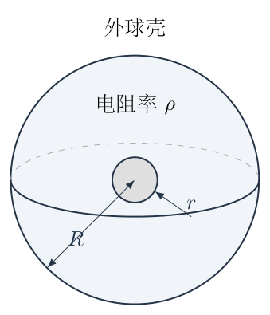
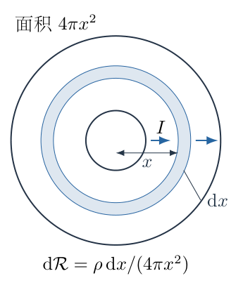
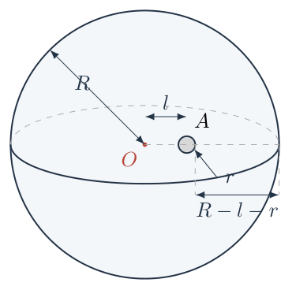
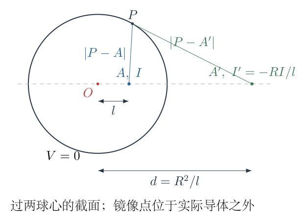

# 第 7 题

半径为 $R$ 的金属球壳内有一个半径为 $r$ 的球形金属电极，二者之间填满电阻率为 $\rho$ 的均匀导体。金属电极和金属球壳各自视为等势体，忽略它们自身的电阻。

（1）电极与球壳同心，求二者之间的电阻。

（2）电极中心偏离球壳中心距离 $l$，满足 $r\ll l\ll R$，且电极不靠近球壳边界，求二者之间的电阻的近似表达式。

{width=61%}

## 一、题型定位

第一问是球对称电流场与串联球壳微元电阻；第二问是失去球对称后的稳态电势边值问题。均匀导体中稳恒电流满足欧姆定律和电流连续性，电势在无电流源的导体区域满足拉普拉斯方程，因此可借用球形等势边界的镜像法。

偏心以后不能继续对球壳中心使用 $I/(4\pi x^2)$。第二问的小电极条件允许以位于其中心的点电流源近似主导场，再用球壳镜像修正电极处的背景电势；最后明确这是有限球形电极的近似，不称为任意偏心两球的精确电阻。

## 二、知识点

- 稳恒电流守恒 $\nabla\cdot\boldsymbol j=0$。
- 局部欧姆定律 $\boldsymbol E=\rho\boldsymbol j$，以及 $\boldsymbol E=-\nabla V$。
- 均匀介质电导率 $\sigma=1/\rho$，无源处有 $\nabla^2V=0$。
- 同心球面电流密度由总电流除以球面积得到。
- 微元电阻 $\mathrm d\mathcal R=\rho\,\mathrm dx/(4\pi x^2)$，径向微元串联。
- 无限均匀导体的点源电势为 $\rho I/(4\pi s)$，$s$ 是离点源的距离。
- 外球等势边界通过球反演镜像满足。
- 小电极自电势与边界产生的缓变背景电势相加，得到近似电压。
- 偏心修正需要保持电极在球壳内部，不能把远离边界近似延伸到接触极限。

## 三、物理图像

同心时，每一条电流线沿径向从内电极流向外球壳，等势面为同心球面。内侧球面积小，电流密度大，单位长度的压降大；外侧面积大，压降小。因此靠近小电极的一段对总电阻贡献最显著。

偏心时，电流线在靠近球壳一侧更密集，在远侧更稀疏。外球壳依旧等势，但不再是以内电极为中心的球面。小电极自身附近仍以球对称点源场为主，外壳的影响可以视为在小电极附近变化缓慢的背景电势。

## 四、解题入口

电阻使用 $\mathcal R$，避免与球壳半径 $R$ 混淆。电阻率仍记为题设的 $\rho$，它不是本题以外所使用的质量密度。

第一问固定总电流 $I>0$ 从内电极流出，先求 $j(x)$ 和 $E(x)$，再积分电压 $V_{\mathrm{in}}-V_{\mathrm{out}}$。第二问取外球壳电势为零，内电极中心沿 $x$ 轴偏离 $l$，使用点源和球反演位置构造外边界零电势。

## 五、解析

（1）用电流守恒求同心导体中的电流密度。

任取半径 $x$ 的同心球面，$r<x<R$。稳恒时，内电极输出的全部电流最终穿过该球面，球对称性使法向电流密度在球面上处处相同：
$$
\oint\boldsymbol j\cdot\mathrm d\boldsymbol S
=j(x)4\pi x^2=I.
$$
因此
$$
\boxed{\boldsymbol j(x)=\frac{I}{4\pi x^2}\boldsymbol e_x.}
\tag{1}
$$
总电流 $I$ 与 $x$ 无关，而局部密度按 $1/x^2$ 减小。把 $I$ 恒定误写为 $j$ 恒定，会得到平板电阻形式。

（2）由欧姆定律求场强，并积分电极电压。

均匀介质电阻率为 $\rho$，局部场强为
$$
\boldsymbol E(x)=\rho\boldsymbol j(x)
=\frac{\rho I}{4\pi x^2}\boldsymbol e_x.
\tag{2}
$$
电流由高电势内电极流向低电势球壳。因 $E_x=-\mathrm dV/\mathrm dx$，内外电压差为
$$
\begin{aligned}
U&=V(r)-V(R)=\int_r^R E_x(x)\,\mathrm dx\\
&=\frac{\rho I}{4\pi}\int_r^R x^{-2}\,\mathrm dx\\
&=\frac{\rho I}{4\pi}\left[-\frac1x\right]_r^R\\
&=\frac{\rho I}{4\pi}\left(\frac1r-\frac1R\right)>0.
\end{aligned}
\tag{3}
$$
由 $\mathcal R=U/I$：
$$
\boxed{\mathcal R_{\mathrm{con}}
=\frac{\rho}{4\pi}\left(\frac1r-\frac1R\right).}
\tag{4}
$$
负号来自 $x^{-2}$ 的原函数，最终内减外为正，不应把场的积分方向颠倒后仍保留同一电压定义。

图7-2中的半径 $x$ 和厚度 $\mathrm dx$ 用来建立面积 $4\pi x^2$。所有径向微元先后经过同一电流，因此它们是串联；不同空间方向的电流通道已经包含在整个球面面积中，不再重复乘一个并联因子。

{width=72%}

（3）用微元电阻与焦耳热两条路线复核。

厚度 $\mathrm dx$ 的球壳等效电阻为
$$
\mathrm d\mathcal R
=\rho\frac{\mathrm dx}{4\pi x^2}.
$$
从内到外积分得到式（4）。这一公式是薄球壳近似中的微分表达；若直接把整个壳层厚度 $R-r$ 除以内表面积或外表面积，都不等价于真实变截面串联积分。

单位体积焦耳热功率为 $\boldsymbol j\cdot\boldsymbol E=\rho j^2$。对整个导体积分：
$$
\begin{aligned}
P
&=\int_r^R\rho\left(\frac{I}{4\pi x^2}\right)^2
4\pi x^2\,\mathrm dx\\
&=\frac{\rho I^2}{4\pi}\int_r^R\frac{\mathrm dx}{x^2}\\
&=I^2\frac{\rho}{4\pi}\left(\frac1r-\frac1R\right)
=I^2\mathcal R_{\mathrm{con}}.
\end{aligned}
\tag{5}
$$
与整体 $P=UI$ 一致。这个积分同时检查了面积因子、平方因子和电阻的正值。

（4）说明偏心时失去什么对称性、保留什么方程。

设球壳中心为 $O$，半径 $R$；电极中心为 $A$，$OA=l$。外壳和电极仍分别为等势体，但在导电介质中，电势不再只依赖到 $O$ 或 $A$ 的距离。

无源介质区域满足
$$
\nabla\cdot\boldsymbol j=0,\qquad
\boldsymbol j=-\sigma\nabla V,\qquad \sigma=1/\rho.
$$
因 $\sigma$ 常数，
$$
-\sigma\nabla^2V=0
\quad\Longrightarrow\quad
\nabla^2V=0.
\tag{6}
$$
边界为 $V=0$ 在外球壳上、$V=U$ 在内电极表面；$U$ 与注入总电流 $I$ 的比值为电阻。

图7-3保留真实的球面空间关系。标出的 $l$ 是两球心距离，不是电极表面到边界的间隙；靠近侧的最小间隙为 $R-l-r$，本题要求其远大于小电极尺度。

{width=67%}

（5）推导点电流源电势，建立镜像法的可用基础。

若在无限均匀介质中以点源输出电流 $I$，距点源 $s$ 的球面有
$$
j_s=\frac{I}{4\pi s^2},\qquad
E_s=\frac{\rho I}{4\pi s^2}.
$$
将远处电势取为零：
$$
V(s)=\int_s^\infty E_s(s')\,\mathrm ds'
=\frac{\rho I}{4\pi s}.
\tag{7}
$$
该函数在点源之外满足拉普拉斯方程。可将数学结构写为“源强乘 $1/s$”，与静电点电荷势同形；镜像构造只借用这个边值解结构，不把电流 $I$ 真正当成静电荷。

当 $r$ 很小且电极远离外边界时，内电极产生的主导远场近似为放在 $A$ 的点电流源。它的自电势在自身球面附近约为 $\rho I/(4\pi r)$，外边界影响再由镜像项补足。

（6）构造外球壳的镜像位置与源强。

令 $A$ 位于 $x=l$。在同一直线上、球壳外侧放数学镜像点 $A'$：
$$
OA'=d=\frac{R^2}{l},\qquad
I'=-\frac Rl I.
\tag{8}
$$
点源近似中的电势为
$$
V(P)=\frac{\rho}{4\pi}
\left(\frac I{|P-A|}+\frac{I'}{|P-A'|}\right).
\tag{9}
$$
需要验证它确实使球壳等势，而不是只记下镜像公式。对于外壳上一点 $P$，$|OP|=R$，令 $\vartheta$ 为 $OP$ 与 $OA$ 的夹角：
$$
|P-A|^2=R^2+l^2-2Rl\cos\vartheta,
$$
$$
\begin{aligned}
|P-A'|^2
&=R^2+\frac{R^4}{l^2}
-\frac{2R^3}{l}\cos\vartheta\\
&=\frac{R^2}{l^2}
(R^2+l^2-2Rl\cos\vartheta).
\end{aligned}
$$
因此
$$
|P-A'|=\frac Rl|P-A|.
\tag{10}
$$
把式（8）、（10）代入式（9）：
$$
\frac I{|P-A|}
+\frac{-RI/l}{(R/l)|P-A|}=0.
$$
外壳所有点均满足 $V=0$，而不是只有最近点满足。$A'$ 位于实际导体区域外，故它不引入介质内部的额外电流源。

图7-4采用过两球心的截面来展示反演几何。镜像点是计算边界条件的工具，不是球壳外真实接入的第二个电极；图中的外侧点不属于实际导电介质。

{width=85%}

（7）求小电极处背景电势并与自电势相加。

电极中心至镜像点距离为
$$
AA'=d-l=\frac{R^2}{l}-l
=\frac{R^2-l^2}{l}.
\tag{11}
$$
镜像在电极中心产生的电势为
$$
\begin{aligned}
V_{\mathrm{bg}}(A)
&=\frac{\rho I'}{4\pi(d-l)}\\
&=\frac{\rho}{4\pi}
\frac{-(R/l)I}{(R^2-l^2)/l}\\
&=-\frac{\rho I}{4\pi}
\frac R{R^2-l^2}.
\end{aligned}
\tag{12}
$$
负号表示外等势边界降低给定注入电流所需的电极电压。小电极表面的自身电势约为 $\rho I/(4\pi r)$，背景项在该小球上变化很小，故
$$
U\approx\frac{\rho I}{4\pi}
\left(\frac1r-\frac R{R^2-l^2}\right).
\tag{13}
$$
除以总电流 $I$：
$$
\boxed{
\mathcal R_{\mathrm{off}}
\approx\frac{\rho}{4\pi}
\left(\frac1r-\frac R{R^2-l^2}\right).}
\tag{14}
$$
“约等于”不能删去。点源加一个外球镜像严格满足外边界，却不能使有限半径偏心电极的每一点都严格等势；电极表面会通过更高多极项调整电流分布。$r$ 小且远离边界时，这些修正较小，本题条件正是保证主导近似有效。

（8）按 $l\ll R$ 进一步展开偏心修正。

将式（14）的第二项写成
$$
\frac R{R^2-l^2}
=\frac1R\frac1{1-(l/R)^2}.
$$
因 $l/R\ll1$，使用几何级数
$$
\frac1{1-z}=1+z+O(z^2),\qquad z=(l/R)^2,
$$
得到
$$
\frac R{R^2-l^2}
=\frac1R+\frac{l^2}{R^3}
+O\left(\frac{l^4}{R^5}\right).
$$
因此在小电极近似基础上，
$$
\boxed{
\mathcal R_{\mathrm{off}}
\approx\frac{\rho}{4\pi}
\left(\frac1r-\frac1R-\frac{l^2}{R^3}\right),}
\tag{15}
$$
所显示的偏心修正为
$$
\Delta\mathcal R
\approx-\frac{\rho l^2}{4\pi R^3}.
\tag{16}
$$
向哪一个方向偏心没有区别，电阻只能依赖偏心距离的大小，故最低阶修正为 $l^2$ 而不是带符号的 $l$。电极移近一侧球壳后出现更短、较低阻的电流路径，总电阻降低，与式（16）的负号一致。

题设有 $r\ll l\ll R$。若只保留最大项，电阻约为 $\rho/(4\pi r)$；如果要看出偏心影响，就必须保留边界项和 $l^2$ 修正。精度不同的写法各有用途，不能声称最大项已经包含了偏心变化。

（9）检查同心极限、正值和接触边界。

形式上令 $l\to0$，式（14）给
$$
\frac{\rho}{4\pi}\left(\frac1r-\frac1R\right),
$$
恢复式（4）。虽然 $r\ll l$ 不在这一端点保持，球对称同心解本身是精确的，因此这是一个一致性检查，不是用偏心小参数条件证明同心极限。

式（14）要求 $R^2-l^2$ 远大于 $Rr$，以使边界项远小于自电势项。若电极接近球壳，即 $R-l$ 与 $r$ 同量级，忽略有限电极多极修正不再成立；不能把式（14）延伸到接触处，甚至接受由失效近似产生的负电阻。

同心薄隙 $R=r+h$、$h\ll r$ 时，精确式（4）给
$$
\mathcal R_{\mathrm{con}}
=\frac{\rho}{4\pi}\frac h{r(r+h)}
\approx\frac{\rho h}{4\pi r^2}.
\tag{17}
$$
这正是厚度为 $h$、面积约为 $4\pi r^2$ 的薄层电阻。外壳远离 $R\to\infty$ 时，式（4）趋于 $\rho/(4\pi r)$，称为小球向无限介质的扩展电阻；并非因为通路无限长就一定电阻无限大，截面积同时不断增长。

（10）归一化数值例与量纲检查。

取示例 $R=1$、$l=0.2$、$r=0.01$，并把 $\rho/(4\pi)$ 作为电阻单位。由式（4）、（14）：
$$
\begin{aligned}
\frac{\mathcal R_{\mathrm{con}}}{\rho/(4\pi)}
&=100-1=99,\\
\frac{\mathcal R_{\mathrm{off}}}{\rho/(4\pi)}
&\approx100-\frac1{1-0.04}\\
&=100-1.0416667
=98.9583333.
\end{aligned}
$$
二阶展开式（15）给 $100-1-0.04=98.96$，与未展开小球近似的差为0.0016667，对应 $(l/R)^4$ 及更高项的影响。有限电极的进一步修正是另一来源，不能把展开误差与电极多极误差混为同一项。

$\rho$ 的单位为 $\Omega\,\mathrm m$，括号中各项单位为 $\mathrm m^{-1}$，电阻单位为欧姆。$l^2/R^3$ 同样为逆长度。式（14）只依赖材料电阻率和几何尺寸，在线性欧姆介质中与测试电流大小无关；若存在焦耳热导致的电阻率变化，应另建立温度耦合，不属于本题稳态常量模型。

## 六、关键洞察

扩散、导热和稳恒导电的球壳问题具有共同的变截面积分结构。第一问电阻与第二题扩散阻力都出现 $1/r-1/R$，来自 $4\pi x^2$ 面积；但两题的物理流量、材料参数和边界约束不同，不能因公式相似就互相替换单位。

镜像法的可靠性来自两点：构造在实际导体内满足拉普拉斯方程，并在外边界逐点满足指定电势。有限小电极的近似额外需要内边界条件足够接近等势。将这两层精度分开，可以解释为何式（14）既有明确物理依据，又不能作为任意偏心双球的精确式。

若要求有限电极精度，可交替对外球和内电极作球反演，形成收敛的多镜像序列：每次修复一条边界会产生下一项，全部迭代后同时满足两条等势边界。此路线适合作独立数值核验；主答案保留题设 $r\ll l\ll R$ 下的简明近似。

## 七、易错点

- 把同心球壳各径向微元误作并联。
- 用一个固定球面积代替整个变截面积分。
- 混淆电阻率 $\rho$ 的单位与质量密度。
- 偏心后仍声称所有电流围绕球壳中心径向均匀。
- 镜像位置写成 $R/l$，遗漏长度平方。
- 把负镜像源解释为实际外部电极。
- 镜像源到内电极中心距离误取为 $R^2/l$，漏减 $l$。
- 不说明有限电极近似，接受靠边界失效后出现的负电阻。
- 在偶对称几何问题中写出带方向符号的一阶偏心修正。

## 八、课堂讲解建议

教师先让学生从两个不同球面通量相同推电流密度，再对压降积分。板书球壳面积时注明它随半径变化，不直接给最终电阻公式。

偏心问先指出球对称性失效，让学生解释为何同心路线不能机械套用。随后用图7-4验证距离比，逐点取消外壳电势，最后才计算小电极中心背景。

课堂应保留近似符号与适用条件，要求学生分别检查同心、无限介质和近接触三个情形。前两者可检验公式，最后一个则检验公式何时不能用。

## 九、变式训练

变式：电极与外球壳同心，但介质电阻率随半径变化为 $\rho(x)=\rho_*x/r$。求总电阻，并判断外壳半径趋于无穷远时是否仍为有限值。

电流守恒与材料是否均匀无关，同心情况下仍有 $j=I/(4\pi x^2)$。微元电阻为
$$
\mathrm d\mathcal R
=\frac{\rho(x)}{4\pi x^2}\mathrm dx
=\frac{\rho_*}{4\pi r}\frac{\mathrm dx}{x}.
$$
积分得到
$$
\boxed{\mathcal R
=\frac{\rho_*}{4\pi r}\ln\frac Rr.}
$$
当 $R\to\infty$，对数发散，所以本变式的扩展电阻无限大。常量电阻率的有限扩展电阻不是仅由“球形”决定，还依赖材料随距离的增长规律。

取 $R=2r$，变式电阻为 $\rho_*\ln2/(4\pi r)$；若常量电阻率为 $\rho_*$，同样几何的电阻为 $\rho_* /(8\pi r)$。因变式各位置电阻率都不小于 $\rho_*$，其电阻更大；数值 $\ln2\approx0.693>0.5$ 与物理比较一致。
