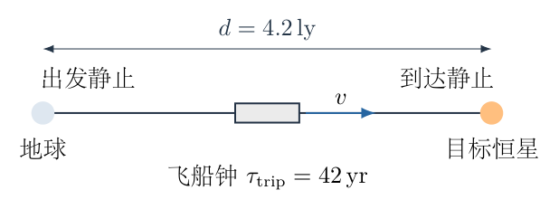
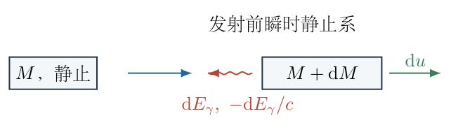
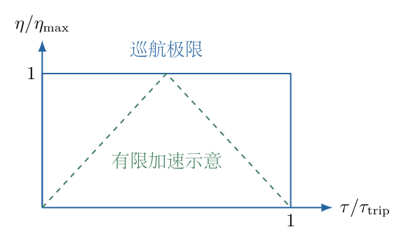
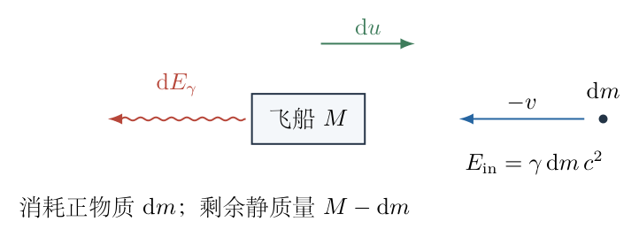

# 第 8 题

地球到半人马座 $\alpha$ 星的距离为 $4.2\,\mathrm{ly}$。飞船使用正反物质湮灭产生的光子辐射作为推进或减速手段。要求飞船自身钟经历 $42$ 年后到达，出发和到达时均与地球—目标恒星参考系近乎相对静止。忽略引力及能量损失，设光子能按需要定向发射。

（1）反物质燃料起初储存在飞船中。这类燃料的质量与起飞总质量之比至少为多少？

（2）飞船不预存反物质，而从太空收集在地球—目标恒星参考系中近乎静止的反物质。某时刻飞船静质量为 $m_0$，收集横截面积为 $S$，反物质的静止质量密度为 $\rho$，飞船在该参考系中的速度为 $v$。收集到的反物质与飞船携带的等静质量正物质立即湮灭，求此时该参考系中飞船能够达到的最大加速度。

{width=88%}

## 一、题型定位

第一问是理想光子火箭的质量比与给定本征旅行时间下的燃料优化。光子动量与能量之比为 $1/c$，采用快度变量后，火箭质量比对应快度变化的指数。最省燃料路线不是未经说明的全程匀加速，而是允许无限短推进阶段时，瞬时加速、恒速巡航、瞬时减速的极限。

第二问是开放系统四动量守恒。反物质相对地面静止，但相对飞船高速迎面进入，带有反向动量和额外动能。必须计入收集造成的动量负担，再利用全部可用能量发射向后的光子；不能只把湮灭静能除以 $c$ 当成净推力。

## 二、知识点

- 洛伦兹因子 $\gamma=(1-\beta^2)^{-1/2}$，$\beta=v/c$。
- 本征时间与地面时间满足 $\mathrm dt=\gamma\,\mathrm d\tau$。
- 快度 $\eta=\operatorname{artanh}\beta$，$\gamma=\cosh\eta$、$\gamma\beta=\sinh\eta$。
- 相同方向速度合成在快度中变为相加。
- 光子能量与动量满足 $p=E/c$；定向发射给最大有向动量。
- 理想光子火箭质量变化满足 $-\mathrm dM/M=|\mathrm d\eta|$。
- 飞船自身时间内的地面位移为 $\mathrm dX=c\sinh\eta\,\mathrm d\tau$。
- 瞬时静止系中的纵向固有加速度与地面坐标加速度满足 $a_{\mathrm{proper}}=\gamma^3a_{\mathrm{lab}}$。
- 收集流量要区分地面时间、飞船本征时间和粒子静质量。

## 三、物理图像

飞船先向后发射光子取得前向速度，接着惯性巡航，最后向前发射光子减速至静止。后半次推进同样消耗质量；只算加速不算刹车，会低估总燃料。没有给推力上限或最大加速度，最小消耗的解应包含瞬时推进极限，而不自行添加匀加速条件。

收集反物质时，在飞船瞬时静止系中，反物质从前方以速度 $-v$ 进入。它与飞船的一份正物质湮灭后，释放的能量包括两份静能和迎面物质的动能。光子全部向后发射时，反冲最大，但需先抵消迎面物质的负向动量。飞船剩余质量只减少被消耗的自身正物质；来自外界的反物质不是原先飞船质量的一部分。

## 四、解题入口

第一问用 $M_{\mathrm i}$、$M_{\mathrm f}$ 表示起飞和到达的飞船静质量，用 $\tau_{\mathrm{trip}}=42\,\mathrm{yr}$ 表示飞船钟时间，距离记为 $d=4.2\,\mathrm{ly}$。先推光子火箭质量比，再用位移与本征时间确定最低所需最大快度。

第二问暂把题设即时静质量记为 $M=m_0$，以 $\mathrm dm>0$ 表示一个微小时间内收集到的反物质静质量。先在飞船瞬时静止系写能量和动量，再换成地面加速度，最后用地面动量流作独立检查。

## 五、解析

（1）建立本征旅行时间与巡航速度的关系。

取地球—目标恒星系为惯性系，二者之间距离为 $d$。若中间以速率 $v$ 恒速巡航、加减速过程时间可忽略，则地面旅行时间为
$$
t_{\mathrm{trip}}=\frac dv.
$$
飞船自身钟记录的时间为
$$
\tau_{\mathrm{trip}}=\frac{t_{\mathrm{trip}}}{\gamma}
=\frac d{\gamma v}.
$$
因此
$$
\gamma v=\frac d{\tau_{\mathrm{trip}}}.
\tag{1}
$$
不能写成 $v=d/\tau_{\mathrm{trip}}$，因为距离取自地面系而时间取自飞船钟，二者不是同一参考系的一对量。

令
$$
q=\frac d{c\tau_{\mathrm{trip}}},
$$
则式（1）为
$$
\frac{\beta}{\sqrt{1-\beta^2}}=q.
$$
两边平方，移项：
$$
\begin{aligned}
\beta^2&=q^2(1-\beta^2),\\
\beta^2(1+q^2)&=q^2,\\
\beta&=\frac q{\sqrt{1+q^2}},\\
\gamma&=\sqrt{1+q^2}.
\end{aligned}
\tag{2}
$$
正根对应向目标飞行。因 $1\,\mathrm{ly}=c\times1\,\mathrm{yr}$，本题
$$
q=\frac{4.2}{42}=0.1.
$$
故
$$
\beta=\frac{0.1}{\sqrt{1.01}}
\approx0.0995037,\qquad
\gamma\approx1.0049876.
\tag{3}
$$
这里速度略小于 $0.1c$，地面时间略长于42年，符合飞船钟比地面计时略少的时间膨胀关系。

（2）从局部能量、动量守恒推理想光子火箭方程。

在发射一个微小光子束之前的飞船瞬时静止系中，飞船质量为 $M$。发射光子后质量为 $M+\mathrm dM$，其中 $\mathrm dM<0$，飞船获得微小速度 $\mathrm du>0$。光子向后，能量为 $\mathrm dE_\gamma>0$。

保留一阶小量，飞船新增动能为二阶，可忽略。能量守恒给
$$
Mc^2=(M+\mathrm dM)c^2+\mathrm dE_\gamma,
$$
即
$$
\mathrm dE_\gamma=-c^2\,\mathrm dM.
\tag{4}
$$
动量守恒给
$$
0=M\,\mathrm du-\frac{\mathrm dE_\gamma}{c}.
$$
代入式（4）：
$$
M\,\mathrm du=-c\,\mathrm dM.
\tag{5}
$$
在当前静止系中的微小速度增量与快度增量满足 $\mathrm du=c\,\mathrm d\eta$。因此
$$
\boxed{-\frac{\mathrm dM}{M}=\mathrm d\eta}
\tag{6}
$$
适用于向正方向加速。减速时快度下降，却仍消耗质量，所以统一写成
$$
-\frac{\mathrm dM}{M}=|\mathrm d\eta|.
\tag{7}
$$
$\mathrm dM$ 是飞船全部静质量减少量，包括参与湮灭的正、反物质两份，不单指其中一份反物质。

图8-2将发射前的静止质量、发射后的飞船和反向光子束分开。式（4）、（5）使用同一个局部参考系，不把地面光子能量直接代入瞬时静止系动量。

{width=80%}

（3）积分质量方程，并分别计入加速和减速。

从质量 $M_{\mathrm a}$、快度零加速到快度 $\eta$、质量 $M_{\mathrm b}$：
$$
\begin{aligned}
-\int_{M_{\mathrm a}}^{M_{\mathrm b}}\frac{\mathrm dM}{M}
&=\int_0^\eta\mathrm d\eta',\\
\ln\frac{M_{\mathrm a}}{M_{\mathrm b}}&=\eta,\\
\frac{M_{\mathrm a}}{M_{\mathrm b}}&=e^\eta.
\end{aligned}
\tag{8}
$$
再从 $\eta$ 减速到零，质量又乘同样的减少比例。两次总质量比为
$$
\boxed{\frac{M_{\mathrm i}}{M_{\mathrm f}}=e^{2\eta}.}
\tag{9}
$$
快度与速度关系为
$$
\eta=\frac12\ln\frac{1+\beta}{1-\beta},
$$
因此也可写成
$$
\boxed{\frac{M_{\mathrm i}}{M_{\mathrm f}}
=\frac{1+\beta}{1-\beta}.}
\tag{10}
$$
单次加速才是上述速度比的平方根，两次加减速后平方根消失。仅保留一次平方根会把到达静止条件遗漏。

对于有限的一次理想定向光子发射，还可作精确检查。初始静止质量 $M_{\mathrm a}$，末态质量 $M_{\mathrm b}$、速度 $\beta c$，光子能量为 $E$：
$$
M_{\mathrm a}c^2=\gamma M_{\mathrm b}c^2+E,\qquad
0=\gamma M_{\mathrm b}\beta c-E/c.
$$
消去 $E$：
$$
M_{\mathrm a}=\gamma M_{\mathrm b}(1+\beta)
=M_{\mathrm b}e^\eta,
$$
与微分积分结果一致。这一检查保留了有限反冲的动能，不依赖一阶近似的截断结果本身。

（4）证明瞬时加速—巡航—减速极限确实给最小燃料。

考虑任意满足起终快度均为零、总本征时间为 $\tau_{\mathrm{trip}}$ 的向目标飞行路线。地面位移微元为
$$
\mathrm dX=v\,\mathrm dt
=v\gamma\,\mathrm d\tau
=c\sinh\eta(\tau)\,\mathrm d\tau.
\tag{11}
$$
记整个航程最大快度为 $\eta_{\max}$，因为 $\sinh$ 在正区间严格递增，
$$
\begin{aligned}
d
&=c\int_0^{\tau_{\mathrm{trip}}}\sinh\eta(\tau)\,\mathrm d\tau\\
&\le c\tau_{\mathrm{trip}}\sinh\eta_{\max}.
\end{aligned}
$$
因此
$$
\eta_{\max}\ge\operatorname{arsinh}q.
\tag{12}
$$
另一方面，从零上升到 $\eta_{\max}$ 再回到零，快度总变差至少为 $2\eta_{\max}$。任何途中反复加减速只会增大总变差。由式（7）：
$$
\ln\frac{M_{\mathrm i}}{M_{\mathrm f}}
=\int|\mathrm d\eta|
\ge2\eta_{\max}
\ge2\operatorname{arsinh}q.
\tag{13}
$$
只有当除起终瞬间外几乎全程保持 $\eta=\operatorname{arsinh}q$ 时，两处不等式同时取到极限。这就是瞬时加速、恒速巡航、瞬时减速的理想路线。

图8-3的快度—本征时间图中，位移对应 $c\sinh\eta$ 的时间积分；方形巡航路线用相同最大快度覆盖最多距离，而平缓升降路线在相同快度上限下覆盖较少距离，需提高峰值才能完成同一任务。

{width=84%}

如果要求有限推力或有限加速度，理想最小值一般只能逼近，需耗费更多燃料。题目未给这些上限，以下给出无损光子火箭的理论下限，不把无限短推进阶段解释为现实发动机能够直接实现。

（5）计算最低质量比和燃料比例。

由双曲恒等式，
$$
e^\eta=\cosh\eta+\sinh\eta=\sqrt{1+q^2}+q.
$$
式（13）的最低质量比为
$$
\boxed{
\left(\frac{M_{\mathrm i}}{M_{\mathrm f}}\right)_{\min}
=\left(\sqrt{1+q^2}+q\right)^2.}
\tag{14}
$$
若“燃料”指全部被转为光子的正反物质耗材，质量为 $M_{\mathrm fuel}=M_{\mathrm i}-M_{\mathrm f}$。其占起飞总质量的比例为
$$
\begin{aligned}
f_{\mathrm fuel}
&=\frac{M_{\mathrm i}-M_{\mathrm f}}{M_{\mathrm i}}\\
&=1-\frac{M_{\mathrm f}}{M_{\mathrm i}}\\
&=1-e^{-2\eta}\\
&=1-\frac{1-\beta}{1+\beta}
=\frac{2\beta}{1+\beta}.
\end{aligned}
\tag{15}
$$
使用 $q=0.1$：
$$
\begin{aligned}
\sqrt{1+q^2}+q&=\sqrt{1.01}+0.1
\approx1.1049876,\\
M_{\mathrm i}/M_{\mathrm f}&\approx1.2209975,\\
M_{\mathrm f}/M_{\mathrm i}&\approx0.8190025.
\end{aligned}
$$
故
$$
\boxed{f_{\mathrm fuel,\min}\approx0.1809975\approx18.10\%.}
\tag{16}
$$
若燃料与最终干质量相比，比例是 $M_{\mathrm fuel}/M_{\mathrm f}\approx22.10\%$，不是本题所问的起飞总质量分母。两者只是分母不同，不能作为两个冲突答案。

若题目专指储存的反物质质量，且每一份反物质与等静质量正物质配对，则反物质仅占全部湮灭耗材的一半：
$$
\boxed{
\frac{M_{\mathrm{anti}}}{M_{\mathrm i}}
=\frac12f_{\mathrm fuel,\min}
\approx9.05\%.}
\tag{17}
$$
对应正物质消耗也为9.05%。把18.10%直接称为“反物质单独质量比例”会漏掉这一配对定义；本题两种口径均明示，全部推进耗材的主质量比保持式（14）。

（6）第二问先求反物质在两个时间口径下的收集量。

在地球—目标恒星系中，反物质近乎静止，飞船以速度 $v>0$ 穿过面积 $S$。地面时间 $\mathrm dt$ 内扫过体积 $Sv\,\mathrm dt$，因此收集静质量
$$
\mathrm dm=\rho Sv\,\mathrm dt.
\tag{18}
$$
横向面积不发生纵向洛伦兹收缩。在飞船瞬时静止系中，单位体积粒子静质量的密度为 $\gamma\rho$，迎面相对速度为 $v$；又有 $\mathrm dt=\gamma\,\mathrm d\tau$，所以
$$
\frac{\mathrm dm}{\mathrm d\tau}=\gamma\rho Sv.
\tag{19}
$$
这里 $\mathrm dm$ 始终是粒子静质量，不是入射总能量除以 $c^2$。迎面反物质的能量为 $\gamma\,\mathrm dm\,c^2$，要另外乘一次 $\gamma$；不能把静质量流量与相对论能量流量混写。

（7）在飞船瞬时静止系建立一次收集—湮灭的能量平衡。

设操作前飞船静质量为 $M=m_0$。收集到的反物质静质量为 $\mathrm dm$，相对飞船速度为 $-v$，故入射能量和动量分别为
$$
E_{\mathrm{in}}=\gamma\,\mathrm dm\,c^2,\qquad
p_{\mathrm{in}}=-\gamma v\,\mathrm dm.
\tag{20}
$$
飞船消耗自身正物质静质量 $\mathrm dm$，全部反物质立即参与湮灭，没有作为静质量留在飞船中。剩余飞船质量为 $M-\mathrm dm$，获得局部微小正向速度 $\mathrm du$；其新增动能为二阶小量。能量守恒一阶式为
$$
Mc^2+\gamma\,\mathrm dm\,c^2
=(M-\mathrm dm)c^2+\mathrm dE_\gamma.
$$
移项得
$$
\boxed{\mathrm dE_\gamma=(\gamma+1)\,\mathrm dm\,c^2.}
\tag{21}
$$
当 $v\to0$、$\gamma\to1$ 时，释放能量回到两份静质量的 $2\,\mathrm dm\,c^2$；速度较大时多出的 $(\gamma-1)\mathrm dm\,c^2$ 来自迎面物质的动能，不是违反能量守恒的额外湮灭能。

图8-4中入射物质从前方到来，光子向后排出。下式（22）同时保留入射物质的负动量和光子的负动量；若遗漏前者，就没有真正核算收集过程。

{width=89%}

（8）由最大光子反冲求局部加速度。

对于给定总光子能量 $\mathrm dE_\gamma$，光子在推进轴上的总动量绝对值不超过 $\mathrm dE_\gamma/c$。全部向后发射才能达到这个上限，且给飞船最大正向反冲。

局部动量守恒为
$$
-\gamma v\,\mathrm dm
=(M-\mathrm dm)\,\mathrm du-\frac{\mathrm dE_\gamma}{c}.
$$
$\mathrm dm\,\mathrm du$ 为二阶，忽略后：
$$
\begin{aligned}
M\,\mathrm du
&=\frac{\mathrm dE_\gamma}{c}-\gamma v\,\mathrm dm\\
&=[(\gamma+1)c-\gamma v]\,\mathrm dm\\
&=c[1+\gamma(1-\beta)]\,\mathrm dm.
\end{aligned}
\tag{22}
$$
因此最大固有加速度为
$$
\begin{aligned}
a_{\mathrm{proper},\max}
&=\frac{\mathrm du}{\mathrm d\tau}\\
&=\frac{\gamma\rho Sv\,c}{M}
[1+\gamma(1-\beta)].
\end{aligned}
\tag{23}
$$
不能将 $(\gamma+1)c\,\mathrm dm$ 全部当作净推进动量，必须减去迎面反物质的 $\gamma v\,\mathrm dm$。

（9）推导纵向加速度变换，得到地面最大加速度。

飞船当前地面速度为 $v$，在自身瞬时静止系中增加 $\mathrm du$。速度合成给
$$
v+\mathrm dv=\frac{v+\mathrm du}{1+v\,\mathrm du/c^2}.
$$
对小量展开 $(1+z)^{-1}=1-z+O(z^2)$：
$$
v+\mathrm dv
=v+\mathrm du-\frac{v^2}{c^2}\mathrm du+O(\mathrm du^2),
$$
所以
$$
\mathrm dv=(1-\beta^2)\mathrm du=\frac{\mathrm du}{\gamma^2}.
\tag{24}
$$
地面时间与本征时间关系为 $\mathrm dt=\gamma\,\mathrm d\tau$，故
$$
a_{\mathrm{lab}}=\frac{\mathrm dv}{\mathrm dt}
=\frac1{\gamma^3}\frac{\mathrm du}{\mathrm d\tau}.
\tag{25}
$$
把式（23）代入，并恢复题设质量 $m_0$：
$$
\boxed{
a_{\max}
=\frac{\rho Sv\,c}{m_0\gamma^2}
\left[1+\gamma\left(1-\frac vc\right)\right],
\qquad
\gamma=\frac1{\sqrt{1-v^2/c^2}}.}
\tag{26}
$$
这给的是地球—目标恒星系的坐标加速度。如果要求飞船加速度计读数，则应使用式（23），不能把两种加速度都标成同一个未说明的 $a$。

（10）用地面动量与光子能量变换独立检查。

地面时间的收集静质量速率为 $\dot m=\rho Sv$，飞船自身静质量变化为
$$
\frac{\mathrm dM}{\mathrm dt}=-\dot m.
\tag{27}
$$
局部向后光子的地面能量变换为
$$
\mathrm dE_{\gamma,\mathrm{lab}}
=\gamma(1-\beta)\mathrm dE_\gamma
=\gamma(1-\beta)(\gamma+1)\,\mathrm dm\,c^2.
\tag{28}
$$
入射反物质在地面系静止，没有入射动量。飞船获得的正向动量速率等于向后光子的动量流：
$$
\frac{\mathrm d(\gamma Mv)}{\mathrm dt}
=\gamma(1-\beta)(\gamma+1)\dot m\,c.
\tag{29}
$$
对左侧求导，使用 $\mathrm d(\gamma v)/\mathrm dv=\gamma^3$：
$$
\gamma^3M a_{\mathrm{lab}}+\gamma v\frac{\mathrm dM}{\mathrm dt}
=\gamma(1-\beta)(\gamma+1)\dot m\,c.
$$
代入式（27）并移项：
$$
\begin{aligned}
\gamma^3M a_{\mathrm{lab}}
&=\gamma v\dot m
+\gamma(1-\beta)(\gamma+1)\dot m\,c\\
&=\gamma\dot m\,c
[\beta+(1-\beta)(\gamma+1)]\\
&=\gamma\dot m\,c[1+\gamma(1-\beta)].
\end{aligned}
$$
约去 $\gamma$ 后恢复式（26）。这条路线在地面系直接计算开放系统动量，独立检验了局部推导与加速度变换中的每个 $\gamma$ 因子。

<!-- KEEP_STUDENT_START -->

（11）检查低速、高速和零收集边界。

当 $\beta\ll1$ 时，$\gamma\approx1$，式（26）给
$$
a_{\max}\approx\frac{2\rho Sv\,c}{m_0}.
\tag{30}
$$
低速每收集一份反物质与一份正物质，约释放两份静能，向后光子动量约为 $2\,\mathrm dm\,c$；迎面物质动量是相对小的修正，结果一致。

若 $v=0$，按本题“介质相对地面静止、靠飞船扫掠收集”的模型，$\rho Sv=0$，没有流入反物质，因此此方式不能自行从严格静止起动。真实介质若有随机运动或外部供给，需另计算流量，不可用“反物质能够推进”掩盖本题的零收集边界。

当 $\beta\to1^-$，
$$
\gamma(1-\beta)=\sqrt{\frac{1-\beta}{1+\beta}}\to0.
$$
因此括号趋于1，而 $1/\gamma^2\to0$，地面坐标加速度趋于零。固有加速度式（23）可以增长，但不意味着地面速度能超过 $c$；两者之间的 $\gamma^3$ 正是需要保留的时间和速度转换。

量纲上 $\rho Sv/m_0$ 为逆时间，乘 $c$ 为加速度。$\gamma,\beta$ 均无量纲。若光子不全部向后或能量有损耗，净推进动量减小，式（26）只给理想最大值。

取检验例 $\beta=0.6$，$\gamma=1.25$。净局部动量系数为
$$
1+\gamma(1-\beta)=1+1.25\times0.4=1.5.
$$
地面加速度为
$$
a_{\max}
=\frac{\rho S(0.6c)c}{m_0(1.25)^2}\times1.5
=0.576\,\frac{\rho Sc^2}{m_0}.
$$
固有加速度为 $\gamma^3$ 倍，即 $1.125\,\rho Sc^2/m_0$。分别代入两套动量式均得到相同结果，不能将0.576与1.125当作相互矛盾的答案。

<!-- KEEP_STUDENT_END -->

## 六、关键洞察

第一问的最小质量比由“快度总变差”决定，而位移受“快度双曲正弦的时间积分”约束。这把优化问题从猜加速度曲线转为明确的两个不等式。没有推力上限时，恒速巡航极限最省燃料；有上限时，需重新优化，不应沿用同一个可达等号。

第二问的能量源不只有两份静质量，迎面反物质在飞船系中的动能也被利用；与此同时，迎面动量造成收集阻力。能量流与动量流必须同时处理，才可能得到最大加速度。若仅做能量账而不做动量账，会错误地以为动能越大就能任意增速。

全部湮灭耗材与反物质份额的区分是质量定义问题，不是相对论修正。任何燃料比例都应注明分母是起飞总质量、末态干质量还是反物质自身质量，否则即使质量比公式正确也可能答非所问。

## 七、易错点

- 用地面距离除以飞船本征时间当成速度。
- 只算一次加速质量损失，遗漏到达时的减速消耗。
- 把单次光子火箭质量比的平方根用于整个往返快度变化。
- 将“最小燃料”擅自换成全程恒加速度路线。
- 把全部湮灭质量损失都称为反物质单独质量。
- 收集时漏掉迎面反物质的负向动量。
- 把 $\mathrm dm$ 当成 $\gamma\mathrm dm$ 的能量质量，重复计算密度因子。
- 不区分本征时间和地面时间的收集速率。
- 加速度变换只除以 $\gamma^2$，遗漏时间变换的另一因子。
- 因固有加速度增长就声称速度可以超过光速。

## 八、课堂讲解建议

教师先用一个有限光子发射事件同时列能量和动量式，推出质量比，再讲快度微分，避免学生将光子推进当作普通排气速度等于 $c$ 的非相对论火箭。

板书第一问时将地面距离、飞船钟时间放在不同列，先解释为什么出现 $\gamma v$。再用位移积分与峰值快度的不等式证明最省燃料路线，不直接宣布采用匀速。

第二问让学生分别标入射动量、光子动量和飞船剩余质量。课堂核对先在局部系求微小反冲，再变换加速度，最后用地面动量流复核，逐项解释三个洛伦兹因子的来源。

## 九、变式训练

变式：改要求飞船前半程保持常量固有加速度，后半程保持相反方向同大小固有加速度，起终静止，总本征时间仍为 $\tau_{\mathrm{trip}}$。求所需峰值快度与燃料比例，并说明为何比主题理想下限大。

令加速度大小为 $a$，前半程本征时间 $\tau_{\mathrm{trip}}/2$，峰值快度
$$
\eta_{\mathrm p}=\frac{a\tau_{\mathrm{trip}}}{2c}.
$$
匀固有加速度由静止出发的位移为
$$
X(\tau)=\frac{c^2}{a}\left[\cosh(a\tau/c)-1\right].
$$
两半程对称，总位移
$$
d=\frac{2c^2}{a}(\cosh\eta_{\mathrm p}-1).
$$
消去 $a=2c\eta_{\mathrm p}/\tau_{\mathrm{trip}}$：
$$
\boxed{
\frac d{c\tau_{\mathrm{trip}}}
=\frac{\cosh\eta_{\mathrm p}-1}{\eta_{\mathrm p}}.}
$$
对本题 $q=0.1$，以该方程数值求正根；小快度展开为 $\eta_{\mathrm p}/2+\eta_{\mathrm p}^3/24+\cdots$，故根接近但略小于0.2。质量比仍由总快度变化给出
$$
M_{\mathrm i}/M_{\mathrm f}=e^{2\eta_{\mathrm p}},\qquad
f_{\mathrm fuel}=1-e^{-2\eta_{\mathrm p}}.
$$
数值求解得 $\eta_{\mathrm p}\approx0.19934$，燃料比例约32.9%，高于主题18.10%的理想下限。原因是加速度段占用大量本征时间，在峰值速度以下飞行，要完成同一距离就需更高峰值快度；不是光子火箭质量比定律变了。反物质单独份额仍为总耗材的一半，若另有限推力与具体功率限制，还需进一步修正这一恒固有加速度设计。
