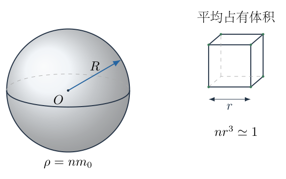
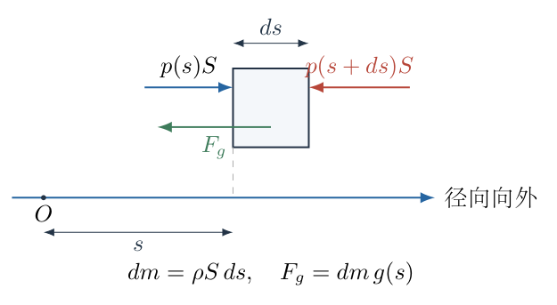
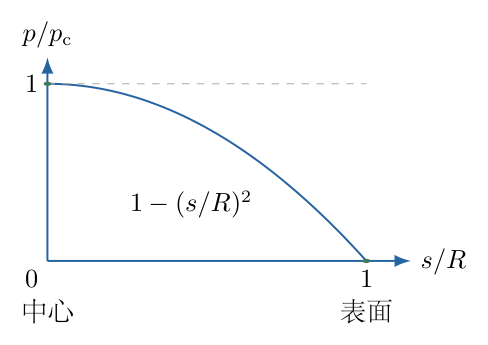

# 第 1 题

假设中子星由大量中子堆积而成。每个中子的质量为$m_0$，中子的数密度为$n$，即单位体积中含有$n$个中子。引力产生的压强若超过中子简并压强，中子星将进一步塌缩。给定简并压强的估算式

$$
p_0=A\frac{n}{m_0}\left(\frac{h}{r}\right)^2,
$$

其中$A$为常数，$h$为普朗克常量，$r$为中子间的平均距离。粗略估算中子星能够维持的最大半径$R$，用$G,m_0,n,A,h$表示；$G$为万有引力常量。

{width=78%}

## 一、题型定位

这是自引力物质的静力支撑估算。题目给出微观压强，需要把“每单位体积有多少个中子”转化为质量密度，再计算一个球体内部因自身引力所需要的中心压强，最后比较两种压强。

“最大半径”不是说万有引力在球面取得最大值就直接使用球面引力，而是说：在数密度$n$固定的粗略模型中，半径越大，总质量越大，中心需要承担的压强也越大。中心最先达到给定支撑压强的上限，因而由中心临界条件决定半径。

采用牛顿引力、球对称、均匀质量密度和真空外边界。这里的$n$是整颗星的代表性数密度，不据此声称已经解出了真实中子星的径向密度分布。这个边界是给定估算模型的结果，不是包含广义相对论和完整核物质状态方程的精确极限。

## 二、知识点

- 数密度的单位是$\mathrm{m^{-3}}$；质量密度为$\rho=nm_0$。
- 平均每个粒子占据的体积约为$r^3$，因此$r^3n\simeq1$。
- 球对称引力中，外层球壳对内点的合引力为零；距中心$s$处的引力只由$s$以内的质量决定。
- 静止微元的压强力差平衡重力，写成$dp/ds=-\rho g(s)$。
- 压强由梯度和一个边界值共同确定，不能只把“引力除以面积”当成任意位置的压强。
- 临界支撑条件是最大所需压强等于给定可提供压强；在本模型中最大所需压强位于中心。

## 三、物理图像

用$s$表示从球心出发的径向坐标，范围为$0\le s\le R$。保留题目中的$r$表示粒子平均间距，不能把$r$同时用作宏观径向坐标。星的外半径是$R$，其内部质量密度近似为常量$\rho=nm_0$。

中心处引力场强为零，但中心压强最大。这两句话并不矛盾：场强是局部重力的强弱，压强则由从边界到该位置累积的压强梯度决定。中心没有局部引力加速度，不等于中心不承受外层物质传递的压力。

表面不受外界气体或其他介质的压力，故取$p(R)=0$。从表面向中心走，必须不断增加压强，才能支撑外层物质；从中心向外走，压强随$s$减小。因此把径向向外规定为正后，压强梯度应当为负。

## 四、解题入口

依次建立四个量：

$$
\begin{aligned}
r&\simeq n^{-1/3},\\
\rho&=nm_0,\\
M(s)&=\frac{4\pi}{3}\rho s^3,\\
\frac{dp}{ds}&=-\rho\frac{GM(s)}{s^2}.
\end{aligned}
$$

前两式把微观条件变成可以计算的输入；第三式是包围质量；第四式是静力平衡。求出$p(s)$以后，再令$p(0)=p_0$。这样每一步都有确定的研究对象，也不会把总质量误代到任意内部半径处。

## 五、解析

（1）由数密度估计平均间距。

每个中子平均对应的空间体积为

$$
V_{\mathrm{per}}=\frac1n.
$$

把这个体积的线尺度记为$r$，则

$$
\begin{aligned}
r^3&\simeq V_{\mathrm{per}}=\frac1n,\\
r&\simeq n^{-1/3},\\
\frac1{r^2}&\simeq n^{2/3}.
\end{aligned}
$$

这不是断言中子真的构成规则立方晶格，而是用单位粒子体积的立方根估计平均距离。若更精细的间距定义引入一个数量级为一的系数，该系数可以并入题目给定的$A$。此处不能另加一个任意晶格因子后又仍把$A$当作原来的常数。

代入简并压强式，逐项合并$n$的指数：

$$
\begin{aligned}
p_0
&=A\frac{n}{m_0}\frac{h^2}{r^2}\\
&\simeq A\frac{n}{m_0}h^2n^{2/3}\\
&=\frac{Ah^2}{m_0}n^{\,1+2/3}\\
&=\boxed{\frac{Ah^2}{m_0}n^{5/3}}.
\end{aligned}
\tag{1}
$$

因此微观支撑压强随数密度增加而增加，且不是与$n$简单成正比。指数$5/3$由“单位体积粒子数”的一个$n$和“间距平方倒数”的$n^{2/3}$共同产生。

（2）求均匀球内部的包围质量。

半径$s$以内的球体体积为$4\pi s^3/3$。因为每单位体积有$n$个中子，每个中子的质量为$m_0$，所以

$$
\begin{aligned}
\rho&=nm_0,\\
M(s)
&=\rho\frac{4\pi s^3}{3}\\
&=\frac{4\pi}{3}nm_0s^3.
\end{aligned}
\tag{2}
$$

球对称引力的方向指向球心。用$g(s)$表示其非负大小，则$s>0$时

$$
\begin{aligned}
g(s)
&=\frac{GM(s)}{s^2}\\
&=\frac{G}{s^2}\frac{4\pi}{3}nm_0s^3\\
&=\frac{4\pi}{3}Gnm_0s.
\end{aligned}
\tag{3}
$$

约去$s^2$以后，内部场强与$s$成正比，而不是与$1/s^2$成正比。反平方公式本身没有失效；变化的是它的分子$M(s)$随$s^3$增加。式（3）在$s\to0$时连续趋于零，所以中心不发生场强发散。

如果把总质量$M(R)$代入内部任意$s$，就相当于错误地把所有外层球壳的质量放到了球心，会得到发散的$g(s)$，进而使压强计算从第一步就不成立。

（3）对局部微元建立静力平衡，而不是对整个球壳直接相减。

如图1-2，在距球心$s$附近取一个很小的直角柱形微元。它沿径向的长度为$ds$，两端面积均为$S$；规定向外为正。内侧压强为$p(s)$，推力向外；外侧压强为$p(s+ds)$，推力向内。侧面压强的径向分量在局部直角微元中相互抵消。

{width=80%}

微元质量和重力分别为

$$
dm=\rho S\,ds,\qquad
F_g=dm\,g(s)=\rho S\,ds\,g(s).
$$

微元静止，向外方向的合力为零：

$$
p(s)S-p(s+ds)S-\rho S\,ds\,g(s)=0.
\tag{4}
$$

使用一阶微分展开，

$$
p(s+ds)=p(s)+\frac{dp}{ds}ds+O(ds^2).
$$

将它代入式（4），先消去$p(s)S$，再除以$S\,ds$：

$$
\begin{aligned}
-\frac{dp}{ds}S\,ds-\rho S\,ds\,g(s)+O(ds^2)&=0,\\
-\frac{dp}{ds}-\rho g(s)+O(ds)&=0.
\end{aligned}
$$

令$ds\to0$，得到

$$
\boxed{\frac{dp}{ds}=-\rho g(s)}.
\tag{5}
$$

负号来自“压强由内向外减小”，不是把万有引力常量或质量取成负值。$g(s)$已经定义为非负大小，真实引力矢量为$-g(s)\boldsymbol e_s$。

不宜将一整层球壳的内外压强各乘以不同球面积后直接相减。球面法线方向不相同，整个球壳所受压强合力按球对称性为零；它不能被当成同一方向的一根柱子。局部微元或连续介质梯度方程才是式（5）的正确依据。

（4）代入场强并积分求压强分布。

将$\rho=nm_0$和式（3）代入式（5）：

$$
\begin{aligned}
\frac{dp}{ds}
&=-nm_0\left(\frac{4\pi}{3}Gnm_0s\right)\\
&=-\frac{4\pi}{3}Gn^2m_0^2s.
\end{aligned}
\tag{6}
$$

令

$$
C_g=\frac{4\pi}{3}Gn^2m_0^2,
$$

则$dp=-C_gs\,ds$。边界为$p(R)=0$，对式（6）从表面$R$积分到内部$s$：

$$
\begin{aligned}
\int_{0}^{p(s)}dp
&=-C_g\int_R^s u\,du\\
&=-C_g\left[\frac{u^2}{2}\right]_R^s\\
&=-\frac{C_g}{2}(s^2-R^2)\\
&=\frac{C_g}{2}(R^2-s^2).
\end{aligned}
$$

这里用$u$作积分哑变量，避免一边使用上限$s$、一边又把$s$当作积分过程中的变量而混淆。

因此

$$
\boxed{
p(s)=\frac{2\pi}{3}Gn^2m_0^2(R^2-s^2)
},\qquad 0\le s\le R.
\tag{7}
$$

也可从$s$向$R$积分，再利用$p(R)-p(s)<0$恢复同一结果。积分方向可以任选，但上下限、微分符号和边界值必须成套使用。

（5）确定最大所需压强的位置。

由式（6），在$0<s<R$内有$dp/ds<0$。所以$p(s)$沿向外方向严格减小，最大值位于$s=0$：

$$
\boxed{
p_{\mathrm c}=p(0)=\frac{2\pi}{3}Gn^2m_0^2R^2
}.
\tag{8}
$$

图1-3用$s/R$作横坐标、$p/p_{\mathrm c}$作纵坐标，展示式（7）的分布。图中的中心值对应临界比较的位置，表面值对应积分边界，不能用图的平均高度代替中心压强。

{width=66%}

由式（7）和（8）立即得到

$$
\frac{p(s)}{p_{\mathrm c}}=1-\left(\frac{s}{R}\right)^2.
\tag{9}
$$

这条曲线在中心的斜率为零，但中心值不是零。中心附近重力较小，只意味着压强变化较慢；从表面累积到中心的压强仍然最大。

（6）建立临界支撑条件并逐步解出半径。

若所需中心压强$p_{\mathrm c}$不超过可提供的$p_0$，本粗略模型可以维持支撑。临界半径$R_{\max}$满足

$$
\frac{2\pi}{3}Gn^2m_0^2R_{\max}^2
=\frac{Ah^2}{m_0}n^{5/3}.
\tag{10}
$$

将常数系数移到右边，不省略$m_0$和$n$的指数：

$$
\begin{aligned}
R_{\max}^2
&=\frac{Ah^2n^{5/3}/m_0}
{\left(2\pi/3\right)Gn^2m_0^2}\\
&=\frac{3Ah^2}{2\pi G}
\frac{n^{5/3}}{n^2}
\frac1{m_0m_0^2}\\
&=\frac{3Ah^2}{2\pi Gm_0^3}n^{\,5/3-2}\\
&=\frac{3Ah^2}{2\pi Gm_0^3}n^{-1/3}.
\end{aligned}
\tag{11}
$$

半径取正根，最终为

$$
\boxed{
R_{\max}\simeq
\sqrt{\frac{3Ah^2}{2\pi Gm_0^3n^{1/3}}}
}.
\tag{12}
$$

题目是估算问题，平均间距与均匀密度都有近似，故使用$\simeq$比将式（12）当作真实星体的精确等式更合适。系数$3/(2\pi)$则应在选定均匀球模型中完整保留，不能因“估算”而跳过球体积分。

相应的支撑判据可以写为

$$
\frac{p_{\mathrm c}}{p_0}
=\frac{R^2}{R_{\max}^2}\le1.
\tag{13}
$$

因此$R<R_{\max}$时所需压强较小，$R>R_{\max}$时所需压强较大。这一不等式给出了“最大”的方向，避免只得到一个平方根却不判断它是上限还是下限。

（7）量纲、参数变化和边界检查。

取$A$为无量纲估算常数。普朗克常量的量纲为$[h]=\mathrm{kg\,m^2\,s^{-1}}$，因此

$$
\begin{aligned}
\left[\frac{Ah^2n^{5/3}}{m_0}\right]
&=\frac{\mathrm{kg^2\,m^4\,s^{-2}}\,
\mathrm{m^{-5}}}{\mathrm{kg}}\\
&=\mathrm{kg\,m^{-1}\,s^{-2}},
\end{aligned}
$$

确实是压强。式（12）根号内的量纲为

$$
\begin{aligned}
\left[\frac{h^2}{Gm_0^3n^{1/3}}\right]
&=\frac{\mathrm{kg^2\,m^4\,s^{-2}}}
{(\mathrm{m^3\,kg^{-1}\,s^{-2}})
\mathrm{kg^3}\mathrm{m^{-1}}}\\
&=\mathrm{m^2}.
\end{aligned}
$$

开方以后为长度。

在其他参数固定时，

$$
R_{\max}\propto
A^{1/2}hG^{-1/2}m_0^{-3/2}n^{-1/6}.
$$

更强的支撑系数$A$允许更大的半径；更强的引力$G$只允许更小的半径。数密度的指数为$-1/6$而不是$+5/6$：虽然简并压强随$n^{5/3}$增加，但均匀球所需中心压强随$n^2$增加得更快。

压强式（7）在$s=R$给出零，在$s=0$给出式（8）；求导恢复式（6），说明边界和梯度同时满足。半径趋于零时中心压强趋于零，也与总质量随$R^3$消失的极限一致。

（8）用总质量表达式独立复查系数。

均匀球的总质量为

$$
M=\frac{4\pi}{3}\rho R^3,
\qquad
\rho=\frac{3M}{4\pi R^3}.
$$

代入式（8），逐项约去：

$$
\begin{aligned}
p_{\mathrm c}
&=\frac{2\pi}{3}G\rho^2R^2\\
&=\frac{2\pi}{3}G
\frac{9M^2}{16\pi^2R^6}R^2\\
&=\frac{3GM^2}{8\pi R^4}.
\end{aligned}
\tag{14}
$$

再从静力积分直接使用$M(s)=M(s/R)^3$与$\rho=3M/(4\pi R^3)$：

$$
\begin{aligned}
p_{\mathrm c}
&=\int_0^R \rho\frac{GM(s)}{s^2}\,ds\\
&=\frac{3M}{4\pi R^3}\frac{GM}{R^3}\int_0^R s\,ds\\
&=\frac{3GM^2}{4\pi R^6}\frac{R^2}{2}\\
&=\frac{3GM^2}{8\pi R^4}.
\end{aligned}
$$

两条写法的系数一致。这里是在复查同一个均匀球的静力积分，不是再引入一个“表面重力乘总质量”的未经积分近似。

## 六、关键洞察

决定支撑上限的是整个压强梯度积累出来的中心值，不是中心场强本身。一个非常有用的判别是：内部场强$g\propto s$，于是压强从表面向内增加量与$\int s\,ds$成正比，自然得到$R^2-s^2$。积分前就可以预期压强分布为二次型。

均匀密度近似与给定微观压强是两个不同层次的估算。若把$p=K\rho^{5/3}$当作严格局部状态方程，再要求$\rho$处处相同，就会使$p$处处相同，与静力所需梯度冲突。本题只把代表性密度计算出的$p_0$当作可用支撑尺度，与均匀球所需最大压强比较。若要求精确结构，必须允许$\rho(s)$变化并联立质量与静力方程。

还可以用压强积分与引力势能交叉理解。均匀球的引力势能由逐层组装求得：

$$
\begin{aligned}
U_g
&=-\int_0^R\frac{GM(s)}s\,dM(s)\\
&=-\int_0^R\frac{G(4\pi\rho s^3/3)}s\,
4\pi\rho s^2\,ds\\
&=-\frac{16\pi^2G\rho^2}{3}\frac{R^5}{5}\\
&=-\frac{3GM^2}{5R}.
\end{aligned}
$$

使用实际压强分布，体积分为

$$
\begin{aligned}
\int p\,dV
&=4\pi\frac{2\pi G\rho^2}{3}
\int_0^R(R^2-s^2)s^2\,ds\\
&=\frac{8\pi^2G\rho^2}{3}
\left(\frac{R^5}{3}-\frac{R^5}{5}\right)\\
&=\frac{16\pi^2G\rho^2R^5}{45}\\
&=-\frac{U_g}{3}.
\end{aligned}
$$

这检验了球内支撑的整体能量关系，也说明平均压强不等于中心压强；此例有$\langle p\rangle=2p_{\mathrm c}/5$。直接用平均压强进行临界比较，会改变题目采用的支撑判据。

## 七、易错点

- 把平均间距写成$r=1/n$，混淆长度与体积。
- 宏观径向坐标与粒子间距都写成$r$，导致将$n^{-1/3}$误代到引力积分中。
- 对内点使用总质量$M(R)$，得到错误的反平方内部场强。
- 因中心$g=0$而断言中心$p=0$，忽略压强是由梯度累积确定的。
- 取$dp/ds>0$，与表面零压强及向内引力不一致。
- 对整个球壳把不同方向的压力大小当作同向标量相减。
- 化简时漏掉$m_0$的第三次幂，或把$n^{5/3}/n^2$错写成$n^{1/3}$。
- 把本估算半径称为真实中子星的精确塌缩界限，遗漏牛顿与均匀模型的限制。

## 八、课堂讲解建议

先让学生从$n$的单位判断间距只能与$n^{-1/3}$同量纲，再把$\rho=nm_0$写在图旁。不要一开始给出中心压强公式，可先问“在球内半径减半，包围质量和场强各如何变”，把$M(s)\propto s^3$、$g(s)\propto s$的区别讲清。

受力图用局部小柱，而不是整层球壳。板书保留$p(s)S-p(s+ds)S-\rho Sds\,g=0$，让学生检查两个压力方向，再展示一阶展开。教师可以用“中心重力为零，中心压力是否也为零”检验学生是否区分局部梯度和积分值。

最后把支撑比写成$(R/R_{\max})^2$，由学生自行判断哪一侧会失稳。量纲检查安排在完整代数之后，要求学生分别核对$m_0$与$n$的指数，不能只说“根号内是长度平方”。

## 九、变式训练

变式：均匀球的表面受到一个恒定外压$p_{\mathrm e}$，微观支撑尺度仍为$p_0$。求新的压力分布和临界半径，并讨论$p_{\mathrm e}\ge p_0$。

局部静力方程未变，但边界改为$p(R)=p_{\mathrm e}$。积分得到

$$
p(s)=p_{\mathrm e}
+\frac{2\pi}{3}Gn^2m_0^2(R^2-s^2).
$$

中心所需压强包含外压和自引力增加量：

$$
p_{\mathrm c}=p_{\mathrm e}
+\frac{2\pi}{3}Gn^2m_0^2R^2.
$$

令$p_{\mathrm c}=p_0$，得到

$$
\begin{aligned}
R_{\max,\mathrm e}^2
&=\frac{3(p_0-p_{\mathrm e})}{2\pi Gn^2m_0^2}\\
&=R_{\max}^2
\left(1-\frac{p_{\mathrm e}}{p_0}\right).
\end{aligned}
$$

当$0\le p_{\mathrm e}<p_0$时，

$$
\boxed{
R_{\max,\mathrm e}
=R_{\max}\sqrt{1-\frac{p_{\mathrm e}}{p_0}}
}.
$$

外压越大，给自引力支撑留下的压强余量越小。当$p_{\mathrm e}=p_0$，只剩零半径极限；当$p_{\mathrm e}>p_0$，在本固定$n$、固定可用压强的模型中没有正半径支撑解。不能对负的根号内量开方后报告一个“虚半径”，应说明该支撑条件无法满足。取$p_{\mathrm e}=0$恢复主问题；压强与半径的量纲也完全一致。
