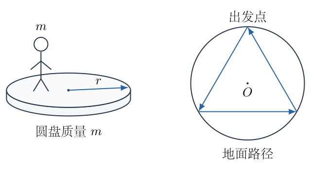
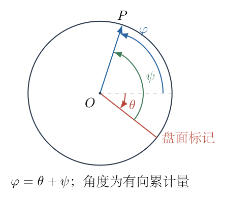
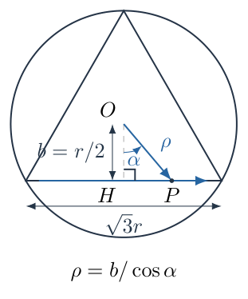
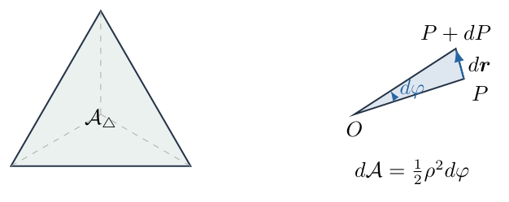
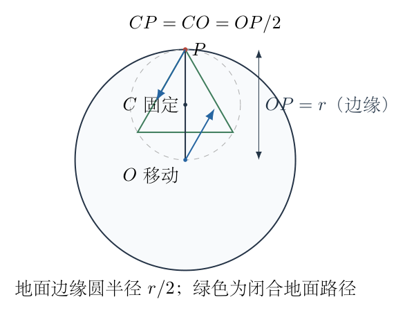

# 第 2 题

黄俏站在水平圆盘上。黄俏的质量为$m$，圆盘半径为$r$，质量均匀且也为$m$；圆盘与地面之间无摩擦。圆盘绕自身中心轴的转动惯量为$I=\frac12mr^2$。初始时整个系统静止，忽略黄俏自身的转动惯量。

（1）圆盘的圆心被固定，圆盘只能转动。黄俏沿圆周走一圈，回到圆盘上原来的出发点，求圆盘相对地面的转角$\theta_1$。

（2）圆盘的圆心被固定。黄俏相对地面沿图示内接正三角形走一圈，回到地面中的出发点，求圆盘相对地面的转角$\theta_2$。

（3）圆盘可以自由平移和转动。黄俏相对地面沿上一问中第一段的方向走到圆盘边缘，随后将行进方向转过$120^\circ$，走到边缘，再转过$120^\circ$，走回出发点。求圆盘相对地面的转角$\theta_3$。

{width=80%}

## 一、题型定位

这是内部行走引起载体转动的角动量守恒问题。三个小问的守恒条件相近，几何路径和参考对象却不相同。

第一问规定的是相对圆盘的周向角度；第二问规定的是相对地面的封闭路径；第三问不仅有转动，还存在圆盘圆心的平移。只有先把这些运动描述翻译成明确的坐标关系，才能正确使用角动量。

第二、三问中的三角形行走并不要求速度恒定。圆盘的总转角取决于路径积分而不是走完的时间。关键是保留运动中不断变化的到中心距离，或将它化为封闭路径包围的面积。

## 二、知识点

- 无外力矩时总角动量守恒。固定圆心时，固定力作用于圆心，对该点不产生力矩。
- 初始系统静止，所以守恒的总角动量为零；行走者和圆盘的角动量始终互相抵消。
- 极坐标中，质点的角动量为$m\rho^2\dot\varphi$；径向速度不贡献绕中心的角动量。
- 圆盘转角、质点相对地面的方位角、质点相对圆盘的方位角不是同一个量。
- 对封闭平面路径，$\oint(x\,dy-y\,dx)=2\mathcal A$，其中$\mathcal A$为有向面积。
- 自由圆盘的总质心固定。两者质量相等时，总质心是圆盘圆心与行走者位置的中点。
- 圆盘自身绕其圆心转动的惯量$I$与两者质心平移产生的轨道角动量必须分开计算。

## 三、物理图像

规定逆时针为正，图中的三角形行走方向为逆时针。用$\theta$表示圆盘相对地面的累计转角；用$\varphi$表示黄俏相对一个固定中心的地面方位角；第一问另用$\psi$表示相对圆盘的方位角。

固定圆心时，把圆心记为$O$。第一问黄俏到$O$的距离始终为$r$；第二问的距离$\rho$在每条弦上变化，不能固定为$r$。

自由圆盘时，把固定总质心记为$C$，圆盘圆心仍记为$O$，黄俏的位置记为$P$。由等质量关系，$C$位于$OP$中点。于是圆盘边缘条件$|OP|=r$对应$|CP|=r/2$，而不是$|CP|=r$。相对地面走出的三角形落在以$C$为中心、半径$r/2$的固定圆内。

以下给出有符号转角。若只问旋转角的大小，应取绝对值，并注明圆盘转向与行走方向相反。累计转角不能先按$2\pi$取余，否则会把实际转过的角度与最终盘面朝向混淆。

## 四、解题入口

固定圆心的总角动量为

$$
I\dot\theta+m\rho^2\dot\varphi=0.
$$

第一问将$\rho=r$和$\varphi=\theta+\psi$代入；第二问将它写成微分关系

$$
d\theta=-\frac mI\rho^2\,d\varphi,
$$

再沿三角形积分。

第三问先由质心守恒确定$P$、$O$相对于$C$的位置，再重新计算二者的轨道角动量。不能把第二问的圆心固定公式原样套到一个正在移动的$O$上。

## 五、解析

（1）先确定固定圆心时的守恒依据。

水平面内，黄俏与圆盘之间的摩擦力是系统内力，其力矩相互抵消。圆盘受重力和地面支持力的作用方向均为竖直，不提供绕竖直轴的外力矩。固定圆心所需的水平力通过$O$，对$O$的力矩也为零。

故系统绕$O$的角动量守恒。圆盘的角动量为$I\dot\theta$，黄俏视为质点。若黄俏相对$O$的位置为$\boldsymbol r_P=\rho\boldsymbol e_\rho$，则

$$
\begin{aligned}
\boldsymbol v_P
&=\dot\rho\,\boldsymbol e_\rho
+\rho\dot\varphi\,\boldsymbol e_\varphi,\\
L_P
&=(\boldsymbol r_P\times m\boldsymbol v_P)_z\\
&=m\rho^2\dot\varphi.
\end{aligned}
\tag{1}
$$

第一项的叉乘为零，因为径向位置与径向速度平行。第二项才贡献角动量。这是即使第二问有径向运动，仍能使用$m\rho^2\dot\varphi$的原因。

初始总角动量为零，任意时刻都有

$$
I\dot\theta+m\rho^2\dot\varphi=0.
\tag{2}
$$

（2）第一问：把相对圆盘角度转换为相对地面角度。

圆盘相对地面转过$\theta$，黄俏相对圆盘转过$\psi$，因此地面看到的方位角是两者之和：

$$
\varphi=\theta+\psi,\qquad
\dot\varphi=\dot\theta+\dot\psi.
\tag{3}
$$

图2-2将三个角度放在同一圆周上。图中的盘面标记随$\theta$转动，黄俏相对标记增加$\psi$；角动量中应使用两者合成的地面方位角$\varphi$。

{width=67%}

黄俏始终在边缘，$\rho=r$。把式（3）代入式（2）：

$$
\begin{aligned}
I\dot\theta+mr^2(\dot\theta+\dot\psi)&=0,\\
(I+mr^2)\dot\theta&=-mr^2\dot\psi,\\
d\theta&=-\frac{mr^2}{I+mr^2}\,d\psi.
\end{aligned}
\tag{4}
$$

由于$I$、$m$和$r$为常量，系数可以移到积分号外。走完相对圆盘的一圈意味着$\Delta\psi=2\pi$，不是$\Delta\varphi=2\pi$。所以

$$
\begin{aligned}
\theta_1
&=-\frac{mr^2}{I+mr^2}\int_0^{2\pi}d\psi\\
&=-\frac{mr^2}{\frac12mr^2+mr^2}\,2\pi\\
&=-\frac{1}{3/2}\,2\pi\\
&=\boxed{-\frac{4\pi}{3}}.
\end{aligned}
\tag{5}
$$

圆盘顺时针转过$4\pi/3$，即$240^\circ$。黄俏相对地面的累计方位角为

$$
\Delta\varphi
=\theta_1+\Delta\psi
=-\frac{4\pi}{3}+2\pi
=\frac{2\pi}{3}.
\tag{6}
$$

因此黄俏相对圆盘回到同一标记，却没有相对地面绕$O$走满一圈。若把第一问误作地面一圈，将从式（2）得到$\theta=-4\pi$，那描述的是另一个不同的运动任务。

（3）第二问：给出三角形的实际地面几何。

固定圆心$O$，三个顶点位于半径$r$的圆周上，正三角形的边长为

$$
\ell=2r\sin60^\circ=\sqrt3\,r.
\tag{7}
$$

每条弦到圆心的垂距为

$$
b=r\cos60^\circ=\frac r2.
\tag{8}
$$

在图2-3的一条边上，令$H$为垂足，$P$为黄俏的瞬时位置，$\alpha=\angle HOP$。当黄俏从一个端点走向另一个端点时，$\alpha$从$-60^\circ$增加至$60^\circ$。在同一边上，$\alpha$与地面方位角$\varphi$只差一个固定的角，因此$d\varphi=d\alpha$。

{width=73%}

直角三角形$OHP$给出

$$
\rho\cos\alpha=b,
\qquad
\rho=\frac b{\cos\alpha}.
\tag{9}
$$

中点处$\rho=b=r/2$，两端处$\rho=r$。这已经说明，不能在整条边上把黄俏的转动惯量写成固定的$mr^2$。

由式（2），

$$
d\theta=-\frac mI\rho^2\,d\varphi
=-\frac{2}{r^2}\rho^2\,d\alpha.
\tag{10}
$$

对一条边积分，使用$\int\sec^2\alpha\,d\alpha=\tan\alpha$：

$$
\begin{aligned}
\Delta\theta_{\mathrm{edge}}
&=-\frac{2b^2}{r^2}
\int_{-\pi/3}^{\pi/3}\sec^2\alpha\,d\alpha\\
&=-\frac{2(r^2/4)}{r^2}
\left[\tan\alpha\right]_{-\pi/3}^{\pi/3}\\
&=-\frac12\left(\sqrt3-(-\sqrt3)\right)\\
&=-\sqrt3.
\end{aligned}
\tag{11}
$$

三条边的几何完全相同，且行走方向均为逆时针，所以三段转角同号：

$$
\boxed{
\theta_2=3\Delta\theta_{\mathrm{edge}}=-3\sqrt3
}.
\tag{12}
$$

角度的单位为弧度，大小约$5.19615\ \mathrm{rad}$，即$297.718^\circ$。这里的$\sqrt3$不是角度单位；不可把数值$3\sqrt3$直接当作度数。

（4）从扫过面积复核第二问，并说明面积关系的来源。

在一个很小的时间内，$OP$转过$d\varphi$。位置矢量扫过的小三角形面积为

$$
d\mathcal A=\frac12\rho^2\,d\varphi.
\tag{13}
$$

它是有向面积：逆时针为正，顺时针为负。代入式（10）：

$$
d\theta=-\frac{4}{r^2}\,d\mathcal A.
\tag{14}
$$

正三角形的总面积为

$$
\begin{aligned}
\mathcal A_\triangle
&=\frac{\sqrt3}{4}\ell^2\\
&=\frac{\sqrt3}{4}(\sqrt3r)^2\\
&=\frac{3\sqrt3}{4}r^2.
\end{aligned}
\tag{15}
$$

对闭合路径积分，

$$
\theta_2=-\frac4{r^2}\mathcal A_\triangle
=-\frac4{r^2}\frac{3\sqrt3}{4}r^2
=-3\sqrt3.
\tag{16}
$$

图2-4展示了一段弦行走扫过的面积与整个封闭面积。面积法并非凭经验用三角形面积代替圆面积，而是由角动量微分式和式（13）建立的等价关系。

{width=72%}

用直角坐标还能检查式（13）：

$$
\begin{aligned}
x&=\rho\cos\varphi,\qquad y=\rho\sin\varphi,\\
x\,dy-y\,dx
&=\rho^2(\cos^2\varphi+\sin^2\varphi)\,d\varphi\\
&=\rho^2\,d\varphi.
\end{aligned}
\tag{17}
$$

所有包含$d\rho$的项相互抵消，所以即使路径的半径在变化，面积关系仍然成立。

（5）第三问：先确定质心以及边缘的地面轨迹。

自由圆盘与行走者构成的系统不受水平外力，初始总动量为零，所以总质心$C$相对地面静止。设地面坐标中的位置矢量为$\boldsymbol r_O$、$\boldsymbol r_P$、$\boldsymbol r_C$，则

$$
\begin{aligned}
\boldsymbol r_C
&=\frac{m\boldsymbol r_O+m\boldsymbol r_P}{2m}
=\frac{\boldsymbol r_O+\boldsymbol r_P}{2},\\
\boldsymbol r_O-\boldsymbol r_C
&=-(\boldsymbol r_P-\boldsymbol r_C).
\end{aligned}
\tag{18}
$$

记$\boldsymbol R_P=\boldsymbol r_P-\boldsymbol r_C$，则圆盘圆心相对$C$的位置为$-\boldsymbol R_P$，速度为$-\dot{\boldsymbol R}_P$。人与圆心的相对位置是

$$
\boldsymbol r_P-\boldsymbol r_O=2\boldsymbol R_P.
\tag{19}
$$

由圆盘边缘条件$|\boldsymbol r_P-\boldsymbol r_O|=r$，得到

$$
|\boldsymbol R_P|=\frac r2.
\tag{20}
$$

图2-5同时画出固定质心$C$、移动圆心$O$、行走者$P$和人与圆盘的相对距离。三角形顶点是$P$相对地面的边缘交点，而不是围绕某个固定圆盘圆心的旧顶点。

{width=79%}

每次走到边缘，$P$都位于以$C$为中心、半径$r/2$的固定圆上。初始边方向与第二问相同，即相对于起点径向线形成$30^\circ$的弦方向；下一次交点相差$120^\circ$圆心角。再两次改变方向，得到内接正三角形，地面路径的边长为

$$
\ell_3=\sqrt3\frac r2=\frac{\sqrt3\,r}{2}.
\tag{21}
$$

行走过程中圆盘圆心始终处于相对$C$的对称位置，因此其平移不是一个可以忽略的扰动，而是决定路径尺度和角动量系数的必要运动。

（6）重新计算绕固定质心的总角动量。

令$\rho_C=|CP|$，$\varphi_C$为$CP$的地面方位角。黄俏绕$C$的轨道角动量为

$$
L_P=m\rho_C^2\dot\varphi_C.
$$

圆盘圆心处于相反的位置、具有相反的速度，因此其平移轨道角动量为

$$
\begin{aligned}
L_{O,\mathrm{orb}}
&=\left[(-\boldsymbol R_P)
\times m(-\dot{\boldsymbol R}_P)\right]_z\\
&=(\boldsymbol R_P\times m\dot{\boldsymbol R}_P)_z\\
&=m\rho_C^2\dot\varphi_C.
\end{aligned}
\tag{22}
$$

两个负号在叉乘中抵消。这两份轨道角动量同向，不能因圆盘圆心向另一侧移动就将它们互相相减。圆盘还具有绕自身圆心的自转角动量$I\dot\theta$。

故总角动量为

$$
I\dot\theta+2m\rho_C^2\dot\varphi_C=0.
\tag{23}
$$

将$I=mr^2/2$代入：

$$
\begin{aligned}
d\theta
&=-\frac{2m}{I}\rho_C^2\,d\varphi_C\\
&=-\frac4{r^2}\rho_C^2\,d\varphi_C\\
&=-\frac8{r^2}\,d\mathcal A_C.
\end{aligned}
\tag{24}
$$

这里$d\mathcal A_C=\rho_C^2d\varphi_C/2$是绕固定质心扫过的面积。尽管$\rho_C$也沿每条边变化，式（24）仍适用。

（7）积分求第三问的圆盘转角。

半径为$r/2$的内接正三角形面积为

$$
\begin{aligned}
\mathcal A_{C,\triangle}
&=\frac{\sqrt3}{4}\ell_3^2\\
&=\frac{\sqrt3}{4}
\left(\frac{\sqrt3r}{2}\right)^2\\
&=\frac{3\sqrt3}{16}r^2.
\end{aligned}
\tag{25}
$$

代入式（24）：

$$
\begin{aligned}
\theta_3
&=-\frac8{r^2}\mathcal A_{C,\triangle}\\
&=-\frac8{r^2}\frac{3\sqrt3}{16}r^2\\
&=\boxed{-\frac{3\sqrt3}{2}}.
\end{aligned}
\tag{26}
$$

大小约$2.59808\ \mathrm{rad}$，即$148.859^\circ$，转向仍与黄俏逆时针行走的方向相反。

第二问的面积系数为$4/r^2$，第三问的面积系数为$8/r^2$，增加了两倍；第三问的路径线尺度缩小为一半，面积缩小为四分之一。两个效应相乘，第三问总转角恰为第二问的一半。不能仅凭“圆盘会平移”直接断言结果减半，必须把两个因素都算出来。

（8）用相对位置和约化质量独立检查第三问。

定义人与圆心的相对矢量$\boldsymbol q=\boldsymbol r_P-\boldsymbol r_O=2\boldsymbol R_P$。由于质量相等，总轨道角动量也可写成

$$
L_{\mathrm{orb}}=\mu(\boldsymbol q\times\dot{\boldsymbol q})_z,
\qquad
\mu=\frac{m\cdot m}{m+m}=\frac m2.
\tag{27}
$$

将$\boldsymbol q=2\boldsymbol R_P$代入：

$$
L_{\mathrm{orb}}
=\frac m2\cdot4
(\boldsymbol R_P\times\dot{\boldsymbol R}_P)_z
=2m\rho_C^2\dot\varphi_C,
$$

与式（23）一致。相对坐标中的三角形线尺度是地面路径的两倍，其面积为$3\sqrt3r^2/4$，所以

$$
\begin{aligned}
\theta_3
&=-\frac{2\mu}{I}\mathcal A_q\\
&=-\frac{2(m/2)}{mr^2/2}
\frac{3\sqrt3r^2}{4}\\
&=-\frac{3\sqrt3}{2}.
\end{aligned}
\tag{28}
$$

这条路线把两者的平移自动包含在约化质量中，所得结果与逐项计算两份轨道角动量相同。

（9）汇总结果与物理检查。

在逆时针行走为正的约定下，

$$
\boxed{
\theta_1=-\frac{4\pi}{3},\qquad
\theta_2=-3\sqrt3,\qquad
\theta_3=-\frac{3\sqrt3}{2}
}.
\tag{29}
$$

若填写转角大小，则为$4\pi/3$、$3\sqrt3$、$3\sqrt3/2$，并注明均为顺时针。所有结果无长度或质量量纲，且共同质量$m$和盘半径$r$均消去，符合相同质量比、相似路径下转角相同的性质。

行走变慢不会改变积分结果，只会减小瞬时角速度。行走方向反转时，有向面积和$\Delta\psi$同时反号，圆盘转角也反号。若闭合路径退化为来回同一条线，包围的有向面积为零，第二、三类任务的累计转角也为零。

圆盘最终可能静止，也可能尚有瞬时反向角速度，这取决于行走者在终点是否停止；转角积分不依赖这个停止过程的时长。若最后行走者与盘共同静止，仍不意味着前面累积的转角会被自动转回。

## 六、关键洞察

相对路径闭合与地面路径闭合是不同的边界条件。第一问用$\Delta\psi=2\pi$；第二问用地面三角形；第三问还必须根据质心关系重新求边界交点。把“走一圈”一概翻译为$2\pi$的地面方位角，会失去题目的核心区别。

封闭路径转角与有向面积成正比，是由角动量对位移的积分产生的几何效应。路径不是圆也能求转角，不需要为每条边求详细时间函数。更一般地，固定圆心时

$$
\Delta\theta=-\frac{2m}{I}\mathcal A_O.
$$

自由圆盘质量为$M$、行走者质量为$m$时，总质心固定，有

$$
\boldsymbol r_O-\boldsymbol r_C
=-\frac mM(\boldsymbol r_P-\boldsymbol r_C).
$$

两份轨道角动量相加为

$$
L_{\mathrm{orb}}
=\frac{m(M+m)}M
(\boldsymbol R_P\times\dot{\boldsymbol R}_P)_z.
$$

因此

$$
\Delta\theta
=-\frac{2m(M+m)}{MI}\mathcal A_C.
$$

这个推广同时显示，使用地面路径时系数与使用相对路径时的约化质量系数不同；路径面积也必须随坐标变换成套改变，不能只换质量系数。

## 七、易错点

- 第一问把相对盘面的一圈误写成地面方位角变化$2\pi$。
- 把$\dot\psi$直接放进黄俏的角动量，遗漏盘面角速度。
- 三角形路径上将$\rho$固定为$r$，忽略弦中点更靠近圆心。
- 只计算圆盘自转和行走者角动量，遗漏自由圆盘圆心的轨道角动量。
- 认为圆盘圆心与人向相反方向运动，所以二者轨道角动量相消。
- 把以$C$为中心的边缘半径仍取成$r$，使第三问面积大四倍。
- 用移动圆心$O$当作固定惯性原点，不说明相对角动量的附加项。
- 用转角取余后的最终朝向代替累计转角，或将弧度数直接当作角度数。

## 八、课堂讲解建议

先让学生在同一张圆上分别标出$\theta,\psi,\varphi$，口头说明“相对谁”。板书$\varphi=\theta+\psi$以后，再让学生自己写第一问角动量。教师可用$\Delta\varphi=2\pi/3$反问：人回到盘面标记，为何地面观察没有绕一整圈？

第二问先画弦中点与顶点，要求学生比较两个位置的$\rho$，再推导$\rho=b/\cos\alpha$。面积法应在一次完整弦积分之后出现，使学生知道它来自守恒方程，而不是突然给出捷径。

第三问在板书中用不同颜色标出固定$C$与移动$O$，让学生从$m\boldsymbol r_P+m\boldsymbol r_O$恒定求出中点关系。角动量先分成三项逐项写，特别检查两个负号的叉乘。最后让学生解释“面积四分之一、系数两倍”共同导致减半。

## 九、变式训练

变式：圆盘质量改为$M$，半径仍为$r$，均匀盘惯量$I=Mr^2/2$，行走者质量仍为$m$。求固定圆心相对盘面一圈的转角，以及自由圆盘沿同样三段地面方向行走的转角。

第一种任务仍有$\varphi=\theta+\psi$，因此

$$
\begin{aligned}
(I+mr^2)d\theta&=-mr^2d\psi,\\
\theta_{\mathrm{circle}}
&=-\frac{mr^2}{Mr^2/2+mr^2}\,2\pi\\
&=\boxed{-\frac{4\pi m}{M+2m}}.
\end{aligned}
$$

自由圆盘时，

$$
|CP|=\frac{M}{M+m}|OP|.
$$

边缘地面轨迹半径为$R_C=Mr/(M+m)$，三角形有向面积为

$$
\mathcal A_C=\frac{3\sqrt3}{4}
\left(\frac{M}{M+m}r\right)^2.
$$

代入关键洞察中的自由路径公式：

$$
\begin{aligned}
\theta_{\mathrm{free}}
&=-\frac{2m(M+m)}{MI}
\frac{3\sqrt3 M^2r^2}{4(M+m)^2}\\
&=-\frac{3\sqrt3\,mMr^2}{2I(M+m)}\\
&=\boxed{-\frac{3\sqrt3\,m}{M+m}}.
\end{aligned}
$$

取$M=m$恢复式（5）、（26）。当$M\gg m$，两种转角均较小；当$m\gg M$，相对盘面一圈的转角趋于$-2\pi$，自由三角形的转角趋于$-3\sqrt3$。后一极限的地面路径同时缩小，不能只看角动量系数发散就断言转角无穷大。
