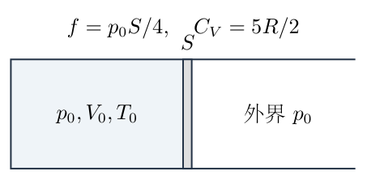
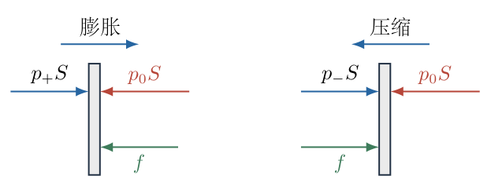
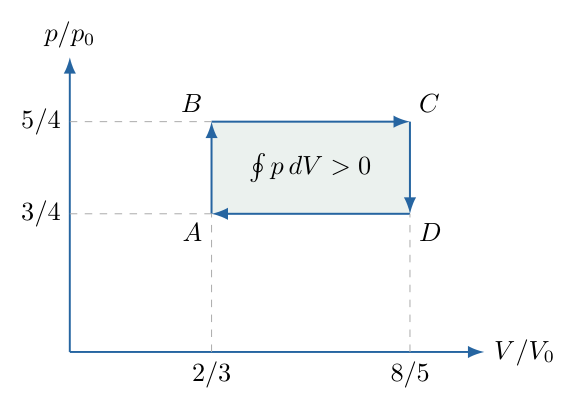
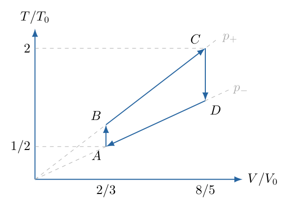

# 第 3 题

一个水平气缸中密封有理想气体，初始压强、体积和温度分别为$p_0,V_0,T_0$。气体的摩尔定容热容为$C_V=\frac52R$。活塞横截面积为$S$，活塞与气缸之间的最大静摩擦力为$f=\frac14p_0S$。气缸足够长，外界压强恒为$p_0$。

先缓慢将气体升温至$2T_0$，再缓慢降温至$T_0/2$，随后反复在这两个温度之间升温、降温。

（1）求循环过程中的最大体积$V_{\max}$与最小体积$V_{\min}$。

（2）达到稳定循环后，求气体一个循环的对外做功$W$。

（3）达到稳定循环后，求气体的循环效率$\eta$。

{width=76%}

## 一、题型定位

这是带摩擦活塞的准静态热力学循环。摩擦使同一体积在向外和向内移动时对应不同压强，从而在$p$—$V$平面形成滞回环。温度反向变化后，活塞不能立即反向滑动，会先经历定容过程。

初始状态不是稳定循环的一个端点。必须先求出首轮升温、降温所能达到的极值，确认后续四段过程闭合，再使用闭合循环的功和吸热量计算效率。

题干只直接给出最大静摩擦力。以下采用理想库仑摩擦近似：滑动摩擦力的大小也取$f$，忽略活塞惯性；这是获得明确恒压移动段所需的模型条件。若滑动摩擦与最大静摩擦不同而又未给出其大小及过渡运动规律，题干信息不足以唯一确定移动段。本解不会把“静摩擦在所有时刻都等于$f$”作为依据。

## 二、知识点

- 闭口理想气体的物质的量$\nu$不变，$\nu R=p_0V_0/T_0$。
- 静止活塞要求压强差产生的力不超过最大静摩擦力。
- 膨胀与压缩时摩擦方向相反，准静态移动压强为$p_+=p_0+f/S$和$p_-=p_0-f/S$。
- 定容过程$W=0$，热量为$\nu C_V\Delta T$。
- 定压过程$W=p\Delta V=\nu R\Delta T$，热量为$\nu C_P\Delta T$，其中$C_P=C_V+R$。
- 气体做功取正，第一定律写成$\Delta U=Q-W$，即$Q=\Delta U+W$。
- 闭合循环$\Delta U=0$，净功为$p$—$V$环面积；效率的分母是正吸热量，不是整个循环净热量。

## 三、物理图像

气体位于活塞左侧，规定活塞向右运动为膨胀。向右移动时摩擦向左，气体压强必须大于外界压强；向左移动时摩擦向右，气体压强必须小于外界压强。

温度从高端下降时，活塞开始仍停在最大体积处。只有压强下降至$p_-$，才开始向左滑动。温度从低端上升时，活塞开始仍停在最小体积处；只有压强上升至$p_+$，才开始向右滑动。

用$A,B,C,D$依次表示稳定循环的低温小体积状态、膨胀起点、高温大体积状态和压缩起点。循环为$A\to B\to C\to D\to A$；其中$AB,CD$定容，$BC,DA$定压。

## 四、解题入口

先从活塞受力求出两个滑动压强：

$$
p_+=\frac54p_0,\qquad p_-=\frac34p_0.
$$

再将高、低温端分别与膨胀、压缩支路配对：

$$
p_+V_{\max}=\nu R(2T_0),\qquad
p_-V_{\min}=\nu R(T_0/2).
$$

两端体积和四个温度都确定以后，分别计算四段$W,Q,\Delta U$。这个顺序能避免把气体从$T_0/2$升至$2T_0$的整段过程误认成一次定压加热。

## 五、解析

（1）写出气体物质的量与摩擦压差。

由初始状态方程，

$$
\nu=\frac{p_0V_0}{RT_0},
\qquad
\nu RT_0=p_0V_0.
\tag{1}
$$

定义摩擦对应的压差

$$
\Delta p=\frac fS=\frac{p_0}{4}.
\tag{2}
$$

活塞静止时，气体和外界的净压力差由静摩擦平衡，要求

$$
|(p-p_0)S|\le f,
$$

即

$$
\frac34p_0\le p\le\frac54p_0.
\tag{3}
$$

这个区间不是说活塞静止时压强始终等于两个端值。静摩擦可以在零到$f$之间变化，使活塞在同一体积下容许一定范围的压强变化。

如图3-2，膨胀时气体推力向右、外压和滑动摩擦向左；压缩时摩擦方向反转。两个准静态受力式分别为

{width=82%}

$$
\begin{aligned}
p_+S-p_0S-f&=0,\\
p_-S-p_0S+f&=0.
\end{aligned}
$$

因此

$$
\boxed{
p_+=p_0+\Delta p=\frac54p_0,\qquad
p_-=p_0-\Delta p=\frac34p_0
}.
\tag{4}
$$

（2）追踪第一次升温，确定最大体积。

初始活塞处于静止，气体温度由$T_0$升高时，体积先保持$V_0$。状态方程给出

$$
p=p_0\frac T{T_0}.
$$

膨胀启动条件为$p=p_+$，故第一次启动温度为

$$
T_{\mathrm{start,first}}=\frac54T_0.
\tag{5}
$$

此后活塞缓慢向右运动，在所采用的摩擦模型中$p=p_+$保持不变。升温至$2T_0$时，

$$
\begin{aligned}
V_{\max}
&=\frac{\nu R(2T_0)}{p_+}\\
&=\frac{2p_0V_0}{(5/4)p_0}\\
&=2V_0\frac45\\
&=\boxed{\frac85V_0}.
\end{aligned}
\tag{6}
$$

最大体积确实大于初始体积，因此首次升温包含一段实际膨胀，而不只是定容加热。

（3）追踪第一次降温，确定最小体积。

在高温端，活塞停止向外运动。开始降温时，体积先保持$V_{\max}$，压强按温度成比例下降。反向压缩启动条件为$p=p_-$：

$$
\begin{aligned}
T_D
&=\frac{p_-V_{\max}}{\nu R}\\
&=\frac{(3/4)p_0(8/5)V_0}{p_0V_0/T_0}\\
&=\frac65T_0.
\end{aligned}
\tag{7}
$$

在$2T_0$到$6T_0/5$之间，活塞并未压缩。随后保持$p_-$向内移动，直至低温端$T_0/2$：

$$
\begin{aligned}
V_{\min}
&=\frac{\nu R(T_0/2)}{p_-}\\
&=\frac{(p_0V_0)/2}{(3/4)p_0}\\
&=\frac12V_0\frac43\\
&=\boxed{\frac23V_0}.
\end{aligned}
\tag{8}
$$

因为$T_0/2<6T_0/5$，压缩段确实存在。最大体积和最小体积的差为

$$
\begin{aligned}
\Delta V
&=\frac85V_0-\frac23V_0\\
&=\left(\frac{24}{15}-\frac{10}{15}\right)V_0\\
&=\frac{14}{15}V_0.
\end{aligned}
\tag{9}
$$

（4）确认后续升温进入闭合的稳定循环。

从低温端$A$重新升温时，体积先保持$V_{\min}$，由$p_-$升至$p_+$。膨胀启动温度为

$$
\begin{aligned}
T_B
&=\frac{p_+V_{\min}}{\nu R}\\
&=\frac{(5/4)p_0(2/3)V_0}{p_0V_0/T_0}\\
&=\frac56T_0.
\end{aligned}
\tag{10}
$$

随后在$p_+$下膨胀至同一高温端$C$；降温又经$D$返回$A$。首轮升温的启动温度为$5T_0/4$，稳定循环升温的启动温度为$5T_0/6$，两者不同，原因是起始体积已经不同。

稳定循环四个状态可统一列出：

|状态|$V/V_0$|$p/p_0$|$T/T_0$|后续过程|
|---|---:|---:|---:|---|
|$A$|$2/3$|$3/4$|$1/2$|定容升温至$B$|
|$B$|$2/3$|$5/4$|$5/6$|定压膨胀至$C$|
|$C$|$8/5$|$5/4$|$2$|定容降温至$D$|
|$D$|$8/5$|$3/4$|$6/5$|定压压缩至$A$|

图3-3中的箭头构成顺时针闭合环。图上的水平段对应式（4）的两种移动压强，竖直段对应活塞被静摩擦暂时保持在同一位置。

{width=71%}

（5）逐段计算气体做功。

定容两段的体积不变，故

$$
W_{AB}=W_{CD}=0.
$$

膨胀段$BC$中，气体做正功：

$$
\begin{aligned}
W_{BC}
&=p_+(V_{\max}-V_{\min})\\
&=\frac54p_0\frac{14}{15}V_0\\
&=\frac{70}{60}p_0V_0\\
&=\frac76p_0V_0.
\end{aligned}
\tag{11}
$$

压缩段$DA$的体积变化为负，气体做负功：

$$
\begin{aligned}
W_{DA}
&=p_-(V_{\min}-V_{\max})\\
&=-\frac34p_0\frac{14}{15}V_0\\
&=-\frac{42}{60}p_0V_0\\
&=-\frac7{10}p_0V_0.
\end{aligned}
\tag{12}
$$

净功不是两段功的大小相加，而是代数和：

$$
\begin{aligned}
W
&=W_{BC}+W_{DA}\\
&=\left(\frac76-\frac7{10}\right)p_0V_0\\
&=\frac{35-21}{30}p_0V_0\\
&=\boxed{\frac7{15}p_0V_0}.
\end{aligned}
\tag{13}
$$

也可以直接使用图中矩形面积：

$$
(p_+-p_-)\Delta V
=\left(\frac54-\frac34\right)p_0
\frac{14}{15}V_0
=\frac7{15}p_0V_0.
$$

面积为正，因为循环方向是顺时针。若把循环方向反转，气体净功会变负，描述的将是需要输入机械功的过程。

（6）逐段计算吸热，不把整个升温段当成一种过程。

内能变化为

$$
\Delta U=\nu C_V\Delta T,
\qquad C_V=\frac52R.
$$

定压摩尔热容为

$$
C_P=C_V+R=\frac72R.
\tag{14}
$$

在$AB$定容升温时，$W_{AB}=0$，热量为

$$
\begin{aligned}
Q_{AB}
&=\nu C_V(T_B-T_A)\\
&=\nu\frac52R
\left(\frac56-\frac12\right)T_0\\
&=\nu RT_0\frac52\frac13\\
&=\frac56p_0V_0.
\end{aligned}
\tag{15}
$$

在$BC$定压膨胀时，热量不仅要增加内能，还要供给膨胀功。由第一定律，

$$
\begin{aligned}
Q_{BC}
&=\nu C_V(T_C-T_B)+W_{BC}\\
&=\nu(C_V+R)(T_C-T_B)\\
&=\nu\frac72R
\left(2-\frac56\right)T_0\\
&=\nu RT_0\frac72\frac76\\
&=\frac{49}{12}p_0V_0.
\end{aligned}
\tag{16}
$$

两段都吸热，因此总正吸热量为

$$
\begin{aligned}
Q_{\mathrm{in}}
&=Q_{AB}+Q_{BC}\\
&=\left(\frac56+\frac{49}{12}\right)p_0V_0\\
&=\frac{10+49}{12}p_0V_0\\
&=\boxed{\frac{59}{12}p_0V_0}.
\end{aligned}
\tag{17}
$$

把$AB$错误地算成定压段，会多算这段的体积功；把$BC$错误地算成定容段，则会漏算实际膨胀功。

图3-4把同一循环放到$T$—$V$平面。两条竖直线是定容过程，两条过原点的直线是不同压强下的状态方程。升温路径$A\to B\to C$在$B$处改变斜率，正是不能只用一个热容乘总温差的几何原因。

{width=69%}

（7）算出放热并独立检查第一定律。

定容降温段$CD$：

$$
\begin{aligned}
Q_{CD}
&=\nu C_V(T_D-T_C)\\
&=\nu\frac52R
\left(\frac65-2\right)T_0\\
&=\nu RT_0\frac52\left(-\frac45\right)\\
&=-2p_0V_0.
\end{aligned}
\tag{18}
$$

定压压缩段$DA$：

$$
\begin{aligned}
Q_{DA}
&=\nu C_P(T_A-T_D)\\
&=\nu\frac72R
\left(\frac12-\frac65\right)T_0\\
&=\nu RT_0\frac72\left(-\frac7{10}\right)\\
&=-\frac{49}{20}p_0V_0.
\end{aligned}
\tag{19}
$$

总放热量的大小为

$$
Q_{\mathrm{out}}
=-Q_{CD}-Q_{DA}
=\frac{89}{20}p_0V_0.
\tag{20}
$$

检查净热量：

$$
\begin{aligned}
Q_{\mathrm{in}}-Q_{\mathrm{out}}
&=\left(\frac{59}{12}-\frac{89}{20}\right)p_0V_0\\
&=\frac{295-267}{60}p_0V_0\\
&=\frac{28}{60}p_0V_0\\
&=\frac7{15}p_0V_0=W.
\end{aligned}
\tag{21}
$$

另一方面，四段总温差为零，故总内能变化$\nu C_V\sum\Delta T=0$。净热量等于净功与闭合循环条件同时成立。

（8）求效率并解释所计算的“对外功”。

按气体热力学循环效率的定义，

$$
\begin{aligned}
\eta
&=\frac{W}{Q_{\mathrm{in}}}\\
&=\frac{(7/15)p_0V_0}{(59/12)p_0V_0}\\
&=\frac7{15}\frac{12}{59}\\
&=\frac{84}{885}\\
&=\boxed{\frac{28}{295}\approx9.49\%}.
\end{aligned}
\tag{22}
$$

效率无量纲，且小于一。不能将净热量$Q_{\mathrm{in}}-Q_{\mathrm{out}}$放在分母，否则任何闭合循环都会被错算成$100\%$。

这里的$W$是气体通过活塞边界输出的净机械功，其中包含克服摩擦的功。一个周期中外界恒压的净功为

$$
W_{\mathrm{ambient}}=p_0\oint dV=0.
$$

活塞膨胀和压缩各移动$\Delta x=\Delta V/S$，两段摩擦耗散相加：

$$
\begin{aligned}
E_{\mathrm{fr}}
&=2f\Delta x\\
&=2\frac{p_0S}{4}\frac{14V_0}{15S}\\
&=\frac7{15}p_0V_0=W.
\end{aligned}
\tag{23}
$$

所以本装置没有另接负载时，气体的净输出全部耗于摩擦，并不等于可以提供给外接机器的有用功。式（22）是题目采用的气体循环功与正吸热量之比，不能再把它解释为恒压外界获得的净有用功效率。

（9）检查过程存在性及模型边界。

四个温度的顺序满足

$$
\frac12T_0<\frac56T_0<2T_0,
\qquad
\frac12T_0<\frac65T_0<2T_0,
$$

因此每次升温和降温都确实包含一段静止、一段滑动。$V_{\max}>V_{\min}>0$、$p_->0$，也满足几何和热力学的基本要求。

气缸足够长保证活塞能达到$8V_0/5$而不撞到端部；缓慢改变温度保证在所采用的同阈值摩擦模型中，可忽略活塞惯性并用准静态支路描述。若滑动摩擦力小于静摩擦阈值，启动后可能产生快速过渡或粘滑，此时仅知道最大静摩擦力不足以确定上述矩形支路，必须补充滑动摩擦及过渡过程。

最终结果在本明确模型下为

$$
\boxed{
V_{\max}=\frac85V_0,\quad
V_{\min}=\frac23V_0,\quad
W=\frac7{15}p_0V_0,\quad
\eta=\frac{28}{295}
}.
\tag{24}
$$

## 六、关键洞察

循环面积来自摩擦造成的方向依赖，而不是温度反向时立即反向移动。即使温度变化无限缓慢，只要理想摩擦阈值非零，这个滞回环也不会消失；“准静态”并不自动意味着“可逆”。

效率的较小数值有两个来源：一部分热量在定容升温中只增加内能，没有产生膨胀功；净输出又是较大膨胀功与较大压缩功相减后的差值。单看$W_{BC}=7p_0V_0/6$，很容易高估一周期的净输出。

若将第一轮从$T_0$出发的升温当作稳定吸热段，会得到不同的吸热量。首轮升温定容到$5T_0/4$后膨胀到$2T_0$，正吸热量为

$$
\begin{aligned}
Q_{\mathrm{in,first}}
&=\nu C_V(T_C-T_0)+p_+(V_{\max}-V_0)\\
&=\frac52p_0V_0+\frac54p_0\frac35V_0\\
&=\frac{13}{4}p_0V_0.
\end{aligned}
$$

但首轮从$(p_0,V_0,T_0)$结束于$A$，并非闭合，$\Delta U=-5p_0V_0/4$。不能将稳定净功$7p_0V_0/15$除以这个首轮吸热量。循环效率要求分子、分母来自同一闭合过程。

## 七、易错点

- 用$p=p_0$描述所有活塞移动，忽略摩擦造成的两个不同压力平台。
- 认为降温时立即压缩、升温时立即膨胀，遗漏两段定容过程。
- 静止阶段将静摩擦直接固定为$f$，从而错误地使压强不能随温度变化。
- 混用初始升温启动温度$5T_0/4$与稳定循环启动温度$5T_0/6$。
- 压缩功取正，或把膨胀、压缩功的绝对值相加。
- 全升温段只使用$C_V$或只使用$C_P$，遗漏过程类型的改变。
- 将净热量作为效率分母，或把气体净功误认为外界恒压净有用功。
- 把题给最大静摩擦与未知滑动摩擦的关系当作无需说明的物理定律。

## 八、课堂讲解建议

先让学生对活塞画两张受力图：膨胀和压缩。教师只给出$|(p-p_0)S|\le f$，要求学生自己找出两个启动边界，再讨论静止阶段为什么允许压力变化。

状态表应在计算热量之前完成。让学生用$pV=\nu RT$逐项检查四个温度，尤其区分首轮与稳定升温启动温度。板书保留四个$Q$和两个非零$W$，最后让学生独立检验$Q_{\mathrm{in}}-Q_{\mathrm{out}}=W$。

讲效率时，先问“分母是输入热量还是净热量”，再用摩擦能量说明净功的去向。教师应明确声明采用的滑动摩擦模型，避免学生把题目省略的模型条件学成普遍事实。

## 九、变式训练

变式：仍取两个温度端点为$2T_0$和$T_0/2$，摩擦改为$f=\varepsilon p_0S$，静摩擦阈值与滑动摩擦大小相同。求能产生非零滞回循环的$\varepsilon$范围，写出效率，并求效率最大时的$\varepsilon$。

两个移动压强为$p_\pm=(1\pm\varepsilon)p_0$，因此

$$
V_{\max}=\frac2{1+\varepsilon}V_0,\qquad
V_{\min}=\frac1{2(1-\varepsilon)}V_0.
$$

要求$p_->0$且$V_{\max}>V_{\min}$。在$\varepsilon\ge0$下，

$$
\begin{aligned}
\frac2{1+\varepsilon}
&>\frac1{2(1-\varepsilon)},\\
4(1-\varepsilon)&>1+\varepsilon,\\
\varepsilon&<\frac35.
\end{aligned}
$$

非零循环面积要求$0<\varepsilon<3/5$。端点$\varepsilon=0$没有压力滞回，端点$\varepsilon=3/5$没有体积跨度。

体积跨度、净功和正吸热量为

$$
\begin{aligned}
\frac{\Delta V}{V_0}
&=\frac{3-5\varepsilon}{2(1-\varepsilon^2)},\\
\frac{W}{p_0V_0}
&=2\varepsilon\frac{\Delta V}{V_0}
=\frac{\varepsilon(3-5\varepsilon)}{1-\varepsilon^2},\\
\frac{Q_{\mathrm{in}}}{p_0V_0}
&=\frac52\left(2-\frac12\right)
+(1+\varepsilon)\frac{\Delta V}{V_0}\\
&=\frac{15}{4}+\frac{3-5\varepsilon}{2(1-\varepsilon)}\\
&=\frac{21-25\varepsilon}{4(1-\varepsilon)}.
\end{aligned}
$$

于是

$$
\boxed{
\eta(\varepsilon)=
\frac{4\varepsilon(3-5\varepsilon)}
{(1+\varepsilon)(21-25\varepsilon)}
},\qquad 0<\varepsilon<\frac35.
$$

分母在区间内为正。对分子、分母用商法则求导，整理为

$$
\eta'(\varepsilon)
=\frac{4(63-210\varepsilon+95\varepsilon^2)}
{(21-4\varepsilon-25\varepsilon^2)^2}.
$$

驻点满足$95\varepsilon^2-210\varepsilon+63=0$，根为

$$
\varepsilon=\frac{105\pm12\sqrt{35}}{95}.
$$

较大根超出允许区间，保留

$$
\boxed{
\varepsilon_*=\frac{105-12\sqrt{35}}{95}
\approx0.358
}.
$$

导数在$\varepsilon_*$前为正、后为负，且两端效率趋于零，因此该点为区间最大值，代入上式约得$\eta_{\max}=10.6\%$。取$\varepsilon=1/4$恢复式（22），作为代数与分支检查。
