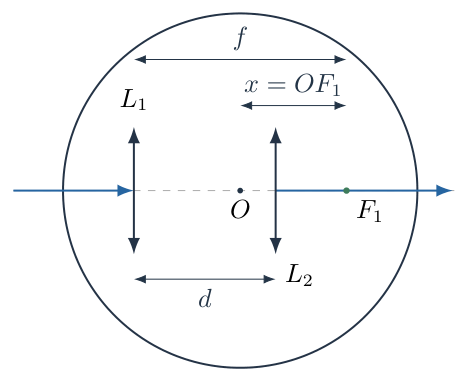
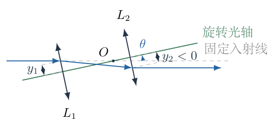
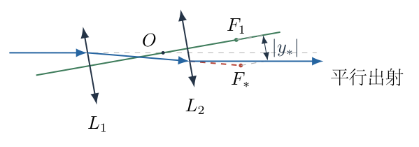
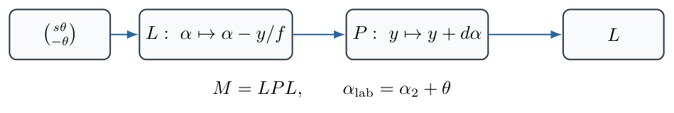

# 第 7 题

一束激光依次通过两个凸透镜，两透镜的焦距均为$f$，相距$d$。透镜固定在可绕圆心$O$转动的圆盘上。初始两透镜共轴，入射光沿图示方向通过系统。圆盘在小角度范围内转动时，入射光方向保持不变，出射光方向始终与入射光平行。

求圆心$O$到左侧透镜焦点的距离$x$。

图中将左侧透镜的右侧轴上焦点记为$F_1$，距离$x=OF_1$为几何长度。解析同时给出有向坐标与另一侧焦点的距离，以区分透镜中心、轴上焦点和实际光束会聚点。

{width=83%}

## 一、题型定位

这是近轴薄透镜系统随载体转动的方向不变条件。两透镜不是用来使入射与出射两条直线重合，而是使出射的倾斜角度始终为零；出射光可以出现横向位移。

最稳妥的方法是直接追踪光线在两个透镜处的高度和方向，求出圆心相对于左透镜中心的位置$s$。题目要求的是焦点距离$x$，还必须在最后减去或加上焦距，不能把$s$直接填作$x$。

采用薄透镜、近轴光线和小角度一阶近似。示意图的长度不代替方程；焦点的侧别以及“有向位置”与“几何距离”的区别都要明确。

## 二、知识点

- 一阶近轴近似中，光线方向角$\alpha$可用横向位移对轴向位移的斜率表示。
- 经过焦距$f$的薄透镜，光线高度不变，方向改变为$\alpha_{\mathrm{out}}=\alpha_{\mathrm{in}}-y/f$。
- 沿光轴传播距离$d$时，方向不变，高度改变为$y_{\mathrm{out}}=y_{\mathrm{in}}+d\alpha$。
- 整个系统转动后，局部光轴角与实验室角相差系统转角。
- 平行出射是实验室方向角为零，不是相对于旋转光轴的方向角为零。
- 焦点位于距透镜中心$f$的位置；圆心到透镜的距离与圆心到焦点的距离不是同一个量。
- 近轴光线矩阵可独立复核逐透镜追迹。

## 三、物理图像

取初始光轴为实验室横轴，入射光沿此轴传播并通过固定圆心$O$。左、右透镜中心分别记为$L_1,L_2$；令$s$为从$L_1$沿初始传播方向到$O$的有向距离。因此在以$O$为原点的初始坐标中，

$$
L_1:\ -s,\qquad L_2:\ d-s.
$$

圆盘逆时针转过小角$\theta$后，整个透镜光轴也转过$\theta$，而激光仍沿实验室水平线。相对于旋转光轴，入射方向角是$-\theta$。

左透镜中心在圆心左侧，其轴向位置为$-s$。激光在左透镜处相对于局部光轴的高度为$y_1\simeq s\theta$。这个高度不是零，正是转轴位置能够影响出射方向的原因。

## 四、解题入口

用两条基本光线变换连续追迹：

$$
\begin{aligned}
\alpha_1&=-\theta-\frac{y_1}{f},\\
y_2&=y_1+d\alpha_1,\\
\alpha_2&=\alpha_1-\frac{y_2}{f}.
\end{aligned}
$$

最后把局部出射方向转回实验室：

$$
\alpha_{\mathrm{lab}}=\alpha_2+\theta.
$$

要求对任意足够小的$\theta$都保持平行，即一阶系数为零。求得$s$后，左透镜右侧焦点在距$L_1$为$f$的位置，所以有向焦点差为$s-f$，实际距离为$|s-f|$。

## 五、解析

（1）推导第一透镜处的入射高度，不凭示意图猜比例。

以圆心$O$为原点，旋转光轴单位矢量及横向单位矢量为

$$
\boldsymbol e_a=(\cos\theta,\sin\theta),
\qquad
\boldsymbol e_y=(-\sin\theta,\cos\theta).
$$

第一透镜所在平面满足沿光轴坐标为$-s$，即$\boldsymbol r\cdot\boldsymbol e_a=-s$。入射光在实验室中位于$Y=0$，交点为

$$
X\cos\theta=-s,\qquad X=-\frac{s}{\cos\theta}.
$$

交点相对于光轴的横向坐标为

$$
\begin{aligned}
y_1
&=\boldsymbol r\cdot\boldsymbol e_y\\
&=X(-\sin\theta)+0\cdot\cos\theta\\
&=\frac{s\sin\theta}{\cos\theta}\\
&=s\tan\theta.
\end{aligned}
\tag{1}
$$

小角范围内$\tan\theta=\theta+O(\theta^3)$，所以保留一阶：

$$
\boxed{y_1=s\theta}.
\tag{2}
$$

图7-2把固定入射线、旋转光轴和两个透镜交点分开画出。$\theta$在图中适当放大以辨认高度；后面的计算仅保留一阶，不从放大的图测量数值。

{width=84%}

（2）在第一透镜处计算方向变化。

相对于旋转光轴，入射方向角为

$$
\alpha_{\mathrm{in}}=-\theta.
$$

薄凸透镜对高度$y_1>0$的近轴光线使其向轴弯折，方向角减少$y_1/f$。因此

$$
\begin{aligned}
\alpha_1
&=\alpha_{\mathrm{in}}-\frac{y_1}{f}\\
&=-\theta-\frac{s\theta}{f}\\
&=-\left(1+\frac sf\right)\theta.
\end{aligned}
\tag{3}
$$

这个角仍是相对于旋转光轴的角。实验室中第一透镜后的方向角为$\alpha_1+\theta=-s\theta/f$，一般不是零。

（3）传播到第二透镜，保留轴向距离$d$。

两透镜之间的距离$d$沿旋转光轴量取。近轴传播满足

$$
y_2=y_1+d\alpha_1.
$$

代入式（2）、（3）：

$$
\begin{aligned}
y_2
&=s\theta+d\left(-\theta-\frac{s\theta}{f}\right)\\
&=\left(s-d-\frac{ds}{f}\right)\theta.
\end{aligned}
\tag{4}
$$

$y_2$可以为负，表示光线落在旋转光轴另一侧。不能把这个高度强行取绝对值后代入透镜式，否则第二透镜的弯折方向会被改错。

（4）计算第二透镜后的方向并转回实验室。

第二透镜的焦距也为$f$，所以

$$
\alpha_2=\alpha_1-\frac{y_2}{f}.
$$

逐项代入展开：

$$
\begin{aligned}
\alpha_2
&=-\theta-\frac{s\theta}{f}
-\frac1f\left(s-d-\frac{ds}{f}\right)\theta\\
&=\left(-1-\frac sf-\frac sf+\frac df+\frac{ds}{f^2}\right)\theta\\
&=\left(-1+\frac df-\frac{2s}{f}+\frac{ds}{f^2}\right)\theta.
\end{aligned}
\tag{5}
$$

实验室中，光轴本身已转过$+\theta$，故出射方向角为

$$
\begin{aligned}
\alpha_{\mathrm{lab}}
&=\alpha_2+\theta\\
&=\left(\frac df-\frac{2s}{f}
+\frac{ds}{f^2}\right)\theta.
\end{aligned}
\tag{6}
$$

若错误地令$\alpha_2=0$，得到的是出射光平行于已经转动的透镜光轴，并不满足出射光平行原来的固定入射方向。

（5）用任意小转角的不变条件求圆心位置。

要求$\alpha_{\mathrm{lab}}=0$对任意小$\theta$都成立。不能仅取$\theta=0$；系统在完全未转动时本来就平行，那个瞬间不能确定转轴位置。

因此式（6）中一阶系数必须为零：

$$
\frac df-\frac{2s}{f}+\frac{ds}{f^2}=0.
$$

乘以$f^2$并整理：

$$
\begin{aligned}
df-2sf+ds&=0,\\
df+s(d-2f)&=0,\\
s(2f-d)&=df.
\end{aligned}
$$

当$d\ne2f$，

$$
\boxed{
s=\frac{fd}{2f-d}
}.
\tag{7}
$$

这首先是左透镜中心到转轴圆心的有向距离，不是题目中的焦点距离$x$。

（6）把透镜距离换算为焦点距离，明确有向量和几何量。

左透镜的右侧轴上焦点$F_1$位于$L_1$右侧距离$f$处。沿初始光轴的有向坐标差为

$$
\begin{aligned}
X_O-X_{F_1}
&=s-f\\
&=\frac{fd}{2f-d}-f\\
&=\frac{fd-f(2f-d)}{2f-d}\\
&=\frac{fd-2f^2+fd}{2f-d}\\
&=\frac{2f(d-f)}{2f-d}.
\end{aligned}
\tag{8}
$$

因此题目所说的几何距离为

$$
\boxed{
x=OF_1=\left|s-f\right|
=\left|\frac{2f(d-f)}{2f-d}\right|
},\qquad d\ne2f.
\tag{9}
$$

若将$x$定义为从$F_1$指向$O$的有向距离，可不取绝对值，直接使用式（8）。不能一边称$x$为距离大小，一边在允许参数范围里报告负长度。

若图示还要求圆心在两透镜之间，则应有$0<s<d$。由于$d,f>0$，式（7）给出

$$
\begin{aligned}
0<\frac{fd}{2f-d}<d
&\quad\Longrightarrow\quad
0<d<f.
\end{aligned}
\tag{10}
$$

在这个分支，$s<f$，所以$O$位于右侧焦点$F_1$的左边。几何距离可写成不含绝对值的形式

$$
\boxed{
x=f-s=\frac{2f(f-d)}{2f-d}
},\qquad 0<d<f.
\tag{11}
$$

端点$d=f$时$s=f=d$，圆心在第二透镜中心，同时与第一透镜右侧焦点重合，$x=0$。它不是严格位于两透镜内部，但可以作为边界检验。

原题未用文字明确区分左右两个焦点。若实际所指是左透镜左侧焦点$F_{1,\mathrm L}$，则距离应为

$$
\boxed{
OF_{1,\mathrm L}
=|s+f|
=\left|\frac{2f^2}{2f-d}\right|
}.
\tag{12}
$$

两种焦点侧别不影响先求$s$的条件；换算到$x$时才有不同。保留侧别说明，比将透镜中心和焦点合并在同一点更严谨。

（7）检查第一透镜的轴上焦点与实际光束会聚点。

系统转动后，固定入射束相对于局部光轴倾斜$-\theta$。第一透镜对这束平行光形成的会聚点$F_*$，在其像方焦平面上，但偏离轴上焦点$F_1$。

近轴条件下，焦平面内的横向位移为

$$
y_*=-f\theta.
\tag{13}
$$

图7-3用虚线延长第一透镜后的光线至$F_*$，并保留真正的轴上焦点$F_1$。实际光线在到达这个第一透镜的会聚点之前，已经遇到第二透镜并改变方向；不能把$F_*$和$F_1$当作同一点来套相似三角形。

{width=84%}

式（13）由平行光束的焦平面成像关系得到，也可以从第一透镜追迹复查：将光线再传播$f$，横向高度为

$$
\begin{aligned}
y_*
&=y_1+f\alpha_1\\
&=s\theta+f\left(-\theta-\frac{s\theta}{f}\right)\\
&=-f\theta.
\end{aligned}
$$

此值与入射高度$y_1$无关，说明各条同方向平行入射近轴光线会聚在同一焦平面位置。

（8）独立使用光线矩阵复核转轴位置。

以$\binom y\alpha$表示光线的局部高度与方向。单透镜矩阵和自由传播矩阵分别为

$$
L=
\begin{pmatrix}
1&0\\
-1/f&1
\end{pmatrix},
\qquad
P=
\begin{pmatrix}
1&d\\
0&1
\end{pmatrix}.
\tag{14}
$$

光依次经过第一透镜、传播和第二透镜，总矩阵应按实际作用顺序写成$M=LPL$，不是把次序随意交换。

先计算$PL$：

$$
PL=
\begin{pmatrix}
1-d/f&d\\
-1/f&1
\end{pmatrix}.
$$

再左乘第二透镜的$L$：

$$
\begin{aligned}
M=LPL
&=
\begin{pmatrix}
1-d/f&d\\
-(1-d/f)/f-1/f&1-d/f
\end{pmatrix}\\
&=
\begin{pmatrix}
1-d/f&d\\
-2/f+d/f^2&1-d/f
\end{pmatrix}.
\end{aligned}
\tag{15}
$$

图7-4展示三个依次作用的变换。每个节点都对应上述矩阵乘法的一步，不把图当成与计算无关的流程装饰。

{width=89%}

输入光线为

$$
\binom{y_1}{\alpha_{\mathrm{in}}}
=\binom{s\theta}{-\theta}.
$$

取矩阵第二行求$\alpha_2$：

$$
\alpha_2
=\left(-\frac2f+\frac d{f^2}\right)s\theta
-\left(1-\frac df\right)\theta.
$$

加回光轴转角$\theta$：

$$
\alpha_{\mathrm{lab}}
=\left[\left(-\frac2f+\frac d{f^2}\right)s
+\frac df\right]\theta.
$$

令系数为零，再次得到$s=fd/(2f-d)$，与逐透镜追迹完全一致。

（9）检查平行不意味着重合，并计算横向位移。

把式（7）代入式（4）：

$$
\begin{aligned}
y_2
&=\left[s\left(1-\frac df\right)-d\right]\theta\\
&=\left[\frac{d(f-d)}{2f-d}-d\right]\theta\\
&=-\frac{fd}{2f-d}\theta\\
&=-s\theta.
\end{aligned}
\tag{16}
$$

第二透镜中心相对固定圆心的实验室高度约为$(d-s)\theta$。出射光的实验室高度为它与局部光线高度之和：

$$
\begin{aligned}
Y_{\mathrm{out}}
&=(d-s)\theta+y_2\\
&=(d-2s)\theta\\
&=\left(d-\frac{2fd}{2f-d}\right)\theta\\
&=\boxed{-\frac{d^2}{2f-d}\theta}.
\end{aligned}
\tag{17}
$$

这个高度一般不为零，但出射方向仍为零。题目允许平行而不同线，故式（17）不破坏所求条件。

（10）参数、量纲和退化情形检查。

式（7）、（9）和（12）均具有长度量纲。$s$与$x$随$f,d$同比放大时也同比放大，符合光学装置相似缩放。

当$d=2f$，矩阵第二行的高度系数为零，式（6）变成

$$
\alpha_{\mathrm{lab}}=2\theta,
$$

与$s$无关。此时不存在能够使这束光在系统转动后仍平行原入射方向的有限转轴位置；公式分母为零不是允许“无限大的具体圆心距离”，而是没有有限解。

当$d\to0$，两透镜近似重合，条件给出$s\to0$，圆心趋向透镜位置；到单个左透镜轴上焦点的距离趋于$f$。当$d=f$，给出$s=f$、右侧焦点距离零，且代回式（6）确实消去一阶角度变化。

当$0<d<f$，式（11）的距离为正；当$f<d<2f$，$s>d$，转轴位于第二透镜右侧；当$d>2f$，$s<0$，转轴位于第一透镜左侧。若装置另要求圆心处在两镜之间，后两个分支就必须排除，不能只算分式而不检查位置。

## 六、关键洞察

方向不变条件是两个效应抵消：系统光轴本身转动，以及固定光束在两个透镜中产生的不同高度弯折。只看两透镜是否共焦，或套一个不说明参考光轴的物像距公式，容易漏掉实验室角度恢复项$+\theta$。

初始光束必须按图位于初始共同光轴。若它在初始状态就有高度偏移$h\ne0$，总矩阵的高度系数$C=(d-2f)/f^2$一般会使出射方向偏转$Ch$。同一有限转轴位置不能使任意横向高度的整片平行束都在两正透镜之后保持平行；题目描述的是选定激光束的中心方向。

焦点距离的符号可通过几何分支独立检查。若$0<d<f$，有$d/2<s<d<f$，因此右侧焦点在圆心右侧。此时$s-f<0$是有向坐标，不是计算失败；它恰好说明应取$x=f-s$作为距离大小。

## 七、易错点

- 把转轴圆心到左透镜中心的$s$直接当作题目要求的焦点距离$x$。
- 把轴上焦点$F_1$与倾斜入射束的会聚点$F_*$合并，遗漏焦平面横向位移。
- 入射方向保持不变，却在局部坐标中仍把入射角写成零。
- 第二透镜的入射高度写成第一透镜高度，漏掉两镜之间传播项$d\alpha_1$。
- 令局部出射角为零，忘记将角度转回实验室。
- 将负光线高度取绝对值再代入透镜式，改变弯折方向。
- 要求出射直线与入射直线重合，额外加入题目没有的限制。
- 对几何距离不取绝对值，或忽略$d=2f$无有限解及圆心位置分支。

## 八、课堂讲解建议

教师先在图上分别标出$L_1,O,F_1$，让学生用一句话说明$s$和$x$各测什么。然后画固定入射线和旋转光轴，让学生判断相对入射角为什么是$-\theta$。

板书追迹分成“第一透镜弯折—传播到第二透镜—第二透镜弯折—恢复地面方向”四步。每步保留高度的正负号，让学生自行解释$y_2<0$的物理位置。得到$s$后再换算焦点距离，避免学生把中间量当作最终答案。

矩阵法安排为独立复核而非首轮捷径。最后用$d=f$和$d=2f$检查公式，要求学生描述圆心在哪里、是否有有限解，以及平行但横移为什么满足题意。

## 九、变式训练

变式：两透镜焦距改为$f_1,f_2$，间距为$d$。初始激光沿共同光轴，求一阶保持实验室出射方向不变所需的左透镜—圆心有向距离$s$。

第一透镜后方向与第二透镜前高度为

$$
\alpha_1=-\theta-\frac{s\theta}{f_1},
\qquad
y_2=s\theta+d\alpha_1.
$$

第二透镜后恢复实验室方向：

$$
\begin{aligned}
\alpha_{\mathrm{lab}}
&=\alpha_1-\frac{y_2}{f_2}+\theta\\
&=\left[
\frac d{f_2}
-s\left(\frac1{f_1}+\frac1{f_2}
-\frac d{f_1f_2}\right)
\right]\theta.
\end{aligned}
$$

令一阶系数为零，乘以$f_1f_2$：

$$
df_1-s(f_1+f_2-d)=0.
$$

因此

$$
\boxed{
s=\frac{df_1}{f_1+f_2-d}
},\qquad d\ne f_1+f_2.
$$

左透镜右侧焦点距离为

$$
x_1=|s-f_1|
=\left|\frac{f_1(2d-f_1-f_2)}{f_1+f_2-d}\right|.
$$

圆心在两镜之间要求$0<s<d$，即$0<d<f_2$。当$d=f_1+f_2$，方向对高度的耦合系数为零，但出射方向仍随转动改变，故无有限$s$；取$f_1=f_2=f$恢复主结果。

用一组具体数值检查有向高度与最后的焦点换算。取$f_1=20\,\mathrm{cm}$、$f_2=30\,\mathrm{cm}$、$d=10\,\mathrm{cm}$，则

$$
\begin{aligned}
s&=\frac{10\times20}{20+30-10}\,\mathrm{cm}
=5\,\mathrm{cm},\\
x_1&=|5-20|\,\mathrm{cm}=15\,\mathrm{cm}.
\end{aligned}
$$

圆心确实在两镜之间，因为$0<5<10$。令转角$\theta=0.010\,\mathrm{rad}$，仍按一阶近轴关系逐镜计算，所有高度统一用厘米：

$$
\begin{aligned}
y_1&=s\theta=0.050\,\mathrm{cm},\\
\alpha_1&=-0.010-\frac{0.050}{20}
=-0.0125\,\mathrm{rad},\\
y_2&=0.050+10(-0.0125)
=-0.075\,\mathrm{cm},\\
\alpha_2&=-0.0125-\frac{-0.075}{30}
=-0.0100\,\mathrm{rad},\\
\alpha_{\rm lab}&=\alpha_2+\theta=0.
\end{aligned}
$$

第二透镜处的高度为负，弯折改变量因而为正，恰好恢复实验室水平出射。若把$y_2$取成正数，抵消就会消失。转轴到镜心的$5\,\mathrm{cm}$与到右侧焦点的$15\,\mathrm{cm}$也不相等，这个例子同时核验符号和题目所求长度。
