# 第 1 题

假设中子星由大量中子堆积而成。每个中子的质量为$m_0$，中子的数密度为$n$，即单位体积中含有$n$个中子。引力产生的压强若超过中子简并压强，中子星将进一步塌缩。给定简并压强的估算式

$$
p_0=A\frac{n}{m_0}\left(\frac{h}{r}\right)^2,
$$

其中$A$为常数，$h$为普朗克常量，$r$为中子间的平均距离。粗略估算中子星能够维持的最大半径$R$，用$G,m_0,n,A,h$表示；$G$为万有引力常量。

{width=78%}

## 一、题型定位

这是自引力物质的静力支撑估算。题目给出微观压强，需要把“每单位体积有多少个中子”转化为质量密度，再计算一个球体内部因自身引力所需要的中心压强，最后比较两种压强。

“最大半径”不是说万有引力在球面取得最大值就直接使用球面引力，而是说：在数密度$n$固定的粗略模型中，半径越大，总质量越大，中心需要承担的压强也越大。中心最先达到给定支撑压强的上限，因而由中心临界条件决定半径。

采用牛顿引力、球对称、均匀质量密度和真空外边界。这里的$n$是整颗星的代表性数密度，不据此声称已经解出了真实中子星的径向密度分布。这个边界是给定估算模型的结果，不是包含广义相对论和完整核物质状态方程的精确极限。

## 二、知识点

- 数密度的单位是$\mathrm{m^{-3}}$；质量密度为$\rho=nm_0$。
- 平均每个粒子占据的体积约为$r^3$，因此$r^3n\simeq1$。
- 球对称引力中，外层球壳对内点的合引力为零；距中心$s$处的引力只由$s$以内的质量决定。
- 静止微元的压强力差平衡重力，写成$dp/ds=-\rho g(s)$。
- 压强由梯度和一个边界值共同确定，不能只把“引力除以面积”当成任意位置的压强。
- 临界支撑条件是最大所需压强等于给定可提供压强；在本模型中最大所需压强位于中心。

## 三、物理图像

用$s$表示从球心出发的径向坐标，范围为$0\le s\le R$。保留题目中的$r$表示粒子平均间距，不能把$r$同时用作宏观径向坐标。星的外半径是$R$，其内部质量密度近似为常量$\rho=nm_0$。

中心处引力场强为零，但中心压强最大。这两句话并不矛盾：场强是局部重力的强弱，压强则由从边界到该位置累积的压强梯度决定。中心没有局部引力加速度，不等于中心不承受外层物质传递的压力。

表面不受外界气体或其他介质的压力，故取$p(R)=0$。从表面向中心走，必须不断增加压强，才能支撑外层物质；从中心向外走，压强随$s$减小。因此把径向向外规定为正后，压强梯度应当为负。

## 四、解题入口

依次建立四个量：

$$
\begin{aligned}
r&\simeq n^{-1/3},\\
\rho&=nm_0,\\
M(s)&=\frac{4\pi}{3}\rho s^3,\\
\frac{dp}{ds}&=-\rho\frac{GM(s)}{s^2}.
\end{aligned}
$$

前两式把微观条件变成可以计算的输入；第三式是包围质量；第四式是静力平衡。求出$p(s)$以后，再令$p(0)=p_0$。这样每一步都有确定的研究对象，也不会把总质量误代到任意内部半径处。

## 五、解析

（1）由数密度估计平均间距。

每个中子平均对应的空间体积为

$$
V_{\mathrm{per}}=\frac1n.
$$

把这个体积的线尺度记为$r$，则

$$
\begin{aligned}
r^3&\simeq V_{\mathrm{per}}=\frac1n,\\
r&\simeq n^{-1/3},\\
\frac1{r^2}&\simeq n^{2/3}.
\end{aligned}
$$

这不是断言中子真的构成规则立方晶格，而是用单位粒子体积的立方根估计平均距离。若更精细的间距定义引入一个数量级为一的系数，该系数可以并入题目给定的$A$。此处不能另加一个任意晶格因子后又仍把$A$当作原来的常数。

代入简并压强式，逐项合并$n$的指数：

$$
\begin{aligned}
p_0
&=A\frac{n}{m_0}\frac{h^2}{r^2}\\
&\simeq A\frac{n}{m_0}h^2n^{2/3}\\
&=\frac{Ah^2}{m_0}n^{\,1+2/3}\\
&=\boxed{\frac{Ah^2}{m_0}n^{5/3}}.
\end{aligned}
\tag{1}
$$

因此微观支撑压强随数密度增加而增加，且不是与$n$简单成正比。指数$5/3$由“单位体积粒子数”的一个$n$和“间距平方倒数”的$n^{2/3}$共同产生。

（2）求均匀球内部的包围质量。

半径$s$以内的球体体积为$4\pi s^3/3$。因为每单位体积有$n$个中子，每个中子的质量为$m_0$，所以

$$
\begin{aligned}
\rho&=nm_0,\\
M(s)
&=\rho\frac{4\pi s^3}{3}\\
&=\frac{4\pi}{3}nm_0s^3.
\end{aligned}
\tag{2}
$$

球对称引力的方向指向球心。用$g(s)$表示其非负大小，则$s>0$时

$$
\begin{aligned}
g(s)
&=\frac{GM(s)}{s^2}\\
&=\frac{G}{s^2}\frac{4\pi}{3}nm_0s^3\\
&=\frac{4\pi}{3}Gnm_0s.
\end{aligned}
\tag{3}
$$

约去$s^2$以后，内部场强与$s$成正比，而不是与$1/s^2$成正比。反平方公式本身没有失效；变化的是它的分子$M(s)$随$s^3$增加。式（3）在$s\to0$时连续趋于零，所以中心不发生场强发散。

如果把总质量$M(R)$代入内部任意$s$，就相当于错误地把所有外层球壳的质量放到了球心，会得到发散的$g(s)$，进而使压强计算从第一步就不成立。

（3）对局部微元建立静力平衡，而不是对整个球壳直接相减。

如图1-2，在距球心$s$附近取一个很小的直角柱形微元。它沿径向的长度为$ds$，两端面积均为$S$；规定向外为正。内侧压强为$p(s)$，推力向外；外侧压强为$p(s+ds)$，推力向内。侧面压强的径向分量在局部直角微元中相互抵消。

{width=80%}

微元质量和重力分别为

$$
dm=\rho S\,ds,\qquad
F_g=dm\,g(s)=\rho S\,ds\,g(s).
$$

微元静止，向外方向的合力为零：

$$
p(s)S-p(s+ds)S-\rho S\,ds\,g(s)=0.
\tag{4}
$$

使用一阶微分展开，

$$
p(s+ds)=p(s)+\frac{dp}{ds}ds+O(ds^2).
$$

将它代入式（4），先消去$p(s)S$，再除以$S\,ds$：

$$
\begin{aligned}
-\frac{dp}{ds}S\,ds-\rho S\,ds\,g(s)+O(ds^2)&=0,\\
-\frac{dp}{ds}-\rho g(s)+O(ds)&=0.
\end{aligned}
$$

令$ds\to0$，得到

$$
\boxed{\frac{dp}{ds}=-\rho g(s)}.
\tag{5}
$$

负号来自“压强由内向外减小”，不是把万有引力常量或质量取成负值。$g(s)$已经定义为非负大小，真实引力矢量为$-g(s)\boldsymbol e_s$。

不宜将一整层球壳的内外压强各乘以不同球面积后直接相减。球面法线方向不相同，整个球壳所受压强合力按球对称性为零；它不能被当成同一方向的一根柱子。局部微元或连续介质梯度方程才是式（5）的正确依据。

（4）代入场强并积分求压强分布。

将$\rho=nm_0$和式（3）代入式（5）：

$$
\begin{aligned}
\frac{dp}{ds}
&=-nm_0\left(\frac{4\pi}{3}Gnm_0s\right)\\
&=-\frac{4\pi}{3}Gn^2m_0^2s.
\end{aligned}
\tag{6}
$$

令

$$
C_g=\frac{4\pi}{3}Gn^2m_0^2,
$$

则$dp=-C_gs\,ds$。边界为$p(R)=0$，对式（6）从表面$R$积分到内部$s$：

$$
\begin{aligned}
\int_{0}^{p(s)}dp
&=-C_g\int_R^s u\,du\\
&=-C_g\left[\frac{u^2}{2}\right]_R^s\\
&=-\frac{C_g}{2}(s^2-R^2)\\
&=\frac{C_g}{2}(R^2-s^2).
\end{aligned}
$$

这里用$u$作积分哑变量，避免一边使用上限$s$、一边又把$s$当作积分过程中的变量而混淆。

因此

$$
\boxed{
p(s)=\frac{2\pi}{3}Gn^2m_0^2(R^2-s^2)
},\qquad 0\le s\le R.
\tag{7}
$$

也可从$s$向$R$积分，再利用$p(R)-p(s)<0$恢复同一结果。积分方向可以任选，但上下限、微分符号和边界值必须成套使用。

（5）确定最大所需压强的位置。

由式（6），在$0<s<R$内有$dp/ds<0$。所以$p(s)$沿向外方向严格减小，最大值位于$s=0$：

$$
\boxed{
p_{\mathrm c}=p(0)=\frac{2\pi}{3}Gn^2m_0^2R^2
}.
\tag{8}
$$

图1-3用$s/R$作横坐标、$p/p_{\mathrm c}$作纵坐标，展示式（7）的分布。图中的中心值对应临界比较的位置，表面值对应积分边界，不能用图的平均高度代替中心压强。

{width=66%}

由式（7）和（8）立即得到

$$
\frac{p(s)}{p_{\mathrm c}}=1-\left(\frac{s}{R}\right)^2.
\tag{9}
$$

这条曲线在中心的斜率为零，但中心值不是零。中心附近重力较小，只意味着压强变化较慢；从表面累积到中心的压强仍然最大。

（6）建立临界支撑条件并逐步解出半径。

若所需中心压强$p_{\mathrm c}$不超过可提供的$p_0$，本粗略模型可以维持支撑。临界半径$R_{\max}$满足

$$
\frac{2\pi}{3}Gn^2m_0^2R_{\max}^2
=\frac{Ah^2}{m_0}n^{5/3}.
\tag{10}
$$

将常数系数移到右边，不省略$m_0$和$n$的指数：

$$
\begin{aligned}
R_{\max}^2
&=\frac{Ah^2n^{5/3}/m_0}
{\left(2\pi/3\right)Gn^2m_0^2}\\
&=\frac{3Ah^2}{2\pi G}
\frac{n^{5/3}}{n^2}
\frac1{m_0m_0^2}\\
&=\frac{3Ah^2}{2\pi Gm_0^3}n^{\,5/3-2}\\
&=\frac{3Ah^2}{2\pi Gm_0^3}n^{-1/3}.
\end{aligned}
\tag{11}
$$

半径取正根，最终为

$$
\boxed{
R_{\max}\simeq
\sqrt{\frac{3Ah^2}{2\pi Gm_0^3n^{1/3}}}
}.
\tag{12}
$$

题目是估算问题，平均间距与均匀密度都有近似，故使用$\simeq$比将式（12）当作真实星体的精确等式更合适。系数$3/(2\pi)$则应在选定均匀球模型中完整保留，不能因“估算”而跳过球体积分。

相应的支撑判据可以写为

$$
\frac{p_{\mathrm c}}{p_0}
=\frac{R^2}{R_{\max}^2}\le1.
\tag{13}
$$

因此$R<R_{\max}$时所需压强较小，$R>R_{\max}$时所需压强较大。这一不等式给出了“最大”的方向，避免只得到一个平方根却不判断它是上限还是下限。

（7）量纲、参数变化和边界检查。

取$A$为无量纲估算常数。普朗克常量的量纲为$[h]=\mathrm{kg\,m^2\,s^{-1}}$，因此

$$
\begin{aligned}
\left[\frac{Ah^2n^{5/3}}{m_0}\right]
&=\frac{\mathrm{kg^2\,m^4\,s^{-2}}\,
\mathrm{m^{-5}}}{\mathrm{kg}}\\
&=\mathrm{kg\,m^{-1}\,s^{-2}},
\end{aligned}
$$

确实是压强。式（12）根号内的量纲为

$$
\begin{aligned}
\left[\frac{h^2}{Gm_0^3n^{1/3}}\right]
&=\frac{\mathrm{kg^2\,m^4\,s^{-2}}}
{(\mathrm{m^3\,kg^{-1}\,s^{-2}})
\mathrm{kg^3}\mathrm{m^{-1}}}\\
&=\mathrm{m^2}.
\end{aligned}
$$

开方以后为长度。

在其他参数固定时，

$$
R_{\max}\propto
A^{1/2}hG^{-1/2}m_0^{-3/2}n^{-1/6}.
$$

更强的支撑系数$A$允许更大的半径；更强的引力$G$只允许更小的半径。数密度的指数为$-1/6$而不是$+5/6$：虽然简并压强随$n^{5/3}$增加，但均匀球所需中心压强随$n^2$增加得更快。

压强式（7）在$s=R$给出零，在$s=0$给出式（8）；求导恢复式（6），说明边界和梯度同时满足。半径趋于零时中心压强趋于零，也与总质量随$R^3$消失的极限一致。

（8）用总质量表达式独立复查系数。

均匀球的总质量为

$$
M=\frac{4\pi}{3}\rho R^3,
\qquad
\rho=\frac{3M}{4\pi R^3}.
$$

代入式（8），逐项约去：

$$
\begin{aligned}
p_{\mathrm c}
&=\frac{2\pi}{3}G\rho^2R^2\\
&=\frac{2\pi}{3}G
\frac{9M^2}{16\pi^2R^6}R^2\\
&=\frac{3GM^2}{8\pi R^4}.
\end{aligned}
\tag{14}
$$

再从静力积分直接使用$M(s)=M(s/R)^3$与$\rho=3M/(4\pi R^3)$：

$$
\begin{aligned}
p_{\mathrm c}
&=\int_0^R \rho\frac{GM(s)}{s^2}\,ds\\
&=\frac{3M}{4\pi R^3}\frac{GM}{R^3}\int_0^R s\,ds\\
&=\frac{3GM^2}{4\pi R^6}\frac{R^2}{2}\\
&=\frac{3GM^2}{8\pi R^4}.
\end{aligned}
$$

两条写法的系数一致。这里是在复查同一个均匀球的静力积分，不是再引入一个“表面重力乘总质量”的未经积分近似。

## 六、关键洞察

决定支撑上限的是整个压强梯度积累出来的中心值，不是中心场强本身。一个非常有用的判别是：内部场强$g\propto s$，于是压强从表面向内增加量与$\int s\,ds$成正比，自然得到$R^2-s^2$。积分前就可以预期压强分布为二次型。

均匀密度近似与给定微观压强是两个不同层次的估算。若把$p=K\rho^{5/3}$当作严格局部状态方程，再要求$\rho$处处相同，就会使$p$处处相同，与静力所需梯度冲突。本题只把代表性密度计算出的$p_0$当作可用支撑尺度，与均匀球所需最大压强比较。若要求精确结构，必须允许$\rho(s)$变化并联立质量与静力方程。

还可以用压强积分与引力势能交叉理解。均匀球的引力势能由逐层组装求得：

$$
\begin{aligned}
U_g
&=-\int_0^R\frac{GM(s)}s\,dM(s)\\
&=-\int_0^R\frac{G(4\pi\rho s^3/3)}s\,
4\pi\rho s^2\,ds\\
&=-\frac{16\pi^2G\rho^2}{3}\frac{R^5}{5}\\
&=-\frac{3GM^2}{5R}.
\end{aligned}
$$

使用实际压强分布，体积分为

$$
\begin{aligned}
\int p\,dV
&=4\pi\frac{2\pi G\rho^2}{3}
\int_0^R(R^2-s^2)s^2\,ds\\
&=\frac{8\pi^2G\rho^2}{3}
\left(\frac{R^5}{3}-\frac{R^5}{5}\right)\\
&=\frac{16\pi^2G\rho^2R^5}{45}\\
&=-\frac{U_g}{3}.
\end{aligned}
$$

这检验了球内支撑的整体能量关系，也说明平均压强不等于中心压强；此例有$\langle p\rangle=2p_{\mathrm c}/5$。直接用平均压强进行临界比较，会改变题目采用的支撑判据。

## 七、易错点

- 把平均间距写成$r=1/n$，混淆长度与体积。
- 宏观径向坐标与粒子间距都写成$r$，导致将$n^{-1/3}$误代到引力积分中。
- 对内点使用总质量$M(R)$，得到错误的反平方内部场强。
- 因中心$g=0$而断言中心$p=0$，忽略压强是由梯度累积确定的。
- 取$dp/ds>0$，与表面零压强及向内引力不一致。
- 对整个球壳把不同方向的压力大小当作同向标量相减。
- 化简时漏掉$m_0$的第三次幂，或把$n^{5/3}/n^2$错写成$n^{1/3}$。
- 把本估算半径称为真实中子星的精确塌缩界限，遗漏牛顿与均匀模型的限制。

## 八、课堂讲解建议

先让学生从$n$的单位判断间距只能与$n^{-1/3}$同量纲，再把$\rho=nm_0$写在图旁。不要一开始给出中心压强公式，可先问“在球内半径减半，包围质量和场强各如何变”，把$M(s)\propto s^3$、$g(s)\propto s$的区别讲清。

受力图用局部小柱，而不是整层球壳。板书保留$p(s)S-p(s+ds)S-\rho Sds\,g=0$，让学生检查两个压力方向，再展示一阶展开。教师可以用“中心重力为零，中心压力是否也为零”检验学生是否区分局部梯度和积分值。

最后把支撑比写成$(R/R_{\max})^2$，由学生自行判断哪一侧会失稳。量纲检查安排在完整代数之后，要求学生分别核对$m_0$与$n$的指数，不能只说“根号内是长度平方”。

## 九、变式训练

变式：均匀球的表面受到一个恒定外压$p_{\mathrm e}$，微观支撑尺度仍为$p_0$。求新的压力分布和临界半径，并讨论$p_{\mathrm e}\ge p_0$。

局部静力方程未变，但边界改为$p(R)=p_{\mathrm e}$。积分得到

$$
p(s)=p_{\mathrm e}
+\frac{2\pi}{3}Gn^2m_0^2(R^2-s^2).
$$

中心所需压强包含外压和自引力增加量：

$$
p_{\mathrm c}=p_{\mathrm e}
+\frac{2\pi}{3}Gn^2m_0^2R^2.
$$

令$p_{\mathrm c}=p_0$，得到

$$
\begin{aligned}
R_{\max,\mathrm e}^2
&=\frac{3(p_0-p_{\mathrm e})}{2\pi Gn^2m_0^2}\\
&=R_{\max}^2
\left(1-\frac{p_{\mathrm e}}{p_0}\right).
\end{aligned}
$$

当$0\le p_{\mathrm e}<p_0$时，

$$
\boxed{
R_{\max,\mathrm e}
=R_{\max}\sqrt{1-\frac{p_{\mathrm e}}{p_0}}
}.
$$

外压越大，给自引力支撑留下的压强余量越小。当$p_{\mathrm e}=p_0$，只剩零半径极限；当$p_{\mathrm e}>p_0$，在本固定$n$、固定可用压强的模型中没有正半径支撑解。不能对负的根号内量开方后报告一个“虚半径”，应说明该支撑条件无法满足。取$p_{\mathrm e}=0$恢复主问题；压强与半径的量纲也完全一致。

\newpage

# 第 2 题

黄俏站在水平圆盘上。黄俏的质量为$m$，圆盘半径为$r$，质量均匀且也为$m$；圆盘与地面之间无摩擦。圆盘绕自身中心轴的转动惯量为$I=\frac12mr^2$。初始时整个系统静止，忽略黄俏自身的转动惯量。

（1）圆盘的圆心被固定，圆盘只能转动。黄俏沿圆周走一圈，回到圆盘上原来的出发点，求圆盘相对地面的转角$\theta_1$。

（2）圆盘的圆心被固定。黄俏相对地面沿图示内接正三角形走一圈，回到地面中的出发点，求圆盘相对地面的转角$\theta_2$。

（3）圆盘可以自由平移和转动。黄俏相对地面沿上一问中第一段的方向走到圆盘边缘，随后将行进方向转过$120^\circ$，走到边缘，再转过$120^\circ$，走回出发点。求圆盘相对地面的转角$\theta_3$。

{width=80%}

## 一、题型定位

这是内部行走引起载体转动的角动量守恒问题。三个小问的守恒条件相近，几何路径和参考对象却不相同。

第一问规定的是相对圆盘的周向角度；第二问规定的是相对地面的封闭路径；第三问不仅有转动，还存在圆盘圆心的平移。只有先把这些运动描述翻译成明确的坐标关系，才能正确使用角动量。

第二、三问中的三角形行走并不要求速度恒定。圆盘的总转角取决于路径积分而不是走完的时间。关键是保留运动中不断变化的到中心距离，或将它化为封闭路径包围的面积。

## 二、知识点

- 无外力矩时总角动量守恒。固定圆心时，固定力作用于圆心，对该点不产生力矩。
- 初始系统静止，所以守恒的总角动量为零；行走者和圆盘的角动量始终互相抵消。
- 极坐标中，质点的角动量为$m\rho^2\dot\varphi$；径向速度不贡献绕中心的角动量。
- 圆盘转角、质点相对地面的方位角、质点相对圆盘的方位角不是同一个量。
- 对封闭平面路径，$\oint(x\,dy-y\,dx)=2\mathcal A$，其中$\mathcal A$为有向面积。
- 自由圆盘的总质心固定。两者质量相等时，总质心是圆盘圆心与行走者位置的中点。
- 圆盘自身绕其圆心转动的惯量$I$与两者质心平移产生的轨道角动量必须分开计算。

## 三、物理图像

规定逆时针为正，图中的三角形行走方向为逆时针。用$\theta$表示圆盘相对地面的累计转角；用$\varphi$表示黄俏相对一个固定中心的地面方位角；第一问另用$\psi$表示相对圆盘的方位角。

固定圆心时，把圆心记为$O$。第一问黄俏到$O$的距离始终为$r$；第二问的距离$\rho$在每条弦上变化，不能固定为$r$。

自由圆盘时，把固定总质心记为$C$，圆盘圆心仍记为$O$，黄俏的位置记为$P$。由等质量关系，$C$位于$OP$中点。于是圆盘边缘条件$|OP|=r$对应$|CP|=r/2$，而不是$|CP|=r$。相对地面走出的三角形落在以$C$为中心、半径$r/2$的固定圆内。

以下给出有符号转角。若只问旋转角的大小，应取绝对值，并注明圆盘转向与行走方向相反。累计转角不能先按$2\pi$取余，否则会把实际转过的角度与最终盘面朝向混淆。

## 四、解题入口

固定圆心的总角动量为

$$
I\dot\theta+m\rho^2\dot\varphi=0.
$$

第一问将$\rho=r$和$\varphi=\theta+\psi$代入；第二问将它写成微分关系

$$
d\theta=-\frac mI\rho^2\,d\varphi,
$$

再沿三角形积分。

第三问先由质心守恒确定$P$、$O$相对于$C$的位置，再重新计算二者的轨道角动量。不能把第二问的圆心固定公式原样套到一个正在移动的$O$上。

## 五、解析

（1）先确定固定圆心时的守恒依据。

水平面内，黄俏与圆盘之间的摩擦力是系统内力，其力矩相互抵消。圆盘受重力和地面支持力的作用方向均为竖直，不提供绕竖直轴的外力矩。固定圆心所需的水平力通过$O$，对$O$的力矩也为零。

故系统绕$O$的角动量守恒。圆盘的角动量为$I\dot\theta$，黄俏视为质点。若黄俏相对$O$的位置为$\boldsymbol r_P=\rho\boldsymbol e_\rho$，则

$$
\begin{aligned}
\boldsymbol v_P
&=\dot\rho\,\boldsymbol e_\rho
+\rho\dot\varphi\,\boldsymbol e_\varphi,\\
L_P
&=(\boldsymbol r_P\times m\boldsymbol v_P)_z\\
&=m\rho^2\dot\varphi.
\end{aligned}
\tag{1}
$$

第一项的叉乘为零，因为径向位置与径向速度平行。第二项才贡献角动量。这是即使第二问有径向运动，仍能使用$m\rho^2\dot\varphi$的原因。

初始总角动量为零，任意时刻都有

$$
I\dot\theta+m\rho^2\dot\varphi=0.
\tag{2}
$$

（2）第一问：把相对圆盘角度转换为相对地面角度。

圆盘相对地面转过$\theta$，黄俏相对圆盘转过$\psi$，因此地面看到的方位角是两者之和：

$$
\varphi=\theta+\psi,\qquad
\dot\varphi=\dot\theta+\dot\psi.
\tag{3}
$$

图2-2将三个角度放在同一圆周上。图中的盘面标记随$\theta$转动，黄俏相对标记增加$\psi$；角动量中应使用两者合成的地面方位角$\varphi$。

{width=67%}

黄俏始终在边缘，$\rho=r$。把式（3）代入式（2）：

$$
\begin{aligned}
I\dot\theta+mr^2(\dot\theta+\dot\psi)&=0,\\
(I+mr^2)\dot\theta&=-mr^2\dot\psi,\\
d\theta&=-\frac{mr^2}{I+mr^2}\,d\psi.
\end{aligned}
\tag{4}
$$

由于$I$、$m$和$r$为常量，系数可以移到积分号外。走完相对圆盘的一圈意味着$\Delta\psi=2\pi$，不是$\Delta\varphi=2\pi$。所以

$$
\begin{aligned}
\theta_1
&=-\frac{mr^2}{I+mr^2}\int_0^{2\pi}d\psi\\
&=-\frac{mr^2}{\frac12mr^2+mr^2}\,2\pi\\
&=-\frac{1}{3/2}\,2\pi\\
&=\boxed{-\frac{4\pi}{3}}.
\end{aligned}
\tag{5}
$$

圆盘顺时针转过$4\pi/3$，即$240^\circ$。黄俏相对地面的累计方位角为

$$
\Delta\varphi
=\theta_1+\Delta\psi
=-\frac{4\pi}{3}+2\pi
=\frac{2\pi}{3}.
\tag{6}
$$

因此黄俏相对圆盘回到同一标记，却没有相对地面绕$O$走满一圈。若把第一问误作地面一圈，将从式（2）得到$\theta=-4\pi$，那描述的是另一个不同的运动任务。

（3）第二问：给出三角形的实际地面几何。

固定圆心$O$，三个顶点位于半径$r$的圆周上，正三角形的边长为

$$
\ell=2r\sin60^\circ=\sqrt3\,r.
\tag{7}
$$

每条弦到圆心的垂距为

$$
b=r\cos60^\circ=\frac r2.
\tag{8}
$$

在图2-3的一条边上，令$H$为垂足，$P$为黄俏的瞬时位置，$\alpha=\angle HOP$。当黄俏从一个端点走向另一个端点时，$\alpha$从$-60^\circ$增加至$60^\circ$。在同一边上，$\alpha$与地面方位角$\varphi$只差一个固定的角，因此$d\varphi=d\alpha$。

{width=73%}

直角三角形$OHP$给出

$$
\rho\cos\alpha=b,
\qquad
\rho=\frac b{\cos\alpha}.
\tag{9}
$$

中点处$\rho=b=r/2$，两端处$\rho=r$。这已经说明，不能在整条边上把黄俏的转动惯量写成固定的$mr^2$。

由式（2），

$$
d\theta=-\frac mI\rho^2\,d\varphi
=-\frac{2}{r^2}\rho^2\,d\alpha.
\tag{10}
$$

对一条边积分，使用$\int\sec^2\alpha\,d\alpha=\tan\alpha$：

$$
\begin{aligned}
\Delta\theta_{\mathrm{edge}}
&=-\frac{2b^2}{r^2}
\int_{-\pi/3}^{\pi/3}\sec^2\alpha\,d\alpha\\
&=-\frac{2(r^2/4)}{r^2}
\left[\tan\alpha\right]_{-\pi/3}^{\pi/3}\\
&=-\frac12\left(\sqrt3-(-\sqrt3)\right)\\
&=-\sqrt3.
\end{aligned}
\tag{11}
$$

三条边的几何完全相同，且行走方向均为逆时针，所以三段转角同号：

$$
\boxed{
\theta_2=3\Delta\theta_{\mathrm{edge}}=-3\sqrt3
}.
\tag{12}
$$

角度的单位为弧度，大小约$5.19615\ \mathrm{rad}$，即$297.718^\circ$。这里的$\sqrt3$不是角度单位；不可把数值$3\sqrt3$直接当作度数。

（4）从扫过面积复核第二问，并说明面积关系的来源。

在一个很小的时间内，$OP$转过$d\varphi$。位置矢量扫过的小三角形面积为

$$
d\mathcal A=\frac12\rho^2\,d\varphi.
\tag{13}
$$

它是有向面积：逆时针为正，顺时针为负。代入式（10）：

$$
d\theta=-\frac{4}{r^2}\,d\mathcal A.
\tag{14}
$$

正三角形的总面积为

$$
\begin{aligned}
\mathcal A_\triangle
&=\frac{\sqrt3}{4}\ell^2\\
&=\frac{\sqrt3}{4}(\sqrt3r)^2\\
&=\frac{3\sqrt3}{4}r^2.
\end{aligned}
\tag{15}
$$

对闭合路径积分，

$$
\theta_2=-\frac4{r^2}\mathcal A_\triangle
=-\frac4{r^2}\frac{3\sqrt3}{4}r^2
=-3\sqrt3.
\tag{16}
$$

图2-4展示了一段弦行走扫过的面积与整个封闭面积。面积法并非凭经验用三角形面积代替圆面积，而是由角动量微分式和式（13）建立的等价关系。

{width=72%}

用直角坐标还能检查式（13）：

$$
\begin{aligned}
x&=\rho\cos\varphi,\qquad y=\rho\sin\varphi,\\
x\,dy-y\,dx
&=\rho^2(\cos^2\varphi+\sin^2\varphi)\,d\varphi\\
&=\rho^2\,d\varphi.
\end{aligned}
\tag{17}
$$

所有包含$d\rho$的项相互抵消，所以即使路径的半径在变化，面积关系仍然成立。

（5）第三问：先确定质心以及边缘的地面轨迹。

自由圆盘与行走者构成的系统不受水平外力，初始总动量为零，所以总质心$C$相对地面静止。设地面坐标中的位置矢量为$\boldsymbol r_O$、$\boldsymbol r_P$、$\boldsymbol r_C$，则

$$
\begin{aligned}
\boldsymbol r_C
&=\frac{m\boldsymbol r_O+m\boldsymbol r_P}{2m}
=\frac{\boldsymbol r_O+\boldsymbol r_P}{2},\\
\boldsymbol r_O-\boldsymbol r_C
&=-(\boldsymbol r_P-\boldsymbol r_C).
\end{aligned}
\tag{18}
$$

记$\boldsymbol R_P=\boldsymbol r_P-\boldsymbol r_C$，则圆盘圆心相对$C$的位置为$-\boldsymbol R_P$，速度为$-\dot{\boldsymbol R}_P$。人与圆心的相对位置是

$$
\boldsymbol r_P-\boldsymbol r_O=2\boldsymbol R_P.
\tag{19}
$$

由圆盘边缘条件$|\boldsymbol r_P-\boldsymbol r_O|=r$，得到

$$
|\boldsymbol R_P|=\frac r2.
\tag{20}
$$

图2-5同时画出固定质心$C$、移动圆心$O$、行走者$P$和人与圆盘的相对距离。三角形顶点是$P$相对地面的边缘交点，而不是围绕某个固定圆盘圆心的旧顶点。

{width=79%}

每次走到边缘，$P$都位于以$C$为中心、半径$r/2$的固定圆上。初始边方向与第二问相同，即相对于起点径向线形成$30^\circ$的弦方向；下一次交点相差$120^\circ$圆心角。再两次改变方向，得到内接正三角形，地面路径的边长为

$$
\ell_3=\sqrt3\frac r2=\frac{\sqrt3\,r}{2}.
\tag{21}
$$

行走过程中圆盘圆心始终处于相对$C$的对称位置，因此其平移不是一个可以忽略的扰动，而是决定路径尺度和角动量系数的必要运动。

（6）重新计算绕固定质心的总角动量。

令$\rho_C=|CP|$，$\varphi_C$为$CP$的地面方位角。黄俏绕$C$的轨道角动量为

$$
L_P=m\rho_C^2\dot\varphi_C.
$$

圆盘圆心处于相反的位置、具有相反的速度，因此其平移轨道角动量为

$$
\begin{aligned}
L_{O,\mathrm{orb}}
&=\left[(-\boldsymbol R_P)
\times m(-\dot{\boldsymbol R}_P)\right]_z\\
&=(\boldsymbol R_P\times m\dot{\boldsymbol R}_P)_z\\
&=m\rho_C^2\dot\varphi_C.
\end{aligned}
\tag{22}
$$

两个负号在叉乘中抵消。这两份轨道角动量同向，不能因圆盘圆心向另一侧移动就将它们互相相减。圆盘还具有绕自身圆心的自转角动量$I\dot\theta$。

故总角动量为

$$
I\dot\theta+2m\rho_C^2\dot\varphi_C=0.
\tag{23}
$$

将$I=mr^2/2$代入：

$$
\begin{aligned}
d\theta
&=-\frac{2m}{I}\rho_C^2\,d\varphi_C\\
&=-\frac4{r^2}\rho_C^2\,d\varphi_C\\
&=-\frac8{r^2}\,d\mathcal A_C.
\end{aligned}
\tag{24}
$$

这里$d\mathcal A_C=\rho_C^2d\varphi_C/2$是绕固定质心扫过的面积。尽管$\rho_C$也沿每条边变化，式（24）仍适用。

（7）积分求第三问的圆盘转角。

半径为$r/2$的内接正三角形面积为

$$
\begin{aligned}
\mathcal A_{C,\triangle}
&=\frac{\sqrt3}{4}\ell_3^2\\
&=\frac{\sqrt3}{4}
\left(\frac{\sqrt3r}{2}\right)^2\\
&=\frac{3\sqrt3}{16}r^2.
\end{aligned}
\tag{25}
$$

代入式（24）：

$$
\begin{aligned}
\theta_3
&=-\frac8{r^2}\mathcal A_{C,\triangle}\\
&=-\frac8{r^2}\frac{3\sqrt3}{16}r^2\\
&=\boxed{-\frac{3\sqrt3}{2}}.
\end{aligned}
\tag{26}
$$

大小约$2.59808\ \mathrm{rad}$，即$148.859^\circ$，转向仍与黄俏逆时针行走的方向相反。

第二问的面积系数为$4/r^2$，第三问的面积系数为$8/r^2$，增加了两倍；第三问的路径线尺度缩小为一半，面积缩小为四分之一。两个效应相乘，第三问总转角恰为第二问的一半。不能仅凭“圆盘会平移”直接断言结果减半，必须把两个因素都算出来。

（8）用相对位置和约化质量独立检查第三问。

定义人与圆心的相对矢量$\boldsymbol q=\boldsymbol r_P-\boldsymbol r_O=2\boldsymbol R_P$。由于质量相等，总轨道角动量也可写成

$$
L_{\mathrm{orb}}=\mu(\boldsymbol q\times\dot{\boldsymbol q})_z,
\qquad
\mu=\frac{m\cdot m}{m+m}=\frac m2.
\tag{27}
$$

将$\boldsymbol q=2\boldsymbol R_P$代入：

$$
L_{\mathrm{orb}}
=\frac m2\cdot4
(\boldsymbol R_P\times\dot{\boldsymbol R}_P)_z
=2m\rho_C^2\dot\varphi_C,
$$

与式（23）一致。相对坐标中的三角形线尺度是地面路径的两倍，其面积为$3\sqrt3r^2/4$，所以

$$
\begin{aligned}
\theta_3
&=-\frac{2\mu}{I}\mathcal A_q\\
&=-\frac{2(m/2)}{mr^2/2}
\frac{3\sqrt3r^2}{4}\\
&=-\frac{3\sqrt3}{2}.
\end{aligned}
\tag{28}
$$

这条路线把两者的平移自动包含在约化质量中，所得结果与逐项计算两份轨道角动量相同。

（9）汇总结果与物理检查。

在逆时针行走为正的约定下，

$$
\boxed{
\theta_1=-\frac{4\pi}{3},\qquad
\theta_2=-3\sqrt3,\qquad
\theta_3=-\frac{3\sqrt3}{2}
}.
\tag{29}
$$

若填写转角大小，则为$4\pi/3$、$3\sqrt3$、$3\sqrt3/2$，并注明均为顺时针。所有结果无长度或质量量纲，且共同质量$m$和盘半径$r$均消去，符合相同质量比、相似路径下转角相同的性质。

行走变慢不会改变积分结果，只会减小瞬时角速度。行走方向反转时，有向面积和$\Delta\psi$同时反号，圆盘转角也反号。若闭合路径退化为来回同一条线，包围的有向面积为零，第二、三类任务的累计转角也为零。

圆盘最终可能静止，也可能尚有瞬时反向角速度，这取决于行走者在终点是否停止；转角积分不依赖这个停止过程的时长。若最后行走者与盘共同静止，仍不意味着前面累积的转角会被自动转回。

## 六、关键洞察

相对路径闭合与地面路径闭合是不同的边界条件。第一问用$\Delta\psi=2\pi$；第二问用地面三角形；第三问还必须根据质心关系重新求边界交点。把“走一圈”一概翻译为$2\pi$的地面方位角，会失去题目的核心区别。

封闭路径转角与有向面积成正比，是由角动量对位移的积分产生的几何效应。路径不是圆也能求转角，不需要为每条边求详细时间函数。更一般地，固定圆心时

$$
\Delta\theta=-\frac{2m}{I}\mathcal A_O.
$$

自由圆盘质量为$M$、行走者质量为$m$时，总质心固定，有

$$
\boldsymbol r_O-\boldsymbol r_C
=-\frac mM(\boldsymbol r_P-\boldsymbol r_C).
$$

两份轨道角动量相加为

$$
L_{\mathrm{orb}}
=\frac{m(M+m)}M
(\boldsymbol R_P\times\dot{\boldsymbol R}_P)_z.
$$

因此

$$
\Delta\theta
=-\frac{2m(M+m)}{MI}\mathcal A_C.
$$

这个推广同时显示，使用地面路径时系数与使用相对路径时的约化质量系数不同；路径面积也必须随坐标变换成套改变，不能只换质量系数。

## 七、易错点

- 第一问把相对盘面的一圈误写成地面方位角变化$2\pi$。
- 把$\dot\psi$直接放进黄俏的角动量，遗漏盘面角速度。
- 三角形路径上将$\rho$固定为$r$，忽略弦中点更靠近圆心。
- 只计算圆盘自转和行走者角动量，遗漏自由圆盘圆心的轨道角动量。
- 认为圆盘圆心与人向相反方向运动，所以二者轨道角动量相消。
- 把以$C$为中心的边缘半径仍取成$r$，使第三问面积大四倍。
- 用移动圆心$O$当作固定惯性原点，不说明相对角动量的附加项。
- 用转角取余后的最终朝向代替累计转角，或将弧度数直接当作角度数。

## 八、课堂讲解建议

先让学生在同一张圆上分别标出$\theta,\psi,\varphi$，口头说明“相对谁”。板书$\varphi=\theta+\psi$以后，再让学生自己写第一问角动量。教师可用$\Delta\varphi=2\pi/3$反问：人回到盘面标记，为何地面观察没有绕一整圈？

第二问先画弦中点与顶点，要求学生比较两个位置的$\rho$，再推导$\rho=b/\cos\alpha$。面积法应在一次完整弦积分之后出现，使学生知道它来自守恒方程，而不是突然给出捷径。

第三问在板书中用不同颜色标出固定$C$与移动$O$，让学生从$m\boldsymbol r_P+m\boldsymbol r_O$恒定求出中点关系。角动量先分成三项逐项写，特别检查两个负号的叉乘。最后让学生解释“面积四分之一、系数两倍”共同导致减半。

## 九、变式训练

变式：圆盘质量改为$M$，半径仍为$r$，均匀盘惯量$I=Mr^2/2$，行走者质量仍为$m$。求固定圆心相对盘面一圈的转角，以及自由圆盘沿同样三段地面方向行走的转角。

第一种任务仍有$\varphi=\theta+\psi$，因此

$$
\begin{aligned}
(I+mr^2)d\theta&=-mr^2d\psi,\\
\theta_{\mathrm{circle}}
&=-\frac{mr^2}{Mr^2/2+mr^2}\,2\pi\\
&=\boxed{-\frac{4\pi m}{M+2m}}.
\end{aligned}
$$

自由圆盘时，

$$
|CP|=\frac{M}{M+m}|OP|.
$$

边缘地面轨迹半径为$R_C=Mr/(M+m)$，三角形有向面积为

$$
\mathcal A_C=\frac{3\sqrt3}{4}
\left(\frac{M}{M+m}r\right)^2.
$$

代入关键洞察中的自由路径公式：

$$
\begin{aligned}
\theta_{\mathrm{free}}
&=-\frac{2m(M+m)}{MI}
\frac{3\sqrt3 M^2r^2}{4(M+m)^2}\\
&=-\frac{3\sqrt3\,mMr^2}{2I(M+m)}\\
&=\boxed{-\frac{3\sqrt3\,m}{M+m}}.
\end{aligned}
$$

取$M=m$恢复式（5）、（26）。当$M\gg m$，两种转角均较小；当$m\gg M$，相对盘面一圈的转角趋于$-2\pi$，自由三角形的转角趋于$-3\sqrt3$。后一极限的地面路径同时缩小，不能只看角动量系数发散就断言转角无穷大。

\newpage

# 第 3 题

一个水平气缸中密封有理想气体，初始压强、体积和温度分别为$p_0,V_0,T_0$。气体的摩尔定容热容为$C_V=\frac52R$。活塞横截面积为$S$，活塞与气缸之间的最大静摩擦力为$f=\frac14p_0S$。气缸足够长，外界压强恒为$p_0$。

先缓慢将气体升温至$2T_0$，再缓慢降温至$T_0/2$，随后反复在这两个温度之间升温、降温。

（1）求循环过程中的最大体积$V_{\max}$与最小体积$V_{\min}$。

（2）达到稳定循环后，求气体一个循环的对外做功$W$。

（3）达到稳定循环后，求气体的循环效率$\eta$。

{width=76%}

## 一、题型定位

这是带摩擦活塞的准静态热力学循环。摩擦使同一体积在向外和向内移动时对应不同压强，从而在$p$—$V$平面形成滞回环。温度反向变化后，活塞不能立即反向滑动，会先经历定容过程。

初始状态不是稳定循环的一个端点。必须先求出首轮升温、降温所能达到的极值，确认后续四段过程闭合，再使用闭合循环的功和吸热量计算效率。

题干只直接给出最大静摩擦力。以下采用理想库仑摩擦近似：滑动摩擦力的大小也取$f$，忽略活塞惯性；这是获得明确恒压移动段所需的模型条件。若滑动摩擦与最大静摩擦不同而又未给出其大小及过渡运动规律，题干信息不足以唯一确定移动段。本解不会把“静摩擦在所有时刻都等于$f$”作为依据。

## 二、知识点

- 闭口理想气体的物质的量$\nu$不变，$\nu R=p_0V_0/T_0$。
- 静止活塞要求压强差产生的力不超过最大静摩擦力。
- 膨胀与压缩时摩擦方向相反，准静态移动压强为$p_+=p_0+f/S$和$p_-=p_0-f/S$。
- 定容过程$W=0$，热量为$\nu C_V\Delta T$。
- 定压过程$W=p\Delta V=\nu R\Delta T$，热量为$\nu C_P\Delta T$，其中$C_P=C_V+R$。
- 气体做功取正，第一定律写成$\Delta U=Q-W$，即$Q=\Delta U+W$。
- 闭合循环$\Delta U=0$，净功为$p$—$V$环面积；效率的分母是正吸热量，不是整个循环净热量。

## 三、物理图像

气体位于活塞左侧，规定活塞向右运动为膨胀。向右移动时摩擦向左，气体压强必须大于外界压强；向左移动时摩擦向右，气体压强必须小于外界压强。

温度从高端下降时，活塞开始仍停在最大体积处。只有压强下降至$p_-$，才开始向左滑动。温度从低端上升时，活塞开始仍停在最小体积处；只有压强上升至$p_+$，才开始向右滑动。

用$A,B,C,D$依次表示稳定循环的低温小体积状态、膨胀起点、高温大体积状态和压缩起点。循环为$A\to B\to C\to D\to A$；其中$AB,CD$定容，$BC,DA$定压。

## 四、解题入口

先从活塞受力求出两个滑动压强：

$$
p_+=\frac54p_0,\qquad p_-=\frac34p_0.
$$

再将高、低温端分别与膨胀、压缩支路配对：

$$
p_+V_{\max}=\nu R(2T_0),\qquad
p_-V_{\min}=\nu R(T_0/2).
$$

两端体积和四个温度都确定以后，分别计算四段$W,Q,\Delta U$。这个顺序能避免把气体从$T_0/2$升至$2T_0$的整段过程误认成一次定压加热。

## 五、解析

（1）写出气体物质的量与摩擦压差。

由初始状态方程，

$$
\nu=\frac{p_0V_0}{RT_0},
\qquad
\nu RT_0=p_0V_0.
\tag{1}
$$

定义摩擦对应的压差

$$
\Delta p=\frac fS=\frac{p_0}{4}.
\tag{2}
$$

活塞静止时，气体和外界的净压力差由静摩擦平衡，要求

$$
|(p-p_0)S|\le f,
$$

即

$$
\frac34p_0\le p\le\frac54p_0.
\tag{3}
$$

这个区间不是说活塞静止时压强始终等于两个端值。静摩擦可以在零到$f$之间变化，使活塞在同一体积下容许一定范围的压强变化。

如图3-2，膨胀时气体推力向右、外压和滑动摩擦向左；压缩时摩擦方向反转。两个准静态受力式分别为

{width=82%}

$$
\begin{aligned}
p_+S-p_0S-f&=0,\\
p_-S-p_0S+f&=0.
\end{aligned}
$$

因此

$$
\boxed{
p_+=p_0+\Delta p=\frac54p_0,\qquad
p_-=p_0-\Delta p=\frac34p_0
}.
\tag{4}
$$

（2）追踪第一次升温，确定最大体积。

初始活塞处于静止，气体温度由$T_0$升高时，体积先保持$V_0$。状态方程给出

$$
p=p_0\frac T{T_0}.
$$

膨胀启动条件为$p=p_+$，故第一次启动温度为

$$
T_{\mathrm{start,first}}=\frac54T_0.
\tag{5}
$$

此后活塞缓慢向右运动，在所采用的摩擦模型中$p=p_+$保持不变。升温至$2T_0$时，

$$
\begin{aligned}
V_{\max}
&=\frac{\nu R(2T_0)}{p_+}\\
&=\frac{2p_0V_0}{(5/4)p_0}\\
&=2V_0\frac45\\
&=\boxed{\frac85V_0}.
\end{aligned}
\tag{6}
$$

最大体积确实大于初始体积，因此首次升温包含一段实际膨胀，而不只是定容加热。

（3）追踪第一次降温，确定最小体积。

在高温端，活塞停止向外运动。开始降温时，体积先保持$V_{\max}$，压强按温度成比例下降。反向压缩启动条件为$p=p_-$：

$$
\begin{aligned}
T_D
&=\frac{p_-V_{\max}}{\nu R}\\
&=\frac{(3/4)p_0(8/5)V_0}{p_0V_0/T_0}\\
&=\frac65T_0.
\end{aligned}
\tag{7}
$$

在$2T_0$到$6T_0/5$之间，活塞并未压缩。随后保持$p_-$向内移动，直至低温端$T_0/2$：

$$
\begin{aligned}
V_{\min}
&=\frac{\nu R(T_0/2)}{p_-}\\
&=\frac{(p_0V_0)/2}{(3/4)p_0}\\
&=\frac12V_0\frac43\\
&=\boxed{\frac23V_0}.
\end{aligned}
\tag{8}
$$

因为$T_0/2<6T_0/5$，压缩段确实存在。最大体积和最小体积的差为

$$
\begin{aligned}
\Delta V
&=\frac85V_0-\frac23V_0\\
&=\left(\frac{24}{15}-\frac{10}{15}\right)V_0\\
&=\frac{14}{15}V_0.
\end{aligned}
\tag{9}
$$

（4）确认后续升温进入闭合的稳定循环。

从低温端$A$重新升温时，体积先保持$V_{\min}$，由$p_-$升至$p_+$。膨胀启动温度为

$$
\begin{aligned}
T_B
&=\frac{p_+V_{\min}}{\nu R}\\
&=\frac{(5/4)p_0(2/3)V_0}{p_0V_0/T_0}\\
&=\frac56T_0.
\end{aligned}
\tag{10}
$$

随后在$p_+$下膨胀至同一高温端$C$；降温又经$D$返回$A$。首轮升温的启动温度为$5T_0/4$，稳定循环升温的启动温度为$5T_0/6$，两者不同，原因是起始体积已经不同。

稳定循环四个状态可统一列出：

|状态|$V/V_0$|$p/p_0$|$T/T_0$|后续过程|
|---|---:|---:|---:|---|
|$A$|$2/3$|$3/4$|$1/2$|定容升温至$B$|
|$B$|$2/3$|$5/4$|$5/6$|定压膨胀至$C$|
|$C$|$8/5$|$5/4$|$2$|定容降温至$D$|
|$D$|$8/5$|$3/4$|$6/5$|定压压缩至$A$|

图3-3中的箭头构成顺时针闭合环。图上的水平段对应式（4）的两种移动压强，竖直段对应活塞被静摩擦暂时保持在同一位置。

{width=71%}

（5）逐段计算气体做功。

定容两段的体积不变，故

$$
W_{AB}=W_{CD}=0.
$$

膨胀段$BC$中，气体做正功：

$$
\begin{aligned}
W_{BC}
&=p_+(V_{\max}-V_{\min})\\
&=\frac54p_0\frac{14}{15}V_0\\
&=\frac{70}{60}p_0V_0\\
&=\frac76p_0V_0.
\end{aligned}
\tag{11}
$$

压缩段$DA$的体积变化为负，气体做负功：

$$
\begin{aligned}
W_{DA}
&=p_-(V_{\min}-V_{\max})\\
&=-\frac34p_0\frac{14}{15}V_0\\
&=-\frac{42}{60}p_0V_0\\
&=-\frac7{10}p_0V_0.
\end{aligned}
\tag{12}
$$

净功不是两段功的大小相加，而是代数和：

$$
\begin{aligned}
W
&=W_{BC}+W_{DA}\\
&=\left(\frac76-\frac7{10}\right)p_0V_0\\
&=\frac{35-21}{30}p_0V_0\\
&=\boxed{\frac7{15}p_0V_0}.
\end{aligned}
\tag{13}
$$

也可以直接使用图中矩形面积：

$$
(p_+-p_-)\Delta V
=\left(\frac54-\frac34\right)p_0
\frac{14}{15}V_0
=\frac7{15}p_0V_0.
$$

面积为正，因为循环方向是顺时针。若把循环方向反转，气体净功会变负，描述的将是需要输入机械功的过程。

（6）逐段计算吸热，不把整个升温段当成一种过程。

内能变化为

$$
\Delta U=\nu C_V\Delta T,
\qquad C_V=\frac52R.
$$

定压摩尔热容为

$$
C_P=C_V+R=\frac72R.
\tag{14}
$$

在$AB$定容升温时，$W_{AB}=0$，热量为

$$
\begin{aligned}
Q_{AB}
&=\nu C_V(T_B-T_A)\\
&=\nu\frac52R
\left(\frac56-\frac12\right)T_0\\
&=\nu RT_0\frac52\frac13\\
&=\frac56p_0V_0.
\end{aligned}
\tag{15}
$$

在$BC$定压膨胀时，热量不仅要增加内能，还要供给膨胀功。由第一定律，

$$
\begin{aligned}
Q_{BC}
&=\nu C_V(T_C-T_B)+W_{BC}\\
&=\nu(C_V+R)(T_C-T_B)\\
&=\nu\frac72R
\left(2-\frac56\right)T_0\\
&=\nu RT_0\frac72\frac76\\
&=\frac{49}{12}p_0V_0.
\end{aligned}
\tag{16}
$$

两段都吸热，因此总正吸热量为

$$
\begin{aligned}
Q_{\mathrm{in}}
&=Q_{AB}+Q_{BC}\\
&=\left(\frac56+\frac{49}{12}\right)p_0V_0\\
&=\frac{10+49}{12}p_0V_0\\
&=\boxed{\frac{59}{12}p_0V_0}.
\end{aligned}
\tag{17}
$$

把$AB$错误地算成定压段，会多算这段的体积功；把$BC$错误地算成定容段，则会漏算实际膨胀功。

图3-4把同一循环放到$T$—$V$平面。两条竖直线是定容过程，两条过原点的直线是不同压强下的状态方程。升温路径$A\to B\to C$在$B$处改变斜率，正是不能只用一个热容乘总温差的几何原因。

{width=69%}

（7）算出放热并独立检查第一定律。

定容降温段$CD$：

$$
\begin{aligned}
Q_{CD}
&=\nu C_V(T_D-T_C)\\
&=\nu\frac52R
\left(\frac65-2\right)T_0\\
&=\nu RT_0\frac52\left(-\frac45\right)\\
&=-2p_0V_0.
\end{aligned}
\tag{18}
$$

定压压缩段$DA$：

$$
\begin{aligned}
Q_{DA}
&=\nu C_P(T_A-T_D)\\
&=\nu\frac72R
\left(\frac12-\frac65\right)T_0\\
&=\nu RT_0\frac72\left(-\frac7{10}\right)\\
&=-\frac{49}{20}p_0V_0.
\end{aligned}
\tag{19}
$$

总放热量的大小为

$$
Q_{\mathrm{out}}
=-Q_{CD}-Q_{DA}
=\frac{89}{20}p_0V_0.
\tag{20}
$$

检查净热量：

$$
\begin{aligned}
Q_{\mathrm{in}}-Q_{\mathrm{out}}
&=\left(\frac{59}{12}-\frac{89}{20}\right)p_0V_0\\
&=\frac{295-267}{60}p_0V_0\\
&=\frac{28}{60}p_0V_0\\
&=\frac7{15}p_0V_0=W.
\end{aligned}
\tag{21}
$$

另一方面，四段总温差为零，故总内能变化$\nu C_V\sum\Delta T=0$。净热量等于净功与闭合循环条件同时成立。

（8）求效率并解释所计算的“对外功”。

按气体热力学循环效率的定义，

$$
\begin{aligned}
\eta
&=\frac{W}{Q_{\mathrm{in}}}\\
&=\frac{(7/15)p_0V_0}{(59/12)p_0V_0}\\
&=\frac7{15}\frac{12}{59}\\
&=\frac{84}{885}\\
&=\boxed{\frac{28}{295}\approx9.49\%}.
\end{aligned}
\tag{22}
$$

效率无量纲，且小于一。不能将净热量$Q_{\mathrm{in}}-Q_{\mathrm{out}}$放在分母，否则任何闭合循环都会被错算成$100\%$。

这里的$W$是气体通过活塞边界输出的净机械功，其中包含克服摩擦的功。一个周期中外界恒压的净功为

$$
W_{\mathrm{ambient}}=p_0\oint dV=0.
$$

活塞膨胀和压缩各移动$\Delta x=\Delta V/S$，两段摩擦耗散相加：

$$
\begin{aligned}
E_{\mathrm{fr}}
&=2f\Delta x\\
&=2\frac{p_0S}{4}\frac{14V_0}{15S}\\
&=\frac7{15}p_0V_0=W.
\end{aligned}
\tag{23}
$$

所以本装置没有另接负载时，气体的净输出全部耗于摩擦，并不等于可以提供给外接机器的有用功。式（22）是题目采用的气体循环功与正吸热量之比，不能再把它解释为恒压外界获得的净有用功效率。

（9）检查过程存在性及模型边界。

四个温度的顺序满足

$$
\frac12T_0<\frac56T_0<2T_0,
\qquad
\frac12T_0<\frac65T_0<2T_0,
$$

因此每次升温和降温都确实包含一段静止、一段滑动。$V_{\max}>V_{\min}>0$、$p_->0$，也满足几何和热力学的基本要求。

气缸足够长保证活塞能达到$8V_0/5$而不撞到端部；缓慢改变温度保证在所采用的同阈值摩擦模型中，可忽略活塞惯性并用准静态支路描述。若滑动摩擦力小于静摩擦阈值，启动后可能产生快速过渡或粘滑，此时仅知道最大静摩擦力不足以确定上述矩形支路，必须补充滑动摩擦及过渡过程。

最终结果在本明确模型下为

$$
\boxed{
V_{\max}=\frac85V_0,\quad
V_{\min}=\frac23V_0,\quad
W=\frac7{15}p_0V_0,\quad
\eta=\frac{28}{295}
}.
\tag{24}
$$

## 六、关键洞察

循环面积来自摩擦造成的方向依赖，而不是温度反向时立即反向移动。即使温度变化无限缓慢，只要理想摩擦阈值非零，这个滞回环也不会消失；“准静态”并不自动意味着“可逆”。

效率的较小数值有两个来源：一部分热量在定容升温中只增加内能，没有产生膨胀功；净输出又是较大膨胀功与较大压缩功相减后的差值。单看$W_{BC}=7p_0V_0/6$，很容易高估一周期的净输出。

若将第一轮从$T_0$出发的升温当作稳定吸热段，会得到不同的吸热量。首轮升温定容到$5T_0/4$后膨胀到$2T_0$，正吸热量为

$$
\begin{aligned}
Q_{\mathrm{in,first}}
&=\nu C_V(T_C-T_0)+p_+(V_{\max}-V_0)\\
&=\frac52p_0V_0+\frac54p_0\frac35V_0\\
&=\frac{13}{4}p_0V_0.
\end{aligned}
$$

但首轮从$(p_0,V_0,T_0)$结束于$A$，并非闭合，$\Delta U=-5p_0V_0/4$。不能将稳定净功$7p_0V_0/15$除以这个首轮吸热量。循环效率要求分子、分母来自同一闭合过程。

## 七、易错点

- 用$p=p_0$描述所有活塞移动，忽略摩擦造成的两个不同压力平台。
- 认为降温时立即压缩、升温时立即膨胀，遗漏两段定容过程。
- 静止阶段将静摩擦直接固定为$f$，从而错误地使压强不能随温度变化。
- 混用初始升温启动温度$5T_0/4$与稳定循环启动温度$5T_0/6$。
- 压缩功取正，或把膨胀、压缩功的绝对值相加。
- 全升温段只使用$C_V$或只使用$C_P$，遗漏过程类型的改变。
- 将净热量作为效率分母，或把气体净功误认为外界恒压净有用功。
- 把题给最大静摩擦与未知滑动摩擦的关系当作无需说明的物理定律。

## 八、课堂讲解建议

先让学生对活塞画两张受力图：膨胀和压缩。教师只给出$|(p-p_0)S|\le f$，要求学生自己找出两个启动边界，再讨论静止阶段为什么允许压力变化。

状态表应在计算热量之前完成。让学生用$pV=\nu RT$逐项检查四个温度，尤其区分首轮与稳定升温启动温度。板书保留四个$Q$和两个非零$W$，最后让学生独立检验$Q_{\mathrm{in}}-Q_{\mathrm{out}}=W$。

讲效率时，先问“分母是输入热量还是净热量”，再用摩擦能量说明净功的去向。教师应明确声明采用的滑动摩擦模型，避免学生把题目省略的模型条件学成普遍事实。

## 九、变式训练

变式：仍取两个温度端点为$2T_0$和$T_0/2$，摩擦改为$f=\varepsilon p_0S$，静摩擦阈值与滑动摩擦大小相同。求能产生非零滞回循环的$\varepsilon$范围，写出效率，并求效率最大时的$\varepsilon$。

两个移动压强为$p_\pm=(1\pm\varepsilon)p_0$，因此

$$
V_{\max}=\frac2{1+\varepsilon}V_0,\qquad
V_{\min}=\frac1{2(1-\varepsilon)}V_0.
$$

要求$p_->0$且$V_{\max}>V_{\min}$。在$\varepsilon\ge0$下，

$$
\begin{aligned}
\frac2{1+\varepsilon}
&>\frac1{2(1-\varepsilon)},\\
4(1-\varepsilon)&>1+\varepsilon,\\
\varepsilon&<\frac35.
\end{aligned}
$$

非零循环面积要求$0<\varepsilon<3/5$。端点$\varepsilon=0$没有压力滞回，端点$\varepsilon=3/5$没有体积跨度。

体积跨度、净功和正吸热量为

$$
\begin{aligned}
\frac{\Delta V}{V_0}
&=\frac{3-5\varepsilon}{2(1-\varepsilon^2)},\\
\frac{W}{p_0V_0}
&=2\varepsilon\frac{\Delta V}{V_0}
=\frac{\varepsilon(3-5\varepsilon)}{1-\varepsilon^2},\\
\frac{Q_{\mathrm{in}}}{p_0V_0}
&=\frac52\left(2-\frac12\right)
+(1+\varepsilon)\frac{\Delta V}{V_0}\\
&=\frac{15}{4}+\frac{3-5\varepsilon}{2(1-\varepsilon)}\\
&=\frac{21-25\varepsilon}{4(1-\varepsilon)}.
\end{aligned}
$$

于是

$$
\boxed{
\eta(\varepsilon)=
\frac{4\varepsilon(3-5\varepsilon)}
{(1+\varepsilon)(21-25\varepsilon)}
},\qquad 0<\varepsilon<\frac35.
$$

分母在区间内为正。对分子、分母用商法则求导，整理为

$$
\eta'(\varepsilon)
=\frac{4(63-210\varepsilon+95\varepsilon^2)}
{(21-4\varepsilon-25\varepsilon^2)^2}.
$$

驻点满足$95\varepsilon^2-210\varepsilon+63=0$，根为

$$
\varepsilon=\frac{105\pm12\sqrt{35}}{95}.
$$

较大根超出允许区间，保留

$$
\boxed{
\varepsilon_*=\frac{105-12\sqrt{35}}{95}
\approx0.358
}.
$$

导数在$\varepsilon_*$前为正、后为负，且两端效率趋于零，因此该点为区间最大值，代入上式约得$\eta_{\max}=10.6\%$。取$\varepsilon=1/4$恢复式（22），作为代数与分支检查。

\newpage

# 第 4 题

水平面上放置两条电阻可忽略的平行光滑导轨，间距$l=0.2\,\mathrm m$，处于方向竖直向上、磁感应强度$B=0.5\,\mathrm T$的匀强磁场中。两导轨的一端接有电阻$R=0.5\,\Omega$。在远离电阻的一侧，垂直于导轨放置一根质量$m=0.1\,\mathrm{kg}$、电阻可忽略的导体棒。

导体棒具有朝电阻方向的初速度$v_0=2\,\mathrm{m\,s^{-1}}$。施加外力$F$，使它以加速度大小$a=2\,\mathrm{m\,s^{-2}}$作匀减速运动；导体棒与导轨之间无摩擦。

（1）求导体棒上电流为零时，导体棒相对初始位置的位移。

（2）求导体棒上电流减为初始值一半时，外力$F$的大小和方向。

（3）求在$0<t<T$的时间内外力$F$所做的功。

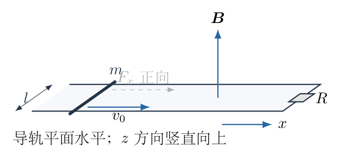{width=79%}

## 一、题型定位

这是规定运动过程的导体棒电磁感应与动力学问题。运动并不是由未知外力自由决定，而是题目先规定$v(t)$必须匀减小，再要求反求实现该运动所需的外力。

导体棒运动产生电流，电流与磁场作用产生反向安培力。匀减速要求总水平力恒为$-ma$，但安培力随速度改变，所以外力一般不是恒力。求外力功时，不能直接用某一个时刻的$F$乘总位移。

忽略回路自感，导轨和导体棒的电阻均不计，全部焦耳热在电阻$R$上产生。题目第三问未给定$T$的数值，因此先保留任意终点$T$的通式；只有额外取$T=v_0/a$时，才代表减速至静止的全过程。

## 二、知识点

- 规定初速度方向为$x$正向，匀减速运动为$v=v_0-at$、$x=v_0t-at^2/2$。
- 导体棒的动生电动势大小为$\mathcal E=Blv$。
- 回路电流为$i=\mathcal E/R$，适用条件是自感可忽略、接触和回路始终完整。
- 安培力方向与运动方向相反，大小为$Bil$。
- 外力不是安培力，牛顿第二定律必须将两者相加。
- 外力功可以由$\int F\,dx$或$\int Fv\,dt$求得。
- 安培力的负功转化为焦耳热，因此外力功满足$W_F=\Delta K+Q_J$。

## 三、物理图像

规定$x$轴沿导轨指向电阻，$y$轴在导轨平面内由下轨指向上轨，$z$轴竖直向上。磁场为$\boldsymbol B=B\boldsymbol e_z$，初始速度为$v_0\boldsymbol e_x$。

在$v>0$阶段，$\boldsymbol v\times\boldsymbol B$指向$-y$，导体棒中正电荷被推向下轨，电流在棒中由上轨流向下轨。这个方向的电流与向上的磁场作用，产生指向$-x$的安培力。

当棒向电阻移动时，回路面积减小，向上的磁通量减小，感应电流应产生向上的磁场；俯视回路，电流为逆时针。这与导体棒中由上向下的方向一致，可作独立符号核对。

以下用$F_x$表示外力在$x$正向上的带符号分量。$F_x<0$表示外力朝远离电阻的方向，不应把负号误解释为力的大小为负。

## 四、解题入口

用速度作为连接运动、电流与力的中间变量：

$$
\begin{aligned}
v(t)&=v_0-at,\\
i(t)&=\frac{Bl}{R}v(t),\\
F_{\mathrm A,x}(t)&=-\frac{B^2l^2}{R}v(t),\\
F_x(t)+F_{\mathrm A,x}(t)&=-ma.
\end{aligned}
$$

第一问由$i=0$求$v=0$，再求时间与位移；第二问由$i=i_0/2$求$v=v_0/2$，再代入动力学；第三问将带符号$F_x(t)$与$v(t)$相乘并积分。

## 五、解析

（1）先写清匀减速过程的时间范围。

初始时刻取$t=0$、$x=0$。规定的加速度为

$$
\frac{dv}{dt}=-a.
$$

积分并用$v(0)=v_0$：

$$
v(t)=v_0-at.
\tag{1}
$$

再次积分并用$x(0)=0$：

$$
\begin{aligned}
x(t)
&=\int_0^t(v_0-a\tau)\,d\tau\\
&=v_0t-\frac12at^2.
\end{aligned}
\tag{2}
$$

“匀减速”在这里是沿原方向运动、速度大小减小，故主要研究区间为

$$
0\le t\le t_{\mathrm s},
\qquad
t_{\mathrm s}=\frac{v_0}{a}=1\,\mathrm s.
\tag{3}
$$

如果把同一个加速度继续作用到$t>t_{\mathrm s}$，导体棒将反向加速，已不是题目所描述的原方向匀减速阶段。

（2）由磁通变化求电流，并核对方向。

设电阻所在位置距棒初始位置为$d$，则回路面积为

$$
\mathcal A(t)=l[d-x(t)].
$$

取回路逆时针为正，对应法向为$+z$，磁通量为

$$
\Phi(t)=Bl[d-x(t)].
$$

法拉第定律给出

$$
\begin{aligned}
\mathcal E
&=-\frac{d\Phi}{dt}\\
&=-Bl\left(-\frac{dx}{dt}\right)\\
&=Blv.
\end{aligned}
\tag{4}
$$

由于$v>0$，$\mathcal E>0$，电流沿规定的逆时针方向。电流大小为

$$
\boxed{
i(t)=\frac{Bl}{R}(v_0-at)
}.
\tag{5}
$$

初始电流为

$$
\begin{aligned}
i_0
&=\frac{Blv_0}{R}\\
&=\frac{0.5\times0.2\times2}{0.5}\,\mathrm A\\
&=0.4\,\mathrm A.
\end{aligned}
\tag{6}
$$

图4-2的俯视回路标出了棒中的向下电流和两条向左的实际水平力。图中磁场用出纸面的符号表示，对应实际竖直向上的磁场，不应误画为向下。

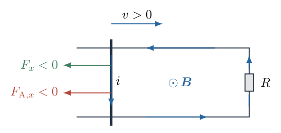{width=77%}

（3）求电流为零时的位移。

在回路电阻有限、$B,l$非零且自感可忽略的条件下，由式（5）可知

$$
i=0\quad\Longleftrightarrow\quad v=0.
$$

故电流为零的时刻是$t_{\mathrm s}=v_0/a=1\,\mathrm s$。代入式（2）：

$$
\begin{aligned}
x_{\mathrm s}
&=v_0\frac{v_0}{a}
-\frac12a\left(\frac{v_0}{a}\right)^2\\
&=\frac{v_0^2}{a}-\frac{v_0^2}{2a}\\
&=\frac{v_0^2}{2a}\\
&=\frac{2^2}{2\times2}\,\mathrm m\\
&=\boxed{1\,\mathrm m}.
\end{aligned}
\tag{7}
$$

方向为初速度方向。用运动学关系$v^2=v_0^2-2ax$直接取$v=0$，也得到相同结果。

这里零电流不是因为磁场消失或导体棒断开，而是棒在该瞬间速度为零，动生电动势也为零。还须默认导轨足够长、初始棒到电阻的距离大于该位移，否则棒会先撞到电阻端部，题设运动无法继续。

（4）由安培力反求外力的带符号表达式。

导体棒中的电流方向是$-y$，所以

$$
\boldsymbol F_{\mathrm A}
=i(-l\boldsymbol e_y)\times(B\boldsymbol e_z)
=-Bil\,\boldsymbol e_x.
$$

将式（5）代入：

$$
F_{\mathrm A,x}
=-Bil
=-\frac{B^2l^2}{R}v.
\tag{8}
$$

为简化计算，定义磁阻尼系数

$$
\begin{aligned}
\kappa
&=\frac{B^2l^2}{R}\\
&=\frac{0.5^2\times0.2^2}{0.5}\\
&=0.02\,\mathrm{kg\,s^{-1}}.
\end{aligned}
\tag{9}
$$

牛顿第二定律的右端是规定的加速度$-a$：

$$
\begin{aligned}
F_x+F_{\mathrm A,x}&=m(-a),\\
F_x-\kappa v&=-ma,\\
\boxed{F_x=\kappa v-ma}.
\end{aligned}
\tag{10}
$$

这一步必须先把安培力的负号写入总力方程，再移项；不能把$F$直接写成$ma$或$Bil$。

代入$v=v_0-at$：

$$
\begin{aligned}
F_x(t)
&=\kappa(v_0-at)-ma\\
&=(0.02\times2-0.1\times2)\,\mathrm N
-(0.02\times2)\,\mathrm{N\,s^{-1}}\,t\\
&=-0.16\,\mathrm N
-(0.04\,\mathrm{N\,s^{-1}})t.
\end{aligned}
\tag{11}
$$

因此整个原方向减速区间内$F_x<0$，外力都向左。随着速度下降，安培制动力减小，为保持相同总减速度，外力的向左大小反而增大。

（5）求半电流时的外力。

式（5）说明电流与速度成正比，因此

$$
\frac{i}{i_0}=\frac{v}{v_0}.
$$

当$i=i_0/2$，

$$
v=\frac{v_0}{2}=1\,\mathrm{m\,s^{-1}}.
\tag{12}
$$

对应时刻与位移为

$$
\begin{aligned}
t_{1/2}
&=\frac{v_0-v_0/2}{a}
=\frac{v_0}{2a}
=0.5\,\mathrm s,\\
x_{1/2}
&=v_0t_{1/2}-\frac12at_{1/2}^2\\
&=2\times0.5-\frac12\times2\times0.5^2\\
&=0.75\,\mathrm m.
\end{aligned}
\tag{13}
$$

安培力分量为

$$
F_{\mathrm A,x}=-\kappa v=-0.02\,\mathrm N.
$$

实现总力$-ma=-0.20\,\mathrm N$还需

$$
\begin{aligned}
F_x
&=-0.20\,\mathrm N-(-0.02\,\mathrm N)\\
&=\boxed{-0.18\,\mathrm N}.
\end{aligned}
\tag{14}
$$

故外力大小为$\boxed{0.18\,\mathrm N}$，方向与初速度相反，即远离电阻。用直接的受力大小检查，两个向左的力相加为$0.18+0.02=0.20\,\mathrm N$，除以$0.1\,\mathrm{kg}$正好给出$2\,\mathrm{m\,s^{-2}}$的减速度。

（6）结合电流—位移关系复查两个时刻。

由$v^2=v_0^2-2ax$，在$v\ge0$的运动支路上取正根：

$$
v(x)=\sqrt{v_0^2-2ax}.
$$

因此

$$
\frac{i(x)}{i_0}
=\sqrt{1-\frac{x}{x_{\mathrm s}}},
\qquad
x_{\mathrm s}=\frac{v_0^2}{2a}.
\tag{15}
$$

图4-3展示电流随位移下降的曲线。半电流不对应半停止距离，而对应

$$
\frac14=1-\frac{x}{x_{\mathrm s}}
\quad\Rightarrow\quad
x=\frac34x_{\mathrm s}.
$$

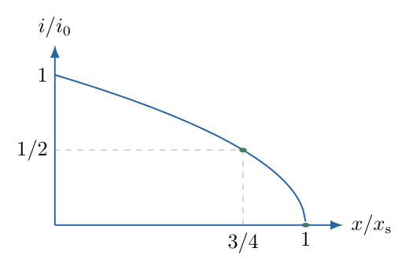{width=67%}

这一检查还能排除用“电流随时间线性下降”就误判“随位移也线性下降”的错误。

（7）对外力瞬时功率逐项积分。

外力功取代数值：

$$
W_F(T)=\int_0^T F_x(t)v(t)\,dt.
\tag{16}
$$

将式（10）代入，先分成两类项：

$$
\begin{aligned}
W_F(T)
&=\int_0^T[\kappa(v_0-at)-ma](v_0-at)\,dt\\
&=\kappa\int_0^T(v_0-at)^2\,dt
-ma\int_0^T(v_0-at)\,dt.
\end{aligned}
\tag{17}
$$

第一类积分先展开平方：

$$
\begin{aligned}
\int_0^T(v_0-at)^2dt
&=\int_0^T(v_0^2-2v_0at+a^2t^2)dt\\
&=v_0^2T-v_0aT^2+\frac13a^2T^3.
\end{aligned}
\tag{18}
$$

第二类积分为位移：

$$
\int_0^T(v_0-at)dt=v_0T-\frac12aT^2.
\tag{19}
$$

所以任意终点$0\le T\le v_0/a$对应

$$
\boxed{
W_F(T)=
\kappa\left(v_0^2T-v_0aT^2+\frac{a^2T^3}{3}\right)
-ma\left(v_0T-\frac{aT^2}{2}\right)
}.
\tag{20}
$$

第三问没有给出具体$T$，式（20）就是保留终点时间的答案。若定义无量纲时间$\tau=T/(1\,\mathrm s)$，代入本题数值可写为

$$
\boxed{
W_F(T)=
\left(-0.32\tau+0.12\tau^2+\frac{2}{75}\tau^3\right)\mathrm J
},\qquad 0\le\tau\le1.
\tag{21}
$$

引入$\tau$后数值多项式的系数都乘同一焦耳单位，避免把带量纲的$T$直接塞进“无单位的小数系数”而使各项单位不一致。

图4-4展示了规定的速度、逐渐增强的反向外力及总功随时间变化。外力和速度反向，所以外力功始终非正；停止瞬间速度为零，瞬时功率为零，但已经积累的负功并不消失。

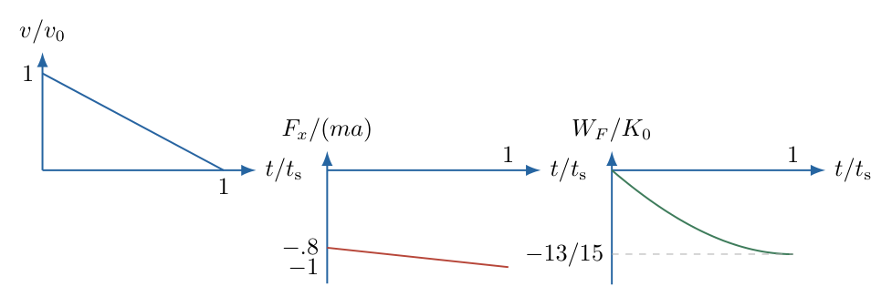{width=84%}

（8）用动能和焦耳热独立验证功的表达式。

电阻的焦耳热为

$$
\begin{aligned}
Q_J(T)
&=\int_0^T i^2R\,dt\\
&=\int_0^T
\left(\frac{Bl}{R}v\right)^2R\,dt\\
&=\kappa\int_0^T v^2\,dt\\
&=\kappa\left(v_0^2T-v_0aT^2+\frac13a^2T^3\right).
\end{aligned}
\tag{22}
$$

安培力做功为

$$
W_{\mathrm A}=\int_0^T(-\kappa v)v\,dt=-Q_J.
$$

对导体棒使用动能定理：

$$
\Delta K=W_F+W_{\mathrm A}=W_F-Q_J.
$$

故

$$
\begin{aligned}
W_F
&=\Delta K+Q_J\\
&=\frac12m(v_0-aT)^2-\frac12mv_0^2\\
&\quad+\kappa\left(v_0^2T-v_0aT^2+\frac13a^2T^3\right).
\end{aligned}
\tag{23}
$$

展开动能变化：

$$
\begin{aligned}
\Delta K
&=\frac12m(v_0^2-2v_0aT+a^2T^2-v_0^2)\\
&=-mv_0aT+\frac12ma^2T^2\\
&=-ma\left(v_0T-\frac12aT^2\right),
\end{aligned}
$$

恰好恢复式（20）。焦耳热虽然为正，却不是外力必做正功的理由；棒原有动能也可以同时向电阻和外力作用系统输出能量。

（9）若终点取停止时刻，给出完整数值核验。

只有额外令$T=t_{\mathrm s}=1\,\mathrm s$，才得到减速至静止的总功。初始动能为

$$
K_0=\frac12mv_0^2
=\frac12\times0.1\times2^2
=0.2\,\mathrm J.
$$

停止前焦耳热为

$$
\begin{aligned}
Q_J(t_{\mathrm s})
&=\frac{\kappa v_0^3}{3a}\\
&=\frac{0.02\times2^3}{3\times2}\\
&=\frac2{75}\,\mathrm J
\approx0.0267\,\mathrm J.
\end{aligned}
\tag{24}
$$

因此

$$
\begin{aligned}
W_F(t_{\mathrm s})
&=-0.2+\frac2{75}\,\mathrm J\\
&=-\frac{15}{75}+\frac2{75}\,\mathrm J\\
&=\boxed{-\frac{13}{75}\,\mathrm J
\approx-0.1733\,\mathrm J}.
\end{aligned}
\tag{25}
$$

能量收支为：棒损失$0.2\,\mathrm J$动能，其中$0.0267\,\mathrm J$成为焦耳热，其余$0.1733\,\mathrm J$通过反向外力被取走。把外力功误写成$-\Delta K+Q_J$会破坏这一收支。

（10）从位置积分再检查功，并判断力的方向边界。

以位置为变量，有

$$
F_x(x)=\kappa\sqrt{v_0^2-2ax}-ma.
$$

对$0\le x\le x_{\mathrm s}$积分，令$u=v_0^2-2ax$、$dx=-du/(2a)$：

$$
\begin{aligned}
W_F(x)
&=-max+\kappa\int_0^x\sqrt{v_0^2-2a\xi}\,d\xi\\
&=-max+\frac{\kappa}{3a}
\left[v_0^3-(v_0^2-2ax)^{3/2}\right].
\end{aligned}
\tag{26}
$$

将$x=v_0T-aT^2/2$代入，根号的正支为$v_0-aT$，再次恢复式（20）。这一变量代换检验了平方根的支路和积分前后的符号。

由式（10），外力方向的临界速度为

$$
v_*=\frac{ma}{\kappa}=10\,\mathrm{m\,s^{-1}}.
$$

本题$v$始终在$0$到$2\,\mathrm{m\,s^{-1}}$之间，故总有$v<v_*$、$F_x<0$。在另一组参数中，即使物体在减速，也可能因磁阻尼足够强而需要一个向前外力；“减速”只限定总力方向，不单独限定每一个力。

## 六、关键洞察

规定运动反求外力与撤去外力后的自然运动不同。这里加速度被保持为$-a$，所以需要主动调节$F_x=\kappa v-ma$。若外力恒定为某个值，则速度一般不能继续严格线性下降。

电磁能量转化可在瞬时层面直接检验：

$$
P_J=i^2R=\kappa v^2,\qquad
P_{\mathrm A}=F_{\mathrm A,x}v=-\kappa v^2.
$$

两者恰好相反。动力学式再乘以$v$：

$$
F_xv-\kappa v^2=m\frac{dv}{dt}v
=\frac{d}{dt}\left(\frac12mv^2\right).
$$

移项即得$P_F=dK/dt+P_J$。这个关系不依赖先把时间积分做完，可用来逐时检查数值计算和受力符号。

在$v=0$瞬间，电流、安培力、焦耳功率和外力功率都为零，但为了继续维持指定加速度，外力仍为$-ma$。因此“功率为零”与“力为零”是不同的判断。

## 七、易错点

- 将竖直向上的磁场误画为入纸面，进而把电流方向反转。
- 把外力当作唯一水平力，直接取$F=ma$。
- 给安培力正确的大小却漏写负方向，使外力大小变为$0.22\,\mathrm N$。
- 半电流时用半位移代替半速度，错误地得到$x=0.5\,\mathrm m$。
- 外力随时间变动却使用单个时刻的力乘总位移。
- 把第三问未指定的终点$T$自动当作停止时刻，只报一个数值而不报通式。
- 在$v^2=v_0^2-2ax$中选负根，混入停止以后的反向运动。
- 认为有焦耳热就必须有正外力功，忽略初始动能提供的能量。

## 八、课堂讲解建议

先让学生通过$\boldsymbol v\times\boldsymbol B$和楞次定律分别判断电流方向，再让学生在同一受力图上画安培力。教师要求写带符号分量式$F_x-\kappa v=-ma$，不要只写力的大小。

半电流问题可先问“电流与哪一个运动量成正比”，再用$x=3x_{\mathrm s}/4$检验学生是否区分时间、速度与位移。板书第三问时保留积分上限$T$，明确停止时刻只是其中一个特例。

功的计算先做$\int Fv\,dt$，再让学生用动能和焦耳热独立核对。停止全过程的三个数值$0.2\,\mathrm J$、$0.0267\,\mathrm J$、$0.1733\,\mathrm J$可以用作能量流向检查，而非只记住外力功的负号。

## 九、变式训练

变式：在同一装置中撤去外力，导体棒只受磁阻尼，初速度仍为$v_0$。求$v(t)$、$x(t)$、电流减半的时刻、最终位移和总焦耳热。

动力学方程为

$$
m\frac{dv}{dt}=-\kappa v.
$$

分离变量并用$v(0)=v_0$：

$$
\begin{aligned}
\int_{v_0}^{v}\frac{du}{u}
&=-\frac{\kappa}{m}\int_0^t d\tau,\\
\ln\frac v{v_0}&=-\frac{\kappa t}{m},\\
\boxed{v(t)=v_0e^{-\kappa t/m}}.
\end{aligned}
$$

积分位移：

$$
\boxed{
x(t)=\frac{mv_0}{\kappa}
\left(1-e^{-\kappa t/m}\right)
}.
$$

电流也按同一指数下降，半电流时间为

$$
t_{1/2}=\frac m\kappa\ln2=5\ln2\,\mathrm s\approx3.47\,\mathrm s.
$$

当$t\to\infty$，

$$
x_\infty=\frac{mv_0}{\kappa}=10\,\mathrm m.
$$

速度只渐近趋于零，不存在有限时刻的严格零电流。若导轨足够长，总焦耳热为

$$
\begin{aligned}
Q_{J,\infty}
&=\kappa v_0^2\int_0^\infty e^{-2\kappa t/m}dt\\
&=\kappa v_0^2\frac m{2\kappa}\\
&=\boxed{\frac12mv_0^2=0.2\,\mathrm J}.
\end{aligned}
$$

它与主问题在$1\,\mathrm s$内人为匀减速停止不同：自然磁制动的停止更慢、距离更长，且全部初始动能最终转为焦耳热，没有外力取走能量。该对比同时检验了“匀减速”和“力与速度成正比的阻尼”不是同一种运动。

\newpage

# 第 5 题

一个固定的绝缘光滑细环，半径为$r$。环上有一个质量$m$、电荷量$q$的粒子，初始以速率$v_0$沿图示方向作圆周运动。初始磁场均匀，大小为$B_0$，垂直环面向内，不考虑重力。

（1）磁场缓慢增加到$2B_0$，求粒子的速度。

（2）磁场保持不变，缓慢将细环绕$x$轴转动半圈，求外力所做的功$W$。

两问分别从同一初始状态出发，不把第一问改变磁场后的状态作为第二问的初态。

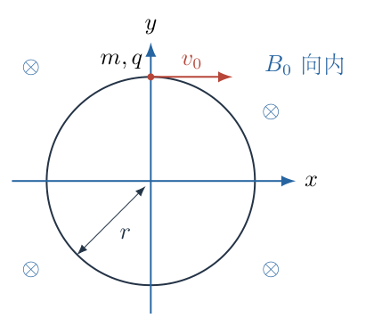{width=60%}

## 一、题型定位

这是两个不同机制控制环上带电粒子运动的问题。固定环中改变磁场，会产生感生电场并直接改变粒子动能；固定磁场中转动环，没有实验室中的感生电场，动能变化来自运动约束及外力做功。

两种过程都与穿过环的磁通量变化有关，但不能因此把它们的瞬时受力当作完全相同。固定环的感生切向电场沿周向均匀；转动环的运动电磁作用在不同周向位置并不均匀，需要使用题设慢转条件进行绕环平均。

取$q$为带符号电荷，按图中的顺时针切向规定正速度。首先给出有符号速度，再说明速率应取绝对值。第二问的慢转结果要求粒子绕环运动相对于转环足够快且过程中没有破坏快慢分离；正电荷$q>0$按图运动时满足速度不降至零的条件。

## 二、知识点

- 固定回路的感生电动势为$\oint\boldsymbol E\cdot d\boldsymbol l=-d\Phi_B/dt$。
- 均匀轴向磁场变化时，环上切向感生电场大小与$r\,dB/dt$成正比。
- 洛伦兹磁力$\boldsymbol F_B=q\boldsymbol v\times\boldsymbol B$始终垂直真实速度，不对粒子做功。
- 静止光滑环的约束力不做功，运动光滑环的约束力却可能做功。
- 穿过随环转动的有向面积的磁通量含$\cos\lambda$，半圈后通量符号反转。
- 慢转平均使用$\langle\sin^2\vartheta\rangle=1/2$；这不是说任意瞬间的$\sin^2\vartheta$都等于$1/2$。
- 初末环停止转动时，粒子全部动能由沿环运动速度决定，外力功可用动能变化求得。

## 三、物理图像

初始环在$x$—$y$平面内，$\boldsymbol B=-B_0\boldsymbol e_z$。粒子位于圆周上方时，初速度指向$+x$，故其运动为顺时针。用$w$表示沿这个方向的有符号切向速度，初始$w=v_0>0$。

第一问中环不动，磁场大小$B(t)$增加；顺时针回路的法向为$-z$，所以磁通量为$+\pi r^2B(t)$。磁通增加产生反顺时针的电场，对正电荷沿初运动方向的速度起减小作用。

第二问中磁场不变，环绕固定$x$轴转过$\lambda$，从$0$到$\pi$。原来与磁场同向的环面法向转到反向，磁通量由$+\pi r^2B_0$变为$-\pi r^2B_0$。最终环的几何平面又与初始平面相同，但随环定义的法向及沿环正方向已经翻转。

## 四、解题入口

第一问直接沿固定圆周用法拉第定律：

$$
2\pi rE_\parallel=-\pi r^2\frac{dB}{dt},
\qquad
m\frac{dw}{dt}=qE_\parallel.
$$

第二问先表示缓慢转动时的通量

$$
\Phi_B(\lambda)=\pi r^2B_0\cos\lambda,
$$

再由平均切向运动电磁作用求$w(\lambda)$。求出半圈后的有符号速度后，用静态磁场不做功和初末转动停止条件计算

$$
W=\frac12mw_{\mathrm f}^2-\frac12mv_0^2.
$$

## 五、解析

（1）第一问：固定环的切向感生电场。

选择沿初运动方向，即顺时针的回路积分方向，其右手法向为$-z$。磁场实际方向也为$-z$，故

$$
\Phi_B=\int\boldsymbol B\cdot d\boldsymbol S
=\pi r^2B(t).
\tag{1}
$$

由于磁场均匀并轴对称，环上切向电场在各点的带符号分量相同：

$$
\begin{aligned}
\oint\boldsymbol E\cdot d\boldsymbol l
&=2\pi rE_\parallel\\
&=-\frac{d\Phi_B}{dt}\\
&=-\pi r^2\frac{dB}{dt}.
\end{aligned}
$$

约去$\pi r$，得到

$$
\boxed{
E_\parallel=-\frac r2\frac{dB}{dt}
}.
\tag{2}
$$

如图5-2，$dB/dt>0$时，电场沿逆时针，与顺时针正方向相反。图上的半径$r$对应式（2）的系数，不是粒子速度或其他长度。

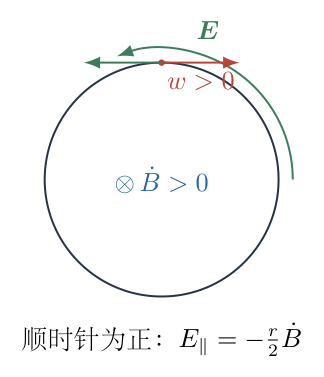{width=55%}

（2）对切向运动积分，不把磁力当作加速力。

粒子的磁力沿径向；静止环的约束力也仅用于维持圆周运动，没有切向分量。改变切向速度的是电场力，因此

$$
m\frac{dw}{dt}=qE_\parallel
=-\frac{qr}{2}\frac{dB}{dt}.
\tag{3}
$$

将$dt$消去，直接积分磁场变化：

$$
\begin{aligned}
dw&=-\frac{qr}{2m}\,dB,\\
\int_{v_0}^{w_{\mathrm f}}dw
&=-\frac{qr}{2m}\int_{B_0}^{2B_0}dB,\\
w_{\mathrm f}-v_0
&=-\frac{qr}{2m}(2B_0-B_0).
\end{aligned}
$$

故第一问的有符号切向速度为

$$
\boxed{
w_{\mathrm f}^{(1)}
=v_0-\frac{qrB_0}{2m}
}.
\tag{4}
$$

对于正电荷，若$v_0>qrB_0/(2m)$，仍沿原顺时针方向运动，速率就是式（4）的正值；若两者相等，末速为零；若$v_0<qrB_0/(2m)$，最终已经反向，速率应写为

$$
\boxed{
v_{\mathrm{speed}}^{(1)}
=\left|v_0-\frac{qrB_0}{2m}\right|
}.
\tag{5}
$$

负的$w_{\mathrm f}^{(1)}$不是负速率，而是逆时针速度。固定环的感生电场方程在停止和反向时仍成立，不需要为第一问附加“不许速度过零”的假设。

“缓慢”使场变化可以视作准静态感应，不改变从$B_0$到$2B_0$所产生的总切向冲量。只要忽略辐射和其他耗散，式（4）不依赖$B(t)$增加的具体快慢函数。

（3）核对第一问的动能来源和符号。

静止光滑环的约束力与瞬时速度垂直，不做功；磁力也不做功。电场的瞬时功率为

$$
P_E=qE_\parallel w=mw\frac{dw}{dt}
=\frac{d}{dt}\left(\frac12mw^2\right).
$$

因此电场的总功为

$$
\begin{aligned}
W_E
&=\frac12m\left(v_0-\frac{qrB_0}{2m}\right)^2
-\frac12mv_0^2\\
&=-\frac12qrB_0v_0
+\frac{q^2r^2B_0^2}{8m}.
\end{aligned}
\tag{6}
$$

对正电荷，如果最终未反向且速度减小，$W_E<0$。若场增强很大，粒子反向后又被加速，最终动能可能大于初始动能。不能从“初始电场阻碍原运动”推出整个过程的电场总功一定为负。

这个功由改变磁场的外部场源交换，不是静止细环的支撑者做的机械功，也不是洛伦兹磁力的功。

（4）第二问：建立旋转环的空间坐标。

第二问重新从原始$B_0,v_0$开始。设环绕$x$轴缓慢转动角为$\lambda$，环内固定基矢为

$$
\boldsymbol e_1=(1,0,0),\qquad
\boldsymbol e_2=(0,\cos\lambda,\sin\lambda).
\tag{7}
$$

用$\vartheta$表示相对于这组基矢的逆时针周向角，粒子位置为

$$
\boldsymbol r
=r(\cos\vartheta\,\boldsymbol e_1
+\sin\vartheta\,\boldsymbol e_2).
\tag{8}
$$

其周向切向单位矢量为

$$
\boldsymbol e_\vartheta
=(-\sin\vartheta,\cos\vartheta\cos\lambda,
\cos\vartheta\sin\lambda).
$$

顺时针有符号速度仍定义为

$$
w=-r\dot\vartheta.
\tag{9}
$$

图5-3显示环面实际进入空间，而不把半圈转动画成平面内绕中心转动。$x$轴始终固定；法向投影随$\cos\lambda$变化。

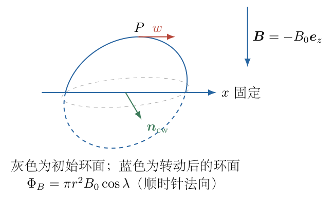{width=72%}

（5）分开沿环速度和环本身运动速度。

令$\Omega=\dot\lambda$。由于环转动，同一环上材料点的运动速度为

$$
\boldsymbol v_c
=r\Omega(0,-\sin\vartheta\sin\lambda,
\sin\vartheta\cos\lambda).
\tag{10}
$$

粒子的实验室总速度为

$$
\boldsymbol v=r\dot\vartheta\,\boldsymbol e_\vartheta
+\boldsymbol v_c.
\tag{11}
$$

沿环运动的速度部分与$\boldsymbol B$的叉乘不产生沿环切向的磁力；它对应维持圆周方向的作用。转环速度部分则给出

$$
\begin{aligned}
\boldsymbol v_c\times\boldsymbol B
&=rB_0\Omega\sin\vartheta\sin\lambda\,
\boldsymbol e_x,\\
(\boldsymbol v_c\times\boldsymbol B)
\cdot\boldsymbol e_\vartheta
&=-rB_0\Omega\sin^2\vartheta\sin\lambda.
\end{aligned}
\tag{12}
$$

第一式使用$\boldsymbol B=-B_0\boldsymbol e_z$；第二式使用$\boldsymbol e_x\cdot\boldsymbol e_\vartheta=-\sin\vartheta$。两个正弦相乘产生$\sin^2\vartheta$，说明不同周向位置的切向磁作用确实不同。

（6）在慢转条件下平均，再积分到半圈。

完整切向加速度还含转环造成的几何惯性项。按式（8）求两次时间导数，投影到$\boldsymbol e_\vartheta$可得

$$
\ddot\vartheta
=\Omega^2\sin\vartheta\cos\vartheta
-\frac{qB_0}{m}\Omega\sin\lambda\sin^2\vartheta.
\tag{13}
$$

第一项是二阶小量$O(\Omega^2)$；第二项是一阶慢转项$O(\Omega)$。粒子绕环周期远短于转环时间时，在$\lambda$近似不变的一圈内作平均：

$$
\left\langle\sin^2\vartheta\right\rangle=\frac12,
\qquad
\left\langle\sin\vartheta\cos\vartheta\right\rangle=0.
$$

结合$w=-r\dot\vartheta$，主阶慢转方程为

$$
\begin{aligned}
\frac{dw}{dt}
&=\frac{qrB_0}{2m}\Omega\sin\lambda,\\
dw&=\frac{qrB_0}{2m}\sin\lambda\,d\lambda.
\end{aligned}
\tag{14}
$$

从$\lambda=0,w=v_0$积分：

$$
\begin{aligned}
w(\lambda)-v_0
&=\frac{qrB_0}{2m}\int_0^\lambda\sin u\,du\\
&=\frac{qrB_0}{2m}[-\cos u]_0^\lambda\\
&=\frac{qrB_0}{2m}(1-\cos\lambda).
\end{aligned}
\tag{15}
$$

故半圈后

$$
\boxed{
w_{\mathrm f}^{(2)}
=v_0+\frac{qrB_0}{m}
}.
\tag{16}
$$

这是与随环方向一起定义的有符号切向速度。对于图示正电荷，它在慢转全过程中增加，不会中途降到零，快慢分离条件可通过足够小的$\Omega$实现。

（7）从移动回路磁通变化复核平均速度增量。

选择随环的顺时针法向，磁通量为

$$
\Phi_B(\lambda)=\pi r^2B_0\cos\lambda.
\tag{17}
$$

移动回路的运动电动势满足

$$
\begin{aligned}
\oint(\boldsymbol v_c\times\boldsymbol B)
\cdot d\boldsymbol l
&=-\frac{d\Phi_B}{dt}\\
&=\pi r^2B_0\sin\lambda\,\Omega.
\end{aligned}
$$

除以周长得到沿顺时针方向的周向平均运动电磁分量：

$$
\overline E_{\mathrm{mot},\parallel}
=\frac{rB_0}{2}\sin\lambda\,\Omega.
\tag{18}
$$

快绕环粒子在一圈中采样这个平均值，于是$m\,dw/dt=q\overline E_{\mathrm{mot},\parallel}$，恢复式（14）。

图5-4同时画出通量投影$B_0\cos\lambda$和平均速度变化。通量从$B_0$变为$-B_0$，故总变化为$-2B_0$，速度增量是$qrB_0/m$，不是第一问的$-qrB_0/(2m)$。

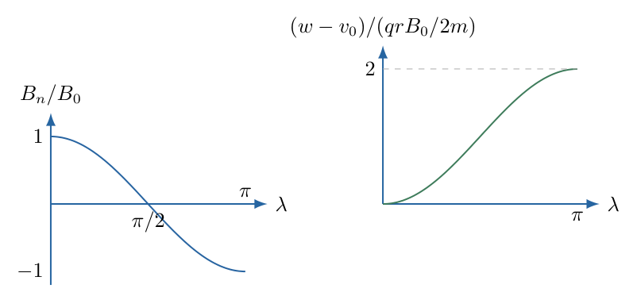{width=76%}

固定磁场意味着实验室$\boldsymbol E=0$。式（18）是随动回路的平均运动电磁作用，不可把它称为实验室中凭空产生的均匀感生电场。这一区分解释了为何最终速度可以用通量算，却仍要用机械外力分析能量来源。

（8）计算外力功，说明运动约束为什么能做功。

光滑环意味着约束力$\boldsymbol N$沿环切向分量为零，即$\boldsymbol N\cdot\boldsymbol e_\vartheta=0$。然而粒子总速度还含$\boldsymbol v_c$，所以

$$
\boldsymbol N\cdot\boldsymbol v
=\boldsymbol N\cdot\boldsymbol v_c
$$

一般不为零。环虽光滑，转动环的外力可以通过运动约束向粒子传递机械能。

磁力功率$(q\boldsymbol v\times\boldsymbol B)\cdot\boldsymbol v=0$，所以粒子动能变化来自约束力功。取缓慢转动且初末环停止转动，环自身初末转动动能相同；外力的净功就是粒子动能的变化。

代入式（16）：

$$
\begin{aligned}
W
&=\frac12m\left(v_0+\frac{qrB_0}{m}\right)^2
-\frac12mv_0^2\\
&=\frac12m
\left(v_0^2+\frac{2qrB_0v_0}{m}
+\frac{q^2r^2B_0^2}{m^2}-v_0^2\right)\\
&=\boxed{
qrB_0v_0+\frac{q^2r^2B_0^2}{2m}
}.
\end{aligned}
\tag{19}
$$

正电荷图示情况$W>0$，转环外力输入能量。这个正功不违反“磁力不做功”；磁场改变了约束反力与速度的关系，机械能仍由外力提供。

（9）检查量纲与两个过程的区别。

量$qBr/m$具有速度量纲：

$$
\left[\frac{qBr}{m}\right]
=\frac{\mathrm C\cdot
(\mathrm{kg\,C^{-1}\,s^{-1}})\cdot\mathrm m}
{\mathrm{kg}}
=\mathrm{m\,s^{-1}}.
$$

式（19）两项均为能量。取$q=0$或$B_0=0$，两个速度改变量和慢转净功均为零，符合无电磁耦合的极限。

第一问改变的是静止环中的真实磁场大小，顺时针通量增加$+\pi r^2B_0$；第二问改变的是静态磁场在随环法向上的投影，通量变化$-2\pi r^2B_0$。因此速度改变量既有相反符号，又有两倍大小，这两个因素都必须保留。

如果$q<0$，式（15）会使顺时针有符号速度减小。若$v_0+qrB_0/m>0$，速度不经过零，慢转平均仍可直接使用，外力功可能为负。若过程中绕环运动趋于停止，则“转得缓慢”不再自动保证平均条件，需要求解式（13）并说明转环时程；不能在这种情形下把平均式当作无条件精确公式。

## 六、关键洞察

“光滑约束不做功”只适用于约束面静止或约束力恰与实验室总速度垂直的情况。运动约束的法向速度分量是能量交换通道。本题的环约束没有沿环摩擦，仍能够通过转环获得净机械功。

第一问可以由角动量形式复核。选择逆时针周向角$\vartheta$，实验室磁场分量为$B_z=-B$。机械角动量为$L_z=mr^2\dot\vartheta=-mrw$，均匀变磁场使

$$
\frac{d}{dt}
\left(L_z+\frac{qr^2B_z}{2}\right)=0.
$$

因此

$$
-mrw-\frac{qr^2B}{2}
=-mrv_0-\frac{qr^2B_0}{2},
$$

立刻得到$w=v_0-qr(B-B_0)/(2m)$。这条守恒量与法拉第积分一致，但机械角动量$L_z$本身并不守恒，因为感生电场提供切向力矩。

慢转半圈不能把粒子的某一瞬间位置直接代入平均$\sin^2\vartheta=1/2$。完整方程（13）显示了位置相关的细小速度振荡。若转环初末角速度为零，且快慢分离充分，独立数值积分会随转环时间增加趋于式（16），而运动约束的功积分与实际动能变化一致。

## 七、易错点

- 把两问接成同一个连续过程，第二问错误使用第一问的末速度。
- 磁通积分方向与速度正方向不一致，导致第一问的减速号写成加速号。
- 漏掉$2\pi r$与$\pi r^2$之比中的$1/2$。
- 把有符号切向速度当作速率，得到“负速率”而不说明反向。
- 认为磁场变化时只有磁力，遗漏实际产生的感生电场。
- 静态磁场转环时虚构实验室感生电场，或声称磁力直接做了正功。
- 因环光滑就令运动约束功为零，忽略环本身的速度。
- 将慢转平均当成任意转动速度下的精确关系，或忽略绕环速度趋零时的适用限制。

## 八、课堂讲解建议

先固定一套回路方向，让学生自己用右手定则确定法向，再写磁通量。教师应要求第一问先算有符号速度，再讨论是否反向；不能只把答案作为速度大小记忆。

第二问先实际画出$x$轴固定、环面向空间翻转的图，问学生“实验室磁场是否改变”。板书将$\boldsymbol v$分成沿环部分和$\boldsymbol v_c$，从而解释为什么运动约束能做功。平均过程保留$\sin^2\vartheta$到最后一步，帮助学生理解题目“缓慢”的真正用途。

最后把两问的通量变化并列写为$+B_0$和$-2B_0$，检查符号与系数；能量上再区分场源电功与转环机械功。教师可让学生指出“磁力不做功”为什么没有推出“动能不变”。

## 九、变式训练

变式：在静态磁场中，只将环缓慢转动角$\lambda_f$，初末环停止，正电荷按图运动。求最终平均速度、外力功，并检查$\lambda_f=\pi/2$与$\lambda_f=\pi$。

式（15）给出

$$
w_f=v_0+\Delta w,\qquad
\Delta w=\frac{qrB_0}{2m}(1-\cos\lambda_f).
$$

外力功为

$$
\begin{aligned}
W(\lambda_f)
&=\frac12m(v_0+\Delta w)^2-\frac12mv_0^2\\
&=mv_0\Delta w+\frac12m(\Delta w)^2\\
&=\boxed{
\frac{qrB_0v_0}{2}(1-\cos\lambda_f)
+\frac{q^2r^2B_0^2}{8m}(1-\cos\lambda_f)^2
}.
\end{aligned}
$$

四分之一圈时$\cos(\pi/2)=0$：

$$
w_{\pi/2}=v_0+\frac{qrB_0}{2m},\qquad
W_{\pi/2}=\frac12qrB_0v_0+\frac{q^2r^2B_0^2}{8m}.
$$

半圈时$1-\cos\pi=2$，恢复主问题。外力功不是四分之一圈功简单乘二，因为动能对速度是二次函数，第二个四分之一圈是在已经提高的沿环速度基础上继续输入能量。

小角$\lambda_f\ll1$时，使用$1-\cos\lambda_f=\lambda_f^2/2+O(\lambda_f^4)$：

$$
\Delta w=\frac{qrB_0}{4m}\lambda_f^2+O(\lambda_f^4),
\qquad
W=\frac{qrB_0v_0}{4}\lambda_f^2+O(\lambda_f^4).
$$

变化没有一阶项，与初始法向磁通在$\lambda=0$处取极值一致。这个极限检查能排除把通量投影误写成$B_0\sin\lambda$的错误。

进一步将电荷改为$q=-|q|$，求快慢分离可能失效的临界角。此时慢转预测为

$$
w(\lambda)=v_0-\frac{|q|rB_0}{2m}(1-\cos\lambda).
$$

<!-- KEEP_TOGETHER_START -->

若$|q|rB_0/m<v_0$，半圈结束前仍有$w>0$，运动周期保持有限；若$|q|rB_0/m\ge v_0$，平均结果会达到零。令$w(\lambda_c)=0$，逐项移项得

$$
\begin{aligned}
1-\cos\lambda_c&=\frac{2mv_0}{|q|rB_0},\\
\cos\lambda_c&=1-\frac{2mv_0}{|q|rB_0},\\
\lambda_c&=\arccos\!\left(1-\frac{2mv_0}{|q|rB_0}\right).
\end{aligned}
$$

右端反余弦的自变量在$[-1,1]$内，正好要求$0<v_0\le |q|rB_0/m$。例如$mv_0/(|q|rB_0)=0.7$，则$\cos\lambda_c=-0.4$，临界角约为$113.6^\circ$。

接近此角时，沿环绕行周期$T_{\rm fast}=2\pi r/|w|$增大。若环的转动角速度为$\Omega$，一周中环面改变的角度约为

$$
\Delta\lambda_{\rm one\ cycle}
\simeq\Omega T_{\rm fast}
=\frac{2\pi r\Omega}{|w|}.
$$

平均过程要求该量远小于$1$。在$w$趋零处，即使$\Omega$很小，也不能继续默认粒子已经绕过完整一周并完成位置平均。因此$\lambda_c$是平均解的适用边界，不是可直接跨越的精确停转角；要给出跨越后的速度与功，必须补充转环的时间规律并积分完整运动方程。这里所求的临界角和失效条件均已明确，不能仅把半圈平均速度取绝对值来掩盖这个限制。

<!-- KEEP_TOGETHER_END -->

\newpage

# 第 6 题

实验基地中有一种信号火箭，以速率$v$飞行，信号发生器发出固定频率$f_0$的声音信号。基地处声速为$c=330\,\mathrm{m\,s^{-1}}$。按题设忽略声音的绝对传播时间对轨迹相位定位的影响。

（1）火箭沿直线朝静止接收器飞来时，接收器收到的声音频率是多少？

（2）火箭距离接收器较远，飞行方向与从火箭指向接收器的连线方向夹角为$\varphi$时，接收频率是多少？

（3）火箭在较低高度以相同速率$v$沿半径$r$的圆周飞行。两台静止接收器记录到的频率—时间关系如图，求两接收器之间的距离。

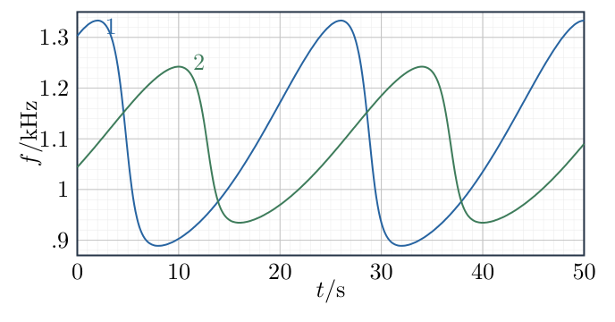{width=92%}

## 一、题型定位

这是运动声源的多普勒效应和周期轨迹反演。频率并不直接给出声源与接收器的距离，而是给出声源速度在指向接收器方向上的投影；极值发生的时刻又给出圆周位置的几何约束。

第三问需要同时使用三个独立信息：曲线的极值幅度确定速率，周期确定轨道半径，极值之间的时间间隔和两曲线的相位差确定接收器位置。只读出周期和速率，还不足以求两台接收器的距离。

这里采用静止空气、静止接收器和经典声学多普勒公式。不把声速$c$当作真空光速，也不引入相对论时间膨胀。图上读数有限，最终距离应报告近似数值，而不是许多位小数的“精确实测值”。

## 二、知识点

- 运动声源朝接收器运动时，相邻波前的间距缩小，接收频率增大。
- 进入公式的是朝向接收器的速度分量$u=v\cos\varphi$，而不是始终取总速率$v$。
- 静止接收器的频率为$f=f_0c/(c-u)$。
- 圆周运动满足$v=\omega r$、$\omega=2\pi/T$。
- 外部接收器的最大视线速度可等于$v$；内部接收器的最大视线速度小于$v$。
- 极值条件必须同时考虑投影分子与视线长度分母的变化。
- 圆心到两个接收器的距离及夹角确定后，用余弦定理求接收器间距。

## 三、物理图像

设轨道圆心为$O$，火箭位置为$P$。固定接收器$Q$距圆心$b$。令$\psi$为$OP$相对于$OQ$的角度，火箭逆时针运动时$\dot\psi=\omega>0$。

朝向接收器的视线速度分量为正时，频率高于$f_0$；背离时为负，频率低于$f_0$。火箭“正在绕圈”不意味着朝某台接收器始终接近或始终远离。

将曲线1对应的接收器记为$B$，曲线2对应的接收器记为$A$。曲线1的频率变化范围较大，曲线2较小。后面的极值推导会说明$B$位于轨道外，$A$位于轨道内，而不是仅凭图形高低直接猜测位置。

## 四、解题入口

先从一对相邻波前求出

$$
f=\frac{cf_0}{c-u}.
$$

再对圆周运动建立

$$
D^2=r^2+b^2-2rb\cos\psi,\qquad
u=-\frac{vb\sin\psi}{D}.
$$

对$u^2$求极值，选择几何允许的根。结合图上约$24\,\mathrm s$的周期、约$6\,\mathrm s$的最大频率到最小频率间隔，以及两曲线最大值约$8\,\mathrm s$的错开，求$OA,OB,\angle AOB$。

## 五、解析

（1）用相邻波前推导直线接近时的频率。

源的发声周期为

$$
\Delta t_{\mathrm e}=\frac1{f_0}.
$$

这段时间中，先发出的波前向前传播距离$c\Delta t_{\mathrm e}$；声源自身向接收器移动距离$v\Delta t_{\mathrm e}$。所以前方相邻波前的距离为

$$
\lambda=(c-v)\Delta t_{\mathrm e}
=\frac{c-v}{f_0}.
\tag{1}
$$

接收器在空气中静止，波前以速度$c$经过它，因此

$$
\boxed{
f=\frac c\lambda=\frac c{c-v}f_0
}.
\tag{2}
$$

因为$c-v<c$，接收频率大于$f_0$。若声源直接远离，将朝向接收器的速度分量改为$-v$，得到$f=cf_0/(c+v)$，低于源频率。

图6-2把两次发声位置和相邻波前画在同一传播方向上。图中“波前传播距离”与“源向前移动距离”相减，正是分母$c-v$的来源。

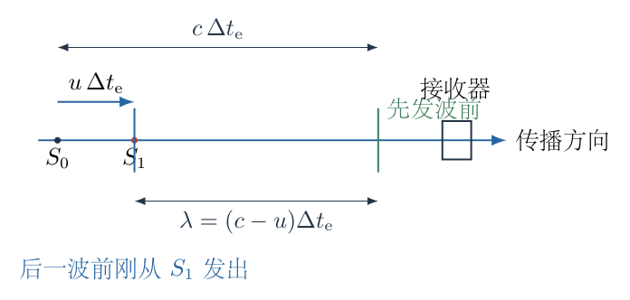{width=80%}

（2）推广到有夹角的瞬时运动。

声源速度在从声源指向接收器方向上的分量为

$$
u=v\cos\varphi.
$$

相邻发声时刻足够接近时，视线方向变化可以按微分近似处理。用$u$代替式（1）中的$v$，得

$$
\lambda=\frac{c-v\cos\varphi}{f_0}.
$$

第二问答案为

$$
\boxed{
f=\frac c{c-v\cos\varphi}f_0
}.
\tag{3}
$$

当$\varphi=0$，恢复式（2）；当$\varphi=\pi$，为远离情形；当$\varphi=\pi/2$，此经典模型的频率等于$f_0$，没有声学的相对论横向多普勒项。

“忽略传播时间”在本题中的用法是：将频率曲线的时间近似对应到火箭当前轨道位置，不另加绝对路程$D/c$修正相位。它不是删掉相邻波前因源运动造成的间距差；若连这个间距差也删掉，就根本不会有多普勒频移。

（3）提取周期及极值读数，先确定可用精度。

两条曲线重复周期均约为

$$
T\simeq24\,\mathrm s.
\tag{4}
$$

曲线1的极值约为

$$
f_{1,\max}\simeq1.33\,\mathrm{kHz},
\qquad
f_{1,\min}\simeq0.89\,\mathrm{kHz}.
$$

以图中刻度允许的简洁读数计算，可取

$$
f_{1,\max}\simeq\frac43\,\mathrm{kHz},
\qquad
f_{1,\min}\simeq\frac89\,\mathrm{kHz}.
\tag{5}
$$

最大值到随后最小值的短时间间隔约为$6\,\mathrm s$；两曲线对应最大值的错开约为$8\,\mathrm s$。这些时间应从同一周期的对应位置读出，不能将一条曲线的最大值与另一条曲线的最小值当作同类事件。

接下来先证明曲线1为何能用总速率$v$代入极值公式，再用式（5）求数值。

（4）建立任意接收器的视线速度。

将某台接收器置于$Q=(b,0)$，火箭位置写成

$$
P=(r\cos\psi,r\sin\psi).
$$

圆周运动的速度为

$$
\boldsymbol v_P
=(-v\sin\psi,v\cos\psi).
\tag{6}
$$

从火箭指向接收器的矢量及距离为

$$
\begin{aligned}
\boldsymbol D
&=Q-P=(b-r\cos\psi,-r\sin\psi),\\
D^2
&=(b-r\cos\psi)^2+r^2\sin^2\psi\\
&=b^2+r^2-2rb\cos\psi.
\end{aligned}
\tag{7}
$$

速度沿视线的分量为$\boldsymbol v_P\cdot\boldsymbol D/D$。将点积逐项展开：

$$
\begin{aligned}
u
&=\frac{(-v\sin\psi)(b-r\cos\psi)
+(v\cos\psi)(-r\sin\psi)}D\\
&=\frac{-vb\sin\psi
+vr\sin\psi\cos\psi-vr\cos\psi\sin\psi}D\\
&=\boxed{-\frac{vb\sin\psi}D}.
\end{aligned}
\tag{8}
$$

含$r\sin\psi\cos\psi$的两项抵消。$\psi<0$时通常对应接近，$u>0$；$\psi>0$时对应远离，$u<0$。

（5）完整求极值，区分内、外接收器。

因为$f=cf_0/(c-u)$随$u$单调增加，最大、最小频率与最大、最小$u$对应。平方后

$$
\frac{u^2}{v^2}
=\frac{b^2\sin^2\psi}{r^2+b^2-2rb\cos\psi}.
$$

令$z=\cos\psi$，可写成

$$
F(z)=\frac{b^2(1-z^2)}{r^2+b^2-2rbz}.
\tag{9}
$$

对$z$用商法则：

$$
\begin{aligned}
F'(z)
&=\frac{
b^2[-2z(r^2+b^2-2rbz)+2rb(1-z^2)]
}{(r^2+b^2-2rbz)^2}\\
&=\frac{
2b^2[rbz^2-(r^2+b^2)z+rb]
}{(r^2+b^2-2rbz)^2}.
\end{aligned}
\tag{10}
$$

分子二次式可因式分解：

$$
rbz^2-(r^2+b^2)z+rb
=(rz-b)(bz-r).
$$

因此候选根为

$$
z=\frac br,\qquad z=\frac rb.
\tag{11}
$$

当$b>r$，$b/r>1$不可能为余弦，保留$z=r/b$。代入式（9）：

$$
\begin{aligned}
D^2&=b^2-r^2,\\
b^2\sin^2\psi&=b^2-r^2,\\
u_{\max}&=v,\qquad u_{\min}=-v.
\end{aligned}
\tag{12}
$$

当$0<b<r$，$r/b>1$不可能，保留$z=b/r$。此时

$$
\begin{aligned}
D^2&=r^2-b^2,\\
b^2\sin^2\psi&=\frac{b^2}{r^2}(r^2-b^2),\\
u_{\max}&=v\frac br,\qquad
u_{\min}=-v\frac br.
\end{aligned}
\tag{13}
$$

图6-3分别画出外接收器的切线极值和内接收器的垂直视线几何。外部极值时$OP\perp PQ$；内部极值时$OQ\perp PQ$。两个直角所在位置不同，正是$r/b$与$b/r$互为倒数而不能混用的原因。

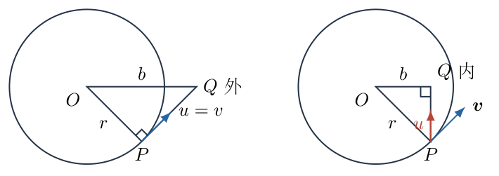{width=88%}

同一速率的声源对任何外部接收器都有完整的$\pm v$极值。曲线2的频移幅度明显小于曲线1，故曲线1对应外部$B$、曲线2对应内部$A$。不能只把曲线2的较小最大值解释为更远的外部接收器。

（6）用曲线1的两个极值求源频率与速率。

由式（12），

$$
f_{1,\max}=\frac{cf_0}{c-v},
\qquad
f_{1,\min}=\frac{cf_0}{c+v}.
\tag{14}
$$

对两式分别取倒数再相加、相减，可以消去$f_0$：

$$
\begin{aligned}
\frac1{f_{1,\min}}+\frac1{f_{1,\max}}
&=\frac{2}{f_0},\\
\frac1{f_{1,\min}}-\frac1{f_{1,\max}}
&=\frac{2v}{cf_0}.
\end{aligned}
$$

两式相除，得

$$
\boxed{
\frac vc
=\frac{f_{1,\max}-f_{1,\min}}
{f_{1,\max}+f_{1,\min}}
}.
\tag{15}
$$

代入式（5）：

$$
\begin{aligned}
\frac vc
&\simeq
\frac{4/3-8/9}{4/3+8/9}\\
&=\frac{12/9-8/9}{12/9+8/9}\\
&=\frac4{20}=\frac15,\\
v&\simeq\frac{330}{5}
=\boxed{66\,\mathrm{m\,s^{-1}}}.
\end{aligned}
\tag{16}
$$

源频率由倒数相加求得：

$$
\begin{aligned}
f_0
&=\frac{2f_{1,\max}f_{1,\min}}
{f_{1,\max}+f_{1,\min}}\\
&\simeq\frac{2(4/3)(8/9)}{4/3+8/9}\,\mathrm{kHz}\\
&=\frac{16}{15}\,\mathrm{kHz}.
\end{aligned}
\tag{17}
$$

这是调和平均形式，不是两个极值的算术平均。用算术平均会高估$f_0$，因为频率对视线速度是分式关系。

（7）由周期求轨道半径。

一周期走过的路程为$2\pi r$，故

$$
\begin{aligned}
2\pi r&=vT,\\
r&=\frac{vT}{2\pi}\\
&\simeq\frac{66\times24}{2\pi}\,\mathrm m\\
&=\frac{792}{\pi}\,\mathrm m\\
&\simeq\boxed{252\,\mathrm m}.
\end{aligned}
\tag{18}
$$

频率曲线的周期是完成一圈的时间，不是最大值到最小值的时间。由于视线几何不对称，后者通常并非半周期，本题约$6\,\mathrm s$也不是$12\,\mathrm s$。

（8）用约6秒的下降段求两接收器到圆心的距离。

令$\delta$表示极值位置的正角。声源从接近极值$\psi=-\delta$走到远离极值$\psi=+\delta$，频率由最大值下降至最小值，转过$2\delta$。按题设时间近似，

$$
2\delta=\omega\Delta t_{\mathrm{fall}},
\qquad
\delta=\frac{\pi\Delta t_{\mathrm{fall}}}{T}.
\tag{19}
$$

曲线1有$\Delta t_{\mathrm{fall},1}\simeq6\,\mathrm s$，所以

$$
\delta_B\simeq\frac{\pi\cdot6}{24}
=\frac\pi4.
$$

外部接收器的极值条件是$\cos\delta_B=r/OB$，因而

$$
\boxed{
OB=\frac r{\cos\delta_B}\simeq\sqrt2\,r
}.
\tag{20}
$$

曲线2也有约$6\,\mathrm s$的极值下降段，得到$\delta_A\simeq\pi/4$。内部接收器使用的是$\cos\delta_A=OA/r$，所以

$$
\boxed{
OA=r\cos\delta_A\simeq\frac r{\sqrt2}
}.
\tag{21}
$$

外部与内部两个距离不能交换。外部必须满足$OB>r$，内部必须满足$OA<r$，可立即筛掉把根选择反了的答案。

由式（13），内部接收器的极值投影速度为$v/\sqrt2$，据此预期

$$
\begin{aligned}
f_{2,\max}
&\simeq\frac{f_0}{1-v/(\sqrt2c)}
\approx1.24\,\mathrm{kHz},\\
f_{2,\min}
&\simeq\frac{f_0}{1+v/(\sqrt2c)}
\approx0.935\,\mathrm{kHz}.
\end{aligned}
\tag{22}
$$

与图中曲线2的范围相符，这是对位置分类和半径比的独立幅度检查。

（9）用两曲线约8秒的峰值错开求夹角。

设$OB$的方位角为$\alpha_B$，$OA$的方位角为$\alpha_A$。两台接收器的最大频率均发生在

$$
\theta_P=\alpha_Q-\delta_Q,
$$

其中$\theta_P$是火箭的地面轨道方位角。由于本题$\delta_A=\delta_B=\pi/4$，两个峰值之间的声源方位角变化就是两个接收器方位角的差：

$$
\begin{aligned}
\alpha_A-\alpha_B
&=\omega(t_{A,\max}-t_{B,\max})\\
&\simeq\frac{2\pi}{24}\times8\\
&=\frac{2\pi}{3}.
\end{aligned}
\tag{23}
$$

因此较小夹角为

$$
\boxed{\angle AOB\simeq120^\circ}.
$$

若选择相反的绕行方向或镜像坐标，会得到相反有向角，但余弦和两接收器间距不变。不能把峰值错开的$8\,\mathrm s$误用作某台接收器最大到最小的$6\,\mathrm s$。

图6-4按$OA=r/\sqrt2$、$OB=\sqrt2r$、$\angle AOB=120^\circ$重建位置。轨道和两点按这些比例绘制，$AB$是最后要求的连线，不是某一段轨道弦长。

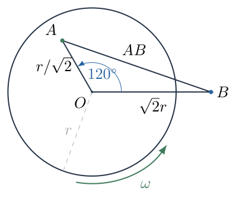{width=75%}

（10）用余弦定理求最终距离。

在三角形$AOB$中，

$$
AB^2=OA^2+OB^2-2\,OA\,OB\cos120^\circ.
\tag{24}
$$

逐项代入：

$$
\begin{aligned}
AB^2
&=\left(\frac r{\sqrt2}\right)^2
+(\sqrt2r)^2
-2\left(\frac r{\sqrt2}\right)(\sqrt2r)
\left(-\frac12\right)\\
&=\frac12r^2+2r^2+r^2\\
&=\frac72r^2.
\end{aligned}
\tag{25}
$$

第三项为正，是因为夹角为钝角，$\cos120^\circ=-1/2$。不能把这个负余弦再漏掉一次符号。

故

$$
\begin{aligned}
AB
&=\sqrt{\frac72}\,r\\
&\simeq\sqrt{\frac72}\frac{792}{\pi}\,\mathrm m\\
&\approx\boxed{4.72\times10^2\,\mathrm m}.
\end{aligned}
\tag{26}
$$

距离约为$472\,\mathrm m$。图上刻度和曲线线宽只支持近似结论，应保留“约”，而不是报告许多位小数。

（11）边界、量纲与回代检查。

最终位置满足$OA\simeq178\,\mathrm m<r$、$OB\simeq357\,\mathrm m>r$。三角形两边之差约为$178\,\mathrm m$，两边之和约为$535\,\mathrm m$，而$AB\simeq472\,\mathrm m$在两者之间，满足三角形不等式。

取$OB=\sqrt2r$，极值角为$\arccos(r/OB)=45^\circ$；取$OA=r/\sqrt2$，极值角为$\arccos(OA/r)=45^\circ$。两者最大到最小均走过$90^\circ$，占$24\,\mathrm s$周期的四分之一，即$6\,\mathrm s$。两接收器方位相差$120^\circ$，对应峰值错开$8\,\mathrm s$，时间关系完整恢复。

取$r=vT/(2\pi)$的单位为长度，余弦定理中的每项单位为长度平方；多普勒式中的$v/c$无量纲，频率单位由$f_0$提供。若把周期误用成频率或漏掉$2\pi$，会在这一步显示量纲或回代时序的不一致。

## 六、关键洞察

内部、外部接收器的极值时刻都有一个直角几何，但直角不在同一点。外部接收器的极值发生在从接收器向轨道作切线的位置，视线与火箭速度平行，得到完整$\pm v$；内部接收器无法与圆周切线相交，最大投影只有$v\,OA/r$。

圆心接收器是一个直接极限检查：令$b\to0$，由式（8）得$u\to0$，因此$f\to f_0$恒定，即使声源速率始终非零。频移观察的是径向接近速度，不是运动本身。

对一般两接收器，峰值相位差还包含极值偏角差。由$\theta_P=\alpha_Q-\delta_Q$，

$$
\alpha_A-\alpha_B
=\omega\Delta t_{\max}+\delta_A-\delta_B.
$$

本题因为两个下降段相同，$\delta_A-\delta_B=0$才直接由$8/24$得到$120^\circ$。不能把这种简化当作任意内外接收器的通用公式。

## 七、易错点

- 用固定接收器、运动声源的题目套上运动接收器公式$f=f_0(c+v)/c$。
- 不定义视线方向，正负投影混乱。
- 用两个频率极值的算术平均代替源频率。
- 看见圆周运动就把最大到最小时间取为$T/2$。
- 极值条件只对$\sin\psi$求最大，遗漏分母$D$也变化。
- 不筛选余弦根，使内部距离大于轨道半径、外部距离小于轨道半径。
- 混用6秒下降段和8秒两曲线错开，得到错误的半径比或夹角。
- 把忽略绝对传播延迟理解为取消多普勒效应。
- 对读图题报告不合理的高精度距离，或把近似模型说成精确定位。

## 八、课堂讲解建议

先让学生在直线传播图上标出两个发声点与相邻波前，推导$c-v$，教师再引入视线投影。随后让学生比较“接收器在圆心”和“接收器在很远处”两种频率范围，建立内部和外部的直觉。

图像审读时，板书分三列记录周期、下降段和峰值错开，要求学生说明每个时间对应的几何事件。极值推导保留商法则和两个候选根，让学生用$\cos\psi\le1$自主筛选，而不直接给出切线结果。

最终余弦定理前，让学生先画按比例的内外位置图并判断钝角。教师用回代的6秒、8秒和曲线2极值范围检查整个几何链，而不只检查最后一个距离数值。

## 九、变式训练

变式：保留有限声传播时间，其余几何半径比仍由同一台接收器的极值间隔得到。若两台接收器记录的峰值错开仍为$\Delta t_{\mathrm{rec}}$，求真实方位角差的修正。

声音到达时刻为

$$
t_{\mathrm{rec}}=t_{\mathrm e}+\frac{D(t_{\mathrm e})}{c}.
$$

本题$v<c$，映射单调，频率极值的发射位置仍由式（11）确定。每台接收器自身的最大和最小位置关于$OQ$对称，其视线长度相同，所以该台最大到最小的传播延迟差为零，原来的6秒角度判断仍成立。

在峰值位置，外部与内部视线长度分别为

$$
D_B=\sqrt{OB^2-r^2}=r,\qquad
D_A=\sqrt{r^2-OA^2}=\frac r{\sqrt2}.
$$

两台峰值的发射时间差为

$$
\Delta t_{\mathrm e}
=\Delta t_{\mathrm{rec}}-\frac{D_A-D_B}{c}.
$$

故真实方位角差为

$$
\begin{aligned}
\Delta\alpha
&=\omega\Delta t_{\mathrm e}
+\delta_A-\delta_B\\
&=\frac{2\pi}{T}\Delta t_{\mathrm{rec}}
+\frac{v}{c}\left(1-\frac1{\sqrt2}\right).
\end{aligned}
$$

代入$\Delta t_{\mathrm{rec}}=8\,\mathrm s$和$v/c=1/5$，得

$$
\Delta\alpha
=\frac{2\pi}{3}+\frac15\left(1-\frac1{\sqrt2}\right)
\approx123.36^\circ.
$$

相应距离为

$$
AB_{\mathrm{ret}}
=r\sqrt{\frac52-2\cos\Delta\alpha}
\approx4.78\times10^2\,\mathrm m.
$$

它是改变“忽略传播延迟”这一条件后的变式结果，不替代主问题按题设近似得到的$472\,\mathrm m$。修正的角度约为$3.36^\circ$；有限读图误差也会影响定位，不能用这组近似曲线宣称毫米级精度。

\newpage

# 第 7 题

一束激光依次通过两个凸透镜，两透镜的焦距均为$f$，相距$d$。透镜固定在可绕圆心$O$转动的圆盘上。初始两透镜共轴，入射光沿图示方向通过系统。圆盘在小角度范围内转动时，入射光方向保持不变，出射光方向始终与入射光平行。

求圆心$O$到左侧透镜焦点的距离$x$。

图中将左侧透镜的右侧轴上焦点记为$F_1$，距离$x=OF_1$为几何长度。解析同时给出有向坐标与另一侧焦点的距离，以区分透镜中心、轴上焦点和实际光束会聚点。

{width=83%}

## 一、题型定位

这是近轴薄透镜系统随载体转动的方向不变条件。两透镜不是用来使入射与出射两条直线重合，而是使出射的倾斜角度始终为零；出射光可以出现横向位移。

最稳妥的方法是直接追踪光线在两个透镜处的高度和方向，求出圆心相对于左透镜中心的位置$s$。题目要求的是焦点距离$x$，还必须在最后减去或加上焦距，不能把$s$直接填作$x$。

采用薄透镜、近轴光线和小角度一阶近似。示意图的长度不代替方程；焦点的侧别以及“有向位置”与“几何距离”的区别都要明确。

## 二、知识点

- 一阶近轴近似中，光线方向角$\alpha$可用横向位移对轴向位移的斜率表示。
- 经过焦距$f$的薄透镜，光线高度不变，方向改变为$\alpha_{\mathrm{out}}=\alpha_{\mathrm{in}}-y/f$。
- 沿光轴传播距离$d$时，方向不变，高度改变为$y_{\mathrm{out}}=y_{\mathrm{in}}+d\alpha$。
- 整个系统转动后，局部光轴角与实验室角相差系统转角。
- 平行出射是实验室方向角为零，不是相对于旋转光轴的方向角为零。
- 焦点位于距透镜中心$f$的位置；圆心到透镜的距离与圆心到焦点的距离不是同一个量。
- 近轴光线矩阵可独立复核逐透镜追迹。

## 三、物理图像

取初始光轴为实验室横轴，入射光沿此轴传播并通过固定圆心$O$。左、右透镜中心分别记为$L_1,L_2$；令$s$为从$L_1$沿初始传播方向到$O$的有向距离。因此在以$O$为原点的初始坐标中，

$$
L_1:\ -s,\qquad L_2:\ d-s.
$$

圆盘逆时针转过小角$\theta$后，整个透镜光轴也转过$\theta$，而激光仍沿实验室水平线。相对于旋转光轴，入射方向角是$-\theta$。

左透镜中心在圆心左侧，其轴向位置为$-s$。激光在左透镜处相对于局部光轴的高度为$y_1\simeq s\theta$。这个高度不是零，正是转轴位置能够影响出射方向的原因。

## 四、解题入口

用两条基本光线变换连续追迹：

$$
\begin{aligned}
\alpha_1&=-\theta-\frac{y_1}{f},\\
y_2&=y_1+d\alpha_1,\\
\alpha_2&=\alpha_1-\frac{y_2}{f}.
\end{aligned}
$$

最后把局部出射方向转回实验室：

$$
\alpha_{\mathrm{lab}}=\alpha_2+\theta.
$$

要求对任意足够小的$\theta$都保持平行，即一阶系数为零。求得$s$后，左透镜右侧焦点在距$L_1$为$f$的位置，所以有向焦点差为$s-f$，实际距离为$|s-f|$。

## 五、解析

（1）推导第一透镜处的入射高度，不凭示意图猜比例。

以圆心$O$为原点，旋转光轴单位矢量及横向单位矢量为

$$
\boldsymbol e_a=(\cos\theta,\sin\theta),
\qquad
\boldsymbol e_y=(-\sin\theta,\cos\theta).
$$

第一透镜所在平面满足沿光轴坐标为$-s$，即$\boldsymbol r\cdot\boldsymbol e_a=-s$。入射光在实验室中位于$Y=0$，交点为

$$
X\cos\theta=-s,\qquad X=-\frac{s}{\cos\theta}.
$$

交点相对于光轴的横向坐标为

$$
\begin{aligned}
y_1
&=\boldsymbol r\cdot\boldsymbol e_y\\
&=X(-\sin\theta)+0\cdot\cos\theta\\
&=\frac{s\sin\theta}{\cos\theta}\\
&=s\tan\theta.
\end{aligned}
\tag{1}
$$

小角范围内$\tan\theta=\theta+O(\theta^3)$，所以保留一阶：

$$
\boxed{y_1=s\theta}.
\tag{2}
$$

图7-2把固定入射线、旋转光轴和两个透镜交点分开画出。$\theta$在图中适当放大以辨认高度；后面的计算仅保留一阶，不从放大的图测量数值。

{width=84%}

（2）在第一透镜处计算方向变化。

相对于旋转光轴，入射方向角为

$$
\alpha_{\mathrm{in}}=-\theta.
$$

薄凸透镜对高度$y_1>0$的近轴光线使其向轴弯折，方向角减少$y_1/f$。因此

$$
\begin{aligned}
\alpha_1
&=\alpha_{\mathrm{in}}-\frac{y_1}{f}\\
&=-\theta-\frac{s\theta}{f}\\
&=-\left(1+\frac sf\right)\theta.
\end{aligned}
\tag{3}
$$

这个角仍是相对于旋转光轴的角。实验室中第一透镜后的方向角为$\alpha_1+\theta=-s\theta/f$，一般不是零。

（3）传播到第二透镜，保留轴向距离$d$。

两透镜之间的距离$d$沿旋转光轴量取。近轴传播满足

$$
y_2=y_1+d\alpha_1.
$$

代入式（2）、（3）：

$$
\begin{aligned}
y_2
&=s\theta+d\left(-\theta-\frac{s\theta}{f}\right)\\
&=\left(s-d-\frac{ds}{f}\right)\theta.
\end{aligned}
\tag{4}
$$

$y_2$可以为负，表示光线落在旋转光轴另一侧。不能把这个高度强行取绝对值后代入透镜式，否则第二透镜的弯折方向会被改错。

（4）计算第二透镜后的方向并转回实验室。

第二透镜的焦距也为$f$，所以

$$
\alpha_2=\alpha_1-\frac{y_2}{f}.
$$

逐项代入展开：

$$
\begin{aligned}
\alpha_2
&=-\theta-\frac{s\theta}{f}
-\frac1f\left(s-d-\frac{ds}{f}\right)\theta\\
&=\left(-1-\frac sf-\frac sf+\frac df+\frac{ds}{f^2}\right)\theta\\
&=\left(-1+\frac df-\frac{2s}{f}+\frac{ds}{f^2}\right)\theta.
\end{aligned}
\tag{5}
$$

实验室中，光轴本身已转过$+\theta$，故出射方向角为

$$
\begin{aligned}
\alpha_{\mathrm{lab}}
&=\alpha_2+\theta\\
&=\left(\frac df-\frac{2s}{f}
+\frac{ds}{f^2}\right)\theta.
\end{aligned}
\tag{6}
$$

若错误地令$\alpha_2=0$，得到的是出射光平行于已经转动的透镜光轴，并不满足出射光平行原来的固定入射方向。

（5）用任意小转角的不变条件求圆心位置。

要求$\alpha_{\mathrm{lab}}=0$对任意小$\theta$都成立。不能仅取$\theta=0$；系统在完全未转动时本来就平行，那个瞬间不能确定转轴位置。

因此式（6）中一阶系数必须为零：

$$
\frac df-\frac{2s}{f}+\frac{ds}{f^2}=0.
$$

乘以$f^2$并整理：

$$
\begin{aligned}
df-2sf+ds&=0,\\
df+s(d-2f)&=0,\\
s(2f-d)&=df.
\end{aligned}
$$

当$d\ne2f$，

$$
\boxed{
s=\frac{fd}{2f-d}
}.
\tag{7}
$$

这首先是左透镜中心到转轴圆心的有向距离，不是题目中的焦点距离$x$。

（6）把透镜距离换算为焦点距离，明确有向量和几何量。

左透镜的右侧轴上焦点$F_1$位于$L_1$右侧距离$f$处。沿初始光轴的有向坐标差为

$$
\begin{aligned}
X_O-X_{F_1}
&=s-f\\
&=\frac{fd}{2f-d}-f\\
&=\frac{fd-f(2f-d)}{2f-d}\\
&=\frac{fd-2f^2+fd}{2f-d}\\
&=\frac{2f(d-f)}{2f-d}.
\end{aligned}
\tag{8}
$$

因此题目所说的几何距离为

$$
\boxed{
x=OF_1=\left|s-f\right|
=\left|\frac{2f(d-f)}{2f-d}\right|
},\qquad d\ne2f.
\tag{9}
$$

若将$x$定义为从$F_1$指向$O$的有向距离，可不取绝对值，直接使用式（8）。不能一边称$x$为距离大小，一边在允许参数范围里报告负长度。

若图示还要求圆心在两透镜之间，则应有$0<s<d$。由于$d,f>0$，式（7）给出

$$
\begin{aligned}
0<\frac{fd}{2f-d}<d
&\quad\Longrightarrow\quad
0<d<f.
\end{aligned}
\tag{10}
$$

在这个分支，$s<f$，所以$O$位于右侧焦点$F_1$的左边。几何距离可写成不含绝对值的形式

$$
\boxed{
x=f-s=\frac{2f(f-d)}{2f-d}
},\qquad 0<d<f.
\tag{11}
$$

端点$d=f$时$s=f=d$，圆心在第二透镜中心，同时与第一透镜右侧焦点重合，$x=0$。它不是严格位于两透镜内部，但可以作为边界检验。

原题未用文字明确区分左右两个焦点。若实际所指是左透镜左侧焦点$F_{1,\mathrm L}$，则距离应为

$$
\boxed{
OF_{1,\mathrm L}
=|s+f|
=\left|\frac{2f^2}{2f-d}\right|
}.
\tag{12}
$$

两种焦点侧别不影响先求$s$的条件；换算到$x$时才有不同。保留侧别说明，比将透镜中心和焦点合并在同一点更严谨。

（7）检查第一透镜的轴上焦点与实际光束会聚点。

系统转动后，固定入射束相对于局部光轴倾斜$-\theta$。第一透镜对这束平行光形成的会聚点$F_*$，在其像方焦平面上，但偏离轴上焦点$F_1$。

近轴条件下，焦平面内的横向位移为

$$
y_*=-f\theta.
\tag{13}
$$

图7-3用虚线延长第一透镜后的光线至$F_*$，并保留真正的轴上焦点$F_1$。实际光线在到达这个第一透镜的会聚点之前，已经遇到第二透镜并改变方向；不能把$F_*$和$F_1$当作同一点来套相似三角形。

{width=84%}

式（13）由平行光束的焦平面成像关系得到，也可以从第一透镜追迹复查：将光线再传播$f$，横向高度为

$$
\begin{aligned}
y_*
&=y_1+f\alpha_1\\
&=s\theta+f\left(-\theta-\frac{s\theta}{f}\right)\\
&=-f\theta.
\end{aligned}
$$

此值与入射高度$y_1$无关，说明各条同方向平行入射近轴光线会聚在同一焦平面位置。

（8）独立使用光线矩阵复核转轴位置。

以$\binom y\alpha$表示光线的局部高度与方向。单透镜矩阵和自由传播矩阵分别为

$$
L=
\begin{pmatrix}
1&0\\
-1/f&1
\end{pmatrix},
\qquad
P=
\begin{pmatrix}
1&d\\
0&1
\end{pmatrix}.
\tag{14}
$$

光依次经过第一透镜、传播和第二透镜，总矩阵应按实际作用顺序写成$M=LPL$，不是把次序随意交换。

先计算$PL$：

$$
PL=
\begin{pmatrix}
1-d/f&d\\
-1/f&1
\end{pmatrix}.
$$

再左乘第二透镜的$L$：

$$
\begin{aligned}
M=LPL
&=
\begin{pmatrix}
1-d/f&d\\
-(1-d/f)/f-1/f&1-d/f
\end{pmatrix}\\
&=
\begin{pmatrix}
1-d/f&d\\
-2/f+d/f^2&1-d/f
\end{pmatrix}.
\end{aligned}
\tag{15}
$$

图7-4展示三个依次作用的变换。每个节点都对应上述矩阵乘法的一步，不把图当成与计算无关的流程装饰。

{width=89%}

输入光线为

$$
\binom{y_1}{\alpha_{\mathrm{in}}}
=\binom{s\theta}{-\theta}.
$$

取矩阵第二行求$\alpha_2$：

$$
\alpha_2
=\left(-\frac2f+\frac d{f^2}\right)s\theta
-\left(1-\frac df\right)\theta.
$$

加回光轴转角$\theta$：

$$
\alpha_{\mathrm{lab}}
=\left[\left(-\frac2f+\frac d{f^2}\right)s
+\frac df\right]\theta.
$$

令系数为零，再次得到$s=fd/(2f-d)$，与逐透镜追迹完全一致。

（9）检查平行不意味着重合，并计算横向位移。

把式（7）代入式（4）：

$$
\begin{aligned}
y_2
&=\left[s\left(1-\frac df\right)-d\right]\theta\\
&=\left[\frac{d(f-d)}{2f-d}-d\right]\theta\\
&=-\frac{fd}{2f-d}\theta\\
&=-s\theta.
\end{aligned}
\tag{16}
$$

第二透镜中心相对固定圆心的实验室高度约为$(d-s)\theta$。出射光的实验室高度为它与局部光线高度之和：

$$
\begin{aligned}
Y_{\mathrm{out}}
&=(d-s)\theta+y_2\\
&=(d-2s)\theta\\
&=\left(d-\frac{2fd}{2f-d}\right)\theta\\
&=\boxed{-\frac{d^2}{2f-d}\theta}.
\end{aligned}
\tag{17}
$$

这个高度一般不为零，但出射方向仍为零。题目允许平行而不同线，故式（17）不破坏所求条件。

（10）参数、量纲和退化情形检查。

式（7）、（9）和（12）均具有长度量纲。$s$与$x$随$f,d$同比放大时也同比放大，符合光学装置相似缩放。

当$d=2f$，矩阵第二行的高度系数为零，式（6）变成

$$
\alpha_{\mathrm{lab}}=2\theta,
$$

与$s$无关。此时不存在能够使这束光在系统转动后仍平行原入射方向的有限转轴位置；公式分母为零不是允许“无限大的具体圆心距离”，而是没有有限解。

当$d\to0$，两透镜近似重合，条件给出$s\to0$，圆心趋向透镜位置；到单个左透镜轴上焦点的距离趋于$f$。当$d=f$，给出$s=f$、右侧焦点距离零，且代回式（6）确实消去一阶角度变化。

当$0<d<f$，式（11）的距离为正；当$f<d<2f$，$s>d$，转轴位于第二透镜右侧；当$d>2f$，$s<0$，转轴位于第一透镜左侧。若装置另要求圆心处在两镜之间，后两个分支就必须排除，不能只算分式而不检查位置。

## 六、关键洞察

方向不变条件是两个效应抵消：系统光轴本身转动，以及固定光束在两个透镜中产生的不同高度弯折。只看两透镜是否共焦，或套一个不说明参考光轴的物像距公式，容易漏掉实验室角度恢复项$+\theta$。

初始光束必须按图位于初始共同光轴。若它在初始状态就有高度偏移$h\ne0$，总矩阵的高度系数$C=(d-2f)/f^2$一般会使出射方向偏转$Ch$。同一有限转轴位置不能使任意横向高度的整片平行束都在两正透镜之后保持平行；题目描述的是选定激光束的中心方向。

焦点距离的符号可通过几何分支独立检查。若$0<d<f$，有$d/2<s<d<f$，因此右侧焦点在圆心右侧。此时$s-f<0$是有向坐标，不是计算失败；它恰好说明应取$x=f-s$作为距离大小。

## 七、易错点

- 把转轴圆心到左透镜中心的$s$直接当作题目要求的焦点距离$x$。
- 把轴上焦点$F_1$与倾斜入射束的会聚点$F_*$合并，遗漏焦平面横向位移。
- 入射方向保持不变，却在局部坐标中仍把入射角写成零。
- 第二透镜的入射高度写成第一透镜高度，漏掉两镜之间传播项$d\alpha_1$。
- 令局部出射角为零，忘记将角度转回实验室。
- 将负光线高度取绝对值再代入透镜式，改变弯折方向。
- 要求出射直线与入射直线重合，额外加入题目没有的限制。
- 对几何距离不取绝对值，或忽略$d=2f$无有限解及圆心位置分支。

## 八、课堂讲解建议

教师先在图上分别标出$L_1,O,F_1$，让学生用一句话说明$s$和$x$各测什么。然后画固定入射线和旋转光轴，让学生判断相对入射角为什么是$-\theta$。

板书追迹分成“第一透镜弯折—传播到第二透镜—第二透镜弯折—恢复地面方向”四步。每步保留高度的正负号，让学生自行解释$y_2<0$的物理位置。得到$s$后再换算焦点距离，避免学生把中间量当作最终答案。

矩阵法安排为独立复核而非首轮捷径。最后用$d=f$和$d=2f$检查公式，要求学生描述圆心在哪里、是否有有限解，以及平行但横移为什么满足题意。

## 九、变式训练

变式：两透镜焦距改为$f_1,f_2$，间距为$d$。初始激光沿共同光轴，求一阶保持实验室出射方向不变所需的左透镜—圆心有向距离$s$。

第一透镜后方向与第二透镜前高度为

$$
\alpha_1=-\theta-\frac{s\theta}{f_1},
\qquad
y_2=s\theta+d\alpha_1.
$$

第二透镜后恢复实验室方向：

$$
\begin{aligned}
\alpha_{\mathrm{lab}}
&=\alpha_1-\frac{y_2}{f_2}+\theta\\
&=\left[
\frac d{f_2}
-s\left(\frac1{f_1}+\frac1{f_2}
-\frac d{f_1f_2}\right)
\right]\theta.
\end{aligned}
$$

令一阶系数为零，乘以$f_1f_2$：

$$
df_1-s(f_1+f_2-d)=0.
$$

因此

$$
\boxed{
s=\frac{df_1}{f_1+f_2-d}
},\qquad d\ne f_1+f_2.
$$

左透镜右侧焦点距离为

$$
x_1=|s-f_1|
=\left|\frac{f_1(2d-f_1-f_2)}{f_1+f_2-d}\right|.
$$

圆心在两镜之间要求$0<s<d$，即$0<d<f_2$。当$d=f_1+f_2$，方向对高度的耦合系数为零，但出射方向仍随转动改变，故无有限$s$；取$f_1=f_2=f$恢复主结果。

用一组具体数值检查有向高度与最后的焦点换算。取$f_1=20\,\mathrm{cm}$、$f_2=30\,\mathrm{cm}$、$d=10\,\mathrm{cm}$，则

$$
\begin{aligned}
s&=\frac{10\times20}{20+30-10}\,\mathrm{cm}
=5\,\mathrm{cm},\\
x_1&=|5-20|\,\mathrm{cm}=15\,\mathrm{cm}.
\end{aligned}
$$

圆心确实在两镜之间，因为$0<5<10$。令转角$\theta=0.010\,\mathrm{rad}$，仍按一阶近轴关系逐镜计算，所有高度统一用厘米：

$$
\begin{aligned}
y_1&=s\theta=0.050\,\mathrm{cm},\\
\alpha_1&=-0.010-\frac{0.050}{20}
=-0.0125\,\mathrm{rad},\\
y_2&=0.050+10(-0.0125)
=-0.075\,\mathrm{cm},\\
\alpha_2&=-0.0125-\frac{-0.075}{30}
=-0.0100\,\mathrm{rad},\\
\alpha_{\rm lab}&=\alpha_2+\theta=0.
\end{aligned}
$$

第二透镜处的高度为负，弯折改变量因而为正，恰好恢复实验室水平出射。若把$y_2$取成正数，抵消就会消失。转轴到镜心的$5\,\mathrm{cm}$与到右侧焦点的$15\,\mathrm{cm}$也不相等，这个例子同时核验符号和题目所求长度。

\newpage

# 第 8 题

蔡子昱乘坐一艘火箭。火箭在其瞬时静止参考系中的加速度为恒定值$a$。某时刻从火箭向前发射一枚导弹，导弹相对于火箭的初速度为$v_0$；随后导弹在惯性参考系中自由运动。

求导弹在火箭参考系中的运动情况，并判断火箭长时间后能否追上导弹而相遇。

提示：火箭瞬时静止系中沿火箭世界线的时间为火箭本征时。可使用

$$
\begin{aligned}
\cosh k&=\frac{e^k+e^{-k}}2,&
\sinh k&=\frac{e^k-e^{-k}}2,&
\tanh k&=\frac{\sinh k}{\cosh k},\\
\frac{d}{dk}\cosh k&=\sinh k,&
\frac{d}{dk}\sinh k&=\cosh k,&
\frac{d}{dk}\ln\cosh k&=\tanh k.
\end{aligned}
$$

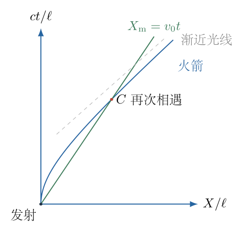{width=72%}

## 一、题型定位

这是恒定固有加速度与惯性运动的相对论追及问题。“在瞬时静止系中的加速度恒定”指固有加速度恒为$a$，不是某个固定惯性系中的$dv/dt$恒为$a$。

最简洁的追及判定在发射瞬间与火箭共动的惯性系中进行：导弹匀速，火箭作双曲线运动，两条世界线再次相交就是追上。相遇事件的存在与否不依赖参考系，求出的地面时间和火箭本征时间却不相同。

描述“火箭参考系中的运动”时，还必须说明如何在持续变化的参考系中定义远处导弹的位置。以下采用火箭瞬时静止系的同时面构成的加速坐标，给出导弹距离随火箭本征时的函数，并区分局部相对速度与该坐标距离的变化率。

## 二、知识点

- 一维速度合成为$(V+u)/(1+Vu/c^2)$。
- 固有加速度$a$满足$dV/d\tau=a(1-V^2/c^2)$，其中$\tau$是火箭本征时。
- 洛伦兹因子$\gamma=1/\sqrt{1-V^2/c^2}$，惯性系时间满足$dt=\gamma\,d\tau$。
- 快度$\eta=\operatorname{artanh}(V/c)$使速度合成化为快度相加。
- 恒定固有加速度对应$V=c\tanh(a\tau/c)$，而不是无限增加的$V=a\tau$。
- 相遇必须满足同一事件的时间和位置，而不是只令火箭与导弹速度相等。
- 加速系的远处同时性随本征时变化，不能直接用不同位置的惯性系等时距离代替火箭瞬时静止系距离。
- 初始共同位置给出的零时间根不是发射后追上所要找的根。

## 三、物理图像

选择发射瞬间与火箭共动的惯性系$S$。取发射事件为$t=0,X=0$，火箭初速度为零；导弹初速度为$v_0$，向$+X$运动。假设$a>0$且$0<v_0<c$，火箭始终向前保持固有加速度$a$。

导弹不再受到推力，在$S$中始终满足$X_{\mathrm m}=v_0t$。火箭速度逐渐增加但始终小于$c$，其位移不是简单的$at^2/2$。

以$\tau$表示火箭本征时，另记

$$
\kappa=\frac{a\tau}{c},\qquad
\beta_0=\frac{v_0}{c},\qquad
\ell=\frac{c^2}{a}.
$$

$\kappa,\beta_0$无量纲，$\ell$是恒定固有加速度所对应的长度尺度。所有时间与距离公式都将按这三个量统一组织，避免把$\tau$和$t$混作同一个时间。

## 四、解题入口

先由速度合成得到火箭的微分方程，再积分求惯性系世界线：

$$
\begin{aligned}
V(\tau)&=c\tanh\kappa,\\
t(\tau)&=\frac ca\sinh\kappa,\\
X_{\mathrm R}(\tau)&=\frac{c^2}{a}(\cosh\kappa-1).
\end{aligned}
$$

导弹的惯性系位置为$v_0t(\tau)$。相遇条件是

$$
X_{\mathrm R}(\tau)=v_0t(\tau).
$$

求出非零时间根后，再建立火箭同时面上的导弹坐标$\xi(\tau)$，分析它先远离、后接近的完整运动。

## 五、解析

（1）从瞬时速度合成推导火箭的速度方程。

设某个火箭本征时$\tau$，火箭相对$S$的速度为$V$。在这一瞬间与火箭共动的惯性系内，经过很小本征时间$d\tau$后，火箭获得小速度

$$
du=a\,d\tau.
$$

用相对论速度合成将这个小速度转回$S$：

$$
V+dV=\frac{V+du}{1+Vdu/c^2}.
\tag{1}
$$

对$du$展开至一阶，使用$(1+\varepsilon)^{-1}=1-\varepsilon+O(\varepsilon^2)$：

$$
\begin{aligned}
V+dV
&=(V+du)\left(1-\frac{Vdu}{c^2}\right)+O(du^2)\\
&=V+du-\frac{V^2du}{c^2}+O(du^2).
\end{aligned}
$$

因此

$$
\begin{aligned}
dV&=\left(1-\frac{V^2}{c^2}\right)du,\\
\boxed{
\frac{dV}{d\tau}
=a\left(1-\frac{V^2}{c^2}\right)
}.
\end{aligned}
\tag{2}
$$

式（2）随$V$增加而降低速度增长率，保证$V$不越过$c$。若用$dV=a\,d\tau$，就忽略了速度合成的分母。

（2）分离变量并积分，不省略对数形式。

由式（2），

$$
\frac{dV}{1-V^2/c^2}=a\,d\tau.
$$

将左侧分母因式分解并作部分分式：

$$
\frac1{1-V^2/c^2}
=\frac c2\left(\frac1{c-V}+\frac1{c+V}\right).
\tag{3}
$$

从$V=0,\tau=0$积分：

$$
\begin{aligned}
a\tau
&=\frac c2\int_0^V
\left(\frac1{c-u}+\frac1{c+u}\right)du\\
&=\frac c2[-\ln(c-u)+\ln(c+u)]_0^V\\
&=\frac c2\ln\frac{c+V}{c-V}.
\end{aligned}
\tag{4}
$$

指数化并解出$V$：

$$
\begin{aligned}
\frac{c+V}{c-V}&=e^{2a\tau/c},\\
V(1+e^{2a\tau/c})&=c(e^{2a\tau/c}-1),\\
\boxed{
V(\tau)=c\frac{e^{2\kappa}-1}{e^{2\kappa}+1}
=c\tanh\kappa
}.
\end{aligned}
\tag{5}
$$

初始$\kappa=0$给出$V=0$；$\kappa\to\infty$时$V\to c$但不达到$c$，符合火箭为有质量物体的限制。

（3）求洛伦兹因子与两个时间的关系。

由$\beta_{\mathrm R}=V/c=\tanh\kappa$，恒等式$1-\tanh^2\kappa=1/\cosh^2\kappa$给出

$$
\gamma_{\mathrm R}=\cosh\kappa.
\tag{6}
$$

火箭沿自身世界线的本征时满足

$$
\frac{dt}{d\tau}=\gamma_{\mathrm R}=\cosh\kappa.
$$

用$d\tau=(c/a)\,d\kappa$积分：

$$
\begin{aligned}
t(\tau)
&=\int_0^\tau\cosh\left(\frac{a\sigma}{c}\right)d\sigma\\
&=\frac ca\int_0^\kappa\cosh u\,du\\
&=\boxed{\frac ca\sinh\kappa}.
\end{aligned}
\tag{7}
$$

惯性系时间$t$与火箭本征时$\tau$仅在低速短时间近似相等。后面的相遇时间必须标明是哪一种。

（4）积分火箭位移，建立双曲线世界线。

火箭在惯性系中的速度为$dX_{\mathrm R}/dt=V$，因此

$$
\begin{aligned}
\frac{dX_{\mathrm R}}{d\tau}
&=\frac{dX_{\mathrm R}}{dt}\frac{dt}{d\tau}\\
&=V\gamma_{\mathrm R}\\
&=c\tanh\kappa\cosh\kappa\\
&=c\sinh\kappa.
\end{aligned}
$$

积分并用$X_{\mathrm R}(0)=0$：

$$
\begin{aligned}
X_{\mathrm R}(\tau)
&=\frac{c^2}{a}\int_0^\kappa\sinh u\,du\\
&=\boxed{\frac{c^2}{a}(\cosh\kappa-1)}.
\end{aligned}
\tag{8}
$$

由$\cosh^2\kappa-\sinh^2\kappa=1$，消去$\kappa$可得

$$
\boxed{
(X_{\mathrm R}+\ell)^2-(ct)^2=\ell^2
},\qquad \ell=\frac{c^2}{a}.
\tag{9}
$$

火箭世界线是双曲线。导弹世界线则是直线

$$
X_{\mathrm m}=v_0t.
\tag{10}
$$

图8-2将两者放在同一惯性系时空图中，并画出某一火箭时刻的瞬时同时面。火箭与导弹的再次交点$C$才是追及事件；火箭速度刚等于$v_0$时，两者仍有非零距离。

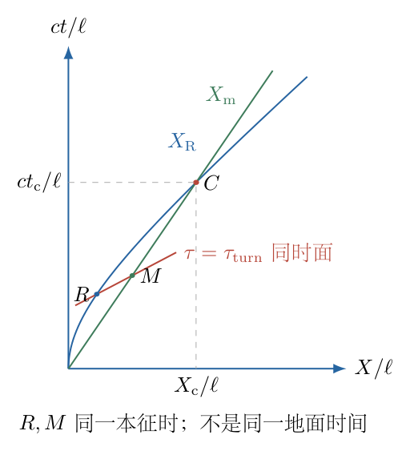{width=75%}

（5）由位置相等建立相遇方程。

将式（7）、（8）代入$X_{\mathrm R}=v_0t$：

$$
\frac{c^2}{a}(\cosh\kappa-1)
=v_0\frac ca\sinh\kappa.
$$

约去$c^2/a$，得到

$$
\cosh\kappa-\beta_0\sinh\kappa=1.
\tag{11}
$$

用指数定义展开：

$$
\begin{aligned}
\frac{e^\kappa+e^{-\kappa}}2
-\beta_0\frac{e^\kappa-e^{-\kappa}}2
&=1,\\
(1-\beta_0)e^\kappa
+(1+\beta_0)e^{-\kappa}
&=2.
\end{aligned}
\tag{12}
$$

令$z=e^\kappa>0$，再乘以$z$：

$$
(1-\beta_0)z^2-2z+(1+\beta_0)=0.
\tag{13}
$$

对$0<\beta_0<1$，判别式为

$$
\Delta=4-4(1-\beta_0)(1+\beta_0)=4\beta_0^2>0.
$$

二次方程根为

$$
\begin{aligned}
z
&=\frac{2\pm2\beta_0}{2(1-\beta_0)}\\
&=1
\quad\text{或}\quad
\frac{1+\beta_0}{1-\beta_0}.
\end{aligned}
\tag{14}
$$

第一根$z=1$对应$\kappa=0$，只是发射瞬间的共同位置。第二根大于一，才是发射后相遇：

$$
\boxed{
\tau_{\mathrm c}
=\frac ca\ln\frac{1+\beta_0}{1-\beta_0}
=\frac ca\ln\frac{c+v_0}{c-v_0}
}.
\tag{15}
$$

因为分子、分母均为正，且比值大于一，$\tau_{\mathrm c}>0$。对任意$a>0$、$0<v_0<c$，这个本征时间有限，所以持续保持固有加速度的火箭能够追上自由导弹。

（6）求惯性系中的相遇时间与位置。

定义导弹快度

$$
\eta_0=\operatorname{artanh}\beta_0
=\frac12\ln\frac{1+\beta_0}{1-\beta_0}.
$$

由式（15），相遇时火箭快度为$\kappa_{\mathrm c}=2\eta_0$。双曲函数倍角公式给出

$$
\sinh(2\eta_0)
=\frac{2\beta_0}{1-\beta_0^2}.
\tag{16}
$$

因此

$$
\begin{aligned}
t_{\mathrm c}
&=\frac ca\sinh\kappa_{\mathrm c}\\
&=\frac ca\frac{2\beta_0}{1-\beta_0^2}\\
&=\boxed{\frac{2v_0}{a(1-v_0^2/c^2)}}.
\end{aligned}
\tag{17}
$$

相遇位置为

$$
\boxed{
X_{\mathrm c}=v_0t_{\mathrm c}
=\frac{2v_0^2}{a(1-v_0^2/c^2)}
}.
\tag{18}
$$

由于沿火箭世界线$\gamma_{\mathrm R}\ge1$，有$t_{\mathrm c}>\tau_{\mathrm c}$，与时间膨胀一致。不能把式（17）直接作为火箭上乘客钟表记录的时间。

（7）建立火箭加速坐标中的远处位置。

在火箭本征时$\tau$，火箭的惯性系事件为$(t_{\mathrm R},X_{\mathrm R})$，速度为$V=c\tanh\kappa$。在它的瞬时静止系中，取同一时刻、距火箭向前$\xi$的事件。

将这个纯空间间隔$(dt'=0,dX'=\xi)$用洛伦兹变换转回$S$，得到

$$
t-t_{\mathrm R}=\gamma_{\mathrm R}\frac{V\xi}{c^2},
\qquad
X-X_{\mathrm R}=\gamma_{\mathrm R}\xi.
\tag{19}
$$

代入$\gamma_{\mathrm R}=\cosh\kappa$、$V\gamma_{\mathrm R}=c\sinh\kappa$及式（7）、（8）：

$$
\boxed{
\begin{aligned}
ct&=(\ell+\xi)\sinh\kappa,\\
X&=(\ell+\xi)\cosh\kappa-\ell.
\end{aligned}
}
\tag{20}
$$

这定义了火箭瞬时同时面上的加速系位置$\xi$。火箭自身始终为$\xi=0$。空间坐标$\xi$在同一同时面上是火箭瞬时静止系量得的距离，而不是简单的$X_{\mathrm m}(t)-X_{\mathrm R}(t)$。

（8）把导弹惯性世界线代入加速坐标，求其距离函数。

导弹满足$X=\beta_0ct$。将式（20）两式代入：

$$
(\ell+\xi)\cosh\kappa-\ell
=\beta_0(\ell+\xi)\sinh\kappa.
$$

移项并提取$\ell+\xi$：

$$
\begin{aligned}
(\ell+\xi)
(\cosh\kappa-\beta_0\sinh\kappa)&=\ell,\\
\ell+\xi
&=\frac{\ell}{\cosh\kappa-\beta_0\sinh\kappa}.
\end{aligned}
$$

因此

$$
\boxed{
\xi(\tau)=\frac{c^2}{a}
\left[
\frac1{\cosh(a\tau/c)-\beta_0\sinh(a\tau/c)}
-1
\right]
}.
\tag{21}
$$

对$0<\beta_0<1$，分母始终为正。用$\beta_0=\tanh\eta_0$和$\gamma_0=\cosh\eta_0$，可化成更容易观察形状的形式：

$$
\begin{aligned}
\cosh\kappa-\beta_0\sinh\kappa
&=\frac{\cosh\kappa\cosh\eta_0
-\sinh\kappa\sinh\eta_0}{\cosh\eta_0}\\
&=\frac{\cosh(\kappa-\eta_0)}{\gamma_0}.
\end{aligned}
$$

于是

$$
\boxed{
\xi(\tau)=\ell
\left[\frac{\gamma_0}{\cosh(\kappa-\eta_0)}-1\right].
}
\tag{22}
$$

图8-3画出$\xi$及局部相对速度随火箭快度的变化。曲线以$\kappa=\eta_0$为距离最大点，$\kappa=2\eta_0$时回到$\xi=0$。

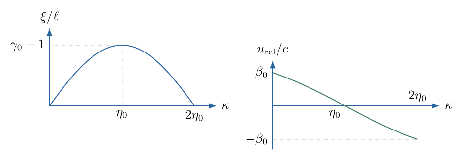{width=86%}

（9）求先远离后接近的转折时刻与最大距离。

记$D(\kappa)=\cosh\kappa-\beta_0\sinh\kappa$。对式（21）求导：

$$
\begin{aligned}
\frac{d\xi}{d\tau}
&=-\ell\frac{D'(\kappa)}{D^2(\kappa)}\frac ac\\
&=c\frac{\beta_0\cosh\kappa-\sinh\kappa}{D^2(\kappa)}.
\end{aligned}
\tag{23}
$$

分母为正，所以转折条件是

$$
\beta_0\cosh\kappa-\sinh\kappa=0,
\qquad
\tanh\kappa=\beta_0.
$$

即

$$
\boxed{
\tau_{\mathrm{turn}}
=\frac ca\operatorname{artanh}\beta_0
=\frac12\tau_{\mathrm c}
}.
\tag{24}
$$

在此之前$\xi$增加，导弹在火箭看来向前远离；在此之后$\xi$减小，导弹向火箭靠近。这个转折时刻火箭速度$V=v_0$，但距离仍不为零。

将$\kappa=\eta_0$代入式（22），由于$\cosh0=1$，

$$
\boxed{
\xi_{\max}
=\ell(\gamma_0-1)
=\frac{c^2}{a}
\left(\frac1{\sqrt{1-v_0^2/c^2}}-1\right)
}.
\tag{25}
$$

速度相等表示瞬时相对速度为零，只能判断间距达到极值，不能判断两物体已经相遇。

相遇之后，$\kappa>2\eta_0$，有$\kappa-\eta_0>\eta_0$，故$\cosh(\kappa-\eta_0)>\cosh\eta_0=\gamma_0$。由式（22）立即得到

$$
-\ell<\xi(\tau)<0.
$$

负号表示导弹位于火箭后方，不是出现“负路程”。当火箭继续加速、$\kappa\to\infty$时，分母趋于无穷，因此在这套加速坐标覆盖的分支上

$$
\xi(\tau)\longrightarrow-\ell=-\frac{c^2}{a}.
$$

它趋近的是加速坐标的后方边界，并不会再次回到$\xi=0$。这一结论只描述同一火箭同时性约定下的位置，不能把它误解为固定惯性系中的导弹位移停止增长；在$S$中导弹依旧满足$X_{\rm m}=v_0t$。

（10）给出局部相对速度，并区分坐标距离变化率。

在本征时$\tau$的火箭瞬时静止系中，用一维速度变换：

$$
\begin{aligned}
u_{\mathrm{rel}}(\tau)
&=\frac{v_0-V(\tau)}{1-v_0V(\tau)/c^2}\\
&=c\frac{\beta_0-\tanh\kappa}
{1-\beta_0\tanh\kappa}\\
&=c\frac{\beta_0\cosh\kappa-\sinh\kappa}
{\cosh\kappa-\beta_0\sinh\kappa}\\
&=\boxed{-c\tanh(\kappa-\eta_0)}.
\end{aligned}
\tag{26}
$$

初始$u_{\mathrm{rel}}=v_0$，转折时为零，相遇时$\kappa=2\eta_0$，有

$$
\boxed{u_{\mathrm{rel}}(\tau_{\mathrm c})=-v_0}.
\tag{27}
$$

火箭看到导弹以与发射时大小相同、方向相反的局部相对速度返回；这对应快度从$+\eta_0$变为$-\eta_0$。

式（23）与式（26）并非处处相等，因为$\xi(\tau)$把远处位置都用火箭原点的钟$\tau$作参数。由式（21），

$$
1+\frac{\xi}{\ell}=\frac1D.
$$

所以

$$
\boxed{
\frac{d\xi}{d\tau}
=\left(1+\frac{a\xi}{c^2}\right)u_{\mathrm{rel}}
}.
\tag{28}
$$

在火箭原点$\xi=0$，两者相等；远处的同时面随加速改变，不能直接将速度合成所得$u_{\mathrm{rel}}$对原点本征时积分当作位置。式（21）由明确的同时性变换得到，避免了这个跳步。

（11）用具体无量纲例子复查全部关键事件。

只作为公式核验，取$v_0=0.6c$。此时

$$
\beta_0=\frac35,\qquad
\gamma_0=\frac54,\qquad
\eta_0=\frac12\ln\frac{1+3/5}{1-3/5}
=\ln2.
$$

转折和相遇本征时分别为

$$
\tau_{\mathrm{turn}}=\frac ca\ln2,\qquad
\tau_{\mathrm c}=\frac ca\ln4.
$$

最大距离为

$$
\xi_{\max}=\frac14\frac{c^2}{a}.
$$

相遇惯性系时间和位置为

$$
\begin{aligned}
t_{\mathrm c}
&=\frac{2(3/5)c}{a[1-(3/5)^2]}
=\frac{15}{8}\frac ca,\\
X_{\mathrm c}
&=\frac35c\,t_{\mathrm c}
=\frac98\frac{c^2}{a}.
\end{aligned}
\tag{29}
$$

直接检查火箭世界线：

$$
\sinh(\ln4)=\frac{4-1/4}{2}=\frac{15}{8},
\qquad
\cosh(\ln4)-1=\frac{4+1/4}{2}-1=\frac98.
$$

与导弹位置完全一致。火箭相遇速度为

$$
V_{\mathrm c}
=c\tanh(2\eta_0)
=c\frac{2\beta_0}{1+\beta_0^2}
=\frac{15}{17}c,
$$

大于$v_0=3c/5$而小于$c$，没有出现超光速追赶。

（12）检查低速极限、光速极限和加速度条件。

当$\beta_0\ll1$，使用

$$
\ln\frac{1+\beta_0}{1-\beta_0}
=2\left(\beta_0+\frac{\beta_0^3}{3}+\cdots\right),
$$

相遇本征时为

$$
\tau_{\mathrm c}
=\frac{2v_0}{a}
\left(1+\frac{v_0^2}{3c^2}+\cdots\right).
\tag{30}
$$

最大距离中的洛伦兹因子可用二项式展开。取$z=\beta_0^2$，将$(1-z)^{-1/2}$展开至$z^2$，系数分别为$1/2$与$(-1/2)(-3/2)/2=3/8$：

$$
\begin{aligned}
\gamma_0
&=(1-\beta_0^2)^{-1/2}\\
&=1+\frac12\beta_0^2+\frac38\beta_0^4
+O(\beta_0^6),\\
\xi_{\max}
&=\frac{c^2}{a}(\gamma_0-1)\\
&=\frac{v_0^2}{2a}
+\frac{3v_0^4}{8ac^2}
+O\!\left(\frac{v_0^6}{ac^4}\right).
\end{aligned}
$$

保留最低阶得到

$$
\xi_{\max}
=\frac{v_0^2}{2a}
+O\left(\frac{v_0^4}{ac^2}\right).
\tag{31}
$$

这分别恢复牛顿模型中$\xi=v_0\tau-a\tau^2/2$的追及时间$2v_0/a$与最大间距$v_0^2/(2a)$。低速极限是对整条推导链的重要检查。

当$v_0\to c^-$，式（15）的对数发散，追及时间趋于无穷。若发射的是光信号$v_0=c$，相遇方程只剩初始根，持续加速火箭也不能追上向前发出的光。不能将“能够追上任何低于光速的惯性导弹”误说成“最终能够追上光”。

光速端点也能直接从位置条件核验，不必把发散公式机械代入。此时$\beta_0=1$，式（11）化为

$$
\cosh\kappa-\sinh\kappa
=e^{-\kappa}=1.
$$

对实数$\kappa\ge0$，指数函数严格递减，唯一解为$\kappa=0$，即发射事件；不存在后来的相遇根。

当$a\to0^+$且$v_0>0$固定，追及时间也趋于无穷；若$a=0$，火箭保持初始静止而导弹向前匀速离开，不再相遇。以上结论要求火箭始终保持给定正固有加速度；若途中停止加速，能否追上须另作判断。

总结：对$a>0$、$0<v_0<c$，导弹在火箭加速坐标中先向前远离，达到式（25）的最大距离后返回，并在式（15）的有限本征时相遇。火箭本身在惯性系中始终不超过光速。

## 六、关键洞察

快度把相对论追及的结构显现出来。导弹快度固定为$\eta_0$，火箭快度为$a\tau/c$线性增加，相对快度为$\eta_0-a\tau/c$。相对速度在$\tau_{\mathrm{turn}}$处为零，相遇时相对快度变为$-\eta_0$。

然而“相对快度反号”本身不足以证明相遇；真正的相遇条件仍是世界线交点。这里恰好由位置方程得到$\kappa_{\mathrm c}=2\eta_0$，才使速度关系具有这种对称形式。

火箭加速坐标的时间尺度随位置不同。对式（20）求微分并代入平直时空间隔：

$$
c^2dt^2-dX^2
=\left(1+\frac{a\xi}{c^2}\right)^2c^2d\tau^2-d\xi^2.
$$

这解释式（28）中坐标速度与局部速度的比例。$\xi$不是任意“伪距离”，而是在火箭瞬时同时面上构造的空间距离；坐标时间则使用原点火箭的钟，必须同时说明测量约定。

火箭在惯性系的加速度为

$$
\frac{dV}{dt}
=\frac{dV/d\tau}{dt/d\tau}
=a\,\operatorname{sech}^3\kappa
=\frac a{\gamma_{\mathrm R}^3}.
$$

它随速度增长而减小。把恒定固有加速度误当成恒定惯性系加速度，会既算错世界线，又算错本征时，还可能得到超过光速的速度。

## 七、易错点

- 使用$V=at$描述恒定固有加速度，而不区分固定惯性系与瞬时静止系。
- 对本征时积分时漏乘$\gamma$，把火箭本征时当作地面时间。
- 将$V=v_0$判作追上；这只对应最大间距。
- 解二次方程保留初始零时间根而遗漏发射后第二个根。
- 用$X_{\mathrm m}(t)-X_{\mathrm R}(t)$冒充火箭瞬时静止系中的距离。
- 将局部相对速度直接对原点本征时积分，忽略远处同时性的变化。
- 使用$v_0>c$或把$v_0=c$代入有限时间公式，忘记定义域和极限。
- 推断火箭能追上光，或认为趋近光速意味着所有相对速度都为零。
- 忽略火箭必须持续加速的条件，把中途停止加速的情形也归入同一结论。

## 八、课堂讲解建议

教师先让学生用牛顿方法判断“速度相等”与“位置相等”的区别，再说明相对论中这个区别仍然存在。发射瞬间的共动惯性系应当首先固定下来，板书始终用$V$表示火箭、$v_0$表示自由导弹，避免把两个速度混为同一变量。

速度合成的一阶展开保留到式（2），让学生看到恒定$a$作用在哪个时间和哪个参考系中。世界线积分要求学生明确$dt/d\tau=\gamma$，两次积分的边界都是发射事件。

追及方程先用指数变成二次式，由学生解释两个根的物理含义。加速坐标的距离可在追及判定后讲解，利用同时面图指出不能简单相减同一地面时刻的位置。最后安排$v_0\ll c$和$v_0\to c$两个极限，检验学生是否理解公式而不只是记住对数。

## 九、变式训练

变式：火箭只保持固有加速度至本征时$\tau_b$，随后不再加速而保持当时的惯性速度。判断能否追上，并求火箭自身记录的追及时间。

记$\kappa_b=a\tau_b/c$。若$\kappa_b\ge2\eta_0$，火箭在停止加速前已追上，时间仍为$\tau_{\mathrm c}=2c\eta_0/a$。

若$\kappa_b<2\eta_0$，停加速时导弹还在火箭前方。取该时刻瞬时静止系作为之后的固定共动惯性系。导弹初位置和相对速度为

$$
\begin{aligned}
\xi_b
&=\ell\left[
\frac1{\cosh\kappa_b-\beta_0\sinh\kappa_b}-1
\right],\\
u_b&=-c\tanh(\kappa_b-\eta_0).
\end{aligned}
$$

如果$\kappa_b<\eta_0$，$u_b>0$，导弹继续远离，无法追上。若$\kappa_b=\eta_0$，$u_b=0$而$\xi_b>0$，两者同速保持非零距离，也不相遇。

只有$\eta_0<\kappa_b<2\eta_0$时，$u_b<0$，导弹在之后的固定共动系中以恒定速度向火箭接近。额外所需本征时间为

$$
\Delta\tau_{\mathrm{coast}}
=\frac{\xi_b}{-u_b}.
$$

因此

$$
\boxed{
\tau_{\mathrm{hit}}
=\tau_b+
\frac{
\ell\left[(\cosh\kappa_b-\beta_0\sinh\kappa_b)^{-1}-1\right]
}{
c\tanh(\kappa_b-\eta_0)
}
}.
$$

这里使用的是停止加速后不再改变的同时性，距离与速度可以直接作匀速追及计算。当$\kappa_b\to\eta_0^+$，分母趋于零而距离非零，追及时间发散；当$\kappa_b\to2\eta_0^-$，距离趋于零，恢复制动前的相遇时间。它说明“火箭速度超过导弹”是停止加速后能继续追上的必要条件，但还需等待间距消失。
